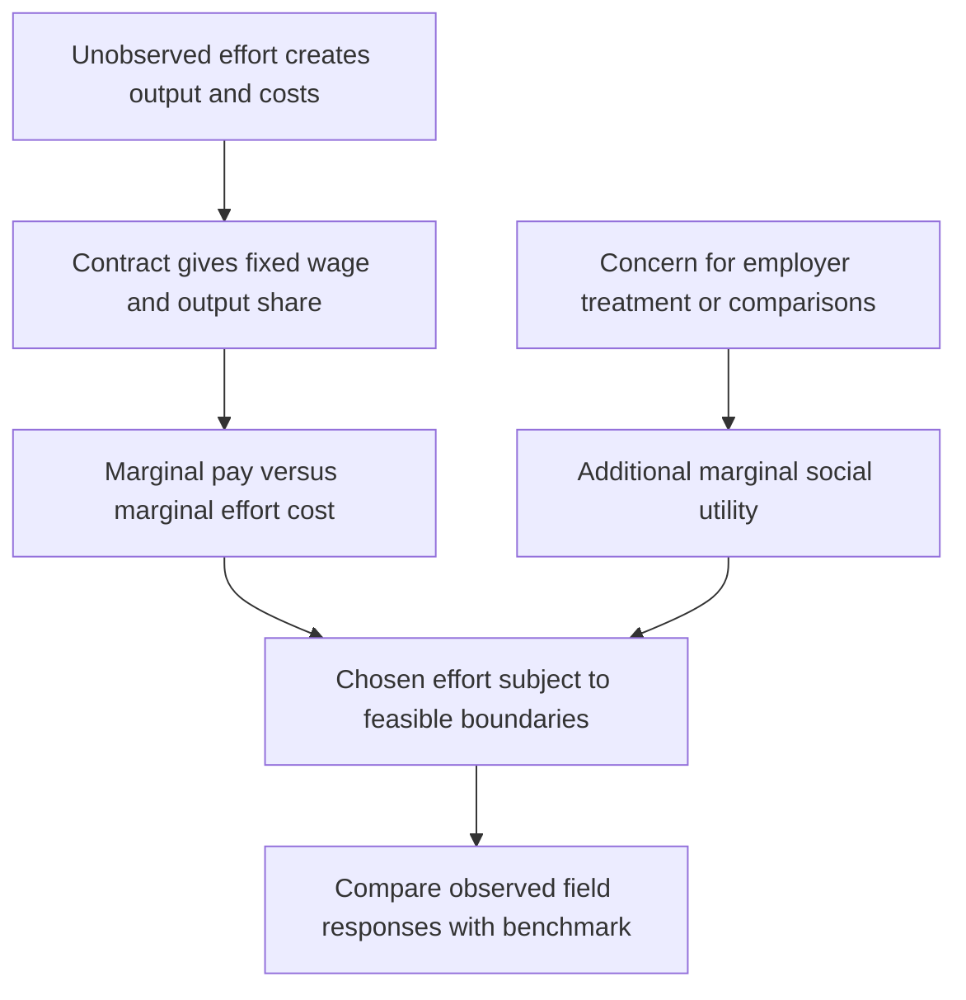

[[01_Notes/2026_2027/Winter_Semester/Behavioral_Economics/Behavioral_Economics_main.md#Week 2|Back to Behavioral Economics — Week 2]]

Source: [[00_Materials/2026_2027/Winter_Semester/Behavioral_Economics/Week_2/L3 BE_SP_field IES 2026.pdf]]

# Effort, contracts and social motivations

Why might a fixed wage change effort even when it does not change the monetary reward for an extra unit of work? The lecture first derives the self-regarding incentive benchmark, then changes the worker's utility. This separates an incentive effect from a social response to the employer or co-workers. [[00_Materials/2026_2027/Winter_Semester/Behavioral_Economics/Week_2/L3 BE_SP_field IES 2026.pdf#page=4|L3 BE_SP_field IES 2026.pdf, physical PDF pp. 4–9]]

The map follows the lecture's model and its transition to field evidence. The core reasoning is marginal: a benefit that changes the level of utility but not its slope with respect to effort need not change effort. [[00_Materials/2026_2027/Winter_Semester/Behavioral_Economics/Week_2/L3 BE_SP_field IES 2026.pdf#page=5|L3 BE_SP_field IES 2026.pdf, physical PDF pp. 5–9]]

## The self-regarding principal-agent benchmark

The principal employs an agent whose effort $e$ is not directly observable. Output is $f(e)+\varepsilon$, with $f'(e)>0$, $f''(e)<0$ and mean-zero noise. Effort costs $d(e)$, where $d'(e)>0$ and $d''(e)>0$. More effort raises expected output at a decreasing rate while its marginal cost rises. The simplified expected-pay contract is

$$y(e)=w+b f(e),$$

where $w$ is fixed pay and $b$ is the worker's output share. In the risk-neutral expected-pay representation, the noise has zero expected monetary contribution. If the actual contract pays on noisy observed output, a risk-averse worker would need a separate treatment of risk; that is outside the displayed benchmark. [[00_Materials/2026_2027/Winter_Semester/Behavioral_Economics/Week_2/L3 BE_SP_field IES 2026.pdf#page=5|L3 BE_SP_field IES 2026.pdf, physical PDF pp. 5–6]]

The selfish worker chooses

$$e^*(w,b)\in\arg\max_e\{w+b f(e)-d(e)\}.$$

At an interior differentiable optimum,

$$b f'(e^*)=d'(e^*).$$

An extra unit of effort produces $f'(e)$ expected output, of which the worker receives $b f'(e)$; the worker compares that reward with $d'(e)$. Fixed pay $w$ vanishes from this derivative. Under the stated concavity/convexity conditions the utility is concave for a nonnegative output share. If effort must be nonnegative, a corner is possible: for $b=0$, utility falls with effort and the optimum is the lowest feasible effort, written $e=0$ in the lecture. The equality condition does not apply at that corner. A higher fixed wage raises the level of selfish utility but supplies no extra marginal monetary reward for effort in this particular model. [[00_Materials/2026_2027/Winter_Semester/Behavioral_Economics/Week_2/L3 BE_SP_field IES 2026.pdf#page=5|L3 BE_SP_field IES 2026.pdf, physical PDF pp. 5–6]]

The principal anticipates the agent's choice and writes

$$\max_{w,b}\{(1-b)f(e^*(w,b))-w\}.$$

This is expected output retained by the principal less fixed pay. The displayed objective does not supply participation constraints, outside options, permissible wages or a full risk-sharing problem, so it should not be used to solve an unrestricted global optimum for $w$. Its role here is to show why the principal cares about the agent's effort response. [[00_Materials/2026_2027/Winter_Semester/Behavioral_Economics/Week_2/L3 BE_SP_field IES 2026.pdf#page=6|L3 BE_SP_field IES 2026.pdf, physical PDF pp. 6]]

## Adding a marginal social motive

The lecture adds a social component,

$$U_i=w+b f(e_i)-d(e_i)+S(e_i),$$

giving the interior condition

$$b f'(e_i)+\frac{\partial S}{\partial e_i}=d'(e_i).$$

The new term measures the utility benefit or cost of how extra effort affects socially valued outcomes. If it is positive, effort can be worthwhile even with little direct marginal pay. This is a conditional model mechanism, not a claim that every gift raises effort. For a fixed wage to change the optimum, it must change a relevant marginal social motive, such as perceived kindness toward the employer, rather than simply add a constant to $S$. [[00_Materials/2026_2027/Winter_Semester/Behavioral_Economics/Week_2/L3 BE_SP_field IES 2026.pdf#page=7|L3 BE_SP_field IES 2026.pdf, physical PDF pp. 7]]

For **altruism**, the slide writes $S_i=\sigma_{ij}U_j(e_i)$ with a positive weight on the other person's utility. If the employer benefits from extra effort, then $\partial S_i/\partial e_i=\sigma_{ij}U_j'(e_i)$ can be positive. If extra effort instead harms a cared-for peer, the same positive concern produces a negative social derivative and can lower effort. For **reciprocity**, kind treatment can make helping the employer attractive, while unkind treatment can reduce that willingness or create a motive to harm. This depends on the treatment and its perceived intentions, not only on final wage levels. [[00_Materials/2026_2027/Winter_Semester/Behavioral_Economics/Week_2/L3 BE_SP_field IES 2026.pdf#page=7|L3 BE_SP_field IES 2026.pdf, physical PDF pp. 7, 9]]

For **inequality aversion**, the source gives the schematic $S_i=\sigma_{ij}|y_i-y_j|$ with $\sigma_{ij}<0$. A payoff gap lowers utility, but the effect on effort depends on how effort changes the two payoffs. The slide's intuition is that a worker with an outcome above the norm may reduce effort, while one below it may increase effort. When own payoff rises with effort and peer payoff is fixed, the absolute gap rises with effort above the peer, so the negative coefficient creates a negative social derivative; below the peer the gap falls with effort, giving a positive social derivative. More generally, the sign depends on how effort changes the payoff gap. That intuition requires a channel from effort into payoffs or socially interpreted contributions. If both own and peer monetary wages are literally fixed and independent of effort, the displayed absolute wage gap is constant: this term alone has zero effort derivative and cannot generate that response. The comparison is also nondifferentiable at equal pay. Treat the formula as a simplified motivation, not a general proof of every relative-pay effect. The Week 1 note gives the fuller payoff-weight distinctions. [[00_Materials/2026_2027/Winter_Semester/Behavioral_Economics/Week_2/L3 BE_SP_field IES 2026.pdf#page=7|L3 BE_SP_field IES 2026.pdf, physical PDF pp. 7]] [[01_Notes/2026_2027/Winter_Semester/Behavioral_Economics/Week_1/Models_of_Social_Preferences.md]]

## Wage rigidity and the gift-exchange hypothesis

The opening supply-demand picture draws a wage above the market-clearing intersection, so labour supplied exceeds labour demanded. The horizontal gap is unemployment in that illustration. It motivates the question of why firms might sustain wages above a competitive benchmark; the drawing does not establish the cause of observed unemployment. Akerlof's gift-exchange idea is that firms offer favourable wages and workers reciprocate with effort above the minimum. Such responses can make high wages privately worthwhile under some conditions. [[00_Materials/2026_2027/Winter_Semester/Behavioral_Economics/Week_2/L3 BE_SP_field IES 2026.pdf#page=2|L3 BE_SP_field IES 2026.pdf, physical PDF pp. 2–3, 9]]

![[01_Notes/2026_2027/Winter_Semester/Behavioral_Economics/assets/Week_2_Wage_Unemployment.png]]

Read the wage, employment and excess-supply gap together. The later field studies test particular wage/effort responses, rather than proving a complete macroeconomic explanation from this stylized graph. The Sli.do prompt on the preceding lecture pages records a question, not observed class poll results. [[00_Materials/2026_2027/Winter_Semester/Behavioral_Economics/Week_2/L3 BE_SP_field IES 2026.pdf#page=2|L3 BE_SP_field IES 2026.pdf, physical PDF pp. 2–4]]

The principal-agent derivation and the distinction between marginal incentives and social motives are core because they generate predictions. The field applications then ask whether those predictions survive real effort, time and context. No slide or these notes establish that any specific derivation will appear in an exam. [[00_Materials/2026_2027/Winter_Semester/Behavioral_Economics/Week_2/L3 BE_SP_field IES 2026.pdf#page=4|L3 BE_SP_field IES 2026.pdf, physical PDF pp. 4–9, 35]]
