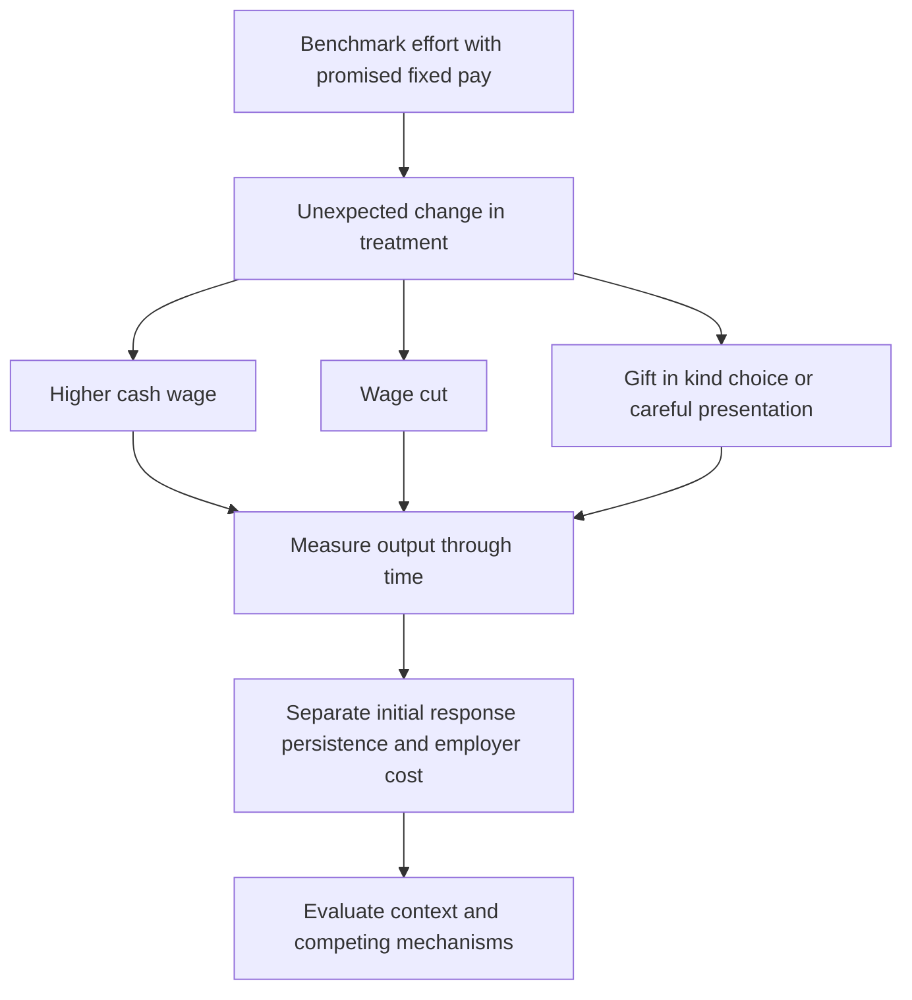

[[01_Notes/2026_2027/Winter_Semester/Behavioral_Economics/Behavioral_Economics_main.md#Week 2|Back to Behavioral Economics — Week 2]]

Source: [[00_Materials/2026_2027/Winter_Semester/Behavioral_Economics/Week_2/L3 BE_SP_field IES 2026.pdf]]

# Gift exchange in labour-market field experiments

Does a wage gift buy sustained additional effort, and does the form of a gift matter? These experiments hold important features of employment fixed while varying pay or presentation. Their comparisons test the social-motivation hypothesis against the fixed-pay selfish benchmark, but the duration and implementation of each treatment remain part of the conclusion. [[00_Materials/2026_2027/Winter_Semester/Behavioral_Economics/Week_2/L3 BE_SP_field IES 2026.pdf#page=9|L3 BE_SP_field IES 2026.pdf, physical PDF pp. 9–24]]

The map organizes the supplied studies around the treatment, time profile and interpretation. A positive early response, a lasting response and a profitable response are three different claims. [[00_Materials/2026_2027/Winter_Semester/Behavioral_Economics/Week_2/L3 BE_SP_field IES 2026.pdf#page=10|L3 BE_SP_field IES 2026.pdf, physical PDF pp. 10–24]]

## Gneezy and List: the response can fade

In the library task, workers were recruited for six hours of entering book records at $12 per hour. The gift group unexpectedly received $20 per hour. Effort was measured as books entered in successive 90-minute intervals, not a hypothetical effort number. The lecture's figure shows a higher first-block output in the gift condition, followed by convergence. Approximate plotted means are about 52 versus 41 books initially and about 40 in each condition in the final interval. Do not read those graphical approximations as individually observed outcomes. [[00_Materials/2026_2027/Winter_Semester/Behavioral_Economics/Week_2/L3 BE_SP_field IES 2026.pdf#page=10|L3 BE_SP_field IES 2026.pdf, physical PDF pp. 10–12]]

![[01_Notes/2026_2027/Winter_Semester/Behavioral_Economics/assets/Week_2_Library_Gift.png]]

In the fundraising task, the announced wage was $10 per hour; after training the gift group was told it would receive $20. The source describes two days of fundraising work and displays the comparison for three-hour blocks before and after lunch. The vertical axis is money **raised for the organization**, rather than the solicitor's own wage. Before lunch the gift group collected about $11 per hour versus $6.4–6.5 in the control; after lunch the amounts were much closer. A common time trend alone would not explain why the treatment difference shrinks: the relevant comparison is the difference between groups in each period. [[00_Materials/2026_2027/Winter_Semester/Behavioral_Economics/Week_2/L3 BE_SP_field IES 2026.pdf#page=13|L3 BE_SP_field IES 2026.pdf, physical PDF pp. 13–14]]

![[01_Notes/2026_2027/Winter_Semester/Behavioral_Economics/assets/Week_2_Fundraising_Gift.png]]

The lecture discusses an initially emotional response and subsequent adaptation of the wage reference point as possible explanations. The time pattern itself does not uniquely distinguish those psychological mechanisms. The authors conclude that the wage gifts did not maximize employer returns in these settings: the output gain was too limited relative to the higher wage bill. This does not imply that reciprocity never exists or that every employer should pay the lowest feasible wage. [[00_Materials/2026_2027/Winter_Semester/Behavioral_Economics/Week_2/L3 BE_SP_field IES 2026.pdf#page=15|L3 BE_SP_field IES 2026.pdf, physical PDF pp. 15]]

**Primary-source check:** Gneezy and List (2006), *Econometrica* 74(5), 1365–1384, author PDF §§2–3, physical pp. 3–8, verifies the announced/surprise wages, six-hour library task, measured outcomes and fading difference. Its detailed book means are 51.7/44.9/41.7/40.3 for gift and 40.7/40.5/41.2/39.6 for control. The brief one-time employment design was chosen partly to limit future-employment incentives. This is a bounded verification of the lecture examples, not ingestion of the full paper. [Consulted author PDF](https://rady.ucsd.edu/_files/faculty-research/uri-gneezy/behavioral-economics.pdf).

## Kube, Maréchal and Puppe: positive and negative responses differ

The lecture's 2006 working-paper example recruits workers for a six-hour book-record task at €15 per hour. The control receives €15, a kind treatment €20 and an unkind treatment €10. The lower wage is a **wage cut**, not a dismissal or a cut in the number of workers. The figure plots average books entered over time. The wage-cut group remains well below control throughout the task; the wage-gift group's advantage is smaller and less decisive. A negative wage surprise can therefore have a more persistent effect than an equivalent positive surprise in this setting. [[00_Materials/2026_2027/Winter_Semester/Behavioral_Economics/Week_2/L3 BE_SP_field IES 2026.pdf#page=16|L3 BE_SP_field IES 2026.pdf, physical PDF pp. 16–18]]

![[01_Notes/2026_2027/Winter_Semester/Behavioral_Economics/assets/Week_2_Wage_Cuts.png]]

The intended comparison is kind/control/unkind treatment with effort otherwise measured in the same units. “The effects are asymmetric” does not mean their magnitudes must be equal with opposite signs, nor does the graph identify a universal wage-cut elasticity. The source's Sli.do prediction prompt supplies no class response data. [[00_Materials/2026_2027/Winter_Semester/Behavioral_Economics/Week_2/L3 BE_SP_field IES 2026.pdf#page=17|L3 BE_SP_field IES 2026.pdf, physical PDF pp. 17–18]]

## The currency of reciprocity: money and a thermos bottle

The lecture next uses Kube, Maréchal and Puppe (2011). Workers enter library records at a fixed wage of €12 per hour. A surprise monetary gift of €7 costs roughly 20% of baseline task pay (€12 × 3 hours = €36, so €7/€36 ≈ 19.4%; post-gift pay is €43); the alternative is a thermos bottle worth €7. There is no prospect of repeat employment, and output quantity and quality are tracked. Equal employer expenditure permits a comparison of the **form** of the gift, rather than a simple comparison of a large and a small gift. [[00_Materials/2026_2027/Winter_Semester/Behavioral_Economics/Week_2/L3 BE_SP_field IES 2026.pdf#page=19|L3 BE_SP_field IES 2026.pdf, physical PDF pp. 19–20]]

The cash treatment gives only a small, statistically undetected gain relative to baseline; the bottle treatment has a much larger gain. The graph measures characters entered per 30-minute interval. In the primary 2011 manuscript, the reported average bottle gain is about 25%. A price-tag treatment tells recipients the bottle's €7 value and still produces substantial effort, weakening the explanation that the effect arises solely because workers overestimate the price. This control does not remove every possible difference in perceived kindness, attention or beliefs. [[00_Materials/2026_2027/Winter_Semester/Behavioral_Economics/Week_2/L3 BE_SP_field IES 2026.pdf#page=20|L3 BE_SP_field IES 2026.pdf, physical PDF pp. 20–21]]

![[01_Notes/2026_2027/Winter_Semester/Behavioral_Economics/assets/Week_2_Gift_Form.png]]

Perhaps workers simply like the bottle more? In the choice treatment, around 80% choose cash rather than the bottle, yet work effort remains comparable to the bottle condition. Preference for receiving money and effort in response to a considerate offer are different outcomes. This undermines a simple story that the bottle works only because recipients value its consumption more than €7. [[00_Materials/2026_2027/Winter_Semester/Behavioral_Economics/Week_2/L3 BE_SP_field IES 2026.pdf#page=22|L3 BE_SP_field IES 2026.pdf, physical PDF pp. 22]]

![[01_Notes/2026_2027/Winter_Semester/Behavioral_Economics/assets/Week_2_Gift_Choice.png]]

The origami treatment folds a €5 note into a shirt and adds a €2 coin with a smiley. The worker still receives €7, but presentation visibly takes time and care. The source reports approximately 30% higher effort than baseline. Together with the choice and price-tag controls, this supports the importance of the gift's social meaning and perceived thoughtfulness. It does not uniquely identify a complete psychological mechanism or establish that elaborate gifts always outperform cash. Physical p. 24 repeats the origami photograph/presentation while stating the lesson; both presentations are accounted for by the same explanation. [[00_Materials/2026_2027/Winter_Semester/Behavioral_Economics/Week_2/L3 BE_SP_field IES 2026.pdf#page=23|L3 BE_SP_field IES 2026.pdf, physical PDF pp. 23–24]]

![[01_Notes/2026_2027/Winter_Semester/Behavioral_Economics/assets/Week_2_Origami_Gift.png]]

**Version check:** the consulted [KIT 2011 working paper](https://publikationen.bibliothek.kit.edu/1000022999/1819054), title page and methods/results on printed pp. 5–18, contains the choice and origami treatments and the roughly 25%/30% results. The same title also circulated in a January 2010 author PDF, with different treatments/results; its 92.4% cash-choice figure and 30% bottle estimate should not replace the lecture's 2011 comparison. The published article is *American Economic Review* 102(4), 1644–1662 (2012); the lecture's 2011 date refers to its working-paper version.

## What the comparisons establish

The fixed-pay model supplies a benchmark of no marginal monetary reason to work harder. Unexpected treatment changes can nevertheless alter real effort. The empirical questions then become **which treatment**, **for how long**, **with what cost**, and **under what interpretation**. The studies are core applications because their controls help separate a marginal incentive from reciprocity, relative valuation and presentation; they do not allow a single universal estimate of gift exchange. [[00_Materials/2026_2027/Winter_Semester/Behavioral_Economics/Week_2/L3 BE_SP_field IES 2026.pdf#page=15|L3 BE_SP_field IES 2026.pdf, physical PDF pp. 15, 18–24, 35]]
