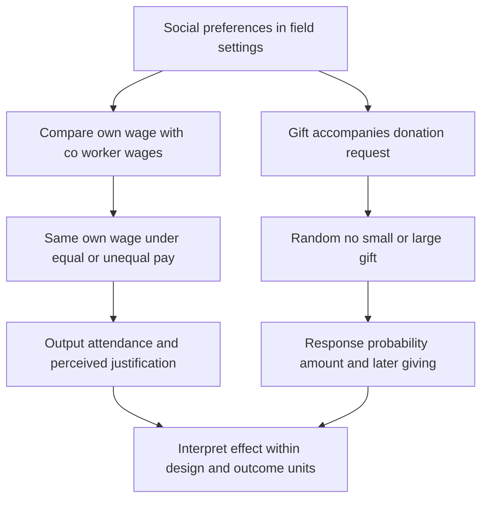

[[01_Notes/2026_2027/Winter_Semester/Behavioral_Economics/Behavioral_Economics_main.md#Week 2|Back to Behavioral Economics — Week 2]]

Source: [[00_Materials/2026_2027/Winter_Semester/Behavioral_Economics/Week_2/L3 BE_SP_field IES 2026.pdf]]

# Relative pay and charitable gift exchange

Social preferences can make the treatment of co-workers or donors relevant even when own monetary pay is fixed. The lecture combines a workplace comparison experiment with a fundraising experiment. Their common logic is to vary a socially meaningful feature while keeping a useful monetary benchmark clear. [[00_Materials/2026_2027/Winter_Semester/Behavioral_Economics/Week_2/L3 BE_SP_field IES 2026.pdf#page=25|L3 BE_SP_field IES 2026.pdf, physical PDF pp. 25–35]]

This map places the comparison group and outcome denominator before the substantive conclusion. It follows the two supplied applications and prevents treating attendance, donation frequency and donation amounts as interchangeable. [[00_Materials/2026_2027/Winter_Semester/Behavioral_Economics/Week_2/L3 BE_SP_field IES 2026.pdf#page=26|L3 BE_SP_field IES 2026.pdf, physical PDF pp. 26–34]]

## Relative wages with own wage held fixed

Breza, Kaur and Shamdasani's Indian field experiment organizes workers into teams whose members make the same product in proximity, while production remains individual. Teams are assigned either a flat common daily wage or different wages linked to baseline productivity rank. Comparisons across treatments can hold a worker's **own absolute wage** fixed while changing what co-workers receive. Without this comparison, a low-paid worker's lower effort could simply reflect lower own pay rather than relative-pay concerns. [[00_Materials/2026_2027/Winter_Semester/Behavioral_Economics/Week_2/L3 BE_SP_field IES 2026.pdf#page=26|L3 BE_SP_field IES 2026.pdf, physical PDF pp. 26]]

The lecture reports that workers paid less than peers reduce output by **12%** and are **13% less likely to come to work**, while higher relative pay produces no detected effort increase. These are the lecture's reported percentages, not an instruction to relabel the attendance change as 13 percentage points. Nor does “no detected increase” prove an exactly zero effect for every worker. The Sli.do page asks for a prediction but shows no poll results. [[00_Materials/2026_2027/Winter_Semester/Behavioral_Economics/Week_2/L3 BE_SP_field IES 2026.pdf#page=27|L3 BE_SP_field IES 2026.pdf, physical PDF pp. 27–28]]

Perceived justification matters: when the pay gap is clearly supported by observed baseline productivity differences, the negative effect is not detected. The simple fact of unequal pay therefore does not fully determine the response; information about why pay differs changes the interpretation. The source concludes that inequality was bad for the firm in the studied comparison. Treat that as an application-specific result, not a general theorem that every wage difference reduces output. [[00_Materials/2026_2027/Winter_Semester/Behavioral_Economics/Week_2/L3 BE_SP_field IES 2026.pdf#page=28|L3 BE_SP_field IES 2026.pdf, physical PDF pp. 28]]

The lesson links to inequality aversion and fairness perceptions, but the design does not identify one utility function merely from a negative response. A preference for equality, resentment about unjustified treatment and beliefs about management can generate overlapping predictions. The model note also explains why a utility penalty on an entirely effort-independent fixed wage gap cannot mechanically derive every effort effect without an additional channel. [[00_Materials/2026_2027/Winter_Semester/Behavioral_Economics/Week_2/L3 BE_SP_field IES 2026.pdf#page=7|L3 BE_SP_field IES 2026.pdf, physical PDF pp. 7, 26–28]] [[01_Notes/2026_2027/Winter_Semester/Behavioral_Economics/Week_2/Effort_Contracts_and_Social_Motivations.md#Adding a marginal social motive]]

## Falk: a gift before the donation decision

Falk's 2007 field experiment sends roughly 10,000 letters for an education charity supporting schools in Bangladesh, addressed to potential donors in Switzerland. The randomized treatments contain no gift, one postcard, or four postcards. The postcards are illustrated with a child's drawing; the drawing is part of the gift treatment, not evidence about an individual donor's circumstances. [[00_Materials/2026_2027/Winter_Semester/Behavioral_Economics/Week_2/L3 BE_SP_field IES 2026.pdf#page=29|L3 BE_SP_field IES 2026.pdf, physical PDF pp. 29–31]]

The theory comparison assumes that the solicitation and recipient's information are otherwise comparable. Pure selfishness without another benefit predicts no donation. Simple altruism about the charity's work alone need not respond to gift size if relevant information and beliefs remain fixed. Reciprocity predicts a stronger response to a larger kind gesture. These predictions depend on the maintained assumptions: gifts might also affect attention, beliefs, warm glow or perceived solicitation costs, so a response gradient is consistent with reciprocity rather than a unique proof of it. [[00_Materials/2026_2027/Winter_Semester/Behavioral_Economics/Week_2/L3 BE_SP_field IES 2026.pdf#page=30|L3 BE_SP_field IES 2026.pdf, physical PDF pp. 30]]

| Treatment | Letters | Donations | Rounded donation frequency |
|---|---:|---:|---:|
| No gift | 3,262 | 397 | 0.12 |
| Small gift | 3,237 | 465 | 0.14 |
| Large gift | 3,347 | 691 | 0.21 |

These source counts sum to **9,846 letters**, explaining why “roughly 10,000” is an approximation. The frequency denominator is all letters in that treatment. A movement from 0.12 to 0.21 is about 9 percentage points, whereas its relative increase using those rounded numbers is about 75%; the two descriptions have different units. Exact ratios calculated from the raw counts need not equal ratios of the rounded displayed frequencies. [[00_Materials/2026_2027/Winter_Semester/Behavioral_Economics/Week_2/L3 BE_SP_field IES 2026.pdf#page=32|L3 BE_SP_field IES 2026.pdf, physical PDF pp. 32]]

![[01_Notes/2026_2027/Winter_Semester/Behavioral_Economics/assets/Week_2_Donation_Frequency.png]]

The next histogram shows the distribution of **positive donation amounts**, conditional on giving. It uses a different denominator from the frequency table. A treatment can change how many recipients donate, the amounts donors give, or both. The conditional histogram alone cannot establish the change in average revenue per mailed letter. [[00_Materials/2026_2027/Winter_Semester/Behavioral_Economics/Week_2/L3 BE_SP_field IES 2026.pdf#page=33|L3 BE_SP_field IES 2026.pdf, physical PDF pp. 33]]

![[01_Notes/2026_2027/Winter_Semester/Behavioral_Economics/assets/Week_2_Conditional_Donations.png]]

## Timing and the revenue denominator

The source reports these CHF totals and Christmas means:

| Outcome | No gift | Small gift | Large gift |
|---|---:|---:|---:|
| Christmas 2001 total | 24,673 | 27,106 | 40,877 |
| Christmas mean per letter | 7.56 | 8.37 | 12.21 |
| February 2002 total | 14,023 | 13,206 | 13,165 |
| Combined total | 38,696 | 40,312 | 54,042 |

For example, 24,673/3,262 is about CHF7.56, so the mean is per letter, including recipients who gave nothing, rather than per positive donor. The slide footnote retains donations of at most CHF500 (approximately €350). The February totals are lower in the gift groups than in control, suggesting that timing or substitution must be considered; combined totals still remain higher for the large gift group. Revenue is not net profit: postcard, postage and other treatment costs are not supplied here, so these totals do not establish net returns. [[00_Materials/2026_2027/Winter_Semester/Behavioral_Economics/Week_2/L3 BE_SP_field IES 2026.pdf#page=34|L3 BE_SP_field IES 2026.pdf, physical PDF pp. 34]]

![[01_Notes/2026_2027/Winter_Semester/Behavioral_Economics/assets/Week_2_Donation_Followup.png]]

**Bounded verification:** the [publisher abstract for Falk 2007](https://doi.org/10.1111/j.1468-0262.2007.00800.x), *Econometrica* 75(5), 1501–1511, confirms random assignment, approximately 10,000 letters, and the reported 17%/75% relative increases in giving frequency for small/large gifts. Full external paper access was not required for the lecture's reproduced tables and is not claimed here.

Relative pay and charitable gifts are core applications because they test social motivations outside anonymous laboratory games. The important skill is to reconstruct the comparison, prediction, outcome and limitation. The lecture's final summary reports social preferences as relevant in labour and donor contexts; it does not turn each empirical percentage into a universal behavioural constant. [[00_Materials/2026_2027/Winter_Semester/Behavioral_Economics/Week_2/L3 BE_SP_field IES 2026.pdf#page=35|L3 BE_SP_field IES 2026.pdf, physical PDF pp. 35]]
