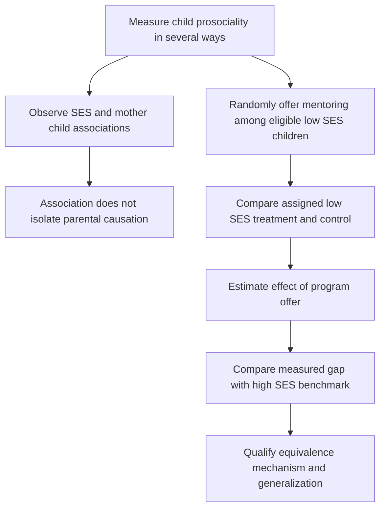

[[01_Notes/2026_2027/Winter_Semester/Behavioral_Economics/Behavioral_Economics_main.md#Week 3|Back to Behavioral Economics — Week 3]]

Source: [[00_Materials/2026_2027/Winter_Semester/Behavioral_Economics/Week_3/L4 BE_formation IES 2026.pdf]]

# Social environment and mentoring

Can a policy change measured social preferences, rather than simply predict which children differ? The lecture combines background correlations with a randomized mentoring intervention. Keeping those comparisons separate is essential: a treatment can identify the effect of an offered program without proving that all background differences are caused by one family characteristic. [[00_Materials/2026_2027/Winter_Semester/Behavioral_Economics/Week_3/L4 BE_formation IES 2026.pdf#page=17|L4 BE_formation IES 2026.pdf, physical PDF pp. 17–23]]

The map follows the supplied experiment and distinguishes the descriptive and causal routes. Random assignment applies within the eligible low-SES sample; it does not randomly assign socioeconomic status (SES). [[00_Materials/2026_2027/Winter_Semester/Behavioral_Economics/Week_3/L4 BE_formation IES 2026.pdf#page=18|L4 BE_formation IES 2026.pdf, physical PDF pp. 18–23]]

## The intervention and comparison groups

The lecture attributes the study to Kosse et al. (2020). Primary-school children in Germany are offered a one-year mentoring program: mentors, typically university students, meet children weekly for activities such as museums, the zoo, playgrounds, reading, cooking or conversation. The program enriches social interactions and introduces a potential prosocial role model. The three displayed groups are low-SES treatment, low-SES control and high-SES control. [[00_Materials/2026_2027/Winter_Semester/Behavioral_Economics/Week_3/L4 BE_formation IES 2026.pdf#page=18|L4 BE_formation IES 2026.pdf, physical PDF pp. 18]]

**Bounded design verification:** the [authors' May 2018 HCEO working paper](https://humcap.uchicago.edu/RePEc/hka/wpaper/Kosse_Deckers_Pinger_etal_2018_formation-prosociality_revised.pdf), §2.1 and §3.4, physical pp. 7–9 and 25–26, verifies stratified random offers among eligible interested low-SES families in Bonn/Cologne. Not everyone assigned obtained or completed mentoring, so the primary comparison is an **intention-to-treat effect of the offer**, rather than the effect of successful participation for every child. High-SES families form a benchmark, not a randomly assigned SES treatment. The later publication is *Journal of Political Economy* 128(2), 434–467 (2020); the lecture's final 2018 citation refers to a working-paper version of this research.

This distinction matters for policy interpretation. The offered treatment includes implementation constraints such as mentor availability. Comparing participants selected by successful matching could lose the protection of random assignment; comparing all assigned groups keeps the offer-based causal question clear. Source slides alone do not supply the compliance details, so this paragraph labels their bounded verification explicitly. [[00_Materials/2026_2027/Winter_Semester/Behavioral_Economics/Week_3/L4 BE_formation IES 2026.pdf#page=18|L4 BE_formation IES 2026.pdf, physical PDF pp. 18, 21]]

## What “prosociality” measures

The lecture uses three facets: **altruism**, measured through incentivized dictator allocations; **trust**, measured with three survey statements about whether other people can be trusted, have good intentions and can be relied on even when not known well; and **other-regarding behaviour**, rated by the mother in an everyday-behaviour questionnaire. An incentivized allocation, a stated belief and an observer report measure related but distinct things. Trust is not inferred solely from the amount donated in a dictator game. [[00_Materials/2026_2027/Winter_Semester/Behavioral_Economics/Week_3/L4 BE_formation IES 2026.pdf#page=19|L4 BE_formation IES 2026.pdf, physical PDF pp. 19]]

The main figure uses an equally weighted index of standardized altruism, trust and other-regarding measures. A standardized score measures position relative to its reference distribution in standard-deviation units, rather than a number of sweets or euros. Combining measures can reduce dependence on one noisy elicitation, but it does not make the three measures identical. Error bars in the supplied charts are standard errors of group means; significance markers refer to stated comparisons, not a test of every bar against zero. [[00_Materials/2026_2027/Winter_Semester/Behavioral_Economics/Week_3/L4 BE_formation IES 2026.pdf#page=20|L4 BE_formation IES 2026.pdf, physical PDF pp. 20–22]]

## Background correlations

The first graph shows a higher average child-prosociality index in the high-SES control group than in the low-SES control group. Its second panel shows higher child scores when maternal prosociality is above its median than below. The supplied caption marks the SES contrast at the 5% level and the maternal-prosociality contrast at 1%; the stated sample sizes are 424 and 410, with the latter difference attributed to incomplete mother questionnaires. [[00_Materials/2026_2027/Winter_Semester/Behavioral_Economics/Week_3/L4 BE_formation IES 2026.pdf#page=20|L4 BE_formation IES 2026.pdf, physical PDF pp. 20]]

![[01_Notes/2026_2027/Winter_Semester/Behavioral_Economics/assets/Week_3_Background_Associations.png]]

These are associations. They do not distinguish inherited influences, shared environment, parenting, selection, reporting differences or other correlated inputs. The slide's “transmission” language should therefore not be read as a causal estimate of maternal preferences or SES. The differences are group averages, not a characterization of every child or household in either group. [[00_Materials/2026_2027/Winter_Semester/Behavioral_Economics/Week_3/L4 BE_formation IES 2026.pdf#page=20|L4 BE_formation IES 2026.pdf, physical PDF pp. 20, 23]]

## The offer changes measured outcomes

The intervention chart shows higher prosociality among low-SES children assigned treatment than among low-SES controls, marked at the 1% level. It reports no statistically significant difference between treated low-SES children and the high-SES control benchmark. The lecture calls this closing the measured gap: the low-SES treatment mean moves toward that benchmark. A nonsignificant difference does **not** prove exact equality or a formal equivalence margin. The causal comparison is treatment versus control within the randomized eligible sample; the cross-SES comparison describes the resulting gap. [[00_Materials/2026_2027/Winter_Semester/Behavioral_Economics/Week_3/L4 BE_formation IES 2026.pdf#page=21|L4 BE_formation IES 2026.pdf, physical PDF pp. 21]]

![[01_Notes/2026_2027/Winter_Semester/Behavioral_Economics/assets/Week_3_Mentoring_Treatment.png]]

The component graphs show higher treatment means for altruism, trust and mother-rated other-regarding behaviour. The first two contrasts have 5% significance markers; the third has no significance star. Thus the slide's broad “robust across multiple measures” statement means directionally supportive component patterns, not three separately confirmed significant effects. A positive but imprecisely estimated component is not evidence of an exactly zero effect, either. Caption sample sizes differ because of missing answers or failed control questions. [[00_Materials/2026_2027/Winter_Semester/Behavioral_Economics/Week_3/L4 BE_formation IES 2026.pdf#page=22|L4 BE_formation IES 2026.pdf, physical PDF pp. 22]]

![[01_Notes/2026_2027/Winter_Semester/Behavioral_Economics/assets/Week_3_Mentoring_Measures.png]]

## Mechanism and policy limits

The lecture proposes that children imitate and internalize behaviour from parents and social role models. The working paper's abstract and §3.3 report a mediation analysis supporting prosocial attachment figures and intensive social interaction. This is a proposed interpretation with additional assumptions; randomizing the whole mentoring offer does not separately randomize every mechanism. The intervention's causal effect is stronger evidence than the background correlations, but it does not prove that role-model imitation is the only channel. [[00_Materials/2026_2027/Winter_Semester/Behavioral_Economics/Week_3/L4 BE_formation IES 2026.pdf#page=18|L4 BE_formation IES 2026.pdf, physical PDF pp. 18, 23]]

The evidence shows that measured prosociality can respond to social environment during childhood. It does not establish that genes are irrelevant, that all socioeconomic differences are environmental, or that this intervention works equally for all ages, countries or outcomes. Its economic relevance is that prosocial behaviour can influence cooperation and other interactions, making the formation of preferences and possible remedial policies worth studying. The closing “why should economists care?” prompt invites that connection; it supplies no observed learner answer. [[00_Materials/2026_2027/Winter_Semester/Behavioral_Economics/Week_3/L4 BE_formation IES 2026.pdf#page=23|L4 BE_formation IES 2026.pdf, physical PDF pp. 23]]

Experimental comparisons, outcome measurement and causal interpretation are core foundations. The particular program, demographic groups and chart values are applications through which to learn that reasoning, with no unsupported claim about exact exam coverage. [[00_Materials/2026_2027/Winter_Semester/Behavioral_Economics/Week_3/L4 BE_formation IES 2026.pdf#page=18|L4 BE_formation IES 2026.pdf, physical PDF pp. 18–23]]
