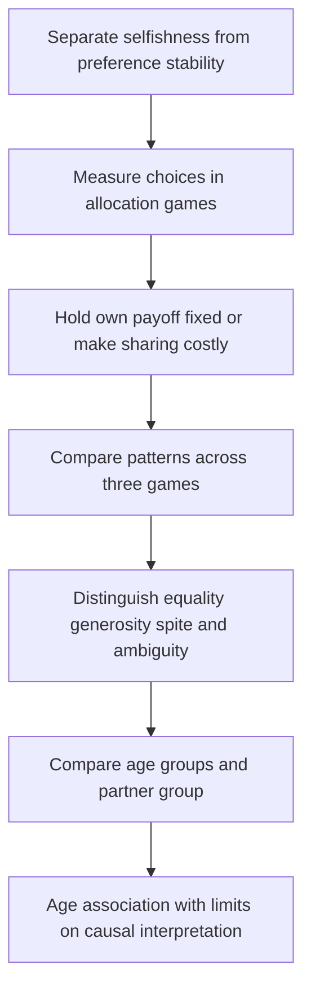

[[01_Notes/2026_2027/Winter_Semester/Behavioral_Economics/Behavioral_Economics_main.md#Week 3|Back to Behavioral Economics — Week 3]]

Source: [[00_Materials/2026_2027/Winter_Semester/Behavioral_Economics/Week_3/L4 BE_formation IES 2026.pdf]]

# Social preferences in childhood

Are preferences fixed traits, or can social experience shape them? This is separate from asking whether preferences are selfish: stable preferences could be other-regarding, and changing preferences could remain selfish. The lecture contrasts a traditional stability assumption, illustrated by Stigler and Becker (1977, p. 76), with a social-environment view attributed to Peter Hedström. Those positions motivate empirical questions rather than establish either answer by assertion. [[00_Materials/2026_2027/Winter_Semester/Behavioral_Economics/Week_3/L4 BE_formation IES 2026.pdf#page=1|L4 BE_formation IES 2026.pdf, physical PDF pp. 1–4]]

The map follows the framing, experimental design and results. The core foundation is to derive what each payoff comparison identifies before attaching a preference label to a child. [[00_Materials/2026_2027/Winter_Semester/Behavioral_Economics/Week_3/L4 BE_formation IES 2026.pdf#page=2|L4 BE_formation IES 2026.pdf, physical PDF pp. 2–16]]

## Three games distinguish different motives

Fehr, Bernhard and Rockenbach (2008) use anonymous, one-shot allocations of sweets between a child and another child. The lecture describes approximately 250 Swiss children aged 3–8; the consulted Nature paper reports **229 analysed children**, so the lecture's count is approximate rather than an exact sample size. Partners are either classmates from the same school/kindergarten (ingroup) or unknown children from another one (outgroup). The photo shows allocation cards and the group-photo cue identifying partner status; the child does not bargain face to face with the partner. [[00_Materials/2026_2027/Winter_Semester/Behavioral_Economics/Week_3/L4 BE_formation IES 2026.pdf#page=6|L4 BE_formation IES 2026.pdf, physical PDF pp. 6–7]]

![[01_Notes/2026_2027/Winter_Semester/Behavioral_Economics/assets/Week_3_Allocation_Setup.png]]

Write a payoff as (own sweets, partner's sweets). The source's tasks are:

| Game | Available allocations | What changes? |
|---|---|---|
| Costless prosocial/sharing | (1,1) or (1,0) | Own sweets stay fixed; helping the partner also removes advantageous inequality. |
| Costless envy | (1,1) or (1,2) | Own sweets stay fixed; equality conflicts with increasing the partner's payoff. |
| Costly sharing | (1,1) or (2,0) | Equality and helping the partner require sacrificing one own sweet. |

A purely selfish child is **indifferent** between the two options in the first two games because own payoff is one in either case; selfishness does not strictly predict one tied option. In costly sharing, selfishness strictly predicts (2,0). A strongly egalitarian child selects equality in all three; a sufficiently altruistic child selects the higher partner payoff, including accepting a cost to share. Spite instead favours reducing the other's payoff. Strength matters when own payoff must be sacrificed. [[00_Materials/2026_2027/Winter_Semester/Behavioral_Economics/Week_3/L4 BE_formation IES 2026.pdf#page=6|L4 BE_formation IES 2026.pdf, physical PDF pp. 6, 8–13]]

## Read the whole choice pattern

The source table exhausts the eight combinations of two choices in three games:

| Source classification | Prosocial game | Envy game | Sharing game |
|---|---|---|---|
| Strongly egalitarian | (1,1) | (1,1) | (1,1) |
| Weakly egalitarian | (1,1) | (1,1) | (2,0) |
| Strongly generous | (1,1) | (1,2) | (1,1) |
| Weakly generous | (1,1) | (1,2) | (2,0) |
| Ambiguous type | (1,0) | (1,1) | (1,1) |
| Spiteful | (1,0) | (1,1) | (2,0) |
| Ambiguous type | (1,0) | (1,2) | (1,1) |
| Ambiguous type | (1,0) | (1,2) | (2,0) |

These are the source's behavioural classifications, not infallible personality diagnoses. Because the selfish benchmark permits either costless choice, a child choosing (2,0) in sharing could also produce several of these costless patterns without a strict selfish preference among them. One cannot identify a unique utility function from one tied choice. Consistency, understanding, context and measurement also matter. The four Sli.do pages ask students to predict inequality-averse, altruistic, spiteful and selfish choices; no poll results are supplied, so the reasoning above supplies model predictions rather than invented class responses. [[00_Materials/2026_2027/Winter_Semester/Behavioral_Economics/Week_3/L4 BE_formation IES 2026.pdf#page=8|L4 BE_formation IES 2026.pdf, physical PDF pp. 8–13]]

![[01_Notes/2026_2027/Winter_Semester/Behavioral_Economics/assets/Week_3_Preference_Types.png]]

## The age comparison is conditional on the partner group

The lecture's repeated age figure concerns **ingroup** partners. The proportion making the egalitarian choice in costly sharing rises from about 9% at ages 3–4 to about 22% at 5–6 and 45% at 7–8. The costless prosocial and envy choices reach roughly 78% and 80% at 7–8. These graphical readings show why the lecture describes young children as mostly selfish and older children as more egalitarian, but the costless-game ties mean that label should not be treated as direct proof of a unique motive for every young child. Even among the oldest group, fewer than half choose costly equality. [[00_Materials/2026_2027/Winter_Semester/Behavioral_Economics/Week_3/L4 BE_formation IES 2026.pdf#page=14|L4 BE_formation IES 2026.pdf, physical PDF pp. 14–15]]

![[01_Notes/2026_2027/Winter_Semester/Behavioral_Economics/assets/Week_3_Age_Choices.png]]

This is a **cross-sectional age comparison**, not a panel following the same children as they grow. It supports an age-related pattern, not a causal estimate of ageing or a particular upbringing. Its ingroup caption also prevents generalizing the displayed percentages to unknown outgroup children. The lecture's statement that later development includes efficiency concerns and altruism is attributed only to unspecified “different studies”; no unprovided later-age evidence or effect size is certified here. [[00_Materials/2026_2027/Winter_Semester/Behavioral_Economics/Week_3/L4 BE_formation IES 2026.pdf#page=14|L4 BE_formation IES 2026.pdf, physical PDF pp. 14–16]]

**Bounded primary check:** Fehr, Bernhard and Rockenbach, “Egalitarianism in young children,” *Nature* 454 (2008), 1079–1083, [publisher proof](https://www.nature.com/news/2008/080827/pdf/nature07155_proof2.pdf), physical pp. 1–2 and methods on p. 6, verifies the three tasks, sample count, anonymous one-shot design and ingroup interpretation. The proof distinguishes costless choices from costly sharing; numerical source figures remain tied to their displayed partner condition. This is supporting verification, not ingestion of the paper's entire additional outgroup analysis.

The next question is whether family background is merely associated with preferences or whether changing a child's social environment can alter measured prosociality. Distinguishing those two claims is the foundation of the mentoring application. [[00_Materials/2026_2027/Winter_Semester/Behavioral_Economics/Week_3/L4 BE_formation IES 2026.pdf#page=16|L4 BE_formation IES 2026.pdf, physical PDF pp. 16–18]] [[01_Notes/2026_2027/Winter_Semester/Behavioral_Economics/Week_3/Social_Environment_and_Mentoring.md]]
