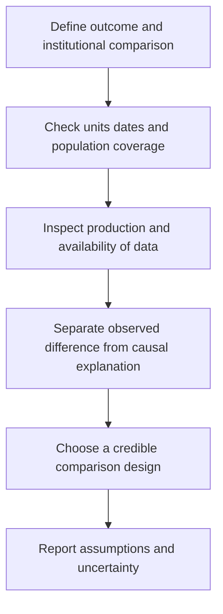

# Comparability, data reliability and reading questions

Source: [[00_Materials/2026_2027/Winter_Semester/Comparative_Economics/Week_2/Week II - lecture - large slides.pdf]]
Source: [[00_Materials/2026_2027/Winter_Semester/Comparative_Economics/Week_3/Week III - lecture - large slides.pdf]]

- [[#Measurement can change what a comparison means|Measurement can change what a comparison means]]
- [[#Source chronology and the first summary|Source chronology and the first summary]]
- [[#Acemoglu–Robinson reading questions and answer routes|Acemoglu–Robinson reading questions and answer routes]]
- [[#Earlier lecture questions and the boundary of supplied readings|Earlier lecture questions and the boundary of supplied readings]]
- [[#What the source leads add to the map|What the source leads add to the map]]

Comparative economics asks positive questions about how institutions and economic systems work. Meaningful comparisons need a defined outcome, credible units and a defensible counterfactual; a large difference alone does not establish its cause. Countries supply a limited and heterogeneous sample, and qualitative features such as informal institutions are difficult to compress into comparable numbers. [[00_Materials/2026_2027/Winter_Semester/Comparative_Economics/Week_2/Week II - lecture - large slides.pdf#page=6|Week II lecture, physical PDF pp. 6–7]]

The data checks are a necessary foundation for the synthetic-control case and institutional narratives. They do not imply that every official statistic is false or every alternative proxy is superior. [[00_Materials/2026_2027/Winter_Semester/Comparative_Economics/Week_2/Week II - lecture - large slides.pdf#page=6|Week II lecture, physical PDF pp. 6–15]]

## Measurement can change what a comparison means

A series can change over time because the economy changes, because its definition changes, or because collection/reporting changes. Cross-country differences can likewise mix true differences with measurement conventions. Record the unit, price basis, coverage, reference date and missing observations before explaining a gap. Political pressure, censorship, self-censorship and incentives within statistical agencies can affect data production and availability. That motivates scrutiny of the specific measurement process, rather than a blanket rejection based on the country’s political label. [[00_Materials/2026_2027/Winter_Semester/Comparative_Economics/Week_2/Week II - lecture - large slides.pdf#page=6|Week II lecture, physical PDF pp. 6–10]]

The lecture reports Li Keqiang’s older skepticism about Chinese GDP and his interest in electricity, rail freight and loans as alternative activity indicators. Such indicators can triangulate an official series but each measures a particular part of the economy; a shift toward services can weaken a historical proxy relationship. Its Chen et al. (2019) graph places the **official provincial GDP growth rate** on the horizontal axis and the researchers’ **adjusted provincial GDP growth rate** on the vertical, both in **percent**, with a 45-degree equality line. Circle size separately represents the relative size of provincial GDP. Points below the line indicate adjusted **growth** below officially reported growth, not a direct estimate of the GDP-level gap. The chart is not a newly audited correction of current national GDP. [[00_Materials/2026_2027/Winter_Semester/Comparative_Economics/Week_2/Week II - lecture - large slides.pdf#page=8|Week II lecture, physical PDF pp. 8–9]]

![[01_Notes/2026_2027/Winter_Semester/Comparative_Economics/assets/Week_2_Provincial_GDP.png]]

The axes compare **growth rates in percent**; the vertical discrepancy at a given official growth rate is a difference in **percentage points**. Circle size represents relative provincial GDP level. Growth-rate differences and relative economic size are distinct information. [[00_Materials/2026_2027/Winter_Semester/Comparative_Economics/Week_2/Week II - lecture - large slides.pdf#page=9|Week II lecture, physical PDF pp. 9]]

The youth-unemployment chart reports a **21.3% June 2023** value for ages 16–24 and a later **18.8% August 2024** value for the series excluding students. Those figures straddle a definitional/publication break. Subtracting them and calling the result an improvement in one unchanged population would be invalid. The accompanying land-sales figure measures area in **billions of square feet**, over 2010–2020; it is not land-sale revenue, an asset price, or a current property-market indicator. [[00_Materials/2026_2027/Winter_Semester/Comparative_Economics/Week_2/Week II - lecture - large slides.pdf#page=10|Week II lecture, physical PDF pp. 10–12]]

![[01_Notes/2026_2027/Winter_Semester/Comparative_Economics/assets/Week_2_Youth_Unemployment.png]]

The annotation marks the reporting/definition discontinuity; retaining that context prevents a false before/after comparison. [[00_Materials/2026_2027/Winter_Semester/Comparative_Economics/Week_2/Week II - lecture - large slides.pdf#page=11|Week II lecture, physical PDF pp. 11]]

The lecture also points to North Korean nighttime lights as a proxy, and to removals or alterations of US government datasets. Its Freilich et al. (2025) example reports CDC datasets declining from **1,519 to 1,316 between January 21 and February 11, 2025**; the Guardian chart reports **nearly 400 deleted or altered datasets** in a distinct **August 18, 2026** report. These are separate source-attributed claims with different dates and coverage. Neither count measures all data quality, and a deleted webpage does not automatically mean underlying observations were destroyed. The articles are references cited on the lecture slide, not independently ingested full sources or a live inventory checked here. [[00_Materials/2026_2027/Winter_Semester/Comparative_Economics/Week_2/Week II - lecture - large slides.pdf#page=13|Week II lecture, physical PDF pp. 13–14]]

![[01_Notes/2026_2027/Winter_Semester/Comparative_Economics/assets/Week_2_Data_Availability.png]]

The source’s topic and agency counts describe its classified set of affected datasets. Agency totals and topic totals group the same reported events differently; they should not be added together as independent removals. [[00_Materials/2026_2027/Winter_Semester/Comparative_Economics/Week_2/Week II - lecture - large slides.pdf#page=14|Week II lecture, physical PDF pp. 14]]

## Source chronology and the first summary

The Week II lecture’s next-session assignment is dated **October 16**. It asks students to discuss five questions on *The Narrow Corridor*, chapter 1, and six on *Paths of Economic and Political Development* (2006), without submitting written answers. The supplied assignment image repeats those reading prompts and points toward synthetic-control resources; it contains no learner responses or results. [[00_Materials/2026_2027/Winter_Semester/Comparative_Economics/Week_2/Week II - lecture - large slides.pdf#page=3|Week II lecture, physical PDF pp. 3]]

For the first “summary,” the lecture names **Roland chapter 7** and **Acemoglu–Robinson (2006)**. It states that the summary takes the final twenty minutes of the third seminar on October 16, with several multiple-choice questions and one or two open questions. That is the source’s dated course instruction, not an inferred expansion of examination scope to every additional reading. The existing Week 1 institution note supplies the checked Roland foundations. [[00_Materials/2026_2027/Winter_Semester/Comparative_Economics/Week_2/Week II - lecture - large slides.pdf#page=4|Week II lecture, physical PDF pp. 4]]

The Week III lecture’s next-session assignment is dated **October 23** and asks for oral discussion of Polanyi chapter 4 and Rosser–Rosser chapter 4 (or its named alternative title). The files are inside the selected Week 3 folder and are covered as supplied; the date does not authorize ingestion of a separate later folder. [[00_Materials/2026_2027/Winter_Semester/Comparative_Economics/Week_3/Week III - lecture - large slides.pdf#page=3|Week III lecture, physical PDF pp. 3]]

## Acemoglu–Robinson reading questions and answer routes

The six supplied questions can be answered from [[01_Notes/2026_2027/Winter_Semester/Comparative_Economics/Week_2/Institutions_Power_and_Democratization.md|Institutions, power and democratization]]:

1. **Driving force:** economic institutions shape incentives and performance, while their political selection responds to distributional conflict and power. This is the authors’ explanation, not a one-variable causal estimate.
2. **Model:** political institutions supply de jure power; resources and organization supply de facto power; together they shape current economic rules and future political institutions; economic rules affect current outcomes and future resources.
3. **De facto power:** resources and the ability to solve collective-action problems, organize, protest or use force; wealth is one input rather than the definition itself.
4. **Credible commitment:** a future transfer or reform promise may be reneged on once the other side’s leverage fades. Durable political-rule changes can alter tomorrow’s incentives where a revocable policy promise cannot.
5. **Repression:** elites choose it when retaining their advantages is valuable and repression is sufficiently feasible/cheap relative to concessions; destruction, failure and empowerment of the military can make it unattractive.
6. **Britain:** growth and political reform interact through institutional protection, investment, industrial/urban change and the organization of excluded groups. Early parliamentary constraints were not yet universal democracy; the narrative is joint evolution rather than proof that income alone automatically causes democracy.

The detailed explanation and historical limits appear in the linked note, grounded in the complete supplied chapter. [[00_Materials/2026_2027/Winter_Semester/Comparative_Economics/Week_2/Acemoglu Robinson 2006 v2.pdf#page=1|Acemoglu–Robinson (2006), physical PDF pp. 1–19]] [[00_Materials/2026_2027/Winter_Semester/Comparative_Economics/Week_2/Week II - lecture - large slides.pdf#page=3|Week II lecture, physical PDF pp. 3, 44–50]]

The five *Narrow Corridor* prompts have their full answers in [[01_Notes/2026_2027/Winter_Semester/Comparative_Economics/Week_2/Liberty_Leviathans_and_Norms.md|Liberty, Leviathans and the cage of norms]]: Warre discourages commerce/investment through persistent threats; order is valuable but statelessness need not imply constant violence and state strength need not protect liberty; the three Leviathans differ in capacity and effective societal constraint; the cage enforces unequal customary roles; the Asante protection/dependency account shows a norm protecting against danger while binding a person to subordination. [[00_Materials/2026_2027/Winter_Semester/Comparative_Economics/Week_2/Acemoglu Robinson - The Narrow Corridor - chapter 1.pdf#page=7|The Narrow Corridor, chapter 1, physical PDF pp. 7–26]] [[00_Materials/2026_2027/Winter_Semester/Comparative_Economics/Week_2/Week II - lecture - large slides.pdf#page=3|Week II lecture, physical PDF pp. 3]]

## Earlier lecture questions and the boundary of supplied readings

The Week II lecture repeats questions on *Why Nations Fail*, chapter 1. Its supplied slides answer the Nogales, encomienda, Jamestown, colonial divergence and institutional-definition prompts; the complete book chapter itself is a reference lead, not another supplied source in this pass. Nogales contrasts are dated examples. Spanish extraction used tribute/labour claims under encomienda; failed coercion in Jamestown led toward land and work incentives rather than successful adoption of the same Spanish regime. Institutions are the rules governing incentives and power, which can be inclusive or extractive, rather than a synonym for a building or organization. Existing Week 1 checked notes develop the colonial context. [[00_Materials/2026_2027/Winter_Semester/Comparative_Economics/Week_2/Week II - lecture - large slides.pdf#page=37|Week II lecture, physical PDF pp. 37–43]]

**Carlos Slim prompt—bounded clarification:** the institutional mechanism relevant to the question is control of a protected telecommunications incumbent. The [OECD’s 2012 *Review of Telecommunication Policy and Regulation in Mexico*](https://www.oecd.org/content/dam/oecd/en/publications/reports/2012/01/oecd-review-of-telecommunication-policy-and-regulation-in-mexico_g1g17f98/9789264060111-en.pdf), Table 1.3 and the following Telmex paragraph, printed pp. 21–22 (physical PDF pp. 23–24), describes Slim-family control of América Móvil, its Telmex stake, and the 1990 sale of controlling Telmex shares to a Grupo Carso-led consortium. Telmex received exclusive long-distance/international service rights until 1997 alongside expansion and regulatory obligations. Ownership and entry rules can therefore create concentrated income opportunities. This verifies that mechanism; it does not claim that those pages reconstruct Slim’s entire fortune or that all his earnings were explained by one event.

The full *Why Nations Fail* chapter’s finer biographical/legal narrative is not certified here. The publisher’s accessible excerpt was checked for the prompt but did not contain Slim’s discussion; no unsupported quotation or invented chapter answer is supplied. The separate 2006 chapter and lecture already support the general distinction between selective protection and broad institutional inclusion. [[00_Materials/2026_2027/Winter_Semester/Comparative_Economics/Week_2/Week II - lecture - large slides.pdf#page=37|Week II lecture, physical PDF pp. 37–43]]

## What the source leads add to the map

The lecture bibliography includes Abadie, Korolev, other synthetic-control articles, an R-bloggers example and other empirical references. The two supplied full papers establish the method and Russia case; a link alone is not evidence that code was run or every cited article was read. Likewise, Week III’s later-book-chapter pointers, Murphy–O’Reilly empirical illustration, Irfan references, S&P/UK reports and two YouTube links have the bounded treatment stated in their relevant notes. No later-week material, unavailable book chapter, video content or unexecuted replication result is silently promoted into checked course coverage. [[00_Materials/2026_2027/Winter_Semester/Comparative_Economics/Week_2/Week II - lecture - large slides.pdf#page=19|Week II lecture, physical PDF pp. 19–20, 51]] [[00_Materials/2026_2027/Winter_Semester/Comparative_Economics/Week_3/Week III - lecture - large slides.pdf#page=8|Week III lecture, physical PDF pp. 8, 24–26, 43–47]]
