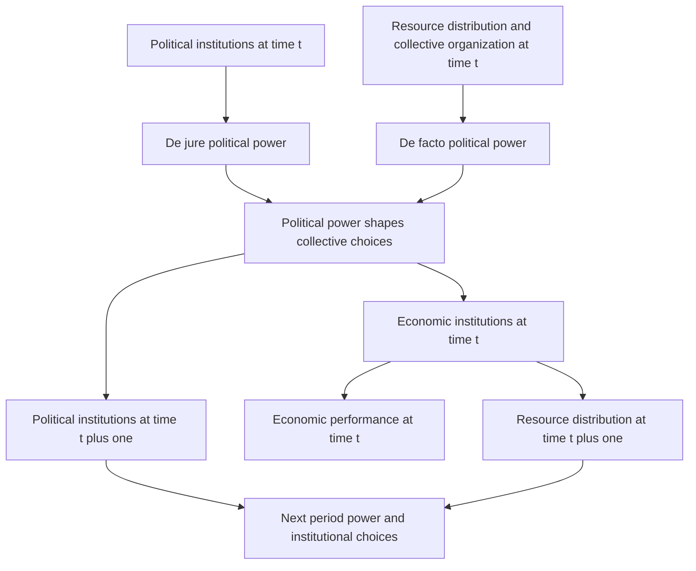

# Institutions, power and democratization

Source: [[00_Materials/2026_2027/Winter_Semester/Comparative_Economics/Week_2/Acemoglu Robinson 2006 v2.pdf]]
Source: [[00_Materials/2026_2027/Winter_Semester/Comparative_Economics/Week_2/Week II - lecture - large slides.pdf]]

- [[#Rules, incentives and selective protection|Rules, incentives and selective protection]]
- [[#Reconstructing the dynamic framework|Reconstructing the dynamic framework]]
- [[#Democratization and its reversal|Democratization and its reversal]]
- [[#Comparative statics and limits|Comparative statics and limits]]
- [[#Britain as an application|Britain as an application]]
- [[#Lecture applications and interpretation|Lecture applications and interpretation]]

Why can institutions that discourage investment persist, and why do promises of reform sometimes fail? Acemoglu and Robinson's 2006 chapter treats economic rules and political power as jointly evolving. Economic institutions shape prosperity, but groups choose them under distributional conflict; the institutions that enlarge the total pie need not benefit those with power. This is the chapter's theoretical account, not a claim that a cross-country correlation alone identifies causation. [[00_Materials/2026_2027/Winter_Semester/Comparative_Economics/Week_2/Acemoglu Robinson 2006 v2.pdf#page=1|Acemoglu–Robinson (2006), physical PDF pp. 1–3]]

This map preserves the two state variables, two power channels and distinct current/future outcomes. The source calls it schematic and simplified. In particular, resources are a major focus, but the ability to solve collective-action problems is also a source of de facto power. [[00_Materials/2026_2027/Winter_Semester/Comparative_Economics/Week_2/Acemoglu Robinson 2006 v2.pdf#page=2|Acemoglu–Robinson (2006), physical PDF pp. 2–6]] [[00_Materials/2026_2027/Winter_Semester/Comparative_Economics/Week_2/Week II - lecture - large slides.pdf#page=44|Week II lecture, physical PDF pp. 44–50]]

## Rules, incentives and selective protection

Institutions are humanly devised rules and constraints, rather than the organizations playing within them. Formal political rules govern leader selection and allocation of authority; formal legal rules govern rights, obligations and transactions; informal norms govern expected behaviour through social pressure, guilt and moral obligation. Effective institutions can reduce uncertainty, cheating and transaction costs, but “institutions” does not mean “efficient rules” by definition. [[00_Materials/2026_2027/Winter_Semester/Comparative_Economics/Week_2/Week II - lecture - large slides.pdf#page=30|Week II lecture, physical PDF pp. 30–32]]

The **hold-up problem** arises when one party makes a relationship-specific sunk investment and then faces worse terms from a partner, with limited alternatives. Anticipating that ex post vulnerability can discourage an otherwise useful investment. Credibly enforceable contracts may help if litigation/enforcement costs are low enough. A **commitment problem** is broader: a promise that is attractive now may be abandoned later when incentives change. Hold-up is a particular investment-based instance, not a synonym for every broken promise. [[00_Materials/2026_2027/Winter_Semester/Comparative_Economics/Week_2/Week II - lecture - large slides.pdf#page=33|Week II lecture, physical PDF pp. 33–34]]

The lecture distinguishes inclusive economic institutions—broad participation, broadly secure property rights, occupational choice, entry, competition and incentives to invest/innovate—from extractive institutions that channel resources toward privileged groups, selectively protect rights and restrict others through coercion or entry barriers. Inclusive political institutions combine pluralism and accountability with sufficient central authority to enforce rules; extraction can coexist with a powerful authoritarian state or an ineffective one. “Small state” is therefore not equivalent to inclusion. [[00_Materials/2026_2027/Winter_Semester/Comparative_Economics/Week_2/Week II - lecture - large slides.pdf#page=41|Week II lecture, physical PDF pp. 41–43]]

## Reconstructing the dynamic framework

Economic institutions affect investments in physical and human capital and technology, organization of production, aggregate performance and the next period's distribution. They are endogenous collective choices because their distributive effects create conflicts. The authors emphasize institutions without claiming that geography and culture can never matter. [[00_Materials/2026_2027/Winter_Semester/Comparative_Economics/Week_2/Acemoglu Robinson 2006 v2.pdf#page=2|Acemoglu–Robinson (2006), physical PDF pp. 2–3]]

**De jure power** comes from political institutions: constitutional rules, voting rights and constraints on rulers. **De facto power** comes from effective organization and resources, including protests, revolts, armed groups or military influence even without formal authority. A constitutional monarchy reallocates formal power relative to an unconstrained monarch; a disenfranchised organized group can still impose costs. Neither power channel is simply another name for income. [[00_Materials/2026_2027/Winter_Semester/Comparative_Economics/Week_2/Acemoglu Robinson 2006 v2.pdf#page=3|Acemoglu–Robinson (2006), physical PDF pp. 3–4]]

Together they influence current economic rules and future political institutions. Political institutions and resource distribution are relatively durable state variables. An already wealthy group can use resources to preserve favourable rules and thereby reproduce its advantage; formal institutions also tend to persist until a sufficiently large power shift occurs. Persistence does not imply inevitability: technology, external conditions and critical junctures can alter the balance. [[00_Materials/2026_2027/Winter_Semester/Comparative_Economics/Week_2/Acemoglu Robinson 2006 v2.pdf#page=4|Acemoglu–Robinson (2006), physical PDF pp. 4–5]]

Why not adopt efficient rules and compensate the losers? Promised transfers and protection may not be credible when tomorrow's powerful group can renege. A monarch can promise secure property rights today yet retain the ability to expropriate later. Merchants who gain temporary protest power want durable protection, but their organization may dissolve; converting de facto power into a change in formal political institutions can make future concessions more credible. This connects distribution, efficiency and political commitment rather than treating them as separable bargains automatically enforceable by a neutral third party. [[00_Materials/2026_2027/Winter_Semester/Comparative_Economics/Week_2/Acemoglu Robinson 2006 v2.pdf#page=3|Acemoglu–Robinson (2006), physical PDF pp. 3, 6–7]]

![[01_Notes/2026_2027/Winter_Semester/Comparative_Economics/assets/Week_2_Power_Feedback.png]]

The reproduced lecture diagram has current economic performance and future resources on its right, and future political institutions below. Those time labels explain the feedback: future resources and formal rules change the next round of power, not the past. [[00_Materials/2026_2027/Winter_Semester/Comparative_Economics/Week_2/Week II - lecture - large slides.pdf#page=50|Week II lecture, physical PDF pp. 50]]

## Democratization and its reversal

In the chapter's simple “today/tomorrow” account, citizens temporarily overcome collective-action problems and threaten costly disorder or revolution. Elites can offer current policy concessions, promise future concessions, repress, or transfer durable political power. If citizens' temporary threat will fade, future elite promises may be noncredible. Extending voting rights changes who can choose policy tomorrow and therefore supplies a more credible commitment than a revocable policy promise. [[00_Materials/2026_2027/Winter_Semester/Comparative_Economics/Week_2/Acemoglu Robinson 2006 v2.pdf#page=7|Acemoglu–Robinson (2006), physical PDF pp. 7–8]]

Democratization is not automatic. Elites may choose repression when retaining power is sufficiently valuable and repression is relatively cheap or feasible. Repression risks destroyed wealth, loss of life, sanctions, failure and empowerment of a military that could threaten elites themselves. In this framework democracy emerges when temporary concessions are insufficient, promises are noncredible and repression is too costly relative to conceding. Those are conditional mechanisms, not a universal numerical threshold supplied by the chapter. [[00_Materials/2026_2027/Winter_Semester/Comparative_Economics/Week_2/Acemoglu Robinson 2006 v2.pdf#page=8|Acemoglu–Robinson (2006), physical PDF pp. 8–9]]

**Consolidation** means democratic institutions endure. A coup is the reverse conversion: elites with a temporary military/political opportunity can change formal institutions to secure future policies they favour. Promises by a democratic majority to remain moderate may also lack credibility after the coup threat subsides. The model therefore distinguishes creating democracy from sustaining it. [[00_Materials/2026_2027/Winter_Semester/Comparative_Economics/Week_2/Acemoglu Robinson 2006 v2.pdf#page=9|Acemoglu–Robinson (2006), physical PDF pp. 9–10]]

## Comparative statics and limits

The chapter gives three connected conditions favouring broad property protection and democratization: checks/balance of power; a relatively broad powerful group with investment opportunities; and limited rents available through coercive/extractive institutions. A small investor oligarchy may protect only its own assets, so investment interests alone are insufficient. Resource equality or effective organization can balance de facto power. Checks can also make democracy less threatening to elites by limiting what the majority can do. [[00_Materials/2026_2027/Winter_Semester/Comparative_Economics/Week_2/Acemoglu Robinson 2006 v2.pdf#page=10|Acemoglu–Robinson (2006), physical PDF pp. 10–12]]

Economic structure changes those trade-offs. Land can be easier to tax/redistribute than mobile capital; resource rents raise the stakes of political monopoly; physical/human-capital economies may suffer greater destruction from repression and require less easily coerced effort. These mechanisms can make repression and coups more attractive in some agrarian/resource settings and less attractive in others. They are the authors' comparative arguments, not an assertion that all agrarian societies follow one path. [[00_Materials/2026_2027/Winter_Semester/Comparative_Economics/Week_2/Acemoglu Robinson 2006 v2.pdf#page=11|Acemoglu–Robinson (2006), physical PDF pp. 11–12]]

Prosperity and democracy are **jointly endogenous** in the framework. Correlation does not by itself show that income causes democracy or that elections alone ensure growth. The chapter reports evidence against an automatic income-to-democracy causal interpretation after historical factors are considered; the claim is tied to that cited research, rather than a proof that every possible income effect is zero. [[00_Materials/2026_2027/Winter_Semester/Comparative_Economics/Week_2/Acemoglu Robinson 2006 v2.pdf#page=12|Acemoglu–Robinson (2006), physical PDF pp. 12–13, 18–19]]

## Britain as an application

The authors trace a sequence from seventeenth-century conflict and limits on the monarchy through more secure property rights and financial development, then industrialization/urbanization and stronger organization among previously excluded groups. Parliament's gains after the Civil War and 1688 were not mass democracy: voting remained narrow and corrupt. The 1832 reform removed many rotten-borough inequalities and expanded an electorate still limited to a minority of adult men; further organization and unrest preceded the 1867 and 1884 reforms. Secret ballots and anti-corruption measures also matter; formal suffrage alone did not immediately remove intimidation. [[00_Materials/2026_2027/Winter_Semester/Comparative_Economics/Week_2/Acemoglu Robinson 2006 v2.pdf#page=13|Acemoglu–Robinson (2006), physical PDF pp. 13–15]]

Later changes included merit-based civil service, labour protections, social insurance/pensions, redistributive taxation and mass education. The chapter's narrative gives the **1918** Representation of the People Act and equal voting terms for women in **1928**. Its opening reference to 1919 is internally inconsistent with that later chronology; use the body chronology, not the opening typo. Reform was gradual and strategic, with unrest, organization, electoral calculation and the costs of repression all relevant. [[00_Materials/2026_2027/Winter_Semester/Comparative_Economics/Week_2/Acemoglu Robinson 2006 v2.pdf#page=15|Acemoglu–Robinson (2006), physical PDF pp. 15–18]]

This application answers why economic rise and democratization appear related without reducing the story to “richer people demand democracy.” Earlier institutions altered investment and growth; resulting structural changes altered de facto power; reform then changed de jure power and subsequent economic rules. Haiti is the authors' contrasting historical path, described as of the chapter's 2006 context, not a current country-status assessment. [[00_Materials/2026_2027/Winter_Semester/Comparative_Economics/Week_2/Acemoglu Robinson 2006 v2.pdf#page=1|Acemoglu–Robinson (2006), physical PDF pp. 1–2, 16–19]]

## Lecture applications and interpretation

The lecture's Nogales table contrasts annual household income (Arizona about USD 30,000 versus Sonora about one-third), education, health, services, security/business conditions and accountability across a border. These are the reading's historical comparisons, not current statistics. Encomienda granted tribute/labour claims over Indigenous populations with nominal conversion obligations, enabling elite extraction. Jamestown did not implement that Spanish institution: attempts to extract from Indigenous people and coercion of English settlers eventually gave way to land/incentive changes when the original strategy failed. The table and examples illustrate institutional incentives; a border narrative alone is not a controlled estimate of every difference. [[00_Materials/2026_2027/Winter_Semester/Comparative_Economics/Week_2/Week II - lecture - large slides.pdf#page=37|Week II lecture, physical PDF pp. 37–40]]

Institutions may remain inefficient because reform requires collective action, people can free ride, small groups with concentrated stakes may organize more effectively, and existing rules may obstruct challengers. The **functionalist fallacy** is to infer an institution's origin or automatic emergence from its useful function. These foundations connect the lecture to the chapter's persistence mechanism and the additional Olson reading. [[00_Materials/2026_2027/Winter_Semester/Comparative_Economics/Week_2/Week II - lecture - large slides.pdf#page=35|Week II lecture, physical PDF pp. 35–36]]

The full dynamic model and commitment mechanism are core because they explain endogenous institutions and answer the supplied seminar questions. Britain, Nogales and colonial contrasts support the reasoning; they do not establish a single inevitable development path or a forecast of present politics. [[00_Materials/2026_2027/Winter_Semester/Comparative_Economics/Week_2/Acemoglu Robinson 2006 v2.pdf#page=18|Acemoglu–Robinson (2006), physical PDF pp. 18–19]] [[00_Materials/2026_2027/Winter_Semester/Comparative_Economics/Week_2/Week II - lecture - large slides.pdf#page=3|Week II lecture, physical PDF pp. 3, 44–50]]
