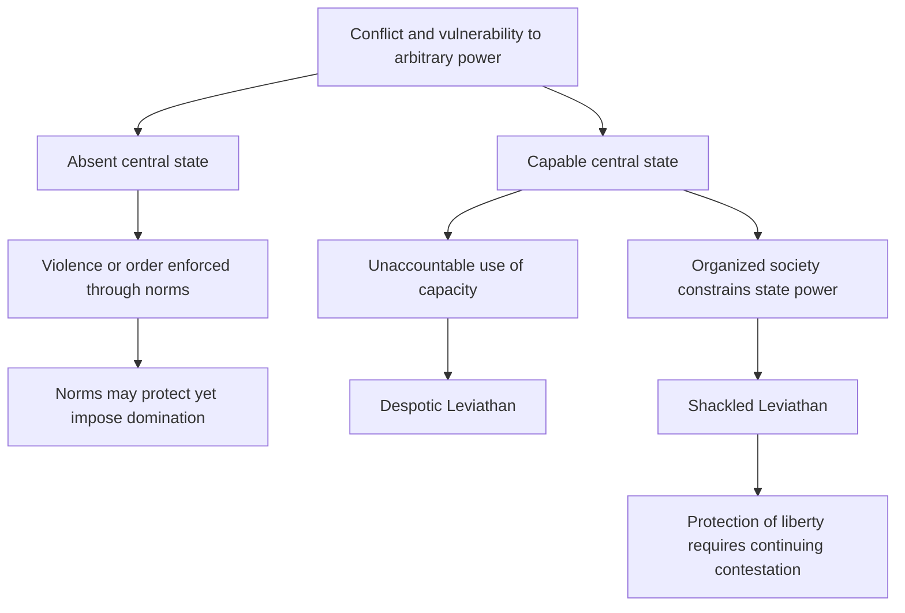

# Liberty, Leviathans and the cage of norms

Source: [[00_Materials/2026_2027/Winter_Semester/Comparative_Economics/Week_2/Acemoglu Robinson - The Narrow Corridor - chapter 1.pdf]]
Source: [[00_Materials/2026_2027/Winter_Semester/Comparative_Economics/Week_2/Week II - lecture - large slides.pdf]]
Source: [[00_Materials/2026_2027/Winter_Semester/Comparative_Economics/Week_3/Week III - lecture - large slides.pdf]]

- [[#Liberty means freedom from domination|Liberty means freedom from domination]]
- [[#Hobbes's Warre and the economic mechanism|Hobbes's Warre and the economic mechanism]]
- [[#Capacity can be used for repression|Capacity can be used for repression]]
- [[#Norms can create order and a cage|Norms can create order and a cage]]
- [[#The Shackled Leviathan|The Shackled Leviathan]]
- [[#What the chapter's final outline does—and does not—supply|What the chapter's final outline does—and does not—supply]]

Can a powerful state protect liberty, and can a society without a state avoid domination? Chapter 1 of *The Narrow Corridor* rejects a simple choice between total anarchy and an all-powerful ruler. Liberty requires the capacity to control violence **and** effective constraints on how that capacity is used. The lecture's corridor is a balance between state and societal power, not a formula that state power alone or social cohesion alone creates freedom. [[00_Materials/2026_2027/Winter_Semester/Comparative_Economics/Week_2/Acemoglu Robinson - The Narrow Corridor - chapter 1.pdf#page=1|The Narrow Corridor, chapter 1, physical PDF pp. 1–3, 23–26]] [[00_Materials/2026_2027/Winter_Semester/Comparative_Economics/Week_3/Week III - lecture - large slides.pdf#page=5|Week III lecture, physical PDF pp. 5–8]]

This map represents the chapter's three types and two objections to Hobbes. It is a conceptual comparison, not a causal experiment or a country-classification index. [[00_Materials/2026_2027/Winter_Semester/Comparative_Economics/Week_2/Acemoglu Robinson - The Narrow Corridor - chapter 1.pdf#page=7|The Narrow Corridor, chapter 1, physical PDF pp. 7–11, 16–18, 23–26]]

## Liberty means freedom from domination

The chapter starts with competing visions: Fukuyama's liberal convergence, Kaplan's anarchy and Harari's technology-enabled dictatorship. The authors propose diversity and historical contingency rather than one inevitable “end.” Their Congo “Article 15—fend for yourself” is explicitly a **joke**, not an actual constitutional provision. The real constitutional promises illustrate the gap between written rights and protection in practice. [[00_Materials/2026_2027/Winter_Semester/Comparative_Economics/Week_2/Acemoglu Robinson - The Narrow Corridor - chapter 1.pdf#page=1|The Narrow Corridor, chapter 1, physical PDF pp. 1–3]]

Soyinka's journey through Lagos depicts gangs, predatory roadblocks, missing services and insecurity. The central idea, developed through Pettit's non-domination, is that a person can be unfree even without an actual assault today: another person's arbitrary ability to threaten, punish or withdraw essential protection alters behaviour. A subordinate spouse, worker or debtor may anticipate retaliation and self-censor. Freedom is therefore more than an abstract permission; it includes the practical ability to act without arbitrary domination by state or private actors. These are the book's historical narratives and conceptual examples, not current conditions certified for whole populations. [[00_Materials/2026_2027/Winter_Semester/Comparative_Economics/Week_2/Acemoglu Robinson - The Narrow Corridor - chapter 1.pdf#page=3|The Narrow Corridor, chapter 1, physical PDF pp. 3–7]]

## Hobbes's Warre and the economic mechanism

**Warre** includes both actual fighting and the known persistent possibility of violence when no common authority reliably protects people. If harvests, possessions and life can be taken, effort and investment have uncertain private returns. People divert resources into self-protection and avoid travel, commerce and long-lived projects. The economic harm can arise from credible threats even when violence is off the observed path. [[00_Materials/2026_2027/Winter_Semester/Comparative_Economics/Week_2/Acemoglu Robinson - The Narrow Corridor - chapter 1.pdf#page=7|The Narrow Corridor, chapter 1, physical PDF pp. 7–10]]

Hobbes's solution is a powerful Leviathan, a state with overwhelming authority to impose order. He allows formation by agreement or conquest and regards monarchy, aristocracy and democracy mainly as different conveniences for wielding sovereign power. The authors accept his insight that avoiding Warre is crucial and that monopolizing violence can reduce killings. They reject two further steps: statelessness does not always mean uncontrolled violence, and a capable state does not automatically protect liberty. [[00_Materials/2026_2027/Winter_Semester/Comparative_Economics/Week_2/Acemoglu Robinson - The Narrow Corridor - chapter 1.pdf#page=9|The Narrow Corridor, chapter 1, physical PDF pp. 9–11]]

## Capacity can be used for repression

State capacity is the ability to achieve objectives: enforce rules, resolve disputes, tax, regulate, build services or wage war. Bureaucratic means and motivation are crucial; capacity is analytically distinct from the desirability of the objective. The Nazi expulsion machinery and mass murder illustrate capable organization used to dispossess and kill. The Mao-era famine account describes procurement and suppression of criticism; later re-education accounts show coercion is not merely a failure to provide order. They demonstrate why an efficient administrative mechanism need not be welfare-improving. [[00_Materials/2026_2027/Winter_Semester/Comparative_Economics/Week_2/Acemoglu Robinson - The Narrow Corridor - chapter 1.pdf#page=11|The Narrow Corridor, chapter 1, physical PDF pp. 11–16]]

The **Despotic Leviathan** is defined by the absence of effective societal control over state power, not by a threshold number of murders. Repression is possible because the state is unaccountable. The Janus metaphor captures two faces: protection/services and predation/domination. Even a state that suppresses private violence can replace it with state violence. Source-reported atrocity estimates and historical incarceration examples are context for this argument, not newly verified demographic measurements or present-day legal descriptions. [[00_Materials/2026_2027/Winter_Semester/Comparative_Economics/Week_2/Acemoglu Robinson - The Narrow Corridor - chapter 1.pdf#page=16|The Narrow Corridor, chapter 1, physical PDF pp. 16–17]]

## Norms can create order and a cage

An **Absent Leviathan** lacks effective centralized authority, but social norms can still coordinate conflict resolution, reciprocity, sanctions and collective defence. The chapter's Akan accounts describe safe commerce and community hearings mediated by elders and shared expectations. These cases refute an automatic equation of statelessness with chaos. They do not establish the absence of hierarchy or coercion. [[00_Materials/2026_2027/Winter_Semester/Comparative_Economics/Week_2/Acemoglu Robinson - The Narrow Corridor - chapter 1.pdf#page=17|The Narrow Corridor, chapter 1, physical PDF pp. 17–18]]

The same norms become a **cage** when conformity, subordination and prescribed roles cannot be freely challenged. In the Asante protection account, attachment to a lineage or powerful person helps guard against raiders but requires obedience; leaving that dependency can expose someone to enslavement. Goi's experience shows slavery and insecurity, while Bwanikwa's pawning illustrates how a nominally redeemable dependency can become lasting bondage. Wards, wives and dependants may receive protection while lacking independent voice. This is the supplied example of one norm system simultaneously reducing danger and restricting liberty. [[00_Materials/2026_2027/Winter_Semester/Comparative_Economics/Week_2/Acemoglu Robinson - The Narrow Corridor - chapter 1.pdf#page=18|The Narrow Corridor, chapter 1, physical PDF pp. 18–21]]

The authors also discuss how powerful interpreters can tilt inherited norms in their own favour, including gender hierarchies. Their Pashtunwali example combines hospitality and generosity with revenge obligations and restrictions on women. Read these as the authors' specified historical/social accounts, not as a claim that every member of an ethnic or religious population behaves identically. The mechanism is compulsory unequal dependence, not a judgment inferred from a group label. [[00_Materials/2026_2027/Winter_Semester/Comparative_Economics/Week_2/Acemoglu Robinson - The Narrow Corridor - chapter 1.pdf#page=22|The Narrow Corridor, chapter 1, physical PDF pp. 22]]

The Week III lecture adds the Tiv illustration: witchcraft accusations can constrain would-be dominant individuals yet inhibit initiative and centralization. That particular example is supplied by the lecture; detailed later book chapters were not supplied or audited here. The lecture's prebendalism discussion similarly explains officials financing themselves through office revenues/rents: it reduces the ruler's cash-wage needs but can encourage predation. These are institutional trade-offs, not proof that all premodern officials had identical arrangements. [[00_Materials/2026_2027/Winter_Semester/Comparative_Economics/Week_3/Week III - lecture - large slides.pdf#page=21|Week III lecture, physical PDF pp. 21–23]]

## The Shackled Leviathan

The answer is a state capable of enforcing law and controlling private violence that is itself constrained by an organized, vigilant society. Formal constitutions, elections and review matter, but effective societal ability to complain, organize, contest and remove rulers matters too. This **Shackled Leviathan** can also loosen oppressive customary constraints. Its coercive potential remains Janus-faced; constraints restrain it rather than erase that potential. [[00_Materials/2026_2027/Winter_Semester/Comparative_Economics/Week_2/Acemoglu Robinson - The Narrow Corridor - chapter 1.pdf#page=23|The Narrow Corridor, chapter 1, physical PDF pp. 23–26]]

The Wyoming example links frontier violence, vigilante justice and the 1892 Johnson County conflict to state intervention, then women's voting rights to changes in customary restrictions. Two historical source labels need care: the chapter names William Henry Harrison for 1892, although it was Benjamin Harrison's presidency; its claim that Wyoming was the world's first place to grant women suffrage is too broad. Wyoming's 1869 territorial suffrage and later retention are the relevant institutional example, not an unqualified global-first claim. The [Library of Congress Benjamin Harrison guide](https://guides.loc.gov/benjamin-harrison), Introduction, confirms his 1889–1893 presidency; its [Women’s Suffrage classroom passage](https://www.loc.gov/classroom-materials/womens-suffrage/), “Early Rights,” notes earlier property-qualified female voting in New Jersey until 1807 and Wyoming territorial suffrage in 1869. These bounded checks correct the labels without treating the Johnson County intervention as a neutral, unqualified success. [[00_Materials/2026_2027/Winter_Semester/Comparative_Economics/Week_2/Acemoglu Robinson - The Narrow Corridor - chapter 1.pdf#page=23|The Narrow Corridor, chapter 1, physical PDF pp. 23–25]]

![[01_Notes/2026_2027/Winter_Semester/Comparative_Economics/assets/Week_3_Narrow_Corridor.png]]

The lecture diagram puts state power on the vertical axis and societal power on the horizontal. Moving upward alone can favour despotism; societal constraints without state capacity do not automatically supply security. A balance inside the corridor can support expansion of both. The following empirical illustration plots state capacity and civil society for the US, Japan, Honduras and Russia from 1855 to 2015. Its standardized/abstract axes and selected cases do not themselves identify a causal law or certify all conclusions of the cited Murphy–O'Reilly paper, which is a bibliography lead here. [[00_Materials/2026_2027/Winter_Semester/Comparative_Economics/Week_3/Week III - lecture - large slides.pdf#page=7|Week III lecture, physical PDF pp. 7–8]]

## What the chapter's final outline does—and does not—supply

The ending surveys later chapters: state-society coevolution, the will to power, economic incentives, European/Chinese/Indian contrasts, conditional structural effects, uneven US capacity and slavery, “Paper” Leviathans, Middle Eastern norms, zero-sum conflict, entry to the corridor and maintaining it as responsibilities expand. These are **pointers in the supplied chapter**, not ingestion of the later chapters' detailed evidence. The common implication is that building and defending accountable capacity is continuing work; geography or a historical shock does not have one unconditional political effect. [[00_Materials/2026_2027/Winter_Semester/Comparative_Economics/Week_2/Acemoglu Robinson - The Narrow Corridor - chapter 1.pdf#page=26|The Narrow Corridor, chapter 1, physical PDF pp. 26–30]]

The core concepts answer the supplied questions: Warre discourages economic activity through insecurity; Hobbes is right about the importance of order but overstates the necessity and benignity of sovereign power; Absent, Despotic and Shackled types differ in effective capacity and constraints; the cage can protect people while binding them to unequal roles. The historical cases make those distinctions usable without turning them into inevitable country destinies. [[00_Materials/2026_2027/Winter_Semester/Comparative_Economics/Week_2/Week II - lecture - large slides.pdf#page=3|Week II lecture, physical PDF pp. 3]] [[00_Materials/2026_2027/Winter_Semester/Comparative_Economics/Week_3/Week III - lecture - large slides.pdf#page=5|Week III lecture, physical PDF pp. 5]] [[00_Materials/2026_2027/Winter_Semester/Comparative_Economics/Week_2/Acemoglu Robinson - The Narrow Corridor - chapter 1.pdf#page=7|The Narrow Corridor, chapter 1, physical PDF pp. 7–26]]

![[01_Notes/2026_2027/Winter_Semester/Comparative_Economics/assets/Week_3_Empirical_Corridor.png]]

The lecture’s selected four-country trajectories use state-capacity and civil-society indices. Treat the curves as the cited illustration; they are not an independently audited identification design. [[00_Materials/2026_2027/Winter_Semester/Comparative_Economics/Week_3/Week III - lecture - large slides.pdf#page=8|Week III lecture, physical PDF pp. 8]]
