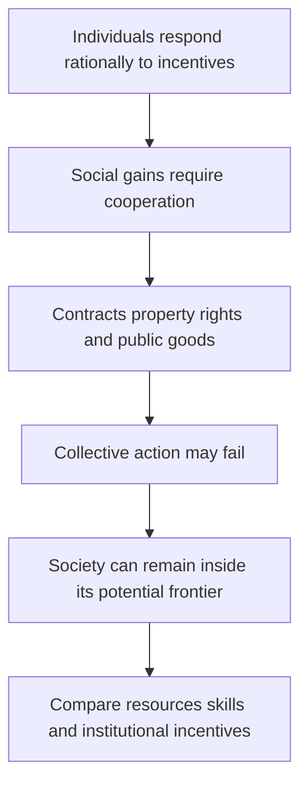

# Collective action, institutions and development

Source: [[00_Materials/2026_2027/Winter_Semester/Comparative_Economics/Week_3/ADDITIONAL - Olson - Big Bills Left on the Sidewalk. Why Some Nations are Rich, and Others Poor.pdf]]
Source: [[00_Materials/2026_2027/Winter_Semester/Comparative_Economics/Week_2/Week II - lecture - large slides.pdf]]

- [[#Individual optimization does not guarantee social efficiency|Individual optimization does not guarantee social efficiency]]
- [[#Knowledge and natural resources do not explain most of the gap|Knowledge and natural resources do not explain most of the gap]]
- [[#Capital allocation is inconsistent with frontier production|Capital allocation is inconsistent with frontier production]]
- [[#Separate private skills from civic human capital|Separate private skills from civic human capital]]
- [[#Institutions, growth, and collective action|Institutions, growth, and collective action]]

Olson’s additional reading explains why individually sensible choices need not produce efficient institutions. It connects the Week II free-riding problem to long-run income differences; its numerical comparisons are evidence from the article’s historical period.

## Individual optimization does not guarantee social efficiency

Olson opens with the efficient-markets metaphor: if a profitable opportunity is visible and people can act on it, competition or bargaining should remove it; “big bills” should not remain on the sidewalk. He surveys arguments that rational workers contract to eliminate involuntary unemployment, firms enter profitable industries and limit monopoly losses, bargaining internalizes externalities where transaction costs are low, and political bargains eliminate inefficient policy. Growth accounting often adds the assumption that economies operate on their production frontiers. Taken together, these claims imply little room for large gains from policy advice. Olson’s article asks whether the rationality of individuals actually puts societies near their productive potential. [[00_Materials/2026_2027/Winter_Semester/Comparative_Economics/Week_3/ADDITIONAL - Olson - Big Bills Left on the Sidewalk. Why Some Nations are Rich, and Others Poor.pdf#page=2|Olson, journal pp. 3–5.]]

He proposes two broad explanations for cross-country income gaps. One is differing resource endowments—capital, land and natural resources, labor and human capital, or technology—with each society near its own production frontier. The other is that policies and institutions produce very different incentive structures: individuals may work hard and act ingeniously while society still fails to secure large gains from cooperation. Olson’s evidence tests the factor-endowment account before arguing for the importance of institutions. [[00_Materials/2026_2027/Winter_Semester/Comparative_Economics/Week_3/ADDITIONAL - Olson - Big Bills Left on the Sidewalk. Why Some Nations are Rich, and Others Poor.pdf#page=4|Olson, journal pp. 5–7.]]

## Knowledge and natural resources do not explain most of the gap

Olson treats much productive knowledge as globally accessible, especially basic science and unpatented knowledge. The Korean example reports that, from 1973 to 1979, royalties and other payments for disembodied technology were often below one-thousandth of GDP; even adding foreign direct-investment profits, the total was under 1.5 percent of Korea’s GDP increase during the period. He acknowledges that imported machinery embodies knowledge and that not all Korean growth came from foreign knowledge. The example supports his claim that unequal access to technology alone cannot explain large income gaps. [[00_Materials/2026_2027/Winter_Semester/Comparative_Economics/Week_3/ADDITIONAL - Olson - Big Bills Left on the Sidewalk. Why Some Nations are Rich, and Others Poor.pdf#page=6|Olson, journal pp. 7–8.]]

The North–South migration model formalizes the diminishing-returns-to-labor explanation. The horizontal axis allocates a fixed world labor force between a richer North and poorer South; each region’s marginal product of labor (MPL), interpreted as the wage, falls as its workforce increases. At status quo point S, the North has relatively little labor per resource and thus a higher wage; the South has more labor per resource and a lower wage. A worker moving South-to-North earns the North wage instead of the South wage, increasing world income by the wage difference (the figure’s segment ab). If diminishing returns alone drove the gap, large migration should reallocate labour from S toward E **along the fixed MPL schedules**: the North’s workforce rises and its wage falls, while the South’s workforce falls and its wage rises. At E their wage/MPL levels are equal in this resource-only model. The migration changes the allocation on the horizontal axis; it does not itself shift either MPL schedule. [[00_Materials/2026_2027/Winter_Semester/Comparative_Economics/Week_3/ADDITIONAL - Olson - Big Bills Left on the Sidewalk. Why Some Nations are Rich, and Others Poor.pdf#page=8|Olson, journal pp. 9–10, Fig. 1.]]

Olson tests that prediction with historical cases. Ireland’s population fell from 5.4 million in 1821 to 3.5 million in 1986, while Great Britain’s rose from 14.2 million to 55.1 million; Ireland’s population density shifted from above Britain’s to roughly one-fifth, yet its income remained around five-eighths of Britain’s and emigration continued. The article also notes European migration to the United States, East-to-West German migration, Latin American migration to the United States, and studies of the Mariel boatlift and repatriations to France and Portugal. Olson argues these episodes do not show the wage equalization expected if land-to-labor ratios were the main cause. He acknowledges that migration has other effects and that Ireland’s nineteenth-century overpopulation is disputed in the cited literature. [[00_Materials/2026_2027/Winter_Semester/Comparative_Economics/Week_3/ADDITIONAL - Olson - Big Bills Left on the Sidewalk. Why Some Nations are Rich, and Others Poor.pdf#page=9|Olson, journal pp. 10–11.]]

Cross-country population density also fails as a simple poverty explanation. Olson contrasts sparsely populated Argentina, Brazil, Kenya, and Zaire with densely populated, higher-income West Germany, Belgium, Japan, Singapore, and Hong Kong. His descriptive log-log regression reports:

$$
\ln(\text{per-capita GDP}) = 6.986 + 0.1746\ln(\text{population density}),
\quad R^2 = .05,\quad t = 2.7.
$$

The relationship is positive, which Olson calls the “wrong” sign for a simple diminishing-returns story. He explicitly warns that this is a misspecified, descriptive regression: income affects population growth and migration as well as the reverse, and it cannot establish causation. He adds that modern manufacturing and services are less tied to local raw materials than earlier production. [[00_Materials/2026_2027/Winter_Semester/Comparative_Economics/Week_3/ADDITIONAL - Olson - Big Bills Left on the Sidewalk. Why Some Nations are Rich, and Others Poor.pdf#page=11|Olson, journal pp. 12–13.]]

## Capital allocation is inconsistent with frontier production

If countries operated on similar neoclassical production frontiers, scarce capital should earn a higher marginal return in poor, capital-scarce countries, attracting investment until risk-adjusted returns converge. Olson invokes Lucas’s calculation: under comparable labor quality, capital’s marginal product in India should be 58 times the U.S. return; even treating five Indian workers as equivalent to one U.S. worker leaves a large predicted gap. Yet capital remains heavily concentrated in rich economies, while investment and lending to poor countries are often limited and locally owned capital may flee. Olson infers that policies and institutions can lower capital’s effective productivity or deter investment. The result contradicts the assumption that each country is near its aggregate production frontier. [[00_Materials/2026_2027/Winter_Semester/Comparative_Economics/Week_3/ADDITIONAL - Olson - Big Bills Left on the Sidewalk. Why Some Nations are Rich, and Others Poor.pdf#page=12|Olson, journal pp. 13–15.]]

His argument assumes small countries take the world price of capital as given and that, on the frontier, marginal product equals the world price. If domestic marginal product were higher than the cost of foreign capital, borrowing and investing locally would create gains. The failure to observe capital flowing until such opportunities disappear is, in Olson’s metaphor, evidence of large uncollected bills. He also notes that capital and labor sometimes leave the same countries together, unlike the opposing flows expected in a frictionless two-factor frontier model. [[00_Materials/2026_2027/Winter_Semester/Comparative_Economics/Week_3/ADDITIONAL - Olson - Big Bills Left on the Sidewalk. Why Some Nations are Rich, and Others Poor.pdf#page=13|Olson, journal pp. 14–15.]]

## Separate private skills from civic human capital

Olson divides “culture” into marketable and public-good human capital. Marketable human capital includes skills, work propensities, savings habits, and entrepreneurial traits that affect a person’s income in the market. Public-good human capital, or civic culture, is knowledge about which policies and institutions would raise social income; it is not normally rewarded through an individual’s wage. This distinction allows migration to serve as a natural experiment: migrants carry their origin-country skills and personal culture, while entering the host country’s institutional environment. [[00_Materials/2026_2027/Winter_Semester/Comparative_Economics/Week_3/ADDITIONAL - Olson - Big Bills Left on the Sidewalk. Why Some Nations are Rich, and Others Poor.pdf#page=14|Olson, journal pp. 15–16.]]

Newly arrived immigrants from poor countries reportedly earned about 55 percent as much as comparable native-born Americans, despite language and adjustment costs, though migrants from very poor countries originated in economies with per-capita incomes only a fraction of U.S. income. Olson argues that higher destination wages reveal higher marginal productivity in the host setting, not merely migrant selection: selection may affect who migrates, but does not explain why the same person’s productivity rises on moving. He then compares Haitian and West German immigrants in the United States. In the 1980 Census, Haitian self-employed immigrants averaged annual earnings of USD 18,900 versus USD 27,300 for West Germans; annual salaried earnings were USD 10,900 versus USD 21,900. Olson treats this as evidence of a marketable-human-capital difference, but his thought experiment concludes that even doubling Haiti’s income to reflect that difference would leave it far below West Germany’s level. [[00_Materials/2026_2027/Winter_Semester/Comparative_Economics/Week_3/ADDITIONAL - Olson - Big Bills Left on the Sidewalk. Why Some Nations are Rich, and Others Poor.pdf#page=15|Olson, journal pp. 16–18.]]

These comparisons rely on assumptions: immigrant earnings proxy marginal product; the comparison controls adequately for age, sex, and schooling; migrants’ marketable traits are representative enough for the argument; and large institutional differences remain after accounting for selection. Olson recognizes selection and investment differences as qualifications. He also cites divided Germany, Korea, and China as comparisons where populations with similar cultural traits experienced different outcomes under different institutional regimes. Migration does not test civic culture, because migrant minorities generally do not change host-country institutions or policies. [[00_Materials/2026_2027/Winter_Semester/Comparative_Economics/Week_3/ADDITIONAL - Olson - Big Bills Left on the Sidewalk. Why Some Nations are Rich, and Others Poor.pdf#page=16|Olson, journal pp. 17–19.]]

## Institutions, growth, and collective action

After considering knowledge, land, capital, and marketable human capital, Olson concludes that institutions and economic policies explain most international income differences. The article does not claim that this brief lecture identifies one ideal policy package. It rejects the shortcut that the size of government or transfers alone determines institutional quality. Instead it emphasizes incentives, contract enforcement, secure long-run property rights, and the capacity to prevent public and private predation. [[00_Materials/2026_2027/Winter_Semester/Comparative_Economics/Week_3/ADDITIONAL - Olson - Big Bills Left on the Sidewalk. Why Some Nations are Rich, and Others Poor.pdf#page=18|Olson, journal pp. 19–22.]]

Olson argues that neither old growth theory nor endogenous growth theory predicts the full pattern he describes. Poor countries as a group do not necessarily grow faster than rich countries, yet a subset of lower-income countries can grow much faster by adopting better institutions and closing part of the gap between actual and potential income. He gives historical examples of rapid catch-up, including South Korea in the 1970s, and compares the leading growers of the 1870s–1880s and 1970s–1980s. These decade-specific figures are the article’s historical evidence, not current rankings. Olson also excludes open-frontier and oil-shock cases from the cited comparisons and says the argument should not be extended to those countries without qualification. [[00_Materials/2026_2027/Winter_Semester/Comparative_Economics/Week_3/ADDITIONAL - Olson - Big Bills Left on the Sidewalk. Why Some Nations are Rich, and Others Poor.pdf#page=19|Olson, journal pp. 20–21.]]

The “big bills” that matter most require coordinated specialization and trade across many workers and inputs. Individuals may optimize well in ordinary self-enforcing transactions, but complex production depends on impartial contract enforcement, secure property rights, stable incentives, and policies that do not invite predation. These institutions do not arise automatically from individual rationality. Collective action can fail even when members could all gain from a socially efficient arrangement: private incentives to contribute, organize, or bear bargaining costs need not align with society-wide gains. Olson’s concluding distinction is therefore between individual rationality and social rationality. [[00_Materials/2026_2027/Winter_Semester/Comparative_Economics/Week_3/ADDITIONAL - Olson - Big Bills Left on the Sidewalk. Why Some Nations are Rich, and Others Poor.pdf#page=20|Olson, journal pp. 21–23.]]

![[01_Notes/2026_2027/Winter_Semester/Comparative_Economics/assets/Week_3_Olson_Migration_Model.png]]

Figure 1 allocates fixed world labour across North and South. North labour increases rightward; South labour increases leftward. At S the vertical ab gap is the wage/MPL gain for a marginal mover; E is equalization under the resource-only model. The empirical discussion tests the model’s maintained explanation, not every possible migration effect. [[00_Materials/2026_2027/Winter_Semester/Comparative_Economics/Week_3/ADDITIONAL - Olson - Big Bills Left on the Sidewalk. Why Some Nations are Rich, and Others Poor.pdf#page=8|Olson (1996), physical PDF pp. 8]]
