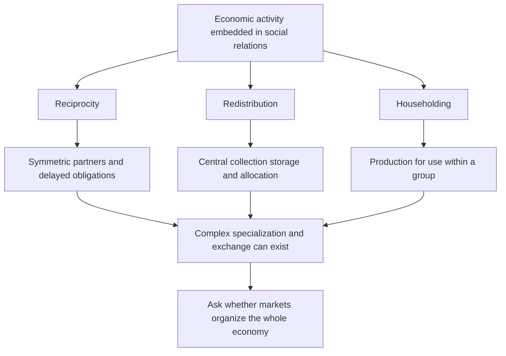

# Embedded economies, reciprocity and the Kula ring

Source: [[00_Materials/2026_2027/Winter_Semester/Comparative_Economics/Week_3/Polanyi 1944 Great-Transformation_chapter 4.pdf]]
Source: [[00_Materials/2026_2027/Winter_Semester/Comparative_Economics/Week_3/ADDITIONAL - Economic Pursuits of the Trobriand Islanders.pdf]]
Source: [[00_Materials/2026_2027/Winter_Semester/Comparative_Economics/Week_3/Week III - lecture - large slides.pdf]]

- [[#Social motives and economic organization|Social motives and economic organization]]
- [[#Reciprocity and symmetry|Reciprocity and symmetry]]
- [[#Redistribution and centricity|Redistribution and centricity]]
- [[#Householding and production for use|Householding and production for use]]
- [[#The 1920 Trobriand report|The 1920 Trobriand report]]

Can a complex economy operate without market prices governing the whole system? Polanyi's chapter distinguishes the existence of trade, money and markets from a **self-regulating market economy** in which prices organize economic life as a whole. His historical thesis is that such a system is an exceptional development, rather than the natural expression of an invariant propensity to barter. This is the author's interpretation; it should not be turned into a claim that earlier societies had no trade or no individual motives. [[00_Materials/2026_2027/Winter_Semester/Comparative_Economics/Week_3/Polanyi 1944 Great-Transformation_chapter 4.pdf#page=1|Polanyi, chapter 4, physical PDF pp. 1–3]] [[00_Materials/2026_2027/Winter_Semester/Comparative_Economics/Week_3/Week III - lecture - large slides.pdf#page=13|Week III lecture, physical PDF pp. 13–16]]

This map separates principles of behaviour from the institutional patterns that support them. It follows Polanyi's argument rather than equating every gift economy with modern socialism or every exchange with capitalism. [[00_Materials/2026_2027/Winter_Semester/Comparative_Economics/Week_3/Polanyi 1944 Great-Transformation_chapter 4.pdf#page=5|Polanyi, chapter 4, physical PDF pp. 5–13]]

## Social motives and economic organization

Polanyi argues that social standing, obligations, kinship and community membership can organize production and distribution. Reputation and public recognition reward effort; ostracism and sanctions discipline noncompliance. The relevant contrast is the dominant coordinating institution and motive, not an assumption that people in one society are inherently generous and those in another inherently selfish. He explicitly rejects replacing a stereotyped “capitalistic” psychology with an equally simple “communistic” psychology. [[00_Materials/2026_2027/Winter_Semester/Comparative_Economics/Week_3/Polanyi 1944 Great-Transformation_chapter 4.pdf#page=2|Polanyi, chapter 4, physical PDF pp. 2–5]]

The lecture groups traditional systems around slowly coevolved family, customary and religious institutions—“familistic groupism”—and contrasts that embedding with the greater subordination of social frameworks to economic calculation in stylized market/command systems. It also warns that traditional systems are diverse. This is a comparative organizing distinction, not a literal claim that modern economies lack norms or that every traditional economy has the same religion or technology. [[00_Materials/2026_2027/Winter_Semester/Comparative_Economics/Week_3/Week III - lecture - large slides.pdf#page=12|Week III lecture, physical PDF pp. 12–16]]

## Reciprocity and symmetry

**Reciprocity** organizes giving and receiving through continuing social obligations. Returns can be delayed and may come through a network rather than the same person immediately. **Symmetry**—recognized paired partners, kin groups or villages—helps those obligations remain legible without a spot-market contract for every exchange. Polanyi's matrilineal example has a man delivering produce to his sister's household while his own wife's relatives provide reciprocal support. Public displays of good gardening protect reputation; the pattern coordinates provision without a wage for each act. [[00_Materials/2026_2027/Winter_Semester/Comparative_Economics/Week_3/Polanyi 1944 Great-Transformation_chapter 4.pdf#page=5|Polanyi, chapter 4, physical PDF pp. 5–7]]

The lecture's Kula example is a ceremonial network across at least 18 island communities. Red shell-disc necklaces (soulava/veigun) circulate clockwise, and white arm-shells (mwali) counterclockwise; “north” and “south” in a ring are simplified local directions, not global compass rules. Objects have prestige linked to history and former owners, and ownership is temporary. Their limited practical use does not mean they have no social value. [[00_Materials/2026_2027/Winter_Semester/Comparative_Economics/Week_3/Week III - lecture - large slides.pdf#page=19|Week III lecture, physical PDF pp. 19–20]] [[00_Materials/2026_2027/Winter_Semester/Comparative_Economics/Week_3/Polanyi 1944 Great-Transformation_chapter 4.pdf#page=7|Polanyi, chapter 4, physical PDF pp. 7–8]]

Partners undertake dangerous long-distance voyages and exchange under ritual rules, rather than bargaining for immediate monetary profit. Polanyi describes circulation over years, sometimes up to a decade; an object may return after gaining history. Complex specialization and exchange therefore do not logically require a system wholly governed by market prices. The example demonstrates organizational complexity rather than proving that modern markets could never handle ceremonial valuables. [[00_Materials/2026_2027/Winter_Semester/Comparative_Economics/Week_3/Polanyi 1944 Great-Transformation_chapter 4.pdf#page=8|Polanyi, chapter 4, physical PDF pp. 8]]

## Redistribution and centricity

**Redistribution** collects products at a centre, stores them and reallocates them. **Centricity** is the institutional arrangement that makes the centre available: a chief, temple, court or administration. Hunters sharing through a headman, Trobriand chief stores supporting feasts/expeditions, and large ancient granary systems are different scales and political forms of the principle. Redistribution can connect geographically specialized producers. [[00_Materials/2026_2027/Winter_Semester/Comparative_Economics/Week_3/Polanyi 1944 Great-Transformation_chapter 4.pdf#page=6|Polanyi, chapter 4, physical PDF pp. 6–10]]

It need not imply equality or voluntary cooperation. A chief may create dependency through gifts; a despot may collect tribute by coercion. Polanyi's “communistic” description of ancient household-like distribution explicitly permits sharply graded rations. His second use rejects the simplistic attribution of an innate communistic psychology to early people. The adjective therefore does not certify modern egalitarian communism. [[00_Materials/2026_2027/Winter_Semester/Comparative_Economics/Week_3/Polanyi 1944 Great-Transformation_chapter 4.pdf#page=2|Polanyi, chapter 4, physical PDF pp. 2, 9–10]]

## Householding and production for use

**Householding** means producing and storing for a group's own use, with a closed-group/self-sufficiency pattern. The group can be a family, village or manor, with democratic or despotic internal relations. Polanyi rejects an isolated self-sufficient “savage” as the universal original economic unit; household provision develops within social organization. [[00_Materials/2026_2027/Winter_Semester/Comparative_Economics/Week_3/Polanyi 1944 Great-Transformation_chapter 4.pdf#page=11|Polanyi, chapter 4, physical PDF pp. 11]]

Aristotle's distinction between household provisioning and unlimited money-making supplies the interpretive contrast. Selling an incidental surplus need not transform a household into production organized primarily for gain. Polanyi recognizes that Greek commerce, loans, insurance and banking were highly developed, even while he argues that market organization did not govern the whole social economy. The presence of money is therefore insufficient to classify the whole system. [[00_Materials/2026_2027/Winter_Semester/Comparative_Economics/Week_3/Polanyi 1944 Great-Transformation_chapter 4.pdf#page=11|Polanyi, chapter 4, physical PDF pp. 11–12]]

The chapter characterizes the Greco-Roman economy as householding combined with large-scale grain redistribution. Feudal arrangements likewise combine collection, tribute, protection and distribution, often with exploitation and unequal status. Its conclusion groups premodern economies under combinations of reciprocity, redistribution and householding. Sixteenth-century mercantilist governments made markets important objects of regulation; that is still different from a nineteenth-century ideal of a self-regulating market. These broad historical propositions remain attributed to Polanyi, rather than presented as uncontested findings from a newly audited history literature. [[00_Materials/2026_2027/Winter_Semester/Comparative_Economics/Week_3/Polanyi 1944 Great-Transformation_chapter 4.pdf#page=9|Polanyi, chapter 4, physical PDF pp. 9–13]]

## The 1920 Trobriand report

The two-page *Nature* item reports Malinowski's presentation to the Royal Anthropological Institute and the subsequent discussion. It rejects a view of Indigenous economies as merely individual subsistence. In its account, organized agriculture depends on chief authority and garden magic: the chief allocates land and finances communal work, while the magician directs ceremonial stages. **Kayasa** organizes communal gardening, fishing, construction, sports and games through announced enterprises and feasts. [[00_Materials/2026_2027/Winter_Semester/Comparative_Economics/Week_3/ADDITIONAL - Economic Pursuits of the Trobriand Islanders.pdf#page=1|Trobriand report (1920), physical PDF pp. 1]]

Producers receive a share, while chiefly collection—reported as about 30–50% of tribal wealth—supports collective projects and accumulation of ceremonial valuables made by dependent specialists. The report distinguishes a common measure of value, tokens of stored wealth and a general medium of exchange; it says no single article performs the latter role in the described setting. Gift/counter-gift obligations also support authority, warfare/peace and penalties. This reinforces the connection between political organization and economic institutions, not an image of a society without power or conflict. [[00_Materials/2026_2027/Winter_Semester/Comparative_Economics/Week_3/ADDITIONAL - Economic Pursuits of the Trobriand Islanders.pdf#page=1|Trobriand report (1920), physical PDF pp. 1]]

The Kula description emphasizes opposite-direction circulation, temporary ownership and repeated overseas expeditions. In discussion, Seligman asks whether elaborate garden organization depends on chiefs; Malinowski replies that Southern Massim/Dobu garden magic existed without the same elaborate distribution. Frazer, Routledge and Ray offer comparative comments about agriculture, magic and chiefly origin, which remain discussion suggestions rather than settled causal tests. Unrelated material on fungi/canvas and scientific services printed around the article is outside the academic item and is not imported into course notes. [[00_Materials/2026_2027/Winter_Semester/Comparative_Economics/Week_3/ADDITIONAL - Economic Pursuits of the Trobriand Islanders.pdf#page=1|Trobriand report (1920), physical PDF pp. 1–2]]

Traditional systems matter here because they expose the institutional assumptions behind apparently universal economic motives. The lecture then asks how “new traditional” movements might combine modern technology with religiously derived social organization. That is an ideal/political perspective with diverse forms, not proof that a complete third system has been realized everywhere. [[00_Materials/2026_2027/Winter_Semester/Comparative_Economics/Week_3/Week III - lecture - large slides.pdf#page=24|Week III lecture, physical PDF pp. 24–26]]

![[01_Notes/2026_2027/Winter_Semester/Comparative_Economics/assets/Week_3_Trobriand_Map.png]]

The lecture locates the islands surrounding the Kula network. The spatial figure supplies context for the opposite directions of ceremonial circulation; the diagram does not label every exchange as ordinary barter. [[00_Materials/2026_2027/Winter_Semester/Comparative_Economics/Week_3/Week III - lecture - large slides.pdf#page=18|Week III lecture, physical PDF pp. 18]]
