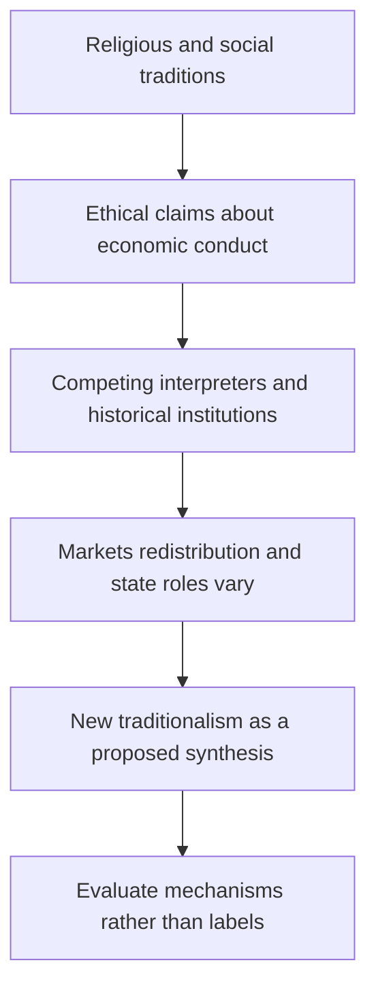

# Religion and economic organization

Source: [[00_Materials/2026_2027/Winter_Semester/Comparative_Economics/Week_3/Comparative Economics - Islamic Economics and the Economics of Other Religions.pdf]]
Source: [[00_Materials/2026_2027/Winter_Semester/Comparative_Economics/Week_3/Week III - lecture - large slides.pdf]]

- [[#Embedded economies and the proposed “New Traditional Economy”|Embedded economies and the proposed “New Traditional Economy”]]
- [[#Religious traditions and economic conduct|Religious traditions and economic conduct]]
- [[#The six lecture reading questions|The six lecture reading questions]]
- [[#Diversity within the source’s Protestant comparison|Diversity within the source’s Protestant comparison]]

The lecture makes traditional organization and its possible modern revival a core comparison. Definitions of embeddedness in [[01_Notes/2026_2027/Winter_Semester/Comparative_Economics/Week_3/Embedded_Economies_and_Kula.md|Embedded economies and the Kula ring]] explain why modern technology need not determine one set of social obligations.

## Embedded economies and the proposed “New Traditional Economy”

Rosser and Rosser use Karl Polanyi’s idea of embeddedness to distinguish economic organization. In market and command systems, they say, production and distribution decisions are largely made on economic grounds; in traditional economies, decisions are embedded in social and cultural relationships and inherited practices. They identify three “Old Traditional Economy” forms: household sharing, reciprocal gift exchange between groups, and redistribution by a central authority or “Big Man.” The authors note controversy over this taxonomy: formalist economists argue that economies follow universal market principles, while substantivist scholars associated with Polanyi emphasize institutional and cultural variation; another position is that all economies are embedded, but differently. They also qualify Polanyi’s original ordering of household and reciprocal forms. [[00_Materials/2026_2027/Winter_Semester/Comparative_Economics/Week_3/Comparative Economics - Islamic Economics and the Economics of Other Religions.pdf#page=1|Rosser & Rosser, printed pp. 85–86.]]

The “New Traditional Economy” aims to restore religious and social priorities while retaining modern technology. Its advocates present it as a “Third Way” that would combine the efficiency associated with markets, the social concern associated with socialism, and a renewed sense of ethical community. Rosser and Rosser describe this as an aspirational program rather than an established outcome: it looks nostalgically to old communities while seeking to operate in modern settings and use modern communications. The claimed benefits include family and social cohesion; the source also suggests that this can be interpreted as an attempt to build social capital. [[00_Materials/2026_2027/Winter_Semester/Comparative_Economics/Week_3/Comparative Economics - Islamic Economics and the Economics of Other Religions.pdf#page=2|Rosser & Rosser, printed pp. 86–87.]]

## Religious traditions and economic conduct

The authors distinguish **religious economics**—an advocacy program that seeks to organize society according to a religion’s economic teaching—from **the economics of religion**, the scholarly study of religion’s effects on economic behavior and institutions. Their comparative tour stresses that no single religious tradition yields one uncontested economic model. Teachings, institutions, political movements, historical settings, and interpreters differ within each tradition. Their examples should therefore be read as the authors’ historically situated comparisons, not as exhaustive descriptions of contemporary religions. [[00_Materials/2026_2027/Winter_Semester/Comparative_Economics/Week_3/Comparative Economics - Islamic Economics and the Economics of Other Religions.pdf#page=3|Rosser & Rosser, printed pp. 87–88.]]

In Schumacher’s influential account, Buddhist economics emphasizes spiritual liberation, moderation in consumption, harmony with nature, resource conservation, local production, and self-sufficiency. The authors question whether this ideal describes Buddhism as practiced across diverse societies. They contrast Thailand’s more individualistic religious and market-oriented trajectory with Burmese Buddhist socialism and merit-making practices that may encourage both wealth accumulation and spending on temples rather than productive investment. They also discuss the different political histories of Theravada and Mahayana traditions. The economic implications are presented as varied and historically contingent, not as a single Buddhist prescription. [[00_Materials/2026_2027/Winter_Semester/Comparative_Economics/Week_3/Comparative Economics - Islamic Economics and the Economics of Other Religions.pdf#page=4|Rosser & Rosser, printed pp. 88–89.]]

Confucianism is treated as a philosophy and cultural influence rather than straightforwardly as a religion. Rosser and Rosser outline benevolence, righteousness, propriety, wisdom, and faithfulness, with particular emphasis on hierarchical relationships and education. They describe mixed historical attitudes toward commerce: some passages permit markets under benevolent rule, while later neo-Confucianism opposed commerce, industrialization, and foreign trade. Modern revivals, in their account, tend to support market activity alongside authoritarian governance and state planning. They present claims that Confucian values foster growth together with concerns about cronyism and corruption, especially in light of the East Asian financial crisis of 1997. [[00_Materials/2026_2027/Winter_Semester/Comparative_Economics/Week_3/Comparative Economics - Islamic Economics and the Economics of Other Religions.pdf#page=5|Rosser & Rosser, printed pp. 89–90.]]

The discussion of Hindu economics centers on caste, village-based specialization, and the *jajmani* system, then turns to Gandhi’s *Hind Swaraj*: self-rule and self-sufficiency nationally and locally, village production, restrained consumption, and skepticism toward industrialization and urbanization. Gandhi’s vision included reform of caste practices, especially the oppression of “Untouchables,” while retaining a reformed caste structure. Deendayal Upadhyaya’s later “Integral Humanism” is presented as a New Traditional adaptation that accepts appropriate modern technology while preserving decentralized villages. This is a description of particular thinkers and political tendencies; it must not be taken as an endorsement of caste hierarchy or as a complete account of Hindu thought. [[00_Materials/2026_2027/Winter_Semester/Comparative_Economics/Week_3/Comparative Economics - Islamic Economics and the Economics of Other Religions.pdf#page=6|Rosser & Rosser, printed pp. 90–91.]]

For Judaism, the authors discuss biblical economic rules concerning property, tithes, interest, Sabbath observance, and the Jubilee Year’s debt, land, and emancipation provisions. They describe different modern interpretations, including proposals for redistribution and debt relief, and note that Israel’s economic institutions also reflect secular socialist and state-building influences, not simply religious doctrine. For Christianity, they contrast Aquinas’s just price and opposition to usury; Catholic social teaching’s later support for markets combined with concern about poverty; Christian Democratic welfare-state politics; and Protestant currents ranging from Calvinist associations with capitalism to Anabaptist communalism, the Social Gospel, and divergent American fundamentalist positions. Their box on U.S. Protestant fundamentalism displays internal disagreement between laissez-faire, anti-market, and redistributive views. [[00_Materials/2026_2027/Winter_Semester/Comparative_Economics/Week_3/Comparative Economics - Islamic Economics and the Economics of Other Religions.pdf#page=7|Rosser & Rosser, printed pp. 91–94.]]

The chapter concludes that these examples resist simple religion-to-system mappings. Buddhist traditions range from ecological critique to support for market activity; Confucian-influenced systems combine markets and hierarchy; Hindu economic visions include village self-sufficiency and contested caste reform; Judaic and Christian interpretations range across market, welfare, and redistributive positions. This is the comparative lesson: a tradition can shape economic arguments, but historical institutions and competing interpretations mediate its effects. [[00_Materials/2026_2027/Winter_Semester/Comparative_Economics/Week_3/Comparative Economics - Islamic Economics and the Economics of Other Religions.pdf#page=25|Rosser & Rosser, printed pp. 109–110.]]

**Discussion questions and reasoned answers [[00_Materials/2026_2027/Winter_Semester/Comparative_Economics/Week_3/Comparative Economics - Islamic Economics and the Economics of Other Religions.pdf#page=26|Rosser & Rosser, printed p. 110]].**

1. **In what sense can Buddhist and Hindu economics support modern “green” movements?** Schumacher’s Buddhist economics favors moderate consumption, conservation, harmony with nature, local production, and reduced long-distance transport. Gandhi’s Hindu economic vision favors restrained consumption, self-sufficient villages, and decentralized, appropriate technology. Both can support ecological aims by questioning materialism and resource-intensive growth. The source gives these as intellectual affinities, not evidence that all Buddhist or Hindu communities act uniformly or that the traditions offer identical environmental programs. [[00_Materials/2026_2027/Winter_Semester/Comparative_Economics/Week_3/Comparative Economics - Islamic Economics and the Economics of Other Religions.pdf#page=4|Rosser & Rosser, printed pp. 88–91.]]

2. **Compare Buddhist, Confucian, and Hindu views of the state.** The chapter’s Buddhist examples range from individual responsibility under Thai royal reforms to Burmese welfare-state ideals and socialist central planning. Confucian political thought emphasizes benevolent hierarchy, educated elites, order, and—in modern revivals—market activity combined with an authoritarian state and some planning. Gandhi’s model is more decentralized, emphasizing village self-rule and self-sufficiency; Upadhyaya adapts this to modern small-scale technology. These are contrasting cases and thinkers, not universal doctrines. [[00_Materials/2026_2027/Winter_Semester/Comparative_Economics/Week_3/Comparative Economics - Islamic Economics and the Economics of Other Religions.pdf#page=4|Rosser & Rosser, printed pp. 88–91.]]

3. **Compare Judaic, Catholic, Protestant, and Islamic views of market capitalism.** Rosser and Rosser present Judaic scripture as containing both market-compatible private-property rules and redistributive or interest restrictions, with contemporary interpretations varying. Catholic thought historically includes just-price and usury concerns, later combines support for markets with social protection, and has Christian Democratic welfare-state expression. Protestant traditions range from Calvinist and fundamentalist pro-market positions to communal, Social Gospel, and redistributive alternatives. The Islamic chapter sections likewise show approval of trade and private property alongside zakat, restrictions on riba and other conduct, and arguments for both market capitalism and redistribution. None of these traditions has one uncontested stance. [[00_Materials/2026_2027/Winter_Semester/Comparative_Economics/Week_3/Comparative Economics - Islamic Economics and the Economics of Other Religions.pdf#page=7|Rosser & Rosser, printed pp. 91–94 and 105–110.]]

4. **Why does Islam seem to have a more fully developed economic system than other major religions?** The authors suggest that Islam’s founder Muhammad was a merchant, that the tradition developed a legal framework (Shari’a) with rules relevant to transactions, and that modern Islamic movements have articulated a more explicit program, including zakat, fair dealing, profit-sharing finance, and riba restrictions. They also describe political and institutional reasons for the program’s visibility. This is a claim about the comparative elaboration and public prominence of a modern movement in the authors’ account, not proof that other religions lack economic thought or that Muslims agree on one system. [[00_Materials/2026_2027/Winter_Semester/Comparative_Economics/Week_3/Comparative Economics - Islamic Economics and the Economics of Other Religions.pdf#page=3|Rosser & Rosser, printed pp. 87–88, 94–95, 97–100, 101–104.]]

**Limitations and terminology.** The chapter’s publication context predates many subsequent developments and uses country labels, political descriptions, demographic claims, and present-tense assertions that are dated. Do not restate its current-sounding numbers, election results, country lists, or claims about political conditions as current facts. The source itself notes scholarly disputes over Polanyi’s categories and diversity within religious traditions. Older terms such as “Hinayana,” “Mohammedan,” “fundamentalist,” and some country/place names require attribution and care; use contemporary neutral labels in explanatory prose while retaining historical source wording only when necessary. [[00_Materials/2026_2027/Winter_Semester/Comparative_Economics/Week_3/Comparative Economics - Islamic Economics and the Economics of Other Religions.pdf#page=1|Rosser & Rosser, printed pp. 85–110.]]

## The six lecture reading questions

**Schumacher and environmentalism:** moderation, local production, reduced transport, conservation and respect for nonrenewable resources explain the affinity. The ideal does not establish that every Buddhist economy implements it. [[00_Materials/2026_2027/Winter_Semester/Comparative_Economics/Week_3/Comparative Economics - Islamic Economics and the Economics of Other Religions.pdf#page=3|Rosser & Rosser, chapter 4, physical PDF pp. 3–5]]

**Crucial Confucian elements:** benevolence, righteousness, propriety, wisdom and faithfulness; relationships of hierarchical duty, educated leadership and reciprocal obligations, with benevolent rule rather than an automatic commitment to one ownership system. The chapter contrasts older anti-commercial currents with modern market/authoritarian combinations. [[00_Materials/2026_2027/Winter_Semester/Comparative_Economics/Week_3/Comparative Economics - Islamic Economics and the Economics of Other Religions.pdf#page=5|Rosser & Rosser, chapter 4, physical PDF pp. 5–6]]

**Jajmani:** a local, relatively self-sufficient village arrangement in which hereditary caste-based occupations provide complementary goods/services through a stable division of labour and customary relations. It is neither simply a freely entered modern labour contract nor identical to every form of Indian village organization. [[00_Materials/2026_2027/Winter_Semester/Comparative_Economics/Week_3/Comparative Economics - Islamic Economics and the Economics of Other Religions.pdf#page=6|Rosser & Rosser, chapter 4, physical PDF pp. 6]]

**Jubilee:** the chapter connects seven Sabbath-year cycles (49 years) to a Jubilee, when property returns to its original owner and recently acquired slaves are freed, including debt release. Modern proposals extend this idea to debt relief, but the biblical rule and a contemporary policy are distinct. The source uses the 49-year cycle; do not confuse it with an annual tax or claim it describes actual current practice. [[00_Materials/2026_2027/Winter_Semester/Comparative_Economics/Week_3/Comparative Economics - Islamic Economics and the Economics of Other Religions.pdf#page=7|Rosser & Rosser, chapter 4, physical PDF pp. 7–8]]

**Judaism and interest:** the chapter reports a restriction on charging interest among Jews with a different rule for lending to non-Jews, plus a footnoted qualification for destitute borrowers. Describe the distinction and interpretive context; “all interest everywhere forbidden by Judaism” would erase the supplied rule’s boundary. [[00_Materials/2026_2027/Winter_Semester/Comparative_Economics/Week_3/Comparative Economics - Islamic Economics and the Economics of Other Religions.pdf#page=7|Rosser & Rosser, chapter 4, physical PDF pp. 7]]

**Aristotle’s ideas in Christianity:** the chapter identifies a just price and an abhorrence of interest as ideas Aquinas reconciled with Christian theology. This historically situated synthesis is different from a claim that every Christian movement has adopted one identical stance on finance. [[00_Materials/2026_2027/Winter_Semester/Comparative_Economics/Week_3/Comparative Economics - Islamic Economics and the Economics of Other Religions.pdf#page=8|Rosser & Rosser, chapter 4, physical PDF pp. 8]]

The Week III assignment asks for oral discussion rather than written submission. Its alternative Rosser–Rosser title is a reading lead, not a second supplied chapter audited here. [[00_Materials/2026_2027/Winter_Semester/Comparative_Economics/Week_3/Week III - lecture - large slides.pdf#page=3|Week III lecture, physical PDF pp. 3]]

## Diversity within the source’s Protestant comparison

| Position in Box 4-1 | Economic stance described in the historical source |
|---|---|
| Strict fundamentalists | Avoid extensive political/economic theorizing or emphasize individual spiritual conduct. |
| New Christian Right | Endorse a pro-market Chicago-style approach alongside moral/religious political aims. |
| Christian Reconstructionists | Prefer an Austrian/libertarian framework, a flat tax and gold-based money, oppose income redistribution and broad state intervention. |
| Evangelical left | Accept markets more conditionally and support greater redistribution on the basis of social concern. |
| Radical evangelicalism | Advocates a socialist alternative. |

These are the authors’ categories and examples, not an exhaustive contemporary typology. Their variation is the point: a religious label alone does not identify a policy package. [[00_Materials/2026_2027/Winter_Semester/Comparative_Economics/Week_3/Comparative Economics - Islamic Economics and the Economics of Other Religions.pdf#page=10|Rosser & Rosser, chapter 4, physical PDF pp. 10]]
