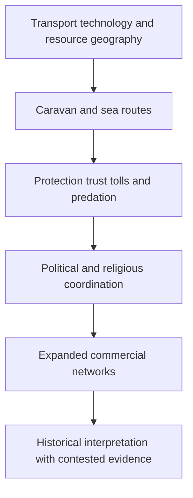

# Trade, protection and historical Islam

Source: [[00_Materials/2026_2027/Winter_Semester/Comparative_Economics/Week_3/ADDITIONAL - Bernstein - chapter 3.pdf]]
Source: [[00_Materials/2026_2027/Winter_Semester/Comparative_Economics/Week_3/Week III - lecture - large slides.pdf]]

- [[#Trade infrastructure before Islam|Trade infrastructure before Islam]]
- [[#The political problem of exchange|The political problem of exchange]]
- [[#Muhammad, early Islam, and commercial norms|Muhammad, early Islam, and commercial norms]]
- [[#Political consolidation and commercial networks|Political consolidation and commercial networks]]
- [[#Commercial instruments in the lecture|Commercial instruments in the lecture]]

Bernstein’s supplied additional excerpt supplies historical context for the lecture’s links between commerce, political protection and Islam. It is interpretive background rather than a timeless account of religious conduct.

## Trade infrastructure before Islam

Bernstein’s chapter begins with the camel as a transport technology that made long-distance exchange across arid regions practicable. The camel’s evolutionary adaptation to dry climates, its domestication, capacity to carry heavy loads, and development of specialized saddles together made it more useful than a donkey for bulk transport across trackless desert. The account contrasts dromedaries, Bactrians, and strong first-generation hybrids used along routes linking the Middle East and Central Asia. It emphasizes that trade capacity depended on animal biology, breeding, equipment, water access, and terrain rather than on distance alone: caravanserais and oases constrained routes, while steep mountain passes still required donkeys. [[00_Materials/2026_2027/Winter_Semester/Comparative_Economics/Week_3/ADDITIONAL - Bernstein - chapter 3.pdf#page=1|Bernstein, supplied chapter 3, physical PDF pp. 1–5]]

The Arabian incense trade illustrates how a valuable export can support a long supply chain. Frankincense and myrrh from the relatively fertile southwest of Arabia and neighboring Somalia served ritual, medicinal, cosmetic, and other uses in ancient markets. Harvest season and monsoon timing affected the choice between camel caravans and sea transport. The text describes local production, protective packaging, caravan services, intermediary markets, transit charges, and destination demand as linked stages in the trade. It also presents evidence of organized market exchange: the “silent trade” described by Theophrastus, in which sellers left measured goods and marked prices for merchants, with a priest taking a stated share. [[00_Materials/2026_2027/Winter_Semester/Comparative_Economics/Week_3/ADDITIONAL - Bernstein - chapter 3.pdf#page=5|Bernstein, supplied chapter 3, physical PDF pp. 5–12]]

Geography, political control, and transaction costs shaped the commodity’s route. The account traces incense through Shabwah and Thomna toward Gaza and Mediterranean markets, describing tolls, gate control, guards, water, fodder, lodging, and protection payments. It contrasts relatively trusting transactions at the production end with costly controls and theft prevention at processing and consumer centers. Under Roman rule, some routes became safer and cheaper, while demand and cultivation patterns changed. The author estimates large trade volumes and compares costs, prices, wages, and revenues using ancient monetary units. These are the author’s reported historical calculations, not contemporary values or independently updated estimates. [[00_Materials/2026_2027/Winter_Semester/Comparative_Economics/Week_3/ADDITIONAL - Bernstein - chapter 3.pdf#page=8|Bernstein, supplied chapter 3, physical PDF pp. 8–14]]

## The political problem of exchange

Bernstein frames the desert economy through a “trade, protect, or raid” trilemma: where enforceable authority is absent, a trader must secure a route and cargo, or risk predation. In his account, family and tribal ties supplied protection in a setting with weak central authority. Collective responsibility and retaliatory violence could deter attacks, but also perpetuate cycles of revenge and insecurity. Raiding, called *ghazu*, could become an economic strategy when no authority beyond the tribe protected trade. This is the author’s broad explanatory frame, not a universal law of desert societies or an adequate description of present-day Muslim societies. [[00_Materials/2026_2027/Winter_Semester/Comparative_Economics/Week_3/ADDITIONAL - Bernstein - chapter 3.pdf#page=14|Bernstein, supplied chapter 3, physical PDF pp. 14–15]]

Mecca’s rise as a commercial center is presented as uncertain. The text notes competing explanations: its relative position between larger powers, the possibility that the principal incense route bypassed it, its dependence on agricultural production at Taif, and the commercial and pilgrimage activity surrounding the Kaaba and nearby shrines. Bernstein describes Quraish leaders as making trade safer and more profitable by taxing merchants and selling safe conduct, shifting incentives away from raiding. This links political organization to the provision of protection and to the growth of exchange. Keep the uncertainty explicit: the source does not establish that Mecca sat on the main incense route or that incense alone caused its prosperity. [[00_Materials/2026_2027/Winter_Semester/Comparative_Economics/Week_3/ADDITIONAL - Bernstein - chapter 3.pdf#page=15|Bernstein, supplied chapter 3, physical PDF pp. 15–16]]

## Muhammad, early Islam, and commercial norms

Bernstein situates Islam’s emergence in a changing commercial and political setting. His narrative presents Muhammad as having merchant experience, including work for Khadija’s trading enterprise, and stresses that Islamic texts and traditions contain guidance on consensual exchange, truthful disclosure of defects, and fair dealing. The author connects these commercial norms to the religious community’s institutional unity. The historical details about Muhammad’s early life are qualified in the source: it says the surviving written biographies appeared more than a century after his death and that the historical record is uncertain. Treat the chapter as a historical interpretation, not as a settled account of Islamic doctrine or as a religious authority. [[00_Materials/2026_2027/Winter_Semester/Comparative_Economics/Week_3/ADDITIONAL - Bernstein - chapter 3.pdf#page=16|Bernstein, supplied chapter 3, physical PDF pp. 16–19]]

The account of early expansion combines religious conversion, military conquest, and economic redistribution. Bernstein describes raids on caravans after the migration from Mecca to Medina, the treatment of conquered property, and the allocation of a share to the community and the remainder to participants. He argues that conversion and conquest together expanded the boundaries of the new polity. This passage is the author’s interpretation and is phrased in sweeping terms, including claims about relations with nonbelievers; it should not be turned into a timeless rule about Islam or Muslims. The text itself notes peaceful conversion as a distinct route of expansion. [[00_Materials/2026_2027/Winter_Semester/Comparative_Economics/Week_3/ADDITIONAL - Bernstein - chapter 3.pdf#page=19|Bernstein, supplied chapter 3, physical PDF pp. 19–20]]

## Political consolidation and commercial networks

The early caliphates are shown as both political powers and organizers of routes and supplies. The text describes efforts to move Egyptian grain to Arabia, including a Nile–Red Sea canal project and the strategic decision not to extend it to the Mediterranean. It recounts the Battle of the Masts in 655, the subsequent growth of Muslim naval control, and expansion into North Africa, Spain, Mediterranean islands, and Central Asia. These events connect trade to food security, naval capacity, and control over ports and sea lanes. A source-based map of incense lands and routes appears earlier in the chapter; a second teaching diagram could map the Red Sea, Persian Gulf, and Silk Road as an integrated network under the early caliphates. [[00_Materials/2026_2027/Winter_Semester/Comparative_Economics/Week_3/ADDITIONAL - Bernstein - chapter 3.pdf#page=20|Bernstein, supplied chapter 3, physical PDF pp. 20–22]]

Bernstein characterizes the Umayyad and Abbasid domains as a large commercial zone in which barriers were reduced and the Red Sea, Persian Gulf, and Silk Road functioned as connected routes. He associates this network with Muslim seafaring, Arabic as a lingua franca, long-distance connections to China, Scandinavia, and sub-Saharan Africa, and the movement of goods such as gold, ivory, furs, amber, silk, pepper, and metalwork. He also notes an intellectual and cultural flourishing centered in cities including Damascus, Baghdad, and Cordova. The account does not imply that political unity produced frictionless trade or equal access for all populations. It explicitly says that the “Pax Islamica” was not an unmixed blessing: the Mediterranean could become a frontier of conflict, and the source describes a shift in the boundaries between Occident and Orient. [[00_Materials/2026_2027/Winter_Semester/Comparative_Economics/Week_3/ADDITIONAL - Bernstein - chapter 3.pdf#page=22|Bernstein, supplied chapter 3, physical PDF pp. 22–23]]

The closing pages note a distinction between sophisticated commercial practices and state financial institutions: Bernstein says Muslim commercial networks used bills of exchange, lending arrangements, and futures markets, while no Islamic state established a national or central bank. He then traces later challenges to the commercial order, including Christian reconquest, Crusades, Mongol invasions, plague, and European entry into the Indian Ocean, while noting that Muslim traders remained important in long-distance trade into the early modern period. This is a historical narrative of changing routes and political conditions, not a claim that one factor alone explains later economic outcomes. [[00_Materials/2026_2027/Winter_Semester/Comparative_Economics/Week_3/ADDITIONAL - Bernstein - chapter 3.pdf#page=23|Bernstein, supplied chapter 3, physical PDF pp. 23]]

**Interpretive cautions.** The chapter uses a vivid, sometimes polemical narrative voice and offers broad claims about tribal life, raiding, religious motivation, conquest, and economic decline. Present these as Bernstein’s explanatory propositions, preserve qualifications and contested points, and do not generalize them to all Muslim societies or the present. The text itself calls Mecca’s commercial importance and route position uncertain. Historical quotations and numerical estimates (including camel capacities, population counts, trade volumes, prices, wages, and silver outflows) are source-period claims; retain their attribution and dates rather than presenting them as current or independently verified. The chapter excerpt ends mid-book and contains no end-of-chapter discussion questions. [[00_Materials/2026_2027/Winter_Semester/Comparative_Economics/Week_3/ADDITIONAL - Bernstein - chapter 3.pdf#page=1|Bernstein, supplied chapter 3, physical PDF pp. 1–23]]

![[01_Notes/2026_2027/Winter_Semester/Comparative_Economics/assets/Week_3_Incense_Routes.png]]

The supplied incense-route map locates production areas, caravan routes and maritime alternatives. Read it alongside the chapter’s explicit uncertainty about whether the principal route passed Mecca. [[00_Materials/2026_2027/Winter_Semester/Comparative_Economics/Week_3/ADDITIONAL - Bernstein - chapter 3.pdf#page=10|Bernstein, supplied chapter 3, physical PDF pp. 10]]

![[01_Notes/2026_2027/Winter_Semester/Comparative_Economics/assets/Week_3_Medieval_Trade.png]]

The Week III map depicts the medieval trade network. The associated three-route argument links the Red Sea, Persian Gulf and Silk Road; a map of connections alone does not measure trade volumes or prove a single cause of later decline. [[00_Materials/2026_2027/Winter_Semester/Comparative_Economics/Week_3/Week III - lecture - large slides.pdf#page=31|Week III lecture, physical PDF pp. 31]]

## Commercial instruments in the lecture

The lecture adds historical terms from Irfan (2015): **suftaja** as a transferable money order, **hawala** as a credit/transfer arrangement, **sakk** as an early cheque-like written instruction, **musharaka** as partnership and **mudarabah** as capital–management profit sharing. The lecture relates these instruments to extensive trading networks and later financial practices. Its genealogy is a reported historical interpretation; the supplied chapter does not establish an exact one-to-one invention lineage for every modern instrument. Distinguish that history from the contract mechanisms explained in [[01_Notes/2026_2027/Winter_Semester/Comparative_Economics/Week_3/Islamic_Finance_and_Institutional_Diversity.md|Islamic finance and institutional diversity]]. [[00_Materials/2026_2027/Winter_Semester/Comparative_Economics/Week_3/Week III - lecture - large slides.pdf#page=28|Week III lecture, physical PDF pp. 28–34]]
