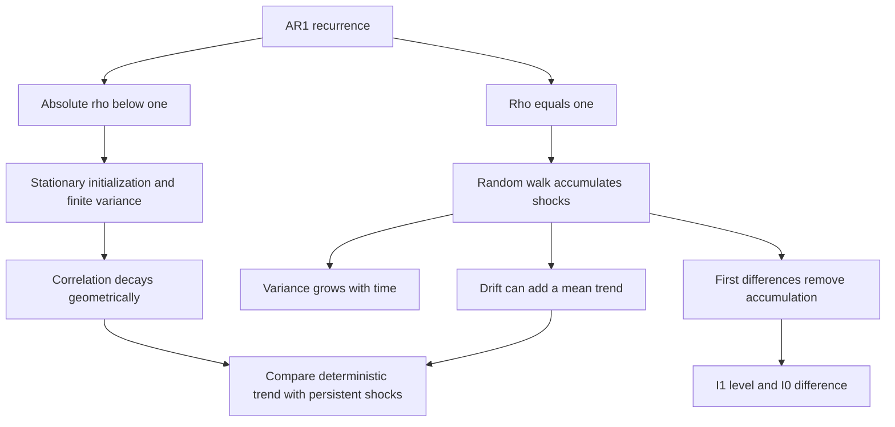

[[01_Notes/2026_2027/Winter_Semester/Econometrics_II/Econometrics_II_main.md#Week 3|Back to Econometrics II — Week 3]]

Source: [[00_Materials/2026_2027/Winter_Semester/Econometrics_II/Week_3/2026_Lecture3_print.pdf]]

# AR(1), random walks and integration

Does a shock fade away, or does it permanently change the level of a series? Comparing a stable autoregression with a random walk explains why apparent persistence changes the validity of ordinary regression asymptotics. It also separates removing a deterministic trend from differencing an accumulated random shock. [[00_Materials/2026_2027/Winter_Semester/Econometrics_II/Week_3/2026_Lecture3_print.pdf#page=15|2026_Lecture3_print.pdf, physical PDF p. 15–18, 25–30]]

The diagram follows physical pp.15–18 and26–30; stationary moments/independent innovations are explained in the preceding Week3 note. [[00_Materials/2026_2027/Winter_Semester/Econometrics_II/Week_3/2026_Lecture3_print.pdf#page=15|2026_Lecture3_print.pdf, physical PDF p. 15–18, 26–30]]

## Stable AR(1): assumptions before moments

An autoregression of order one obeys

$$x_t=\rho x_{t-1}+\varepsilon_t,$$

with i.i.d. zero-mean innovations of finite variance $\sigma_\varepsilon^2>0$. Future innovations must be independent of the initial value/past. The stability condition is $|\rho|<1$. To derive the lecture's constant moments **from the start**, take a covariance-stationary initialization; the recurrence and stability alone do not guarantee that an arbitrary fixed or random $x_0$ has the stationary distribution. The lecture omits that initialization qualification on p.15; the textbook explicitly assumes covariance stationarity in the displayed moment argument. [[00_Materials/2026_2027/Winter_Semester/Econometrics_II/Week_3/2026_Lecture3_print.pdf#page=15|2026_Lecture3_print.pdf, physical PDF p. 15–16]] [[00_Materials/2026_2027/Winter_Semester/Econometrics_II/Dump/textbook.pdf#page=411|Wooldridge, Introductory Econometrics, 5th ed., printed p. 383 (PDF p. 411)]]

Under stationary initialization, the mean satisfies $\mu=\rho\mu$, giving $\mu=0$ because $\rho\ne1$. Independence of the innovation from the past gives

$$\sigma_x^2=\rho^2\sigma_x^2+\sigma_\varepsilon^2,\qquad
\sigma_x^2=\frac{\sigma_\varepsilon^2}{1-\rho^2}.$$

The positive denominator is why a nondegenerate finite stationary variance is compatible with $|\rho|<1$. A recurrence started instead at fixed zero has

$$\operatorname{Var}(x_t)=\sigma_\varepsilon^2\sum_{j=0}^{t-1}\rho^{2j}=\sigma_\varepsilon^2\frac{1-\rho^{2t}}{1-\rho^2},$$

which approaches the stationary variance but is not equal to it at every finite date. This last expression is **agent-derived qualification**: repeatedly substitute the recurrence, then add variances of independent shocks. It shows exactly what the missing initialization changes. [[00_Materials/2026_2027/Winter_Semester/Econometrics_II/Week_3/2026_Lecture3_print.pdf#page=15|2026_Lecture3_print.pdf, physical PDF p. 15–16]] [[00_Materials/2026_2027/Winter_Semester/Econometrics_II/Dump/textbook.pdf#page=411|Wooldridge, Introductory Econometrics, 5th ed., printed p. 383 (PDF p. 411)]]

## Why AR(1) correlation fades

Substitution over $h$ future periods gives

$$x_{t+h}=\rho^h x_t+\sum_{j=1}^{h}\rho^{h-j}\varepsilon_{t+j}.$$

Future innovations have zero covariance with $x_t$, so under the stationary moments

$$\operatorname{Cov}(x_t,x_{t+h})=\rho^h\sigma_x^2,\qquad
\operatorname{Corr}(x_t,x_{t+h})=\rho^h.$$

Thus correlation tends to zero geometrically when $|\rho|<1$. Negative $\rho$ alternates the sign; a $\rho$ near one decays slowly in a short sample but remains stable. Under zero conditional-mean future innovations, $E[x_{t+h}\mid x_t]=\rho^h x_t$ approaches zero. This is the mechanism behind fading shocks, rather than a claim that adjacent values are independent. [[00_Materials/2026_2027/Winter_Semester/Econometrics_II/Week_3/2026_Lecture3_print.pdf#page=17|2026_Lecture3_print.pdf, physical PDF p. 17, 27]] [[00_Materials/2026_2027/Winter_Semester/Econometrics_II/Dump/textbook.pdf#page=412|Wooldridge, Introductory Econometrics, 5th ed., printed p. 384 (PDF p. 412)]]

## Random walk: constant mean does not imply stationarity

Set $\rho=1$. Repeated substitution gives

$$x_t=x_{t-1}+\varepsilon_t=x_0+\sum_{j=1}^{t}\varepsilon_j.$$

For $x_0$ independent of the innovations,

$$E[x_t]=E[x_0],\qquad \operatorname{Var}(x_t)=\operatorname{Var}(x_0)+t\sigma_\varepsilon^2.$$

If $x_0=c$ is fixed, these become $E[x_t]=c$ and $\operatorname{Var}(x_t)=t\sigma_\varepsilon^2$. Increasing variance prevents covariance stationarity even with a constant mean. **Source qualification:** p.26 first allows an independent initial value but then writes $E[x_0]=x_0$ and drops $\operatorname{Var}(x_0)$. Those reductions require fixed $x_0$; for random $x_0$ retain its expectation and variance. The textbook distinguishes the cases explicitly. [[00_Materials/2026_2027/Winter_Semester/Econometrics_II/Week_3/2026_Lecture3_print.pdf#page=26|2026_Lecture3_print.pdf, physical PDF p. 26]] [[00_Materials/2026_2027/Winter_Semester/Econometrics_II/Dump/textbook.pdf#page=420|Wooldridge, Introductory Econometrics, 5th ed., printed p. 392 (PDF p. 420)]]

Conditional prediction is

$$E[x_{t+h}\mid x_t]=x_t.$$

A shock to today's level enters every future level with coefficient one. This contrasts with $\rho^h$ for stable AR(1), and explains permanent versus fading shocks. A random walk is one example of a unit-root process. A high sample lag-one correlation is suggestive of persistence, but it does not itself prove an exact unit root. [[00_Materials/2026_2027/Winter_Semester/Econometrics_II/Week_3/2026_Lecture3_print.pdf#page=27|2026_Lecture3_print.pdf, physical PDF p. 27, 30]]

## Drift and deterministic trend are different

For a random walk with drift $a$,

$$x_t=a+x_{t-1}+\varepsilon_t=x_0+at+\sum_{j=1}^{t}\varepsilon_j,$$

$$E[x_t]=E[x_0]+at,\quad \operatorname{Var}(x_t)=\operatorname{Var}(x_0)+t\sigma_\varepsilon^2,\quad
E[x_{t+h}\mid x_t]=x_t+ah.$$

The deterministic mean trend $at$ does not remove accumulated random shocks. Subtracting $at$ leaves a random walk. By contrast, a **trend-stationary** process $z_t=b_0+b_1t+v_t$ has stationary weakly dependent deviations $v_t$; removing the correct deterministic trend exposes those deviations. The lecture's “include a trend” reassurance on p.18 concerns that case and still requires valid regression assumptions. It is not a remedy for any series that rises over time. Persistence can exist without a visible trend (the lecture names interest rates, inflation and unemployment), and a trend can exist without persistent stochastic shocks. [[00_Materials/2026_2027/Winter_Semester/Econometrics_II/Week_3/2026_Lecture3_print.pdf#page=18|2026_Lecture3_print.pdf, physical PDF p. 18, 28, 30]] [[00_Materials/2026_2027/Winter_Semester/Econometrics_II/Dump/textbook.pdf#page=422|Wooldridge, Introductory Econometrics, 5th ed., printed p. 394 (PDF p. 422)]] [[00_Materials/2026_2027/Winter_Semester/Econometrics_II/Dump/textbook.pdf#page=423|Wooldridge, Introductory Econometrics, 5th ed., printed p. 395 (PDF p. 423)]]

## Integration and first differences

In this course's framing, an $I(0)$ process has the weak-dependence properties needed for ordinary limit-theorem reasoning; an $I(1)$ level requires one difference to obtain such a process. For the random walk,

$$\Delta x_t=x_t-x_{t-1}=\varepsilon_t,$$

so differences are i.i.d. and $I(0)$ even though levels are $I(1)$. With drift the difference is $a+\varepsilon_t$. General $I(1)$ differences need not be i.i.d.; they may retain weak serial dependence. Differencing changes the modeled variable from its level to its period-to-period change, so coefficients must be interpreted accordingly. It does not automatically cure endogeneity or every inference problem. [[00_Materials/2026_2027/Winter_Semester/Econometrics_II/Week_3/2026_Lecture3_print.pdf#page=29|2026_Lecture3_print.pdf, physical PDF p. 29]] [[00_Materials/2026_2027/Winter_Semester/Econometrics_II/Dump/textbook.pdf#page=424|Wooldridge, Introductory Econometrics, 5th ed., printed p. 396 (PDF p. 424)]]

For a deterministic trend, $\Delta z_t=b_1+\Delta v_t$, which also removes its changing mean but may alter short-run dependence. Choosing between detrending and differencing therefore requires a process argument; “both remove a visible trend” is insufficient. **Online verification:** Hyndman and Athanasopoulos, *Forecasting: Principles and Practice*, 3rd ed., §9.1 “Stationarity and differencing,” subsections “Differencing” and “Random walk model,” confirms the random-walk transformation and warns that unnecessary differencing can introduce autocorrelation. [Consulted author textbook section](https://otexts.com/fpp3/stationarity.html). [[00_Materials/2026_2027/Winter_Semester/Econometrics_II/Week_3/2026_Lecture3_print.pdf#page=18|2026_Lecture3_print.pdf, physical PDF p. 18, 29–30]]

## What the lecture does and does not test

Physical p.30 advises looking at lag-one correlation and names Dickey–Fuller and augmented Dickey–Fuller tests, referring to textbook Chapter18.2. The supplied slides do not provide those tests' regressions, null distributions, critical values or worked applications, so naming them is not a prepared test procedure. The instruction “Detrend first!” is supported here only as a warning that a deterministic trend can inflate estimated autocorrelation; it does not mean detrending makes every unit-root series stationary. [[00_Materials/2026_2027/Winter_Semester/Econometrics_II/Dump/textbook.pdf#page=426|Wooldridge, 5th ed., printed p.398 (PDF p.426)]] Formal unit-root-testing instruction beyond the source's pointers remains outside this note. [[00_Materials/2026_2027/Winter_Semester/Econometrics_II/Week_3/2026_Lecture3_print.pdf#page=30|2026_Lecture3_print.pdf, physical PDF p. 30]] [[00_Materials/2026_2027/Winter_Semester/Econometrics_II/Dump/textbook.pdf#page=425|Wooldridge, Introductory Econometrics, 5th ed., printed p. 397 (PDF p. 425)]]

**Spurious regression** is the danger that unrelated persistent series in levels display a misleading apparent relationship, potentially accompanied by large fit or seemingly significant usual test statistics. Shared-looking movements in one observed history need not represent an economic connection. If an accumulated random shock is mistaken for a deterministic trend, removing a fitted line still leaves the stochastic persistence; the weak-dependence conditions justifying the ordinary inference above have not thereby been restored. This is the warning on lecture p.30, rather than a claim that every regression containing an $I(1)$ variable is necessarily spurious. The lecture postpones formal analysis. [[00_Materials/2026_2027/Winter_Semester/Econometrics_II/Week_3/2026_Lecture3_print.pdf#page=30|2026_Lecture3_print.pdf, physical PDF p.30]] [[00_Materials/2026_2027/Winter_Semester/Econometrics_II/Dump/textbook.pdf#page=423|Wooldridge, 5th ed., printed p.395 (PDF p.423)]]

![[01_Notes/2026_2027/Winter_Semester/Econometrics_II/assets/Week_3_Lecture3_Restaurant_Index.png]]

The source's restaurant index shows variation and a later level change. Together with the simulated comparison on p.9 it motivates checking stability, but supplies no fitted DGP or formal test result. The red vertical marker has no explained causal interpretation in the supplied page; none is assigned here. [[00_Materials/2026_2027/Winter_Semester/Econometrics_II/Week_3/2026_Lecture3_print.pdf#page=11|2026_Lecture3_print.pdf, physical PDF p. 11, 32]]
