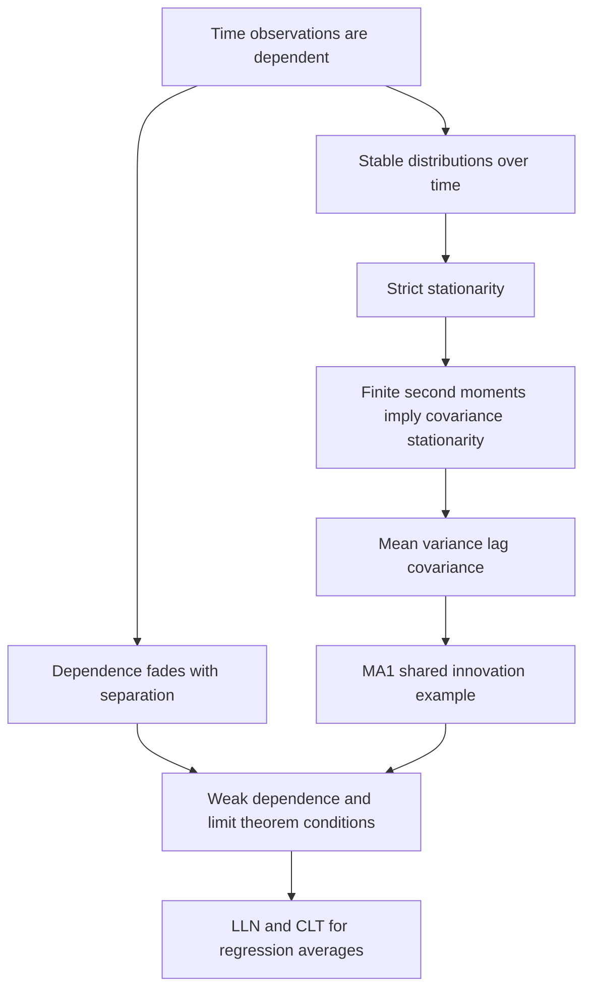

[[01_Notes/2026_2027/Winter_Semester/Econometrics_II/Econometrics_II_main.md#Week 3|Back to Econometrics II — Week 3]]

Source: [[00_Materials/2026_2027/Winter_Semester/Econometrics_II/Week_3/2026_Lecture3_print.pdf]]

# Stationarity, weak dependence and MA(1)

How can more time observations reveal a stable relationship when they are not independent draws? Week 3 replaces random sampling with conditions that make observations sufficiently informative despite dependence. Stationarity concerns stability of distributions over dates; weak dependence concerns how dependence fades as dates separate. They answer different questions and neither should be inferred simply from a smooth-looking time plot. [[00_Materials/2026_2027/Winter_Semester/Econometrics_II/Week_3/2026_Lecture3_print.pdf#page=3|2026_Lecture3_print.pdf, physical PDF p. 3, 6–13]]

This map comes from physical pp.7–14; it traces the foundations required for the OLS asymptotic results on pp.20–24. [[00_Materials/2026_2027/Winter_Semester/Econometrics_II/Week_3/2026_Lecture3_print.pdf#page=7|2026_Lecture3_print.pdf, physical PDF p. 7–14, 20–24]]

## A process and one observed realization

A stochastic process $\{x_t\}$ is a collection of random variables indexed by time. The observed series is one realization of that process, rather than many repetitions at each date. To learn a relationship from a single stretch of history, the mechanism cannot change arbitrarily whenever the observation period changes. Stationarity supplies a particular form of stability; it does not say every realized observation is equal. [[00_Materials/2026_2027/Winter_Semester/Econometrics_II/Week_3/2026_Lecture3_print.pdf#page=7|2026_Lecture3_print.pdf, physical PDF p. 7–8]] [[00_Materials/2026_2027/Winter_Semester/Econometrics_II/Dump/textbook.pdf#page=409|Wooldridge, Introductory Econometrics, 5th ed., printed p. 381 (PDF p. 409)]]

## Strict and covariance stationarity

The lecture's term **stationary** means strict stationarity: for every finite set $t_1<\cdots<t_m$ and permissible shift $h$, the joint distribution of $(x_{t_1},\ldots,x_{t_m})$ equals that of $(x_{t_1+h},\ldots,x_{t_m+h})$. Single-date distributions are therefore unchanged, and so are joint relationships at fixed lags. The definition allows strong adjacent correlation; what cannot change is the distributional pattern when all dates shift together. [[00_Materials/2026_2027/Winter_Semester/Econometrics_II/Week_3/2026_Lecture3_print.pdf#page=8|2026_Lecture3_print.pdf, physical PDF p. 8]]

If second moments exist, covariance stationarity requires only

$$E[x_t]=\mu,\qquad \operatorname{Var}(x_t)=\gamma(0),\qquad
\operatorname{Cov}(x_t,x_{t+h})=\gamma(h),$$

where $\mu,\gamma(0)$ are finite constants and $\gamma(h)$ depends on lag $h$, not calendar date $t$. Strict stationarity **with finite second moments** implies these moment restrictions; the converse need not hold because higher-order distributional features may change. The opening sentence on lecture p.10 calls covariance stationarity a “special case,” but its later finite-moment implication correctly identifies it as a weaker condition. An observed sample mean/variance is a diagnostic, not proof of an unchanged population distribution. [[00_Materials/2026_2027/Winter_Semester/Econometrics_II/Week_3/2026_Lecture3_print.pdf#page=10|2026_Lecture3_print.pdf, physical PDF p. 10]] [[00_Materials/2026_2027/Winter_Semester/Econometrics_II/Dump/textbook.pdf#page=409|Wooldridge, Introductory Econometrics, 5th ed., printed p. 381 (PDF p. 409)]] [[00_Materials/2026_2027/Winter_Semester/Econometrics_II/Dump/textbook.pdf#page=410|Wooldridge, Introductory Econometrics, 5th ed., printed p. 382 (PDF p. 410)]]

![[01_Notes/2026_2027/Winter_Semester/Econometrics_II/assets/Week_3_Lecture3_Stationarity_Comparison.png]]

Physical p.9 compares different time windows (roughly100–300 and600–800). The left series has similar location/spread and overlapping histograms; the right shifts in location. This illustrates distributional stability rather than constituting a statistical test. The second right-hand histogram legend mistakenly uses an $x$ label despite the plotted right series being $y$; do not infer a third variable. [[00_Materials/2026_2027/Winter_Semester/Econometrics_II/Week_3/2026_Lecture3_print.pdf#page=9|2026_Lecture3_print.pdf, physical PDF p. 9]]

The restaurant-price index on the appended physical p.32 changes its level over the sample; p.11 classifies it as nonstationary. A deterministic trend also changes the mean. The plot alone does not tell whether detrending or differencing is the correct remedy, because deterministic and stochastic trends are different mechanisms. [[00_Materials/2026_2027/Winter_Semester/Econometrics_II/Week_3/2026_Lecture3_print.pdf#page=11|2026_Lecture3_print.pdf, physical PDF p. 11, 18, 30, 32]]

## Weak dependence and why limit theorems need it

Weak dependence means that sufficiently distant observations are nearly independent in the sense required by the relevant limit theorem. The lecture uses a covariance-stationary intuition: $\operatorname{Corr}(x_t,x_{t+h})\to0$ sufficiently rapidly as $h\to\infty$. That rate qualification matters. Pairwise zero or vanishing correlation alone is not a universal independence condition or a complete general CLT assumption. The lecture deliberately leaves formal definitions outside scope. Its stationarity-based introduction on p.12 is a convenient setting, not a universal rule that a process with deterministic trend can never have weakly dependent deviations; p.18 and the textbook explicitly allow that distinction. [[00_Materials/2026_2027/Winter_Semester/Econometrics_II/Week_3/2026_Lecture3_print.pdf#page=12|2026_Lecture3_print.pdf, physical PDF p. 12–13, 18]] [[00_Materials/2026_2027/Winter_Semester/Econometrics_II/Dump/textbook.pdf#page=410|Wooldridge, Introductory Econometrics, 5th ed., printed p. 382 (PDF p. 410)]]

The **law of large numbers (LLN)** makes suitable sample averages approach their population counterparts. The **central limit theorem (CLT)** describes the scaled fluctuation around those limits and supports approximate normal inference. With independent draws these results are familiar; for time series they need dependence and moment regularity strong enough for the required averages. More observations of an almost permanently shared shock need not act like more independent information. This is why weak dependence is a substantive prerequisite, not a cosmetic relabeling of random sampling. [[00_Materials/2026_2027/Winter_Semester/Econometrics_II/Week_3/2026_Lecture3_print.pdf#page=6|2026_Lecture3_print.pdf, physical PDF p. 6–7, 12–13, 20]]

## MA(1): dependence with a finite reach

Let

$$x_t=\varepsilon_t+\alpha\varepsilon_{t-1},$$

where innovations $\varepsilon_t$ are i.i.d., have mean zero and finite positive variance $\sigma_\varepsilon^2$. This is a **data-generating process**, not necessarily a regression equation. The same fixed transformation of identically distributed innovation blocks at every date gives strict stationarity. Independence eliminates cross terms, so

$$E[x_t]=0,\qquad \operatorname{Var}(x_t)=(1+\alpha^2)\sigma_\varepsilon^2.$$

Adjacent values share $\varepsilon_t$:

$$\operatorname{Cov}(x_t,x_{t+1})=\operatorname{Cov}(\varepsilon_t+\alpha\varepsilon_{t-1},\varepsilon_{t+1}+\alpha\varepsilon_t)=\alpha\sigma_\varepsilon^2,$$

$$\operatorname{Corr}(x_t,x_{t+1})=\frac{\alpha}{1+\alpha^2}.$$

At lag two or more, the innovation sets are disjoint, hence the values are independent under the stated i.i.d. assumption. Dependence ends after one lag; it need not be zero at lag one for the process to be weakly dependent. No $|\alpha|<1$ restriction is needed for this stationarity argument; a different invertibility question is not part of this lecture. [[00_Materials/2026_2027/Winter_Semester/Econometrics_II/Week_3/2026_Lecture3_print.pdf#page=11|2026_Lecture3_print.pdf, physical PDF p. 11, 14]] [[00_Materials/2026_2027/Winter_Semester/Econometrics_II/Dump/textbook.pdf#page=411|Wooldridge, Introductory Econometrics, 5th ed., printed p. 383 (PDF p. 411)]]

## Reading priority and prerequisites

Strict-versus-moment stability and weak dependence are core foundations because they justify the assumptions used by the later consistency/inference theorems. Covariance algebra and independent innovations are prerequisites for understanding why MA(1) dependence ends and AR(1) dependence fades; memorizing the labels does not supply that reasoning. The histogram/restaurant examples support diagnosis but cannot replace those definitions. Continue with the AR(1)/random-walk note, then the OLS asymptotic note. This is a conceptual reading path, not an assessment prediction. [[00_Materials/2026_2027/Winter_Semester/Econometrics_II/Week_3/2026_Lecture3_print.pdf#page=7|2026_Lecture3_print.pdf, physical PDF p. 7–17, 20–30]]
