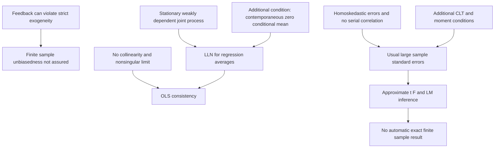

[[01_Notes/2026_2027/Winter_Semester/Econometrics_II/Econometrics_II_main.md#Week 3|Back to Econometrics II — Week 3]]

Source: [[00_Materials/2026_2027/Winter_Semester/Econometrics_II/Week_3/2026_Lecture3_print.pdf]]

# Time-series OLS consistency and inference

Can OLS still be useful when economic feedback violates strict exogeneity? Yes, under the lecture's weaker contemporaneous exogeneity and appropriate time-series regularity, OLS can be consistent even when finite-sample unbiasedness is unavailable. Inference requires additional conditions. The purpose of the assumption ladder is to keep these conclusions separate. [[00_Materials/2026_2027/Winter_Semester/Econometrics_II/Week_3/2026_Lecture3_print.pdf#page=3|2026_Lecture3_print.pdf, physical PDF p. 3–7, 20–24]]

This is a conceptual map of pp.4–7 and20–25, using the stationarity/dependence foundations developed in the other Week3 notes. [[00_Materials/2026_2027/Winter_Semester/Econometrics_II/Week_3/2026_Lecture3_print.pdf#page=4|2026_Lecture3_print.pdf, physical PDF p. 4–7, 20–25]]

## The growth and interest-rate example

The lecture begins with

$$gGDP_t=\beta_0+\beta_1 int_t+u_t,$$

then adds controls $X_t\Gamma$. Here $X_t$ is a row of additional covariates and $\Gamma$ their coefficient column. A policy rate can respond to economic conditions: today's shock to growth may influence a later interest-rate decision. Then $u_t$ can be related to future regressors even if current regressors have zero conditional error mean. This violates **strict** exogeneity, which conditions on the full regressor history/future in the sample. [[00_Materials/2026_2027/Winter_Semester/Econometrics_II/Week_3/2026_Lecture3_print.pdf#page=4|2026_Lecture3_print.pdf, physical PDF p. 4–5]]

Adding controls does not by itself prove $E[u_t\mid int_t,X_t]=0$. The source says contemporaneous exogeneity “should” hold after relevant controls; that is an identifying/modeling assumption whose plausibility depends on omitted variables, simultaneity and measurement, not an algebraic consequence of writing $X_t\Gamma$. Likewise, lacking strict exogeneity means unbiasedness is **not guaranteed**; it is not a theorem that every such estimator must have nonzero bias. The lecture's “biased but might be consistent” wording is read as the general danger/possibility, preserving this distinction. [[00_Materials/2026_2027/Winter_Semester/Econometrics_II/Week_3/2026_Lecture3_print.pdf#page=5|2026_Lecture3_print.pdf, physical PDF p. 5]] [[00_Materials/2026_2027/Winter_Semester/Econometrics_II/Dump/textbook.pdf#page=413|Wooldridge, Introductory Econometrics, 5th ed., printed p. 385 (PDF p. 413)]] [[00_Materials/2026_2027/Winter_Semester/Econometrics_II/Dump/textbook.pdf#page=414|Wooldridge, Introductory Econometrics, 5th ed., printed p. 386 (PDF p. 414)]]

## Assumptions for consistency

Write $y_t=z_t'\beta+u_t$, where $z_t=(1,x_{t1},\ldots,x_{tk})'$ includes the intercept, $\beta$ is a $(k+1)$-vector and $z_t$ is a column. The lecture's conditions are:

- **TS1a:** the model is linear in its coefficients and the **joint process** $(x_t,y_t)$ is stationary and weakly dependent, with the moment/regularity conditions needed for the stated LLN/CLT. Checking each series' marginal distribution alone does not establish joint stability.
- **TS2a:** no explanatory variable is constant or an exact combination of the others (apart from the designated intercept); the relevant population second-moment matrix must be finite and nonsingular for the limit inversion below.
- **TS3a:** $E[u_t\mid x_t]=0$ for each $t$, contemporaneous exogeneity. It imposes no requirement of zero relation with other dates' regressors.

These are the lecture's “a” versions of the textbook's primed assumptions. They relax the strict conditional-mean condition from Week2, while adding time-series restrictions replacing random sampling. [[00_Materials/2026_2027/Winter_Semester/Econometrics_II/Week_3/2026_Lecture3_print.pdf#page=20|2026_Lecture3_print.pdf, physical PDF p. 20–22]] [[00_Materials/2026_2027/Winter_Semester/Econometrics_II/Dump/textbook.pdf#page=412|Wooldridge, Introductory Econometrics, 5th ed., printed p. 384 (PDF p. 412)]] [[00_Materials/2026_2027/Winter_Semester/Econometrics_II/Dump/textbook.pdf#page=413|Wooldridge, Introductory Econometrics, 5th ed., printed p. 385 (PDF p. 413)]]

## Why these conditions yield consistency

The following is **agent-expanded algebra** connecting the lecture's theorem to its stated LLN mechanism. Put $n$ observations into OLS. Substituting $y_t=z_t'\beta+u_t$ gives

$$\widehat\beta-\beta=\left(\frac1n\sum_{t=1}^n z_tz_t'\right)^{-1}\left(\frac1n\sum_{t=1}^n z_tu_t\right).$$

The first factor converges to $Q^{-1}$, with $Q=E[z_tz_t']$ nonsingular. The second converges to $E[z_tu_t]=0$, because iterated expectations gives $E[z_tu_t]=E[z_tE(u_t\mid x_t)]=0$. Therefore $\operatorname{plim}\widehat\beta=\beta$. This is convergence in probability as the sample grows, not equality of the finite-sample expectation with $\beta$. The random sample denominator and error numerator may be related in a finite sample even though their large-sample product has a zero limit. [[00_Materials/2026_2027/Winter_Semester/Econometrics_II/Week_3/2026_Lecture3_print.pdf#page=6|2026_Lecture3_print.pdf, physical PDF p. 6–7, 20–22]] [[00_Materials/2026_2027/Winter_Semester/Econometrics_II/Dump/textbook.pdf#page=413|Wooldridge, Introductory Econometrics, 5th ed., printed p. 385 (PDF p. 413)]] [[00_Materials/2026_2027/Winter_Semester/Econometrics_II/Dump/textbook.pdf#page=414|Wooldridge, Introductory Econometrics, 5th ed., printed p. 386 (PDF p. 414)]]

Weak dependence/moments must support the LLN for the **products** appearing here, not just a casual observation that one series' correlation seems small. The lecture omits the technical proofs and points to Wooldridge (1994); this note supplies the OLS algebra while retaining those regularity assumptions rather than claiming a universal proof for arbitrary dependent data. The linked video is a reading lead, not additional source content inspected here. [[00_Materials/2026_2027/Winter_Semester/Econometrics_II/Week_3/2026_Lecture3_print.pdf#page=12|2026_Lecture3_print.pdf, physical PDF p. 12, 19–22]]

## Additional assumptions for usual inference

The lecture adds

$$\text{TS4a: }\operatorname{Var}(u_t\mid x_t)=\sigma^2,\qquad
\text{TS5a: }E[u_tu_s\mid x_t,x_s]=0\quad(t\ne s).$$

TS4a is contemporaneous homoskedasticity; TS5a restricts serial error correlation conditional on the paired regressor sets. Neither follows simply because $x_t$ is stationary. Weak dependence permits some serial dependence in the data, while TS5a rules out the error dependence relevant to ordinary OLS standard errors. They are different conditions. [[00_Materials/2026_2027/Winter_Semester/Econometrics_II/Week_3/2026_Lecture3_print.pdf#page=23|2026_Lecture3_print.pdf, physical PDF p. 23]] [[00_Materials/2026_2027/Winter_Semester/Econometrics_II/Dump/textbook.pdf#page=415|Wooldridge, Introductory Econometrics, 5th ed., printed p. 387 (PDF p. 415)]] [[00_Materials/2026_2027/Winter_Semester/Econometrics_II/Dump/textbook.pdf#page=416|Wooldridge, Introductory Econometrics, 5th ed., printed p. 388 (PDF p. 416)]]

Under TS1a–TS5a and the applicable CLT/moments, the lecture states asymptotic normality and validity of ordinary OLS standard errors and $t$, $F$, LM statistics. To see the bridge, multiply the consistency identity by $\sqrt n$: the scaled score average $(1/\sqrt n)\sum z_tu_t$ has a limiting normal distribution; the design factor approaches $Q^{-1}$. Under the stated homoskedastic/no-serial-correlation restrictions, its resulting covariance is $\sigma^2Q^{-1}$. Thus the familiar estimated variance $\widehat\sigma^2(Z'Z)^{-1}$ can support large-sample inference. This is an explanatory consequence of the stated theorem under its regularity, not an exact distribution in every finite sample. [[00_Materials/2026_2027/Winter_Semester/Econometrics_II/Week_3/2026_Lecture3_print.pdf#page=6|2026_Lecture3_print.pdf, physical PDF p. 6, 23–24]] [[00_Materials/2026_2027/Winter_Semester/Econometrics_II/Dump/textbook.pdf#page=416|Wooldridge, Introductory Econometrics, 5th ed., printed p. 388 (PDF p. 416)]]

For a coefficient null, $(\widehat\beta_j-\beta_{j,0})/\operatorname{se}(\widehat\beta_j)$ has the usual large-sample normal approximation. A claim of an exact finite-sample Student distribution still needs stronger assumptions. Normality of the error itself is not required for this asymptotic route. If TS4a or TS5a fails, consistency may survive under TS1a–TS3a, but the usual standard-error/inference guarantee does not. Corrections for heteroskedasticity and serial correlation are next week's advertised Chapter12 topic, outside this ingestion. [[00_Materials/2026_2027/Winter_Semester/Econometrics_II/Week_3/2026_Lecture3_print.pdf#page=2|2026_Lecture3_print.pdf, physical PDF p. 2, 22–24, 31]]

## Trend and persistence qualifications

For a truly trend-stationary specification, suitable deterministic trends can be included and the remaining stochastic components must satisfy the relevant dependence/exogeneity/inference conditions. A time trend does not automatically cure a stochastic unit root. For highly persistent/unit-root data, the usual weak-dependence asymptotic argument may fail; the random-walk note explains why differences can help. The source also correctly distinguishes the theoretical possibility of exact finite-sample CLM inference under its full strong assumptions from the vulnerability of that inference when assumptions fail. [[00_Materials/2026_2027/Winter_Semester/Econometrics_II/Week_3/2026_Lecture3_print.pdf#page=18|2026_Lecture3_print.pdf, physical PDF p. 18, 24–30]]

Physical p.24 says OLS is asymptotically efficient under its assumptions, but gives no efficiency bound or estimator class. That statement should not be generalized to efficiency against all estimators in every dynamic model; the checked usable results here are the explicit consistency and usual-inference theorems. Physical p.31 requests revision of the OLS variance derivation; the local asymptotic variance bridge above connects to the full checked [[01_Notes/2026_2027/Winter_Semester/Econometrics_II/Week_2/Time_Series_OLS_and_Strict_Exogeneity.md#The covariance terms hidden in the simple-slope proof|Week2 simple-slope variance derivation]] and [[01_Notes/2026_2027/Winter_Semester/Econometrics_II/Week_2/Time_Series_OLS_and_Strict_Exogeneity.md#Multiple-regression precision, residual variance, and BLUE|multiple-regression precision explanation]]. [[00_Materials/2026_2027/Winter_Semester/Econometrics_II/Week_3/2026_Lecture3_print.pdf#page=23|2026_Lecture3_print.pdf, physical PDF p. 23–25, 31]]

## Scope and support

All32 lecture pages are accounted for across the three Week3 notes and hub. Title/closing/read-next-week items do not add later academic topics. Bounded textbook consultation used *Introductory Econometrics: A Modern Approach*, Jeffrey M. Wooldridge, 5th ed., §11.1 stationary/weakly dependent processes and moment derivations, §11.2 assumptions/theorems, and relevant §11.3 random-walk/differencing qualifications. The full textbook, the optional 1994 chapter, linked video, Chapter12 methods and formal Chapter18 unit-root testing are not ingested. Nearby citations distinguish these supplementary explanations from supplied lecture material. [[00_Materials/2026_2027/Winter_Semester/Econometrics_II/Week_3/2026_Lecture3_print.pdf#page=1|2026_Lecture3_print.pdf, physical PDF p. 1–3, 19, 30–31]]
