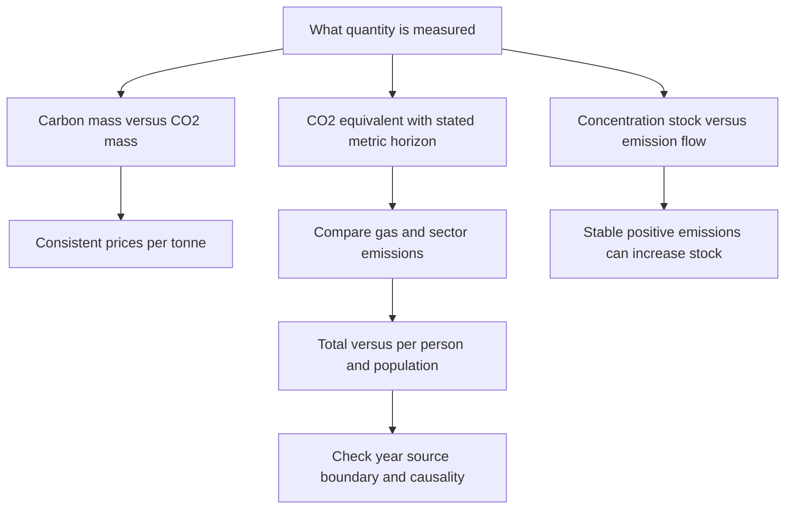

[[01_Notes/2026_2027/Winter_Semester/Economics_of_Green_Deal/Economics_of_Green_Deal_main.md#Week 3|Back to Economics of Green Deal — Week 3]]

Source: [[00_Materials/2026_2027/Winter_Semester/Economics_of_Green_Deal/Week_3/02_AQImp-ClimateChange.pdf]]

# Carbon units, stocks, flows and emissions charts

Which quantities can be compared when a chart says carbon, CO2, CO2-equivalent, concentration or per person? The optional-reading section supplies unit conversions and charts. Reading their units and boundaries is a foundation for both climate-policy comparisons and monetary costs per tonne. These pages are included because they are inside the selected supplied document, while retaining their “Voluntary readings” status. [[00_Materials/2026_2027/Winter_Semester/Economics_of_Green_Deal/Week_3/02_AQImp-ClimateChange.pdf#page=46|02_AQImp-ClimateChange.pdf, physical PDF p. 46–58]]

The map follows pp. 47–58 and uses p. 26's GWP definition to separate mass conversion from warming equivalence. [[00_Materials/2026_2027/Winter_Semester/Economics_of_Green_Deal/Week_3/02_AQImp-ClimateChange.pdf#page=26|02_AQImp-ClimateChange.pdf, physical PDF p. 26, 47–58]]

## Carbon mass and the inverse price conversion

A tonne of carbon (t C) measures carbon atoms; a tonne of CO2 measures the whole molecule. Using source atomic masses 12 for C and 16 for O, molecular mass is $12+2(16)=44$. Therefore

$$1\ \mathrm{tCO_2}=\frac{12}{44}\ \mathrm{tC}\approx0.2727\ \mathrm{tC},\qquad
1\ \mathrm{tC}=\frac{44}{12}\ \mathrm{tCO_2}\approx3.667\ \mathrm{tCO_2}.$$

For the **same total payment**, multiplying mass by $44/12$ requires dividing price per mass by $44/12$. Thus

$$100\ \$/\mathrm{tC}\times\frac{12}{44}=27.27\ \$/\mathrm{tCO_2},\qquad
100\ \$/\mathrm{tCO_2}\times\frac{44}{12}=366.67\ \$/\mathrm{tC}.$$

Confusing quantity conversion with price conversion reverses the comparison. Neither operation is a GWP conversion for methane or other gases. [[00_Materials/2026_2027/Winter_Semester/Economics_of_Green_Deal/Week_3/02_AQImp-ClimateChange.pdf#page=48|02_AQImp-ClimateChange.pdf, physical PDF p. 48]]

## GWP and CO2-equivalent emissions

Global warming potential (GWP) compares the time-integrated radiative effect of a pulse mass of gas with an equal mass of CO2 over a stated horizon; CO2's value is one by definition. For a chosen metric, horizon and assessment,

$$E_{CO_2e}=\sum_g m_g GWP_g,$$

where $m_g$ is emitted mass of gas $g$. This is **agent-expanded notation** for the source's examples, not a new emissions estimate. A million tonnes of CH4 at GWP100=25 becomes 25 million tonnes CO2e; a million tonnes of N2O at 298 becomes 298 million tonnes CO2e. [[00_Materials/2026_2027/Winter_Semester/Economics_of_Green_Deal/Week_3/02_AQImp-ClimateChange.pdf#page=25|02_AQImp-ClimateChange.pdf, physical PDF p. 25–26, 53]]

The p. 26 table explicitly identifies **IPCC AR4 (2007)** values; retain that vintage. Its complete entries are:

| Gas | Lifetime, years | GWP20 | GWP100 | GWP500 |
|---|---:|---:|---:|---:|
| CH4 | 12 | 72 | 25 | 7.6 |
| N2O | 114 | 289 | 298 | 153 |
| HFC-23 | 270 | 12000 | 14800 | 12200 |
| HFC-134a | 14 | 3830 | 1430 | 425 |
| SF6 | 3200 | 16300 | 22800 | 32600 |

These are the supplied historical values, not current universal constants or evidence that later charts use exactly the same assessment. A CO2e label needs its horizon and metric convention for exact comparison. [[00_Materials/2026_2027/Winter_Semester/Economics_of_Green_Deal/Week_3/02_AQImp-ClimateChange.pdf#page=26|02_AQImp-ClimateChange.pdf, physical PDF p. 26]]

## Trace-gas concentration and AGGI

Physical p. 47 uses ppm for CO2, ppb for CH4/N2O and ppt for halocarbons. Each panel has its own scale. The historical plots show rising CO2, CH4 and N2O, peaking/declining CFC-11/CFC-12, and rising HCFC-22/HFC-134a over their displayed period ending around 2020. Heights across separate axes are not direct abundance comparisons. [[00_Materials/2026_2027/Winter_Semester/Economics_of_Green_Deal/Week_3/02_AQImp-ClimateChange.pdf#page=47|02_AQImp-ClimateChange.pdf, physical PDF p. 47]]

Physical p. 49 contrasts CO2-alone concentration with a **CO2-equivalent mixing ratio** obtained by matching forcing from long-lived gases, and a separate AGGI right axis. This equivalent concentration is not a sum of GWP-weighted emission tonnes. The slide does not explain AGGI's baseline. **Supplementary definition:** NOAA defines AGGI as long-lived-gas effective radiative forcing relative to its 1990 value, making 1990 equal one. It is a forcing ratio, not an emissions flow or forecast. [NOAA AGGI, Introduction](https://gml.noaa.gov/aggi/aggi.html). [[00_Materials/2026_2027/Winter_Semester/Economics_of_Green_Deal/Week_3/02_AQImp-ClimateChange.pdf#page=49|02_AQImp-ClimateChange.pdf, physical PDF p. 49]]

## Why a stable flow can increase an atmospheric stock

Concentration measures an atmospheric stock; emissions add mass per unit time and sinks remove it. A simple **agent synthesis** of this accounting is

$$A_{t+1}-A_t=E_t-R_t,$$

where $A_t$ is atmospheric mass, $E_t$ emissions and $R_t$ net removal over the same interval, all in compatible mass units. A constant positive emission flow still increases $A$ whenever $E_t>R_t$. Stabilizing emissions differs from bringing **net additions** to zero. Connecting mass to ppm requires an atmospheric-mass conversion, which the source does not supply. [[00_Materials/2026_2027/Winter_Semester/Economics_of_Green_Deal/Week_3/02_AQImp-ClimateChange.pdf#page=50|02_AQImp-ClimateChange.pdf, physical PDF p. 50–51]]

Physical p. 50 uses separate axes for concentration (ppm) and annual emissions (gigatonnes). Its 1751–2022 graph and caption's historical increase from about 5 Gt/year in the mid twentieth century to over 35 Gt/year illustrate different quantities, not a fitted causal coefficient. Physical p. 51 draws a flat emission line and rising concentration curve on uncalibrated x1–x20 axes with no dates, units or source. Its curved stock path does not follow from constant **net** additions alone, which would give a linear stock rise. Use it for stock-flow intuition, not a quantitative carbon-cycle law. NOAA's atmospheric-CO2 article independently explains that emissions exceeding sinks raise atmospheric abundance: [“Fossil fuels overwhelm Earth's natural carbon cycle”](https://content-drupal.climate.gov/news-features/understanding-climate/climate-change-atmospheric-carbon-dioxide). [[00_Materials/2026_2027/Winter_Semester/Economics_of_Green_Deal/Week_3/02_AQImp-ClimateChange.pdf#page=50|02_AQImp-ClimateChange.pdf, physical PDF p. 50–51]]

## Sector quantities: gas and denominator first

Physical p. 52 is **2020 world per-capita CO2**, with these displayed sector values in tonnes per person for the reported year: electricity/heat 1.93, transport 0.91, manufacturing/construction 0.79, buildings 0.35, industry 0.21, land-use/forestry 0.15, aviation/shipping 0.12 and fugitive emissions 0.03. It credits Climate Watch (2023) and population sources (2023). It is not an all-gas CO2e total, and no finer time aggregation is supplied. [[00_Materials/2026_2027/Winter_Semester/Economics_of_Green_Deal/Week_3/02_AQImp-ClimateChange.pdf#page=52|02_AQImp-ClimateChange.pdf, physical PDF p. 52]]

Physical p. 53 instead shows CH4 and N2O in **CO2e**, roughly 1990–2021, with a GWP100 footnote. Agriculture is largest in each panel; methane also has substantial fugitive and waste emissions. The other methane series are land-use/forestry, other fuel combustion and industry; the other N2O series are industry, waste, land-use/forestry, fugitive and other fuel combustion. The panels have different scales, so their line heights do not directly compare gas mass. [[00_Materials/2026_2027/Winter_Semester/Economics_of_Green_Deal/Week_3/02_AQImp-ClimateChange.pdf#page=53|02_AQImp-ClimateChange.pdf, physical PDF p. 53]]

Physical p. 54 combines all-gas CO2e by sector: electricity/heat, transport, manufacturing/construction, agriculture, fugitive emissions, industry, buildings, waste, land-use/forestry, aviation/shipping and other fuel combustion. Its source is Climate Watch (2023). End-period downturns in some historical series do not establish a permanent future trend. Exact comparison with the AR4 table requires checking the chart dataset's assessment convention, which the slide does not establish. [[00_Materials/2026_2027/Winter_Semester/Economics_of_Green_Deal/Week_3/02_AQImp-ClimateChange.pdf#page=54|02_AQImp-ClimateChange.pdf, physical PDF p. 54]]

![[01_Notes/2026_2027/Winter_Semester/Economics_of_Green_Deal/assets/Week_3_Emissions_By_Sector.png]]

The complete graphic preserves each sector and its 100-year CO2e qualification. [[00_Materials/2026_2027/Winter_Semester/Economics_of_Green_Deal/Week_3/02_AQImp-ClimateChange.pdf#page=54|02_AQImp-ClimateChange.pdf, physical PDF p. 54]]

## Per person, population and totals

Physical p. 55 encodes per-person emissions by rectangle **height**, population by **width**, and total emissions by **area**. A populous country can have a large area but lower per-person emissions than a small country. Labels emphasize countries with large totals rather than a complete per-capita ranking. Its title says CO2 but the vertical axis says tCO2e, so the supplied graphic leaves the gas/metric boundary ambiguous; do not silently treat the two labels as interchangeable. The illustration lacks a clear data-year citation and is not a current league table. [[00_Materials/2026_2027/Winter_Semester/Economics_of_Green_Deal/Week_3/02_AQImp-ClimateChange.pdf#page=55|02_AQImp-ClimateChange.pdf, physical PDF p. 55]]

The p. 56 map reports 2020 total GHG CO2e per person including land-use/forestry, credits Climate Watch (2023), and has a negative legend range and hatched “no data.” The p. 57 map reports 2021 CO2/CH4/N2O in GWP100 CO2e including land-use, credits Jones et al. (2023), and notes that land-use emissions can be negative. Different years, sources and gas/boundary labels mean their visual differences cannot be read as one harmonized annual change. Negative net land-use emissions and missing data are different categories: hatching is not zero emissions. [[00_Materials/2026_2027/Winter_Semester/Economics_of_Green_Deal/Week_3/02_AQImp-ClimateChange.pdf#page=56|02_AQImp-ClimateChange.pdf, physical PDF p. 56–57]]

Physical p. 58 compares 2018 CO2 per person with GDP per person in 2011 international dollars adjusted for purchasing power and inflation. Its GDP axis is **logarithmic** ($1000, $2000, $5000, $10000, $20000, $50000), so equal plot distances are not equal dollar increments. Emissions cover **fossil fuels and cement**, explicitly excluding land-use change. The positive cross-country association has considerable variation and does not identify a causal effect of income. Sources are the Global Carbon Project and Maddison Project Database 2020 (Bolt and van Zanden, 2020). [[00_Materials/2026_2027/Winter_Semester/Economics_of_Green_Deal/Week_3/02_AQImp-ClimateChange.pdf#page=58|02_AQImp-ClimateChange.pdf, physical PDF p. 58]]

Unit consistency, stock-flow accounting and total-versus-per-person denominators are core foundations because they unlock these comparisons. Historical charts remain context; none is relabeled as current or used as an unqualified causal estimate. [[00_Materials/2026_2027/Winter_Semester/Economics_of_Green_Deal/Week_3/02_AQImp-ClimateChange.pdf#page=47|02_AQImp-ClimateChange.pdf, physical PDF p. 47–58]]
