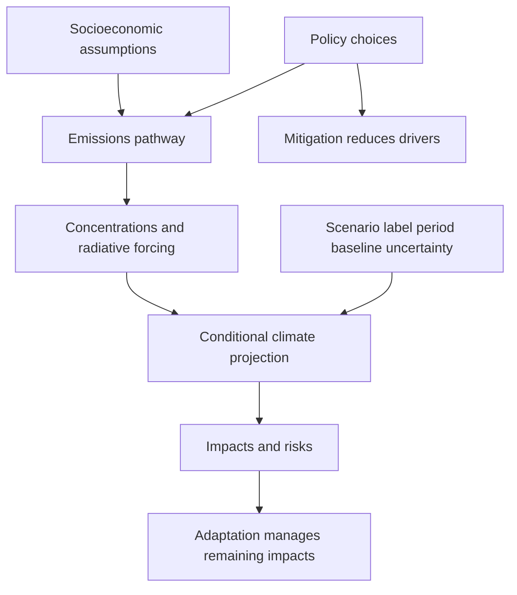

[[01_Notes/2026_2027/Winter_Semester/Economics_of_Green_Deal/Economics_of_Green_Deal_main.md#Week 3|Back to Economics of Green Deal — Week 3]]

Source: [[00_Materials/2026_2027/Winter_Semester/Economics_of_Green_Deal/Week_3/02_AQImp-ClimateChange.pdf]]

# Climate scenarios, policy and adaptation

A climate scenario asks what follows **if** a coherent set of social, technological, emissions and policy conditions occurs. It is not an assigned probability or an unconditional forecast. The lecture uses older RCP projections alongside newer SSP-labelled examples; the two naming systems and their temperature baselines must be distinguished. [[00_Materials/2026_2027/Winter_Semester/Economics_of_Green_Deal/Week_3/02_AQImp-ClimateChange.pdf#page=40|02_AQImp-ClimateChange.pdf, physical PDF p. 40–45]]

This map follows pp. 40–45 and 43's paired emissions/concentration graphic; it explains why the policy discussion needs both mitigation and adaptation. [[00_Materials/2026_2027/Winter_Semester/Economics_of_Green_Deal/Week_3/02_AQImp-ClimateChange.pdf#page=40|02_AQImp-ClimateChange.pdf, physical PDF p. 40–45]]

## SSP assumptions and RCP forcing pathways

The source presents **SSP2**, “middle of the road,” as its baseline socioeconomic narrative, extending major development trends without a large assumed policy/technology break. That is the lecture's baseline choice, not a universal definition that SSP2 equals one forcing outcome. Shared Socioeconomic Pathways describe demographic, economic and technological narratives; Representative Concentration Pathways describe emissions/concentration/forcing trajectories. [[00_Materials/2026_2027/Winter_Semester/Economics_of_Green_Deal/Week_3/02_AQImp-ClimateChange.pdf#page=41|02_AQImp-ClimateChange.pdf, physical PDF p. 41, 43]]

Radiative forcing measures a change in Earth's energy balance in **W/m²**, as the embedded comments on pp. 41–42 explain. RCP labels 2.6/4.5/6.0/8.5 refer to approximate 2100 forcing levels, with different trajectories toward them. The source associates 2.6/4.5/6.0 with approximately 490/650/850 ppm CO2-equivalent and leaves 8.5 unfinished. These are the slide's older shorthand values, not concentrations of CO2 alone; the exact trajectory and whether a quoted value is a peak or endpoint matter. Its claim that forcing is “declining” should not be read as monotonic decline throughout every RCP. [[00_Materials/2026_2027/Winter_Semester/Economics_of_Green_Deal/Week_3/02_AQImp-ClimateChange.pdf#page=41|02_AQImp-ClimateChange.pdf, physical PDF p. 41]]

There is a source inconsistency: p. 41 calls RCP6.0 “close to SSP2,” whereas p. 42 calls RCP8.5 “close to SSP2.” A socioeconomic family does not uniquely identify a forcing path. **Authoritative clarification:** IPCC AR6 WGI SPM BoxSPM.1 and note 22 define **SSPx-y** as socioeconomic family x plus approximate 2100 forcing y. The supplied p. 43 itself shows SSP2-4.5 as intermediate, alongside SSP1-1.9/SSP1-2.6 and SSP3-7.0/SSP5-8.5. [IPCC AR6 WGI SPM, BoxSPM.1/note22](https://www.ipcc.ch/report/ar6/wg1/chapter/summary-for-policymakers/). Thus neither conflicting “close to” statement is used as a one-to-one mapping. [[00_Materials/2026_2027/Winter_Semester/Economics_of_Green_Deal/Week_3/02_AQImp-ClimateChange.pdf#page=41|02_AQImp-ClimateChange.pdf, physical PDF p. 41–43]]

## The AR5 temperature table needs its reference period

The supplied p. 42 table reports the following **°C changes relative to 1986–2005**, verified from IPCC 2014 Synthesis Report Table 2.1 (printed p. 60 and its notes). That missing baseline is essential: these are not automatically additional temperatures above the Paris preindustrial reference. Entries are means with the source's likely ranges; scenarios are conditional, and range width is not a probability assigned to the scenario itself. [[00_Materials/2026_2027/Winter_Semester/Economics_of_Green_Deal/Week_3/02_AQImp-ClimateChange.pdf#page=42|02_AQImp-ClimateChange.pdf, physical PDF p. 42]]

| RCP |2046–2065 mean (likely range),°C|2081–2100 mean (likely range),°C|
|---|---|---|
|2.6|1.0 (0.4–1.6)|1.0 (0.3–1.7)|
|4.5|1.4 (0.9–2.0)|1.8 (1.1–2.6)|
|6.0|1.3 (0.8–1.8)|2.2 (1.4–3.1)|
|8.5|2.0 (1.4–2.6)|3.7 (2.6–4.8)|

The official table notes natural variability, forcing/model uncertainty and different confidence for the two horizons. Its observed baseline offset is not itself a complete uncertainty conversion rule, so do not add a constant and reuse the identical uncertainty range without qualification. [IPCC2014 Synthesis Report, Table2.1 and notes](https://www.ipcc.ch/site/assets/uploads/2018/02/SYR_AR5_FINAL_full.pdf). [[00_Materials/2026_2027/Winter_Semester/Economics_of_Green_Deal/Week_3/02_AQImp-ClimateChange.pdf#page=42|02_AQImp-ClimateChange.pdf, physical PDF p. 42]]

![[01_Notes/2026_2027/Winter_Semester/Economics_of_Green_Deal/assets/Week_3_Emissions_Concentration_Scenarios.png]]

Physical p. 43 compares annual CO2 emissions (billions of tonnes/year) with resulting atmospheric CO2 concentrations (ppm). Low-emission paths bend down and can become net negative; concentrations need not follow emissions one-for-one because they reflect accumulated additions and removals. The caption says only central illustrative curves are shown, not the full uncertainty distribution. This graphic therefore illustrates scenario mechanisms rather than exact forecasts. [[00_Materials/2026_2027/Winter_Semester/Economics_of_Green_Deal/Week_3/02_AQImp-ClimateChange.pdf#page=43|02_AQImp-ClimateChange.pdf, physical PDF p. 43]]

## Climate policy: source claims and verified chronology

Physical p. 44 names the UNFCCC, Kyoto arrangements and annual Conferences of the Parties (COPs). It refers to Annex I/II groupings and writes “DCM, JI”; the recognized Kyoto project mechanism is **CDM, Clean Development Mechanism**, alongside Joint Implementation. Annex groupings/targets are not all interchangeable: the official Kyoto overview distinguishes the Convention's annex structure and Kyoto Annex B commitments. Only that overview is needed here, not an invented treaty-law curriculum. **Correction:** the slide's “1996 Kyoto Protocol” is wrong; Kyoto was adopted 11 December 1997 and entered into force 16 February 2005. [UNFCCC Kyoto overview, opening/market mechanisms](https://unfccc.int/process-and-meetings/the-kyoto-protocol). [[00_Materials/2026_2027/Winter_Semester/Economics_of_Green_Deal/Week_3/02_AQImp-ClimateChange.pdf#page=44|02_AQImp-ClimateChange.pdf, physical PDF p. 44]]

The lecture describes Paris COP21 in 2015 as pursuing warming well below 2°C and efforts toward 1.5°C above preindustrial levels, with peaking as soon as possible and rapid subsequent reductions. Its discussion of INDCs concerns the pledges at that historical conference, not a checked present-day assessment of every NDC. The slide calls 4 November 2016 a “ratification” date; it is the Agreement's **entry into force** date. Adoption was 12 December 2015; individual parties ratify on their own dates. [UNFCCC Paris overview](https://unfccc.int/process-and-meetings/the-paris-agreement). [[00_Materials/2026_2027/Winter_Semester/Economics_of_Green_Deal/Week_3/02_AQImp-ClimateChange.pdf#page=44|02_AQImp-ClimateChange.pdf, physical PDF p. 44]]

The slide's subsequent conference list runs through COP30/Brazil 2025, naming Marrakesh 2016, Bonn 2017, Katowice 2018, Madrid 2019, the 2020 pandemic gap, Glasgow 2021, Cairo 2022, Dubai 2023 and Baku 2024. **Location correction:** COP27 was in Sharm el-Sheikh, Egypt, not Cairo; the official proceedings state its 2022 venue. [UNFCCC COP27 proceedings listing](https://unfccc.int/event/cop-27). These are the source's historical orientation, not a live future meeting schedule. [[00_Materials/2026_2027/Winter_Semester/Economics_of_Green_Deal/Week_3/02_AQImp-ClimateChange.pdf#page=44|02_AQImp-ClimateChange.pdf, physical PDF p. 44]]

## Mitigation and adaptation solve different parts of the problem

Mitigation reduces climate-change drivers, such as net greenhouse-gas emissions; adaptation changes exposure/vulnerability and responses to climatic effects that still occur. Physical p. 45 combines a historical/projected warming panel with five escalating risk categories—unique/threatened systems, extreme weather, distribution of impacts, global aggregate impacts and large-scale singular events. Coloured transitions represent increasing risk, not cash damages or a uniform threshold for all outcomes. It overlays Paris NDC/aspiration labels on an AR5-era figure and concludes that even successful mitigation leaves impacts requiring adaptation. Read the overlay as a teaching illustration, not a current quantified forecast of the Paris pledges. [[00_Materials/2026_2027/Winter_Semester/Economics_of_Green_Deal/Week_3/02_AQImp-ClimateChange.pdf#page=45|02_AQImp-ClimateChange.pdf, physical PDF p. 45]]

The core reading path is assumptions→emissions→forcing→conditional climate→risks, then the complementary responses. Matching scenario type, baseline, date and uncertainty is prerequisite to using the numbers; conference chronology is supporting context with the source errors explicitly repaired here. [[00_Materials/2026_2027/Winter_Semester/Economics_of_Green_Deal/Week_3/02_AQImp-ClimateChange.pdf#page=40|02_AQImp-ClimateChange.pdf, physical PDF p. 40–45]]
