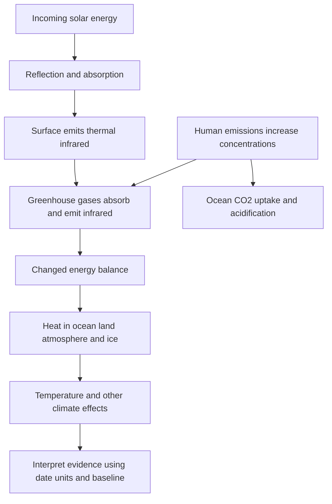

[[01_Notes/2026_2027/Winter_Semester/Economics_of_Green_Deal/Economics_of_Green_Deal_main.md#Week 3|Back to Economics of Green Deal — Week 3]]

Source: [[00_Materials/2026_2027/Winter_Semester/Economics_of_Green_Deal/Week_3/02_AQImp-ClimateChange.pdf]]

# Greenhouse effect, CO2 and Earth's energy

Why does increasing atmospheric greenhouse-gas abundance alter climate, and where does the extra energy go? The lecture links radiation, concentrations and Earth's heat inventory. A temperature change is one consequence of an energy imbalance; ocean heating and ice change are also part of that response. [[00_Materials/2026_2027/Winter_Semester/Economics_of_Green_Deal/Week_3/02_AQImp-ClimateChange.pdf#page=20|02_AQImp-ClimateChange.pdf, physical PDF p. 20–39]]

This source-derived map follows physical pp. 21–39 and distinguishes a radiative mechanism, its evidence and a separate chemical effect of CO2. [[00_Materials/2026_2027/Winter_Semester/Economics_of_Green_Deal/Week_3/02_AQImp-ClimateChange.pdf#page=21|02_AQImp-ClimateChange.pdf, physical PDF p. 21–39]]

## The radiative mechanism and its limits as an analogy

The Czech schematic on p. 22 shows incoming sunlight, some reflection by Earth's surface/atmosphere, absorption at the surface and outgoing longwave heat radiation. Greenhouse gases/clouds absorb and emit part of that infrared radiation, including downward emission. “Sluneční záření” is solar radiation, “Země” Earth and “atmosféra” atmosphere. The source's text describes this as absorption and “reflection” by greenhouse-gas molecules; the physical mechanism is absorption and re-emission, not a literal infrared mirror. The embedded comment likewise contrasts reflected sunlight and thermal radiation. [[00_Materials/2026_2027/Winter_Semester/Economics_of_Green_Deal/Week_3/02_AQImp-ClimateChange.pdf#page=22|02_AQImp-ClimateChange.pdf, physical PDF p. 22, 24–25]]

The p. 23 historical teaching diagram gives absorbed sunlight 235 W/m², split into 67 atmospheric and 168 surface absorption. Thermal loss to space is 195+40=235 W/m²; its larger internal downward/upward flows (including 324 downward and 350 absorbed greenhouse radiation) do not create energy but redistribute it within the surface–atmosphere system. These are the figure's illustrative older-budget values, not a current measurement of every energy flux. [[00_Materials/2026_2027/Winter_Semester/Economics_of_Green_Deal/Week_3/02_AQImp-ClimateChange.pdf#page=23|02_AQImp-ClimateChange.pdf, physical PDF p. 23]]

![[01_Notes/2026_2027/Winter_Semester/Economics_of_Green_Deal/assets/Week_3_Greenhouse_Budget.png]]

Natural greenhouse warming makes the surface warmer than it would be without this radiative effect. **Change** in greenhouse-gas abundance enhances that natural effect and changes the balance; a natural greenhouse effect by itself is not synonymous with ongoing human-caused climate change. CO2 is a central long-lived greenhouse gas, not the only one: methane, nitrous oxide and halogenated gases also matter. The source's description of CO2 as “most important” is read in its long-lived anthropogenic context rather than ignoring water-vapour/cloud feedback. [[00_Materials/2026_2027/Winter_Semester/Economics_of_Green_Deal/Week_3/02_AQImp-ClimateChange.pdf#page=24|02_AQImp-ClimateChange.pdf, physical PDF p. 24–25]]

The lecture says CO2 supplied about two-thirds of the total human-produced greenhouse-gas heating influence in 2021. Keep its year and denominator; a share of total forcing and a share of the **increase since 1990** are different statistics. Its list includes “black carbon” among gases on pp. 25/48; that is a category error. Black carbon is an aerosol/soot component, not a greenhouse gas. The European Commission JRC glossary explicitly defines it as an aerosol species: [consulted definition](https://knowledge4policy.ec.europa.eu/glossary-item/black-carbon_en). [[00_Materials/2026_2027/Winter_Semester/Economics_of_Green_Deal/Week_3/02_AQImp-ClimateChange.pdf#page=24|02_AQImp-ClimateChange.pdf, physical PDF p. 24–25, 48]]

## Concentration is not a global daily average by default

A concentration in **ppm** measures a fraction of atmospheric molecules; Mauna Loa is a particular station, a daily/monthly average is not an annual average, and a global marine-surface estimate is not a station reading. The seasonal cycle on the Mauna Loa graphs reflects Northern Hemisphere vegetation uptake/decay over the year, superimposed on a long-term human-driven rise. [[00_Materials/2026_2027/Winter_Semester/Economics_of_Green_Deal/Week_3/02_AQImp-ClimateChange.pdf#page=27|02_AQImp-ClimateChange.pdf, physical PDF p. 27–29]]

The source reports global 419.3 ppm in 2023, global 422.7 ppm in 2024, and a Mauna Loa daily 425.68 ppm on 1 November 2025; the last is a source-reported dated station value, not independently reconstructed daily data. Its 2024 “increase over 2023” 3.75 ppm is not the arithmetic difference of the displayed annual means (422.7−419.3=3.4). These statements mix vintages and annual-average versus within-year growth conventions. **Reference check:** NOAA's archived 21 May 2025 article reports global 2024 annual 422.8 ppm, within-2024 increase 3.75 ppm and Mauna Loa annual 424.61 ppm. This explains why year/series/averaging definition must accompany a number; the source 422.7 differs from that reference and from its own p. 30 figure 422.8. [NOAA, “Carbon dioxide levels in 2024”](https://content-drupal.climate.gov/news-features/understanding-climate/climate-change-atmospheric-carbon-dioxide). These are documented historical comparisons, not live 2026 concentrations. [[00_Materials/2026_2027/Winter_Semester/Economics_of_Green_Deal/Week_3/02_AQImp-ClimateChange.pdf#page=28|02_AQImp-ClimateChange.pdf, physical PDF p. 28–30]]

Physical p. 30 compares an 800,000-year ice-core record (below about 300 ppm in that displayed record) with a modern dot. Its graphic labels **2024 average 422.8 ppm**, while the caption still says 2022. The observed lesson is the large, rapid recent rise relative to those glacial/interglacial variations; the inconsistent caption year is retained explicitly rather than relabeling the figure silently. The source attributes the underlying reconstruction to Lüthi et al. 2008/NOAA NCEI. [[00_Materials/2026_2027/Winter_Semester/Economics_of_Green_Deal/Week_3/02_AQImp-ClimateChange.pdf#page=30|02_AQImp-ClimateChange.pdf, physical PDF p. 30]]

## Reading the temperature evidence

Physical p. 32 is a deep-time reconstructed-temperature composite with **nonuniform time scales**: millions, then thousands of years, with geological periods and human-evolution labels. It illustrates long-run climate variation; straight visual slopes across scale changes do not measure comparable rates. Physical p. 33's heading mentions a “hockey stick dispute,” but its actual graph compares several historical temperature series over roughly 1840–2000. It is not, by itself, a millennium reconstruction or a resolution of every attribution dispute. [[00_Materials/2026_2027/Winter_Semester/Economics_of_Green_Deal/Week_3/02_AQImp-ClimateChange.pdf#page=32|02_AQImp-ClimateChange.pdf, physical PDF p. 32–33]]

Physical p. 34 is explicitly a **one-day average 2 m temperature field for 25 February 2018** from GFS/ClimateReanalyzer. It shows spatial weather variation, not a global multi-decade trend or an anomaly with a stated climatology. Physical p. 35 instead gives a global land/sea temperature **anomaly relative to 1961–1990**, with an 1850–2023 plotted record and grey 95% confidence bounds. An anomaly is a difference from that reference mean, not the absolute surface temperature. It cannot be directly equated with a warming target relative to a different preindustrial baseline. [[00_Materials/2026_2027/Winter_Semester/Economics_of_Green_Deal/Week_3/02_AQImp-ClimateChange.pdf#page=34|02_AQImp-ClimateChange.pdf, physical PDF p. 34–35]]

## Energy imbalance and the heat inventory

Incoming energy minus outgoing radiation is the net energy flux. A positive imbalance means energy accumulates in Earth's system. The source's von Schuckmann et al. 2020 figure estimates **358±37 ZJ** total heat gain over 1971–2018 (1 ZJ=$10^{21}$joules), equivalent to mean **0.47±0.10 W/m²**. Its 2010–2018 estimate is **0.87±0.12 W/m²**. These different periods must remain attached to the values. [[00_Materials/2026_2027/Winter_Semester/Economics_of_Green_Deal/Week_3/02_AQImp-ClimateChange.pdf#page=36|02_AQImp-ClimateChange.pdf, physical PDF p. 36–37]]

For 1971–2018, the diagram partitions heat uptake into ocean 89%, land 6%, cryosphere 4% and atmosphere 1%. Parentheses give 2010–2018 values 90%, 5%, 3%, 2%. Ocean layers account for 52% upper 0–700 m, 28% at 700–2000 m and 9% below 2000 m in the longer period, versus 52/30/8% in the later period. The ocean dominates: surface-air temperature alone does not measure all the accumulated energy. **Reference verification:** the cited original's §6 and Figure 8/caption reproduce the periods/partition and clarify the conditional calculation: [von Schuckmann et al.2020](https://essd.copernicus.org/articles/12/2013/2020/). [[00_Materials/2026_2027/Winter_Semester/Economics_of_Green_Deal/Week_3/02_AQImp-ClimateChange.pdf#page=37|02_AQImp-ClimateChange.pdf, physical PDF p. 37]]

![[01_Notes/2026_2027/Winter_Semester/Economics_of_Green_Deal/assets/Week_3_Earth_Heat_Inventory.png]]

The figure's “−57±8 ppm” is the paper's modeled CO2 reduction from an approximately 410 ppm reference needed to counter its estimated 2010–2018 imbalance under its radiative assumptions. It is neither an observed concentration decline nor an unconditional present-day policy target. The paper also notes other greenhouse-gas changes affect that calculation. [[00_Materials/2026_2027/Winter_Semester/Economics_of_Green_Deal/Week_3/02_AQImp-ClimateChange.pdf#page=37|02_AQImp-ClimateChange.pdf, physical PDF p. 37]]

Physical p. 38 shows ocean-heat-content anomalies relative to 2005–2017 for 0–300, 0–700, 0–2000 and 700–2000 m layers, with ensemble 2σ shading. Some depth bands overlap, so adding all curves would double count heat. The caption specifies the ocean area 60°S–60°N and bathymetry restrictions for the contributing products; do not generalize its per-area axis into an unqualified global total. Rising curves and uncertainty bands support ocean warming within that study coverage. [[00_Materials/2026_2027/Winter_Semester/Economics_of_Green_Deal/Week_3/02_AQImp-ClimateChange.pdf#page=38|02_AQImp-ClimateChange.pdf, physical PDF p. 38]]

## CO2 also changes ocean chemistry

CO2 dissolving into seawater changes carbonate chemistry and lowers pH. Physical p. 39 reports surface-ocean pH falling from 8.21 to 8.10 since industrialization and contrasts an intact shell with one exposed to more corrosive conditions. “Acidification” means decreasing pH; it does not mean the average seawater has already become acidic in the everyday pH<7 sense. The shell comparison illustrates a biological consequence but supplies no full experiment protocol for estimating an effect size. This chemical pathway is distinct from the radiative-heating pathway even though both start with increased CO2. [[00_Materials/2026_2027/Winter_Semester/Economics_of_Green_Deal/Week_3/02_AQImp-ClimateChange.pdf#page=39|02_AQImp-ClimateChange.pdf, physical PDF p. 39]]

The core foundations are radiation/energy conservation, concentration-versus-emission units and period/reference baselines, because those distinctions keep every graph interpretable. Historical temperatures and the shell image support these mechanisms without becoming current datasets or independent causal estimates. [[00_Materials/2026_2027/Winter_Semester/Economics_of_Green_Deal/Week_3/02_AQImp-ClimateChange.pdf#page=22|02_AQImp-ClimateChange.pdf, physical PDF p. 22–39]]
