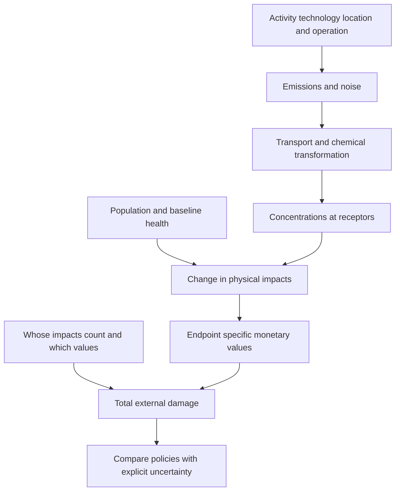

[[01_Notes/2026_2027/Winter_Semester/Economics_of_Green_Deal/Economics_of_Green_Deal_main.md#Week 3|Back to Economics of Green Deal — Week 3]]

Source: [[00_Materials/2026_2027/Winter_Semester/Economics_of_Green_Deal/Week_3/02_AQImp-ClimateChange.pdf]]

# Impact pathways, health valuation and standing

Why can the same tonne of pollution cause different damages in different places? Emissions are only the beginning of the causal chain. An impact-pathway assessment follows a specified activity through dispersion, exposure and physical effects, then values those effects for an explicitly chosen population. This connects Week 2 externality and benefit-cost concepts to a practical damage estimate. [[00_Materials/2026_2027/Winter_Semester/Economics_of_Green_Deal/Week_3/02_AQImp-ClimateChange.pdf#page=1|02_AQImp-ClimateChange.pdf, physical PDF p. 1–5, 19]]

This map follows physical pp. 2–13 and 19. Its central distinction is between a pressure, an exposure, an impact and a money value; each arrow needs different evidence. [[00_Materials/2026_2027/Winter_Semester/Economics_of_Green_Deal/Week_3/02_AQImp-ClimateChange.pdf#page=2|02_AQImp-ClimateChange.pdf, physical PDF p. 2–13, 19]]

## Top-down allocation versus bottom-up pathways

The top-down diagram starts from a national damage estimate and a pollutant/activity allocation, then assigns a fraction of damage to the activity. It can be useful at an aggregate level but does not itself trace where a particular source's emissions travel. The bottom-up side begins with resource use (electricity production), follows SO2 emissions and atmospheric concentrations, ecosystem acidification/disruption, damage to forest production/non-production functions, and market/non-market valuation. Moving from a national average to a specific plant requires those physical and receptor distinctions. [[00_Materials/2026_2027/Winter_Semester/Economics_of_Green_Deal/Week_3/02_AQImp-ClimateChange.pdf#page=2|02_AQImp-ClimateChange.pdf, physical PDF p. 2]]

The lecture describes **ExternE (Externalities of Energy)** as an EU research series launched in 1991, initially concerned with airborne pollution from power plants and later transport, industry and other activities. It connects the method to DPSIR: driving forces, pressures, state, impacts and responses. Its note that “I” is monetized impacts describes the valuation endpoint of this application; one must still calculate physical impacts before money values can be attached. Damage depends on technology, operation, location, time, the included fuel-cycle boundary and population preferences. [[00_Materials/2026_2027/Winter_Semester/Economics_of_Green_Deal/Week_3/02_AQImp-ClimateChange.pdf#page=3|02_AQImp-ClimateChange.pdf, physical PDF p. 3–4]]

## From concentration to a receptor-specific impact

The Lauffen/Stuttgart example maps changes in sulfate concentration due to a plant's SO2 emissions across Europe. The pressure-map legend is in **ng/m³**. A separate receptor map shows where potentially exposed people live. The mortality/life-year-loss map combines exposure changes and population response: a high concentration change in a sparsely populated area need not create the largest health loss. Transboundary transport explains why damages need not stay within the emitting jurisdiction. The maps' different units and colour breaks must not be equated. [[00_Materials/2026_2027/Winter_Semester/Economics_of_Green_Deal/Week_3/02_AQImp-ClimateChange.pdf#page=5|02_AQImp-ClimateChange.pdf, physical PDF p. 5–8]]

![[01_Notes/2026_2027/Winter_Semester/Economics_of_Green_Deal/assets/Week_3_Impact_Pathway.png]]

The source diagram moves from emissions through transport/chemistry to human/material/crop effects and only then money. Treating an emission quantity itself as a welfare loss would skip the receptor and valuation steps. [[00_Materials/2026_2027/Winter_Semester/Economics_of_Green_Deal/Week_3/02_AQImp-ClimateChange.pdf#page=5|02_AQImp-ClimateChange.pdf, physical PDF p. 5]]

An exposure/dose/concentration-response function connects a specified exposure change with a specified outcome. Physical p. 9 gives the illustrative equation

$$\text{additional years of life lost}=3.9\times10^{-5}\,\Delta\text{Sulfate}\times\text{Population}.$$

The coefficient embodies a response per concentration unit and exposed person, so concentration units, population definition and exposure period must match its calibration. The slide does **not** supply those calibration units/time details; the ng/m³ map is not permission to assume the equation uses ng/m³. This formula supports the pathway logic, but not a reproducible numerical health estimate without that missing context. Its graph contrasts linear, nonlinear, threshold/limited and initially beneficial (“fertilizing”) shapes; choosing a straight line is a substantive response assumption, not an automatic property of every pollutant. [[00_Materials/2026_2027/Winter_Semester/Economics_of_Green_Deal/Week_3/02_AQImp-ClimateChange.pdf#page=9|02_AQImp-ClimateChange.pdf, physical PDF p. 9]]

## Endpoints and the source response-value table

The source includes particulate matter, SO2/NOx/NH3/VOC, CO2, heavy metals, noise and odour as burdens, with health, buildings/materials, crops, climate, landscape, visibility and cultural heritage as impact categories. Its p. 11 embedded comment adds respiratory admissions, restricted activity, congestive heart failure, nonfatal cancer, bronchitis and asthma; material ageing/soiling across metals, paint and stone; and crop-yield changes for barley, oats, potato, rye, sugar beet, wheat, sunflower, rice and tobacco. The category list does not assert that every burden affects every endpoint equally. [[00_Materials/2026_2027/Winter_Semester/Economics_of_Green_Deal/Week_3/02_AQImp-ClimateChange.pdf#page=11|02_AQImp-ClimateChange.pdf, physical PDF p. 11, 11]]

![[01_Notes/2026_2027/Winter_Semester/Economics_of_Green_Deal/assets/Week_3_Concentration_Response_Table.png]]

Physical p. 10's complete table retains its endpoint units and numerical entries. Long-term PM2.5 adult mortality is expressed per year of life lost (YOLL), while infant mortality and bronchitis rows are per case. Short-term PM2.5/PM10/O3 rows distinguish restricted/work days, respiratory/cardiovascular admissions, asthma symptoms and mortality. A value per day cannot be multiplied by a number of people without specifying days per person; a value per YOLL is not a value per death. The CRF column is calibrated per 10 µg/m³, whereas the noise rows use weighted day-evening-night level $L_{den}$ in dB and separate quadratic annoyance functions. The table alone does not supply baseline disease frequencies, age structure or valid concentration/noise ranges; do not extrapolate its curves outside their study context. [[00_Materials/2026_2027/Winter_Semester/Economics_of_Green_Deal/Week_3/02_AQImp-ClimateChange.pdf#page=10|02_AQImp-ClimateChange.pdf, physical PDF p. 10]]

A CRF such as **1.019 per 10 µg/m³** is a relative risk: for that concentration increment, the respiratory-admission rate is multiplied by 1.019, a **1.9% relative increase**. It is not 1.019 extra admissions per person, and it is not a YOLL conversion. As an explicitly simplified calculation for a 10 µg/m³ increase from a reference exposure, if the baseline admission rate is $r_0$ cases per person per year and the exposed population is $N$, then

$$\Delta\text{cases}\approx N r_0(1.019-1).$$

For an illustrative baseline of 0.01 admissions per person per year and 100,000 exposed people, the reference count is 1,000 admissions per year and the increase is 19 per year. These invented round inputs teach the calculation; they are not an estimate for the lecture's plant. Other increments require the study's specified response function, and reductions from an already exposed observed baseline require the corresponding attributable-fraction calculation rather than silently reusing the same baseline. The baseline incidence, exposed population, period and endpoint must match. Mortality-to-YOLL estimation additionally needs life-expectancy/age information; a relative-risk coefficient alone cannot produce life years. This expands the source's pathway reasoning, supported by the manuscript's Methods/Table 1. [[00_Materials/2026_2027/Winter_Semester/Economics_of_Green_Deal/Week_3/02_AQImp-ClimateChange.pdf#page=10|02_AQImp-ClimateChange.pdf, physical PDF p. 10]]

**Bounded reference verification:** Máca, Melichar, Ščasný and Braun Kohlová (2017), “Valuing environmental health for informed policy-making,” *Reviews on Environmental Health* 32(1–2), 171–175, author manuscript physical pp. 3–5 (Methods/Table 1/perspectives), confirms that background population and incidence enter the assessment, and identifies the values as euro 2014. It also distinguishes physical modeling uncertainty from economic standing/value choices. [Consulted author manuscript](https://mpra.ub.uni-muenchen.de/92550/1/MPRA_paper_92550.pdf). This verifies interpretation of the supplied table, rather than importing its whole case study as assigned scope.

## Monetizing the change in health and welfare

Market prices can inform crop losses, material repair and medical-resource costs. Non-market values address pain, premature mortality risk, recreation, aesthetic and landscape losses that have no complete market transaction. **Willingness to pay (WTP)** asks what someone would give up to avoid an adverse change or obtain an improvement. It is preference-based valuation of the change, not a statement that a person's intrinsic worth equals an invoice. [[00_Materials/2026_2027/Winter_Semester/Economics_of_Green_Deal/Week_3/02_AQImp-ClimateChange.pdf#page=12|02_AQImp-ClimateChange.pdf, physical PDF p. 12–13]]

For mortality, the source emphasizes WTP for a reduction in the risk of dying and the difficulty of eliciting life-expectancy changes. Quality-adjusted/disability-based values depend on context and cause; the lecture does not supply a universal price per QALY/DALY. For morbidity, cost of illness includes medical treatment and lost earnings, while pain/inconvenience require a separate welfare component. Development/fertility examples include risks of very low birth weight, birth defects, conception and IQ, plus IVF/training/earnings costs. Mental-health impacts can also be elicited through WTP studies. These components must be consistently defined to avoid counting the same loss twice. [[00_Materials/2026_2027/Winter_Semester/Economics_of_Green_Deal/Week_3/02_AQImp-ClimateChange.pdf#page=13|02_AQImp-ClimateChange.pdf, physical PDF p. 13]]

A useful **agent synthesis** of the pathway is

$$D=\sum_{r}\sum_{j}\Delta I_{rj}\,v_{rj},$$

where $\Delta I_{rj}$ is the modeled change in endpoint $j$ for receptor region $r$ and $v_{rj}$ is a value per matching endpoint unit, in a specified currency/year. This is not a new estimated response law: it states how checked physical changes and unit values combine. Changing receptor coverage or monetary weights changes $D$ even if emissions are unchanged. [[00_Materials/2026_2027/Winter_Semester/Economics_of_Green_Deal/Week_3/02_AQImp-ClimateChange.pdf#page=5|02_AQImp-ClimateChange.pdf, physical PDF p. 5, 10, 12–13, 19]]

## What the electricity comparisons show

Physical p. 14 decomposes Czech plant external costs in Kč/kWh into health, crops, buildings, biodiversity and climate. Its plant totals differ, with the largest displayed bars around 3 Kč/kWh and smaller ones below 1; health is a major component. Physical p. 15 instead groups fuel/technology examples and explicitly states **2008 prices**: displayed examples range from about 0.2–0.4 for some gas configurations to 3.5 Kč/kWh for a biomass example; brown-coal examples include 1.2, 2.1, 2.9 and other values, and biogas examples 0.4, 0.5, 0.9. Different technologies and operating/location assumptions matter: the diagram is not proof that every biomass plant is more damaging than every coal plant. These are historical external-cost assessments, not current electricity prices or full private generation costs. [[00_Materials/2026_2027/Winter_Semester/Economics_of_Green_Deal/Week_3/02_AQImp-ClimateChange.pdf#page=14|02_AQImp-ClimateChange.pdf, physical PDF p. 14–15]]

![[01_Notes/2026_2027/Winter_Semester/Economics_of_Green_Deal/assets/Week_3_Electricity_External_Costs.png]]

The full fuel/technology graphic retains every category and displayed number. Its six-component legend includes heavy metals as well as health/biodiversity/climate/materials/crops. Read the bars within this source's price year and configuration labels; do not combine them with a current market tariff. [[00_Materials/2026_2027/Winter_Semester/Economics_of_Green_Deal/Week_3/02_AQImp-ClimateChange.pdf#page=15|02_AQImp-ClimateChange.pdf, physical PDF p. 15]]

## Denmark and local versus imported pollution

The 2021 Danish illustration attributes about 74% (roughly 3,000 premature deaths) to foreign sources and 26% (roughly 1,000) to Danish sources. Within the domestic pie it shows agriculture 22%, road traffic 21%, other mobile 7%, energy industries 7%, nonindustrial combustion 36%, others 7%; annotations include about 220 traffic deaths, about 70 each for other mobile/energy industries and about 330 household/SNAP2 deaths (about 240 from wood stoves). Danish contributions to deaths **abroad**, about 2,300, are a different receptor total. These rounded modeled source contributions are not additive exact counts of identified persons. [[00_Materials/2026_2027/Winter_Semester/Economics_of_Green_Deal/Week_3/02_AQImp-ClimateChange.pdf#page=16|02_AQImp-ClimateChange.pdf, physical PDF p. 16]]

The 2019–2021 EVA v7.1 table gives approximately 427 short-exposure and 3,460 long-exposure premature deaths, total about 3,890. Its rounded pollutant totals are SO2~25, O3~85, NO2 ~30 and PM2.5 ~3,740. PM2.5 includes primary particles and secondary material formed in the atmosphere. The slide lists “NH4” among emitted precursor gases; **ammonia is NH3**, while ammonium NH4+ occurs in particle salts. EEA's “Sources and emissions of air pollutants in Europe,” pollutant definitions/secondary-PM passage, verifies ammonia's precursor role: [EEA source](https://www.eea.europa.eu/en/analysis/publications/air-quality-in-europe-2022/sources-and-emissions-of-air-pollutants-in-europe). The table's rounded rows/columns need not reconcile exactly, and blank cells should not be silently interpreted as exact zero. [[00_Materials/2026_2027/Winter_Semester/Economics_of_Green_Deal/Week_3/02_AQImp-ClimateChange.pdf#page=17|02_AQImp-ClimateChange.pdf, physical PDF p. 17]]

On p. 18 the narrative local shares (including unexplained Copenhagen 12%, 5%, 9%) and the table are different presentations: the table explicitly concerns **2030 Nordic capital-city contributions**, giving city/country/abroad shares Copenhagen 15/23/63, Stockholm 35/18/47, Helsinki 25/21/53 and Reykjavík 43/27/30 percent. Rounding explains sums such as 101%; it does not resolve the unlabeled Copenhagen narrative figures. The common lesson is that local measures address only part of exposure, with traffic and wood stoves identified as large local sources. Retain the differing year/boundary labels instead of treating the figures as one exact estimate. [[00_Materials/2026_2027/Winter_Semester/Economics_of_Green_Deal/Week_3/02_AQImp-ClimateChange.pdf#page=18|02_AQImp-ClimateChange.pdf, physical PDF p. 18]]

## Economic standing: whose loss counts?

Standing chooses whose impacts enter the benefit-cost account: residents of the emitting country, EU residents, or people worldwide. Valuation then chooses Czech unit values, uniform EU values, or country-specific WTP. These are separate decisions. Physical p. 19's four perspectives—Czech narrow, Czech broad, EU and independent observer—produce different stacked cost totals and geographical shares for the same mining-limit variants. Narrow standing excludes much of the transboundary harm; broader standing includes it. The figure is therefore about ethical/policy boundaries and monetary weights as well as atmospheric science. The source article's Methods/perspectives verifies this distinction. [[00_Materials/2026_2027/Winter_Semester/Economics_of_Green_Deal/Week_3/02_AQImp-ClimateChange.pdf#page=19|02_AQImp-ClimateChange.pdf, physical PDF p. 19]]

The four perspectives use these distinct rules in the cited mining case:

| Perspective | Receptors whose health impacts count | Values applied to matching endpoints |
|---|---|---|
| Czech narrow | Czech population only | Czech values: EU unit values adjusted by the Czech/EU GDP per person at purchasing-power parity, about 0.82 for 2014. |
| Czech broad | All populations covered by the model, including foreign receptors | The same Czech values for every included country. |
| EU policy maker | All modelled populations; the case also includes affected non-EU receptors | Uniform EU unit values for every included country. |
| Independent observer | All modelled populations | Country-specific values, adjusting EU values by each country's relative GDP per person at purchasing-power parity. |

Thus Czech narrow versus broad changes the receptor boundary while holding the value rule fixed; Czech broad versus EU changes monetary weights with the modelled receptor boundary held fixed. The independent-observer calculation adds country-specific weights. “All modelled” is the study's finite geographical coverage, not proof that every global effect was measured. These are appraisal conventions, not claims that a person's intrinsic worth depends on GDP. The bounded manuscript's Methods/perspectives explains the rules. [Máca et al. 2017, manuscript physical pp. 3–5](https://mpra.ub.uni-muenchen.de/92550/1/MPRA_paper_92550.pdf).

The figure's **variants 1–4** are alternative territorial mining limits: 1 keeps the existing limits; 2 revokes them at Bílina only; 3 revokes them at Bílina and partly at ČSA; 4 revokes them at both mines. They alter the coal-extraction/use path over the case's 2015–2050 horizon. Within a variant, changing perspective changes whose damages and which values enter; comparing variants within one perspective changes the mining scenario. The graph should not be read as four different pollutants or four valuation rules alone. [[00_Materials/2026_2027/Winter_Semester/Economics_of_Green_Deal/Week_3/02_AQImp-ClimateChange.pdf#page=19|02_AQImp-ClimateChange.pdf, physical PDF p. 19]]

![[01_Notes/2026_2027/Winter_Semester/Economics_of_Green_Deal/assets/Week_3_Economic_Standing.png]]

Location-specific exposure/response and explicit standing are core because they explain why “one tonne = one universal damage price” fails. The historical plant/Danish/Nordic examples are supporting applications; their exact vintage, units and caveats remain part of their meaning. [[00_Materials/2026_2027/Winter_Semester/Economics_of_Green_Deal/Week_3/02_AQImp-ClimateChange.pdf#page=4|02_AQImp-ClimateChange.pdf, physical PDF p. 4–19]]
