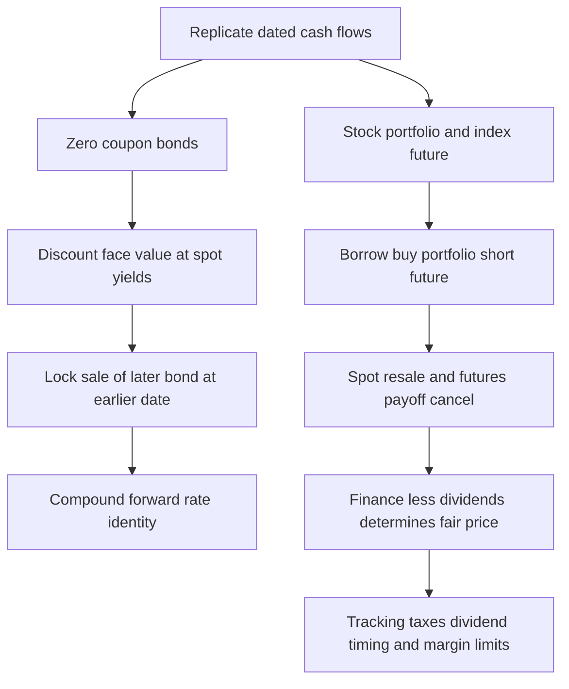

[[01_Notes/2026_2027/Winter_Semester/Financial_Markets_Instruments_I/Financial_Markets_Instruments_I_main.md#Week 3|Back to Financial Markets Instruments I — Week 3]]

Source: [[00_Materials/2026_2027/Winter_Semester/Financial_Markets_Instruments_I/Week_3/L12(CostOfCarryModel).pptx]]

# Bond forward rates and stock index parity

The same no-arbitrage question prices an investment between two future dates and a stock portfolio delivered later. Bonds require compound discount factors; the stock-index slide returns to the lecture's simple carry convention. Keeping those conventions distinct is necessary to interpret each formula correctly. [[00_Materials/2026_2027/Winter_Semester/Financial_Markets_Instruments_I/Week_3/L12(CostOfCarryModel).pptx|L12(CostOfCarryModel).pptx, physical slide 9–10]]

The source relationships and their limitations are on slides 9–10. [[00_Materials/2026_2027/Winter_Semester/Financial_Markets_Instruments_I/Week_3/L12(CostOfCarryModel).pptx|L12(CostOfCarryModel).pptx, physical slide 9–10]]

## Zero-coupon prices and dates

A zero-coupon bond pays only face value $M$ at maturity. Let $T_1<T_2$ be maturities in years and $r_{T_1},r_{T_2}$ the respective annual effective spot yields. Then

$$P_{T_1}=\frac{M}{(1+r_{T_1})^{T_1}},\qquad
P_{T_2}=\frac{M}{(1+r_{T_2})^{T_2}}.$$

These are compound-price definitions for the stated yields, not the simple-interest model from the currency slide. Let $F_{T_2}^{T_1}$ be today's agreed price for delivery of the later bond at $T_1$, and $f_{T_1,T_2}$ the annualized forward yield over $[T_1,T_2]$. At the earlier date the later bond has $T_2-T_1$ years remaining, so

$$F_{T_2}^{T_1}=\frac{M}{(1+f_{T_1,T_2})^{T_2-T_1}}.$$

The forward rate is contracted/implied today. It is distinct from the as-yet-unknown spot yield that may prevail at $T_1$. Treat the bonds as otherwise comparable and free of default risk in this idealized replication. [[00_Materials/2026_2027/Winter_Semester/Financial_Markets_Instruments_I/Week_3/L12(CostOfCarryModel).pptx|L12(CostOfCarryModel).pptx, physical slide 9]]

## Deriving the forward-rate identity

Today issue one earlier bond, receiving $P_{T_1}$ and committing to repay $M$ at $T_1$. Spend those proceeds on $q=P_{T_1}/P_{T_2}$ units of the later bond, and sell those units forward for delivery at $T_1$. Opening net investment is zero. At $T_1$ receive $qF_{T_2}^{T_1}$ under the forward and repay $M$. No arbitrage gives

$$qF_{T_2}^{T_1}=M,\qquad
F_{T_2}^{T_1}=M\frac{P_{T_2}}{P_{T_1}}.$$

Insert the price formulas and cancel $M$:

$$\frac{M}{(1+f_{T_1,T_2})^{T_2-T_1}}
=M\frac{(1+r_{T_1})^{T_1}}{(1+r_{T_2})^{T_2}},$$

$$\boxed{(1+r_{T_2})^{T_2}=(1+r_{T_1})^{T_1}(1+f_{T_1,T_2})^{T_2-T_1}}.$$

The left side is growth over the full $T_2$ years. The right side grows first to $T_1$, then across the remaining interval at a rate locked today. Consequently

$$f_{T_1,T_2}=\left[\frac{(1+r_{T_2})^{T_2}}{(1+r_{T_1})^{T_1}}\right]^{1/(T_2-T_1)}-1.$$

This multiplication of growth factors is why merely subtracting spot yields does not compute the forward rate. It also explains the prerequisite: understand discounting and match dates before using a yield curve. No claim that the implied forward rate predicts the actual future rate follows from the replication. [[00_Materials/2026_2027/Winter_Semester/Financial_Markets_Instruments_I/Week_3/L12(CostOfCarryModel).pptx|L12(CostOfCarryModel).pptx, physical slide 9]]

![[01_Notes/2026_2027/Winter_Semester/Financial_Markets_Instruments_I/assets/Week_3_L12_Zero_Coupon_Parity.png]]

The source's timeline ends at the earlier maturity, because the later bond is sold forward then; there is no need to wait for its final face-value payment to settle this package. [[00_Materials/2026_2027/Winter_Semester/Financial_Markets_Instruments_I/Week_3/L12(CostOfCarryModel).pptx|L12(CostOfCarryModel).pptx, physical slide 9]]

## Stock-index replication and cancellation of spot risk

Let $S_0$ be today's value of a portfolio matching the index, $S_1$ its delivery-date value, $F_0$ the futures price in matching portfolio units, $r$ the annual simple borrowing rate, $d$ annual dividend yield and $T$ years. Borrow $S_0$, buy the tracking portfolio and short matching index futures. At delivery sell the portfolio for $S_1$, receive cumulative futures gain $F_0-S_1$, collect dividends and repay funding. If dividends over the interval are modeled as $dTS_0$, the net payoff is

$$\Pi=S_1-S_0(1+rT)+dTS_0+(F_0-S_1).$$

The uncertain $S_1$ cancels: a lower portfolio resale price produces a larger short-futures gain. Setting remaining cash to zero gives

$$F_0=S_0+(r-d)TS_0.$$

A contract multiplier must be applied consistently to portfolio value and futures gains; mixing an index-point quotation with an unscaled money portfolio invalidates the cancellation. Actual variation margin is daily, while the source aggregates it into a terminal balance. [[00_Materials/2026_2027/Winter_Semester/Financial_Markets_Instruments_I/Week_3/L12(CostOfCarryModel).pptx|L12(CostOfCarryModel).pptx, physical slide 10]]

## The source's terminal-futures-payoff typo

Slide 10's table correctly gives the short-futures balance as $F_0-S_1$, and the final fair-price formula is $F_0=S_0+(r-d)TS_0$. Its displayed intermediate equation, however, writes the last parenthesis as $F_0-S_0$. That subtracts today's spot value instead of the terminal spot value, leaving the uncertain $S_1$ uncancelled and failing to produce the stated replication. The consistent parenthesis is $F_0-S_1$, as used in the derivation above. The dividend term in the source equation is $dTS_0$; it includes the time factor. This note preserves the source typo explicitly rather than using it as a valid algebra step. [[00_Materials/2026_2027/Winter_Semester/Financial_Markets_Instruments_I/Week_3/L12(CostOfCarryModel).pptx|L12(CostOfCarryModel).pptx, physical slide 10]]

## Implementation limits and priority

The source identifies costs of forming and maintaining the tracking portfolio, dividend taxation and uncertain dividend timing as market imperfections. An ETF can reduce the practical cost of acquiring a portfolio that copies an index, but the source does not establish zero tracking cost or certain dividends for every ETF. The core concept is replication and cancellation; ETF implementation is supporting detail whose purpose is to show why an ideal equality may be costly to trade. [[00_Materials/2026_2027/Winter_Semester/Financial_Markets_Instruments_I/Week_3/L12(CostOfCarryModel).pptx|L12(CostOfCarryModel).pptx, physical slide 10]]

**Bounded external verification:** Damodaran's NYU “Futures Arbitrage,” “Stock Index Futures” assumptions, likewise requires known dividends and compatible funding/shorting. This corroborates the limits rather than overriding the course's simple-rate convention. [Consulted passage](https://pages.stern.nyu.edu/~adamodar/New_Home_Page/invfables/futurearb.htm). No current contract terms or live ETF recommendation are inferred.
