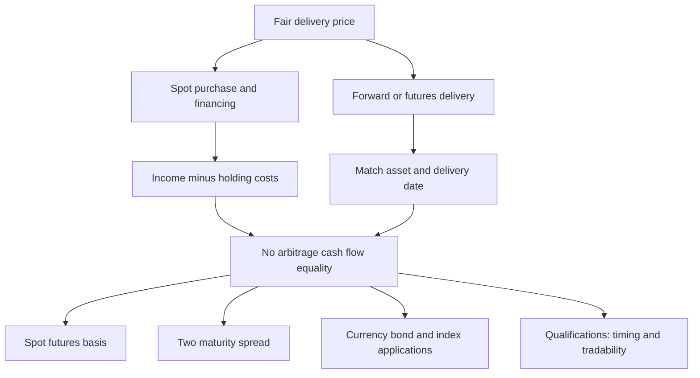

[[01_Notes/2026_2027/Winter_Semester/Financial_Markets_Instruments_I/Financial_Markets_Instruments_I_main.md#Week 3|Back to Financial Markets Instruments I — Week 3]]

Source: [[00_Materials/2026_2027/Winter_Semester/Financial_Markets_Instruments_I/Week_3/L12(CostOfCarryModel).pptx]]

# Cost of carry and calendar spreads

What determines a fair delivery price when an asset can be bought today, financed, and held until delivery? The lecture answers by constructing two ways to obtain the same asset at the same date. Comparing their cash flows removes the need to predict the future spot price. This is the core of Week 3 because currency, bond and index pricing are applications of the same replication logic. [[00_Materials/2026_2027/Winter_Semester/Financial_Markets_Instruments_I/Week_3/L12(CostOfCarryModel).pptx|L12(CostOfCarryModel).pptx, physical slide 2–5]]

This source-grounded map follows physical slides 2–10; the present note develops slides 2–5, with the applications in the other Week 3 notes. [[00_Materials/2026_2027/Winter_Semester/Financial_Markets_Instruments_I/Week_3/L12(CostOfCarryModel).pptx|L12(CostOfCarryModel).pptx, physical slide 2–10]]

## Foundations and conventions

$S_0$ is today's spot price per unit of the underlying, $F_0$ today's agreed delivery price per unit, and $T$ the time to maturity in **years**. Annual decimal rates $d$ and $r$ represent respectively income/benefits and holding costs. The source lists coupons, dividends and convenience yield under $d$, and interest, insurance, storage and deterioration under $r$. In the linear model, income is $dS_0T$, cost is $rS_0T$, and **net carry** is $S_0(d-r)T$. No particular calendar day-count basis is supplied. [[00_Materials/2026_2027/Winter_Semester/Financial_Markets_Instruments_I/Week_3/L12(CostOfCarryModel).pptx|L12(CostOfCarryModel).pptx, physical slide 2–4]]

A long commits to buy and a short to sell. The foundational distinction is between paying for an asset now and agreeing a delivery price now: entering the idealized forward/futures position has zero opening value, whereas acquiring the asset costs $S_0$. A financed spot position can nevertheless have zero **net** opening investment because the loan receipt pays for the purchase. No-arbitrage rules out a feasible zero-investment package with a sure positive payoff; if both the package and its reverse can be traded, its riskless payoff must be zero. These are model conditions, not a promise that any real investment earns a guaranteed return. [[00_Materials/2026_2027/Winter_Semester/Financial_Markets_Instruments_I/Week_3/L12(CostOfCarryModel).pptx|L12(CostOfCarryModel).pptx, physical slide 2–4]]

## Borrow cash, buy spot and sell futures

At time zero borrow $S_0$, pay it to buy one unit, and short one matching futures contract. Opening cash is $+S_0-S_0+0=0$. At maturity the asset is delivered for $F_0$, the loan principal $S_0$ and its interest $rS_0T$ are repaid, and the asset's income $dS_0T$ is received. Under the source's deterministic simple-rate/timing assumptions,

$$\Pi_{\rm cash}=F_0+dS_0T-S_0-rS_0T.$$

Setting this to zero and collecting $S_0$ terms gives

$$F_0=S_0+S_0(r-d)T=S_0[1+(r-d)T].$$

Financing raises the delivery price; income received while holding the asset lowers the net cost of replicating delivery. If quoted $F_0$ exceeds this value, the package earns a sure positive modeled payoff: buy the asset cheaply through spot plus financing and sell the expensive delivery commitment. [[00_Materials/2026_2027/Winter_Semester/Financial_Markets_Instruments_I/Week_3/L12(CostOfCarryModel).pptx|L12(CostOfCarryModel).pptx, physical slide 3]]

![[01_Notes/2026_2027/Winter_Semester/Financial_Markets_Instruments_I/assets/Week_3_L12_Cash_Strategy.png]]

Source slide 3: opening loan/purchase cancel, and maturity inflows equal maturity outflows at the fair price. The asset's uncertain resale price does not enter because the asset is delivered under the agreed contract. [[00_Materials/2026_2027/Winter_Semester/Financial_Markets_Instruments_I/Week_3/L12(CostOfCarryModel).pptx|L12(CostOfCarryModel).pptx, physical slide 3]]

## Borrow the asset, sell spot and buy futures

For the reverse strategy, borrow the asset, sell it for $S_0$, invest the proceeds and open a long matching futures position. Opening net cash is again zero. At maturity the deposit returns $S_0+rS_0T$. Pay $F_0$ to take delivery, return the asset to its owner and compensate the owner for income $dS_0T$. Thus

$$\Pi_{\rm reverse}=S_0+rS_0T-F_0-dS_0T.$$

This is the negative of the first payoff. If $F_0$ is too low, buy delivery cheaply and sell the asset now. When both strategies are feasible, neither sign can generate a riskless gain, forcing the equality above. In this strategy $r$ is the modeled deposit return, whereas slide 3 uses it as financing cost; the common rate and reversible cash flows are substantive assumptions. Shorting restrictions or different borrowing/lending terms can replace one exact price by a range. [[00_Materials/2026_2027/Winter_Semester/Financial_Markets_Instruments_I/Week_3/L12(CostOfCarryModel).pptx|L12(CostOfCarryModel).pptx, physical slide 4]]

## Basis, carry, contango and backwardation

The course defines basis as **spot minus futures**, $B_0=S_0-F_0$. Therefore

$$B_0=S_0(d-r)T.$$

If $d>r$, net carry and basis are positive, so $F_0<S_0$: the lecture calls this backwardation. If $d<r$, carry and basis are negative, so $F_0>S_0$: contango. If $d=r$, $F_0=S_0$. These price relations follow from the stated model and sign convention. A positive **cost** of carry $r-d$ has the opposite sign to positive **net** carry $d-r$; interchanging the terms reverses the conclusion. No forecast of future spot prices follows solely from these inequalities. [[00_Materials/2026_2027/Winter_Semester/Financial_Markets_Instruments_I/Week_3/L12(CostOfCarryModel).pptx|L12(CostOfCarryModel).pptx, physical slide 3–4]]

## Carry between two delivery dates

Let $F_0^1,F_0^2$ be current prices for deliveries at $T^1<T^2$, both measured in years, and put $\Delta T=T^2-T^1$. Today go long the earlier contract, short the later one, and arrange a forward loan for the interval $[T^1,T^2]$. The source assigns zero initial cash to each agreement. At $T^1$ draw $F_0^1$ under the arranged loan and pay the earlier contract to acquire the asset. Hold it only for $\Delta T$; the source measures income and financing cost relative to the amount $F_0^1$ financed. At $T^2$ deliver for $F_0^2$ and repay the loan:

$$0=[F_0^2+dF_0^1\Delta T]-[F_0^1+rF_0^1\Delta T].$$

Moving the delivery-price terms to one side gives

$$F_0^1-F_0^2=F_0^1(d-r)(T^2-T^1),\qquad F_0^2=F_0^1[1+(r-d)\Delta T].$$

The earlier-minus-later spread equals carry over the **intervening** interval. Using $T^2$ instead of $T^2-T^1$ would charge for time before the asset was acquired. Using $S_0$ rather than $F_0^1$ would change the financing base in the source's construction. This is a separate interval model with funding terms locked today, not a license to combine inconsistent rates across maturities. [[00_Materials/2026_2027/Winter_Semester/Financial_Markets_Instruments_I/Week_3/L12(CostOfCarryModel).pptx|L12(CostOfCarryModel).pptx, physical slide 5]]

## What makes the replication valid

The lecture's linear rates, known income/costs, tradeable underlying, available short sales, matching delivery and locked funding underpin the derivation. A convenience benefit from physical ownership need not be a cash coupon transferable to a short seller. Thus listing convenience yield on slide 2 does not establish that every asset supports both exact arbitrages. **External qualification:** Damodaran's NYU “Futures Arbitrage,” sections “Storable Commodities” and “Stock Index Futures,” explains that funding differences, shorting costs and uncertain dividends weaken exact replication. These are reasons to inspect feasibility before applying the equation. [Damodaran, consulted sections](https://pages.stern.nyu.edu/~adamodar/New_Home_Page/invfables/futurearb.htm). [[00_Materials/2026_2027/Winter_Semester/Financial_Markets_Instruments_I/Week_3/L12(CostOfCarryModel).pptx|L12(CostOfCarryModel).pptx, physical slide 2–5]]

The source aggregates all futures flows at delivery. Actual futures have daily variation margin, as explained in the Week 1 margin note. That cash timing, funding and reinvestment can matter; this note preserves the lecture's simplified replication rather than treating a forward-style cash-flow table as a complete margin-funding model. The simple formula also differs from compounded conventions: do not replace it silently by an exponential. [[00_Materials/2026_2027/Winter_Semester/Financial_Markets_Instruments_I/Week_3/L12(CostOfCarryModel).pptx|L12(CostOfCarryModel).pptx, physical slide 3–5]]
