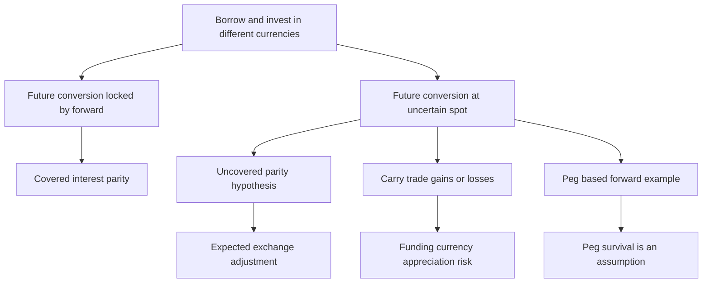

[[01_Notes/2026_2027/Winter_Semester/Financial_Markets_Instruments_I/Financial_Markets_Instruments_I_main.md#Week 3|Back to Financial Markets Instruments I — Week 3]]

Source: [[00_Materials/2026_2027/Winter_Semester/Financial_Markets_Instruments_I/Week_3/L12(CostOfCarryModel).pptx]]

# Currency parity and carry trade

How can interest rates determine a forward exchange rate, yet a currency carry trade still lose money? The distinction is whether the future conversion is contracted today or left exposed to the future spot rate. This note derives the course's covered relation before explaining its uncovered and peg-dependent examples. [[00_Materials/2026_2027/Winter_Semester/Financial_Markets_Instruments_I/Week_3/L12(CostOfCarryModel).pptx|L12(CostOfCarryModel).pptx, physical slide 6–8]]

The map follows slides 6–8; the prerequisite is matching assets, dates and cash flows in the general carry model. [[00_Materials/2026_2027/Winter_Semester/Financial_Markets_Instruments_I/Week_3/L12(CostOfCarryModel).pptx|L12(CostOfCarryModel).pptx, physical slide 6–8]]

## Covered interest parity with dollars per euro

On slide 6, $S_0$ and $F_0$ mean **dollars per euro**. Let $r_\$,r_€$ be annual simple dollar/euro rates and $\tau=T/12$ years when the slide's $T$ is in months. Borrow one euro, sell it for $S_0$ dollars and deposit those dollars. At maturity the deposit pays $S_0(1+r_\$\tau)$ dollars. The euro debt is $1+r_€\tau$ euros; arrange a forward purchase of that euro amount, equivalently a forward sale of the corresponding dollar deposit proceeds at parity. The locked dollar repayment cost is $F_0(1+r_€\tau)$. Setting the zero-investment package's dollar payoff to zero gives

$$S_0(1+r_\$\tau)=F_0(1+r_€\tau),\qquad
F_0=S_0\frac{1+r_\$\tau}{1+r_€\tau}.$$

The numerator/denominator follow the quotation: dollar investment grows at the dollar rate, but each euro owed costs $F_0$ dollars. No uncertain future spot conversion remains in this covered package. [[00_Materials/2026_2027/Winter_Semester/Financial_Markets_Instruments_I/Week_3/L12(CostOfCarryModel).pptx|L12(CostOfCarryModel).pptx, physical slide 6]]

Dividing by $S_0$ and subtracting from one yields the slide's exact relation

$$\frac{S_0-F_0}{S_0}=\frac{(r_€-r_\$)\tau}{1+r_€\tau}\approx(r_€-r_\$)\tau.$$

The approximation ignores the denominator's deviation from one; it is not an exact annualized percentage. If $r_€>r_\$$, $F_0<S_0$: one euro buys fewer dollars forward, a euro forward discount/dollar premium. If $r_€<r_\$$ the euro is at a premium. Reversing the currency quotation requires rederiving the ratio rather than keeping its sign mechanically. Rates, value dates and borrowing/lending availability must match. [[00_Materials/2026_2027/Winter_Semester/Financial_Markets_Instruments_I/Week_3/L12(CostOfCarryModel).pptx|L12(CostOfCarryModel).pptx, physical slide 6]]

![[01_Notes/2026_2027/Winter_Semester/Financial_Markets_Instruments_I/assets/Week_3_L12_Currency_Parity.png]]

The source table shows principal and interest separately; the equations above group them into maturity balances. The slide's month-to-year conversion is essential even though other slides measure $T$ directly in years. [[00_Materials/2026_2027/Winter_Semester/Financial_Markets_Instruments_I/Week_3/L12(CostOfCarryModel).pptx|L12(CostOfCarryModel).pptx, physical slide 6]]

## Uncovered parity is a condition on expectations

Slide 7 replaces $F_0$ by $E_0[S_T]$ (the source writes $E_T(S)$ for the anticipated maturity spot rate) in the dollar-per-euro relation:

$$\frac{S_0-E_0[S_T]}{S_0}=\frac{(r_€-r_\$)\tau}{1+r_€\tau}.$$

Without a forward contract the actual $S_T$ remains unknown. This equation is an **uncovered interest parity hypothesis**, rather than an equality forced by a riskless trading package. A higher-yield currency must be expected to depreciate sufficiently under that condition to offset its interest advantage. Expectations are not realized cash flows; replacing a future random conversion with its expectation does not remove risk. [[00_Materials/2026_2027/Winter_Semester/Financial_Markets_Instruments_I/Week_3/L12(CostOfCarryModel).pptx|L12(CostOfCarryModel).pptx, physical slide 7]]

**External verification:** Cavallo (2006), “Interest Rates, Carry Trades, and Exchange Rate Movements,” sections “Not profitable in theory, but profitable in practice” and “What is the carry trade?”, distinguishes the parity condition from exchange risk in the actual strategy. This supports the risk qualification; its empirical examples are not additional course assignments. [FRBSF Economic Letter 2006-31](https://www.frbsf.org/research-and-insights/publications/economic-letter/2006/11/interest-rates-carry-trades-and-exchange-rate-movements/).

## The lecture's peg and non-deliverable-forward example

The source switches to **Czechoslovak koruna per Deutsche Mark**, $S_{\rm CSK/DEM}$. With $r_{\rm CSK}>r_{\rm DEM}$ the covered forward rate satisfies $F_{\rm CSK/DEM}>S_{\rm CSK/DEM}$. If the future spot rate actually stays at the present peg, selling one DEM forward and buying it spot at maturity earns $F-S_T=F-S_0>0$ koruna. That is the logic behind the lecture's bundled bank trade. The source explicitly mentions fluctuation bands and a peg to a currency basket as practical complications. [[00_Materials/2026_2027/Winter_Semester/Financial_Markets_Instruments_I/Week_3/L12(CostOfCarryModel).pptx|L12(CostOfCarryModel).pptx, physical slide 7]]

**Necessary qualification of the source:** slide 7 calls the payoff “risk-free” after replacing future spot by its expectation. A peg or the belief $E_0[S_T]=S_0$ alone does not guarantee $S_T=S_0$. If the peg changes and $S_T>F$, the short DEM forward loses. The source's positive result is conditional on an unchanged executable conversion rate and ignored costs/counterparty constraints. It cannot be generalized into riskless profit merely from a fixed-exchange-rate announcement. [[00_Materials/2026_2027/Winter_Semester/Financial_Markets_Instruments_I/Week_3/L12(CostOfCarryModel).pptx|L12(CostOfCarryModel).pptx, physical slide 7]]

**Supplementary definition:** an NDF settles a contractual exchange-rate difference in cash, rather than delivering the underlying currency principal. It is not defined by an interest-differential profit or a peg. This distinguishes the source's particular strategy from the instrument's general definition. See McCauley, Shu and Ma (2014), “Non-deliverable forwards: 2013 and beyond,” opening definition paragraphs, BIS Quarterly Review: [NDF definition](https://www.bis.org/publications/non-deliverable-forwards-2013-and-beyond). Contract-specific settlement currency and fixing must be checked; the course does not supply such terms for this historical example.

## Yen-funded dollar carry trade

Slide 8 uses yet another quotation: $S_0$ is **yen per dollar**, and the horizon is one year. Borrow one yen at $r_¥$, convert it into $1/S_0$ dollars and invest at $r_\$$. At maturity the dollar balance is $(1+r_\$)/S_0$. Converting at realized $S_T$ gives $S_T(1+r_\$)/S_0$ yen. Repaying $1+r_¥$ leaves

$$\Pi_T=\frac{S_T}{S_0}(1+r_\$)-(1+r_¥)\quad\text{yen per initial yen borrowed}.$$

Taking expectations gives the slide's expression with $E_0[S_T]$. If the exchange rate stays unchanged, profit is $r_\$-r_¥$. A higher dollar interest rate therefore creates a carry incentive, but yen appreciation means **fewer yen per dollar**, so $S_T$ falls and repayment becomes harder. The strategy breaks even when

$$\frac{S_T}{S_0}=\frac{1+r_¥}{1+r_\$}.$$

Setting expected rather than realized profit to zero gives the corresponding uncovered parity condition. Negative expected exchange movement can offset a positive interest differential; an unexpected stronger movement can produce a loss. [[00_Materials/2026_2027/Winter_Semester/Financial_Markets_Instruments_I/Week_3/L12(CostOfCarryModel).pptx|L12(CostOfCarryModel).pptx, physical slide 8]]

**Agent-created illustration from that equation:** at $S_0=100$ yen/dollar, $r_\$=5\%$, $r_¥=1\%$, unchanged spot produces $0.04$ yen per yen borrowed. Break-even is $S_T=100(1.01/1.05)\approx96.19$. If $S_T=90$, profit is $0.9(1.05)-1.01=-0.065$ yen. This is arithmetic under the slide's one-year setup, not a supplied historical result or trading recommendation. [[00_Materials/2026_2027/Winter_Semester/Financial_Markets_Instruments_I/Week_3/L12(CostOfCarryModel).pptx|L12(CostOfCarryModel).pptx, physical slide 8]]
