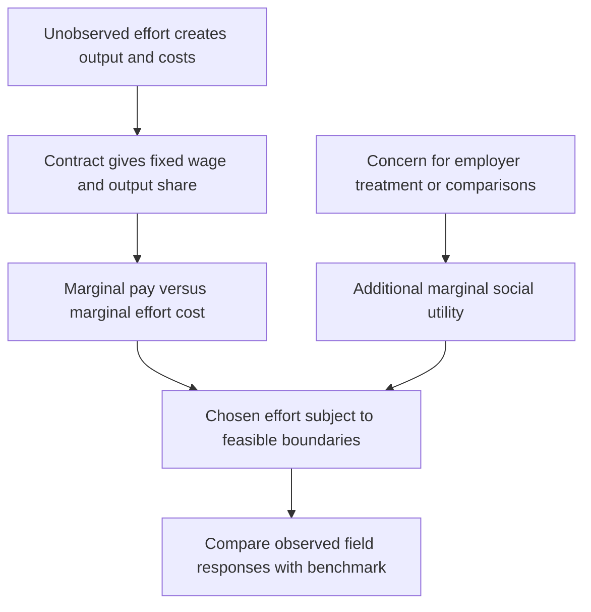

# Derive effort incentives and effort-dependent social motives

## Record metadata

```json
{
  "schema_version": 3,
  "owner": "plan",
  "course_id": "2026_2027/Winter_Semester/Behavioral_Economics",
  "transaction_id": "PLAN-20261018-BE-P002",
  "plan_version": "P002",
  "source_version": "V002",
  "ingestion_revision": 3,
  "objective_id": "O009",
  "objective_revision": 1,
  "criterion_version": "O009-C1",
  "status": "ready",
  "lesson_content_contract": "self-contained-lessons-v1",
  "knowledge_components": [
    "selfish_foc_corners_and_fixed_wage",
    "social_derivative_and_gap_channel",
    "principal_constraints_and_inference_limits"
  ],
  "prerequisite_ids": [
    "O003",
    "O004"
  ],
  "compatible_versions": [],
  "note_locations": [
    {
      "path": "01_Notes/2026_2027/Winter_Semester/Behavioral_Economics/Week_2/Effort_Contracts_and_Social_Motivations.md",
      "heading": "Effort, contracts and social motivations"
    },
    {
      "path": "01_Notes/2026_2027/Winter_Semester/Behavioral_Economics/Week_2/Effort_Contracts_and_Social_Motivations.md",
      "heading": "The self-regarding principal-agent benchmark"
    },
    {
      "path": "01_Notes/2026_2027/Winter_Semester/Behavioral_Economics/Week_2/Effort_Contracts_and_Social_Motivations.md",
      "heading": "Adding a marginal social motive"
    },
    {
      "path": "01_Notes/2026_2027/Winter_Semester/Behavioral_Economics/Week_2/Effort_Contracts_and_Social_Motivations.md",
      "heading": "Wage rigidity and the gift-exchange hypothesis"
    }
  ],
  "acquisition_rule": {
    "distinct_independent_passes": 2,
    "required_item_roles": [
      "full_capability_check",
      "full_capability_check"
    ],
    "allowed_routes": [
      [
        "O009-I1",
        "O009-I2"
      ],
      [
        "O009-I1",
        "O009-D1"
      ],
      [
        "O009-I1",
        "O009-D2"
      ],
      [
        "O009-I2",
        "O009-D1"
      ],
      [
        "O009-I2",
        "O009-D2"
      ],
      [
        "O009-D1",
        "O009-D2"
      ]
    ]
  },
  "delayed_rule": {
    "minimum_elapsed_hours": 24,
    "fresh_item": true,
    "independent_required": true
  },
  "review_topic": "Derive effort incentives and effort-dependent social motives",
  "review_instruction": "Begin a closed-note review with teach for O009; request an unused prepared delayed item before recap."
}
```

## Outcome and conditions

Derive and solve a bounded expected-pay effort choice, add an explicit marginal social motive and state the fixed-gap, corner and principal-constraint limits. All essential components listed in metadata are required. Hypothetical assessment values instantiate the checked equations; they are not historical observations or observed outcomes. Independent checks are closed-note and without hints, solution access, external retrieval or other assistance; blank paper and pen only are allowed; no calculator or device. Teach establishes and records actual help/exposure conditions before claiming independence.

## Prerequisites and checks

- [O003 outcome and repair route](../lessons/O003.md#outcome-and-conditions): payoff branches and equality boundaries determine a social utility term’s interpretation.
- [O004 outcome and repair route](../lessons/O004.md#outcome-and-conditions): reciprocal treatment differs from a payoff-only concern and can alter marginal willingness to help.

O009-P1, item_version 1, prerequisite_diagnostic. **Prompt:** In a piecewise other-regarding utility, why must the correct payoff ordering be chosen? Does reciprocity depend only on the final payoff pair, and does adding a constant to utility change its maximizer?

**Complete key and rubric:** The payoff ordering selects the correct weight/branch. Reciprocity can depend on prior treatment or intentions as O004 distinguishes from payoff-only motives. Adding the same constant at every effort changes utility levels but not rankings/marginal effort incentives. Require all clauses; repair O003 branches and O004 treatment distinction. Pass requires every requested reason and result; partial for an omitted reason or unresolved isolated arithmetic slip; fail for the conflicting mechanism. This diagnostic never counts as acquisition. Current or explicitly compatible committed independent prerequisite evidence may permit skipping its check; familiarity alone cannot. Use the cited complete prerequisite lesson or the named included foundation, then the worked example, after a partial/failing entry check.

## Teaching order and rationale

1. Use the diagnostic once to establish the necessary conceptual or algebraic foundation.
2. Present the complete checked-note explanation below, preserving variables, dates, assumptions and source qualifications. Follow one reasoning chain at a time so every intermediate step is visible.
3. Work W1 fully, asking the learner to explain why each step follows.
4. Use S1 as completion practice: show the setup and first identity, hide the final algebra/numbers and interpretation. After an explanation of the missing steps, withdraw support.
5. Present unused I1/I2 full checks with hidden solutions; use correction/repair after scoring the original answer. An unused D form can replace an exposed I only through a listed route.
6. On a later eligible occasion, begin an unused D item before recap. A numeric variant establishes bounded same-method performance, not general transfer.

## Motivation, intuition, and definitions

Derive and solve a bounded expected-pay effort choice, add an explicit marginal social motive and state the fixed-gap, corner and principal-constraint limits. Establish the definitions, assumptions and relevant comparisons before simplifying an equation. The complete reused passages establish every academic claim, notation choice and qualification assessed here; necessary prerequisites use the complete lessons above.

## Explanation steps

Origin: reused complete checked passage [[01_Notes/2026_2027/Winter_Semester/Behavioral_Economics/Week_2/Effort_Contracts_and_Social_Motivations.md#Effort, contracts and social motivations]]; fingerprint `9b7365693d9f801e0a0ff180c3fd9801b7ad8976661455d7d8299756e0090ede`. Heading depth alone is adapted.

### Effort, contracts and social motivations

Why might a fixed wage change effort even when it does not change the monetary reward for an extra unit of work? The lecture first derives the self-regarding incentive benchmark, then changes the worker's utility. This separates an incentive effect from a social response to the employer or co-workers. [[00_Materials/2026_2027/Winter_Semester/Behavioral_Economics/Week_2/L3 BE_SP_field IES 2026.pdf#page=4|L3 BE_SP_field IES 2026.pdf, physical PDF pp. 4–9]]



The map follows the lecture's model and its transition to field evidence. The core reasoning is marginal: a benefit that changes the level of utility but not its slope with respect to effort need not change effort. [[00_Materials/2026_2027/Winter_Semester/Behavioral_Economics/Week_2/L3 BE_SP_field IES 2026.pdf#page=5|L3 BE_SP_field IES 2026.pdf, physical PDF pp. 5–9]]

#### The self-regarding principal-agent benchmark

The principal employs an agent whose effort $e$ is not directly observable. Output is $f(e)+\varepsilon$, with $f'(e)>0$, $f''(e)<0$ and mean-zero noise. Effort costs $d(e)$, where $d'(e)>0$ and $d''(e)>0$. More effort raises expected output at a decreasing rate while its marginal cost rises. The simplified expected-pay contract is

$$y(e)=w+b f(e),$$

where $w$ is fixed pay and $b$ is the worker's output share. In the risk-neutral expected-pay representation, the noise has zero expected monetary contribution. If the actual contract pays on noisy observed output, a risk-averse worker would need a separate treatment of risk; that is outside the displayed benchmark. [[00_Materials/2026_2027/Winter_Semester/Behavioral_Economics/Week_2/L3 BE_SP_field IES 2026.pdf#page=5|L3 BE_SP_field IES 2026.pdf, physical PDF pp. 5–6]]

The selfish worker chooses

$$e^*(w,b)\in\arg\max_e\{w+b f(e)-d(e)\}.$$

At an interior differentiable optimum,

$$b f'(e^*)=d'(e^*).$$

An extra unit of effort produces $f'(e)$ expected output, of which the worker receives $b f'(e)$; the worker compares that reward with $d'(e)$. Fixed pay $w$ vanishes from this derivative. Under the stated concavity/convexity conditions the utility is concave for a nonnegative output share. If effort must be nonnegative, a corner is possible: for $b=0$, utility falls with effort and the optimum is the lowest feasible effort, written $e=0$ in the lecture. The equality condition does not apply at that corner. A higher fixed wage raises the level of selfish utility but supplies no extra marginal monetary reward for effort in this particular model. [[00_Materials/2026_2027/Winter_Semester/Behavioral_Economics/Week_2/L3 BE_SP_field IES 2026.pdf#page=5|L3 BE_SP_field IES 2026.pdf, physical PDF pp. 5–6]]

The principal anticipates the agent's choice and writes

$$\max_{w,b}\{(1-b)f(e^*(w,b))-w\}.$$

This is expected output retained by the principal less fixed pay. The displayed objective does not supply participation constraints, outside options, permissible wages or a full risk-sharing problem, so it should not be used to solve an unrestricted global optimum for $w$. Its role here is to show why the principal cares about the agent's effort response. [[00_Materials/2026_2027/Winter_Semester/Behavioral_Economics/Week_2/L3 BE_SP_field IES 2026.pdf#page=6|L3 BE_SP_field IES 2026.pdf, physical PDF pp. 6]]

#### Adding a marginal social motive

The lecture adds a social component,

$$U_i=w+b f(e_i)-d(e_i)+S(e_i),$$

giving the interior condition

$$b f'(e_i)+\frac{\partial S}{\partial e_i}=d'(e_i).$$

The new term measures the utility benefit or cost of how extra effort affects socially valued outcomes. If it is positive, effort can be worthwhile even with little direct marginal pay. This is a conditional model mechanism, not a claim that every gift raises effort. For a fixed wage to change the optimum, it must change a relevant marginal social motive, such as perceived kindness toward the employer, rather than simply add a constant to $S$. [[00_Materials/2026_2027/Winter_Semester/Behavioral_Economics/Week_2/L3 BE_SP_field IES 2026.pdf#page=7|L3 BE_SP_field IES 2026.pdf, physical PDF pp. 7]]

For **altruism**, the slide writes $S_i=\sigma_{ij}U_j(e_i)$ with a positive weight on the other person's utility. If the employer benefits from extra effort, then $\partial S_i/\partial e_i=\sigma_{ij}U_j'(e_i)$ can be positive. If extra effort instead harms a cared-for peer, the same positive concern produces a negative social derivative and can lower effort. For **reciprocity**, kind treatment can make helping the employer attractive, while unkind treatment can reduce that willingness or create a motive to harm. This depends on the treatment and its perceived intentions, not only on final wage levels. [[00_Materials/2026_2027/Winter_Semester/Behavioral_Economics/Week_2/L3 BE_SP_field IES 2026.pdf#page=7|L3 BE_SP_field IES 2026.pdf, physical PDF pp. 7, 9]]

For **inequality aversion**, the source gives the schematic $S_i=\sigma_{ij}|y_i-y_j|$ with $\sigma_{ij}<0$. A payoff gap lowers utility, but the effect on effort depends on how effort changes the two payoffs. The slide's intuition is that a worker with an outcome above the norm may reduce effort, while one below it may increase effort. When own payoff rises with effort and peer payoff is fixed, the absolute gap rises with effort above the peer, so the negative coefficient creates a negative social derivative; below the peer the gap falls with effort, giving a positive social derivative. More generally, the sign depends on how effort changes the payoff gap. That intuition requires a channel from effort into payoffs or socially interpreted contributions. If both own and peer monetary wages are literally fixed and independent of effort, the displayed absolute wage gap is constant: this term alone has zero effort derivative and cannot generate that response. The comparison is also nondifferentiable at equal pay. Treat the formula as a simplified motivation, not a general proof of every relative-pay effect. The Week 1 note gives the fuller payoff-weight distinctions. [[00_Materials/2026_2027/Winter_Semester/Behavioral_Economics/Week_2/L3 BE_SP_field IES 2026.pdf#page=7|L3 BE_SP_field IES 2026.pdf, physical PDF pp. 7]] [[01_Notes/2026_2027/Winter_Semester/Behavioral_Economics/Week_1/Models_of_Social_Preferences.md]]

#### Wage rigidity and the gift-exchange hypothesis

The opening supply-demand picture draws a wage above the market-clearing intersection, so labour supplied exceeds labour demanded. The horizontal gap is unemployment in that illustration. It motivates the question of why firms might sustain wages above a competitive benchmark; the drawing does not establish the cause of observed unemployment. Akerlof's gift-exchange idea is that firms offer favourable wages and workers reciprocate with effort above the minimum. Such responses can make high wages privately worthwhile under some conditions. [[00_Materials/2026_2027/Winter_Semester/Behavioral_Economics/Week_2/L3 BE_SP_field IES 2026.pdf#page=2|L3 BE_SP_field IES 2026.pdf, physical PDF pp. 2–3, 9]]

![[01_Notes/2026_2027/Winter_Semester/Behavioral_Economics/assets/Week_2_Wage_Unemployment.png]]

Read the wage, employment and excess-supply gap together. The later field studies test particular wage/effort responses, rather than proving a complete macroeconomic explanation from this stylized graph. The Sli.do prompt on the preceding lecture pages records a question, not observed class poll results. [[00_Materials/2026_2027/Winter_Semester/Behavioral_Economics/Week_2/L3 BE_SP_field IES 2026.pdf#page=2|L3 BE_SP_field IES 2026.pdf, physical PDF pp. 2–4]]

The principal-agent derivation and the distinction between marginal incentives and social motives are core because they generate predictions. The field applications then ask whether those predictions survive real effort, time and context. No slide or these notes establish that any specific derivation will appear in an exam. [[00_Materials/2026_2027/Winter_Semester/Behavioral_Economics/Week_2/L3 BE_SP_field IES 2026.pdf#page=4|L3 BE_SP_field IES 2026.pdf, physical PDF pp. 4–9, 35]]


## Worked example

O009-W1, item_version 1, worked_example. **Prompt:** Use a hypothetical risk-neutral expected-pay model on $0\leq e\leq 9$: $f(e)=10e-e^2/2$, $d(e)=2e+e^2/2$, contract $y=w+b f(e)$ with $w=10$ and $b=0.5$. Derive the selfish marginal condition and optimum, checking concavity and corners. Does increasing only $w$ by 5 change effort? Compare a fixed-pay contract $b=0$ without social utility. Now add the explicitly supplied $S(e)=3e$ and solve effort. Explain how altruistic concern can increase or reduce the social derivative, why a literally fixed own/peer wage gap alone cannot affect effort, and what is unresolved at equality. State the principal’s expected objective and why an unrestricted optimum for its wage cannot be solved from these notes alone.

**Complete solution and essential rubric:** $f^{\prime}(e)=10-e>0$ on the supplied domain and $f^{\prime\prime}=-1$; $d^{\prime}(e)=2+e>0$ and $d^{\prime\prime}=1$. Selfish derivative is $b(10-e)-(2+e)$, second derivative $-(b+1)<0$, and the unconstrained solution is $(0.5(10)-2)/(0.5+1)=2.00000000$ here, inside the bounds. Clipping/checking endpoints handles a corner. Fixed $w$ disappears from the derivative, so a 5-unit wage increase does not change effort in this benchmark. At $b=0$ and no social term the objective decreases with effort, giving the lowest feasible effort 0. With $S^{\prime}(e)=3$, solve $b(10-e)+3=2+e$, yielding $4.00000000$, again feasible. Positive altruistic weight times the other person’s effort-induced utility derivative can be positive when helping them or negative when effort harms them; reciprocity depends on treatment/intentions. A negative coefficient on $|y_i-y_j|$ has zero effort derivative if both payoffs are literally effort-independent. With an effort-varying gap its derivative may differ above/below the peer; the absolute value is nondifferentiable at equality. The principal anticipates effort and maximizes $(1-b)f(e^*(w,b))-w$, but participation/outside-option/feasible-wage/risk-sharing constraints are absent, so no unrestricted global wage optimum or complete macro-unemployment explanation is inferred. All requested calculations, derivations and qualifications are essential; the component map above applies to every full form.

## Practice with fading assistance

O009-S1, item_version 1, supported_completion. **Prompt:** Use a hypothetical risk-neutral expected-pay model on $0\leq e\leq 11$: $f(e)=12e-e^2/2$, $d(e)=3e+e^2/2$, contract $y=w+b f(e)$ with $w=12$ and $b=0.5$. Derive the selfish marginal condition and optimum, checking concavity and corners. Does increasing only $w$ by 5 change effort? Compare a fixed-pay contract $b=0$ without social utility. Now add the explicitly supplied $S(e)=1.5e$ and solve effort. Explain how altruistic concern can increase or reduce the social derivative, why a literally fixed own/peer wage gap alone cannot affect effort, and what is unresolved at equality. State the principal’s expected objective and why an unrestricted optimum for its wage cannot be solved from these notes alone.

**Complete solution and essential rubric:** $f^{\prime}(e)=12-e>0$ on the supplied domain and $f^{\prime\prime}=-1$; $d^{\prime}(e)=3+e>0$ and $d^{\prime\prime}=1$. Selfish derivative is $b(12-e)-(3+e)$, second derivative $-(b+1)<0$, and the unconstrained solution is $(0.5(12)-3)/(0.5+1)=2.00000000$ here, inside the bounds. Clipping/checking endpoints handles a corner. Fixed $w$ disappears from the derivative, so a 5-unit wage increase does not change effort in this benchmark. At $b=0$ and no social term the objective decreases with effort, giving the lowest feasible effort 0. With $S^{\prime}(e)=1.5$, solve $b(12-e)+1.5=3+e$, yielding $3.00000000$, again feasible. Positive altruistic weight times the other person’s effort-induced utility derivative can be positive when helping them or negative when effort harms them; reciprocity depends on treatment/intentions. A negative coefficient on $|y_i-y_j|$ has zero effort derivative if both payoffs are literally effort-independent. With an effort-varying gap its derivative may differ above/below the peer; the absolute value is nondifferentiable at equality. The principal anticipates effort and maximizes $(1-b)f(e^*(w,b))-w$, but participation/outside-option/feasible-wage/risk-sharing constraints are absent, so no unrestricted global wage optimum or complete macro-unemployment explanation is inferred. All requested calculations, derivations and qualifications are essential; the component map above applies to every full form.

Allowed support is the first stated identity only; hide the remaining key while the learner completes it. Supported performance is practice, not an independent result.

## Rubric and independence

Required components: selfish_foc_corners_and_fixed_wage, social_derivative_and_gap_channel, principal_constraints_and_inference_limits. Each full prompt/key below elicits every component; all are necessary for a pass on every permitted pair. Accept algebraically equivalent expressions and clearly defined opposite cash-flow signs with correct interpretation. A pass requires all requested outputs/reasons, correct units/assumptions and no critical conceptual error. Partial means a missing component or an unresolved isolated arithmetic slip with an otherwise valid method; independent correction is required for a pass. Fail means a critical mechanism/condition is wrong. Unscorable means a response or its help/exposure conditions cannot be established. Unknown help conditions are never independent evidence.

Critical errors: Fixed wage substituted for marginal pay; interior FOC applied at an infeasible corner; constant wage gap asserted to create a nonzero effort derivative; altruism assumed always positive; unconstrained principal wage optimum invented.

Acquisition requires two distinct unused unassisted full checks selected from the six exact metadata routes. Every I/D form covers all components; W1, S1, the prerequisite and C1 are forbidden substitutes. A D form used for acquisition cannot later be counted again as delayed success. No teach-generated item may replace a named full check; additional verified explanation/practice is allowed under the unchanged method and may not fabricate evidence. If fewer than two fresh forms remain for acquisition, return a plan_issue for an additional prepared bank.

| Component | I1 | I2 | D1 | D2 |
|---|---|---|---|---|
| selfish_foc_corners_and_fixed_wage | required | required | required | required |
| social_derivative_and_gap_channel | required | required | required | required |
| principal_constraints_and_inference_limits | required | required | required | required |

## Misconceptions and correction

An observed omitted term/sign is tentative until the learner explains it; compare the reasoning with the critical errors above. Score the original response before providing help. Route a conceptual failure to the relevant included derivation and prerequisite, then use an unused full form.

O009-C1, item_version 1, narrow_correction. **Prompt:** A worker receives two literally effort-independent fixed wages and dislikes their absolute gap. Does that gap term alone change the effort FOC? **Key/rubric:** No. The gap and its utility penalty are constant in effort, so their derivative is zero. An effort-induced payoff/contribution or social-meaning channel is needed; at equal variable payoffs the absolute value is nondifferentiable. Pass requires all keyed reasoning; partial for a missing part; fail for the conflicting mechanism. This repairs a common inference only; it cannot substitute for a full numerical/capability check.

Give at most two hints (first identify the date/unit, second point to the included identity); after ineffective hints show the relevant worked step. After two unsuccessful independent attempts stop repeated quizzing, revisit the explanation/prerequisite and preserve the unresolved status.

## Immediate and delayed checks

### O009-I1

O009-I1, item_version 1, full_capability_check. **Prompt:** Use a hypothetical risk-neutral expected-pay model on $0\leq e\leq 7$: $f(e)=8e-e^2/2$, $d(e)=1e+e^2/2$, contract $y=w+b f(e)$ with $w=9$ and $b=0.5$. Derive the selfish marginal condition and optimum, checking concavity and corners. Does increasing only $w$ by 5 change effort? Compare a fixed-pay contract $b=0$ without social utility. Now add the explicitly supplied $S(e)=1.5e$ and solve effort. Explain how altruistic concern can increase or reduce the social derivative, why a literally fixed own/peer wage gap alone cannot affect effort, and what is unresolved at equality. State the principal’s expected objective and why an unrestricted optimum for its wage cannot be solved from these notes alone.

**Complete solution and essential rubric:** $f^{\prime}(e)=8-e>0$ on the supplied domain and $f^{\prime\prime}=-1$; $d^{\prime}(e)=1+e>0$ and $d^{\prime\prime}=1$. Selfish derivative is $b(8-e)-(1+e)$, second derivative $-(b+1)<0$, and the unconstrained solution is $(0.5(8)-1)/(0.5+1)=2.00000000$ here, inside the bounds. Clipping/checking endpoints handles a corner. Fixed $w$ disappears from the derivative, so a 5-unit wage increase does not change effort in this benchmark. At $b=0$ and no social term the objective decreases with effort, giving the lowest feasible effort 0. With $S^{\prime}(e)=1.5$, solve $b(8-e)+1.5=1+e$, yielding $3.00000000$, again feasible. Positive altruistic weight times the other person’s effort-induced utility derivative can be positive when helping them or negative when effort harms them; reciprocity depends on treatment/intentions. A negative coefficient on $|y_i-y_j|$ has zero effort derivative if both payoffs are literally effort-independent. With an effort-varying gap its derivative may differ above/below the peer; the absolute value is nondifferentiable at equality. The principal anticipates effort and maximizes $(1-b)f(e^*(w,b))-w$, but participation/outside-option/feasible-wage/risk-sharing constraints are absent, so no unrestricted global wage optimum or complete macro-unemployment explanation is inferred. All requested calculations, derivations and qualifications are essential; the component map above applies to every full form.

I1/I2 are immediate checks; D1/D2 are distinct parallel variants reserved where possible for delayed checks. A delayed success requires an unused form before recap, no help/solution access, and at least 24 actual elapsed hours after acquisition and the most recent relevant teaching/solution exposure. Record intervening exposure. A calendar-date change alone is insufficient; an early D attempt is immediate evidence only.

### O009-I2

O009-I2, item_version 1, full_capability_check. **Prompt:** Use a hypothetical risk-neutral expected-pay model on $0\leq e\leq 13$: $f(e)=14e-e^2/2$, $d(e)=4e+e^2/2$, contract $y=w+b f(e)$ with $w=11$ and $b=0.5$. Derive the selfish marginal condition and optimum, checking concavity and corners. Does increasing only $w$ by 5 change effort? Compare a fixed-pay contract $b=0$ without social utility. Now add the explicitly supplied $S(e)=3e$ and solve effort. Explain how altruistic concern can increase or reduce the social derivative, why a literally fixed own/peer wage gap alone cannot affect effort, and what is unresolved at equality. State the principal’s expected objective and why an unrestricted optimum for its wage cannot be solved from these notes alone.

**Complete solution and essential rubric:** $f^{\prime}(e)=14-e>0$ on the supplied domain and $f^{\prime\prime}=-1$; $d^{\prime}(e)=4+e>0$ and $d^{\prime\prime}=1$. Selfish derivative is $b(14-e)-(4+e)$, second derivative $-(b+1)<0$, and the unconstrained solution is $(0.5(14)-4)/(0.5+1)=2.00000000$ here, inside the bounds. Clipping/checking endpoints handles a corner. Fixed $w$ disappears from the derivative, so a 5-unit wage increase does not change effort in this benchmark. At $b=0$ and no social term the objective decreases with effort, giving the lowest feasible effort 0. With $S^{\prime}(e)=3$, solve $b(14-e)+3=4+e$, yielding $4.00000000$, again feasible. Positive altruistic weight times the other person’s effort-induced utility derivative can be positive when helping them or negative when effort harms them; reciprocity depends on treatment/intentions. A negative coefficient on $|y_i-y_j|$ has zero effort derivative if both payoffs are literally effort-independent. With an effort-varying gap its derivative may differ above/below the peer; the absolute value is nondifferentiable at equality. The principal anticipates effort and maximizes $(1-b)f(e^*(w,b))-w$, but participation/outside-option/feasible-wage/risk-sharing constraints are absent, so no unrestricted global wage optimum or complete macro-unemployment explanation is inferred. All requested calculations, derivations and qualifications are essential; the component map above applies to every full form.

### O009-D1

O009-D1, item_version 1, full_capability_check. **Prompt:** Use a hypothetical risk-neutral expected-pay model on $0\leq e\leq 15$: $f(e)=16e-e^2/2$, $d(e)=2e+e^2/2$, contract $y=w+b f(e)$ with $w=15$ and $b=0.25$. Derive the selfish marginal condition and optimum, checking concavity and corners. Does increasing only $w$ by 5 change effort? Compare a fixed-pay contract $b=0$ without social utility. Now add the explicitly supplied $S(e)=2.5e$ and solve effort. Explain how altruistic concern can increase or reduce the social derivative, why a literally fixed own/peer wage gap alone cannot affect effort, and what is unresolved at equality. State the principal’s expected objective and why an unrestricted optimum for its wage cannot be solved from these notes alone.

**Complete solution and essential rubric:** $f^{\prime}(e)=16-e>0$ on the supplied domain and $f^{\prime\prime}=-1$; $d^{\prime}(e)=2+e>0$ and $d^{\prime\prime}=1$. Selfish derivative is $b(16-e)-(2+e)$, second derivative $-(b+1)<0$, and the unconstrained solution is $(0.25(16)-2)/(0.25+1)=1.60000000$ here, inside the bounds. Clipping/checking endpoints handles a corner. Fixed $w$ disappears from the derivative, so a 5-unit wage increase does not change effort in this benchmark. At $b=0$ and no social term the objective decreases with effort, giving the lowest feasible effort 0. With $S^{\prime}(e)=2.5$, solve $b(16-e)+2.5=2+e$, yielding $3.60000000$, again feasible. Positive altruistic weight times the other person’s effort-induced utility derivative can be positive when helping them or negative when effort harms them; reciprocity depends on treatment/intentions. A negative coefficient on $|y_i-y_j|$ has zero effort derivative if both payoffs are literally effort-independent. With an effort-varying gap its derivative may differ above/below the peer; the absolute value is nondifferentiable at equality. The principal anticipates effort and maximizes $(1-b)f(e^*(w,b))-w$, but participation/outside-option/feasible-wage/risk-sharing constraints are absent, so no unrestricted global wage optimum or complete macro-unemployment explanation is inferred. All requested calculations, derivations and qualifications are essential; the component map above applies to every full form.

### O009-D2

O009-D2, item_version 1, full_capability_check. **Prompt:** Use a hypothetical risk-neutral expected-pay model on $0\leq e\leq 8$: $f(e)=9e-e^2/2$, $d(e)=2e+e^2/2$, contract $y=w+b f(e)$ with $w=8$ and $b=1$. Derive the selfish marginal condition and optimum, checking concavity and corners. Does increasing only $w$ by 5 change effort? Compare a fixed-pay contract $b=0$ without social utility. Now add the explicitly supplied $S(e)=2e$ and solve effort. Explain how altruistic concern can increase or reduce the social derivative, why a literally fixed own/peer wage gap alone cannot affect effort, and what is unresolved at equality. State the principal’s expected objective and why an unrestricted optimum for its wage cannot be solved from these notes alone.

**Complete solution and essential rubric:** $f^{\prime}(e)=9-e>0$ on the supplied domain and $f^{\prime\prime}=-1$; $d^{\prime}(e)=2+e>0$ and $d^{\prime\prime}=1$. Selfish derivative is $b(9-e)-(2+e)$, second derivative $-(b+1)<0$, and the unconstrained solution is $(1(9)-2)/(1+1)=3.50000000$ here, inside the bounds. Clipping/checking endpoints handles a corner. Fixed $w$ disappears from the derivative, so a 5-unit wage increase does not change effort in this benchmark. At $b=0$ and no social term the objective decreases with effort, giving the lowest feasible effort 0. With $S^{\prime}(e)=2$, solve $b(9-e)+2=2+e$, yielding $4.50000000$, again feasible. Positive altruistic weight times the other person’s effort-induced utility derivative can be positive when helping them or negative when effort harms them; reciprocity depends on treatment/intentions. A negative coefficient on $|y_i-y_j|$ has zero effort derivative if both payoffs are literally effort-independent. With an effort-varying gap its derivative may differ above/below the peer; the absolute value is nondifferentiable at equality. The principal anticipates effort and maximizes $(1-b)f(e^*(w,b))-w$, but participation/outside-option/feasible-wage/risk-sharing constraints are absent, so no unrestricted global wage optimum or complete macro-unemployment explanation is inferred. All requested calculations, derivations and qualifications are essential; the component map above applies to every full form.

## Advance, revisit, pause, and escalate

Advance only after teach commits two qualifying independent full passes under a listed route. Keep acquisition and each later delayed observation separate. A source conflict blocks the affected claim and returns to ingest with the exact note heading. Missing criteria, a new method, unsupported alternative or exhausted fresh bank returns to plan with 2026_2027/Winter_Semester/Behavioral_Economics, O009, revision1/O009-C1, P002/V002/ingestion3 and item ID. Equivalent valid methods meeting the frozen criterion may receive credit after verification; no criterion is changed to fit an answer. Closing a session preserves the actual stopping point without claiming completion.

## Content provenance and generation boundaries

Explanations, figures and qualifications above reuse complete checked-note sections with exact origin/fingerprint; heading depth alone is adapted. Main exercises and worked arithmetic are plan-created hypothetical instantiations of those displayed identities. No additional academic claims or external course scope are introduced. Preserve the note conventions and explicit qualifications; checked references reused from notes are not an independent raw-source audit by plan. New numerical practice can use the same method only after its complete solution and unchanged components are checked before display; it cannot replace this lesson’s named evidence forms. Prerequisites route to the complete prepared lessons above.

## Answer-free recall handoff

Topic: Derive effort incentives and effort-dependent social motives. Begin a closed-note review with teach for O009; request an unused prepared delayed item before recap. Exact lesson: [[03_Agents/2026_2027/Winter_Semester/Behavioral_Economics/lessons/O009.md#Immediate and delayed checks]]. Teach supplies actual committed evidence and timestamps; recall alone dates reviews. No learner outcome or due date is created by this curriculum.

For independent numeric outputs, exact fractions/expressions with correct setup or sensible hand rounding are acceptable; no calculator precision is required. Teacher keys show decimals for verification. This follows the supplied paper-and-pen independent conditions and does not reinterpret an earlier attempt.
