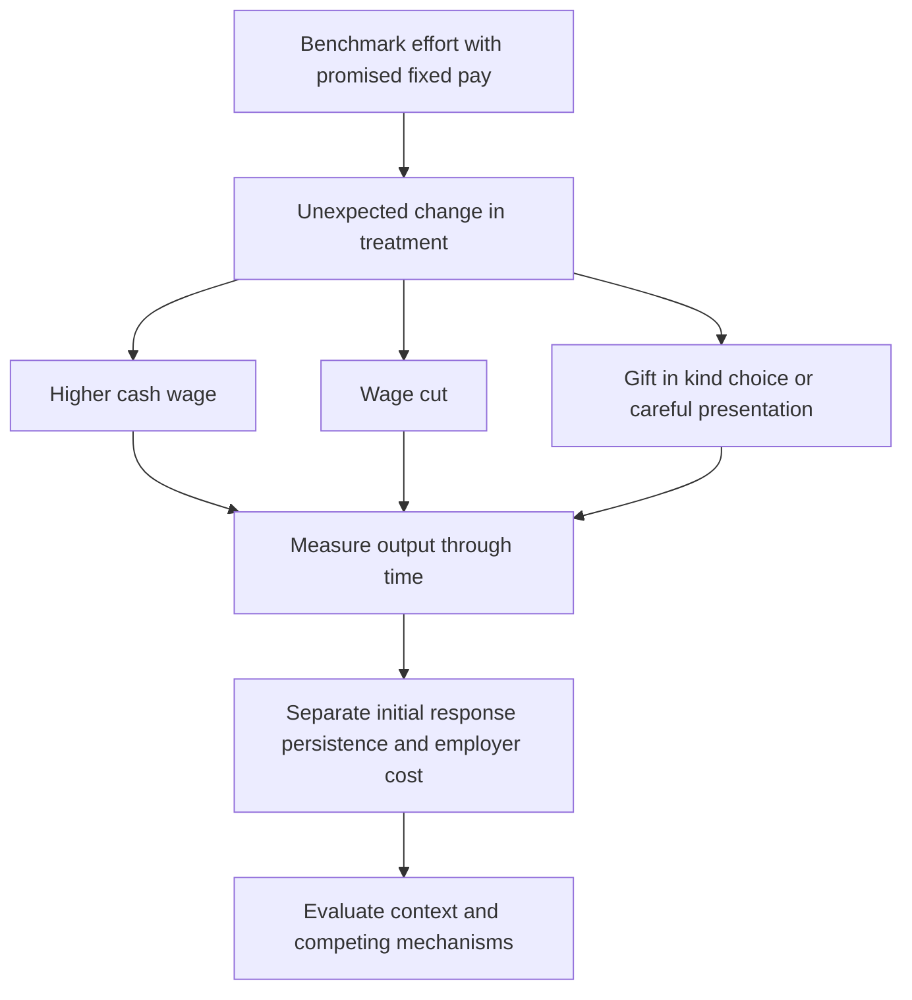

# Compare labour gifts by time profile, form and employer return

## Record metadata

```json
{
  "schema_version": 3,
  "owner": "plan",
  "course_id": "2026_2027/Winter_Semester/Behavioral_Economics",
  "transaction_id": "PLAN-20261018-BE-P002",
  "plan_version": "P002",
  "source_version": "V002",
  "ingestion_revision": 3,
  "objective_id": "O010",
  "objective_revision": 1,
  "criterion_version": "O010-C1",
  "status": "ready",
  "lesson_content_contract": "self-contained-lessons-v1",
  "knowledge_components": [
    "time_profile_and_outcome_units",
    "incremental_employer_return",
    "gift_form_controls_and_mechanism_limits"
  ],
  "prerequisite_ids": [
    "O009",
    "O001"
  ],
  "compatible_versions": [],
  "note_locations": [
    {
      "path": "01_Notes/2026_2027/Winter_Semester/Behavioral_Economics/Week_2/Gift_Exchange_in_Labour_Markets.md",
      "heading": "Gift exchange in labour-market field experiments"
    },
    {
      "path": "01_Notes/2026_2027/Winter_Semester/Behavioral_Economics/Week_2/Gift_Exchange_in_Labour_Markets.md",
      "heading": "Gneezy and List: the response can fade"
    },
    {
      "path": "01_Notes/2026_2027/Winter_Semester/Behavioral_Economics/Week_2/Gift_Exchange_in_Labour_Markets.md",
      "heading": "Kube, Maréchal and Puppe: positive and negative responses differ"
    },
    {
      "path": "01_Notes/2026_2027/Winter_Semester/Behavioral_Economics/Week_2/Gift_Exchange_in_Labour_Markets.md",
      "heading": "The currency of reciprocity: money and a thermos bottle"
    },
    {
      "path": "01_Notes/2026_2027/Winter_Semester/Behavioral_Economics/Week_2/Gift_Exchange_in_Labour_Markets.md",
      "heading": "What the comparisons establish"
    }
  ],
  "acquisition_rule": {
    "distinct_independent_passes": 2,
    "required_item_roles": [
      "full_capability_check",
      "full_capability_check"
    ],
    "allowed_routes": [
      [
        "O010-I1",
        "O010-I2"
      ],
      [
        "O010-I1",
        "O010-D1"
      ],
      [
        "O010-I1",
        "O010-D2"
      ],
      [
        "O010-I2",
        "O010-D1"
      ],
      [
        "O010-I2",
        "O010-D2"
      ],
      [
        "O010-D1",
        "O010-D2"
      ]
    ]
  },
  "delayed_rule": {
    "minimum_elapsed_hours": 24,
    "fresh_item": true,
    "independent_required": true
  },
  "review_topic": "Compare labour gifts by time profile, form and employer return",
  "review_instruction": "Begin a closed-note review with teach for O010; request an unused prepared delayed item before recap."
}
```

## Outcome and conditions

Reconstruct field treatment/time comparisons, compute a declared hypothetical incremental employer return, and interpret gift-form controls without a universal psychological claim. All essential components listed in metadata are required. Hypothetical assessment values instantiate the checked equations; they are not historical observations or observed outcomes. Independent checks are closed-note and without hints, solution access, external retrieval or other assistance; blank paper and pen only are allowed; no calculator or device. Teach establishes and records actual help/exposure conditions before claiming independence.

## Prerequisites and checks

- [O009 outcome and repair route](../lessons/O009.md#outcome-and-conditions): the marginal-pay benchmark explains why a fixed wage gift is a test of social response.
- [O001 outcome and repair route](../lessons/O001.md#outcome-and-conditions): the treatment-comparison method distinguishes evidence from a theoretical or temporal narrative.

O010-P1, item_version 1, prerequisite_diagnostic. **Prompt:** Why does higher fixed pay leave effort unchanged in the selfish benchmark, and what can a randomized treatment-control comparison identify that a before-after trend alone cannot?

**Complete key and rubric:** Fixed pay disappears from marginal utility absent a social channel (O009). A properly assigned comparison can separate the treatment difference from shared time changes; treatment implementation/outcome/assumptions remain necessary (O001). Require both; repair those complete lessons. Pass requires every requested reason and result; partial for an omitted reason or unresolved isolated arithmetic slip; fail for the conflicting mechanism. This diagnostic never counts as acquisition. Current or explicitly compatible committed independent prerequisite evidence may permit skipping its check; familiarity alone cannot. Use the cited complete prerequisite lesson or the named included foundation, then the worked example, after a partial/failing entry check.

## Teaching order and rationale

1. Use the diagnostic once to establish the necessary conceptual or algebraic foundation.
2. Present the complete checked-note explanation below, preserving variables, dates, assumptions and source qualifications. Follow one reasoning chain at a time so every intermediate step is visible.
3. Work W1 fully, asking the learner to explain why each step follows.
4. Use S1 as completion practice: show the setup and first identity, hide the final algebra/numbers and interpretation. After an explanation of the missing steps, withdraw support.
5. Present unused I1/I2 full checks with hidden solutions; use correction/repair after scoring the original answer. An unused D form can replace an exposed I only through a listed route.
6. On a later eligible occasion, begin an unused D item before recap. A numeric variant establishes bounded same-method performance, not general transfer.

## Motivation, intuition, and definitions

Reconstruct field treatment/time comparisons, compute a declared hypothetical incremental employer return, and interpret gift-form controls without a universal psychological claim. Establish the definitions, assumptions and relevant comparisons before simplifying an equation. The complete reused passages establish every academic claim, notation choice and qualification assessed here; necessary prerequisites use the complete lessons above.

## Explanation steps

Origin: reused complete checked passage [[01_Notes/2026_2027/Winter_Semester/Behavioral_Economics/Week_2/Gift_Exchange_in_Labour_Markets.md#Gift exchange in labour-market field experiments]]; fingerprint `9302e6c35313a9e16a1e62736c03c3e078afc09b76cc2ea12d7ff16331d489dd`. Heading depth alone is adapted.

### Gift exchange in labour-market field experiments

Does a wage gift buy sustained additional effort, and does the form of a gift matter? These experiments hold important features of employment fixed while varying pay or presentation. Their comparisons test the social-motivation hypothesis against the fixed-pay selfish benchmark, but the duration and implementation of each treatment remain part of the conclusion. [[00_Materials/2026_2027/Winter_Semester/Behavioral_Economics/Week_2/L3 BE_SP_field IES 2026.pdf#page=9|L3 BE_SP_field IES 2026.pdf, physical PDF pp. 9–24]]



The map organizes the supplied studies around the treatment, time profile and interpretation. A positive early response, a lasting response and a profitable response are three different claims. [[00_Materials/2026_2027/Winter_Semester/Behavioral_Economics/Week_2/L3 BE_SP_field IES 2026.pdf#page=10|L3 BE_SP_field IES 2026.pdf, physical PDF pp. 10–24]]

#### Gneezy and List: the response can fade

In the library task, workers were recruited for six hours of entering book records at $12 per hour. The gift group unexpectedly received $20 per hour. Effort was measured as books entered in successive 90-minute intervals, not a hypothetical effort number. The lecture's figure shows a higher first-block output in the gift condition, followed by convergence. Approximate plotted means are about 52 versus 41 books initially and about 40 in each condition in the final interval. Do not read those graphical approximations as individually observed outcomes. [[00_Materials/2026_2027/Winter_Semester/Behavioral_Economics/Week_2/L3 BE_SP_field IES 2026.pdf#page=10|L3 BE_SP_field IES 2026.pdf, physical PDF pp. 10–12]]

![[01_Notes/2026_2027/Winter_Semester/Behavioral_Economics/assets/Week_2_Library_Gift.png]]

In the fundraising task, the announced wage was $10 per hour; after training the gift group was told it would receive $20. The source describes two days of fundraising work and displays the comparison for three-hour blocks before and after lunch. The vertical axis is money **raised for the organization**, rather than the solicitor's own wage. Before lunch the gift group collected about $11 per hour versus $6.4–6.5 in the control; after lunch the amounts were much closer. A common time trend alone would not explain why the treatment difference shrinks: the relevant comparison is the difference between groups in each period. [[00_Materials/2026_2027/Winter_Semester/Behavioral_Economics/Week_2/L3 BE_SP_field IES 2026.pdf#page=13|L3 BE_SP_field IES 2026.pdf, physical PDF pp. 13–14]]

![[01_Notes/2026_2027/Winter_Semester/Behavioral_Economics/assets/Week_2_Fundraising_Gift.png]]

The lecture discusses an initially emotional response and subsequent adaptation of the wage reference point as possible explanations. The time pattern itself does not uniquely distinguish those psychological mechanisms. The authors conclude that the wage gifts did not maximize employer returns in these settings: the output gain was too limited relative to the higher wage bill. This does not imply that reciprocity never exists or that every employer should pay the lowest feasible wage. [[00_Materials/2026_2027/Winter_Semester/Behavioral_Economics/Week_2/L3 BE_SP_field IES 2026.pdf#page=15|L3 BE_SP_field IES 2026.pdf, physical PDF pp. 15]]

**Primary-source check:** Gneezy and List (2006), *Econometrica* 74(5), 1365–1384, author PDF §§2–3, physical pp. 3–8, verifies the announced/surprise wages, six-hour library task, measured outcomes and fading difference. Its detailed book means are 51.7/44.9/41.7/40.3 for gift and 40.7/40.5/41.2/39.6 for control. The brief one-time employment design was chosen partly to limit future-employment incentives. This is a bounded verification of the lecture examples, not ingestion of the full paper. [Consulted author PDF](https://rady.ucsd.edu/_files/faculty-research/uri-gneezy/behavioral-economics.pdf).

#### Kube, Maréchal and Puppe: positive and negative responses differ

The lecture's 2006 working-paper example recruits workers for a six-hour book-record task at €15 per hour. The control receives €15, a kind treatment €20 and an unkind treatment €10. The lower wage is a **wage cut**, not a dismissal or a cut in the number of workers. The figure plots average books entered over time. The wage-cut group remains well below control throughout the task; the wage-gift group's advantage is smaller and less decisive. A negative wage surprise can therefore have a more persistent effect than an equivalent positive surprise in this setting. [[00_Materials/2026_2027/Winter_Semester/Behavioral_Economics/Week_2/L3 BE_SP_field IES 2026.pdf#page=16|L3 BE_SP_field IES 2026.pdf, physical PDF pp. 16–18]]

![[01_Notes/2026_2027/Winter_Semester/Behavioral_Economics/assets/Week_2_Wage_Cuts.png]]

The intended comparison is kind/control/unkind treatment with effort otherwise measured in the same units. “The effects are asymmetric” does not mean their magnitudes must be equal with opposite signs, nor does the graph identify a universal wage-cut elasticity. The source's Sli.do prediction prompt supplies no class response data. [[00_Materials/2026_2027/Winter_Semester/Behavioral_Economics/Week_2/L3 BE_SP_field IES 2026.pdf#page=17|L3 BE_SP_field IES 2026.pdf, physical PDF pp. 17–18]]

#### The currency of reciprocity: money and a thermos bottle

The lecture next uses Kube, Maréchal and Puppe (2011). Workers enter library records at a fixed wage of €12 per hour. A surprise monetary gift of €7 costs roughly 20% of baseline task pay (€12 × 3 hours = €36, so €7/€36 ≈ 19.4%; post-gift pay is €43); the alternative is a thermos bottle worth €7. There is no prospect of repeat employment, and output quantity and quality are tracked. Equal employer expenditure permits a comparison of the **form** of the gift, rather than a simple comparison of a large and a small gift. [[00_Materials/2026_2027/Winter_Semester/Behavioral_Economics/Week_2/L3 BE_SP_field IES 2026.pdf#page=19|L3 BE_SP_field IES 2026.pdf, physical PDF pp. 19–20]]

The cash treatment gives only a small, statistically undetected gain relative to baseline; the bottle treatment has a much larger gain. The graph measures characters entered per 30-minute interval. In the primary 2011 manuscript, the reported average bottle gain is about 25%. A price-tag treatment tells recipients the bottle's €7 value and still produces substantial effort, weakening the explanation that the effect arises solely because workers overestimate the price. This control does not remove every possible difference in perceived kindness, attention or beliefs. [[00_Materials/2026_2027/Winter_Semester/Behavioral_Economics/Week_2/L3 BE_SP_field IES 2026.pdf#page=20|L3 BE_SP_field IES 2026.pdf, physical PDF pp. 20–21]]

![[01_Notes/2026_2027/Winter_Semester/Behavioral_Economics/assets/Week_2_Gift_Form.png]]

Perhaps workers simply like the bottle more? In the choice treatment, around 80% choose cash rather than the bottle, yet work effort remains comparable to the bottle condition. Preference for receiving money and effort in response to a considerate offer are different outcomes. This undermines a simple story that the bottle works only because recipients value its consumption more than €7. [[00_Materials/2026_2027/Winter_Semester/Behavioral_Economics/Week_2/L3 BE_SP_field IES 2026.pdf#page=22|L3 BE_SP_field IES 2026.pdf, physical PDF pp. 22]]

![[01_Notes/2026_2027/Winter_Semester/Behavioral_Economics/assets/Week_2_Gift_Choice.png]]

The origami treatment folds a €5 note into a shirt and adds a €2 coin with a smiley. The worker still receives €7, but presentation visibly takes time and care. The source reports approximately 30% higher effort than baseline. Together with the choice and price-tag controls, this supports the importance of the gift's social meaning and perceived thoughtfulness. It does not uniquely identify a complete psychological mechanism or establish that elaborate gifts always outperform cash. Physical p. 24 repeats the origami photograph/presentation while stating the lesson; both presentations are accounted for by the same explanation. [[00_Materials/2026_2027/Winter_Semester/Behavioral_Economics/Week_2/L3 BE_SP_field IES 2026.pdf#page=23|L3 BE_SP_field IES 2026.pdf, physical PDF pp. 23–24]]

![[01_Notes/2026_2027/Winter_Semester/Behavioral_Economics/assets/Week_2_Origami_Gift.png]]

**Version check:** the consulted [KIT 2011 working paper](https://publikationen.bibliothek.kit.edu/1000022999/1819054), title page and methods/results on printed pp. 5–18, contains the choice and origami treatments and the roughly 25%/30% results. The same title also circulated in a January 2010 author PDF, with different treatments/results; its 92.4% cash-choice figure and 30% bottle estimate should not replace the lecture's 2011 comparison. The published article is *American Economic Review* 102(4), 1644–1662 (2012); the lecture's 2011 date refers to its working-paper version.

#### What the comparisons establish

The fixed-pay model supplies a benchmark of no marginal monetary reason to work harder. Unexpected treatment changes can nevertheless alter real effort. The empirical questions then become **which treatment**, **for how long**, **with what cost**, and **under what interpretation**. The studies are core applications because their controls help separate a marginal incentive from reciprocity, relative valuation and presentation; they do not allow a single universal estimate of gift exchange. [[00_Materials/2026_2027/Winter_Semester/Behavioral_Economics/Week_2/L3 BE_SP_field IES 2026.pdf#page=15|L3 BE_SP_field IES 2026.pdf, physical PDF pp. 15, 18–24, 35]]


## Worked example

O010-W1, item_version 1, worked_example. **Prompt:** A hypothetical six-hour one-time employment task has four 90-minute blocks. Control output counts are [40, 40, 40, 40]; gift-group counts are [50, 46, 40, 40]. The gift increases hourly wages by 2 currency units for all six hours, and each extra output unit is worth 0.5 to the employer; other costs are identical. Compute each treatment-control block difference, total extra output and incremental employer net return. Does an early response establish persistence or profitability? Contrast the actual Gneezy–List outcome units/time pattern, the Kube wage-cut asymmetry, and cash/bottle/price-tag/choice/origami controls. Explain why 80% choosing cash can coexist with a larger effort response to a considerate gift and why the results do not uniquely prove one psychological channel.

**Complete solution and essential rubric:** Block differences are $(10,6,0,0)$ output units; extra output is $16$. Incremental revenue is $16(0.5)=8.00000000$; added wage bill is $6(2)=12.00000000$, so hypothetical incremental net return is $-4.00000000$. The effect fades in this supplied profile; initial, persistent and profitable responses are separate claims. These invented calculations are not a re-estimate of the studies. Gneezy–List compares library books/90 minutes and fundraising money raised per work time (not worker wage); early treatment differences shrink, and the authors’ employer-return conclusion is setting-specific. Kube’s wage-cut group has a larger/more persistent negative response than the positive gift’s advantage; asymmetry is not equal magnitudes with opposite signs. The gift-form study holds employer gift cost near €7 while changing cash/bottle/presentation; the price tag weakens pure price-overestimation, choice distinguishes consumption preference from response to considerate treatment, and origami holds money at €7 while adding care. Roughly 80% cash choice does not require effort to respond most strongly to an unthoughtful cash transfer. The 2011 version has about 25% bottle/choice and 30% origami results; do not substitute the different 2010 version. Attention, perceived kindness, beliefs and reference adaptation remain overlapping explanations; no universal gift elasticity or complete unemployment cause is proved. All requested calculations, derivations and qualifications are essential; the component map above applies to every full form.

## Practice with fading assistance

O010-S1, item_version 1, supported_completion. **Prompt:** A hypothetical six-hour one-time employment task has four 90-minute blocks. Control output counts are [30, 30, 30, 30]; gift-group counts are [42, 34, 30, 30]. The gift increases hourly wages by 2 currency units for all six hours, and each extra output unit is worth 1 to the employer; other costs are identical. Compute each treatment-control block difference, total extra output and incremental employer net return. Does an early response establish persistence or profitability? Contrast the actual Gneezy–List outcome units/time pattern, the Kube wage-cut asymmetry, and cash/bottle/price-tag/choice/origami controls. Explain why 80% choosing cash can coexist with a larger effort response to a considerate gift and why the results do not uniquely prove one psychological channel.

**Complete solution and essential rubric:** Block differences are $(12,4,0,0)$ output units; extra output is $16$. Incremental revenue is $16(1)=16.00000000$; added wage bill is $6(2)=12.00000000$, so hypothetical incremental net return is $4.00000000$. The effect fades in this supplied profile; initial, persistent and profitable responses are separate claims. These invented calculations are not a re-estimate of the studies. Gneezy–List compares library books/90 minutes and fundraising money raised per work time (not worker wage); early treatment differences shrink, and the authors’ employer-return conclusion is setting-specific. Kube’s wage-cut group has a larger/more persistent negative response than the positive gift’s advantage; asymmetry is not equal magnitudes with opposite signs. The gift-form study holds employer gift cost near €7 while changing cash/bottle/presentation; the price tag weakens pure price-overestimation, choice distinguishes consumption preference from response to considerate treatment, and origami holds money at €7 while adding care. Roughly 80% cash choice does not require effort to respond most strongly to an unthoughtful cash transfer. The 2011 version has about 25% bottle/choice and 30% origami results; do not substitute the different 2010 version. Attention, perceived kindness, beliefs and reference adaptation remain overlapping explanations; no universal gift elasticity or complete unemployment cause is proved. All requested calculations, derivations and qualifications are essential; the component map above applies to every full form.

Allowed support is the first stated identity only; hide the remaining key while the learner completes it. Supported performance is practice, not an independent result.

## Rubric and independence

Required components: time_profile_and_outcome_units, incremental_employer_return, gift_form_controls_and_mechanism_limits. Each full prompt/key below elicits every component; all are necessary for a pass on every permitted pair. Accept algebraically equivalent expressions and clearly defined opposite cash-flow signs with correct interpretation. A pass requires all requested outputs/reasons, correct units/assumptions and no critical conceptual error. Partial means a missing component or an unresolved isolated arithmetic slip with an otherwise valid method; independent correction is required for a pass. Fail means a critical mechanism/condition is wrong. Unscorable means a response or its help/exposure conditions cannot be established. Unknown help conditions are never independent evidence.

Critical errors: Worker wage confused with funds raised/output; early gain equated with persistence or profit; cash preference assumed to rank effort; 2010/2011 versions mixed; unique mechanism claimed.

Acquisition requires two distinct unused unassisted full checks selected from the six exact metadata routes. Every I/D form covers all components; W1, S1, the prerequisite and C1 are forbidden substitutes. A D form used for acquisition cannot later be counted again as delayed success. No teach-generated item may replace a named full check; additional verified explanation/practice is allowed under the unchanged method and may not fabricate evidence. If fewer than two fresh forms remain for acquisition, return a plan_issue for an additional prepared bank.

| Component | I1 | I2 | D1 | D2 |
|---|---|---|---|---|
| time_profile_and_outcome_units | required | required | required | required |
| incremental_employer_return | required | required | required | required |
| gift_form_controls_and_mechanism_limits | required | required | required | required |

## Misconceptions and correction

An observed omitted term/sign is tentative until the learner explains it; compare the reasoning with the critical errors above. Score the original response before providing help. Route a conceptual failure to the relevant included derivation and prerequisite, then use an unused full form.

O010-C1, item_version 1, narrow_correction. **Prompt:** A gift group works harder initially but converges to control later. Does that alone show the gift maximizes the employer’s return? **Key/rubric:** No. Integrate the output gain over the relevant duration, value it and subtract extra wage/gift costs. A fading effect can still be positive or negative net under supplied values; actual study results remain setting-specific. Pass requires all keyed reasoning; partial for a missing part; fail for the conflicting mechanism. This repairs a common inference only; it cannot substitute for a full numerical/capability check.

Give at most two hints (first identify the date/unit, second point to the included identity); after ineffective hints show the relevant worked step. After two unsuccessful independent attempts stop repeated quizzing, revisit the explanation/prerequisite and preserve the unresolved status.

## Immediate and delayed checks

### O010-I1

O010-I1, item_version 1, full_capability_check. **Prompt:** A hypothetical six-hour one-time employment task has four 90-minute blocks. Control output counts are [50, 50, 50, 50]; gift-group counts are [58, 54, 50, 50]. The gift increases hourly wages by 3 currency units for all six hours, and each extra output unit is worth 1 to the employer; other costs are identical. Compute each treatment-control block difference, total extra output and incremental employer net return. Does an early response establish persistence or profitability? Contrast the actual Gneezy–List outcome units/time pattern, the Kube wage-cut asymmetry, and cash/bottle/price-tag/choice/origami controls. Explain why 80% choosing cash can coexist with a larger effort response to a considerate gift and why the results do not uniquely prove one psychological channel.

**Complete solution and essential rubric:** Block differences are $(8,4,0,0)$ output units; extra output is $12$. Incremental revenue is $12(1)=12.00000000$; added wage bill is $6(3)=18.00000000$, so hypothetical incremental net return is $-6.00000000$. The effect fades in this supplied profile; initial, persistent and profitable responses are separate claims. These invented calculations are not a re-estimate of the studies. Gneezy–List compares library books/90 minutes and fundraising money raised per work time (not worker wage); early treatment differences shrink, and the authors’ employer-return conclusion is setting-specific. Kube’s wage-cut group has a larger/more persistent negative response than the positive gift’s advantage; asymmetry is not equal magnitudes with opposite signs. The gift-form study holds employer gift cost near €7 while changing cash/bottle/presentation; the price tag weakens pure price-overestimation, choice distinguishes consumption preference from response to considerate treatment, and origami holds money at €7 while adding care. Roughly 80% cash choice does not require effort to respond most strongly to an unthoughtful cash transfer. The 2011 version has about 25% bottle/choice and 30% origami results; do not substitute the different 2010 version. Attention, perceived kindness, beliefs and reference adaptation remain overlapping explanations; no universal gift elasticity or complete unemployment cause is proved. All requested calculations, derivations and qualifications are essential; the component map above applies to every full form.

I1/I2 are immediate checks; D1/D2 are distinct parallel variants reserved where possible for delayed checks. A delayed success requires an unused form before recap, no help/solution access, and at least 24 actual elapsed hours after acquisition and the most recent relevant teaching/solution exposure. Record intervening exposure. A calendar-date change alone is insufficient; an early D attempt is immediate evidence only.

### O010-I2

O010-I2, item_version 1, full_capability_check. **Prompt:** A hypothetical six-hour one-time employment task has four 90-minute blocks. Control output counts are [45, 45, 45, 45]; gift-group counts are [60, 50, 45, 45]. The gift increases hourly wages by 2 currency units for all six hours, and each extra output unit is worth 0.5 to the employer; other costs are identical. Compute each treatment-control block difference, total extra output and incremental employer net return. Does an early response establish persistence or profitability? Contrast the actual Gneezy–List outcome units/time pattern, the Kube wage-cut asymmetry, and cash/bottle/price-tag/choice/origami controls. Explain why 80% choosing cash can coexist with a larger effort response to a considerate gift and why the results do not uniquely prove one psychological channel.

**Complete solution and essential rubric:** Block differences are $(15,5,0,0)$ output units; extra output is $20$. Incremental revenue is $20(0.5)=10.00000000$; added wage bill is $6(2)=12.00000000$, so hypothetical incremental net return is $-2.00000000$. The effect fades in this supplied profile; initial, persistent and profitable responses are separate claims. These invented calculations are not a re-estimate of the studies. Gneezy–List compares library books/90 minutes and fundraising money raised per work time (not worker wage); early treatment differences shrink, and the authors’ employer-return conclusion is setting-specific. Kube’s wage-cut group has a larger/more persistent negative response than the positive gift’s advantage; asymmetry is not equal magnitudes with opposite signs. The gift-form study holds employer gift cost near €7 while changing cash/bottle/presentation; the price tag weakens pure price-overestimation, choice distinguishes consumption preference from response to considerate treatment, and origami holds money at €7 while adding care. Roughly 80% cash choice does not require effort to respond most strongly to an unthoughtful cash transfer. The 2011 version has about 25% bottle/choice and 30% origami results; do not substitute the different 2010 version. Attention, perceived kindness, beliefs and reference adaptation remain overlapping explanations; no universal gift elasticity or complete unemployment cause is proved. All requested calculations, derivations and qualifications are essential; the component map above applies to every full form.

### O010-D1

O010-D1, item_version 1, full_capability_check. **Prompt:** A hypothetical six-hour one-time employment task has four 90-minute blocks. Control output counts are [35, 35, 35, 35]; gift-group counts are [49, 45, 35, 35]. The gift increases hourly wages by 3 currency units for all six hours, and each extra output unit is worth 1 to the employer; other costs are identical. Compute each treatment-control block difference, total extra output and incremental employer net return. Does an early response establish persistence or profitability? Contrast the actual Gneezy–List outcome units/time pattern, the Kube wage-cut asymmetry, and cash/bottle/price-tag/choice/origami controls. Explain why 80% choosing cash can coexist with a larger effort response to a considerate gift and why the results do not uniquely prove one psychological channel.

**Complete solution and essential rubric:** Block differences are $(14,10,0,0)$ output units; extra output is $24$. Incremental revenue is $24(1)=24.00000000$; added wage bill is $6(3)=18.00000000$, so hypothetical incremental net return is $6.00000000$. The effect fades in this supplied profile; initial, persistent and profitable responses are separate claims. These invented calculations are not a re-estimate of the studies. Gneezy–List compares library books/90 minutes and fundraising money raised per work time (not worker wage); early treatment differences shrink, and the authors’ employer-return conclusion is setting-specific. Kube’s wage-cut group has a larger/more persistent negative response than the positive gift’s advantage; asymmetry is not equal magnitudes with opposite signs. The gift-form study holds employer gift cost near €7 while changing cash/bottle/presentation; the price tag weakens pure price-overestimation, choice distinguishes consumption preference from response to considerate treatment, and origami holds money at €7 while adding care. Roughly 80% cash choice does not require effort to respond most strongly to an unthoughtful cash transfer. The 2011 version has about 25% bottle/choice and 30% origami results; do not substitute the different 2010 version. Attention, perceived kindness, beliefs and reference adaptation remain overlapping explanations; no universal gift elasticity or complete unemployment cause is proved. All requested calculations, derivations and qualifications are essential; the component map above applies to every full form.

### O010-D2

O010-D2, item_version 1, full_capability_check. **Prompt:** A hypothetical six-hour one-time employment task has four 90-minute blocks. Control output counts are [60, 60, 60, 60]; gift-group counts are [69, 63, 60, 60]. The gift increases hourly wages by 3 currency units for all six hours, and each extra output unit is worth 2 to the employer; other costs are identical. Compute each treatment-control block difference, total extra output and incremental employer net return. Does an early response establish persistence or profitability? Contrast the actual Gneezy–List outcome units/time pattern, the Kube wage-cut asymmetry, and cash/bottle/price-tag/choice/origami controls. Explain why 80% choosing cash can coexist with a larger effort response to a considerate gift and why the results do not uniquely prove one psychological channel.

**Complete solution and essential rubric:** Block differences are $(9,3,0,0)$ output units; extra output is $12$. Incremental revenue is $12(2)=24.00000000$; added wage bill is $6(3)=18.00000000$, so hypothetical incremental net return is $6.00000000$. The effect fades in this supplied profile; initial, persistent and profitable responses are separate claims. These invented calculations are not a re-estimate of the studies. Gneezy–List compares library books/90 minutes and fundraising money raised per work time (not worker wage); early treatment differences shrink, and the authors’ employer-return conclusion is setting-specific. Kube’s wage-cut group has a larger/more persistent negative response than the positive gift’s advantage; asymmetry is not equal magnitudes with opposite signs. The gift-form study holds employer gift cost near €7 while changing cash/bottle/presentation; the price tag weakens pure price-overestimation, choice distinguishes consumption preference from response to considerate treatment, and origami holds money at €7 while adding care. Roughly 80% cash choice does not require effort to respond most strongly to an unthoughtful cash transfer. The 2011 version has about 25% bottle/choice and 30% origami results; do not substitute the different 2010 version. Attention, perceived kindness, beliefs and reference adaptation remain overlapping explanations; no universal gift elasticity or complete unemployment cause is proved. All requested calculations, derivations and qualifications are essential; the component map above applies to every full form.

## Advance, revisit, pause, and escalate

Advance only after teach commits two qualifying independent full passes under a listed route. Keep acquisition and each later delayed observation separate. A source conflict blocks the affected claim and returns to ingest with the exact note heading. Missing criteria, a new method, unsupported alternative or exhausted fresh bank returns to plan with 2026_2027/Winter_Semester/Behavioral_Economics, O010, revision1/O010-C1, P002/V002/ingestion3 and item ID. Equivalent valid methods meeting the frozen criterion may receive credit after verification; no criterion is changed to fit an answer. Closing a session preserves the actual stopping point without claiming completion.

## Content provenance and generation boundaries

Explanations, figures and qualifications above reuse complete checked-note sections with exact origin/fingerprint; heading depth alone is adapted. Main exercises and worked arithmetic are plan-created hypothetical instantiations of those displayed identities. No additional academic claims or external course scope are introduced. Preserve the note conventions and explicit qualifications; checked references reused from notes are not an independent raw-source audit by plan. New numerical practice can use the same method only after its complete solution and unchanged components are checked before display; it cannot replace this lesson’s named evidence forms. Prerequisites route to the complete prepared lessons above.

## Answer-free recall handoff

Topic: Compare labour gifts by time profile, form and employer return. Begin a closed-note review with teach for O010; request an unused prepared delayed item before recap. Exact lesson: [[03_Agents/2026_2027/Winter_Semester/Behavioral_Economics/lessons/O010.md#Immediate and delayed checks]]. Teach supplies actual committed evidence and timestamps; recall alone dates reviews. No learner outcome or due date is created by this curriculum.

For independent numeric outputs, exact fractions/expressions with correct setup or sensible hand rounding are acceptable; no calculator precision is required. Teacher keys show decimals for verification. This follows the supplied paper-and-pen independent conditions and does not reinterpret an earlier attempt.
