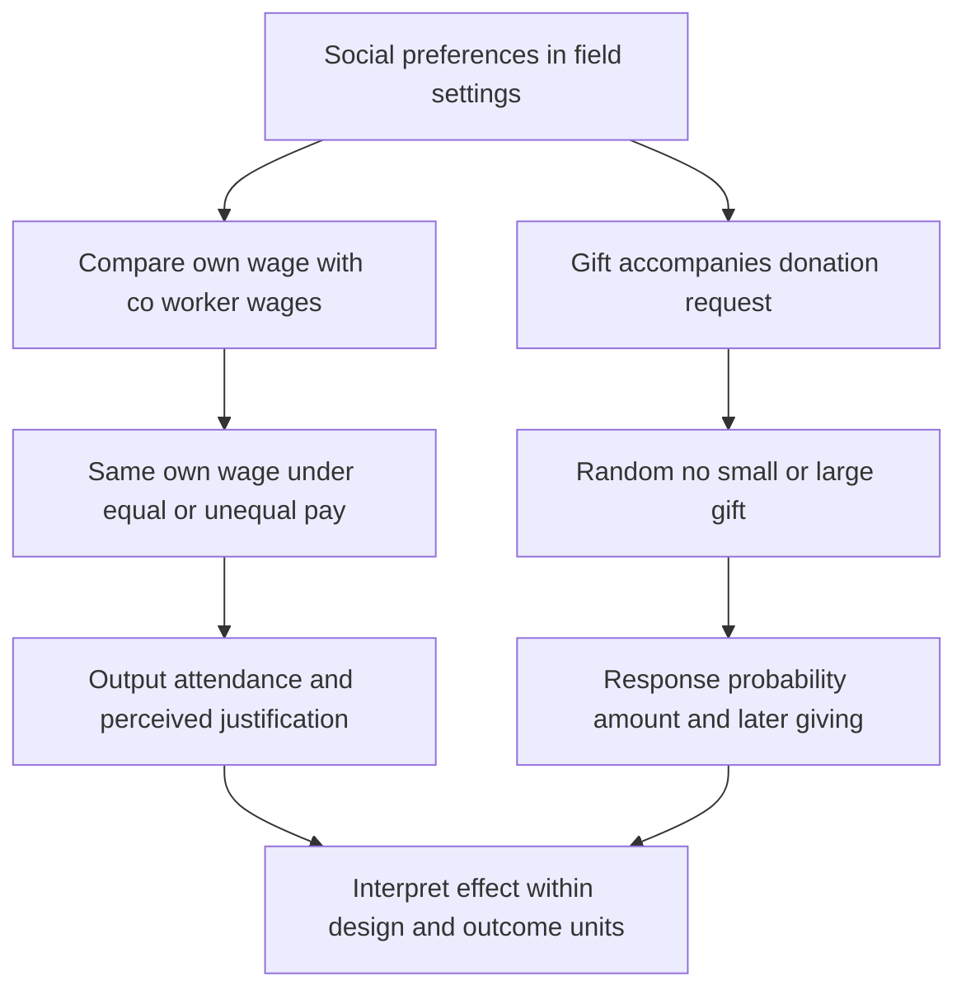

# Interpret relative-pay comparisons without confusing own wages or percentages

## Record metadata

```json
{
  "schema_version": 3,
  "owner": "plan",
  "course_id": "2026_2027/Winter_Semester/Behavioral_Economics",
  "transaction_id": "PLAN-20261018-BE-P002",
  "plan_version": "P002",
  "source_version": "V002",
  "ingestion_revision": 3,
  "objective_id": "O011",
  "objective_revision": 1,
  "criterion_version": "O011-C1",
  "status": "ready",
  "lesson_content_contract": "self-contained-lessons-v1",
  "knowledge_components": [
    "held_own_wage_comparison",
    "relative_percent_probability_and_output",
    "justification_and_nonunique_motive_limits"
  ],
  "prerequisite_ids": [
    "O009",
    "O003"
  ],
  "compatible_versions": [],
  "note_locations": [
    {
      "path": "01_Notes/2026_2027/Winter_Semester/Behavioral_Economics/Week_2/Relative_Pay_and_Charitable_Gift_Exchange.md",
      "heading": "Relative pay and charitable gift exchange"
    },
    {
      "path": "01_Notes/2026_2027/Winter_Semester/Behavioral_Economics/Week_2/Relative_Pay_and_Charitable_Gift_Exchange.md",
      "heading": "Relative wages with own wage held fixed"
    }
  ],
  "acquisition_rule": {
    "distinct_independent_passes": 2,
    "required_item_roles": [
      "full_capability_check",
      "full_capability_check"
    ],
    "allowed_routes": [
      [
        "O011-I1",
        "O011-I2"
      ],
      [
        "O011-I1",
        "O011-D1"
      ],
      [
        "O011-I1",
        "O011-D2"
      ],
      [
        "O011-I2",
        "O011-D1"
      ],
      [
        "O011-I2",
        "O011-D2"
      ],
      [
        "O011-D1",
        "O011-D2"
      ]
    ]
  },
  "delayed_rule": {
    "minimum_elapsed_hours": 24,
    "fresh_item": true,
    "independent_required": true
  },
  "review_topic": "Interpret relative-pay comparisons without confusing own wages or percentages",
  "review_instruction": "Begin a closed-note review with teach for O011; request an unused prepared delayed item before recap."
}
```

## Outcome and conditions

Explain the same-own-wage workplace comparison, calculate explicitly defined hypothetical relative changes and qualify justification/mechanism claims. All essential components listed in metadata are required. Hypothetical assessment values instantiate the checked equations; they are not historical observations or observed outcomes. Independent checks are closed-note and without hints, solution access, external retrieval or other assistance; blank paper and pen only are allowed; no calculator or device. Teach establishes and records actual help/exposure conditions before claiming independence.

## Prerequisites and checks

- [O009 outcome and repair route](../lessons/O009.md#outcome-and-conditions): relative wages require an actual effort-dependent marginal social channel, not a constant penalty alone.
- [O003 outcome and repair route](../lessons/O003.md#outcome-and-conditions): payoff evidence need not uniquely identify a motive or preference parameter.

O011-P1, item_version 1, prerequisite_diagnostic. **Prompt:** If own and peer wages are both fixed with effort, what is the derivative of an absolute-gap penalty? Why does observing one allocation/payoff choice not uniquely identify all preference weights?

**Complete key and rubric:** The fixed gap has zero effort derivative (O009); an observed choice supplies limited inequalities/branch evidence and can have ties or overlapping motives (O003). Require both; repair the complete model lessons. Pass requires every requested reason and result; partial for an omitted reason or unresolved isolated arithmetic slip; fail for the conflicting mechanism. This diagnostic never counts as acquisition. Current or explicitly compatible committed independent prerequisite evidence may permit skipping its check; familiarity alone cannot. Use the cited complete prerequisite lesson or the named included foundation, then the worked example, after a partial/failing entry check.

## Teaching order and rationale

1. Use the diagnostic once to establish the necessary conceptual or algebraic foundation.
2. Present the complete checked-note explanation below, preserving variables, dates, assumptions and source qualifications. Follow one reasoning chain at a time so every intermediate step is visible.
3. Work W1 fully, asking the learner to explain why each step follows.
4. Use S1 as completion practice: show the setup and first identity, hide the final algebra/numbers and interpretation. After an explanation of the missing steps, withdraw support.
5. Present unused I1/I2 full checks with hidden solutions; use correction/repair after scoring the original answer. An unused D form can replace an exposed I only through a listed route.
6. On a later eligible occasion, begin an unused D item before recap. A numeric variant establishes bounded same-method performance, not general transfer.

## Motivation, intuition, and definitions

Explain the same-own-wage workplace comparison, calculate explicitly defined hypothetical relative changes and qualify justification/mechanism claims. Establish the definitions, assumptions and relevant comparisons before simplifying an equation. The complete reused passages establish every academic claim, notation choice and qualification assessed here; necessary prerequisites use the complete lessons above.

## Explanation steps

Origin: reused complete note introduction before its first subsection, [[01_Notes/2026_2027/Winter_Semester/Behavioral_Economics/Week_2/Relative_Pay_and_Charitable_Gift_Exchange.md#Relative pay and charitable gift exchange]], fingerprint `f25609e10a80282755875d6639b5d4cc8b32423bdac3240e176c3a7e277e95ef`. Heading depth alone is adapted.

### Relative pay and charitable gift exchange

Social preferences can make the treatment of co-workers or donors relevant even when own monetary pay is fixed. The lecture combines a workplace comparison experiment with a fundraising experiment. Their common logic is to vary a socially meaningful feature while keeping a useful monetary benchmark clear. [[00_Materials/2026_2027/Winter_Semester/Behavioral_Economics/Week_2/L3 BE_SP_field IES 2026.pdf#page=25|L3 BE_SP_field IES 2026.pdf, physical PDF pp. 25–35]]



This map places the comparison group and outcome denominator before the substantive conclusion. It follows the two supplied applications and prevents treating attendance, donation frequency and donation amounts as interchangeable. [[00_Materials/2026_2027/Winter_Semester/Behavioral_Economics/Week_2/L3 BE_SP_field IES 2026.pdf#page=26|L3 BE_SP_field IES 2026.pdf, physical PDF pp. 26–34]]

Origin: reused complete checked passage [[01_Notes/2026_2027/Winter_Semester/Behavioral_Economics/Week_2/Relative_Pay_and_Charitable_Gift_Exchange.md#Relative wages with own wage held fixed]]; fingerprint `f25609e10a80282755875d6639b5d4cc8b32423bdac3240e176c3a7e277e95ef`. Heading depth alone is adapted.

### Relative wages with own wage held fixed

Breza, Kaur and Shamdasani's Indian field experiment organizes workers into teams whose members make the same product in proximity, while production remains individual. Teams are assigned either a flat common daily wage or different wages linked to baseline productivity rank. Comparisons across treatments can hold a worker's **own absolute wage** fixed while changing what co-workers receive. Without this comparison, a low-paid worker's lower effort could simply reflect lower own pay rather than relative-pay concerns. [[00_Materials/2026_2027/Winter_Semester/Behavioral_Economics/Week_2/L3 BE_SP_field IES 2026.pdf#page=26|L3 BE_SP_field IES 2026.pdf, physical PDF pp. 26]]

The lecture reports that workers paid less than peers reduce output by **12%** and are **13% less likely to come to work**, while higher relative pay produces no detected effort increase. These are the lecture's reported percentages, not an instruction to relabel the attendance change as 13 percentage points. Nor does “no detected increase” prove an exactly zero effect for every worker. The Sli.do page asks for a prediction but shows no poll results. [[00_Materials/2026_2027/Winter_Semester/Behavioral_Economics/Week_2/L3 BE_SP_field IES 2026.pdf#page=27|L3 BE_SP_field IES 2026.pdf, physical PDF pp. 27–28]]

Perceived justification matters: when the pay gap is clearly supported by observed baseline productivity differences, the negative effect is not detected. The simple fact of unequal pay therefore does not fully determine the response; information about why pay differs changes the interpretation. The source concludes that inequality was bad for the firm in the studied comparison. Treat that as an application-specific result, not a general theorem that every wage difference reduces output. [[00_Materials/2026_2027/Winter_Semester/Behavioral_Economics/Week_2/L3 BE_SP_field IES 2026.pdf#page=28|L3 BE_SP_field IES 2026.pdf, physical PDF pp. 28]]

The lesson links to inequality aversion and fairness perceptions, but the design does not identify one utility function merely from a negative response. A preference for equality, resentment about unjustified treatment and beliefs about management can generate overlapping predictions. The model note also explains why a utility penalty on an entirely effort-independent fixed wage gap cannot mechanically derive every effort effect without an additional channel. [[00_Materials/2026_2027/Winter_Semester/Behavioral_Economics/Week_2/L3 BE_SP_field IES 2026.pdf#page=7|L3 BE_SP_field IES 2026.pdf, physical PDF pp. 7, 26–28]] [[01_Notes/2026_2027/Winter_Semester/Behavioral_Economics/Week_2/Effort_Contracts_and_Social_Motivations.md#Adding a marginal social motive]]


## Worked example

O011-W1, item_version 1, worked_example. **Prompt:** A hypothetical unequal-pay workplace comparison holds a low-paid worker’s own daily wage fixed across equal-pay and peer-higher-pay teams, with the same individual production task. Baseline output is 100 units; the unequal-pay condition reduces it by 12%. Baseline attendance probability is 0.8; for this hypothetical calculation “13.0% less likely” explicitly means a relative reduction from that baseline. Calculate output, attendance probability and percentage-point change. Explain the identifying comparison, how “the pay gap is visibly explained by prior productivity” would bear on the interpretation, and what the lecture’s actual 12%/13% reports do and do not establish. Does the design identify a unique inequality-aversion utility, or can a constant fixed wage-gap penalty by itself derive effort?

**Complete solution and essential rubric:** Output becomes $100(1-.12)=88.00000000$ units. Under the expressly supplied relative-probability convention, attendance becomes $0.8(1-0.13)=0.69600000$, a change of $-10.40000000$ percentage points. Relative percent and percentage points differ; the lecture’s actual 13% statement cannot be converted to 13 points or a numerical probability without a baseline and precise definition. Keeping own wage fixed while changing peers’ wages separates relative-pay treatment from an own-wage-level explanation, subject to the randomized design and measured task. Clear baseline-productivity justification can change perceived fairness; the lecture reports no detected negative effect under visible justification, not a theorem that any wage gap is harmless. Its 12% output/13% attendance reports are source-reported setting-specific effects and “no detected” high-pay increase is not proof of exact zero. Equality concerns, resentment, fairness beliefs and management intentions can overlap. A literally fixed gap term is constant in effort and has zero derivative; a further effort/payoff or social-meaning channel is needed. No unique utility function or universal employment effect is identified. All requested calculations, derivations and qualifications are essential; the component map above applies to every full form.

## Practice with fading assistance

O011-S1, item_version 1, supported_completion. **Prompt:** A hypothetical unequal-pay workplace comparison holds a low-paid worker’s own daily wage fixed across equal-pay and peer-higher-pay teams, with the same individual production task. Baseline output is 80 units; the unequal-pay condition reduces it by 12%. Baseline attendance probability is 0.9; for this hypothetical calculation “13.0% less likely” explicitly means a relative reduction from that baseline. Calculate output, attendance probability and percentage-point change. Explain the identifying comparison, how “baseline-productivity differences justify the gap” would bear on the interpretation, and what the lecture’s actual 12%/13% reports do and do not establish. Does the design identify a unique inequality-aversion utility, or can a constant fixed wage-gap penalty by itself derive effort?

**Complete solution and essential rubric:** Output becomes $80(1-.12)=70.40000000$ units. Under the expressly supplied relative-probability convention, attendance becomes $0.9(1-0.13)=0.78300000$, a change of $-11.70000000$ percentage points. Relative percent and percentage points differ; the lecture’s actual 13% statement cannot be converted to 13 points or a numerical probability without a baseline and precise definition. Keeping own wage fixed while changing peers’ wages separates relative-pay treatment from an own-wage-level explanation, subject to the randomized design and measured task. Clear baseline-productivity justification can change perceived fairness; the lecture reports no detected negative effect under visible justification, not a theorem that any wage gap is harmless. Its 12% output/13% attendance reports are source-reported setting-specific effects and “no detected” high-pay increase is not proof of exact zero. Equality concerns, resentment, fairness beliefs and management intentions can overlap. A literally fixed gap term is constant in effort and has zero derivative; a further effort/payoff or social-meaning channel is needed. No unique utility function or universal employment effect is identified. All requested calculations, derivations and qualifications are essential; the component map above applies to every full form.

Allowed support is the first stated identity only; hide the remaining key while the learner completes it. Supported performance is practice, not an independent result.

## Rubric and independence

Required components: held_own_wage_comparison, relative_percent_probability_and_output, justification_and_nonunique_motive_limits. Each full prompt/key below elicits every component; all are necessary for a pass on every permitted pair. Accept algebraically equivalent expressions and clearly defined opposite cash-flow signs with correct interpretation. A pass requires all requested outputs/reasons, correct units/assumptions and no critical conceptual error. Partial means a missing component or an unresolved isolated arithmetic slip with an otherwise valid method; independent correction is required for a pass. Fail means a critical mechanism/condition is wrong. Unscorable means a response or its help/exposure conditions cannot be established. Unknown help conditions are never independent evidence.

Critical errors: Attendance percent relabeled percentage points without baseline; own wage not held fixed; no detected effect treated as exact zero; fixed-gap penalty used without effort channel.

Acquisition requires two distinct unused unassisted full checks selected from the six exact metadata routes. Every I/D form covers all components; W1, S1, the prerequisite and C1 are forbidden substitutes. A D form used for acquisition cannot later be counted again as delayed success. No teach-generated item may replace a named full check; additional verified explanation/practice is allowed under the unchanged method and may not fabricate evidence. If fewer than two fresh forms remain for acquisition, return a plan_issue for an additional prepared bank.

| Component | I1 | I2 | D1 | D2 |
|---|---|---|---|---|
| held_own_wage_comparison | required | required | required | required |
| relative_percent_probability_and_output | required | required | required | required |
| justification_and_nonunique_motive_limits | required | required | required | required |

## Misconceptions and correction

An observed omitted term/sign is tentative until the learner explains it; compare the reasoning with the critical errors above. Score the original response before providing help. Route a conceptual failure to the relevant included derivation and prerequisite, then use an unused full form.

O011-C1, item_version 1, narrow_correction. **Prompt:** The lecture says13% less likely to attend. Without a baseline and exact convention, may that be rewritten as a 13 percentage-point fall? **Key/rubric:** No. Relative percentages and probability-point differences use different denominators. A numerical probability or point change needs the stated baseline/convention; retain the source-reported wording otherwise. Pass requires all keyed reasoning; partial for a missing part; fail for the conflicting mechanism. This repairs a common inference only; it cannot substitute for a full numerical/capability check.

Give at most two hints (first identify the date/unit, second point to the included identity); after ineffective hints show the relevant worked step. After two unsuccessful independent attempts stop repeated quizzing, revisit the explanation/prerequisite and preserve the unresolved status.

## Immediate and delayed checks

### O011-I1

O011-I1, item_version 1, full_capability_check. **Prompt:** A hypothetical unequal-pay workplace comparison holds a low-paid worker’s own daily wage fixed across equal-pay and peer-higher-pay teams, with the same individual production task. Baseline output is 120 units; the unequal-pay condition reduces it by 12%. Baseline attendance probability is 0.75; for this hypothetical calculation “13.0% less likely” explicitly means a relative reduction from that baseline. Calculate output, attendance probability and percentage-point change. Explain the identifying comparison, how “workers observe a clear performance basis for unequal pay” would bear on the interpretation, and what the lecture’s actual 12%/13% reports do and do not establish. Does the design identify a unique inequality-aversion utility, or can a constant fixed wage-gap penalty by itself derive effort?

**Complete solution and essential rubric:** Output becomes $120(1-.12)=105.60000000$ units. Under the expressly supplied relative-probability convention, attendance becomes $0.75(1-0.13)=0.65250000$, a change of $-9.75000000$ percentage points. Relative percent and percentage points differ; the lecture’s actual 13% statement cannot be converted to 13 points or a numerical probability without a baseline and precise definition. Keeping own wage fixed while changing peers’ wages separates relative-pay treatment from an own-wage-level explanation, subject to the randomized design and measured task. Clear baseline-productivity justification can change perceived fairness; the lecture reports no detected negative effect under visible justification, not a theorem that any wage gap is harmless. Its 12% output/13% attendance reports are source-reported setting-specific effects and “no detected” high-pay increase is not proof of exact zero. Equality concerns, resentment, fairness beliefs and management intentions can overlap. A literally fixed gap term is constant in effort and has zero derivative; a further effort/payoff or social-meaning channel is needed. No unique utility function or universal employment effect is identified. All requested calculations, derivations and qualifications are essential; the component map above applies to every full form.

I1/I2 are immediate checks; D1/D2 are distinct parallel variants reserved where possible for delayed checks. A delayed success requires an unused form before recap, no help/solution access, and at least 24 actual elapsed hours after acquisition and the most recent relevant teaching/solution exposure. Record intervening exposure. A calendar-date change alone is insufficient; an early D attempt is immediate evidence only.

### O011-I2

O011-I2, item_version 1, full_capability_check. **Prompt:** A hypothetical unequal-pay workplace comparison holds a low-paid worker’s own daily wage fixed across equal-pay and peer-higher-pay teams, with the same individual production task. Baseline output is 150 units; the unequal-pay condition reduces it by 12%. Baseline attendance probability is 0.7; for this hypothetical calculation “13.0% less likely” explicitly means a relative reduction from that baseline. Calculate output, attendance probability and percentage-point change. Explain the identifying comparison, how “the employer supplies credible productivity information” would bear on the interpretation, and what the lecture’s actual 12%/13% reports do and do not establish. Does the design identify a unique inequality-aversion utility, or can a constant fixed wage-gap penalty by itself derive effort?

**Complete solution and essential rubric:** Output becomes $150(1-.12)=132.00000000$ units. Under the expressly supplied relative-probability convention, attendance becomes $0.7(1-0.13)=0.60900000$, a change of $-9.10000000$ percentage points. Relative percent and percentage points differ; the lecture’s actual 13% statement cannot be converted to 13 points or a numerical probability without a baseline and precise definition. Keeping own wage fixed while changing peers’ wages separates relative-pay treatment from an own-wage-level explanation, subject to the randomized design and measured task. Clear baseline-productivity justification can change perceived fairness; the lecture reports no detected negative effect under visible justification, not a theorem that any wage gap is harmless. Its 12% output/13% attendance reports are source-reported setting-specific effects and “no detected” high-pay increase is not proof of exact zero. Equality concerns, resentment, fairness beliefs and management intentions can overlap. A literally fixed gap term is constant in effort and has zero derivative; a further effort/payoff or social-meaning channel is needed. No unique utility function or universal employment effect is identified. All requested calculations, derivations and qualifications are essential; the component map above applies to every full form.

### O011-D1

O011-D1, item_version 1, full_capability_check. **Prompt:** A hypothetical unequal-pay workplace comparison holds a low-paid worker’s own daily wage fixed across equal-pay and peer-higher-pay teams, with the same individual production task. Baseline output is 90 units; the unequal-pay condition reduces it by 12%. Baseline attendance probability is 0.85; for this hypothetical calculation “13.0% less likely” explicitly means a relative reduction from that baseline. Calculate output, attendance probability and percentage-point change. Explain the identifying comparison, how “the unequal-pay reason is transparently productivity-related” would bear on the interpretation, and what the lecture’s actual 12%/13% reports do and do not establish. Does the design identify a unique inequality-aversion utility, or can a constant fixed wage-gap penalty by itself derive effort?

**Complete solution and essential rubric:** Output becomes $90(1-.12)=79.20000000$ units. Under the expressly supplied relative-probability convention, attendance becomes $0.85(1-0.13)=0.73950000$, a change of $-11.05000000$ percentage points. Relative percent and percentage points differ; the lecture’s actual 13% statement cannot be converted to 13 points or a numerical probability without a baseline and precise definition. Keeping own wage fixed while changing peers’ wages separates relative-pay treatment from an own-wage-level explanation, subject to the randomized design and measured task. Clear baseline-productivity justification can change perceived fairness; the lecture reports no detected negative effect under visible justification, not a theorem that any wage gap is harmless. Its 12% output/13% attendance reports are source-reported setting-specific effects and “no detected” high-pay increase is not proof of exact zero. Equality concerns, resentment, fairness beliefs and management intentions can overlap. A literally fixed gap term is constant in effort and has zero derivative; a further effort/payoff or social-meaning channel is needed. No unique utility function or universal employment effect is identified. All requested calculations, derivations and qualifications are essential; the component map above applies to every full form.

### O011-D2

O011-D2, item_version 1, full_capability_check. **Prompt:** A hypothetical unequal-pay workplace comparison holds a low-paid worker’s own daily wage fixed across equal-pay and peer-higher-pay teams, with the same individual production task. Baseline output is 200 units; the unequal-pay condition reduces it by 12%. Baseline attendance probability is 0.6; for this hypothetical calculation “13.0% less likely” explicitly means a relative reduction from that baseline. Calculate output, attendance probability and percentage-point change. Explain the identifying comparison, how “the gap’s productivity justification is understood” would bear on the interpretation, and what the lecture’s actual 12%/13% reports do and do not establish. Does the design identify a unique inequality-aversion utility, or can a constant fixed wage-gap penalty by itself derive effort?

**Complete solution and essential rubric:** Output becomes $200(1-.12)=176.00000000$ units. Under the expressly supplied relative-probability convention, attendance becomes $0.6(1-0.13)=0.52200000$, a change of $-7.80000000$ percentage points. Relative percent and percentage points differ; the lecture’s actual 13% statement cannot be converted to 13 points or a numerical probability without a baseline and precise definition. Keeping own wage fixed while changing peers’ wages separates relative-pay treatment from an own-wage-level explanation, subject to the randomized design and measured task. Clear baseline-productivity justification can change perceived fairness; the lecture reports no detected negative effect under visible justification, not a theorem that any wage gap is harmless. Its 12% output/13% attendance reports are source-reported setting-specific effects and “no detected” high-pay increase is not proof of exact zero. Equality concerns, resentment, fairness beliefs and management intentions can overlap. A literally fixed gap term is constant in effort and has zero derivative; a further effort/payoff or social-meaning channel is needed. No unique utility function or universal employment effect is identified. All requested calculations, derivations and qualifications are essential; the component map above applies to every full form.

## Advance, revisit, pause, and escalate

Advance only after teach commits two qualifying independent full passes under a listed route. Keep acquisition and each later delayed observation separate. A source conflict blocks the affected claim and returns to ingest with the exact note heading. Missing criteria, a new method, unsupported alternative or exhausted fresh bank returns to plan with 2026_2027/Winter_Semester/Behavioral_Economics, O011, revision1/O011-C1, P002/V002/ingestion3 and item ID. Equivalent valid methods meeting the frozen criterion may receive credit after verification; no criterion is changed to fit an answer. Closing a session preserves the actual stopping point without claiming completion.

## Content provenance and generation boundaries

Explanations, figures and qualifications above reuse complete checked-note sections with exact origin/fingerprint; heading depth alone is adapted. Main exercises and worked arithmetic are plan-created hypothetical instantiations of those displayed identities. No additional academic claims or external course scope are introduced. Preserve the note conventions and explicit qualifications; checked references reused from notes are not an independent raw-source audit by plan. New numerical practice can use the same method only after its complete solution and unchanged components are checked before display; it cannot replace this lesson’s named evidence forms. Prerequisites route to the complete prepared lessons above.

## Answer-free recall handoff

Topic: Interpret relative-pay comparisons without confusing own wages or percentages. Begin a closed-note review with teach for O011; request an unused prepared delayed item before recap. Exact lesson: [[03_Agents/2026_2027/Winter_Semester/Behavioral_Economics/lessons/O011.md#Immediate and delayed checks]]. Teach supplies actual committed evidence and timestamps; recall alone dates reviews. No learner outcome or due date is created by this curriculum.

For independent numeric outputs, exact fractions/expressions with correct setup or sensible hand rounding are acceptable; no calculator precision is required. Teacher keys show decimals for verification. This follows the supplied paper-and-pen independent conditions and does not reinterpret an earlier attempt.
