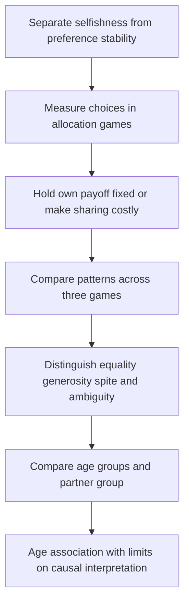

# Derive childhood allocation patterns and bound age comparisons

## Record metadata

```json
{
  "schema_version": 3,
  "owner": "plan",
  "course_id": "2026_2027/Winter_Semester/Behavioral_Economics",
  "transaction_id": "PLAN-20261018-BE-P002",
  "plan_version": "P002",
  "source_version": "V002",
  "ingestion_revision": 3,
  "objective_id": "O013",
  "objective_revision": 1,
  "criterion_version": "O013-C1",
  "status": "ready",
  "lesson_content_contract": "self-contained-lessons-v1",
  "knowledge_components": [
    "three_payoff_comparisons_and_selfish_ties",
    "whole_pattern_classification_and_identification",
    "age_partner_sample_and_causal_limits"
  ],
  "prerequisite_ids": [
    "O002",
    "O003"
  ],
  "compatible_versions": [],
  "note_locations": [
    {
      "path": "01_Notes/2026_2027/Winter_Semester/Behavioral_Economics/Week_3/Social_Preferences_in_Childhood.md",
      "heading": "Social preferences in childhood"
    },
    {
      "path": "01_Notes/2026_2027/Winter_Semester/Behavioral_Economics/Week_3/Social_Preferences_in_Childhood.md",
      "heading": "Three games distinguish different motives"
    },
    {
      "path": "01_Notes/2026_2027/Winter_Semester/Behavioral_Economics/Week_3/Social_Preferences_in_Childhood.md",
      "heading": "Read the whole choice pattern"
    },
    {
      "path": "01_Notes/2026_2027/Winter_Semester/Behavioral_Economics/Week_3/Social_Preferences_in_Childhood.md",
      "heading": "The age comparison is conditional on the partner group"
    }
  ],
  "acquisition_rule": {
    "distinct_independent_passes": 2,
    "required_item_roles": [
      "full_capability_check",
      "full_capability_check"
    ],
    "allowed_routes": [
      [
        "O013-I1",
        "O013-I2"
      ],
      [
        "O013-I1",
        "O013-D1"
      ],
      [
        "O013-I1",
        "O013-D2"
      ],
      [
        "O013-I2",
        "O013-D1"
      ],
      [
        "O013-I2",
        "O013-D2"
      ],
      [
        "O013-D1",
        "O013-D2"
      ]
    ]
  },
  "delayed_rule": {
    "minimum_elapsed_hours": 24,
    "fresh_item": true,
    "independent_required": true
  },
  "review_topic": "Derive childhood allocation patterns and bound age comparisons",
  "review_instruction": "Begin a closed-note review with teach for O013; request an unused prepared delayed item before recap."
}
```

## Outcome and conditions

Derive the three sweets game comparisons, classify a full observed pattern with the source table, and qualify ingroup age/sample inference. All essential components listed in metadata are required. Hypothetical assessment values instantiate the checked equations; they are not historical observations or observed outcomes. Independent checks are closed-note and without hints, solution access, external retrieval or other assistance; blank paper and pen only are allowed; no calculator or device. Teach establishes and records actual help/exposure conditions before claiming independence.

## Prerequisites and checks

- [O002 outcome and repair route](../lessons/O002.md#outcome-and-conditions): unilateral allocation differs from bargaining/veto games.
- [O003 outcome and repair route](../lessons/O003.md#outcome-and-conditions): preference interpretation depends on whose payoff changes and whether the benchmark is indifferent.

O013-P1, item_version 1, prerequisite_diagnostic. **Prompt:** In a dictator allocation, who controls the outcome and can the receiver veto? If own payoff is identical across two options, does pure self-interest strictly rank them?

**Complete key and rubric:** The allocator controls it without a receiver veto (O002); identical own payoff gives a self-regarding tie, not a strict selection (O003). Require both; repair the complete game/payoff lessons. Pass requires every requested reason and result; partial for an omitted reason or unresolved isolated arithmetic slip; fail for the conflicting mechanism. This diagnostic never counts as acquisition. Current or explicitly compatible committed independent prerequisite evidence may permit skipping its check; familiarity alone cannot. Use the cited complete prerequisite lesson or the named included foundation, then the worked example, after a partial/failing entry check.

## Teaching order and rationale

1. Use the diagnostic once to establish the necessary conceptual or algebraic foundation.
2. Present the complete checked-note explanation below, preserving variables, dates, assumptions and source qualifications. Follow one reasoning chain at a time so every intermediate step is visible.
3. Work W1 fully, asking the learner to explain why each step follows.
4. Use S1 as completion practice: show the setup and first identity, hide the final algebra/numbers and interpretation. After an explanation of the missing steps, withdraw support.
5. Present unused I1/I2 full checks with hidden solutions; use correction/repair after scoring the original answer. An unused D form can replace an exposed I only through a listed route.
6. On a later eligible occasion, begin an unused D item before recap. A numeric variant establishes bounded same-method performance, not general transfer.

## Motivation, intuition, and definitions

Derive the three sweets game comparisons, classify a full observed pattern with the source table, and qualify ingroup age/sample inference. Establish the definitions, assumptions and relevant comparisons before simplifying an equation. The complete reused passages establish every academic claim, notation choice and qualification assessed here; necessary prerequisites use the complete lessons above.

## Explanation steps

Origin: reused complete checked passage [[01_Notes/2026_2027/Winter_Semester/Behavioral_Economics/Week_3/Social_Preferences_in_Childhood.md#Social preferences in childhood]]; fingerprint `e0a3559c498c69bafe1c4a6d41bffa0c3f527a21fdd89a26affaabf6a221d04b`. Heading depth alone is adapted.

### Social preferences in childhood

Are preferences fixed traits, or can social experience shape them? This is separate from asking whether preferences are selfish: stable preferences could be other-regarding, and changing preferences could remain selfish. The lecture contrasts a traditional stability assumption, illustrated by Stigler and Becker (1977, p. 76), with a social-environment view attributed to Peter Hedström. Those positions motivate empirical questions rather than establish either answer by assertion. [[00_Materials/2026_2027/Winter_Semester/Behavioral_Economics/Week_3/L4 BE_formation IES 2026.pdf#page=1|L4 BE_formation IES 2026.pdf, physical PDF pp. 1–4]]



The map follows the framing, experimental design and results. The core foundation is to derive what each payoff comparison identifies before attaching a preference label to a child. [[00_Materials/2026_2027/Winter_Semester/Behavioral_Economics/Week_3/L4 BE_formation IES 2026.pdf#page=2|L4 BE_formation IES 2026.pdf, physical PDF pp. 2–16]]

#### Three games distinguish different motives

Fehr, Bernhard and Rockenbach (2008) use anonymous, one-shot allocations of sweets between a child and another child. The lecture describes approximately 250 Swiss children aged 3–8; the consulted Nature paper reports **229 analysed children**, so the lecture's count is approximate rather than an exact sample size. Partners are either classmates from the same school/kindergarten (ingroup) or unknown children from another one (outgroup). The photo shows allocation cards and the group-photo cue identifying partner status; the child does not bargain face to face with the partner. [[00_Materials/2026_2027/Winter_Semester/Behavioral_Economics/Week_3/L4 BE_formation IES 2026.pdf#page=6|L4 BE_formation IES 2026.pdf, physical PDF pp. 6–7]]

![[01_Notes/2026_2027/Winter_Semester/Behavioral_Economics/assets/Week_3_Allocation_Setup.png]]

Write a payoff as (own sweets, partner's sweets). The source's tasks are:

| Game | Available allocations | What changes? |
|---|---|---|
| Costless prosocial/sharing | (1,1) or (1,0) | Own sweets stay fixed; helping the partner also removes advantageous inequality. |
| Costless envy | (1,1) or (1,2) | Own sweets stay fixed; equality conflicts with increasing the partner's payoff. |
| Costly sharing | (1,1) or (2,0) | Equality and helping the partner require sacrificing one own sweet. |

A purely selfish child is **indifferent** between the two options in the first two games because own payoff is one in either case; selfishness does not strictly predict one tied option. In costly sharing, selfishness strictly predicts (2,0). A strongly egalitarian child selects equality in all three; a sufficiently altruistic child selects the higher partner payoff, including accepting a cost to share. Spite instead favours reducing the other's payoff. Strength matters when own payoff must be sacrificed. [[00_Materials/2026_2027/Winter_Semester/Behavioral_Economics/Week_3/L4 BE_formation IES 2026.pdf#page=6|L4 BE_formation IES 2026.pdf, physical PDF pp. 6, 8–13]]

#### Read the whole choice pattern

The source table exhausts the eight combinations of two choices in three games:

| Source classification | Prosocial game | Envy game | Sharing game |
|---|---|---|---|
| Strongly egalitarian | (1,1) | (1,1) | (1,1) |
| Weakly egalitarian | (1,1) | (1,1) | (2,0) |
| Strongly generous | (1,1) | (1,2) | (1,1) |
| Weakly generous | (1,1) | (1,2) | (2,0) |
| Ambiguous type | (1,0) | (1,1) | (1,1) |
| Spiteful | (1,0) | (1,1) | (2,0) |
| Ambiguous type | (1,0) | (1,2) | (1,1) |
| Ambiguous type | (1,0) | (1,2) | (2,0) |

These are the source's behavioural classifications, not infallible personality diagnoses. Because the selfish benchmark permits either costless choice, a child choosing (2,0) in sharing could also produce several of these costless patterns without a strict selfish preference among them. One cannot identify a unique utility function from one tied choice. Consistency, understanding, context and measurement also matter. The four Sli.do pages ask students to predict inequality-averse, altruistic, spiteful and selfish choices; no poll results are supplied, so the reasoning above supplies model predictions rather than invented class responses. [[00_Materials/2026_2027/Winter_Semester/Behavioral_Economics/Week_3/L4 BE_formation IES 2026.pdf#page=8|L4 BE_formation IES 2026.pdf, physical PDF pp. 8–13]]

![[01_Notes/2026_2027/Winter_Semester/Behavioral_Economics/assets/Week_3_Preference_Types.png]]

#### The age comparison is conditional on the partner group

The lecture's repeated age figure concerns **ingroup** partners. The proportion making the egalitarian choice in costly sharing rises from about 9% at ages 3–4 to about 22% at 5–6 and 45% at 7–8. The costless prosocial and envy choices reach roughly 78% and 80% at 7–8. These graphical readings show why the lecture describes young children as mostly selfish and older children as more egalitarian, but the costless-game ties mean that label should not be treated as direct proof of a unique motive for every young child. Even among the oldest group, fewer than half choose costly equality. [[00_Materials/2026_2027/Winter_Semester/Behavioral_Economics/Week_3/L4 BE_formation IES 2026.pdf#page=14|L4 BE_formation IES 2026.pdf, physical PDF pp. 14–15]]

![[01_Notes/2026_2027/Winter_Semester/Behavioral_Economics/assets/Week_3_Age_Choices.png]]

This is a **cross-sectional age comparison**, not a panel following the same children as they grow. It supports an age-related pattern, not a causal estimate of ageing or a particular upbringing. Its ingroup caption also prevents generalizing the displayed percentages to unknown outgroup children. The lecture's statement that later development includes efficiency concerns and altruism is attributed only to unspecified “different studies”; no unprovided later-age evidence or effect size is certified here. [[00_Materials/2026_2027/Winter_Semester/Behavioral_Economics/Week_3/L4 BE_formation IES 2026.pdf#page=14|L4 BE_formation IES 2026.pdf, physical PDF pp. 14–16]]

**Bounded primary check:** Fehr, Bernhard and Rockenbach, “Egalitarianism in young children,” *Nature* 454 (2008), 1079–1083, [publisher proof](https://www.nature.com/news/2008/080827/pdf/nature07155_proof2.pdf), physical pp. 1–2 and methods on p. 6, verifies the three tasks, sample count, anonymous one-shot design and ingroup interpretation. The proof distinguishes costless choices from costly sharing; numerical source figures remain tied to their displayed partner condition. This is supporting verification, not ingestion of the paper's entire additional outgroup analysis.

The next question is whether family background is merely associated with preferences or whether changing a child's social environment can alter measured prosociality. Distinguishing those two claims is the foundation of the mentoring application. [[00_Materials/2026_2027/Winter_Semester/Behavioral_Economics/Week_3/L4 BE_formation IES 2026.pdf#page=16|L4 BE_formation IES 2026.pdf, physical PDF pp. 16–18]] [[01_Notes/2026_2027/Winter_Semester/Behavioral_Economics/Week_3/Social_Environment_and_Mentoring.md]]


## Worked example

O013-W1, item_version 1, worked_example. **Prompt:** In the source’s own/partner-sweets order, the prosocial game offers (1,1)/(1,0), envy game (1,1)/(1,2), sharing game (1,1)/(2,0). A hypothetical child chooses [(1, 1), (1, 1), (1, 1)] in that order. Derive what varies/what is held fixed in each game, the selfish indifference/strict-choice predictions, and the strong-equality/generosity/spite interpretations. Give the table’s classification for this observed pattern and explain whether it uniquely identifies utility or a permanent personality trait. Interpret the age graph’s about 9/22/45% costly-equality pattern, ingroup restriction, anonymous one-shot design and 229 analysed versus approximately 250 sample wording without turning age association into causal development.

**Complete solution and essential rubric:** Own payoff stays 1 in the first two games; changing the partner’s payoff also changes equality. In the third, selecting (1,1) costs one own sweet relative to (2,0). Pure self-interest is indifferent over the first two pairs and strictly prefers (2,0) in sharing. Strong egalitarianism selects equality throughout; sufficiently strong generosity raises the partner’s payoff even when costly, and spite favours reducing it (strength matters with own costs). The source-table label for [(1, 1), (1, 1), (1, 1)] is “strongly egalitarian.” The costly-equality choice sacrifices an own sweet and therefore does not follow from the pure-selfish strict sharing prediction. A behavioural table classification is not a unique utility/personality diagnosis; comprehension, context and ties matter. The actual tasks are anonymous one-shot incentivized sweets allocations, with ingroup/outgroup cues rather than face-to-face bargaining. The displayed age figure is ingroup-only, roughly 9%, 22%, 45% costly equality across 3–4, 5–6, 7–8; even the oldest mean is below one half. It compares different children by age, not a panel or randomized upbringing, so neither causal ageing nor a universal outgroup pattern follows. The primary paper reports 229 analysed children; the slide’s approximately 250 is approximate. Unspecified later-age studies and empty poll prompts are not certified results. All requested calculations, derivations and qualifications are essential; the component map above applies to every full form.

## Practice with fading assistance

O013-S1, item_version 1, supported_completion. **Prompt:** In the source’s own/partner-sweets order, the prosocial game offers (1,1)/(1,0), envy game (1,1)/(1,2), sharing game (1,1)/(2,0). A hypothetical child chooses [(1, 1), (1, 1), (2, 0)] in that order. Derive what varies/what is held fixed in each game, the selfish indifference/strict-choice predictions, and the strong-equality/generosity/spite interpretations. Give the table’s classification for this observed pattern and explain whether it uniquely identifies utility or a permanent personality trait. Interpret the age graph’s about 9/22/45% costly-equality pattern, ingroup restriction, anonymous one-shot design and 229 analysed versus approximately 250 sample wording without turning age association into causal development.

**Complete solution and essential rubric:** Own payoff stays 1 in the first two games; changing the partner’s payoff also changes equality. In the third, selecting (1,1) costs one own sweet relative to (2,0). Pure self-interest is indifferent over the first two pairs and strictly prefers (2,0) in sharing. Strong egalitarianism selects equality throughout; sufficiently strong generosity raises the partner’s payoff even when costly, and spite favours reducing it (strength matters with own costs). The source-table label for [(1, 1), (1, 1), (2, 0)] is “weakly egalitarian.” This pattern is compatible with the selfish benchmark too because its two costless choices are tied and sharing keeps 2 own sweets. A behavioural table classification is not a unique utility/personality diagnosis; comprehension, context and ties matter. The actual tasks are anonymous one-shot incentivized sweets allocations, with ingroup/outgroup cues rather than face-to-face bargaining. The displayed age figure is ingroup-only, roughly 9%, 22%, 45% costly equality across 3–4, 5–6, 7–8; even the oldest mean is below one half. It compares different children by age, not a panel or randomized upbringing, so neither causal ageing nor a universal outgroup pattern follows. The primary paper reports 229 analysed children; the slide’s approximately 250 is approximate. Unspecified later-age studies and empty poll prompts are not certified results. All requested calculations, derivations and qualifications are essential; the component map above applies to every full form.

Allowed support is the first stated identity only; hide the remaining key while the learner completes it. Supported performance is practice, not an independent result.

## Rubric and independence

Required components: three_payoff_comparisons_and_selfish_ties, whole_pattern_classification_and_identification, age_partner_sample_and_causal_limits. Each full prompt/key below elicits every component; all are necessary for a pass on every permitted pair. Accept algebraically equivalent expressions and clearly defined opposite cash-flow signs with correct interpretation. A pass requires all requested outputs/reasons, correct units/assumptions and no critical conceptual error. Partial means a missing component or an unresolved isolated arithmetic slip with an otherwise valid method; independent correction is required for a pass. Fail means a critical mechanism/condition is wrong. Unscorable means a response or its help/exposure conditions cannot be established. Unknown help conditions are never independent evidence.

Critical errors: Selfishness strictly selects one costless tied option; one choice uniquely diagnoses personality; age cross-section called longitudinal/causal; ingroup percentages generalized to outgroup; approximate 250 treated as exact.

Acquisition requires two distinct unused unassisted full checks selected from the six exact metadata routes. Every I/D form covers all components; W1, S1, the prerequisite and C1 are forbidden substitutes. A D form used for acquisition cannot later be counted again as delayed success. No teach-generated item may replace a named full check; additional verified explanation/practice is allowed under the unchanged method and may not fabricate evidence. If fewer than two fresh forms remain for acquisition, return a plan_issue for an additional prepared bank.

| Component | I1 | I2 | D1 | D2 |
|---|---|---|---|---|
| three_payoff_comparisons_and_selfish_ties | required | required | required | required |
| whole_pattern_classification_and_identification | required | required | required | required |
| age_partner_sample_and_causal_limits | required | required | required | required |

## Misconceptions and correction

An observed omitted term/sign is tentative until the learner explains it; compare the reasoning with the critical errors above. Score the original response before providing help. Route a conceptual failure to the relevant included derivation and prerequisite, then use an unused full form.

O013-C1, item_version 1, narrow_correction. **Prompt:** A child picks equality when own payoff stays 1. Does that alone rule out pure self-interest? **Key/rubric:** No. Pure self-interest is indifferent between the equal and unequal costless options. Costly sharing provides a stricter sacrifice comparison, and complete choice patterns still require cautious interpretation. Pass requires all keyed reasoning; partial for a missing part; fail for the conflicting mechanism. This repairs a common inference only; it cannot substitute for a full numerical/capability check.

Give at most two hints (first identify the date/unit, second point to the included identity); after ineffective hints show the relevant worked step. After two unsuccessful independent attempts stop repeated quizzing, revisit the explanation/prerequisite and preserve the unresolved status.

## Immediate and delayed checks

### O013-I1

O013-I1, item_version 1, full_capability_check. **Prompt:** In the source’s own/partner-sweets order, the prosocial game offers (1,1)/(1,0), envy game (1,1)/(1,2), sharing game (1,1)/(2,0). A hypothetical child chooses [(1, 1), (1, 2), (1, 1)] in that order. Derive what varies/what is held fixed in each game, the selfish indifference/strict-choice predictions, and the strong-equality/generosity/spite interpretations. Give the table’s classification for this observed pattern and explain whether it uniquely identifies utility or a permanent personality trait. Interpret the age graph’s about 9/22/45% costly-equality pattern, ingroup restriction, anonymous one-shot design and 229 analysed versus approximately 250 sample wording without turning age association into causal development.

**Complete solution and essential rubric:** Own payoff stays 1 in the first two games; changing the partner’s payoff also changes equality. In the third, selecting (1,1) costs one own sweet relative to (2,0). Pure self-interest is indifferent over the first two pairs and strictly prefers (2,0) in sharing. Strong egalitarianism selects equality throughout; sufficiently strong generosity raises the partner’s payoff even when costly, and spite favours reducing it (strength matters with own costs). The source-table label for [(1, 1), (1, 2), (1, 1)] is “strongly generous.” The costly-equality choice sacrifices an own sweet and therefore does not follow from the pure-selfish strict sharing prediction. A behavioural table classification is not a unique utility/personality diagnosis; comprehension, context and ties matter. The actual tasks are anonymous one-shot incentivized sweets allocations, with ingroup/outgroup cues rather than face-to-face bargaining. The displayed age figure is ingroup-only, roughly 9%, 22%, 45% costly equality across 3–4, 5–6, 7–8; even the oldest mean is below one half. It compares different children by age, not a panel or randomized upbringing, so neither causal ageing nor a universal outgroup pattern follows. The primary paper reports 229 analysed children; the slide’s approximately 250 is approximate. Unspecified later-age studies and empty poll prompts are not certified results. All requested calculations, derivations and qualifications are essential; the component map above applies to every full form.

I1/I2 are immediate checks; D1/D2 are distinct parallel variants reserved where possible for delayed checks. A delayed success requires an unused form before recap, no help/solution access, and at least 24 actual elapsed hours after acquisition and the most recent relevant teaching/solution exposure. Record intervening exposure. A calendar-date change alone is insufficient; an early D attempt is immediate evidence only.

### O013-I2

O013-I2, item_version 1, full_capability_check. **Prompt:** In the source’s own/partner-sweets order, the prosocial game offers (1,1)/(1,0), envy game (1,1)/(1,2), sharing game (1,1)/(2,0). A hypothetical child chooses [(1, 1), (1, 2), (2, 0)] in that order. Derive what varies/what is held fixed in each game, the selfish indifference/strict-choice predictions, and the strong-equality/generosity/spite interpretations. Give the table’s classification for this observed pattern and explain whether it uniquely identifies utility or a permanent personality trait. Interpret the age graph’s about 9/22/45% costly-equality pattern, ingroup restriction, anonymous one-shot design and 229 analysed versus approximately 250 sample wording without turning age association into causal development.

**Complete solution and essential rubric:** Own payoff stays 1 in the first two games; changing the partner’s payoff also changes equality. In the third, selecting (1,1) costs one own sweet relative to (2,0). Pure self-interest is indifferent over the first two pairs and strictly prefers (2,0) in sharing. Strong egalitarianism selects equality throughout; sufficiently strong generosity raises the partner’s payoff even when costly, and spite favours reducing it (strength matters with own costs). The source-table label for [(1, 1), (1, 2), (2, 0)] is “weakly generous.” This pattern is compatible with the selfish benchmark too because its two costless choices are tied and sharing keeps 2 own sweets. A behavioural table classification is not a unique utility/personality diagnosis; comprehension, context and ties matter. The actual tasks are anonymous one-shot incentivized sweets allocations, with ingroup/outgroup cues rather than face-to-face bargaining. The displayed age figure is ingroup-only, roughly 9%, 22%, 45% costly equality across 3–4, 5–6, 7–8; even the oldest mean is below one half. It compares different children by age, not a panel or randomized upbringing, so neither causal ageing nor a universal outgroup pattern follows. The primary paper reports 229 analysed children; the slide’s approximately 250 is approximate. Unspecified later-age studies and empty poll prompts are not certified results. All requested calculations, derivations and qualifications are essential; the component map above applies to every full form.

### O013-D1

O013-D1, item_version 1, full_capability_check. **Prompt:** In the source’s own/partner-sweets order, the prosocial game offers (1,1)/(1,0), envy game (1,1)/(1,2), sharing game (1,1)/(2,0). A hypothetical child chooses [(1, 0), (1, 1), (2, 0)] in that order. Derive what varies/what is held fixed in each game, the selfish indifference/strict-choice predictions, and the strong-equality/generosity/spite interpretations. Give the table’s classification for this observed pattern and explain whether it uniquely identifies utility or a permanent personality trait. Interpret the age graph’s about 9/22/45% costly-equality pattern, ingroup restriction, anonymous one-shot design and 229 analysed versus approximately 250 sample wording without turning age association into causal development.

**Complete solution and essential rubric:** Own payoff stays 1 in the first two games; changing the partner’s payoff also changes equality. In the third, selecting (1,1) costs one own sweet relative to (2,0). Pure self-interest is indifferent over the first two pairs and strictly prefers (2,0) in sharing. Strong egalitarianism selects equality throughout; sufficiently strong generosity raises the partner’s payoff even when costly, and spite favours reducing it (strength matters with own costs). The source-table label for [(1, 0), (1, 1), (2, 0)] is “spiteful.” This pattern is compatible with the selfish benchmark too because its two costless choices are tied and sharing keeps 2 own sweets. A behavioural table classification is not a unique utility/personality diagnosis; comprehension, context and ties matter. The actual tasks are anonymous one-shot incentivized sweets allocations, with ingroup/outgroup cues rather than face-to-face bargaining. The displayed age figure is ingroup-only, roughly 9%, 22%, 45% costly equality across 3–4, 5–6, 7–8; even the oldest mean is below one half. It compares different children by age, not a panel or randomized upbringing, so neither causal ageing nor a universal outgroup pattern follows. The primary paper reports 229 analysed children; the slide’s approximately 250 is approximate. Unspecified later-age studies and empty poll prompts are not certified results. All requested calculations, derivations and qualifications are essential; the component map above applies to every full form.

### O013-D2

O013-D2, item_version 1, full_capability_check. **Prompt:** In the source’s own/partner-sweets order, the prosocial game offers (1,1)/(1,0), envy game (1,1)/(1,2), sharing game (1,1)/(2,0). A hypothetical child chooses [(1, 0), (1, 2), (1, 1)] in that order. Derive what varies/what is held fixed in each game, the selfish indifference/strict-choice predictions, and the strong-equality/generosity/spite interpretations. Give the table’s classification for this observed pattern and explain whether it uniquely identifies utility or a permanent personality trait. Interpret the age graph’s about 9/22/45% costly-equality pattern, ingroup restriction, anonymous one-shot design and 229 analysed versus approximately 250 sample wording without turning age association into causal development.

**Complete solution and essential rubric:** Own payoff stays 1 in the first two games; changing the partner’s payoff also changes equality. In the third, selecting (1,1) costs one own sweet relative to (2,0). Pure self-interest is indifferent over the first two pairs and strictly prefers (2,0) in sharing. Strong egalitarianism selects equality throughout; sufficiently strong generosity raises the partner’s payoff even when costly, and spite favours reducing it (strength matters with own costs). The source-table label for [(1, 0), (1, 2), (1, 1)] is “ambiguous type.” The costly-equality choice sacrifices an own sweet and therefore does not follow from the pure-selfish strict sharing prediction. A behavioural table classification is not a unique utility/personality diagnosis; comprehension, context and ties matter. The actual tasks are anonymous one-shot incentivized sweets allocations, with ingroup/outgroup cues rather than face-to-face bargaining. The displayed age figure is ingroup-only, roughly 9%, 22%, 45% costly equality across 3–4, 5–6, 7–8; even the oldest mean is below one half. It compares different children by age, not a panel or randomized upbringing, so neither causal ageing nor a universal outgroup pattern follows. The primary paper reports 229 analysed children; the slide’s approximately 250 is approximate. Unspecified later-age studies and empty poll prompts are not certified results. All requested calculations, derivations and qualifications are essential; the component map above applies to every full form.

## Advance, revisit, pause, and escalate

Advance only after teach commits two qualifying independent full passes under a listed route. Keep acquisition and each later delayed observation separate. A source conflict blocks the affected claim and returns to ingest with the exact note heading. Missing criteria, a new method, unsupported alternative or exhausted fresh bank returns to plan with 2026_2027/Winter_Semester/Behavioral_Economics, O013, revision1/O013-C1, P002/V002/ingestion3 and item ID. Equivalent valid methods meeting the frozen criterion may receive credit after verification; no criterion is changed to fit an answer. Closing a session preserves the actual stopping point without claiming completion.

## Content provenance and generation boundaries

Explanations, figures and qualifications above reuse complete checked-note sections with exact origin/fingerprint; heading depth alone is adapted. Main exercises and worked arithmetic are plan-created hypothetical instantiations of those displayed identities. No additional academic claims or external course scope are introduced. Preserve the note conventions and explicit qualifications; checked references reused from notes are not an independent raw-source audit by plan. New numerical practice can use the same method only after its complete solution and unchanged components are checked before display; it cannot replace this lesson’s named evidence forms. Prerequisites route to the complete prepared lessons above.

## Answer-free recall handoff

Topic: Derive childhood allocation patterns and bound age comparisons. Begin a closed-note review with teach for O013; request an unused prepared delayed item before recap. Exact lesson: [[03_Agents/2026_2027/Winter_Semester/Behavioral_Economics/lessons/O013.md#Immediate and delayed checks]]. Teach supplies actual committed evidence and timestamps; recall alone dates reviews. No learner outcome or due date is created by this curriculum.

For independent numeric outputs, exact fractions/expressions with correct setup or sensible hand rounding are acceptable; no calculator precision is required. Teacher keys show decimals for verification. This follows the supplied paper-and-pen independent conditions and does not reinterpret an earlier attempt.
