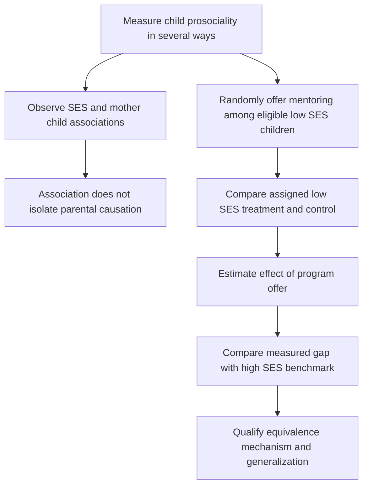

# Separate mentoring offer effects from background associations and mechanisms

## Record metadata

```json
{
  "schema_version": 3,
  "owner": "plan",
  "course_id": "2026_2027/Winter_Semester/Behavioral_Economics",
  "transaction_id": "PLAN-20261018-BE-P002",
  "plan_version": "P002",
  "source_version": "V002",
  "ingestion_revision": 3,
  "objective_id": "O014",
  "objective_revision": 1,
  "criterion_version": "O014-C1",
  "status": "ready",
  "lesson_content_contract": "self-contained-lessons-v1",
  "knowledge_components": [
    "measurement_index_and_benchmark_arithmetic",
    "random_offer_itt_vs_participation_and_ses",
    "significance_mechanism_and_generalization_limits"
  ],
  "prerequisite_ids": [
    "O001",
    "O013"
  ],
  "compatible_versions": [],
  "note_locations": [
    {
      "path": "01_Notes/2026_2027/Winter_Semester/Behavioral_Economics/Week_3/Social_Environment_and_Mentoring.md",
      "heading": "Social environment and mentoring"
    },
    {
      "path": "01_Notes/2026_2027/Winter_Semester/Behavioral_Economics/Week_3/Social_Environment_and_Mentoring.md",
      "heading": "The intervention and comparison groups"
    },
    {
      "path": "01_Notes/2026_2027/Winter_Semester/Behavioral_Economics/Week_3/Social_Environment_and_Mentoring.md",
      "heading": "What “prosociality” measures"
    },
    {
      "path": "01_Notes/2026_2027/Winter_Semester/Behavioral_Economics/Week_3/Social_Environment_and_Mentoring.md",
      "heading": "Background correlations"
    },
    {
      "path": "01_Notes/2026_2027/Winter_Semester/Behavioral_Economics/Week_3/Social_Environment_and_Mentoring.md",
      "heading": "The offer changes measured outcomes"
    },
    {
      "path": "01_Notes/2026_2027/Winter_Semester/Behavioral_Economics/Week_3/Social_Environment_and_Mentoring.md",
      "heading": "Mechanism and policy limits"
    }
  ],
  "acquisition_rule": {
    "distinct_independent_passes": 2,
    "required_item_roles": [
      "full_capability_check",
      "full_capability_check"
    ],
    "allowed_routes": [
      [
        "O014-I1",
        "O014-I2"
      ],
      [
        "O014-I1",
        "O014-D1"
      ],
      [
        "O014-I1",
        "O014-D2"
      ],
      [
        "O014-I2",
        "O014-D1"
      ],
      [
        "O014-I2",
        "O014-D2"
      ],
      [
        "O014-D1",
        "O014-D2"
      ]
    ]
  },
  "delayed_rule": {
    "minimum_elapsed_hours": 24,
    "fresh_item": true,
    "independent_required": true
  },
  "review_topic": "Separate mentoring offer effects from background associations and mechanisms",
  "review_instruction": "Begin a closed-note review with teach for O014; request an unused prepared delayed item before recap."
}
```

## Outcome and conditions

Interpret the randomized mentoring offer, construct a supplied mean-component-z index and distinguish causal assignment, descriptive benchmarks, component precision and mechanism limits. All essential components listed in metadata are required. Hypothetical assessment values instantiate the checked equations; they are not historical observations or observed outcomes. Independent checks are closed-note and without hints, solution access, external retrieval or other assistance; blank paper and pen only are allowed; no calculator or device. Teach establishes and records actual help/exposure conditions before claiming independence.

## Prerequisites and checks

- [O001 outcome and repair route](../lessons/O001.md#outcome-and-conditions): the experimental intervention/control contrast is distinct from a background association.
- [O013 outcome and repair route](../lessons/O013.md#outcome-and-conditions): allocation patterns and tied choices limit one-to-one preference interpretations. The trust-survey and observer-rating distinctions are taught in the included O014 foundation below, before its diagnostic or assessed forms.

### Included O014 measurement and index foundation

Read this bounded foundation before O014-P1 and the worked example. The checked passage “What “prosociality” measures” below distinguishes an incentivized dictator allocation (a choice), a trust survey (stated beliefs about others’ trustworthiness, intentions or reliability), and a mother rating (an observer questionnaire). These are different measurements; neither a choice nor a stated belief uniquely identifies every social preference. O013 supplies allocation-pattern and tie reasoning, not the trust-survey distinction. If the measurement part of P1 fails, repair it here and in that complete included checked passage; repair random-assignment reasoning through O001.

For the hypothetical arithmetic in this lesson, let $z_A,z_T,z_M$ denote the three component scores after each component has been standardized. Define the **mean-component-z index** as $J=(z_A+z_T+z_M)/3$. Its treatment-minus-control contrast is the arithmetic mean of the three supplied component contrasts. Report that contrast and any supplied benchmark gap in the same **mean-component-z index units**. Standardizing the components does not give their average a standard deviation of one: the average’s variance depends on their variances and covariances. A subsequently standardized composite would instead require the composite’s own reference mean and standard deviation, for example $Z_J=(J-\mu_J)/\sigma_J$ with $\sigma_J>0$. Those reference quantities are not supplied, so no composite-SD conversion is requested or inferred. This is a transparent explanation of the toy index definition, not a re-estimate of the study’s empirical effect.

O014-P1, item_version 1, prerequisite_diagnostic. **Prompt:** What does random assignment compare, and why is a dictator allocation not identical to a survey statement about trusting others?

**Complete key and rubric:** Random assignment compares assigned intervention/control under its design, not automatically every background difference (O001). An incentivized allocation measures a choice while a trust statement records a belief; neither uniquely identifies every social preference (included O014 measurement foundation and the complete “What “prosociality” measures” passage below). Require both; repair O001 for assignment reasoning and the included O014 foundation for measurement, before retrying. Pass requires every requested reason and result; partial for an omitted reason or unresolved isolated arithmetic slip; fail for the conflicting mechanism. This diagnostic never counts as acquisition. Current or explicitly compatible committed independent prerequisite evidence may permit skipping its check; familiarity alone cannot. Use the cited complete prerequisite lesson or the named included foundation, then the worked example, after a partial/failing entry check.

## Teaching order and rationale

1. Read the included O014 measurement/index foundation, then use the diagnostic once to establish the necessary conceptual foundation and follow its explicit repair routes.
2. Present the complete checked-note explanation below, preserving variables, dates, assumptions and source qualifications. Follow one reasoning chain at a time so every intermediate step is visible.
3. Work W1 fully, asking the learner to explain why each step follows.
4. Use S1 as completion practice: show the setup and first identity, hide the final algebra/numbers and interpretation. After an explanation of the missing steps, withdraw support.
5. Present unused I1/I2 full checks with hidden solutions; use correction/repair after scoring the original answer. An unused D form can replace an exposed I only through a listed route.
6. On a later eligible occasion, begin an unused D item before recap. A numeric variant establishes bounded same-method performance, not general transfer.

## Motivation, intuition, and definitions

Interpret the randomized mentoring offer, construct a supplied mean-component-z index and distinguish causal assignment, descriptive benchmarks, component precision and mechanism limits. Establish the definitions, assumptions and relevant comparisons before simplifying an equation. The complete reused passages establish every academic claim, notation choice and qualification assessed here; necessary prerequisites use the complete lessons above.

## Explanation steps

Origin: reused complete checked passage [[01_Notes/2026_2027/Winter_Semester/Behavioral_Economics/Week_3/Social_Environment_and_Mentoring.md#Social environment and mentoring]]; fingerprint `ae2f09f4c9e0e3456e9ab1d7fa9303e2c945ea69c2509f71dfb0ef966c7c4d9b`. Heading depth alone is adapted.

### Social environment and mentoring

Can a policy change measured social preferences, rather than simply predict which children differ? The lecture combines background correlations with a randomized mentoring intervention. Keeping those comparisons separate is essential: a treatment can identify the effect of an offered program without proving that all background differences are caused by one family characteristic. [[00_Materials/2026_2027/Winter_Semester/Behavioral_Economics/Week_3/L4 BE_formation IES 2026.pdf#page=17|L4 BE_formation IES 2026.pdf, physical PDF pp. 17–23]]



The map follows the supplied experiment and distinguishes the descriptive and causal routes. Random assignment applies within the eligible low-SES sample; it does not randomly assign socioeconomic status (SES). [[00_Materials/2026_2027/Winter_Semester/Behavioral_Economics/Week_3/L4 BE_formation IES 2026.pdf#page=18|L4 BE_formation IES 2026.pdf, physical PDF pp. 18–23]]

#### The intervention and comparison groups

The lecture attributes the study to Kosse et al. (2020). Primary-school children in Germany are offered a one-year mentoring program: mentors, typically university students, meet children weekly for activities such as museums, the zoo, playgrounds, reading, cooking or conversation. The program enriches social interactions and introduces a potential prosocial role model. The three displayed groups are low-SES treatment, low-SES control and high-SES control. [[00_Materials/2026_2027/Winter_Semester/Behavioral_Economics/Week_3/L4 BE_formation IES 2026.pdf#page=18|L4 BE_formation IES 2026.pdf, physical PDF pp. 18]]

**Bounded design verification:** the [authors' May 2018 HCEO working paper](https://humcap.uchicago.edu/RePEc/hka/wpaper/Kosse_Deckers_Pinger_etal_2018_formation-prosociality_revised.pdf), §2.1 and §3.4, physical pp. 7–9 and 25–26, verifies stratified random offers among eligible interested low-SES families in Bonn/Cologne. Not everyone assigned obtained or completed mentoring, so the primary comparison is an **intention-to-treat effect of the offer**, rather than the effect of successful participation for every child. High-SES families form a benchmark, not a randomly assigned SES treatment. The later publication is *Journal of Political Economy* 128(2), 434–467 (2020); the lecture's final 2018 citation refers to a working-paper version of this research.

This distinction matters for policy interpretation. The offered treatment includes implementation constraints such as mentor availability. Comparing participants selected by successful matching could lose the protection of random assignment; comparing all assigned groups keeps the offer-based causal question clear. Source slides alone do not supply the compliance details, so this paragraph labels their bounded verification explicitly. [[00_Materials/2026_2027/Winter_Semester/Behavioral_Economics/Week_3/L4 BE_formation IES 2026.pdf#page=18|L4 BE_formation IES 2026.pdf, physical PDF pp. 18, 21]]

#### What “prosociality” measures

The lecture uses three facets: **altruism**, measured through incentivized dictator allocations; **trust**, measured with three survey statements about whether other people can be trusted, have good intentions and can be relied on even when not known well; and **other-regarding behaviour**, rated by the mother in an everyday-behaviour questionnaire. An incentivized allocation, a stated belief and an observer report measure related but distinct things. Trust is not inferred solely from the amount donated in a dictator game. [[00_Materials/2026_2027/Winter_Semester/Behavioral_Economics/Week_3/L4 BE_formation IES 2026.pdf#page=19|L4 BE_formation IES 2026.pdf, physical PDF pp. 19]]

The main figure uses an equally weighted index of standardized altruism, trust and other-regarding measures. A standardized score measures position relative to its reference distribution in standard-deviation units, rather than a number of sweets or euros. Combining measures can reduce dependence on one noisy elicitation, but it does not make the three measures identical. Error bars in the supplied charts are standard errors of group means; significance markers refer to stated comparisons, not a test of every bar against zero. [[00_Materials/2026_2027/Winter_Semester/Behavioral_Economics/Week_3/L4 BE_formation IES 2026.pdf#page=20|L4 BE_formation IES 2026.pdf, physical PDF pp. 20–22]]

#### Background correlations

The first graph shows a higher average child-prosociality index in the high-SES control group than in the low-SES control group. Its second panel shows higher child scores when maternal prosociality is above its median than below. The supplied caption marks the SES contrast at the 5% level and the maternal-prosociality contrast at 1%; the stated sample sizes are 424 and 410, with the latter difference attributed to incomplete mother questionnaires. [[00_Materials/2026_2027/Winter_Semester/Behavioral_Economics/Week_3/L4 BE_formation IES 2026.pdf#page=20|L4 BE_formation IES 2026.pdf, physical PDF pp. 20]]

![[01_Notes/2026_2027/Winter_Semester/Behavioral_Economics/assets/Week_3_Background_Associations.png]]

These are associations. They do not distinguish inherited influences, shared environment, parenting, selection, reporting differences or other correlated inputs. The slide's “transmission” language should therefore not be read as a causal estimate of maternal preferences or SES. The differences are group averages, not a characterization of every child or household in either group. [[00_Materials/2026_2027/Winter_Semester/Behavioral_Economics/Week_3/L4 BE_formation IES 2026.pdf#page=20|L4 BE_formation IES 2026.pdf, physical PDF pp. 20, 23]]

#### The offer changes measured outcomes

The intervention chart shows higher prosociality among low-SES children assigned treatment than among low-SES controls, marked at the 1% level. It reports no statistically significant difference between treated low-SES children and the high-SES control benchmark. The lecture calls this closing the measured gap: the low-SES treatment mean moves toward that benchmark. A nonsignificant difference does **not** prove exact equality or a formal equivalence margin. The causal comparison is treatment versus control within the randomized eligible sample; the cross-SES comparison describes the resulting gap. [[00_Materials/2026_2027/Winter_Semester/Behavioral_Economics/Week_3/L4 BE_formation IES 2026.pdf#page=21|L4 BE_formation IES 2026.pdf, physical PDF pp. 21]]

![[01_Notes/2026_2027/Winter_Semester/Behavioral_Economics/assets/Week_3_Mentoring_Treatment.png]]

The component graphs show higher treatment means for altruism, trust and mother-rated other-regarding behaviour. The first two contrasts have 5% significance markers; the third has no significance star. Thus the slide's broad “robust across multiple measures” statement means directionally supportive component patterns, not three separately confirmed significant effects. A positive but imprecisely estimated component is not evidence of an exactly zero effect, either. Caption sample sizes differ because of missing answers or failed control questions. [[00_Materials/2026_2027/Winter_Semester/Behavioral_Economics/Week_3/L4 BE_formation IES 2026.pdf#page=22|L4 BE_formation IES 2026.pdf, physical PDF pp. 22]]

![[01_Notes/2026_2027/Winter_Semester/Behavioral_Economics/assets/Week_3_Mentoring_Measures.png]]

#### Mechanism and policy limits

The lecture proposes that children imitate and internalize behaviour from parents and social role models. The working paper's abstract and §3.3 report a mediation analysis supporting prosocial attachment figures and intensive social interaction. This is a proposed interpretation with additional assumptions; randomizing the whole mentoring offer does not separately randomize every mechanism. The intervention's causal effect is stronger evidence than the background correlations, but it does not prove that role-model imitation is the only channel. [[00_Materials/2026_2027/Winter_Semester/Behavioral_Economics/Week_3/L4 BE_formation IES 2026.pdf#page=18|L4 BE_formation IES 2026.pdf, physical PDF pp. 18, 23]]

The evidence shows that measured prosociality can respond to social environment during childhood. It does not establish that genes are irrelevant, that all socioeconomic differences are environmental, or that this intervention works equally for all ages, countries or outcomes. Its economic relevance is that prosocial behaviour can influence cooperation and other interactions, making the formation of preferences and possible remedial policies worth studying. The closing “why should economists care?” prompt invites that connection; it supplies no observed learner answer. [[00_Materials/2026_2027/Winter_Semester/Behavioral_Economics/Week_3/L4 BE_formation IES 2026.pdf#page=23|L4 BE_formation IES 2026.pdf, physical PDF pp. 23]]

Experimental comparisons, outcome measurement and causal interpretation are core foundations. The particular program, demographic groups and chart values are applications through which to learn that reasoning, with no unsupported claim about exact exam coverage. [[00_Materials/2026_2027/Winter_Semester/Behavioral_Economics/Week_3/L4 BE_formation IES 2026.pdf#page=18|L4 BE_formation IES 2026.pdf, physical PDF pp. 18–23]]


## Worked example

O014-W1, item_version 1, worked_example. **Prompt:** For an explicitly hypothetical eligible low-SES sample, a mentoring offer is randomly assigned against control. Standardized treatment-minus-control component means are altruism 0.3, trust 0.6, mother-rated other-regarding behaviour 0; define the mean-component-z index as their equal-weight arithmetic mean, with no further composite standardization. The high-SES benchmark mean-component-z index is 0.35 mean-component-z index units above low-SES control. Compute the offer’s index difference and remaining benchmark gap. Only 60% of those offered complete participation; why is the assignment contrast still an ITT effect and why can participant-only comparisons lose protection? Suppose the reported index contrast is significant, altruism/trust are starred, mother-rating is unstarred, and treated-low versus high-SES is nonsignificant: interpret without inventing zero/equivalence or a genetic/mechanism conclusion. State what each facet measures, the background-correlation comparison and the actual program’s scope.

**Complete solution and essential rubric:** Mean-component-z index difference is $(0.3+0.6+0)/3=0.30000000$ mean-component-z index units, without an assumed composite standard deviation of one; remaining high-benchmark gap is $0.35-0.30000000=0.05000000$ in the same mean-component-z index units. Further composite standardization would require the composite’s own reference mean and standard deviation, which are not supplied. These are invented arithmetic inputs, not a re-estimate. Randomization is of the offer within eligible interested low-SES families; comparing all assigned preserves the intention-to-treat question even with 60% completion. Completed participation is selected after assignment; its comparison can reintroduce selection, and dividing by participation is not automatically a valid causal participation estimate without further assumptions. High versus low SES and mother-child correlations are descriptive, not randomized SES or parental transmission. Altruism uses incentivized dictator allocations, trust uses stated beliefs about others’ trustworthiness/intentions/reliability, and the mother rating is an observer questionnaire; standardization/equal weighting does not make them identical. Unstarred does not prove zero; nonsignificance versus high SES does not prove exact equality or formal equivalence. The source component stars support the first two contrasts, not three separately significant effects. The actual one-year German mentoring offer involves weekly interactions/role models in an eligible voluntary sample, with implementation/compliance limits. Randomizing the whole offer does not isolate one mediator, rule out genes or establish universal effects across countries/ages/outcomes; it shows measured prosociality can respond to social environment. All requested calculations, derivations and qualifications are essential; the component map above applies to every full form.

## Practice with fading assistance

O014-S1, item_version 1, supported_completion. **Prompt:** For an explicitly hypothetical eligible low-SES sample, a mentoring offer is randomly assigned against control. Standardized treatment-minus-control component means are altruism 0.6, trust 0.3, mother-rated other-regarding behaviour 0.3; define the mean-component-z index as their equal-weight arithmetic mean, with no further composite standardization. The high-SES benchmark mean-component-z index is 0.5 mean-component-z index units above low-SES control. Compute the offer’s index difference and remaining benchmark gap. Only 70% of those offered complete participation; why is the assignment contrast still an ITT effect and why can participant-only comparisons lose protection? Suppose the reported index contrast is significant, altruism/trust are starred, mother-rating is unstarred, and treated-low versus high-SES is nonsignificant: interpret without inventing zero/equivalence or a genetic/mechanism conclusion. State what each facet measures, the background-correlation comparison and the actual program’s scope.

**Complete solution and essential rubric:** Mean-component-z index difference is $(0.6+0.3+0.3)/3=0.40000000$ mean-component-z index units, without an assumed composite standard deviation of one; remaining high-benchmark gap is $0.5-0.40000000=0.10000000$ in the same mean-component-z index units. Further composite standardization would require the composite’s own reference mean and standard deviation, which are not supplied. These are invented arithmetic inputs, not a re-estimate. Randomization is of the offer within eligible interested low-SES families; comparing all assigned preserves the intention-to-treat question even with 70% completion. Completed participation is selected after assignment; its comparison can reintroduce selection, and dividing by participation is not automatically a valid causal participation estimate without further assumptions. High versus low SES and mother-child correlations are descriptive, not randomized SES or parental transmission. Altruism uses incentivized dictator allocations, trust uses stated beliefs about others’ trustworthiness/intentions/reliability, and the mother rating is an observer questionnaire; standardization/equal weighting does not make them identical. Unstarred does not prove zero; nonsignificance versus high SES does not prove exact equality or formal equivalence. The source component stars support the first two contrasts, not three separately significant effects. The actual one-year German mentoring offer involves weekly interactions/role models in an eligible voluntary sample, with implementation/compliance limits. Randomizing the whole offer does not isolate one mediator, rule out genes or establish universal effects across countries/ages/outcomes; it shows measured prosociality can respond to social environment. All requested calculations, derivations and qualifications are essential; the component map above applies to every full form.

Allowed support is the first stated identity only; hide the remaining key while the learner completes it. Supported performance is practice, not an independent result.

## Rubric and independence

Required components: measurement_index_and_benchmark_arithmetic, random_offer_itt_vs_participation_and_ses, significance_mechanism_and_generalization_limits. Each full prompt/key below elicits every component; all are necessary for a pass on every permitted pair. Accept algebraically equivalent expressions and clearly defined opposite cash-flow signs with correct interpretation. A pass requires all requested outputs/reasons, correct units/assumptions and no critical conceptual error. Partial means a missing component or an unresolved isolated arithmetic slip with an otherwise valid method; independent correction is required for a pass. Fail means a critical mechanism/condition is wrong. Unscorable means a response or its help/exposure conditions cannot be established. Unknown help conditions are never independent evidence.

Critical errors: SES or participation claimed randomized; ITT equated with effect of every completed treatment; nonsignificance proves zero/equality; all three components called significant; sole mediator or genetic irrelevance claimed.

Acquisition requires two distinct unused unassisted full checks selected from the six exact metadata routes. Every I/D form covers all components; W1, S1, the prerequisite and C1 are forbidden substitutes. A D form used for acquisition cannot later be counted again as delayed success. No teach-generated item may replace a named full check; additional verified explanation/practice is allowed under the unchanged method and may not fabricate evidence. If fewer than two fresh forms remain for acquisition, return a plan_issue for an additional prepared bank.

| Component | I1 | I2 | D1 | D2 |
|---|---|---|---|---|
| measurement_index_and_benchmark_arithmetic | required | required | required | required |
| random_offer_itt_vs_participation_and_ses | required | required | required | required |
| significance_mechanism_and_generalization_limits | required | required | required | required |

## Misconceptions and correction

An observed omitted term/sign is tentative until the learner explains it; compare the reasoning with the critical errors above. Score the original response before providing help. Route a conceptual failure to the relevant included derivation and prerequisite, then use an unused full form.

O014-C1, item_version 1, narrow_correction. **Prompt:** Treated low-SES and high-SES groups differ nonsignificantly. Does that prove exact equality or that SES was randomized? **Key/rubric:** No. Nonsignificance is not an equivalence proof, and high SES is a descriptive benchmark. Causal identification comes from randomized offers within the eligible low-SES sample. Pass requires all keyed reasoning; partial for a missing part; fail for the conflicting mechanism. This repairs a common inference only; it cannot substitute for a full numerical/capability check.

Give at most two hints (first identify the date/unit, second point to the included identity); after ineffective hints show the relevant worked step. After two unsuccessful independent attempts stop repeated quizzing, revisit the explanation/prerequisite and preserve the unresolved status.

## Immediate and delayed checks

### O014-I1

O014-I1, item_version 1, full_capability_check. **Prompt:** For an explicitly hypothetical eligible low-SES sample, a mentoring offer is randomly assigned against control. Standardized treatment-minus-control component means are altruism 0.3, trust 0.3, mother-rated other-regarding behaviour 0; define the mean-component-z index as their equal-weight arithmetic mean, with no further composite standardization. The high-SES benchmark mean-component-z index is 0.25 mean-component-z index units above low-SES control. Compute the offer’s index difference and remaining benchmark gap. Only 65% of those offered complete participation; why is the assignment contrast still an ITT effect and why can participant-only comparisons lose protection? Suppose the reported index contrast is significant, altruism/trust are starred, mother-rating is unstarred, and treated-low versus high-SES is nonsignificant: interpret without inventing zero/equivalence or a genetic/mechanism conclusion. State what each facet measures, the background-correlation comparison and the actual program’s scope.

**Complete solution and essential rubric:** Mean-component-z index difference is $(0.3+0.3+0)/3=0.20000000$ mean-component-z index units, without an assumed composite standard deviation of one; remaining high-benchmark gap is $0.25-0.20000000=0.05000000$ in the same mean-component-z index units. Further composite standardization would require the composite’s own reference mean and standard deviation, which are not supplied. These are invented arithmetic inputs, not a re-estimate. Randomization is of the offer within eligible interested low-SES families; comparing all assigned preserves the intention-to-treat question even with 65% completion. Completed participation is selected after assignment; its comparison can reintroduce selection, and dividing by participation is not automatically a valid causal participation estimate without further assumptions. High versus low SES and mother-child correlations are descriptive, not randomized SES or parental transmission. Altruism uses incentivized dictator allocations, trust uses stated beliefs about others’ trustworthiness/intentions/reliability, and the mother rating is an observer questionnaire; standardization/equal weighting does not make them identical. Unstarred does not prove zero; nonsignificance versus high SES does not prove exact equality or formal equivalence. The source component stars support the first two contrasts, not three separately significant effects. The actual one-year German mentoring offer involves weekly interactions/role models in an eligible voluntary sample, with implementation/compliance limits. Randomizing the whole offer does not isolate one mediator, rule out genes or establish universal effects across countries/ages/outcomes; it shows measured prosociality can respond to social environment. All requested calculations, derivations and qualifications are essential; the component map above applies to every full form.

I1/I2 are immediate checks; D1/D2 are distinct parallel variants reserved where possible for delayed checks. A delayed success requires an unused form before recap, no help/solution access, and at least 24 actual elapsed hours after acquisition and the most recent relevant teaching/solution exposure. Record intervening exposure. A calendar-date change alone is insufficient; an early D attempt is immediate evidence only.

### O014-I2

O014-I2, item_version 1, full_capability_check. **Prompt:** For an explicitly hypothetical eligible low-SES sample, a mentoring offer is randomly assigned against control. Standardized treatment-minus-control component means are altruism 0.6, trust 0.6, mother-rated other-regarding behaviour 0; define the mean-component-z index as their equal-weight arithmetic mean, with no further composite standardization. The high-SES benchmark mean-component-z index is 0.45 mean-component-z index units above low-SES control. Compute the offer’s index difference and remaining benchmark gap. Only 75% of those offered complete participation; why is the assignment contrast still an ITT effect and why can participant-only comparisons lose protection? Suppose the reported index contrast is significant, altruism/trust are starred, mother-rating is unstarred, and treated-low versus high-SES is nonsignificant: interpret without inventing zero/equivalence or a genetic/mechanism conclusion. State what each facet measures, the background-correlation comparison and the actual program’s scope.

**Complete solution and essential rubric:** Mean-component-z index difference is $(0.6+0.6+0)/3=0.40000000$ mean-component-z index units, without an assumed composite standard deviation of one; remaining high-benchmark gap is $0.45-0.40000000=0.05000000$ in the same mean-component-z index units. Further composite standardization would require the composite’s own reference mean and standard deviation, which are not supplied. These are invented arithmetic inputs, not a re-estimate. Randomization is of the offer within eligible interested low-SES families; comparing all assigned preserves the intention-to-treat question even with 75% completion. Completed participation is selected after assignment; its comparison can reintroduce selection, and dividing by participation is not automatically a valid causal participation estimate without further assumptions. High versus low SES and mother-child correlations are descriptive, not randomized SES or parental transmission. Altruism uses incentivized dictator allocations, trust uses stated beliefs about others’ trustworthiness/intentions/reliability, and the mother rating is an observer questionnaire; standardization/equal weighting does not make them identical. Unstarred does not prove zero; nonsignificance versus high SES does not prove exact equality or formal equivalence. The source component stars support the first two contrasts, not three separately significant effects. The actual one-year German mentoring offer involves weekly interactions/role models in an eligible voluntary sample, with implementation/compliance limits. Randomizing the whole offer does not isolate one mediator, rule out genes or establish universal effects across countries/ages/outcomes; it shows measured prosociality can respond to social environment. All requested calculations, derivations and qualifications are essential; the component map above applies to every full form.

### O014-D1

O014-D1, item_version 1, full_capability_check. **Prompt:** For an explicitly hypothetical eligible low-SES sample, a mentoring offer is randomly assigned against control. Standardized treatment-minus-control component means are altruism 0.9, trust 0.3, mother-rated other-regarding behaviour 0.3; define the mean-component-z index as their equal-weight arithmetic mean, with no further composite standardization. The high-SES benchmark mean-component-z index is 0.55 mean-component-z index units above low-SES control. Compute the offer’s index difference and remaining benchmark gap. Only 80% of those offered complete participation; why is the assignment contrast still an ITT effect and why can participant-only comparisons lose protection? Suppose the reported index contrast is significant, altruism/trust are starred, mother-rating is unstarred, and treated-low versus high-SES is nonsignificant: interpret without inventing zero/equivalence or a genetic/mechanism conclusion. State what each facet measures, the background-correlation comparison and the actual program’s scope.

**Complete solution and essential rubric:** Mean-component-z index difference is $(0.9+0.3+0.3)/3=0.50000000$ mean-component-z index units, without an assumed composite standard deviation of one; remaining high-benchmark gap is $0.55-0.50000000=0.05000000$ in the same mean-component-z index units. Further composite standardization would require the composite’s own reference mean and standard deviation, which are not supplied. These are invented arithmetic inputs, not a re-estimate. Randomization is of the offer within eligible interested low-SES families; comparing all assigned preserves the intention-to-treat question even with 80% completion. Completed participation is selected after assignment; its comparison can reintroduce selection, and dividing by participation is not automatically a valid causal participation estimate without further assumptions. High versus low SES and mother-child correlations are descriptive, not randomized SES or parental transmission. Altruism uses incentivized dictator allocations, trust uses stated beliefs about others’ trustworthiness/intentions/reliability, and the mother rating is an observer questionnaire; standardization/equal weighting does not make them identical. Unstarred does not prove zero; nonsignificance versus high SES does not prove exact equality or formal equivalence. The source component stars support the first two contrasts, not three separately significant effects. The actual one-year German mentoring offer involves weekly interactions/role models in an eligible voluntary sample, with implementation/compliance limits. Randomizing the whole offer does not isolate one mediator, rule out genes or establish universal effects across countries/ages/outcomes; it shows measured prosociality can respond to social environment. All requested calculations, derivations and qualifications are essential; the component map above applies to every full form.

### O014-D2

O014-D2, item_version 1, full_capability_check. **Prompt:** For an explicitly hypothetical eligible low-SES sample, a mentoring offer is randomly assigned against control. Standardized treatment-minus-control component means are altruism 0.3, trust 0.6, mother-rated other-regarding behaviour 0.3; define the mean-component-z index as their equal-weight arithmetic mean, with no further composite standardization. The high-SES benchmark mean-component-z index is 0.5 mean-component-z index units above low-SES control. Compute the offer’s index difference and remaining benchmark gap. Only 55% of those offered complete participation; why is the assignment contrast still an ITT effect and why can participant-only comparisons lose protection? Suppose the reported index contrast is significant, altruism/trust are starred, mother-rating is unstarred, and treated-low versus high-SES is nonsignificant: interpret without inventing zero/equivalence or a genetic/mechanism conclusion. State what each facet measures, the background-correlation comparison and the actual program’s scope.

**Complete solution and essential rubric:** Mean-component-z index difference is $(0.3+0.6+0.3)/3=0.40000000$ mean-component-z index units, without an assumed composite standard deviation of one; remaining high-benchmark gap is $0.5-0.40000000=0.10000000$ in the same mean-component-z index units. Further composite standardization would require the composite’s own reference mean and standard deviation, which are not supplied. These are invented arithmetic inputs, not a re-estimate. Randomization is of the offer within eligible interested low-SES families; comparing all assigned preserves the intention-to-treat question even with 55% completion. Completed participation is selected after assignment; its comparison can reintroduce selection, and dividing by participation is not automatically a valid causal participation estimate without further assumptions. High versus low SES and mother-child correlations are descriptive, not randomized SES or parental transmission. Altruism uses incentivized dictator allocations, trust uses stated beliefs about others’ trustworthiness/intentions/reliability, and the mother rating is an observer questionnaire; standardization/equal weighting does not make them identical. Unstarred does not prove zero; nonsignificance versus high SES does not prove exact equality or formal equivalence. The source component stars support the first two contrasts, not three separately significant effects. The actual one-year German mentoring offer involves weekly interactions/role models in an eligible voluntary sample, with implementation/compliance limits. Randomizing the whole offer does not isolate one mediator, rule out genes or establish universal effects across countries/ages/outcomes; it shows measured prosociality can respond to social environment. All requested calculations, derivations and qualifications are essential; the component map above applies to every full form.

## Advance, revisit, pause, and escalate

Advance only after teach commits two qualifying independent full passes under a listed route. Keep acquisition and each later delayed observation separate. A source conflict blocks the affected claim and returns to ingest with the exact note heading. Missing criteria, a new method, unsupported alternative or exhausted fresh bank returns to plan with 2026_2027/Winter_Semester/Behavioral_Economics, O014, revision1/O014-C1, P002/V002/ingestion3 and item ID. Equivalent valid methods meeting the frozen criterion may receive credit after verification; no criterion is changed to fit an answer. Closing a session preserves the actual stopping point without claiming completion.

## Content provenance and generation boundaries

Explanations, figures and qualifications above reuse complete checked-note sections with exact origin/fingerprint; heading depth alone is adapted. Main exercises and worked arithmetic are plan-created hypothetical instantiations of those displayed identities. No additional academic claims or external course scope are introduced. Preserve the note conventions and explicit qualifications; checked references reused from notes are not an independent raw-source audit by plan. New numerical practice can use the same method only after its complete solution and unchanged components are checked before display; it cannot replace this lesson’s named evidence forms. Prerequisites route to the complete prepared lessons above.

## Answer-free recall handoff

Topic: Separate mentoring offer effects from background associations and mechanisms. Begin a closed-note review with teach for O014; request an unused prepared delayed item before recap. Exact lesson: [[03_Agents/2026_2027/Winter_Semester/Behavioral_Economics/lessons/O014.md#Immediate and delayed checks]]. Teach supplies actual committed evidence and timestamps; recall alone dates reviews. No learner outcome or due date is created by this curriculum.

For independent numeric outputs, exact fractions/expressions with correct setup or sensible hand rounding are acceptable; no calculator precision is required. Teacher keys show decimals for verification. This follows the supplied paper-and-pen independent conditions and does not reinterpret an earlier attempt.
