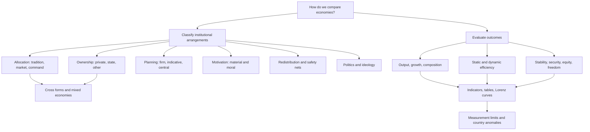

# Classify economic systems across distinct dimensions

```json
{
  "schema_version": 3,
  "owner": "plan",
  "course_id": "2026_2027/Winter_Semester/Comparative_Economics",
  "transaction_id": "PLAN-20261018-CE-P002",
  "plan_version": "P002",
  "source_version": "V002",
  "ingestion_revision": 2,
  "objective_id": "O001",
  "objective_revision": 2,
  "criterion_version": "O001-C1",
  "status": "ready",
  "knowledge_components": [
    "conceptual",
    "interpretation"
  ],
  "prerequisite_ids": [],
  "compatible_versions": [
    {
      "objective_revision": 1,
      "criterion_version": "O001-C1",
      "plan_version": "P001",
      "source_version": "V001",
      "ingestion_revision": 1,
      "reason": "Selected earlier academic note passages retain identical meaning and criteria after inspection. Full-content teaching reuse, exact locator normalization and formula typesetting do not change the preserved assessment prompts/keys, essential components or evidence conditions. New methods receive new IDs; no learner response is regraded.",
      "change_class": "unchanged",
      "requires_reassessment": false
    }
  ],
  "note_locations": [
    {
      "path": "01_Notes/2026_2027/Winter_Semester/Comparative_Economics/Week_1/Comparing_Economic_Systems.md",
      "heading": "Comparing economic systems: rules, outcomes, and change"
    },
    {
      "path": "01_Notes/2026_2027/Winter_Semester/Comparative_Economics/Week_1/Comparing_Economic_Systems.md",
      "heading": "Topic map from Rosser and Rosser, chapter 1"
    },
    {
      "path": "01_Notes/2026_2027/Winter_Semester/Comparative_Economics/Week_1/Comparing_Economic_Systems.md",
      "heading": "Why comparative economics remains useful"
    },
    {
      "path": "01_Notes/2026_2027/Winter_Semester/Comparative_Economics/Week_1/Comparing_Economic_Systems.md",
      "heading": "What is being classified?"
    },
    {
      "path": "01_Notes/2026_2027/Winter_Semester/Comparative_Economics/Week_1/Comparing_Economic_Systems.md",
      "heading": "1. Allocation: custom, exchange, or command"
    },
    {
      "path": "01_Notes/2026_2027/Winter_Semester/Comparative_Economics/Week_1/Comparing_Economic_Systems.md",
      "heading": "2. Ownership: who controls productive assets?"
    },
    {
      "path": "01_Notes/2026_2027/Winter_Semester/Comparative_Economics/Week_1/Comparing_Economic_Systems.md",
      "heading": "3–6. Planning, incentives, redistribution, and politics"
    },
    {
      "path": "01_Notes/2026_2027/Winter_Semester/Comparative_Economics/Week_1/Comparing_Economic_Systems.md",
      "heading": "Comparing performance: define the outcome first"
    },
    {
      "path": "01_Notes/2026_2027/Winter_Semester/Comparative_Economics/Week_1/Comparing_Economic_Systems.md",
      "heading": "Reading the chapter's evidence"
    },
    {
      "path": "01_Notes/2026_2027/Winter_Semester/Comparative_Economics/Week_1/Comparing_Economic_Systems.md",
      "heading": "Systems change, and institutions feed back on themselves"
    },
    {
      "path": "01_Notes/2026_2027/Winter_Semester/Comparative_Economics/Week_1/Comparing_Economic_Systems.md",
      "heading": "Why a striking comparison may still mislead"
    },
    {
      "path": "01_Notes/2026_2027/Winter_Semester/Comparative_Economics/Week_1/Comparing_Economic_Systems.md",
      "heading": "Synthesis"
    },
    {
      "path": "01_Notes/2026_2027/Winter_Semester/Comparative_Economics/Week_1/Course_Organization_and_Week_1_Scope.md",
      "heading": "Course organization and Week 1 scope"
    },
    {
      "path": "01_Notes/2026_2027/Winter_Semester/Comparative_Economics/Week_1/Course_Organization_and_Week_1_Scope.md",
      "heading": "Course question and teaching format"
    },
    {
      "path": "01_Notes/2026_2027/Winter_Semester/Comparative_Economics/Week_1/Course_Organization_and_Week_1_Scope.md",
      "heading": "Assessment"
    },
    {
      "path": "01_Notes/2026_2027/Winter_Semester/Comparative_Economics/Week_1/Course_Organization_and_Week_1_Scope.md",
      "heading": "How the new export relates to the existing Week 1 reading"
    },
    {
      "path": "01_Notes/2026_2027/Winter_Semester/Comparative_Economics/Comparative_Economics_main.md",
      "heading": "Comparative Economics"
    },
    {
      "path": "01_Notes/2026_2027/Winter_Semester/Comparative_Economics/Comparative_Economics_main.md",
      "heading": "Week 1"
    },
    {
      "path": "01_Notes/2026_2027/Winter_Semester/Comparative_Economics/Comparative_Economics_main.md",
      "heading": "Reading questions to be ready to discuss"
    },
    {
      "path": "01_Notes/2026_2027/Winter_Semester/Comparative_Economics/Comparative_Economics_main.md",
      "heading": "Course information added from the SIS export"
    },
    {
      "path": "01_Notes/2026_2027/Winter_Semester/Comparative_Economics/Comparative_Economics_main.md",
      "heading": "Week 2"
    },
    {
      "path": "01_Notes/2026_2027/Winter_Semester/Comparative_Economics/Comparative_Economics_main.md",
      "heading": "Week 3"
    }
  ],
  "acquisition_rule": {
    "distinct_independent_passes": 2,
    "required_item_roles": [
      "full_scope_independent"
    ],
    "required_components": [
      "C1 six dimensions",
      "C2 ownership-allocation mechanism",
      "C3 mixed systems and inference limits"
    ]
  },
  "delayed_rule": {
    "minimum_elapsed_hours": 24,
    "fresh_item": true,
    "independent_required": true,
    "required_components": [
      "C1 six dimensions",
      "C2 ownership-allocation mechanism",
      "C3 mixed systems and inference limits"
    ]
  },
  "review_topic": "Classify economic systems across distinct dimensions",
  "review_instruction": "Begin a closed-note review with teach for O001; request a fresh prepared delayed item before recap.",
  "reassessment_requirement": null,
  "lesson_content_contract": "self-contained-lessons-v1"
}
```

## Outcome and conditions

Given a short institutional description, distinguish allocation, ownership, planning, incentives, redistribution, and political control; explain who decides, what information reaches them, what motivates them and how decisions coordinate. Use a justified multidimensional description rather than infer the whole economy from one label.

Essential criterion components are **C1 six dimensions, C2 ownership-allocation mechanism, C3 mixed systems and inference limits**. Primary finished-note locations: [[01_Notes/2026_2027/Winter_Semester/Comparative_Economics/Week_1/Comparing_Economic_Systems.md#What is being classified?]]; [[01_Notes/2026_2027/Winter_Semester/Comparative_Economics/Week_1/Comparing_Economic_Systems.md#1. Allocation: custom, exchange, or command]]; [[01_Notes/2026_2027/Winter_Semester/Comparative_Economics/Week_1/Comparing_Economic_Systems.md#2. Ownership: who controls productive assets?]]; [[01_Notes/2026_2027/Winter_Semester/Comparative_Economics/Week_1/Comparing_Economic_Systems.md#3–6. Planning, incentives, redistribution, and politics]].

Instruction and supported practice may use the selected notes. Independent checks are closed-note: show the stated prompt and its supplied data only, with no explanation, model answer, hints, web search, other people, AI help, or solution-bearing figure access before the response. A simple calculator is allowed for arithmetic after the learner states the reasoning; no symbolic or generative tools. If notes, item keys, or matching solutions were accessed, record the exposure and do not call that attempt independent. No timing or confidence threshold replaces a complete answer. No quantitative derivation is applicable: this capability classifies and explains arrangements, not national rankings. Historical country labels are the source’s examples and are not live classifications.

## Prerequisites and checks

No course-local prerequisite is required: this is the entry block. Entry diagnostic O001-P1 / 1 (not acquisition): “A privately owned workshop follows a ministry output order. Who owns, and how is output allocated?” Key: private ownership with command allocation; title does not determine coordination. Pass if both are distinguished; partial if one is omitted; fail if private ownership is taken to imply market allocation. Repair is this lesson’s definitions and W1, then S1. Do not repeat the diagnostic.

For every P diagnostic, ask before exposing its key. Pass requires all explicitly requested distinctions and their reasons; partial means a correct part with an omission or local arithmetic slip; fail means the essential prerequisite mechanism is contradicted. Unknown help or no answer is unscorable. Diagnostics are brief route selection only and never acquisition evidence. Apply the named repair once, then instruction rather than repeat-testing.

## Teaching order and rationale

1. Use [[03_Agents/2026_2027/Winter_Semester/Comparative_Economics/lessons/O001.md#Motivation, intuition, and definitions]] to pose the concrete problem and define the terms.
2. Follow [[03_Agents/2026_2027/Winter_Semester/Comparative_Economics/lessons/O001.md#Explanation steps]] in order: establish the decision or claim, compare alternatives, then interpret its limits. Each next step relies on the preceding distinction.
3. Present [[03_Agents/2026_2027/Winter_Semester/Comparative_Economics/lessons/O001.md#Worked example]] with its decision points before requesting a new full answer.
4. Use [[03_Agents/2026_2027/Winter_Semester/Comparative_Economics/lessons/O001.md#Practice with fading assistance]] for the completion task; give at most the two prepared hints. A complete response with stated reasons permits withdrawing support.
5. Ask I1, score the original response, provide the prepared feedback if needed, then ask I2 fresh and closed-note. Use only the permitted substitutions below after correction.
6. After acquisition, close without claiming durable retention. At a qualifying later review, ask D1 or D2 before recap; retain the second as an alternate.

A learner with adequate committed current-criterion prerequisite evidence may skip the prerequisite diagnostic. A successful entry diagnostic may skip the worked/support route, but acquisition still requires two fresh full-scope independent checks. A failed diagnostic returns to its named prepared repair and instruction; it never triggers repeated pretests.

## Motivation, intuition, and definitions

Why does a worker-managed firm selling at market prices not contradict a public-ownership label? Allocation answers how scarce resources are assigned: custom, decentralized bids/offers/prices, or authoritative command. Ownership answers who controls productive assets and receives claims/returns. Planning can occur within a firm, as nonbinding government guidance, or as central prescriptions. Incentives blend material rewards and moral obligations; redistribution changes final income/risk through taxes, transfers and safety nets; political institutions determine power and its constraints. The lecture’s four questions unpack mechanisms inside these six dimensions. The ownership/allocation matrix in the note is schematic; every actual economy mixes arrangements.

## Explanation steps

1. Identify the action being explained, such as choosing an output quantity. A price response is market coordination; an imposed quantity is command; inherited status can reflect tradition.
2. Identify who controls the machine, land or firm separately. Private/public/collective ownership is compatible with more than one coordination mechanism.
3. Locate planning: firm planning does not abolish markets; indicative plans are nonbinding; improvised commands need not form a coherent central plan.
4. Add motivation, final distribution and political constraints rather than infer them from ownership. A profitable firm can also use duty, and taxes can redistribute market incomes.
5. Restrict the inference: real mixtures differ within headline categories. Moral appeals coincided with stagnation in the chapter’s Mao/Castro cases and contributed to US wartime effort alongside controls and other incentives; this is not a universal effect. Market capitalism does not entail democracy. Rosser’s incompatibility hypothesis about permanent comprehensive command and liberal freedom is an argument, not a definition or proof from the matrix.

## Complete checked-note explanation

Deliver these complete reused passages before the worked example; earlier concise prompts are checkpoints, not substitutes. Necessary prerequisites use the complete prepared lessons specified above.

Origin: reused complete checked passage [[01_Notes/2026_2027/Winter_Semester/Comparative_Economics/Week_1/Comparing_Economic_Systems.md#Comparing economic systems: rules, outcomes, and change]]; fingerprint `8764485b6a043a0bcf7003eea29bf86eaa00b3cb42d43f2fde4d15cb696a2778`. Heading depth and required relative figure-path relocation alone are adapted.

### Comparing economic systems: rules, outcomes, and change

**Question.** How can we compare economies when every country contains a different mixture of markets, public authority, customs, and political rules? Week 1 introduces comparative economics as a study of those institutional arrangements, the behavior they induce, and the outcomes they help produce. A useful comparison first says *what differs*, then chooses *what outcome matters*, and finally asks whether the available evidence can support the proposed explanation. [[00_Materials/2026_2027/Winter_Semester/Comparative_Economics/Week_1/Week I - lecture - shorter - large slides.pdf#page=10|Week I lecture, PDF slide 10]] [[00_Materials/2026_2027/Winter_Semester/Comparative_Economics/Week_1/Rosser Rosser Comparative Economics - chapter 1 full.pdf#page=3|Rosser & Rosser, PDF p. 3 (printed p. 5)]]

Return to the [[01_Notes/2026_2027/Winter_Semester/Comparative_Economics/Comparative_Economics_main.md#Week 1|Week 1 course overview]]. The companion note [[01_Notes/2026_2027/Winter_Semester/Comparative_Economics/Week_1/Institutions_and_Economic_Development.md|Institutions and economic development]] explains five transaction problems behind many system differences; [[01_Notes/2026_2027/Winter_Semester/Comparative_Economics/Week_1/Colonial_Institutions_and_Divergence.md|Colonial institutional divergence]] develops one historical explanation of long-run differences.

#### Topic map from Rosser and Rosser, chapter 1

This map follows the chapter's two tasks: classify the institutional rules and evaluate performance. Its branches are a coverage plan, not a claim that any one institutional feature alone causes a national outcome. [[00_Materials/2026_2027/Winter_Semester/Comparative_Economics/Week_1/Rosser Rosser Comparative Economics - chapter 1 full.pdf#page=4|Rosser & Rosser, PDF pp. 4–19 (printed pp. 6–21)]]



#### Why comparative economics remains useful

The older plan-versus-market debate asked which allocation mechanism could use resources efficiently. After the Soviet bloc's collapse, some observers expected convergence toward liberal democracy and market capitalism. Rosser and Rosser set out that convergence thesis, but emphasize continuing variation: different capitalist models, surviving socialist forms, and institutions rooted in custom or religion. Their opening is a historical framing from the book's early-2000s context, not a statement of current country classifications. The lecture describes a parallel shift in the field: before 1989, comparison of systems, especially forms of socialism; after 1989, reform and transition; more recently, differences among legal, political, cultural, and other institutions within capitalism. [[00_Materials/2026_2027/Winter_Semester/Comparative_Economics/Week_1/Rosser Rosser Comparative Economics - chapter 1 full.pdf#page=1|Rosser & Rosser, PDF pp. 1–3 (printed pp. 3–5)]] [[00_Materials/2026_2027/Winter_Semester/Comparative_Economics/Week_1/Week I - lecture - shorter - large slides.pdf#page=12|Week I lecture, PDF slides 12–17]]

Comparison matters because institutions shape the setting in which households and firms choose what to produce, combine labor and capital, distribute output, save and invest, and judge whether that distribution is legitimate. An observed behavior that looks puzzling under one system can be sensible under another. The lecture's example is replacing a windshield wiper: a buyer in a well supplied market may search sellers and pay a price, whereas a buyer in a shortage economy may need a queue, personal contact, or another nonmarket channel. The slide poses this as a question, so the specific channel should be treated as an illustration of the mechanism, not as a documented answer for every Soviet-bloc setting. [[00_Materials/2026_2027/Winter_Semester/Comparative_Economics/Week_1/Week I - lecture - shorter - large slides.pdf#page=23|Week I lecture, PDF slides 23–25, 49–50]]

#### What is being classified?

Rosser and Rosser call an economy a group of people operating within a set of rules, customs, and laws. A label such as “capitalist” or “socialist” can hide substantial differences in how the group decides, owns, motivates, protects, and redistributes. The six dimensions below should be examined separately before attaching a system label. The lecture adds a useful alternative set of questions: who decides, what information reaches decision makers, what motivates them, and how their choices are coordinated. These four structures describe the *mechanism* by which the six dimensions operate. [[00_Materials/2026_2027/Winter_Semester/Comparative_Economics/Week_1/Rosser Rosser Comparative Economics - chapter 1 full.pdf#page=3|Rosser & Rosser, PDF pp. 3–4 (printed pp. 5–6)]] [[00_Materials/2026_2027/Winter_Semester/Comparative_Economics/Week_1/Week I - lecture - shorter - large slides.pdf#page=30|Week I lecture, PDF slide 30]]

##### 1. Allocation: custom, exchange, or command

An **allocation mechanism** determines which uses receive scarce labor, land, inputs, and products. Under *tradition*, established status or custom assigns roles and goods; the Rosser chapter uses caste-based occupations as an example. Under *market exchange*, bids, offers, and prices coordinate decentralized decisions, provided participants can exchange and respond to prices. Under *command*, an authority directs production or distribution. These are ideal types: commands can coexist with markets, and customs continue inside market economies. The distinction is about *how decisions are coordinated*, not who owns the assets. [[00_Materials/2026_2027/Winter_Semester/Comparative_Economics/Week_1/Rosser Rosser Comparative Economics - chapter 1 full.pdf#page=4|Rosser & Rosser, PDF pp. 4–5 (printed pp. 6–7)]] [[00_Materials/2026_2027/Winter_Semester/Comparative_Economics/Week_1/Week I - lecture - shorter - large slides.pdf#page=26|Week I lecture, PDF slide 26]]

##### 2. Ownership: who controls productive assets?

Ownership concerns claims to and control of the **means of production**: land, machines, firms, and other productive assets. Private ownership is central to the chapter's definition of capitalism; public ownership is central to its definition of socialism. Public ownership can be central or local, and religious or collective ownership adds further forms. Legal title alone may conceal who actually controls decisions or receives returns, so allocation and ownership should be crossed rather than conflated. [[00_Materials/2026_2027/Winter_Semester/Comparative_Economics/Week_1/Rosser Rosser Comparative Economics - chapter 1 full.pdf#page=5|Rosser & Rosser, PDF pp. 5–7 (printed pp. 7–9)]]


*The lecture's two-by-two schematic:* public ownership plus a central plan is labeled a socialist economy; public ownership plus markets is market socialism, with Yugoslavia as the historical example; private ownership plus markets is a free-market model; private ownership plus central commands is illustrated by Nazi Germany. The table demonstrates that “market” does not logically imply private ownership and “command” does not logically imply public ownership. It is a schematic classification, not a claim that any actual country has only one cell's features. [[00_Materials/2026_2027/Winter_Semester/Comparative_Economics/Week_1/Week I - lecture - shorter - large slides.pdf#page=27|Week I lecture, PDF slide 27]] [[00_Materials/2026_2027/Winter_Semester/Comparative_Economics/Week_1/Rosser Rosser Comparative Economics - chapter 1 full.pdf#page=6|Rosser & Rosser, PDF pp. 6–7 (printed pp. 8–9)]]

Rosser and Rosser note Yugoslav worker management as a market-socialist arrangement, and wartime command over privately owned production as a command-capitalist arrangement. Their point is conceptual: neither pair of labels is a contradiction. They also caution that all real economies are mixed, so the categories describe dominant tendencies rather than exhaustive inventories. [[00_Materials/2026_2027/Winter_Semester/Comparative_Economics/Week_1/Rosser Rosser Comparative Economics - chapter 1 full.pdf#page=6|Rosser & Rosser, PDF pp. 6–7 (printed pp. 8–9)]]

##### 3–6. Planning, incentives, redistribution, and politics

**Planning** is a separate dimension because every firm plans some of its own activity even in a market economy. Governments may make nonbinding, *indicative* plans while prices still coordinate exchange; a central plan can instead prescribe most output and inputs. Command can also be improvised without a coherent plan, as the book's War Communism example shows. Thus “planning” does not simply mean “no market.” [[00_Materials/2026_2027/Winter_Semester/Comparative_Economics/Week_1/Rosser Rosser Comparative Economics - chapter 1 full.pdf#page=7|Rosser & Rosser, PDF pp. 7–8 (printed pp. 9–10)]] [[00_Materials/2026_2027/Winter_Semester/Comparative_Economics/Week_1/Week I - lecture - shorter - large slides.pdf#page=28|Week I lecture, PDF slide 28]]

**Incentives** may be material, such as wages, profits, and access to goods, or moral, such as duty to a group or an ideological ideal. The chapter does not claim that people respond to only one type; systems blend incentives, and informal norms affect how material rewards work. **Redistribution** asks both how unequal market or administrative rewards are and how taxes, transfers, and safety nets alter the final distribution and economic security. Rosser contrasts minimal-state arguments, Rawlsian concern for the least advantaged, and Marx's distinct principles for socialism and communism. These are competing ethical and institutional positions, not measurements of a country's performance. [[00_Materials/2026_2027/Winter_Semester/Comparative_Economics/Week_1/Rosser Rosser Comparative Economics - chapter 1 full.pdf#page=8|Rosser & Rosser, PDF pp. 8–11 (printed pp. 10–13)]]

Moral appeals do not have a fixed economic effect. Rosser and Rosser describe Mao-era China and Castro-era Cuba campaigns that appealed to collective ideals and coincided with serious stagnation. They contrast these with the United States' World War II production surge under wage and price controls, when patriotic appeals contributed to work effort. These cases show that the appeal operates alongside material incentives and other conditions; neither outcome establishes a universal effect of moral motivation. [[00_Materials/2026_2027/Winter_Semester/Comparative_Economics/Week_1/Rosser Rosser Comparative Economics - chapter 1 full.pdf#page=9|Rosser & Rosser, PDF p. 9 (printed p. 11)]]

**Politics and ideology** concern who holds power, how rulers are selected or constrained, and which rules are regarded as legitimate. Market capitalism can coexist with authoritarian government; substantial public ownership and redistribution can coexist with electoral democracy. Rosser and Rosser advance the narrower *hypothesis* that permanent, comprehensive command over the economy is incompatible with liberal political freedom because effective opposition would threaten the command structure. This is the authors' argument, not a definitional identity or a result established merely by the four-cell matrix. [[00_Materials/2026_2027/Winter_Semester/Comparative_Economics/Week_1/Rosser Rosser Comparative Economics - chapter 1 full.pdf#page=11|Rosser & Rosser, PDF pp. 11–13 (printed pp. 13–15)]]

#### Comparing performance: define the outcome first

Rosser and Rosser use nine evaluation criteria drawn from Bornstein. **Output level** is real output per person, adjusted for population and prices; it approximates average material living standards, not distribution or freedom. **Growth** is the change in output per person, so population growth must be removed before comparing living standards over time. **Composition** asks what is produced and how much output goes to consumption, investment, military use, or public goods. **Static efficiency** concerns using available resources and technology well at a point in time; *Pareto efficiency* means no feasible reallocation makes someone better off without making someone else worse off. It does not imply an equitable distribution. **Dynamic efficiency** concerns choices over time, including whether current extraction or investment undermines future output; the chapter's Soviet oil-well example illustrates the distinction from maximizing current production. [[00_Materials/2026_2027/Winter_Semester/Comparative_Economics/Week_1/Rosser Rosser Comparative Economics - chapter 1 full.pdf#page=13|Rosser & Rosser, PDF pp. 13–15 (printed pp. 15–17)]]

The growth criterion needs a mechanism as well as a rate. Rosser and Rosser argue that the poorest economies may have too little surplus after subsistence consumption to invest, while economies that have escaped that trap can adopt existing frontier technology and catch up. The richest economies must push the technological frontier itself, so their growth opportunity differs. The chapter says command socialist systems sometimes achieved rapid growth for extended periods but tended toward longer-run stagnation. These are historical tendencies in the authors' account, not predictions from a country's label alone. [[00_Materials/2026_2027/Winter_Semester/Comparative_Economics/Week_1/Rosser Rosser Comparative Economics - chapter 1 full.pdf#page=14|Rosser & Rosser, PDF p. 14 (printed p. 16)]]

The remaining criteria are **macroeconomic stability** of output, employment, and prices; **individual economic security**, including jobs and health care; **equity** in income and wealth; and **freedom** to work, consume, own, invest, and exercise civil and political rights. Rosser and Rosser say strict command systems are often credited with short-run stability, but note major exceptions, including instability in surviving command systems after the Soviet breakup. A country can score differently on each criterion. A single ranking therefore requires value judgments about how to weigh these outcomes. The book also cautions against assuming an unavoidable equality–growth trade-off: it gives historical examples of relatively equal, fast-growing economies and unequal, slow-growing ones. Those examples question a simple rule; they do not prove that any specific redistribution policy raises growth. [[00_Materials/2026_2027/Winter_Semester/Comparative_Economics/Week_1/Rosser Rosser Comparative Economics - chapter 1 full.pdf#page=10|Rosser & Rosser, PDF pp. 10–11, 15 (printed pp. 12–13, 17)]]

##### Reading the chapter's evidence


*Table 1-1* lists 25 economies grouped by the book's system categories. Its indicators include purchasing-power-adjusted GDP per person in 2000, annual average per-person growth and consumer-price inflation generally over 1990–2000, investment share, a top-to-bottom income-quintile ratio, life expectancy, and the Human Development Index (**HDI**). The HDI combines real income per person, life expectancy, adult literacy, and educational enrollment on a 0–1 scale, with higher values indicating greater measured development. Read the footnote before treating columns as simultaneous: Cuba's growth covers 2000–01, New Zealand's and Cuba's inflation use other sources or periods, and several other indicators have different reference years. The table is a **dated cross-country comparison** with missing values and mixed measurement quality; it cannot by itself isolate the effect of an allocation or ownership rule. [[00_Materials/2026_2027/Winter_Semester/Comparative_Economics/Week_1/Rosser Rosser Comparative Economics - chapter 1 full.pdf#page=15|Rosser & Rosser, PDF pp. 15–16 (printed pp. 17–18), Table 1-1 and source note]]


*Table 1-2* reports central-government expenditure and taxes, plus central-government military, education, and health spending, **each as a percentage of GDP**. It also gives an Economic Freedom Index whose **source scale runs from 1 (freer) to 5 (less free)**. Its columns draw on different years, as the source note explains; the values should not be read as current or perfectly synchronized. For a concrete comparison, Table 1-1 gives 2000 GDP per person of $34,142 for the United States and $24,277 for Sweden, but similar HDI values of 0.939 and 0.941 and different top/bottom quintile ratios of 9.0 and 3.6. Table 1-2 reports central-government expenditure of 21.1% and 42.7% of GDP, respectively, in its source period. The pair illustrates how rankings vary by criterion and institutional arrangement; it does not establish that spending caused the observed HDI or distribution. [[00_Materials/2026_2027/Winter_Semester/Comparative_Economics/Week_1/Rosser Rosser Comparative Economics - chapter 1 full.pdf#page=16|Rosser & Rosser, PDF pp. 16–17 (printed pp. 18–19), Tables 1-1 and 1-2 with source notes]]


*Figure 1-1* plots cumulative population ranked from poorest to richest on the horizontal axis against cumulative national income on the vertical axis. Equal income would trace the 45-degree line; a curve farther below it indicates greater inequality. The **Gini coefficient** is defined as the area between the equality line and a country's Lorenz curve divided by the whole area under the equality line, ranging from 0 (equal) toward 1 (maximally unequal in the limiting case). This converts the picture to one number, but neither the curve nor Gini identifies why inequality arose or whether an observed distribution is just. The figure's named countries and data are historical. [[00_Materials/2026_2027/Winter_Semester/Comparative_Economics/Week_1/Rosser Rosser Comparative Economics - chapter 1 full.pdf#page=18|Rosser & Rosser, PDF pp. 18–19 (printed pp. 20–21), Figure 1-1]]

The chapter explicitly warns that data may be especially weak in poorer countries and in former command systems, where secrecy, reporting incentives, and later revisions complicate comparisons. System classifications themselves are partly arbitrary: openness, industry structure, law, corruption, trust, population density, and other features can matter even when two countries share a headline label. Use the tables to form precise questions, not to treat a category average as a causal estimate. [[00_Materials/2026_2027/Winter_Semester/Comparative_Economics/Week_1/Rosser Rosser Comparative Economics - chapter 1 full.pdf#page=18|Rosser & Rosser, PDF pp. 18–19 (printed pp. 20–21)]]

#### Systems change, and institutions feed back on themselves

The lecture rejects a single inevitable route from tradition to feudalism to capitalism or from central planning to one market model. It uses China and Russia to illustrate different, politically shaped transition paths toward forms it calls state capitalism. **Path dependence** means that earlier arrangements alter the resources, expectations, and power of later decision makers; a reform starts from that inherited position. A related **survivorship bias** arises if we infer the original form of all traditional societies only from those that still survive. A system change may lack a deliberate starting decision or a clear start date; where there was a decision, the new system could have been imposed rather than voluntarily chosen, as with Soviet-bloc central planning. The design and survival of a system can also serve political goals, so political control can help stabilize it even when its economic results are poor for much of the population. These are interpretive claims from the slides, not proof that one historical path is universal. [[00_Materials/2026_2027/Winter_Semester/Comparative_Economics/Week_1/Week I - lecture - shorter - large slides.pdf#page=31|Week I lecture, PDF slides 31–36]]


*The lecture's Narrow Corridor schematic* places state power vertically and society's power horizontally. It labels a corridor where state capacity is constrained by organized society as the **Shackled Leviathan**; outside it are a **Despotic Leviathan** where state power dominates, an **Absent Leviathan** with weak state capacity, and a weak-both **Paper Leviathan**. The country labels are illustrative placements in a qualitative model, not measured coordinates or a necessary sequence of development. This visual connects political constraints to economic institutions; the course's uploaded *Why Nations Fail* chapter supplies a different historical argument, so one should not pretend that chapter itself contains this figure. [[00_Materials/2026_2027/Winter_Semester/Comparative_Economics/Week_1/Week I - lecture - shorter - large slides.pdf#page=34|Week I lecture, PDF slides 34–35]]


*The lecture's Acemoglu–Robinson (2006) feedback diagram* links today's political institutions to **de jure** (legally assigned) power, and today's distribution of resources to **de facto** (effective) power. Together those forms of power help shape today's economic institutions and tomorrow's political institutions. Economic institutions affect economic performance and the next resource distribution, which feeds back into later power. The arrows express a conceptual causal mechanism and endogeneity, not measured coefficients or algebraic identities. [[00_Materials/2026_2027/Winter_Semester/Comparative_Economics/Week_1/Week I - lecture - shorter - large slides.pdf#page=43|Week I lecture, PDF slides 43–44]]

##### Why a striking comparison may still mislead


*Austria–Czechoslovakia comparison.* The chart plots GDP per person in **1990 international Geary–Khamis dollars** over 1820–2010 using the Maddison Project 2013 version. The visible gap later in the series motivates a question about divergent institutions and systems. It does not isolate a causal effect of socialism: war, borders, industrial structure, measurement, and other historical differences also require analysis. The slide retains a “Czecho-slovakia” series for 2000 and 2010, after the state's dissolution, without explaining how those observations were constructed. Read its units, source date, and this labeling limit before using it as evidence. [[00_Materials/2026_2027/Winter_Semester/Comparative_Economics/Week_1/Week I - lecture - shorter - large slides.pdf#page=40|Week I lecture, PDF slide 40]]


*Germany measurement example.* For 1950–1989, the slide reports West German GNP and GNP-per-person growth figures of 4.2 and 3.6, while its East German official **NMP** series reports 5.6 and 5.9. Two re-estimates of East German GNP using different 1989 Mark/DM conversions report 1.6/1.9 and −2.2/−1.9 respectively. The table's labels do not print a unit for these rates, and NMP and GNP are different aggregates. The key lesson is sensitivity to accounting and conversion, not a precise uncontested ranking from unlike numbers. [[00_Materials/2026_2027/Winter_Semester/Comparative_Economics/Week_1/Week I - lecture - shorter - large slides.pdf#page=41|Week I lecture, PDF slide 41, table attributed there to Pohl (1991)]]

The lecture surveys geography, culture, and leaders' ignorance as proposed explanations of prosperity, then poses Nogales and other counterexamples to simple one-factor accounts. It argues that trust and cooperation can themselves be shaped by institutions. These examples show why competing explanations must be examined; they do not mean geography or culture never matters. The [[01_Notes/2026_2027/Winter_Semester/Comparative_Economics/Week_1/Colonial_Institutions_and_Divergence.md|Nogales and colonial-history note]] explains the uploaded chapter's own evidence and its limits in detail. [[00_Materials/2026_2027/Winter_Semester/Comparative_Economics/Week_1/Week I - lecture - shorter - large slides.pdf#page=37|Week I lecture, PDF slides 37–43]]

Finally, the lecture's Lagos insecurity scenario, Adam Smith quotation, and China discussion all point to the same decision mechanism: if property claims, contract enforcement, or predictable treatment are doubtful, an investor has reason to protect or conceal resources, seek personal connections, or use shorter-horizon opportunities. The China slide specifically names inconsistent rules, weak independent judicial checks, and reliance on *guanxi* networks; those are lecturer claims for discussion, not a blanket characterization of every Chinese transaction. The uploaded Roland chapter explains the contracting problems behind that intuition. [[00_Materials/2026_2027/Winter_Semester/Comparative_Economics/Week_1/Week I - lecture - shorter - large slides.pdf#page=46|Week I lecture, PDF slides 46–52]] [[01_Notes/2026_2027/Winter_Semester/Comparative_Economics/Week_1/Institutions_and_Economic_Development.md|Institutions and economic development]]


*The lecture's final example* is a screenshot of a September 2024 article describing a debated practice in which a relative's conviction can restrict access to certain public jobs, university programs, or military service. It illustrates an **indirect effect** of legal rules on people who were not convicted and why households may care about predictability and equal application. The screenshot reports nearly 25 million recorded offenders during 2000–2022 and states that **some 100 million people could be at risk** if each has three affected relatives. That multiplication gives about 75 million relative instances before any overlap; the article does not explain the difference. Neither number is an observed count of people actually penalized. The slide presents this as an article excerpt, not as independently verified course data. [[00_Materials/2026_2027/Winter_Semester/Comparative_Economics/Week_1/Week I - lecture - shorter - large slides.pdf#page=52|Week I lecture, PDF slide 52]]

#### Synthesis

First identify the rules for allocation, ownership, planning, motivation, redistribution, and political control. Then choose explicit performance criteria and examine whether the indicators are comparable and dated appropriately. Historical paths and power can cause the rules themselves to change or persist, so observed outcomes cannot be attributed to a simple system label without considering institutions, context, and measurement. This is why Week 1 connects system classification to the Roland account of transaction costs and the Acemoglu–Robinson account of political and economic institutions. [[00_Materials/2026_2027/Winter_Semester/Comparative_Economics/Week_1/Rosser Rosser Comparative Economics - chapter 1 full.pdf#page=19|Rosser & Rosser, PDF p. 19 (printed p. 21)]] [[00_Materials/2026_2027/Winter_Semester/Comparative_Economics/Week_1/Week I - lecture - shorter - large slides.pdf#page=20|Week I lecture, PDF slides 20–21, 43–44]]


Origin: reused complete checked passage [[01_Notes/2026_2027/Winter_Semester/Comparative_Economics/Week_1/Course_Organization_and_Week_1_Scope.md#Course organization and Week 1 scope]]; fingerprint `da6280da9009a563971b534792f134c537cedfb4f55b0cfa261ecdf95b936147`. Heading depth and required relative figure-path relocation alone are adapted.

### Course organization and Week 1 scope

This note adds the newly supplied SIS course-information export to the existing Comparative Economics Week 1 notes. The export identifies the course as JEB103 and describes its semester organization. The established course path remains `Comparative_Economics`. Its text is mostly English despite several Czech SIS section labels. [[00_Materials/2026_2027/Winter_Semester/Comparative_Economics/Week_1/Předměty.pdf#page=1|SIS course export, PDF p. 1]]

Return to [[01_Notes/2026_2027/Winter_Semester/Comparative_Economics/Comparative_Economics_main.md#Week 1|Week 1]].

#### Course question and teaching format

The course compares the features of economic systems, the behavior they encourage, and their implications for performance. It emphasizes institutions and their interaction with performance and stability. The course-level overview includes market economies, central planning, worker-managed companies, transition, state capitalism, and informal institutions. These descriptions establish the course's larger setting; they do not add later-week lessons to this ingestion. The existing [[01_Notes/2026_2027/Winter_Semester/Comparative_Economics/Week_1/Comparing_Economic_Systems.md|systems-comparison note]] develops the Week 1 classification and measurement questions. [[00_Materials/2026_2027/Winter_Semester/Comparative_Economics/Week_1/Předměty.pdf#page=1|SIS export, PDF p. 1]]

The export states that Fall 2026 teaching is on site, with no streaming or lecture recording planned. It lists Friday lectures 15:30–16:50 and seminars 17:00–18:20 in room 314. It directs students to Moodle for more information and names a separate syllabus PDF that is not present in this Week_1 folder; that document and linked websites were not consulted. These are supplied course details, not a live timetable check. [[00_Materials/2026_2027/Winter_Semester/Comparative_Economics/Week_1/Předměty.pdf#page=1|SIS export, PDF p. 1]]

#### Assessment

The course expects continuous work, active and honest teamwork, and participation in the midterm and final exam. Four brief summaries or critical evaluations of assigned texts are written during seminars in weeks 3, 6, 9, and 12. Each contributes 5% of the grade, for 20% in total. The week-7 midterm contributes 20%, and the final test contributes 60%. [[00_Materials/2026_2027/Winter_Semester/Comparative_Economics/Week_1/Předměty.pdf#page=2|SIS export, PDF pp. 2–3]]

The final test includes multiple-choice questions, problem sets using models and graphs, and a brief essay chosen from provided topics. The export says that creative thinking and understanding receive more weight than memorization. Original written work is required. The printed grading ranges are A 91–100%, B 81–90%, C 71–80%, D 61–70%, E 51–60%, and F 0–50%; the document does not provide a separate fractional-score rounding rule. [[00_Materials/2026_2027/Winter_Semester/Comparative_Economics/Week_1/Předměty.pdf#page=2|SIS export, PDF pp. 2–3]]

#### How the new export relates to the existing Week 1 reading

The dated outline lists October 2 as the introductory session: what comparative economics studies, how economies can be compared, model typology, and traditional explanations of differences. October 9 is listed separately for the focus on institutions. The previously supplied Week 1 screenshot and lecture assign the Roland and Acemoglu–Robinson readings, already covered in the [[01_Notes/2026_2027/Winter_Semester/Comparative_Economics/Week_1/Institutions_and_Economic_Development.md|institutions note]] and [[01_Notes/2026_2027/Winter_Semester/Comparative_Economics/Week_1/Colonial_Institutions_and_Divergence.md|colonial-divergence note]]. This export adds calendar context; it does not establish that those reading assignments should be removed or reclassified. [[00_Materials/2026_2027/Winter_Semester/Comparative_Economics/Week_1/Předměty.pdf#page=3|SIS export, PDF p. 3]] [[00_Materials/2026_2027/Winter_Semester/Comparative_Economics/Week_1/Pasted 03-10-2026 at 14.19.39.png|Existing Week 1 reading assignment]]

The export's bibliography and weeks 2–13 outline were inspected as course context. They do not contain new Week 1 derivations or reading text, so no later topics or listed external readings were ingested. The historical enrollment and grading statistics describe past cohorts and are not evidence about the current learner's knowledge. [[00_Materials/2026_2027/Winter_Semester/Comparative_Economics/Week_1/Předměty.pdf#page=2|SIS export, PDF pp. 2–3]]


Origin: reused complete checked passage [[01_Notes/2026_2027/Winter_Semester/Comparative_Economics/Comparative_Economics_main.md#Comparative Economics]]; fingerprint `879554bfe3030f01859a0fcaa3ac76ad1661e9095fea37393bfa593a08e76fc3`. Heading depth and required relative figure-path relocation alone are adapted.

### Comparative Economics

- [[#Week 1|Week 1 — systems, institutions, and historical divergence]]
- [[#Week 2|Week 2 — evidence, synthetic controls, political power and liberty]]
- [[#Week 3|Week 3 — embedded economies, market capitalism and religious institutions]]

#### Week 1

**Concept index**

- [[01_Notes/2026_2027/Winter_Semester/Comparative_Economics/Week_1/Course_Organization_and_Week_1_Scope.md|Course organization and Week 1 scope]] adds the newly supplied SIS course description, assessment requirements, and dated introduction scope.

- [[01_Notes/2026_2027/Winter_Semester/Comparative_Economics/Week_1/Comparing_Economic_Systems.md|Comparing economic systems]] explains the dimensions used to classify economies, the criteria used to evaluate them, and the limits of cross-country comparisons.
- [[01_Notes/2026_2027/Winter_Semester/Comparative_Economics/Week_1/Institutions_and_Economic_Development.md|Institutions and economic development]] explains why transactions can fail even when trade or investment could benefit both sides, and how formal rules and informal norms address five recurring problems.
- [[01_Notes/2026_2027/Winter_Semester/Comparative_Economics/Week_1/Colonial_Institutions_and_Divergence.md|Colonial institutions and divergence]] traces Acemoglu and Robinson's argument from colonial extraction and political power to later incentives, finance, and inequality.

The Week I lecture asks what **comparative economics** studies and how different economic systems organize decisions. The screenshot identifies the lecture PDF, the Rosser and Rosser chapter as the system-comparison reading, and Roland and Acemoglu–Robinson as reading assignments. Although the files were initially placed in a Behavioral Economics source folder, both the screenshot and lecture title identify this material as Comparative Economics; the originals now sit in this course's `Week_1` materials folder. [[00_Materials/2026_2027/Winter_Semester/Comparative_Economics/Week_1/Pasted 03-10-2026 at 14.19.39.png|Week 1 course screenshot]] [[00_Materials/2026_2027/Winter_Semester/Comparative_Economics/Week_1/Week I - lecture - shorter - large slides.pdf#page=1|Week I lecture, PDF slides 1, 8–10]]

An economic system is more than a single ownership label. It is the set of rules and customs through which people choose production, organize resources, allocate output, invest, and justify the resulting distribution. The first step of comparison is therefore to identify several distinct features: whether custom, prices, or commands allocate resources; who owns and actually controls productive assets; how much planning is centralized; what motivates decisions; how income and risk are shared; and how political power is organized. Public ownership can coexist with market allocation, as the Yugoslav market-socialism example shows, while private ownership can coexist with extensive command. Every real economy mixes these arrangements. [[00_Materials/2026_2027/Winter_Semester/Comparative_Economics/Week_1/Week I - lecture - shorter - large slides.pdf#page=23|Week I lecture, PDF slides 23–30]] [[00_Materials/2026_2027/Winter_Semester/Comparative_Economics/Week_1/Rosser Rosser Comparative Economics - chapter 1 full.pdf#page=3|Rosser & Rosser, PDF pp. 3–9 (printed pp. 5–11)]]

The second step is to ask *better in what respect?* Output per person, growth, employment stability, economic security, inequality, freedom, and static or long-run efficiency are different outcomes. The Rosser tables offer historical indicators for selected countries, but some series use different years or unreliable data, and the categories themselves are approximate. The lecture's Austria–Czechoslovakia chart shows a divergence worth explaining; its East–West German table shows that accounting concepts and conversion rates can change a comparison dramatically. A visible difference motivates an explanation but does not identify its cause by itself. [[00_Materials/2026_2027/Winter_Semester/Comparative_Economics/Week_1/Rosser Rosser Comparative Economics - chapter 1 full.pdf#page=13|Rosser & Rosser, PDF pp. 13–19 (printed pp. 15–21)]] [[00_Materials/2026_2027/Winter_Semester/Comparative_Economics/Week_1/Week I - lecture - shorter - large slides.pdf#page=40|Week I lecture, PDF slides 40–41]]

**Institutions** connect system rules to everyday choices. Roland defines them broadly as socially made constraints on behavior: political and legal rules as well as conventions, reputation, and other informal norms. Without credible information, a buyer may reject even a good product; without protection for a specialized investment, a supplier may never make it; without commitment, a party may renege after the other has acted; and without collective arrangements, individually sensible behavior may undermine cooperation or coordination. These problems explain why apparently simple markets need a supporting institutional setting. [[00_Materials/2026_2027/Winter_Semester/Comparative_Economics/Week_1/Roland - chapter 7 (Institutions) - single page.pdf#page=2|Roland, PDF pp. 2–4 (printed pp. 176–178)]] [[00_Materials/2026_2027/Winter_Semester/Comparative_Economics/Week_1/Roland - chapter 7 (Institutions) - single page.pdf#page=16|Roland, PDF pp. 16–24 (printed pp. 190–198)]]

Institutions also have a history. Acemoglu and Robinson use neighboring Nogales communities to frame the question of why prosperity differs where geography and much of the population's background are shared. Their chapter argues that Spanish colonial extraction, unsuccessful attempts at similar coercion in Virginia, later differences in political participation and elite privilege, and feedback between political power and economic opportunity help explain divergent paths. It documents severe limits to early US inclusion—enslavement, indigenous dispossession, and restricted voting—so the comparison is relative rather than a story of complete equality. Roland's account adds why weak rules can persist: beneficiaries may resist change, cooperation is hard to organize, and people can remain coordinated around an inferior convention. [[00_Materials/2026_2027/Winter_Semester/Comparative_Economics/Week_1/Acemoglu Robinson - Why-Nations-Fail - chapter 1.pdf#page=1|Acemoglu & Robinson, PDF pp. 1–3, 21–26, 38–41]] [[00_Materials/2026_2027/Winter_Semester/Comparative_Economics/Week_1/Roland - chapter 7 (Institutions) - single page.pdf#page=19|Roland, PDF pp. 19–25 (printed pp. 193–199)]]

##### Reading questions to be ready to discuss

The screenshot and lecture slide 9 assign **four Roland questions**: What are institutions and what types are discussed? What is the hold-up problem? How does a commitment problem arise? Why can imperfect institutions persist? The [[01_Notes/2026_2027/Winter_Semester/Comparative_Economics/Week_1/Institutions_and_Economic_Development.md|Roland note]] develops and answers each. [[00_Materials/2026_2027/Winter_Semester/Comparative_Economics/Week_1/Pasted 03-10-2026 at 14.19.39.png|Week 1 course screenshot]] [[00_Materials/2026_2027/Winter_Semester/Comparative_Economics/Week_1/Week I - lecture - shorter - large slides.pdf#page=9|Week I lecture, PDF slide 9]]

They also assign **six Acemoglu–Robinson questions**: What distinguishes the two Nogales communities? What was the encomienda and how did it operate? Was it or a similar system used in Jamestown? Which historical differences between Mexico and the United States matter in the chapter? How did Carlos Slim become rich? What do the authors mean by institutions? The [[01_Notes/2026_2027/Winter_Semester/Comparative_Economics/Week_1/Colonial_Institutions_and_Divergence.md|colonial divergence note]] gives source-grounded answers and marks where the authors' illustrations do not by themselves prove causation. The lecture says these are for discussion; it does not require written submission. [[00_Materials/2026_2027/Winter_Semester/Comparative_Economics/Week_1/Pasted 03-10-2026 at 14.19.39.png|Week 1 course screenshot]] [[00_Materials/2026_2027/Winter_Semester/Comparative_Economics/Week_1/Week I - lecture - shorter - large slides.pdf#page=9|Week I lecture, PDF slide 9]]

The Week 1 lesson is a sequence of questions: identify how an economy coordinates and constrains choices; choose an outcome and check its measurement; trace how the rules arose and who can change them. The three linked notes develop that sequence with the original definitions, examples, diagrams, and qualifications. [[00_Materials/2026_2027/Winter_Semester/Comparative_Economics/Week_1/Week I - lecture - shorter - large slides.pdf#page=20|Week I lecture, PDF slides 20–21, 43–44]]

##### Course information added from the SIS export

The new course export identifies the introductory session on October 2 and records the assessment weights: four seminar summaries contribute 20%, the midterm 20%, and the final test 60%. The [[01_Notes/2026_2027/Winter_Semester/Comparative_Economics/Week_1/Course_Organization_and_Week_1_Scope.md|course-information note]] explains the timetable and the relationship between the dated outline and the already assigned Week 1 readings. [[00_Materials/2026_2027/Winter_Semester/Comparative_Economics/Week_1/Předměty.pdf#page=2|SIS course export, PDF pp. 2–3]]


#### Week 2

Begin with comparability and data reliability, then the missing counterfactual and synthetic-control design before the Russia application. Institutions/power and the liberty corridor provide complementary political mechanisms; neither a statistical fit nor a strong state alone establishes a good institution.

- [[01_Notes/2026_2027/Winter_Semester/Comparative_Economics/Week_2/Comparability_Data_and_Reading_Questions.md|Comparability, data reliability and reading questions]]
- [[01_Notes/2026_2027/Winter_Semester/Comparative_Economics/Week_2/Institutions_Power_and_Democratization.md|Institutions, power and democratization]]
- [[01_Notes/2026_2027/Winter_Semester/Comparative_Economics/Week_2/Liberty_Leviathans_and_Norms.md|Liberty, Leviathans and the cage of norms]]
- [[01_Notes/2026_2027/Winter_Semester/Comparative_Economics/Week_2/Russia_Without_Revolution_Counterfactuals.md|Russia without the Revolution: predictive counterfactuals]]
- [[01_Notes/2026_2027/Winter_Semester/Comparative_Economics/Week_2/Synthetic_Control_Design_and_Inference.md|Synthetic control: design, fit and inference]]


#### Week 3

Embeddedness distinguishes exchange from a whole economy governed by markets. Market capitalism supplies a conditional efficiency benchmark and its failures; religious economics explores competing normative programs and observed institutions. Olson and Bernstein are supplied additional context, not independently inferred examination requirements.

- [[01_Notes/2026_2027/Winter_Semester/Comparative_Economics/Week_3/Collective_Action_and_Development.md|Collective action, institutions and development]]
- [[01_Notes/2026_2027/Winter_Semester/Comparative_Economics/Week_3/Embedded_Economies_and_Kula.md|Embedded economies, reciprocity and the Kula ring]]
- [[01_Notes/2026_2027/Winter_Semester/Comparative_Economics/Week_3/Islamic_Finance_and_Institutional_Diversity.md|Islamic finance and institutional diversity]]
- [[01_Notes/2026_2027/Winter_Semester/Comparative_Economics/Week_3/Market_Capitalism_Theory_and_Practice.md|Market capitalism: efficiency, failures and institutions]]
- [[01_Notes/2026_2027/Winter_Semester/Comparative_Economics/Week_3/Religion_and_Economic_Organization.md|Religion and economic organization]]
- [[01_Notes/2026_2027/Winter_Semester/Comparative_Economics/Week_3/Trade_Protection_and_Historical_Islam.md|Trade, protection and historical Islam]]


## Worked example

### O001-W1

**Item/version:** `O001-W1` / 1. **Role:** worked example. **Components:** C1 six dimensions, C2 ownership-allocation mechanism, C3 mixed systems and inference limits.

**Prompt:** Agent-created hypothetical: A municipally owned bus company chooses routes using fares and customer demand, plans staffing internally, pays bonuses and invokes public-service duty. Taxes fund concessionary fares; elected councillors oversee the company. Classify all dimensions and say what remains unknown.

**Prepared key and essential reasoning:** Ownership is municipal/public; allocation uses markets insofar as fares and demand guide choices. Internal staffing is firm planning, not automatically central command. Bonuses are material, duty moral. Tax-funded concessions redistribute access and risk; elected oversight is a political feature. Decisions use customer information and incentives but public service can also constrain routes: this is a mixed description. Legal ownership alone does not establish effective control or every political freedom. Check that a “plan” inside a firm has not been mistaken for central planning.

**Item decision:** Pass requires every listed component in the key with no critical error. Partial means some valid reasoning but a missing essential component or a local slip; fail means the defining mechanism is wrong. Accept paraphrase and different examples only where explicitly allowed by the key. 

## Practice with fading assistance

### O001-S1

**Item/version:** `O001-S1` / 1. **Role:** supported completion. **Components:** C1 six dimensions, C2 ownership-allocation mechanism, C3 mixed systems and inference limits.

**Prompt:** Completion: A privately owned bakery receives binding output orders, makes an internal labor plan, pays workers and appeals to national duty; the state redistributes income and rulers cannot be replaced through elections. Supply the six dimension labels and two limits to a system label.

**Prepared key and essential reasoning:** Private ownership; command allocation for ordered output; binding public output plan plus internal firm planning; material wages and moral duty; state redistribution (amount/justice unknown); unelectable rulers as a stated political constraint. It crosses private title and command allocation. Real economies mix arrangements, and the description gives no performance ranking or universal moral-incentive effect.

**Item decision:** Pass requires every listed component in the key with no critical error. Partial means some valid reasoning but a missing essential component or a local slip; fail means the defining mechanism is wrong. Accept paraphrase and different examples only where explicitly allowed by the key. Notes allowed. Hint 1: Separate the ownership of ovens from the instruction about quantities. Hint 2: Fill planning, motivation, redistribution and politics as separate rows; do not infer a missing fact. Then show the worked step if still stuck; this response cannot establish independence.

### O001-I1

**Item/version:** `O001-I1` / 1. **Role:** full_scope_independent (immediate). **Components:** C1 six dimensions, C2 ownership-allocation mechanism, C3 mixed systems and inference limits.

**Prompt:** Hypothetical: a worker-managed publicly owned factory sells at negotiated prices, sets its own production plan, shares earnings and praises solidarity. Taxes finance a safety net; elections constrain public officials. Explain all six dimensions, the lecture’s four mechanism questions, and whether “public means command” or “moral motivation guarantees growth” follows.

**Prepared key and essential reasoning:** Public/worker-managed ownership; market allocation through exchange/prices; firm production planning; earnings/material and solidarity/moral incentives; taxes/safety net redistribution; electoral political constraint. Workers/managers decide, prices/demand inform them, earnings/norms motivate, exchange coordinates. Public ownership does not imply command. Actual mixtures require more detail; moral motivation has no guaranteed effect and no outcome/growth data were supplied.

**Item decision:** Pass requires every listed component in the key with no critical error. Partial means some valid reasoning but a missing essential component or a local slip; fail means the defining mechanism is wrong. Accept paraphrase and different examples only where explicitly allowed by the key. 

### O001-I2

**Item/version:** `O001-I2` / 1. **Role:** full_scope_independent (immediate). **Components:** C1 six dimensions, C2 ownership-allocation mechanism, C3 mixed systems and inference limits.

**Prompt:** Hypothetical: private farms inherit occupational roles by custom but a ministry directs grain delivery; farms plan planting, earn cash rewards and appeal to duty. Transfers protect households; political power is concentrated. Give the six dimensions, four mechanism questions, and assess “private means market and democratic” and “planning eliminates markets.”

**Prepared key and essential reasoning:** Private asset ownership; traditional role assignment plus command grain delivery; farm planning and public delivery directives; material cash/moral duty; redistributive transfers; concentrated political power. Farms/ministry decide in their respective domains, custom/orders and potentially prices provide information, cash/duty motivate, tradition/command coordinate the stated activity. Private ownership implies neither market-only allocation nor democracy; internal planning can coexist with markets elsewhere. Unknown features remain unknown and no performance ranking follows.

**Item decision:** Pass requires every listed component in the key with no critical error. Partial means some valid reasoning but a missing essential component or a local slip; fail means the defining mechanism is wrong. Accept paraphrase and different examples only where explicitly allowed by the key. 

## Rubric and independence

The prepared keys operationalize each component; all are essential. Pass requires an explicit mechanism and justified application plus every specified limit. Partial applies to an incomplete argument or isolated arithmetic transcription error with otherwise correct setup; teach gives feedback and obtains a fresh check. An arithmetic slip is not itself proof of conceptual failure, but a numerically wrong result does not count as a complete pass. Fail applies to any critical conceptual error identified below. Unscorable applies to missing response or ambiguous/unknown help conditions; do not infer acquisition.

**Full role coverage:** I1, I2, D1, and D2 each test all components C1 six dimensions, C2 ownership-allocation mechanism, C3 mixed systems and inference limits. Normal acquisition is two distinct passes on I1 and I2, same revision/criterion and known unassisted conditions. Permitted repair/entry substitution: use a previously unseen D1 or D2 as a `full_scope_independent` check; record that immediate use explicitly and do not count it as delayed retention. Only combinations of two different unexposed I/D items are permitted. Supported, worked, diagnostic, and C items do not fill this role. Correction items are deliberately narrower and cannot substitute for acquisition or delayed checks. If both delayed variants are consumed during repair, request new prepared delayed items from plan before claiming delayed readiness.

Each delayed pass independently requires the same entire criterion after at least 24 elapsed hours from the last instruction/solution exposure for this objective, with current tuple, fresh item and known intervening exposure. The 24-hour guard is an operational minimum; recall owns dates. A previously seen question can be used for practice only.

## Misconceptions and correction

**Observable sign:** Learner equates private title with prices or firm planning with command. A single response supports a tentative diagnosis; it becomes established only with corroborating reasoning, never from hesitation alone. **Corrective explanation:** Title concerns claims/control; allocation concerns how the decision is coordinated. Internal planning is compatible with market exchange. **Hint 1:** Name the distinction being tested. **Hint 2:** Compare the alternatives using the supplied definitions; after two ineffective hints show the relevant worked step.

### O001-C1

**Item/version:** `O001-C1` / 1. **Role:** fresh correction; practice only. **Components:** C2 ownership-allocation mechanism.

**Prompt:** Fresh correction: a publicly owned café buys ingredients at market prices and schedules shifts internally. Identify ownership, allocation and planning.

**Prepared key and essential reasoning:** Public ownership, market purchase allocation, and internal firm planning. None alone proves a whole-system type.

**Item decision:** Pass requires every listed component in the key with no critical error. Partial means some valid reasoning but a missing essential component or a local slip; fail means the defining mechanism is wrong. Accept paraphrase and different examples only where explicitly allowed by the key. 

**Observable sign:** Learner calls a moral appeal always efficient or treats market capitalism as electoral democracy. A single response supports a tentative diagnosis; it becomes established only with corroborating reasoning, never from hesitation alone. **Corrective explanation:** The notes report contrasting outcomes under moral campaigns; political constraints must be observed separately from an economic label. **Hint 1:** Name the distinction being tested. **Hint 2:** Compare the alternatives using the supplied definitions; after two ineffective hints show the relevant worked step.

### O001-C2

**Item/version:** `O001-C2` / 1. **Role:** fresh correction; practice only. **Components:** C3 mixed systems and inference limits.

**Prompt:** Fresh correction: two privately owned firms use patriotic appeals, but one expands and one stagnates. Does the appeal explain the difference, and can voting rights be inferred?

**Prepared key and essential reasoning:** No isolated causal effect is identified by the contrast; other conditions/material incentives matter. Private ownership supplies no voting-rights information.

**Item decision:** Pass requires every listed component in the key with no critical error. Partial means some valid reasoning but a missing essential component or a local slip; fail means the defining mechanism is wrong. Accept paraphrase and different examples only where explicitly allowed by the key. 

## Immediate and delayed checks

I1/I2 above are separate immediate forms. Ask delayed forms before showing any recap, explanation or solution. The D forms are parallel or near-transfer applications of the stated mechanism; different contexts/numbers do not prove broad transfer or whole-course mastery. Record item version, help, elapsed time, and intervening exposure.

### O001-D1

**Item/version:** `O001-D1` / 1. **Role:** full_scope_independent (delayed variant). **Components:** C1 six dimensions, C2 ownership-allocation mechanism, C3 mixed systems and inference limits.

**Prompt:** A cooperative shop holds collective assets and exchanges at prices. A nonbinding state plan suggests investment; members plan staffing, receive earnings and follow mutual-help norms. A welfare tax exists; elected officials face legal checks. Classify six dimensions and four mechanism questions; evaluate “nonbinding planning is command” and whether politics or growth can be read from title alone.

**Prepared key and essential reasoning:** Collective ownership; market exchange; indicative state guidance plus internal planning; material earnings/moral mutual help; welfare redistribution; elections/legal political constraints. Members/management choose, prices and guidance inform, earnings/norms motivate, exchange coordinates. Nonbinding guidance differs from imposed command. The economy remains mixed; ownership does not establish politics or measured growth and moral incentives are conditional.

**Item decision:** Pass requires every listed component in the key with no critical error. Partial means some valid reasoning but a missing essential component or a local slip; fail means the defining mechanism is wrong. Accept paraphrase and different examples only where explicitly allowed by the key. 

### O001-D2

**Item/version:** `O001-D2` / 1. **Role:** full_scope_independent (delayed variant). **Components:** C1 six dimensions, C2 ownership-allocation mechanism, C3 mixed systems and inference limits.

**Prompt:** A state-owned mine receives central output/input orders, uses a site production plan, pays output bonuses and appeals to duty. Public transfers redistribute earnings; rulers suppress opposition. Classify all six dimensions and four mechanism questions, contrast state ownership with state command, and explain the status of the command–freedom claim.

**Prepared key and essential reasoning:** Public ownership; command allocation; central prescriptions plus site planning; material bonuses/moral duty; public transfers; suppression as political constraint. Central/site authorities decide, directives inform, bonuses/duty motivate, command coordinates. Ownership and command happen together here but are distinct dimensions. Rosser argues permanent comprehensive command conflicts with liberal freedom; this is a narrower hypothesis, not a logical identity proved by a mine description. Mixture and performance still require evidence.

**Item decision:** Pass requires every listed component in the key with no critical error. Partial means some valid reasoning but a missing essential component or a local slip; fail means the defining mechanism is wrong. Accept paraphrase and different examples only where explicitly allowed by the key. 

## Advance, revisit, pause, and escalate

Advance only after two distinct qualifying full-scope independent passes at O001 revision 2 / O001-C1. Delayed success is separate and cannot be inferred from acquisition. If a prerequisite fails, execute its one prepared repair route and return to instruction. If the supported answer remains incomplete after two hints, show the missing step and stop treating it as a check. After two unsuccessful fresh independent attempts in one session, pause assessment, revisit the worked explanation, and arrange a fresh prepared attempt; do not drill exposed questions until they appear fluent. Close an interrupted session without acquisition claims.

If the notes conflict, ingestion state becomes blocked/stale, or a cited source claim cannot support a key, stop the affected block and route a `note_issue` to ingest with course 2026_2027/Winter_Semester/Comparative_Economics, note/heading, ingestion revision 2 and exact conflicting claim. If a learner offers a plausible answer outside prepared criteria, a key is ambiguous, a lesson explanation/teaching bridge is missing, or fresh variants are exhausted, route `plan_issue` to plan with O001, revision 2, O001-C1, P002/V002, item ID/version and exact missing decision. Continue unaffected objectives only if their prerequisites are satisfied. Teach owns actual evidence; this file supplies no learner outcome.

## Answer-free recall handoff

**Topic:** Classify economic systems across distinct dimensions. **Start:** Begin a closed-note review with teach for O001 using [[03_Agents/2026_2027/Winter_Semester/Comparative_Economics/lessons/O001.md#Immediate and delayed checks]]; request a fresh prepared delayed item before recap. Teach sends only actual committed evidence IDs and exposure context. Recall determines the date and task synchronization; no due date is defined here.

## Content provenance and generation boundaries

Complete checked-note passages above are reused with only heading-depth, required relative figure-path relocation and explicit mathematical typography adaptation; exact origin/fingerprint and asset dependencies are in source_manifest.md. All earlier plan-created exercises/full keys and named evidence routes remain intact. Hypothetical arithmetic instantiates the included definitions and does not introduce empirical results or new academic claims. Only named prepared full-capability forms and their existing permitted pairs can certify acquisition/delayed evidence. Extra checked explanation/practice cannot replace a named full form or reassessment gate. Equivalent verified methods may meet the unchanged pre-answer criterion; ambiguous criteria or an exhausted fresh bank return to plan. The current objective revision is 2; item/criterion versions remain as explicitly stated above.
