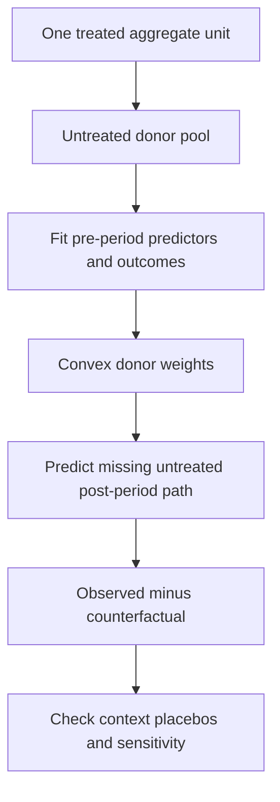

# Distinguish synthetic-control diagnostics, inference and extensions

## Record metadata

```json
{
  "schema_version": 3,
  "owner": "plan",
  "course_id": "2026_2027/Winter_Semester/Comparative_Economics",
  "transaction_id": "PLAN-20261018-CE-P002",
  "plan_version": "P002",
  "source_version": "V002",
  "ingestion_revision": 2,
  "objective_id": "O011",
  "objective_revision": 1,
  "criterion_version": "O011-C1",
  "status": "ready",
  "lesson_content_contract": "self-contained-lessons-v1",
  "knowledge_components": [
    "rmspe_rank_and_bias_adjustment_arithmetic",
    "distinct_reference_distributions_and_targets",
    "robustness_and_extension_mechanisms"
  ],
  "prerequisite_ids": [
    "O010"
  ],
  "compatible_versions": [],
  "note_locations": [
    {
      "path": "01_Notes/2026_2027/Winter_Semester/Comparative_Economics/Week_2/Synthetic_Control_Design_and_Inference.md",
      "heading": "Synthetic control: design, fit and inference"
    },
    {
      "path": "01_Notes/2026_2027/Winter_Semester/Comparative_Economics/Week_2/Synthetic_Control_Design_and_Inference.md",
      "heading": "The missing counterfactual and convex weights"
    },
    {
      "path": "01_Notes/2026_2027/Winter_Semester/Comparative_Economics/Week_2/Synthetic_Control_Design_and_Inference.md",
      "heading": "Selecting predictors and weights"
    },
    {
      "path": "01_Notes/2026_2027/Winter_Semester/Comparative_Economics/Week_2/Synthetic_Control_Design_and_Inference.md",
      "heading": "Why fit can help and when it misleads"
    },
    {
      "path": "01_Notes/2026_2027/Winter_Semester/Comparative_Economics/Week_2/Synthetic_Control_Design_and_Inference.md",
      "heading": "Context, data and feasibility"
    },
    {
      "path": "01_Notes/2026_2027/Winter_Semester/Comparative_Economics/Week_2/Synthetic_Control_Design_and_Inference.md",
      "heading": "Placebos, inference and robustness"
    },
    {
      "path": "01_Notes/2026_2027/Winter_Semester/Comparative_Economics/Week_2/Synthetic_Control_Design_and_Inference.md",
      "heading": "How the surveyed extensions change the estimator"
    },
    {
      "path": "01_Notes/2026_2027/Winter_Semester/Comparative_Economics/Week_2/Synthetic_Control_Design_and_Inference.md",
      "heading": "Distinct inferential reference distributions"
    }
  ],
  "acquisition_rule": {
    "distinct_independent_passes": 2,
    "required_item_roles": [
      "full_capability_check",
      "full_capability_check"
    ],
    "allowed_routes": [
      [
        "O011-I1",
        "O011-I2"
      ],
      [
        "O011-I1",
        "O011-D1"
      ],
      [
        "O011-I1",
        "O011-D2"
      ],
      [
        "O011-I2",
        "O011-D1"
      ],
      [
        "O011-I2",
        "O011-D2"
      ],
      [
        "O011-D1",
        "O011-D2"
      ]
    ]
  },
  "delayed_rule": {
    "minimum_elapsed_hours": 24,
    "fresh_item": true,
    "independent_required": true
  },
  "review_topic": "Distinguish synthetic-control diagnostics, inference and extensions",
  "review_instruction": "Begin a closed-note review with teach for O011; request an unused prepared delayed item before recap."
}
```

## Outcome and conditions

Compute diagnostic/rank/adjustment quantities and distinguish reference distributions, interval targets and surveyed estimator changes. All essential components listed in metadata are required. Hypothetical assessment values instantiate the checked equations; they are not historical observations or observed outcomes. Independent checks are closed-note and without hints, solution access, external retrieval or other assistance; a basic arithmetic calculator is allowed. Teach establishes and records actual help/exposure conditions before claiming independence.

## Prerequisites and checks

- [O010 outcome and repair route](../lessons/O010.md#outcome-and-conditions): canonical weights, missing potential outcomes and fit assumptions establish the object being diagnosed.

O011-P1, item_version 1, prerequisite_diagnostic. **Prompt:** What do canonical convex weights estimate after treatment, and why does prefit alone not prove causal validity?

**Complete key and rubric:** They predict the treated unit’s missing untreated outcome from untreated donors; observed minus predicted is the gap. O010 requires stable, uncontaminated, contextually plausible comparison and pre-only design. Require both; repair O010. Pass requires every requested reason and result; partial for an omitted reason or unresolved isolated arithmetic slip; fail for the conflicting mechanism. This diagnostic never counts as acquisition. Current or explicitly compatible committed independent prerequisite evidence may permit skipping its check; familiarity alone cannot. Use the cited complete prerequisite lesson or the named included foundation, then the worked example, after a partial/failing entry check.

## Teaching order and rationale

1. Use the diagnostic once to establish the necessary conceptual or algebraic foundation.
2. Present the complete checked-note explanation below, preserving variables, dates, assumptions and source qualifications. Follow one reasoning chain at a time so every intermediate step is visible.
3. Work W1 fully, asking the learner to explain why each step follows.
4. Use S1 as completion practice: show the setup and first identity, hide the final algebra/numbers and interpretation. After an explanation of the missing steps, withdraw support.
5. Present unused I1/I2 full checks with hidden solutions; use correction/repair after scoring the original answer. An unused D form can replace an exposed I only through a listed route.
6. On a later eligible occasion, begin an unused D item before recap. A numeric variant establishes bounded same-method performance, not general transfer.

## Motivation, intuition, and definitions

Compute diagnostic/rank/adjustment quantities and distinguish reference distributions, interval targets and surveyed estimator changes. Establish the definitions, assumptions and relevant comparisons before simplifying an equation. The complete reused passages establish every academic claim, notation choice and qualification assessed here; necessary prerequisites use the complete lessons above.

## Explanation steps

Origin: reused complete checked passage [[01_Notes/2026_2027/Winter_Semester/Comparative_Economics/Week_2/Synthetic_Control_Design_and_Inference.md#Synthetic control: design, fit and inference]]; fingerprint `f68abe39a544b3e0073189cf0d3543276edd30d9d1b78718c7ff6a94a34dee87`. Heading depth and required relative figure-path relocation alone are adapted.

### Synthetic control: design, fit and inference

Source: [[00_Materials/2026_2027/Winter_Semester/Comparative_Economics/Week_2/Abadie 2021 jel.20191450.pdf]]
Source: [[00_Materials/2026_2027/Winter_Semester/Comparative_Economics/Week_2/Week II - lecture - large slides.pdf]]

- [[#The missing counterfactual and convex weights|The missing counterfactual and convex weights]]
- [[#Selecting predictors and weights|Selecting predictors and weights]]
- [[#Why fit can help and when it misleads|Why fit can help and when it misleads]]
- [[#Context, data and feasibility|Context, data and feasibility]]
- [[#Placebos, inference and robustness|Placebos, inference and robustness]]
- [[#How the surveyed extensions change the estimator|How the surveyed extensions change the estimator]]
- [[#Distinct inferential reference distributions|Distinct inferential reference distributions]]


Synthetic control is the core method behind the lecture’s Russia case. Understanding the missing counterfactual, weight constraints and diagnostic limits comes before interpreting a post-treatment gap.



A synthetic control estimates what would have happened to one treated aggregate unit after an intervention by constructing a comparison from untreated units. Its central idea is that a weighted combination can resemble the treated unit more closely than any single comparison unit. That matters when interventions are rare and the available sample contains only a few regions, countries, or other large units. Many standard comparative designs are most informative with many units; a single-unit time series can be sensitive to other shocks; and informal comparative case studies do not formalize how comparison units were chosen. The synthetic-control design makes that choice explicit and lets readers inspect the fit and the units contributing to it (§§1–2, PDF pp. 1–3) [[00_Materials/2026_2027/Winter_Semester/Comparative_Economics/Week_2/Abadie 2021 jel.20191450.pdf#page=1|Abadie (2021), physical PDF pp. 1–3]].

#### The missing counterfactual and convex weights

Let unit $1$ be treated after period $T_0$, with $J$ untreated donor units. Write $Y^N_{1t}$ and $Y^I_{1t}$ for the treated unit’s untreated and treated potential outcomes. After treatment, the observed outcome is $Y_{1t}=Y^I_{1t}$, so the effect is

$$\tau_{1t}=Y^I_{1t}-Y^N_{1t},\qquad t>T_0.$$

The treated outcome is observed, but the untreated counterfactual is not. Synthetic control estimates it as

$$\widehat Y^N_{1t}=\sum_{j=2}^{J+1}w_jY_{jt},\qquad \widehat\tau_{1t}=Y_{1t}-\widehat Y^N_{1t}.$$

The effect can vary over post-treatment time; the estimator does not impose a constant effect. With $w_j\geq0$ and $\sum_{j=2}^{J+1}w_j=1$, the synthetic outcome is a convex weighted average of donor outcomes. Thus the estimate avoids extrapolation beyond the donor outcomes’ support. Relaxing these restrictions can allow extrapolation; regression weights may sum to one while still being negative or larger than one. The paper illustrates this distinction with West Germany’s regression weights, including four negative weights (eqs. (1)–(6), PDF pp. 4–5; §4 and Table 3, PDF pp. 15–16) [[00_Materials/2026_2027/Winter_Semester/Comparative_Economics/Week_2/Abadie 2021 jel.20191450.pdf#page=4|Abadie (2021), physical PDF pp. 4–5]] [[00_Materials/2026_2027/Winter_Semester/Comparative_Economics/Week_2/Abadie 2021 jel.20191450.pdf#page=15|Abadie (2021), physical PDF pp. 15–16]].

#### Selecting predictors and weights

Weights are selected using pre-intervention predictors. Let  $X_1$  collect the treated unit’s predictor values and  $X_0$  the corresponding donor values. For a chosen diagonal predictor-weight matrix $V=\operatorname{diag}(v_1,\ldots,v_k)$ with **nonnegative entries** $v_h\geq0$, canonical synthetic control solves

$$W(V)\in\operatorname*{arg\,min}_{W\geq0,\;\mathbf1^\top W=1}(X_1-X_0W)^\top V(X_1-X_0W).$$

The article writes the equivalent weighted norm objective in equation (7). The nonnegative entries of $V$ determine how heavily each predictor mismatch counts; conditional on $V$, the problem is convex constrained quadratic optimization. Negative diagonal entries would no longer define a nonnegative squared-distance objective. One simple choice scales predictors by inverse variance. Another chooses V to minimize pre-treatment outcome prediction error. The two-stage version of Abadie, Diamond, and Hainmueller (2015) divides pre-treatment time into training and validation windows: compute weights from training predictors, score their validation-period outcome mean squared prediction error (MSPE), select V, then refit using the final pre-treatment predictor window. This only helps when a choice of V produces both useful pre-treatment outcome prediction and acceptable predictor balance. Cross-validation solutions need not be unique, and fit to a selected period is not proof that the post-treatment relationship remains valid (eqs. (7)–(9), PDF pp. 6–7) [[00_Materials/2026_2027/Winter_Semester/Comparative_Economics/Week_2/Abadie 2021 jel.20191450.pdf#page=6|Abadie (2021), physical PDF pp. 6–7]].

The German reunification example makes these mechanics concrete. West Germany is compared with a donor pool of 16 OECD countries. A simple donor average fails to reproduce West Germany’s pre-1990 GDP trajectory; the synthetic control tracks it closely (Figure 1, PDF p. 8). Its listed weights are Austria 0.42, Japan 0.16, Netherlands 0.09, Switzerland 0.11, and United States 0.22; all other listed donor weights are zero (Table 2, PDF p. 9). Selected covariate means are also close: for example, GDP per capita is 15,808.9 for West Germany and 15,802.2 for its synthetic comparison (Table 1, same page). This is an example, not a guarantee that a convex combination exists or that a close fit implies an unbiased counterfactual.

#### Why fit can help and when it misleads

The factor-model argument explains why fit is diagnostic. For untreated outcomes the article uses

$$Y^N_{jt}=\delta_t+\theta_t Z_j+\lambda_t\mu_j+\varepsilon_{jt},$$

where  $\delta_t$  is a common time component,  $Z_j$  observed predictors,  $\mu_j$  unobserved factor loadings,  $\theta_t$  and  $\lambda_t$  time-varying coefficients, and  $\varepsilon_{jt}$  mean-zero unit-specific transitory shocks (eq. (10), PDF pp. 10–11). Difference-in-differences is a special restriction with time-invariant  $\lambda_t$ ; fixing the latent-factor coefficient removes that source of differential trends, while observed predictor effects must still be matched or controlled for in a parallel-trends interpretation. The unrestricted model need not satisfy parallel trends.

If a synthetic comparison exactly matches observed predictors and pre-treatment outcomes, it matches  $Z_1$ , while the extended pre-treatment outcome trajectory can provide evidence about the unobserved  $\mu_1$ . The cited bias-bound result depends on assumptions including this match and a linear factor structure; the bound worsens with transitory-shock scale and the number of latent factors and improves with more pre-treatment periods. A large donor pool can make it easier to overfit a short pre-period, creating a close observed fit even when latent loadings differ. Consequently, more pre-periods do not rescue a materially poor fit, and increasing the donor pool can raise overfitting risk. The factor model is a working approximation; under nonlinear outcome processes, even close linear interpolation may have substantial bias. A poor convex-hull fit is a reason to reject the conventional estimator, not to hide mismatch behind extrapolating regression weights (§3.3, PDF pp. 10–11; §5, PDF pp. 18–21) [[00_Materials/2026_2027/Winter_Semester/Comparative_Economics/Week_2/Abadie 2021 jel.20191450.pdf#page=10|Abadie (2021), physical PDF pp. 10–11]] [[00_Materials/2026_2027/Winter_Semester/Comparative_Economics/Week_2/Abadie 2021 jel.20191450.pdf#page=18|Abadie (2021), physical PDF pp. 18–21]].

Predictor choice is part of the design. Pre-treatment outcomes matter because they can proxy for latent factors and allow checking trajectory fit. Other predictors matter too: omitting relevant observed predictors effectively leaves them among the unobserved components. A holdout pre-period can assess whether the chosen predictors predict outcomes beyond the period used to construct the weights. Post-treatment outcomes must not drive design choices if the researcher wants a clean safeguard against specification searches; the pre-treatment design and weights can be set before post-treatment outcomes are observed (§3.4, PDF pp. 11–12; §4, PDF pp. 16–17) [[00_Materials/2026_2027/Winter_Semester/Comparative_Economics/Week_2/Abadie 2021 jel.20191450.pdf#page=11|Abadie (2021), physical PDF pp. 11–12]] [[00_Materials/2026_2027/Winter_Semester/Comparative_Economics/Week_2/Abadie 2021 jel.20191450.pdf#page=16|Abadie (2021), physical PDF pp. 16–17]].

Synthetic controls are often sparse because the solution projects the treated predictor vector onto the donor convex hull. When that vector is outside the hull and donor points are in general position, the solution is unique and uses at most k positive weights for k predictors. If it lies inside the hull, solutions may be non-unique; sparse solutions with at most k+1 positive weights exist. Sparsity is useful for interpretation and contextual scrutiny, not by itself a bias cure. With multiple treated units, non-uniqueness and distant contributing donors can become practical problems. Abadie and L’Hour add a penalty for pairwise predictor distances of contributing donors; as its tuning parameter grows, the estimator approaches one-to-one matching, while smaller values emphasize aggregate fit. Their extension yields a unique sparse solution under stated geometric conditions (§4 and Figure 2, PDF pp. 17–18; §8, eqs. (13)–(14), PDF pp. 26–27) [[00_Materials/2026_2027/Winter_Semester/Comparative_Economics/Week_2/Abadie 2021 jel.20191450.pdf#page=17|Abadie (2021), physical PDF pp. 17–18]] [[00_Materials/2026_2027/Winter_Semester/Comparative_Economics/Week_2/Abadie 2021 jel.20191450.pdf#page=26|Abadie (2021), physical PDF pp. 26–27]].

#### Context, data and feasibility

The design also needs contextual plausibility. Donors should not receive the treatment or be affected by it; units with large idiosyncratic shocks may be unsuitable; and there must be enough unaffected donors to form a comparison. Anticipation can bias estimates, so the intervention may need to be backdated to before responses begin. Spillovers violate no-interference assumptions: excluding exposed donors can reduce contamination but may worsen fit. The direction of contamination may sometimes be reasoned through from transparent weights. In the German example, if donor countries’ GDP were themselves negatively affected by reunification, the estimated negative effect for West Germany would be attenuated (§5, PDF pp. 19–22) [[00_Materials/2026_2027/Winter_Semester/Comparative_Economics/Week_2/Abadie 2021 jel.20191450.pdf#page=19|Abadie (2021), physical PDF pp. 19–22]].

Feasibility depends on whether the treated unit lies near the donors’ convex hull in substantively important predictors and outcomes. If only trends can be matched but levels cannot, demeaned or differenced outcomes, or a constant-shift variant, may help in suitable settings; such transformations can also increase noise and need not be valid when levels affect growth or when the underlying process is nonlinear. A researcher should not use conventional synthetic control when no credible donor combination approximates the treated unit. The paper further requires aggregate outcomes and predictors for treated and donor units, adequate pre-treatment history, and enough post-treatment observations to capture relevant effects. Longer pre-periods improve information but risk structural breaks; weighting more recent pre-period measures may help address instability. Highly volatile outcomes, small effects, and short or delayed post-period effects limit detectability; filtering may reduce common or unit-specific noise, though it changes the target and requires justification (§§5–6, PDF pp. 19–23) [[00_Materials/2026_2027/Winter_Semester/Comparative_Economics/Week_2/Abadie 2021 jel.20191450.pdf#page=19|Abadie (2021), physical PDF pp. 19–23]].

#### Placebos, inference and robustness

Inference in the canonical approach is often permutation-based: reassign treatment to each donor, reconstruct its synthetic control, and compare its placebo effect with the treated effect. One statistic is the ratio of post-period to pre-period root mean squared prediction error (RMSPE):

$$R_j(t_1,t_2)=\left[\frac{1}{t_2-t_1+1}\sum_{t=t_1}^{t_2}(Y_{jt}-\widehat Y^N_{jt})^2\right]^{1/2},\qquad r_j=\frac{R_j(T_0+1,T)}{R_j(1,T_0)}.$$

Large pre-treatment placebo errors make those placebos weak comparisons; one can report the distribution of ratios or gaps and, with transparent rules, exclude placebos whose pre-fit is substantially worse. One-sided statistics can focus power on a specified direction. This procedure does not automatically approximate a sampling distribution or turn observational treatment assignment into random assignment. Its interpretation depends on a defensible assignment benchmark; placebo rankings are a way to contextualize evidence, not a universal causal p-value. Other proposals include generalized permutation tests and confidence sets, end-of-sample instability tests, residual permutation under exchangeability conditions, bias-corrected synthetic control, and predictive intervals (§3.5, PDF pp. 12–15; §8 “Inference,” PDF pp. 29–32) [[00_Materials/2026_2027/Winter_Semester/Comparative_Economics/Week_2/Abadie 2021 jel.20191450.pdf#page=12|Abadie (2021), physical PDF pp. 12–15]] [[00_Materials/2026_2027/Winter_Semester/Comparative_Economics/Week_2/Abadie 2021 jel.20191450.pdf#page=29|Abadie (2021), physical PDF pp. 29–32]].

Diagnostics should include backdating/in-time placebos, donor-placebo comparisons, leave-one-out donor checks, and sensitivity to predictors and donor-pool definitions. In the reunification illustration, a ten-year backdating exercise finds close fit before the true intervention and a gap emerging near it (Figure 3, PDF p. 24); removing contributing donors leaves a negative estimate around the baseline (Figure 4, PDF p. 26). Those are design-specific checks rather than proof that every application is robust. Relevant extensions surveyed include multiple treated units, donor matching penalties, time weights, matrix completion/low-rank factor methods for missing outcomes, synthetic difference-in-differences, and alternative inferential procedures (§7, PDF pp. 23–25; §8, PDF pp. 25–33) [[00_Materials/2026_2027/Winter_Semester/Comparative_Economics/Week_2/Abadie 2021 jel.20191450.pdf#page=23|Abadie (2021), physical PDF pp. 23–25]] [[00_Materials/2026_2027/Winter_Semester/Comparative_Economics/Week_2/Abadie 2021 jel.20191450.pdf#page=25|Abadie (2021), physical PDF pp. 25–33]].


The source's permutation ranking can be written

$$p=\frac{1}{J+1}\sum_{j=1}^{J+1}\mathbf1\{r_j\geq r_1\}.$$

Including the treated unit gives a minimum attainable rank fraction of $1/(J+1)$, so a small donor pool limits resolution. This fraction is called a permutation p-value under the stated assignment benchmark; it does not manufacture randomized assignment or a repeated-sampling model. The researcher must state the reference distribution and any exclusions of badly fitted placebo units.
[[00_Materials/2026_2027/Winter_Semester/Comparative_Economics/Week_2/Abadie 2021 jel.20191450.pdf#page=13|Abadie (2021), physical PDF pp. 13–14]]

#### How the surveyed extensions change the estimator

The extensions are contextual reading: each relaxes or augments a particular design feature; the article does not claim every extension is interchangeable. With $I$ treated units and donors $j=I+1,\ldots,I+J$, the Abadie–L’Hour objective for treated unit $i$ is

$$\min_{W_i\geq0,\;\mathbf1^\top W_i=1}\left\{\left\|X_i-\sum_jw_{ij}X_j\right\|^2+\lambda\sum_jw_{ij}\|X_i-X_j\|^2\right\},\quad\lambda>0.$$

The first term rewards a good **aggregate** predictor match; the second penalizes giving weight to individually distant donors even if their differences cancel in the aggregate. The treatment estimate remains $\widehat\tau_{it}=Y_{it}-\sum_jw_{ij}Y_{jt}$; a simple average across treated units estimates their average effect. The penalty does not add post-treatment outcomes to the weight-fitting stage. These are equations (13)–(14), with sums written over the donor set.
[[00_Materials/2026_2027/Winter_Semester/Comparative_Economics/Week_2/Abadie 2021 jel.20191450.pdf#page=27|Abadie (2021), physical PDF pp. 27]]

A regression bias adjustment estimates an untreated prediction function $\widehat\mu_{0t}(X)$ using donors, then subtracts the weighted predicted discrepancy:

$$\widehat\tau_{it}=\left(Y_{it}-\sum_jw_{ij}Y_{jt}\right)-\sum_jw_{ij}\left[\widehat\mu_{0t}(X_i)-\widehat\mu_{0t}(X_j)\right].$$

Equivalently, compare treated and weighted donor **residuals** after removing their predicted outcomes. This can address imperfect balance but adds dependence on the prediction model; estimated pre-period bias can instead support a constant-shift adjustment only if its stability is credible. Equations (15)–(16) are not an automatic guarantee that poor overlap is harmless.
[[00_Materials/2026_2027/Winter_Semester/Comparative_Economics/Week_2/Abadie 2021 jel.20191450.pdf#page=29|Abadie (2021), physical PDF pp. 29]]

The regression extension writes $\widehat Y^N_{1t}=\widehat\alpha+\sum_{j=2}^{J+1}\widehat w_jY_{jt}$. Its weights may be negative and need not sum to one. An elastic-net fit minimizes pre-period squared residuals plus

$$\lambda_1\left[\frac{1-\lambda_2}{2}\sum_jw_j^2+\lambda_2\sum_j|w_j|\right],\quad\lambda_1\geq0,\quad0\leq\lambda_2\leq1.$$

The squared-weight part shrinks dispersed large coefficients; the absolute-weight part can set coefficients to zero. Cross-validation chooses regularization. Such a model trades convex-interpolation transparency for flexibility and possible extrapolation; unpenalized regression is the zero-penalty limit, not proof of credible identification. Equations (17)–(18) state this version.
[[00_Materials/2026_2027/Winter_Semester/Comparative_Economics/Week_2/Abadie 2021 jel.20191450.pdf#page=29|Abadie (2021), physical PDF pp. 29–30]]

Matrix methods view untreated outcomes as a matrix with common latent structure. A low-rank approximation estimates a small number of common patterns, denoises observed entries and imputes treated post-period entries; variants first denoise donors and then fit ridge weights. Some methods add covariates or fixed effects. Synthetic difference-in-differences adds weights over pre-period **times** as well as donor units. These methods still require their own stability/identification and inference assumptions; sharing a predictive target does not make those assumptions identical. The final discussion leaves large open questions about small-sample inference, model sensitivity, multiple interventions and prospective experimental design. [[00_Materials/2026_2027/Winter_Semester/Comparative_Economics/Week_2/Abadie 2021 jel.20191450.pdf#page=30|Abadie (2021), physical PDF pp. 30–35]]

![[01_Notes/2026_2027/Winter_Semester/Comparative_Economics/assets/Week_2_Abadie_German_Fit.png]]

Figure 1: the left panel compares West Germany with the simple OECD donor mean; the right uses the fitted synthetic comparison. The vertical line is reunification in 1990. Good pre-fit makes the comparison interpretable but does not independently establish no spillovers or stable latent relations. [[00_Materials/2026_2027/Winter_Semester/Comparative_Economics/Week_2/Abadie 2021 jel.20191450.pdf#page=8|Abadie (2021), physical PDF pp. 8]]


![[01_Notes/2026_2027/Winter_Semester/Comparative_Economics/assets/Week_2_Abadie_Balance_Weights.png]]

Tables 1–2 preserve predictor balance, the five positive weights and the eleven zero-weight donors. Weights sum to one at the displayed precision; a weight is a statistical contribution, not evidence that the donor was unaffected. [[00_Materials/2026_2027/Winter_Semester/Comparative_Economics/Week_2/Abadie 2021 jel.20191450.pdf#page=9|Abadie (2021), physical PDF pp. 9]]


![[01_Notes/2026_2027/Winter_Semester/Comparative_Economics/assets/Week_2_Abadie_Convex_Hull.png]]

Figure 2 projects the treated predictor vector onto the donors’ convex hull. Only the red donor vertices contribute in this illustration; geometric proximity must be paired with substantive comparability. [[00_Materials/2026_2027/Winter_Semester/Comparative_Economics/Week_2/Abadie 2021 jel.20191450.pdf#page=17|Abadie (2021), physical PDF pp. 17]]


![[01_Notes/2026_2027/Winter_Semester/Comparative_Economics/assets/Week_2_Abadie_Backdating.png]]

Figure 3 pretends reunification happened in 1980. The large divergence emerges around the actual intervention, which is supportive in-time evidence, rather than a proof that any other event has been excluded. [[00_Materials/2026_2027/Winter_Semester/Comparative_Economics/Week_2/Abadie 2021 jel.20191450.pdf#page=24|Abadie (2021), physical PDF pp. 24]]


![[01_Notes/2026_2027/Winter_Semester/Comparative_Economics/assets/Week_2_Abadie_Leave_One_Out.png]]

Figure 4 removes positively weighted donors one at a time. The family of resulting paths displays this application’s sensitivity; robust pre-fit and sign do not remove all identification assumptions. [[00_Materials/2026_2027/Winter_Semester/Comparative_Economics/Week_2/Abadie 2021 jel.20191450.pdf#page=26|Abadie (2021), physical PDF pp. 26]]


#### Distinct inferential reference distributions

The article’s surveyed alternatives differ from simply moving the treatment label across donor units. An **end-of-sample instability test** compares estimates over the post-treatment window with estimates computed over same-length consecutive pre-treatment windows. Its repeated-sampling justification uses stationary data and a large pre-period $T_0$; merely labelling an early date a placebo does not supply that justification. Generalized donor-permutation tests can instead generate confidence sets by **test inversion**: collect effect values whose null hypotheses are not rejected. [[00_Materials/2026_2027/Winter_Semester/Comparative_Economics/Week_2/Abadie 2021 jel.20191450.pdf#page=31|Physical PDF pp. 31]]

A **time-residual permutation** approach writes untreated outcomes as $Y^N_{1t}=P^N_t+u_t$, with mean-zero stationary, weakly dependent errors. Under a candidate post-treatment effect sequence $a_t$, subtract $a_t$ from observed treated outcomes to construct null-adjusted outcomes. The article first explains unrestricted permutation under an i.i.d. simplification; valid inference requires estimated residuals to be **exchangeable under the null**. Stationarity and weak dependence alone do not imply arbitrary exchangeability. This proposal fits constrained weights under the null using **all periods**, including the adjusted post-period, unlike canonical pre-only weight construction. It is a distinct null-testing procedure, not permission to fit canonical weights to untreated-looking post outcomes chosen after seeing results. The source also distinguishes a regression orthogonality restriction from the linear factor model; an unbiased factor-model synthetic control need not automatically satisfy that restriction. [[00_Materials/2026_2027/Winter_Semester/Comparative_Economics/Week_2/Abadie 2021 jel.20191450.pdf#page=31|Physical PDF pp. 31–32]]

Another surveyed procedure forms bias-corrected **mean post-treatment effects** with confidence intervals centred on $K$-fold cross-fitted estimates, using large pre- and post-periods and an asymptotically pivotal statistic. Cross-fitting constructs fits with held-out portions to reduce dependence between fitting and evaluation; it does not erase the underlying time-series requirements. In contrast, **predictive intervals** account both for uncertainty in estimated predictor parameters and irreducible uncertainty in the untreated outcome’s disturbance $u_t$. An interval for an average effect, a confidence set obtained by inverting a particular test, and a predictive interval for a particular missing untreated outcome have different targets and cannot be read interchangeably. This is the supplied article’s bounded survey, not a full proof or implementation of each cited external paper. [[00_Materials/2026_2027/Winter_Semester/Comparative_Economics/Week_2/Abadie 2021 jel.20191450.pdf#page=32|Physical PDF pp. 32]]


## Worked example

O011-W1, item_version 1, worked_example. **Prompt:** A hypothetical treated unit has pre-RMSPE 1 and post-RMSPE 4. There are 9 retained donor placebos, of which 0 have a post/pre ratio at least as large as the treated ratio. Compute the ratio, inclusive permutation rank fraction and minimum possible fraction. Explain why a poor-pre-fit placebo, discretionary exclusions or nonrandom treatment affects interpretation. With observed outcome 20, weighted donor outcome 17 and weighted predicted covariate discrepancy 1, compute the supplied regression bias-adjusted gap. Explain in-time and leave-one-out diagnostics, and compare canonical donor permutation, end-of-sample testing, null-adjusted residual permutation, cross-fitted mean-effect confidence intervals and predictive intervals. For the surveyed extensions, state what donor-distance penalties, regression/elastic net, low-rank imputation and synthetic DID alter and which assumptions remain.

**Complete solution and essential rubric:** Treated ratio is $4/1=4.000000$. Including the treated unit, rank fraction is $(0+1)/(9+1)=0.100000$, minimum $1/(9+1)$. RMSPE is the square root of the mean squared gap over its specified window. Report actual reference set and exclusions: bad prefit makes a placebo weak, and the ranking is not automatically a sampling p-value or randomization proof. Bias-adjusted gap is $(20-17)-1=2.000000$; subtract weighted predicted discrepancy, equivalently compare residuals. Adjustment adds prediction-model/stability dependence; it does not cure arbitrary nonoverlap. In-time backdating asks whether a false earlier intervention creates a gap; leave-one-out/predictor/pool changes assess sensitivity. Donor permutation reassigns labels under an explicit assignment benchmark. End-of-sample instability compares post estimates to same-length pre windows under stationary/large-pre-period assumptions. Residual permutation tests a candidate effect sequence by null-adjusting post outcomes and fitting under the null using all periods; arbitrary permutations need null residual exchangeability, which stationarity/weak dependence alone do not supply. It is distinct from canonical pre-only design. Generalized tests can invert nonrejected nulls into confidence sets. Cross-fitted mean-effect intervals use held-out fits and large pre/post series with their pivotal-statistic assumptions. Predictive intervals target a missing untreated outcome and include both parameter uncertainty and irreducible disturbance uncertainty, unlike a mean-effect confidence interval. A pairwise donor-distance penalty trades aggregate match against individually remote donors; large penalty approaches matching. Regression adds intercept/unrestricted weights and extrapolation, elastic-net mixes squared and absolute penalties selected by pre-validation; zero penalty is unpenalized regression. Low-rank methods denoise/impute common matrix structure; synthetic DID also weights pre-period times. Each extension needs its own stability/identification/inference conditions, and this bounded survey supplies no full proof/code implementation of every external paper. All requested calculations, derivations and qualifications are essential; the component map above applies to every full form.

## Practice with fading assistance

O011-S1, item_version 1, supported_completion. **Prompt:** A hypothetical treated unit has pre-RMSPE 2 and post-RMSPE 6. There are 7 retained donor placebos, of which 1 have a post/pre ratio at least as large as the treated ratio. Compute the ratio, inclusive permutation rank fraction and minimum possible fraction. Explain why a poor-pre-fit placebo, discretionary exclusions or nonrandom treatment affects interpretation. With observed outcome 30, weighted donor outcome 25 and weighted predicted covariate discrepancy 2, compute the supplied regression bias-adjusted gap. Explain in-time and leave-one-out diagnostics, and compare canonical donor permutation, end-of-sample testing, null-adjusted residual permutation, cross-fitted mean-effect confidence intervals and predictive intervals. For the surveyed extensions, state what donor-distance penalties, regression/elastic net, low-rank imputation and synthetic DID alter and which assumptions remain.

**Complete solution and essential rubric:** Treated ratio is $6/2=3.000000$. Including the treated unit, rank fraction is $(1+1)/(7+1)=0.250000$, minimum $1/(7+1)$. RMSPE is the square root of the mean squared gap over its specified window. Report actual reference set and exclusions: bad prefit makes a placebo weak, and the ranking is not automatically a sampling p-value or randomization proof. Bias-adjusted gap is $(30-25)-2=3.000000$; subtract weighted predicted discrepancy, equivalently compare residuals. Adjustment adds prediction-model/stability dependence; it does not cure arbitrary nonoverlap. In-time backdating asks whether a false earlier intervention creates a gap; leave-one-out/predictor/pool changes assess sensitivity. Donor permutation reassigns labels under an explicit assignment benchmark. End-of-sample instability compares post estimates to same-length pre windows under stationary/large-pre-period assumptions. Residual permutation tests a candidate effect sequence by null-adjusting post outcomes and fitting under the null using all periods; arbitrary permutations need null residual exchangeability, which stationarity/weak dependence alone do not supply. It is distinct from canonical pre-only design. Generalized tests can invert nonrejected nulls into confidence sets. Cross-fitted mean-effect intervals use held-out fits and large pre/post series with their pivotal-statistic assumptions. Predictive intervals target a missing untreated outcome and include both parameter uncertainty and irreducible disturbance uncertainty, unlike a mean-effect confidence interval. A pairwise donor-distance penalty trades aggregate match against individually remote donors; large penalty approaches matching. Regression adds intercept/unrestricted weights and extrapolation, elastic-net mixes squared and absolute penalties selected by pre-validation; zero penalty is unpenalized regression. Low-rank methods denoise/impute common matrix structure; synthetic DID also weights pre-period times. Each extension needs its own stability/identification/inference conditions, and this bounded survey supplies no full proof/code implementation of every external paper. All requested calculations, derivations and qualifications are essential; the component map above applies to every full form.

Allowed support is the first stated identity only; hide the remaining key while the learner completes it. Supported performance is practice, not an independent result.

## Rubric and independence

Required components: rmspe_rank_and_bias_adjustment_arithmetic, distinct_reference_distributions_and_targets, robustness_and_extension_mechanisms. Each full prompt/key below elicits every component; all are necessary for a pass on every permitted pair. Accept algebraically equivalent expressions and clearly defined opposite cash-flow signs with correct interpretation. A pass requires all requested outputs/reasons, correct units/assumptions and no critical conceptual error. Partial means a missing component or an unresolved isolated arithmetic slip with an otherwise valid method; independent correction is required for a pass. Fail means a critical mechanism/condition is wrong. Unscorable means a response or its help/exposure conditions cannot be established. Unknown help conditions are never independent evidence.

Critical errors: Placebo rank called automatic randomized p-value; weak dependence treated as arbitrary exchangeability; predictive interval confused with mean-effect interval.

Acquisition requires two distinct unused unassisted full checks selected from the six exact metadata routes. Every I/D form covers all components; W1, S1, the prerequisite and C1 are forbidden substitutes. A D form used for acquisition cannot later be counted again as delayed success. No teach-generated item may replace a named full check; additional verified explanation/practice is allowed under the unchanged method and may not fabricate evidence. If fewer than two fresh forms remain for acquisition, return a plan_issue for an additional prepared bank.

| Component | I1 | I2 | D1 | D2 |
|---|---|---|---|---|
| rmspe_rank_and_bias_adjustment_arithmetic | required | required | required | required |
| distinct_reference_distributions_and_targets | required | required | required | required |
| robustness_and_extension_mechanisms | required | required | required | required |

## Misconceptions and correction

An observed omitted term/sign is tentative until the learner explains it; compare the reasoning with the critical errors above. Score the original response before providing help. Route a conceptual failure to the relevant included derivation and prerequisite, then use an unused full form.

O011-C1, item_version 1, narrow_correction. **Prompt:** Does stationarity plus weak dependence alone justify shuffling all residuals arbitrarily under a candidate null? **Key/rubric:** No. The surveyed residual-permutation test requires null exchangeability for arbitrary permutations; it has a distinct all-period null fit and target from canonical pre-only donor design. Pass requires all keyed reasoning; partial for a missing part; fail for the conflicting mechanism. This repairs a common inference only; it cannot substitute for a full numerical/capability check.

Give at most two hints (first identify the date/unit, second point to the included identity); after ineffective hints show the relevant worked step. After two unsuccessful independent attempts stop repeated quizzing, revisit the explanation/prerequisite and preserve the unresolved status.

## Immediate and delayed checks

### O011-I1

O011-I1, item_version 1, full_capability_check. **Prompt:** A hypothetical treated unit has pre-RMSPE 1 and post-RMSPE 5. There are 11 retained donor placebos, of which 2 have a post/pre ratio at least as large as the treated ratio. Compute the ratio, inclusive permutation rank fraction and minimum possible fraction. Explain why a poor-pre-fit placebo, discretionary exclusions or nonrandom treatment affects interpretation. With observed outcome 15, weighted donor outcome 12 and weighted predicted covariate discrepancy 0.5, compute the supplied regression bias-adjusted gap. Explain in-time and leave-one-out diagnostics, and compare canonical donor permutation, end-of-sample testing, null-adjusted residual permutation, cross-fitted mean-effect confidence intervals and predictive intervals. For the surveyed extensions, state what donor-distance penalties, regression/elastic net, low-rank imputation and synthetic DID alter and which assumptions remain.

**Complete solution and essential rubric:** Treated ratio is $5/1=5.000000$. Including the treated unit, rank fraction is $(2+1)/(11+1)=0.250000$, minimum $1/(11+1)$. RMSPE is the square root of the mean squared gap over its specified window. Report actual reference set and exclusions: bad prefit makes a placebo weak, and the ranking is not automatically a sampling p-value or randomization proof. Bias-adjusted gap is $(15-12)-0.5=2.500000$; subtract weighted predicted discrepancy, equivalently compare residuals. Adjustment adds prediction-model/stability dependence; it does not cure arbitrary nonoverlap. In-time backdating asks whether a false earlier intervention creates a gap; leave-one-out/predictor/pool changes assess sensitivity. Donor permutation reassigns labels under an explicit assignment benchmark. End-of-sample instability compares post estimates to same-length pre windows under stationary/large-pre-period assumptions. Residual permutation tests a candidate effect sequence by null-adjusting post outcomes and fitting under the null using all periods; arbitrary permutations need null residual exchangeability, which stationarity/weak dependence alone do not supply. It is distinct from canonical pre-only design. Generalized tests can invert nonrejected nulls into confidence sets. Cross-fitted mean-effect intervals use held-out fits and large pre/post series with their pivotal-statistic assumptions. Predictive intervals target a missing untreated outcome and include both parameter uncertainty and irreducible disturbance uncertainty, unlike a mean-effect confidence interval. A pairwise donor-distance penalty trades aggregate match against individually remote donors; large penalty approaches matching. Regression adds intercept/unrestricted weights and extrapolation, elastic-net mixes squared and absolute penalties selected by pre-validation; zero penalty is unpenalized regression. Low-rank methods denoise/impute common matrix structure; synthetic DID also weights pre-period times. Each extension needs its own stability/identification/inference conditions, and this bounded survey supplies no full proof/code implementation of every external paper. All requested calculations, derivations and qualifications are essential; the component map above applies to every full form.

I1/I2 are immediate checks; D1/D2 are distinct parallel variants reserved where possible for delayed checks. A delayed success requires an unused form before recap, no help/solution access, and at least 24 actual elapsed hours after acquisition and the most recent relevant teaching/solution exposure. Record intervening exposure. A calendar-date change alone is insufficient; an early D attempt is immediate evidence only.

### O011-I2

O011-I2, item_version 1, full_capability_check. **Prompt:** A hypothetical treated unit has pre-RMSPE 2 and post-RMSPE 8. There are 9 retained donor placebos, of which 2 have a post/pre ratio at least as large as the treated ratio. Compute the ratio, inclusive permutation rank fraction and minimum possible fraction. Explain why a poor-pre-fit placebo, discretionary exclusions or nonrandom treatment affects interpretation. With observed outcome 40, weighted donor outcome 34 and weighted predicted covariate discrepancy 1, compute the supplied regression bias-adjusted gap. Explain in-time and leave-one-out diagnostics, and compare canonical donor permutation, end-of-sample testing, null-adjusted residual permutation, cross-fitted mean-effect confidence intervals and predictive intervals. For the surveyed extensions, state what donor-distance penalties, regression/elastic net, low-rank imputation and synthetic DID alter and which assumptions remain.

**Complete solution and essential rubric:** Treated ratio is $8/2=4.000000$. Including the treated unit, rank fraction is $(2+1)/(9+1)=0.300000$, minimum $1/(9+1)$. RMSPE is the square root of the mean squared gap over its specified window. Report actual reference set and exclusions: bad prefit makes a placebo weak, and the ranking is not automatically a sampling p-value or randomization proof. Bias-adjusted gap is $(40-34)-1=5.000000$; subtract weighted predicted discrepancy, equivalently compare residuals. Adjustment adds prediction-model/stability dependence; it does not cure arbitrary nonoverlap. In-time backdating asks whether a false earlier intervention creates a gap; leave-one-out/predictor/pool changes assess sensitivity. Donor permutation reassigns labels under an explicit assignment benchmark. End-of-sample instability compares post estimates to same-length pre windows under stationary/large-pre-period assumptions. Residual permutation tests a candidate effect sequence by null-adjusting post outcomes and fitting under the null using all periods; arbitrary permutations need null residual exchangeability, which stationarity/weak dependence alone do not supply. It is distinct from canonical pre-only design. Generalized tests can invert nonrejected nulls into confidence sets. Cross-fitted mean-effect intervals use held-out fits and large pre/post series with their pivotal-statistic assumptions. Predictive intervals target a missing untreated outcome and include both parameter uncertainty and irreducible disturbance uncertainty, unlike a mean-effect confidence interval. A pairwise donor-distance penalty trades aggregate match against individually remote donors; large penalty approaches matching. Regression adds intercept/unrestricted weights and extrapolation, elastic-net mixes squared and absolute penalties selected by pre-validation; zero penalty is unpenalized regression. Low-rank methods denoise/impute common matrix structure; synthetic DID also weights pre-period times. Each extension needs its own stability/identification/inference conditions, and this bounded survey supplies no full proof/code implementation of every external paper. All requested calculations, derivations and qualifications are essential; the component map above applies to every full form.

### O011-D1

O011-D1, item_version 1, full_capability_check. **Prompt:** A hypothetical treated unit has pre-RMSPE 1 and post-RMSPE 3. There are 7 retained donor placebos, of which 0 have a post/pre ratio at least as large as the treated ratio. Compute the ratio, inclusive permutation rank fraction and minimum possible fraction. Explain why a poor-pre-fit placebo, discretionary exclusions or nonrandom treatment affects interpretation. With observed outcome 22, weighted donor outcome 18 and weighted predicted covariate discrepancy 2, compute the supplied regression bias-adjusted gap. Explain in-time and leave-one-out diagnostics, and compare canonical donor permutation, end-of-sample testing, null-adjusted residual permutation, cross-fitted mean-effect confidence intervals and predictive intervals. For the surveyed extensions, state what donor-distance penalties, regression/elastic net, low-rank imputation and synthetic DID alter and which assumptions remain.

**Complete solution and essential rubric:** Treated ratio is $3/1=3.000000$. Including the treated unit, rank fraction is $(0+1)/(7+1)=0.125000$, minimum $1/(7+1)$. RMSPE is the square root of the mean squared gap over its specified window. Report actual reference set and exclusions: bad prefit makes a placebo weak, and the ranking is not automatically a sampling p-value or randomization proof. Bias-adjusted gap is $(22-18)-2=2.000000$; subtract weighted predicted discrepancy, equivalently compare residuals. Adjustment adds prediction-model/stability dependence; it does not cure arbitrary nonoverlap. In-time backdating asks whether a false earlier intervention creates a gap; leave-one-out/predictor/pool changes assess sensitivity. Donor permutation reassigns labels under an explicit assignment benchmark. End-of-sample instability compares post estimates to same-length pre windows under stationary/large-pre-period assumptions. Residual permutation tests a candidate effect sequence by null-adjusting post outcomes and fitting under the null using all periods; arbitrary permutations need null residual exchangeability, which stationarity/weak dependence alone do not supply. It is distinct from canonical pre-only design. Generalized tests can invert nonrejected nulls into confidence sets. Cross-fitted mean-effect intervals use held-out fits and large pre/post series with their pivotal-statistic assumptions. Predictive intervals target a missing untreated outcome and include both parameter uncertainty and irreducible disturbance uncertainty, unlike a mean-effect confidence interval. A pairwise donor-distance penalty trades aggregate match against individually remote donors; large penalty approaches matching. Regression adds intercept/unrestricted weights and extrapolation, elastic-net mixes squared and absolute penalties selected by pre-validation; zero penalty is unpenalized regression. Low-rank methods denoise/impute common matrix structure; synthetic DID also weights pre-period times. Each extension needs its own stability/identification/inference conditions, and this bounded survey supplies no full proof/code implementation of every external paper. All requested calculations, derivations and qualifications are essential; the component map above applies to every full form.

### O011-D2

O011-D2, item_version 1, full_capability_check. **Prompt:** A hypothetical treated unit has pre-RMSPE 2 and post-RMSPE 10. There are 11 retained donor placebos, of which 3 have a post/pre ratio at least as large as the treated ratio. Compute the ratio, inclusive permutation rank fraction and minimum possible fraction. Explain why a poor-pre-fit placebo, discretionary exclusions or nonrandom treatment affects interpretation. With observed outcome 50, weighted donor outcome 43 and weighted predicted covariate discrepancy 3, compute the supplied regression bias-adjusted gap. Explain in-time and leave-one-out diagnostics, and compare canonical donor permutation, end-of-sample testing, null-adjusted residual permutation, cross-fitted mean-effect confidence intervals and predictive intervals. For the surveyed extensions, state what donor-distance penalties, regression/elastic net, low-rank imputation and synthetic DID alter and which assumptions remain.

**Complete solution and essential rubric:** Treated ratio is $10/2=5.000000$. Including the treated unit, rank fraction is $(3+1)/(11+1)=0.333333$, minimum $1/(11+1)$. RMSPE is the square root of the mean squared gap over its specified window. Report actual reference set and exclusions: bad prefit makes a placebo weak, and the ranking is not automatically a sampling p-value or randomization proof. Bias-adjusted gap is $(50-43)-3=4.000000$; subtract weighted predicted discrepancy, equivalently compare residuals. Adjustment adds prediction-model/stability dependence; it does not cure arbitrary nonoverlap. In-time backdating asks whether a false earlier intervention creates a gap; leave-one-out/predictor/pool changes assess sensitivity. Donor permutation reassigns labels under an explicit assignment benchmark. End-of-sample instability compares post estimates to same-length pre windows under stationary/large-pre-period assumptions. Residual permutation tests a candidate effect sequence by null-adjusting post outcomes and fitting under the null using all periods; arbitrary permutations need null residual exchangeability, which stationarity/weak dependence alone do not supply. It is distinct from canonical pre-only design. Generalized tests can invert nonrejected nulls into confidence sets. Cross-fitted mean-effect intervals use held-out fits and large pre/post series with their pivotal-statistic assumptions. Predictive intervals target a missing untreated outcome and include both parameter uncertainty and irreducible disturbance uncertainty, unlike a mean-effect confidence interval. A pairwise donor-distance penalty trades aggregate match against individually remote donors; large penalty approaches matching. Regression adds intercept/unrestricted weights and extrapolation, elastic-net mixes squared and absolute penalties selected by pre-validation; zero penalty is unpenalized regression. Low-rank methods denoise/impute common matrix structure; synthetic DID also weights pre-period times. Each extension needs its own stability/identification/inference conditions, and this bounded survey supplies no full proof/code implementation of every external paper. All requested calculations, derivations and qualifications are essential; the component map above applies to every full form.

## Advance, revisit, pause, and escalate

Advance only after teach commits two qualifying independent full passes under a listed route. Keep acquisition and each later delayed observation separate. A source conflict blocks the affected claim and returns to ingest with the exact note heading. Missing criteria, a new method, unsupported alternative or exhausted fresh bank returns to plan with 2026_2027/Winter_Semester/Comparative_Economics, O011, revision1/O011-C1, P002/V002/ingestion2 and item ID. Equivalent valid methods meeting the frozen criterion may receive credit after verification; no criterion is changed to fit an answer. Closing a session preserves the actual stopping point without claiming completion.

## Content provenance and generation boundaries

Explanations, figures and qualifications above reuse complete checked-note sections with exact origin/fingerprint; heading depth alone is adapted. Main exercises and worked arithmetic are plan-created hypothetical instantiations of those displayed identities. No additional academic claims or external course scope are introduced. Preserve the note conventions and explicit qualifications; checked references reused from notes are not an independent raw-source audit by plan. New numerical practice can use the same method only after its complete solution and unchanged components are checked before display; it cannot replace this lesson’s named evidence forms. Prerequisites route to the complete prepared lessons above.

## Answer-free recall handoff

Topic: Distinguish synthetic-control diagnostics, inference and extensions. Begin a closed-note review with teach for O011; request an unused prepared delayed item before recap. Exact lesson: [[03_Agents/2026_2027/Winter_Semester/Comparative_Economics/lessons/O011.md#Immediate and delayed checks]]. Teach supplies actual committed evidence and timestamps; recall alone dates reviews. No learner outcome or due date is created by this curriculum.
