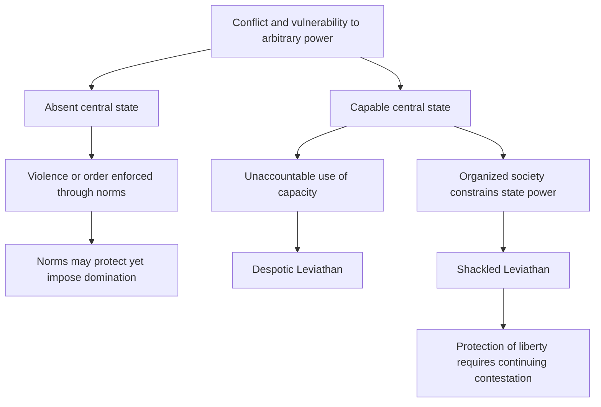

# Explain liberty, Leviathans and the cage of norms

## Record metadata

```json
{
  "schema_version": 3,
  "owner": "plan",
  "course_id": "2026_2027/Winter_Semester/Comparative_Economics",
  "transaction_id": "PLAN-20261018-CE-P002",
  "plan_version": "P002",
  "source_version": "V002",
  "ingestion_revision": 2,
  "objective_id": "O014",
  "objective_revision": 1,
  "criterion_version": "O014-C1",
  "status": "ready",
  "lesson_content_contract": "self-contained-lessons-v1",
  "knowledge_components": [
    "non_domination_warre_and_capacity",
    "absent_despotic_shackled_and_norms",
    "corridor_historical_qualifications_and_scope"
  ],
  "prerequisite_ids": [
    "O006",
    "O013"
  ],
  "compatible_versions": [],
  "note_locations": [
    {
      "path": "01_Notes/2026_2027/Winter_Semester/Comparative_Economics/Week_2/Liberty_Leviathans_and_Norms.md",
      "heading": "Liberty, Leviathans and the cage of norms"
    },
    {
      "path": "01_Notes/2026_2027/Winter_Semester/Comparative_Economics/Week_2/Liberty_Leviathans_and_Norms.md",
      "heading": "Liberty means freedom from domination"
    },
    {
      "path": "01_Notes/2026_2027/Winter_Semester/Comparative_Economics/Week_2/Liberty_Leviathans_and_Norms.md",
      "heading": "Hobbes's Warre and the economic mechanism"
    },
    {
      "path": "01_Notes/2026_2027/Winter_Semester/Comparative_Economics/Week_2/Liberty_Leviathans_and_Norms.md",
      "heading": "Capacity can be used for repression"
    },
    {
      "path": "01_Notes/2026_2027/Winter_Semester/Comparative_Economics/Week_2/Liberty_Leviathans_and_Norms.md",
      "heading": "Norms can create order and a cage"
    },
    {
      "path": "01_Notes/2026_2027/Winter_Semester/Comparative_Economics/Week_2/Liberty_Leviathans_and_Norms.md",
      "heading": "The Shackled Leviathan"
    },
    {
      "path": "01_Notes/2026_2027/Winter_Semester/Comparative_Economics/Week_2/Liberty_Leviathans_and_Norms.md",
      "heading": "What the chapter's final outline does—and does not—supply"
    }
  ],
  "acquisition_rule": {
    "distinct_independent_passes": 2,
    "required_item_roles": [
      "full_capability_check",
      "full_capability_check"
    ],
    "allowed_routes": [
      [
        "O014-I1",
        "O014-I2"
      ],
      [
        "O014-I1",
        "O014-D1"
      ],
      [
        "O014-I1",
        "O014-D2"
      ],
      [
        "O014-I2",
        "O014-D1"
      ],
      [
        "O014-I2",
        "O014-D2"
      ],
      [
        "O014-D1",
        "O014-D2"
      ]
    ]
  },
  "delayed_rule": {
    "minimum_elapsed_hours": 24,
    "fresh_item": true,
    "independent_required": true
  },
  "review_topic": "Explain liberty, Leviathans and the cage of norms",
  "review_instruction": "Begin a closed-note review with teach for O014; request an unused prepared delayed item before recap."
}
```

## Outcome and conditions

Classify the three Leviathans and explain how capacity and norms can protect or dominate, with historical/source qualifications. All essential components listed in metadata are required. Hypothetical assessment values instantiate the checked equations; they are not historical observations or observed outcomes. Independent checks are closed-note and without hints, solution access, external retrieval or other assistance; a basic arithmetic calculator is allowed. Teach establishes and records actual help/exposure conditions before claiming independence.

## Prerequisites and checks

- [O006 outcome and repair route](../lessons/O006.md#outcome-and-conditions): the qualitative corridor separates state and societal power.
- [O013 outcome and repair route](../lessons/O013.md#outcome-and-conditions): effective organization and formal constraints interact without automatic benevolent rule.

O014-P1, item_version 1, prerequisite_diagnostic. **Prompt:** Does state power alone establish a protected society, and does a written constitution exhaust effective power?

**Complete key and rubric:** O006’s corridor requires societal constraint alongside capacity; O013 distinguishes formal allocation from effective organization/resources. Require both; repair those lessons. Pass requires every requested reason and result; partial for an omitted reason or unresolved isolated arithmetic slip; fail for the conflicting mechanism. This diagnostic never counts as acquisition. Current or explicitly compatible committed independent prerequisite evidence may permit skipping its check; familiarity alone cannot. Use the cited complete prerequisite lesson or the named included foundation, then the worked example, after a partial/failing entry check.

## Teaching order and rationale

1. Use the diagnostic once to establish the necessary conceptual or algebraic foundation.
2. Present the complete checked-note explanation below, preserving variables, dates, assumptions and source qualifications. Follow one reasoning chain at a time so every intermediate step is visible.
3. Work W1 fully, asking the learner to explain why each step follows.
4. Use S1 as completion practice: show the setup and first identity, hide the final algebra/numbers and interpretation. After an explanation of the missing steps, withdraw support.
5. Present unused I1/I2 full checks with hidden solutions; use correction/repair after scoring the original answer. An unused D form can replace an exposed I only through a listed route.
6. On a later eligible occasion, begin an unused D item before recap. A numeric variant establishes bounded same-method performance, not general transfer.

## Motivation, intuition, and definitions

Classify the three Leviathans and explain how capacity and norms can protect or dominate, with historical/source qualifications. Establish the definitions, assumptions and relevant comparisons before simplifying an equation. The complete reused passages establish every academic claim, notation choice and qualification assessed here; necessary prerequisites use the complete lessons above.

## Explanation steps

Origin: reused complete checked passage [[01_Notes/2026_2027/Winter_Semester/Comparative_Economics/Week_2/Liberty_Leviathans_and_Norms.md#Liberty, Leviathans and the cage of norms]]; fingerprint `d8467cfbbfbf327692a52af4dc0f820dd58507e3cfb3e430d35147ed2b8a3ce3`. Heading depth and required relative figure-path relocation alone are adapted.

### Liberty, Leviathans and the cage of norms

Source: [[00_Materials/2026_2027/Winter_Semester/Comparative_Economics/Week_2/Acemoglu Robinson - The Narrow Corridor - chapter 1.pdf]]
Source: [[00_Materials/2026_2027/Winter_Semester/Comparative_Economics/Week_2/Week II - lecture - large slides.pdf]]
Source: [[00_Materials/2026_2027/Winter_Semester/Comparative_Economics/Week_3/Week III - lecture - large slides.pdf]]

- [[#Liberty means freedom from domination|Liberty means freedom from domination]]
- [[#Hobbes's Warre and the economic mechanism|Hobbes's Warre and the economic mechanism]]
- [[#Capacity can be used for repression|Capacity can be used for repression]]
- [[#Norms can create order and a cage|Norms can create order and a cage]]
- [[#The Shackled Leviathan|The Shackled Leviathan]]
- [[#What the chapter's final outline does—and does not—supply|What the chapter's final outline does—and does not—supply]]


Can a powerful state protect liberty, and can a society without a state avoid domination? Chapter 1 of *The Narrow Corridor* rejects a simple choice between total anarchy and an all-powerful ruler. Liberty requires the capacity to control violence **and** effective constraints on how that capacity is used. The lecture's corridor is a balance between state and societal power, not a formula that state power alone or social cohesion alone creates freedom. [[00_Materials/2026_2027/Winter_Semester/Comparative_Economics/Week_2/Acemoglu Robinson - The Narrow Corridor - chapter 1.pdf#page=1|The Narrow Corridor, chapter 1, physical PDF pp. 1–3, 23–26]] [[00_Materials/2026_2027/Winter_Semester/Comparative_Economics/Week_3/Week III - lecture - large slides.pdf#page=5|Week III lecture, physical PDF pp. 5–8]]



This map represents the chapter's three types and two objections to Hobbes. It is a conceptual comparison, not a causal experiment or a country-classification index. [[00_Materials/2026_2027/Winter_Semester/Comparative_Economics/Week_2/Acemoglu Robinson - The Narrow Corridor - chapter 1.pdf#page=7|The Narrow Corridor, chapter 1, physical PDF pp. 7–11, 16–18, 23–26]]

#### Liberty means freedom from domination

The chapter starts with competing visions: Fukuyama's liberal convergence, Kaplan's anarchy and Harari's technology-enabled dictatorship. The authors propose diversity and historical contingency rather than one inevitable “end.” Their Congo “Article 15—fend for yourself” is explicitly a **joke**, not an actual constitutional provision. The real constitutional promises illustrate the gap between written rights and protection in practice. [[00_Materials/2026_2027/Winter_Semester/Comparative_Economics/Week_2/Acemoglu Robinson - The Narrow Corridor - chapter 1.pdf#page=1|The Narrow Corridor, chapter 1, physical PDF pp. 1–3]]

Soyinka's journey through Lagos depicts gangs, predatory roadblocks, missing services and insecurity. The central idea, developed through Pettit's non-domination, is that a person can be unfree even without an actual assault today: another person's arbitrary ability to threaten, punish or withdraw essential protection alters behaviour. A subordinate spouse, worker or debtor may anticipate retaliation and self-censor. Freedom is therefore more than an abstract permission; it includes the practical ability to act without arbitrary domination by state or private actors. These are the book's historical narratives and conceptual examples, not current conditions certified for whole populations. [[00_Materials/2026_2027/Winter_Semester/Comparative_Economics/Week_2/Acemoglu Robinson - The Narrow Corridor - chapter 1.pdf#page=3|The Narrow Corridor, chapter 1, physical PDF pp. 3–7]]

#### Hobbes's Warre and the economic mechanism

**Warre** includes both actual fighting and the known persistent possibility of violence when no common authority reliably protects people. If harvests, possessions and life can be taken, effort and investment have uncertain private returns. People divert resources into self-protection and avoid travel, commerce and long-lived projects. The economic harm can arise from credible threats even when violence is off the observed path. [[00_Materials/2026_2027/Winter_Semester/Comparative_Economics/Week_2/Acemoglu Robinson - The Narrow Corridor - chapter 1.pdf#page=7|The Narrow Corridor, chapter 1, physical PDF pp. 7–10]]

Hobbes's solution is a powerful Leviathan, a state with overwhelming authority to impose order. He allows formation by agreement or conquest and regards monarchy, aristocracy and democracy mainly as different conveniences for wielding sovereign power. The authors accept his insight that avoiding Warre is crucial and that monopolizing violence can reduce killings. They reject two further steps: statelessness does not always mean uncontrolled violence, and a capable state does not automatically protect liberty. [[00_Materials/2026_2027/Winter_Semester/Comparative_Economics/Week_2/Acemoglu Robinson - The Narrow Corridor - chapter 1.pdf#page=9|The Narrow Corridor, chapter 1, physical PDF pp. 9–11]]

#### Capacity can be used for repression

State capacity is the ability to achieve objectives: enforce rules, resolve disputes, tax, regulate, build services or wage war. Bureaucratic means and motivation are crucial; capacity is analytically distinct from the desirability of the objective. The Nazi expulsion machinery and mass murder illustrate capable organization used to dispossess and kill. The Mao-era famine account describes procurement and suppression of criticism; later re-education accounts show coercion is not merely a failure to provide order. They demonstrate why an efficient administrative mechanism need not be welfare-improving. [[00_Materials/2026_2027/Winter_Semester/Comparative_Economics/Week_2/Acemoglu Robinson - The Narrow Corridor - chapter 1.pdf#page=11|The Narrow Corridor, chapter 1, physical PDF pp. 11–16]]

The **Despotic Leviathan** is defined by the absence of effective societal control over state power, not by a threshold number of murders. Repression is possible because the state is unaccountable. The Janus metaphor captures two faces: protection/services and predation/domination. Even a state that suppresses private violence can replace it with state violence. Source-reported atrocity estimates and historical incarceration examples are context for this argument, not newly verified demographic measurements or present-day legal descriptions. [[00_Materials/2026_2027/Winter_Semester/Comparative_Economics/Week_2/Acemoglu Robinson - The Narrow Corridor - chapter 1.pdf#page=16|The Narrow Corridor, chapter 1, physical PDF pp. 16–17]]

#### Norms can create order and a cage

An **Absent Leviathan** lacks effective centralized authority, but social norms can still coordinate conflict resolution, reciprocity, sanctions and collective defence. The chapter's Akan accounts describe safe commerce and community hearings mediated by elders and shared expectations. These cases refute an automatic equation of statelessness with chaos. They do not establish the absence of hierarchy or coercion. [[00_Materials/2026_2027/Winter_Semester/Comparative_Economics/Week_2/Acemoglu Robinson - The Narrow Corridor - chapter 1.pdf#page=17|The Narrow Corridor, chapter 1, physical PDF pp. 17–18]]

The same norms become a **cage** when conformity, subordination and prescribed roles cannot be freely challenged. In the Asante protection account, attachment to a lineage or powerful person helps guard against raiders but requires obedience; leaving that dependency can expose someone to enslavement. Goi's experience shows slavery and insecurity, while Bwanikwa's pawning illustrates how a nominally redeemable dependency can become lasting bondage. Wards, wives and dependants may receive protection while lacking independent voice. This is the supplied example of one norm system simultaneously reducing danger and restricting liberty. [[00_Materials/2026_2027/Winter_Semester/Comparative_Economics/Week_2/Acemoglu Robinson - The Narrow Corridor - chapter 1.pdf#page=18|The Narrow Corridor, chapter 1, physical PDF pp. 18–21]]

The authors also discuss how powerful interpreters can tilt inherited norms in their own favour, including gender hierarchies. Their Pashtunwali example combines hospitality and generosity with revenge obligations and restrictions on women. Read these as the authors' specified historical/social accounts, not as a claim that every member of an ethnic or religious population behaves identically. The mechanism is compulsory unequal dependence, not a judgment inferred from a group label. [[00_Materials/2026_2027/Winter_Semester/Comparative_Economics/Week_2/Acemoglu Robinson - The Narrow Corridor - chapter 1.pdf#page=22|The Narrow Corridor, chapter 1, physical PDF pp. 22]]

The Week III lecture adds the Tiv illustration: witchcraft accusations can constrain would-be dominant individuals yet inhibit initiative and centralization. That particular example is supplied by the lecture; detailed later book chapters were not supplied or audited here. The lecture's prebendalism discussion similarly explains officials financing themselves through office revenues/rents: it reduces the ruler's cash-wage needs but can encourage predation. These are institutional trade-offs, not proof that all premodern officials had identical arrangements. [[00_Materials/2026_2027/Winter_Semester/Comparative_Economics/Week_3/Week III - lecture - large slides.pdf#page=21|Week III lecture, physical PDF pp. 21–23]]

#### The Shackled Leviathan

The answer is a state capable of enforcing law and controlling private violence that is itself constrained by an organized, vigilant society. Formal constitutions, elections and review matter, but effective societal ability to complain, organize, contest and remove rulers matters too. This **Shackled Leviathan** can also loosen oppressive customary constraints. Its coercive potential remains Janus-faced; constraints restrain it rather than erase that potential. [[00_Materials/2026_2027/Winter_Semester/Comparative_Economics/Week_2/Acemoglu Robinson - The Narrow Corridor - chapter 1.pdf#page=23|The Narrow Corridor, chapter 1, physical PDF pp. 23–26]]

The Wyoming example links frontier violence, vigilante justice and the 1892 Johnson County conflict to state intervention, then women's voting rights to changes in customary restrictions. Two historical source labels need care: the chapter names William Henry Harrison for 1892, although it was Benjamin Harrison's presidency; its claim that Wyoming was the world's first place to grant women suffrage is too broad. Wyoming's 1869 territorial suffrage and later retention are the relevant institutional example, not an unqualified global-first claim. The [Library of Congress Benjamin Harrison guide](https://guides.loc.gov/benjamin-harrison), Introduction, confirms his 1889–1893 presidency; its [Women’s Suffrage classroom passage](https://www.loc.gov/classroom-materials/womens-suffrage/), “Early Rights,” notes earlier property-qualified female voting in New Jersey until 1807 and Wyoming territorial suffrage in 1869. These bounded checks correct the labels without treating the Johnson County intervention as a neutral, unqualified success. [[00_Materials/2026_2027/Winter_Semester/Comparative_Economics/Week_2/Acemoglu Robinson - The Narrow Corridor - chapter 1.pdf#page=23|The Narrow Corridor, chapter 1, physical PDF pp. 23–25]]

![[01_Notes/2026_2027/Winter_Semester/Comparative_Economics/assets/Week_3_Narrow_Corridor.png]]

The lecture diagram puts state power on the vertical axis and societal power on the horizontal. Moving upward alone can favour despotism; societal constraints without state capacity do not automatically supply security. A balance inside the corridor can support expansion of both. The following empirical illustration plots state capacity and civil society for the US, Japan, Honduras and Russia from 1855 to 2015. Its standardized/abstract axes and selected cases do not themselves identify a causal law or certify all conclusions of the cited Murphy–O'Reilly paper, which is a bibliography lead here. [[00_Materials/2026_2027/Winter_Semester/Comparative_Economics/Week_3/Week III - lecture - large slides.pdf#page=7|Week III lecture, physical PDF pp. 7–8]]

#### What the chapter's final outline does—and does not—supply

The ending surveys later chapters: state-society coevolution, the will to power, economic incentives, European/Chinese/Indian contrasts, conditional structural effects, uneven US capacity and slavery, “Paper” Leviathans, Middle Eastern norms, zero-sum conflict, entry to the corridor and maintaining it as responsibilities expand. These are **pointers in the supplied chapter**, not ingestion of the later chapters' detailed evidence. The common implication is that building and defending accountable capacity is continuing work; geography or a historical shock does not have one unconditional political effect. [[00_Materials/2026_2027/Winter_Semester/Comparative_Economics/Week_2/Acemoglu Robinson - The Narrow Corridor - chapter 1.pdf#page=26|The Narrow Corridor, chapter 1, physical PDF pp. 26–30]]

The core concepts answer the supplied questions: Warre discourages economic activity through insecurity; Hobbes is right about the importance of order but overstates the necessity and benignity of sovereign power; Absent, Despotic and Shackled types differ in effective capacity and constraints; the cage can protect people while binding them to unequal roles. The historical cases make those distinctions usable without turning them into inevitable country destinies. [[00_Materials/2026_2027/Winter_Semester/Comparative_Economics/Week_2/Week II - lecture - large slides.pdf#page=3|Week II lecture, physical PDF pp. 3]] [[00_Materials/2026_2027/Winter_Semester/Comparative_Economics/Week_3/Week III - lecture - large slides.pdf#page=5|Week III lecture, physical PDF pp. 5]] [[00_Materials/2026_2027/Winter_Semester/Comparative_Economics/Week_2/Acemoglu Robinson - The Narrow Corridor - chapter 1.pdf#page=7|The Narrow Corridor, chapter 1, physical PDF pp. 7–26]]


![[01_Notes/2026_2027/Winter_Semester/Comparative_Economics/assets/Week_3_Empirical_Corridor.png]]

The lecture’s selected four-country trajectories use state-capacity and civil-society indices. Treat the curves as the cited illustration; they are not an independently audited identification design. [[00_Materials/2026_2027/Winter_Semester/Comparative_Economics/Week_3/Week III - lecture - large slides.pdf#page=8|Week III lecture, physical PDF pp. 8]]


## Worked example

O014-W1, item_version 1, worked_example. **Prompt:** Compare hypothetical communities Alder (no central authority, safe trade through elders but compulsory dependent status), Birch (effective coercive bureaucracy without accountability), and Cedar (capable enforcement with organized citizens able to challenge rulers and oppressive custom). Classify Leviathans and explain non-domination, Warre and investment, capacity’s two faces, the cage of norms/Asante protection, corridor axes and continuing contestation. Qualify historical examples, source corrections, later-chapter leads and the four-country graph.

**Complete solution and essential rubric:** Alder illustrates an Absent Leviathan: norms can provide order while caging dependants, so statelessness need not mean constant violence. Birch illustrates a Despotic Leviathan: capacity can protect or repress and is distinct from desirable objectives. Cedar illustrates a Shackled Leviathan: state capacity controls private violence while organized society constrains state power and can loosen customary domination. Liberty is practical freedom from arbitrary domination even without an assault today. Hobbes’s Warre includes persistent credible threats that discourage travel, commerce and long-lived investment and divert resources into protection. Order matters, but unaccountable sovereignty need not be benign. Asante attachment can reduce enslavement risk while demanding obedience; exit may expose vulnerability. Akan, Pashtun, Tiv and prebendalism examples are bounded accounts, not uniform ethnic/current-country claims. State power is vertical and societal power horizontal in the corridor; increasing state power alone can favour despotism, while society alone need not ensure security. Continuing organization matters alongside written rights. Congo Article 15 is a joke, not a constitutional law. The 1892 Wyoming context concerns Benjamin Harrison, not William Henry Harrison;1869 territorial suffrage is not an unqualified world first. The 1855–2015 four-country index trajectories are a cited illustration, not an audited causal design. Later chapters remain pointers; no necessary country development sequence follows. All requested calculations, derivations and qualifications are essential; the component map above applies to every full form.

## Practice with fading assistance

O014-S1, item_version 1, supported_completion. **Prompt:** Compare hypothetical communities Delta (no central authority, safe trade through elders but compulsory dependent status), Elm (effective coercive bureaucracy without accountability), and Fir (capable enforcement with organized citizens able to challenge rulers and oppressive custom). Classify Leviathans and explain non-domination, Warre and investment, capacity’s two faces, the cage of norms/Asante protection, corridor axes and continuing contestation. Qualify historical examples, source corrections, later-chapter leads and the four-country graph.

**Complete solution and essential rubric:** Delta illustrates an Absent Leviathan: norms can provide order while caging dependants, so statelessness need not mean constant violence. Elm illustrates a Despotic Leviathan: capacity can protect or repress and is distinct from desirable objectives. Fir illustrates a Shackled Leviathan: state capacity controls private violence while organized society constrains state power and can loosen customary domination. Liberty is practical freedom from arbitrary domination even without an assault today. Hobbes’s Warre includes persistent credible threats that discourage travel, commerce and long-lived investment and divert resources into protection. Order matters, but unaccountable sovereignty need not be benign. Asante attachment can reduce enslavement risk while demanding obedience; exit may expose vulnerability. Akan, Pashtun, Tiv and prebendalism examples are bounded accounts, not uniform ethnic/current-country claims. State power is vertical and societal power horizontal in the corridor; increasing state power alone can favour despotism, while society alone need not ensure security. Continuing organization matters alongside written rights. Congo Article 15 is a joke, not a constitutional law. The 1892 Wyoming context concerns Benjamin Harrison, not William Henry Harrison;1869 territorial suffrage is not an unqualified world first. The 1855–2015 four-country index trajectories are a cited illustration, not an audited causal design. Later chapters remain pointers; no necessary country development sequence follows. All requested calculations, derivations and qualifications are essential; the component map above applies to every full form.

Allowed support is the first stated identity only; hide the remaining key while the learner completes it. Supported performance is practice, not an independent result.

## Rubric and independence

Required components: non_domination_warre_and_capacity, absent_despotic_shackled_and_norms, corridor_historical_qualifications_and_scope. Each full prompt/key below elicits every component; all are necessary for a pass on every permitted pair. Accept algebraically equivalent expressions and clearly defined opposite cash-flow signs with correct interpretation. A pass requires all requested outputs/reasons, correct units/assumptions and no critical conceptual error. Partial means a missing component or an unresolved isolated arithmetic slip with an otherwise valid method; independent correction is required for a pass. Fail means a critical mechanism/condition is wrong. Unscorable means a response or its help/exposure conditions cannot be established. Unknown help conditions are never independent evidence.

Critical errors: No state implies chaos; strong state implies liberty; norms assumed egalitarian; later chapter leads treated as checked details.

Acquisition requires two distinct unused unassisted full checks selected from the six exact metadata routes. Every I/D form covers all components; W1, S1, the prerequisite and C1 are forbidden substitutes. A D form used for acquisition cannot later be counted again as delayed success. No teach-generated item may replace a named full check; additional verified explanation/practice is allowed under the unchanged method and may not fabricate evidence. If fewer than two fresh forms remain for acquisition, return a plan_issue for an additional prepared bank.

| Component | I1 | I2 | D1 | D2 |
|---|---|---|---|---|
| non_domination_warre_and_capacity | required | required | required | required |
| absent_despotic_shackled_and_norms | required | required | required | required |
| corridor_historical_qualifications_and_scope | required | required | required | required |

## Misconceptions and correction

An observed omitted term/sign is tentative until the learner explains it; compare the reasoning with the critical errors above. Score the original response before providing help. Route a conceptual failure to the relevant included derivation and prerequisite, then use an unused full form.

O014-C1, item_version 1, narrow_correction. **Prompt:** If no abuse occurs this week but a patron can arbitrarily withdraw essential protection, is domination absent? **Key/rubric:** No. Practical dependence and a credible arbitrary threat can constrain behaviour without an observed assault; liberty is non-domination, with effective protection and constraints needed. Pass requires all keyed reasoning; partial for a missing part; fail for the conflicting mechanism. This repairs a common inference only; it cannot substitute for a full numerical/capability check.

Give at most two hints (first identify the date/unit, second point to the included identity); after ineffective hints show the relevant worked step. After two unsuccessful independent attempts stop repeated quizzing, revisit the explanation/prerequisite and preserve the unresolved status.

## Immediate and delayed checks

### O014-I1

O014-I1, item_version 1, full_capability_check. **Prompt:** A constitution promises speech and a bureaucracy efficiently collects taxes. In practice, officials may withdraw a worker’s permit arbitrarily; independent associations cannot challenge them. No permit has been withdrawn this month, so an analyst declares liberty secure and places the country inside the corridor using state capacity alone. Diagnose the claim using non-domination and Warre’s investment mechanism. Identify the most consistent Leviathan and distinguish what evidence would support the other two types; explain why orderly norms can still cage people, using Asante dependency. Correct the corridor axes and the Wyoming 1892/1869 source labels, and state what the four-country illustration and later-chapter outline can establish.

**Complete solution and essential rubric:** The worker’s anticipation of arbitrary permit withdrawal can constrain action without a withdrawal today: non-domination is more than written permission or the current assault count. Persistent threats to returns discourage travel, trade and long-lived investment and induce self-protection, the economic logic of Warre. Tax collection shows a capacity, but the lack of effective challenge makes the Despotic Leviathan most consistent; capability does not imply benign use. An Absent Leviathan would lack effective central authority, potentially with norm-based order; a Shackled one would combine capable protection with effective societal constraints, not just a constitution. Norms can coordinate safety yet impose compulsory status: Asante protection through a lineage/patron can reduce raiding danger while requiring obedience and making exit risky. Thus order alone does not settle liberty. State power is the vertical axis and societal power horizontal; an upward move alone cannot establish the corridor. Janus-faced capacity can supply services or repress. Wyoming’s 1892 presidency was Benjamin Harrison’s, and 1869 territorial suffrage is not an unqualified world first; these corrections do not turn the intervention into a neutral success proof. The 1855–2015 four-country index paths are a cited illustration, not an audited causal design, and later chapter details remain pointers. Require the permit-specific threat analysis, all three type distinctions, norms/capacity mechanism and evidence/scope corrections.

I1/I2 are immediate checks; D1/D2 are distinct parallel variants reserved where possible for delayed checks. A delayed success requires an unused form before recap, no help/solution access, and at least 24 actual elapsed hours after acquisition and the most recent relevant teaching/solution exposure. Record intervening exposure. A calendar-date change alone is insufficient; an early D attempt is immediate evidence only.

### O014-I2

O014-I2, item_version 1, full_capability_check. **Prompt:** A stateless trading community settles disputes through elders and has little street fighting, but dependants must obey a patron to keep protection from raiders. A reformer concludes both that no state is ever needed and that these norms prove liberty. Contrast that claim with a proposal for courts capable of protecting exit while open associations can contest officials. Explain Warre even during quiet periods, non-domination, the three Leviathans and capacity’s Janus character. Use the source’s Asante and Tiv/prebendalism examples without ethnic generalization, identify both corridor axes, and audit the Congo Article 15 and later-chapter/four-country evidence claims.

**Complete solution and essential rubric:** Quiet commerce without central authority shows that an Absent Leviathan need not mean constant chaos; it does not establish liberty or the universal dispensability of state capacity. Protection conditional on patron obedience is a cage: arbitrary dependence and dangerous exit constrain conduct before an attack occurs. Warre includes the known possibility of violence that makes investment and travel unsafe. Courts with real protective capacity plus effective open societal contestation could move toward a Shackled Leviathan; mere administrative power without constraints could instead be Despotic. Capacity has protective and predatory faces, so the proposal must be assessed on actual enforcement and challenge, not its stated benevolence alone. The Asante account joins protection with subordination; Tiv accusations can constrain aspiring dominance yet inhibit initiative/centralization, and prebendal finance can reduce cash-wage needs while encouraging predation. These are bounded source accounts, not uniform ethnic or timeless rules. On the diagram, state power is vertical and societal power horizontal; organized norms alone do not replace capable public protection, nor does upward capacity alone secure freedom. Congo Article 15 is explicitly a joke, not law. The four-country trajectories cannot identify the proposed court reform’s causal effect; later chapters are only surveyed leads. Wyoming’s 1869 example and the Benjamin Harrison correction likewise remain qualified historical illustrations. Require the stateless-order-versus-liberty diagnosis, prospective institutional contrast, full type/capacity distinctions and scope/attribution limits.

### O014-D1

O014-D1, item_version 1, full_capability_check. **Prompt:** Citizens freely organize and obtain paper rights, but police cannot reliably protect roads and merchants avoid long trips because gangs could seize cargo. A graph shows high societal organization but low effective state capacity; a minister calls this a Shackled Leviathan merely because elections exist. A later proposal adds effective courts and accountable policing while permitting challenges to forced customary roles. Assess both stages and the investment mechanism without assuming any increase in policing is liberating. Contrast Absent, Despotic and Shackled arrangements, explain Asante-type protection/dependency and the corridor axes, and identify the historical and empirical qualifications needed before claiming a proven national transition.

**Complete solution and essential rubric:** Effective road protection is missing despite formal rights and organization. Merchants respond to a credible threat even when a particular trip has not been attacked; insecure returns discourage commerce and long projects and divert resources to defence. The first stage does not meet the combined-capacity-and-constraint requirement for a Shackled Leviathan; it has an absent/ineffective central-protection feature, and the qualitative model is not determined by the election label alone. Courts and policing under effective societal control can support a Shackled arrangement and loosen arbitrary customary dependency. The same capacity without challenge could be Despotic, so increased enforcement alone is not sufficient. Absent states can have norm-based order, but Asante-type patron protection may require unequal obedience and dangerous exit; protection and non-domination differ. State power is vertical and societal power horizontal; improvement in both can be compatible with the corridor without making a trajectory inevitable. Janus-faced capacity requires continuing contestation, not merely adopting the proposal. Wyoming’s 1869 suffrage is not an unqualified world first, its 1892 president was Benjamin Harrison, and source intervention narratives remain qualified. The four-country 1855–2015 indices illustrate selected trajectories rather than identify this reform, while later book chapters are pointers. Require the stage-specific diagnosis, threat/returns mechanism, all type/norm distinctions and limits on inferred transition success.

### O014-D2

O014-D2, item_version 1, full_capability_check. **Prompt:** An essay uses three pieces of evidence: the Nazi state’s organizational effectiveness supposedly proves low violence is the definition of despotism; an Asante protection relationship supposedly proves customs cannot dominate; and Wyoming’s institutions supposedly prove every state automatically liberates women. Build a corrected argument linking liberty, capacity and societal constraint. Explain Warre’s known threat rather than only observed battles, distinguish all three Leviathans and the cage of norms, and interpret a vertical-only rise on the corridor diagram. Audit the source’s Harrison/global-first labels, Congo joke, four-country graph and later-chapter leads without replacing them with a universal country destiny.

**Complete solution and essential rubric:** The Nazi example demonstrates capable machinery used for dispossession and killing, not a definition based on a murder threshold or low observed violence. Despotic power is unaccountable to effective societal control; a state can suppress private attacks while dominating people itself. Liberty means freedom from arbitrary dependence, including anticipated retaliation without an attack today. Warre’s persistent known danger undermines expected returns, commerce and investment even between battles. An Absent Leviathan lacks effective central authority but can have orderly norms; Asante protection can simultaneously reduce danger and cage dependants through obedience and costly exit. A Shackled Leviathan combines public capacity with organized continuing constraints and can challenge oppressive custom; Wyoming is a qualified illustration of that possibility, not automatic emancipation by any state. State power is vertical, societal power horizontal; rising only vertically can increase unaccountable capacity rather than secure the corridor. Its Janus faces must be judged separately from administrative effectiveness. Correct 1892 to Benjamin Harrison and qualify the 1869 world-first statement; Congo Article 15 is a joke. The four-country index illustration is not an identified causal law and the later-chapter outline is not supplied detailed evidence. Require corrections tied to each essay claim, full type and norm distinctions, threat/investment reasoning and empirical/historical restraint.

## Advance, revisit, pause, and escalate

Advance only after teach commits two qualifying independent full passes under a listed route. Keep acquisition and each later delayed observation separate. A source conflict blocks the affected claim and returns to ingest with the exact note heading. Missing criteria, a new method, unsupported alternative or exhausted fresh bank returns to plan with 2026_2027/Winter_Semester/Comparative_Economics, O014, revision1/O014-C1, P002/V002/ingestion2 and item ID. Equivalent valid methods meeting the frozen criterion may receive credit after verification; no criterion is changed to fit an answer. Closing a session preserves the actual stopping point without claiming completion.

## Content provenance and generation boundaries

Explanations, figures and qualifications above reuse complete checked-note sections with exact origin/fingerprint; heading depth alone is adapted. Main exercises and worked arithmetic are plan-created hypothetical instantiations of those displayed identities. No additional academic claims or external course scope are introduced. Preserve the note conventions and explicit qualifications; checked references reused from notes are not an independent raw-source audit by plan. New numerical practice can use the same method only after its complete solution and unchanged components are checked before display; it cannot replace this lesson’s named evidence forms. Prerequisites route to the complete prepared lessons above.

## Answer-free recall handoff

Topic: Explain liberty, Leviathans and the cage of norms. Begin a closed-note review with teach for O014; request an unused prepared delayed item before recap. Exact lesson: [[03_Agents/2026_2027/Winter_Semester/Comparative_Economics/lessons/O014.md#Immediate and delayed checks]]. Teach supplies actual committed evidence and timestamps; recall alone dates reviews. No learner outcome or due date is created by this curriculum.
