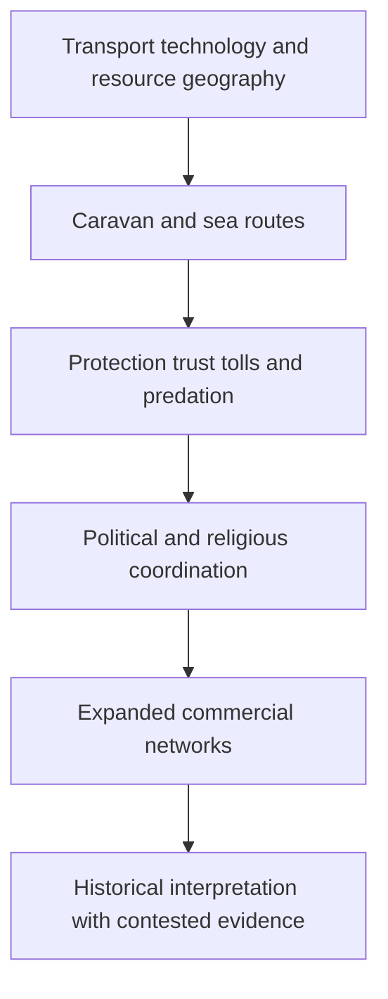

# Explain trade, protection and historical commercial networks

## Record metadata

```json
{
  "schema_version": 3,
  "owner": "plan",
  "course_id": "2026_2027/Winter_Semester/Comparative_Economics",
  "transaction_id": "PLAN-20261018-CE-P002",
  "plan_version": "P002",
  "source_version": "V002",
  "ingestion_revision": 2,
  "objective_id": "O017",
  "objective_revision": 1,
  "criterion_version": "O017-C1",
  "status": "ready",
  "lesson_content_contract": "self-contained-lessons-v1",
  "knowledge_components": [
    "conditional_route_cost_arithmetic",
    "transport_protection_and_political_coordination",
    "attribution_uncertainty_and_instrument_history"
  ],
  "prerequisite_ids": [
    "O004",
    "O014"
  ],
  "compatible_versions": [],
  "note_locations": [
    {
      "path": "01_Notes/2026_2027/Winter_Semester/Comparative_Economics/Week_3/Trade_Protection_and_Historical_Islam.md",
      "heading": "Trade, protection and historical Islam"
    },
    {
      "path": "01_Notes/2026_2027/Winter_Semester/Comparative_Economics/Week_3/Trade_Protection_and_Historical_Islam.md",
      "heading": "Trade infrastructure before Islam"
    },
    {
      "path": "01_Notes/2026_2027/Winter_Semester/Comparative_Economics/Week_3/Trade_Protection_and_Historical_Islam.md",
      "heading": "The political problem of exchange"
    },
    {
      "path": "01_Notes/2026_2027/Winter_Semester/Comparative_Economics/Week_3/Trade_Protection_and_Historical_Islam.md",
      "heading": "Muhammad, early Islam, and commercial norms"
    },
    {
      "path": "01_Notes/2026_2027/Winter_Semester/Comparative_Economics/Week_3/Trade_Protection_and_Historical_Islam.md",
      "heading": "Political consolidation and commercial networks"
    },
    {
      "path": "01_Notes/2026_2027/Winter_Semester/Comparative_Economics/Week_3/Trade_Protection_and_Historical_Islam.md",
      "heading": "Commercial instruments in the lecture"
    }
  ],
  "acquisition_rule": {
    "distinct_independent_passes": 2,
    "required_item_roles": [
      "full_capability_check",
      "full_capability_check"
    ],
    "allowed_routes": [
      [
        "O017-I1",
        "O017-I2"
      ],
      [
        "O017-I1",
        "O017-D1"
      ],
      [
        "O017-I1",
        "O017-D2"
      ],
      [
        "O017-I2",
        "O017-D1"
      ],
      [
        "O017-I2",
        "O017-D2"
      ],
      [
        "O017-D1",
        "O017-D2"
      ]
    ]
  },
  "delayed_rule": {
    "minimum_elapsed_hours": 24,
    "fresh_item": true,
    "independent_required": true
  },
  "review_topic": "Explain trade, protection and historical commercial networks",
  "review_instruction": "Begin a closed-note review with teach for O017; request an unused prepared delayed item before recap."
}
```

## Outcome and conditions

Compare a declared route-cost example and trace Bernstein’s logistics/protection narrative without timeless religious or causal overclaims. All essential components listed in metadata are required. Hypothetical assessment values instantiate the checked equations; they are not historical observations or observed outcomes. Independent checks are closed-note and without hints, solution access, external retrieval or other assistance; a basic arithmetic calculator is allowed. Teach establishes and records actual help/exposure conditions before claiming independence.

## Prerequisites and checks

- [O004 outcome and repair route](../lessons/O004.md#outcome-and-conditions): credible performance and enforcement affect whether mutually beneficial exchanges occur.
- [O014 outcome and repair route](../lessons/O014.md#outcome-and-conditions): protection and coercive power must be evaluated separately from non-domination.

O017-P1, item_version 1, prerequisite_diagnostic. **Prompt:** Why can trade fail with mutual gains if later performance or protection is not credible, and does order alone establish liberty?

**Complete key and rubric:** O004 shows sequential commitment can stop exchange; O014 distinguishes protection/capacity from freedom under arbitrary domination. Require both; repair those lessons. Pass requires every requested reason and result; partial for an omitted reason or unresolved isolated arithmetic slip; fail for the conflicting mechanism. This diagnostic never counts as acquisition. Current or explicitly compatible committed independent prerequisite evidence may permit skipping its check; familiarity alone cannot. Use the cited complete prerequisite lesson or the named included foundation, then the worked example, after a partial/failing entry check.

## Teaching order and rationale

1. Use the diagnostic once to establish the necessary conceptual or algebraic foundation.
2. Present the complete checked-note explanation below, preserving variables, dates, assumptions and source qualifications. Follow one reasoning chain at a time so every intermediate step is visible.
3. Work W1 fully, asking the learner to explain why each step follows.
4. Use S1 as completion practice: show the setup and first identity, hide the final algebra/numbers and interpretation. After an explanation of the missing steps, withdraw support.
5. Present unused I1/I2 full checks with hidden solutions; use correction/repair after scoring the original answer. An unused D form can replace an exposed I only through a listed route.
6. On a later eligible occasion, begin an unused D item before recap. A numeric variant establishes bounded same-method performance, not general transfer.

## Motivation, intuition, and definitions

Compare a declared route-cost example and trace Bernstein’s logistics/protection narrative without timeless religious or causal overclaims. Establish the definitions, assumptions and relevant comparisons before simplifying an equation. The complete reused passages establish every academic claim, notation choice and qualification assessed here; necessary prerequisites use the complete lessons above.

## Explanation steps

Origin: reused complete checked passage [[01_Notes/2026_2027/Winter_Semester/Comparative_Economics/Week_3/Trade_Protection_and_Historical_Islam.md#Trade, protection and historical Islam]]; fingerprint `032f26f0359d18357f1a3a165f3d83f86d6e698b9c2e75d6f4a468ed05f10d70`. Heading depth and required relative figure-path relocation alone are adapted.

### Trade, protection and historical Islam

Source: [[00_Materials/2026_2027/Winter_Semester/Comparative_Economics/Week_3/ADDITIONAL - Bernstein - chapter 3.pdf]]
Source: [[00_Materials/2026_2027/Winter_Semester/Comparative_Economics/Week_3/Week III - lecture - large slides.pdf]]

- [[#Trade infrastructure before Islam|Trade infrastructure before Islam]]
- [[#The political problem of exchange|The political problem of exchange]]
- [[#Muhammad, early Islam, and commercial norms|Muhammad, early Islam, and commercial norms]]
- [[#Political consolidation and commercial networks|Political consolidation and commercial networks]]
- [[#Commercial instruments in the lecture|Commercial instruments in the lecture]]


Bernstein’s supplied additional excerpt supplies historical context for the lecture’s links between commerce, political protection and Islam. It is interpretive background rather than a timeless account of religious conduct.



#### Trade infrastructure before Islam

Bernstein’s chapter begins with the camel as a transport technology that made long-distance exchange across arid regions practicable. The camel’s evolutionary adaptation to dry climates, its domestication, capacity to carry heavy loads, and development of specialized saddles together made it more useful than a donkey for bulk transport across trackless desert. The account contrasts dromedaries, Bactrians, and strong first-generation hybrids used along routes linking the Middle East and Central Asia. It emphasizes that trade capacity depended on animal biology, breeding, equipment, water access, and terrain rather than on distance alone: caravanserais and oases constrained routes, while steep mountain passes still required donkeys. [[00_Materials/2026_2027/Winter_Semester/Comparative_Economics/Week_3/ADDITIONAL - Bernstein - chapter 3.pdf#page=1|Bernstein, supplied chapter 3, physical PDF pp. 1–5]]

The Arabian incense trade illustrates how a valuable export can support a long supply chain. Frankincense and myrrh from the relatively fertile southwest of Arabia and neighboring Somalia served ritual, medicinal, cosmetic, and other uses in ancient markets. Harvest season and monsoon timing affected the choice between camel caravans and sea transport. The text describes local production, protective packaging, caravan services, intermediary markets, transit charges, and destination demand as linked stages in the trade. It also presents evidence of organized market exchange: the “silent trade” described by Theophrastus, in which sellers left measured goods and marked prices for merchants, with a priest taking a stated share. [[00_Materials/2026_2027/Winter_Semester/Comparative_Economics/Week_3/ADDITIONAL - Bernstein - chapter 3.pdf#page=5|Bernstein, supplied chapter 3, physical PDF pp. 5–12]]

Geography, political control, and transaction costs shaped the commodity’s route. The account traces incense through Shabwah and Thomna toward Gaza and Mediterranean markets, describing tolls, gate control, guards, water, fodder, lodging, and protection payments. It contrasts relatively trusting transactions at the production end with costly controls and theft prevention at processing and consumer centers. Under Roman rule, some routes became safer and cheaper, while demand and cultivation patterns changed. The author estimates large trade volumes and compares costs, prices, wages, and revenues using ancient monetary units. These are the author’s reported historical calculations, not contemporary values or independently updated estimates. [[00_Materials/2026_2027/Winter_Semester/Comparative_Economics/Week_3/ADDITIONAL - Bernstein - chapter 3.pdf#page=8|Bernstein, supplied chapter 3, physical PDF pp. 8–14]]

#### The political problem of exchange

Bernstein frames the desert economy through a “trade, protect, or raid” trilemma: where enforceable authority is absent, a trader must secure a route and cargo, or risk predation. In his account, family and tribal ties supplied protection in a setting with weak central authority. Collective responsibility and retaliatory violence could deter attacks, but also perpetuate cycles of revenge and insecurity. Raiding, called *ghazu*, could become an economic strategy when no authority beyond the tribe protected trade. This is the author’s broad explanatory frame, not a universal law of desert societies or an adequate description of present-day Muslim societies. [[00_Materials/2026_2027/Winter_Semester/Comparative_Economics/Week_3/ADDITIONAL - Bernstein - chapter 3.pdf#page=14|Bernstein, supplied chapter 3, physical PDF pp. 14–15]]

Mecca’s rise as a commercial center is presented as uncertain. The text notes competing explanations: its relative position between larger powers, the possibility that the principal incense route bypassed it, its dependence on agricultural production at Taif, and the commercial and pilgrimage activity surrounding the Kaaba and nearby shrines. Bernstein describes Quraish leaders as making trade safer and more profitable by taxing merchants and selling safe conduct, shifting incentives away from raiding. This links political organization to the provision of protection and to the growth of exchange. Keep the uncertainty explicit: the source does not establish that Mecca sat on the main incense route or that incense alone caused its prosperity. [[00_Materials/2026_2027/Winter_Semester/Comparative_Economics/Week_3/ADDITIONAL - Bernstein - chapter 3.pdf#page=15|Bernstein, supplied chapter 3, physical PDF pp. 15–16]]

#### Muhammad, early Islam, and commercial norms

Bernstein situates Islam’s emergence in a changing commercial and political setting. His narrative presents Muhammad as having merchant experience, including work for Khadija’s trading enterprise, and stresses that Islamic texts and traditions contain guidance on consensual exchange, truthful disclosure of defects, and fair dealing. The author connects these commercial norms to the religious community’s institutional unity. The historical details about Muhammad’s early life are qualified in the source: it says the surviving written biographies appeared more than a century after his death and that the historical record is uncertain. Treat the chapter as a historical interpretation, not as a settled account of Islamic doctrine or as a religious authority. [[00_Materials/2026_2027/Winter_Semester/Comparative_Economics/Week_3/ADDITIONAL - Bernstein - chapter 3.pdf#page=16|Bernstein, supplied chapter 3, physical PDF pp. 16–19]]

The account of early expansion combines religious conversion, military conquest, and economic redistribution. Bernstein describes raids on caravans after the migration from Mecca to Medina, the treatment of conquered property, and the allocation of a share to the community and the remainder to participants. He argues that conversion and conquest together expanded the boundaries of the new polity. This passage is the author’s interpretation and is phrased in sweeping terms, including claims about relations with nonbelievers; it should not be turned into a timeless rule about Islam or Muslims. The text itself notes peaceful conversion as a distinct route of expansion. [[00_Materials/2026_2027/Winter_Semester/Comparative_Economics/Week_3/ADDITIONAL - Bernstein - chapter 3.pdf#page=19|Bernstein, supplied chapter 3, physical PDF pp. 19–20]]

#### Political consolidation and commercial networks

The early caliphates are shown as both political powers and organizers of routes and supplies. The text describes efforts to move Egyptian grain to Arabia, including a Nile–Red Sea canal project and the strategic decision not to extend it to the Mediterranean. It recounts the Battle of the Masts in 655, the subsequent growth of Muslim naval control, and expansion into North Africa, Spain, Mediterranean islands, and Central Asia. These events connect trade to food security, naval capacity, and control over ports and sea lanes. A source-based map of incense lands and routes appears earlier in the chapter; a second teaching diagram could map the Red Sea, Persian Gulf, and Silk Road as an integrated network under the early caliphates. [[00_Materials/2026_2027/Winter_Semester/Comparative_Economics/Week_3/ADDITIONAL - Bernstein - chapter 3.pdf#page=20|Bernstein, supplied chapter 3, physical PDF pp. 20–22]]

Bernstein characterizes the Umayyad and Abbasid domains as a large commercial zone in which barriers were reduced and the Red Sea, Persian Gulf, and Silk Road functioned as connected routes. He associates this network with Muslim seafaring, Arabic as a lingua franca, long-distance connections to China, Scandinavia, and sub-Saharan Africa, and the movement of goods such as gold, ivory, furs, amber, silk, pepper, and metalwork. He also notes an intellectual and cultural flourishing centered in cities including Damascus, Baghdad, and Cordova. The account does not imply that political unity produced frictionless trade or equal access for all populations. It explicitly says that the “Pax Islamica” was not an unmixed blessing: the Mediterranean could become a frontier of conflict, and the source describes a shift in the boundaries between Occident and Orient. [[00_Materials/2026_2027/Winter_Semester/Comparative_Economics/Week_3/ADDITIONAL - Bernstein - chapter 3.pdf#page=22|Bernstein, supplied chapter 3, physical PDF pp. 22–23]]

The closing pages note a distinction between sophisticated commercial practices and state financial institutions: Bernstein says Muslim commercial networks used bills of exchange, lending arrangements, and futures markets, while no Islamic state established a national or central bank. He then traces later challenges to the commercial order, including Christian reconquest, Crusades, Mongol invasions, plague, and European entry into the Indian Ocean, while noting that Muslim traders remained important in long-distance trade into the early modern period. This is a historical narrative of changing routes and political conditions, not a claim that one factor alone explains later economic outcomes. [[00_Materials/2026_2027/Winter_Semester/Comparative_Economics/Week_3/ADDITIONAL - Bernstein - chapter 3.pdf#page=23|Bernstein, supplied chapter 3, physical PDF pp. 23]]

**Interpretive cautions.** The chapter uses a vivid, sometimes polemical narrative voice and offers broad claims about tribal life, raiding, religious motivation, conquest, and economic decline. Present these as Bernstein’s explanatory propositions, preserve qualifications and contested points, and do not generalize them to all Muslim societies or the present. The text itself calls Mecca’s commercial importance and route position uncertain. Historical quotations and numerical estimates (including camel capacities, population counts, trade volumes, prices, wages, and silver outflows) are source-period claims; retain their attribution and dates rather than presenting them as current or independently verified. The chapter excerpt ends mid-book and contains no end-of-chapter discussion questions. [[00_Materials/2026_2027/Winter_Semester/Comparative_Economics/Week_3/ADDITIONAL - Bernstein - chapter 3.pdf#page=1|Bernstein, supplied chapter 3, physical PDF pp. 1–23]]


![[01_Notes/2026_2027/Winter_Semester/Comparative_Economics/assets/Week_3_Incense_Routes.png]]

The supplied incense-route map locates production areas, caravan routes and maritime alternatives. Read it alongside the chapter’s explicit uncertainty about whether the principal route passed Mecca. [[00_Materials/2026_2027/Winter_Semester/Comparative_Economics/Week_3/ADDITIONAL - Bernstein - chapter 3.pdf#page=10|Bernstein, supplied chapter 3, physical PDF pp. 10]]


![[01_Notes/2026_2027/Winter_Semester/Comparative_Economics/assets/Week_3_Medieval_Trade.png]]

The Week III map depicts the medieval trade network. The associated three-route argument links the Red Sea, Persian Gulf and Silk Road; a map of connections alone does not measure trade volumes or prove a single cause of later decline. [[00_Materials/2026_2027/Winter_Semester/Comparative_Economics/Week_3/Week III - lecture - large slides.pdf#page=31|Week III lecture, physical PDF pp. 31]]


#### Commercial instruments in the lecture

The lecture adds historical terms from Irfan (2015): **suftaja** as a transferable money order, **hawala** as a credit/transfer arrangement, **sakk** as an early cheque-like written instruction, **musharaka** as partnership and **mudarabah** as capital–management profit sharing. The lecture relates these instruments to extensive trading networks and later financial practices. Its genealogy is a reported historical interpretation; the supplied chapter does not establish an exact one-to-one invention lineage for every modern instrument. Distinguish that history from the contract mechanisms explained in [[01_Notes/2026_2027/Winter_Semester/Comparative_Economics/Week_3/Islamic_Finance_and_Institutional_Diversity.md|Islamic finance and institutional diversity]]. [[00_Materials/2026_2027/Winter_Semester/Comparative_Economics/Week_3/Week III - lecture - large slides.pdf#page=28|Week III lecture, physical PDF pp. 28–34]]


## Worked example

O017-W1, item_version 1, worked_example. **Prompt:** A hypothetical caravan has gross trading margin 100, logistics cost 20, a safe-conduct fee 10, or an expected predation loss 30 if unprotected; other costs are equal and the supplied fee is assumed to eliminate that particular loss. Compare expected net margins, keeping expectations distinct from guaranteed outcomes. Use Bernstein’s transport and incense-chain mechanisms, trade/protect/raid framework, Mecca uncertainty, early commercial norms, political consolidation/routes and later disruptions. Distinguish attributed narrative from timeless religious claims and historical suftaja/hawala/sakk/musharaka/mudarabah from a proven invention lineage.

**Complete solution and essential rubric:** Protected expected margin is $100-20-10=70$; unprotected expected margin is $100-20-30=50$. The supplied expected comparison favours protection by $20$, conditional on its effectiveness and costs; it is not proof every voyage profits or a historical estimate. Camel biology/domestication/saddles, terrain, oases and caravanserais affect transport; mountains can still require donkeys. Incense production, packaging, monsoon/harvest timing, intermediary markets, tolls and protection jointly determine routes/costs. Trade, protection or raiding depend on enforcement and incentives; kin protection can deter attacks yet sustain revenge. Mecca’s route position and commercial importance are explicitly uncertain; do not assert the main incense route passed through it. Muhammad’s merchant/fair-dealing narrative relies on later/uncertain biographical evidence and is the author’s interpretation, not religious authority. Expansion includes conversion, conquest and redistribution, not one timeless Muslim motive. Caliphate supply, naval control and the Red Sea/Persian Gulf/Silk Road connections can reduce barriers without frictionless or equal access; later reconquest, Crusades, Mongols, plague and European entry are multiple developments, not a one-factor decline proof. Historical suftaja money orders, hawala credit/transfers, sakk cheque-like instructions, musharaka partnership and mudarabah capital-management sharing are lecture terminology, not exact modern invention lineages. Maps show connections, not volumes/causal effects; all monetary/capacity estimates and broad claims retain historical attribution. All requested calculations, derivations and qualifications are essential; the component map above applies to every full form.

## Practice with fading assistance

O017-S1, item_version 1, supported_completion. **Prompt:** A hypothetical caravan has gross trading margin 120, logistics cost 25, a safe-conduct fee 15, or an expected predation loss 40 if unprotected; other costs are equal and the supplied fee is assumed to eliminate that particular loss. Compare expected net margins, keeping expectations distinct from guaranteed outcomes. Use Bernstein’s transport and incense-chain mechanisms, trade/protect/raid framework, Mecca uncertainty, early commercial norms, political consolidation/routes and later disruptions. Distinguish attributed narrative from timeless religious claims and historical suftaja/hawala/sakk/musharaka/mudarabah from a proven invention lineage.

**Complete solution and essential rubric:** Protected expected margin is $120-25-15=80$; unprotected expected margin is $120-25-40=55$. The supplied expected comparison favours protection by $25$, conditional on its effectiveness and costs; it is not proof every voyage profits or a historical estimate. Camel biology/domestication/saddles, terrain, oases and caravanserais affect transport; mountains can still require donkeys. Incense production, packaging, monsoon/harvest timing, intermediary markets, tolls and protection jointly determine routes/costs. Trade, protection or raiding depend on enforcement and incentives; kin protection can deter attacks yet sustain revenge. Mecca’s route position and commercial importance are explicitly uncertain; do not assert the main incense route passed through it. Muhammad’s merchant/fair-dealing narrative relies on later/uncertain biographical evidence and is the author’s interpretation, not religious authority. Expansion includes conversion, conquest and redistribution, not one timeless Muslim motive. Caliphate supply, naval control and the Red Sea/Persian Gulf/Silk Road connections can reduce barriers without frictionless or equal access; later reconquest, Crusades, Mongols, plague and European entry are multiple developments, not a one-factor decline proof. Historical suftaja money orders, hawala credit/transfers, sakk cheque-like instructions, musharaka partnership and mudarabah capital-management sharing are lecture terminology, not exact modern invention lineages. Maps show connections, not volumes/causal effects; all monetary/capacity estimates and broad claims retain historical attribution. All requested calculations, derivations and qualifications are essential; the component map above applies to every full form.

Allowed support is the first stated identity only; hide the remaining key while the learner completes it. Supported performance is practice, not an independent result.

## Rubric and independence

Required components: conditional_route_cost_arithmetic, transport_protection_and_political_coordination, attribution_uncertainty_and_instrument_history. Each full prompt/key below elicits every component; all are necessary for a pass on every permitted pair. Accept algebraically equivalent expressions and clearly defined opposite cash-flow signs with correct interpretation. A pass requires all requested outputs/reasons, correct units/assumptions and no critical conceptual error. Partial means a missing component or an unresolved isolated arithmetic slip with an otherwise valid method; independent correction is required for a pass. Fail means a critical mechanism/condition is wrong. Unscorable means a response or its help/exposure conditions cannot be established. Unknown help conditions are never independent evidence.

Critical errors: Expected return becomes guarantee; uncertain Mecca route stated as fact; conquest or decline reduced to one universal religious motive.

Acquisition requires two distinct unused unassisted full checks selected from the six exact metadata routes. Every I/D form covers all components; W1, S1, the prerequisite and C1 are forbidden substitutes. A D form used for acquisition cannot later be counted again as delayed success. No teach-generated item may replace a named full check; additional verified explanation/practice is allowed under the unchanged method and may not fabricate evidence. If fewer than two fresh forms remain for acquisition, return a plan_issue for an additional prepared bank.

| Component | I1 | I2 | D1 | D2 |
|---|---|---|---|---|
| conditional_route_cost_arithmetic | required | required | required | required |
| transport_protection_and_political_coordination | required | required | required | required |
| attribution_uncertainty_and_instrument_history | required | required | required | required |

## Misconceptions and correction

An observed omitted term/sign is tentative until the learner explains it; compare the reasoning with the critical errors above. Score the original response before providing help. Route a conceptual failure to the relevant included derivation and prerequisite, then use an unused full form.

O017-C1, item_version 1, narrow_correction. **Prompt:** Does a medieval route map prove trade volume, Mecca’s exact route position or the cause of later decline? **Key/rubric:** No. It locates connections. The account qualifies Mecca and discusses multiple mechanisms; volumes and causal effects need further evidence. Pass requires all keyed reasoning; partial for a missing part; fail for the conflicting mechanism. This repairs a common inference only; it cannot substitute for a full numerical/capability check.

Give at most two hints (first identify the date/unit, second point to the included identity); after ineffective hints show the relevant worked step. After two unsuccessful independent attempts stop repeated quizzing, revisit the explanation/prerequisite and preserve the unresolved status.

## Immediate and delayed checks

### O017-I1

O017-I1, item_version 1, full_capability_check. **Prompt:** A hypothetical caravan has gross trading margin 90, logistics cost 15, a safe-conduct fee 10, or an expected predation loss 25 if unprotected; other costs are equal and the supplied fee is assumed to eliminate that particular loss. Compare expected net margins, keeping expectations distinct from guaranteed outcomes. Use Bernstein’s transport and incense-chain mechanisms, trade/protect/raid framework, Mecca uncertainty, early commercial norms, political consolidation/routes and later disruptions. Distinguish attributed narrative from timeless religious claims and historical suftaja/hawala/sakk/musharaka/mudarabah from a proven invention lineage.

**Complete solution and essential rubric:** Protected expected margin is $90-15-10=65$; unprotected expected margin is $90-15-25=50$. The supplied expected comparison favours protection by $15$, conditional on its effectiveness and costs; it is not proof every voyage profits or a historical estimate. Camel biology/domestication/saddles, terrain, oases and caravanserais affect transport; mountains can still require donkeys. Incense production, packaging, monsoon/harvest timing, intermediary markets, tolls and protection jointly determine routes/costs. Trade, protection or raiding depend on enforcement and incentives; kin protection can deter attacks yet sustain revenge. Mecca’s route position and commercial importance are explicitly uncertain; do not assert the main incense route passed through it. Muhammad’s merchant/fair-dealing narrative relies on later/uncertain biographical evidence and is the author’s interpretation, not religious authority. Expansion includes conversion, conquest and redistribution, not one timeless Muslim motive. Caliphate supply, naval control and the Red Sea/Persian Gulf/Silk Road connections can reduce barriers without frictionless or equal access; later reconquest, Crusades, Mongols, plague and European entry are multiple developments, not a one-factor decline proof. Historical suftaja money orders, hawala credit/transfers, sakk cheque-like instructions, musharaka partnership and mudarabah capital-management sharing are lecture terminology, not exact modern invention lineages. Maps show connections, not volumes/causal effects; all monetary/capacity estimates and broad claims retain historical attribution. All requested calculations, derivations and qualifications are essential; the component map above applies to every full form.

I1/I2 are immediate checks; D1/D2 are distinct parallel variants reserved where possible for delayed checks. A delayed success requires an unused form before recap, no help/solution access, and at least 24 actual elapsed hours after acquisition and the most recent relevant teaching/solution exposure. Record intervening exposure. A calendar-date change alone is insufficient; an early D attempt is immediate evidence only.

### O017-I2

O017-I2, item_version 1, full_capability_check. **Prompt:** A hypothetical caravan has gross trading margin 150, logistics cost 30, a safe-conduct fee 20, or an expected predation loss 50 if unprotected; other costs are equal and the supplied fee is assumed to eliminate that particular loss. Compare expected net margins, keeping expectations distinct from guaranteed outcomes. Use Bernstein’s transport and incense-chain mechanisms, trade/protect/raid framework, Mecca uncertainty, early commercial norms, political consolidation/routes and later disruptions. Distinguish attributed narrative from timeless religious claims and historical suftaja/hawala/sakk/musharaka/mudarabah from a proven invention lineage.

**Complete solution and essential rubric:** Protected expected margin is $150-30-20=100$; unprotected expected margin is $150-30-50=70$. The supplied expected comparison favours protection by $30$, conditional on its effectiveness and costs; it is not proof every voyage profits or a historical estimate. Camel biology/domestication/saddles, terrain, oases and caravanserais affect transport; mountains can still require donkeys. Incense production, packaging, monsoon/harvest timing, intermediary markets, tolls and protection jointly determine routes/costs. Trade, protection or raiding depend on enforcement and incentives; kin protection can deter attacks yet sustain revenge. Mecca’s route position and commercial importance are explicitly uncertain; do not assert the main incense route passed through it. Muhammad’s merchant/fair-dealing narrative relies on later/uncertain biographical evidence and is the author’s interpretation, not religious authority. Expansion includes conversion, conquest and redistribution, not one timeless Muslim motive. Caliphate supply, naval control and the Red Sea/Persian Gulf/Silk Road connections can reduce barriers without frictionless or equal access; later reconquest, Crusades, Mongols, plague and European entry are multiple developments, not a one-factor decline proof. Historical suftaja money orders, hawala credit/transfers, sakk cheque-like instructions, musharaka partnership and mudarabah capital-management sharing are lecture terminology, not exact modern invention lineages. Maps show connections, not volumes/causal effects; all monetary/capacity estimates and broad claims retain historical attribution. All requested calculations, derivations and qualifications are essential; the component map above applies to every full form.

### O017-D1

O017-D1, item_version 1, full_capability_check. **Prompt:** A hypothetical caravan has gross trading margin 80, logistics cost 10, a safe-conduct fee 5, or an expected predation loss 20 if unprotected; other costs are equal and the supplied fee is assumed to eliminate that particular loss. Compare expected net margins, keeping expectations distinct from guaranteed outcomes. Use Bernstein’s transport and incense-chain mechanisms, trade/protect/raid framework, Mecca uncertainty, early commercial norms, political consolidation/routes and later disruptions. Distinguish attributed narrative from timeless religious claims and historical suftaja/hawala/sakk/musharaka/mudarabah from a proven invention lineage.

**Complete solution and essential rubric:** Protected expected margin is $80-10-5=65$; unprotected expected margin is $80-10-20=50$. The supplied expected comparison favours protection by $15$, conditional on its effectiveness and costs; it is not proof every voyage profits or a historical estimate. Camel biology/domestication/saddles, terrain, oases and caravanserais affect transport; mountains can still require donkeys. Incense production, packaging, monsoon/harvest timing, intermediary markets, tolls and protection jointly determine routes/costs. Trade, protection or raiding depend on enforcement and incentives; kin protection can deter attacks yet sustain revenge. Mecca’s route position and commercial importance are explicitly uncertain; do not assert the main incense route passed through it. Muhammad’s merchant/fair-dealing narrative relies on later/uncertain biographical evidence and is the author’s interpretation, not religious authority. Expansion includes conversion, conquest and redistribution, not one timeless Muslim motive. Caliphate supply, naval control and the Red Sea/Persian Gulf/Silk Road connections can reduce barriers without frictionless or equal access; later reconquest, Crusades, Mongols, plague and European entry are multiple developments, not a one-factor decline proof. Historical suftaja money orders, hawala credit/transfers, sakk cheque-like instructions, musharaka partnership and mudarabah capital-management sharing are lecture terminology, not exact modern invention lineages. Maps show connections, not volumes/causal effects; all monetary/capacity estimates and broad claims retain historical attribution. All requested calculations, derivations and qualifications are essential; the component map above applies to every full form.

### O017-D2

O017-D2, item_version 1, full_capability_check. **Prompt:** A hypothetical caravan has gross trading margin 200, logistics cost 40, a safe-conduct fee 25, or an expected predation loss 60 if unprotected; other costs are equal and the supplied fee is assumed to eliminate that particular loss. Compare expected net margins, keeping expectations distinct from guaranteed outcomes. Use Bernstein’s transport and incense-chain mechanisms, trade/protect/raid framework, Mecca uncertainty, early commercial norms, political consolidation/routes and later disruptions. Distinguish attributed narrative from timeless religious claims and historical suftaja/hawala/sakk/musharaka/mudarabah from a proven invention lineage.

**Complete solution and essential rubric:** Protected expected margin is $200-40-25=135$; unprotected expected margin is $200-40-60=100$. The supplied expected comparison favours protection by $35$, conditional on its effectiveness and costs; it is not proof every voyage profits or a historical estimate. Camel biology/domestication/saddles, terrain, oases and caravanserais affect transport; mountains can still require donkeys. Incense production, packaging, monsoon/harvest timing, intermediary markets, tolls and protection jointly determine routes/costs. Trade, protection or raiding depend on enforcement and incentives; kin protection can deter attacks yet sustain revenge. Mecca’s route position and commercial importance are explicitly uncertain; do not assert the main incense route passed through it. Muhammad’s merchant/fair-dealing narrative relies on later/uncertain biographical evidence and is the author’s interpretation, not religious authority. Expansion includes conversion, conquest and redistribution, not one timeless Muslim motive. Caliphate supply, naval control and the Red Sea/Persian Gulf/Silk Road connections can reduce barriers without frictionless or equal access; later reconquest, Crusades, Mongols, plague and European entry are multiple developments, not a one-factor decline proof. Historical suftaja money orders, hawala credit/transfers, sakk cheque-like instructions, musharaka partnership and mudarabah capital-management sharing are lecture terminology, not exact modern invention lineages. Maps show connections, not volumes/causal effects; all monetary/capacity estimates and broad claims retain historical attribution. All requested calculations, derivations and qualifications are essential; the component map above applies to every full form.

## Advance, revisit, pause, and escalate

Advance only after teach commits two qualifying independent full passes under a listed route. Keep acquisition and each later delayed observation separate. A source conflict blocks the affected claim and returns to ingest with the exact note heading. Missing criteria, a new method, unsupported alternative or exhausted fresh bank returns to plan with 2026_2027/Winter_Semester/Comparative_Economics, O017, revision1/O017-C1, P002/V002/ingestion2 and item ID. Equivalent valid methods meeting the frozen criterion may receive credit after verification; no criterion is changed to fit an answer. Closing a session preserves the actual stopping point without claiming completion.

## Content provenance and generation boundaries

Explanations, figures and qualifications above reuse complete checked-note sections with exact origin/fingerprint; heading depth alone is adapted. Main exercises and worked arithmetic are plan-created hypothetical instantiations of those displayed identities. No additional academic claims or external course scope are introduced. Preserve the note conventions and explicit qualifications; checked references reused from notes are not an independent raw-source audit by plan. New numerical practice can use the same method only after its complete solution and unchanged components are checked before display; it cannot replace this lesson’s named evidence forms. Prerequisites route to the complete prepared lessons above.

## Answer-free recall handoff

Topic: Explain trade, protection and historical commercial networks. Begin a closed-note review with teach for O017; request an unused prepared delayed item before recap. Exact lesson: [[03_Agents/2026_2027/Winter_Semester/Comparative_Economics/lessons/O017.md#Immediate and delayed checks]]. Teach supplies actual committed evidence and timestamps; recall alone dates reviews. No learner outcome or due date is created by this curriculum.
