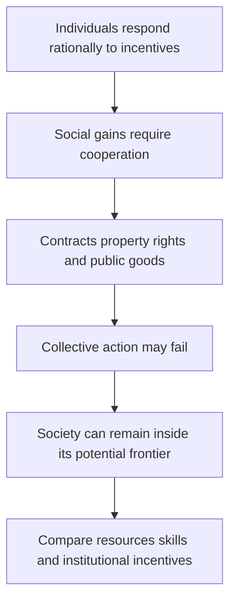

# Assess Olson’s institutions and collective-action argument

## Record metadata

```json
{
  "schema_version": 3,
  "owner": "plan",
  "course_id": "2026_2027/Winter_Semester/Comparative_Economics",
  "transaction_id": "PLAN-20261018-CE-P002",
  "plan_version": "P002",
  "source_version": "V002",
  "ingestion_revision": 2,
  "objective_id": "O022",
  "objective_revision": 1,
  "criterion_version": "O022-C1",
  "status": "ready",
  "lesson_content_contract": "self-contained-lessons-v1",
  "knowledge_components": [
    "migration_mpl_and_incentive_arithmetic",
    "factor_skill_civic_and_comparability_arguments",
    "individual_vs_social_rationality_and_policy_limits"
  ],
  "prerequisite_ids": [
    "O005",
    "O006"
  ],
  "compatible_versions": [],
  "note_locations": [
    {
      "path": "01_Notes/2026_2027/Winter_Semester/Comparative_Economics/Week_3/Collective_Action_and_Development.md",
      "heading": "Collective action, institutions and development"
    },
    {
      "path": "01_Notes/2026_2027/Winter_Semester/Comparative_Economics/Week_3/Collective_Action_and_Development.md",
      "heading": "Individual optimization does not guarantee social efficiency"
    },
    {
      "path": "01_Notes/2026_2027/Winter_Semester/Comparative_Economics/Week_3/Collective_Action_and_Development.md",
      "heading": "Knowledge and natural resources do not explain most of the gap"
    },
    {
      "path": "01_Notes/2026_2027/Winter_Semester/Comparative_Economics/Week_3/Collective_Action_and_Development.md",
      "heading": "Capital allocation is inconsistent with frontier production"
    },
    {
      "path": "01_Notes/2026_2027/Winter_Semester/Comparative_Economics/Week_3/Collective_Action_and_Development.md",
      "heading": "Separate private skills from civic human capital"
    },
    {
      "path": "01_Notes/2026_2027/Winter_Semester/Comparative_Economics/Week_3/Collective_Action_and_Development.md",
      "heading": "Institutions, growth, and collective action"
    }
  ],
  "acquisition_rule": {
    "distinct_independent_passes": 2,
    "required_item_roles": [
      "full_capability_check",
      "full_capability_check"
    ],
    "allowed_routes": [
      [
        "O022-I1",
        "O022-I2"
      ],
      [
        "O022-I1",
        "O022-D1"
      ],
      [
        "O022-I1",
        "O022-D2"
      ],
      [
        "O022-I2",
        "O022-D1"
      ],
      [
        "O022-I2",
        "O022-D2"
      ],
      [
        "O022-D1",
        "O022-D2"
      ]
    ]
  },
  "delayed_rule": {
    "minimum_elapsed_hours": 24,
    "fresh_item": true,
    "independent_required": true
  },
  "review_topic": "Assess Olson’s institutions and collective-action argument",
  "review_instruction": "Begin a closed-note review with teach for O022; request an unused prepared delayed item before recap."
}
```

## Outcome and conditions

Apply the resource-only migration comparison and an explicit incentive example, then assess Olson’s institutional argument and evidence limits. All essential components listed in metadata are required. Hypothetical assessment values instantiate the checked equations; they are not historical observations or observed outcomes. Independent checks are closed-note and without hints, solution access, external retrieval or other assistance; a basic arithmetic calculator is allowed. Teach establishes and records actual help/exposure conditions before claiming independence.

## Prerequisites and checks

- [O005 outcome and repair route](../lessons/O005.md#outcome-and-conditions): collective gains can fail under rational individual contribution incentives.
- [O006 outcome and repair route](../lessons/O006.md#outcome-and-conditions): institutional persistence and origin require power/organization reasoning, not functionalist inference.

O022-P1, item_version 1, prerequisite_diagnostic. **Prompt:** Why need rational individuals not organize a shared beneficial reform, and does an institution’s useful function prove its origin?

**Complete key and rubric:** O005 identifies contribution/free-riding incentives; O006 distinguishes function from origin and adds beneficiary/coordination barriers. Require both; repair those lessons. Pass requires every requested reason and result; partial for an omitted reason or unresolved isolated arithmetic slip; fail for the conflicting mechanism. This diagnostic never counts as acquisition. Current or explicitly compatible committed independent prerequisite evidence may permit skipping its check; familiarity alone cannot. Use the cited complete prerequisite lesson or the named included foundation, then the worked example, after a partial/failing entry check.

## Teaching order and rationale

1. Use the diagnostic once to establish the necessary conceptual or algebraic foundation.
2. Present the complete checked-note explanation below, preserving variables, dates, assumptions and source qualifications. Follow one reasoning chain at a time so every intermediate step is visible.
3. Work W1 fully, asking the learner to explain why each step follows.
4. Use S1 as completion practice: show the setup and first identity, hide the final algebra/numbers and interpretation. After an explanation of the missing steps, withdraw support.
5. Present unused I1/I2 full checks with hidden solutions; use correction/repair after scoring the original answer. An unused D form can replace an exposed I only through a listed route.
6. On a later eligible occasion, begin an unused D item before recap. A numeric variant establishes bounded same-method performance, not general transfer.

## Motivation, intuition, and definitions

Apply the resource-only migration comparison and an explicit incentive example, then assess Olson’s institutional argument and evidence limits. Establish the definitions, assumptions and relevant comparisons before simplifying an equation. The complete reused passages establish every academic claim, notation choice and qualification assessed here; necessary prerequisites use the complete lessons above.

## Explanation steps

Origin: reused complete checked passage [[01_Notes/2026_2027/Winter_Semester/Comparative_Economics/Week_3/Collective_Action_and_Development.md#Collective action, institutions and development]]; fingerprint `13cec2d999e2712200b5a6c9435838cc3774c8459c9de181c5616751780ca28d`. Heading depth and required relative figure-path relocation alone are adapted.

### Collective action, institutions and development

Source: [[00_Materials/2026_2027/Winter_Semester/Comparative_Economics/Week_3/ADDITIONAL - Olson - Big Bills Left on the Sidewalk. Why Some Nations are Rich, and Others Poor.pdf]]
Source: [[00_Materials/2026_2027/Winter_Semester/Comparative_Economics/Week_2/Week II - lecture - large slides.pdf]]

- [[#Individual optimization does not guarantee social efficiency|Individual optimization does not guarantee social efficiency]]
- [[#Knowledge and natural resources do not explain most of the gap|Knowledge and natural resources do not explain most of the gap]]
- [[#Capital allocation is inconsistent with frontier production|Capital allocation is inconsistent with frontier production]]
- [[#Separate private skills from civic human capital|Separate private skills from civic human capital]]
- [[#Institutions, growth, and collective action|Institutions, growth, and collective action]]


Olson’s additional reading explains why individually sensible choices need not produce efficient institutions. It connects the Week II free-riding problem to long-run income differences; its numerical comparisons are evidence from the article’s historical period.



#### Individual optimization does not guarantee social efficiency

Olson opens with the efficient-markets metaphor: if a profitable opportunity is visible and people can act on it, competition or bargaining should remove it; “big bills” should not remain on the sidewalk. He surveys arguments that rational workers contract to eliminate involuntary unemployment, firms enter profitable industries and limit monopoly losses, bargaining internalizes externalities where transaction costs are low, and political bargains eliminate inefficient policy. Growth accounting often adds the assumption that economies operate on their production frontiers. Taken together, these claims imply little room for large gains from policy advice. Olson’s article asks whether the rationality of individuals actually puts societies near their productive potential. [[00_Materials/2026_2027/Winter_Semester/Comparative_Economics/Week_3/ADDITIONAL - Olson - Big Bills Left on the Sidewalk. Why Some Nations are Rich, and Others Poor.pdf#page=2|Olson, journal pp. 3–5.]]

He proposes two broad explanations for cross-country income gaps. One is differing resource endowments—capital, land and natural resources, labor and human capital, or technology—with each society near its own production frontier. The other is that policies and institutions produce very different incentive structures: individuals may work hard and act ingeniously while society still fails to secure large gains from cooperation. Olson’s evidence tests the factor-endowment account before arguing for the importance of institutions. [[00_Materials/2026_2027/Winter_Semester/Comparative_Economics/Week_3/ADDITIONAL - Olson - Big Bills Left on the Sidewalk. Why Some Nations are Rich, and Others Poor.pdf#page=4|Olson, journal pp. 5–7.]]

#### Knowledge and natural resources do not explain most of the gap

Olson treats much productive knowledge as globally accessible, especially basic science and unpatented knowledge. The Korean example reports that, from 1973 to 1979, royalties and other payments for disembodied technology were often below one-thousandth of GDP; even adding foreign direct-investment profits, the total was under 1.5 percent of Korea’s GDP increase during the period. He acknowledges that imported machinery embodies knowledge and that not all Korean growth came from foreign knowledge. The example supports his claim that unequal access to technology alone cannot explain large income gaps. [[00_Materials/2026_2027/Winter_Semester/Comparative_Economics/Week_3/ADDITIONAL - Olson - Big Bills Left on the Sidewalk. Why Some Nations are Rich, and Others Poor.pdf#page=6|Olson, journal pp. 7–8.]]

The North–South migration model formalizes the diminishing-returns-to-labor explanation. The horizontal axis allocates a fixed world labor force between a richer North and poorer South; each region’s marginal product of labor (MPL), interpreted as the wage, falls as its workforce increases. At status quo point S, the North has relatively little labor per resource and thus a higher wage; the South has more labor per resource and a lower wage. A worker moving South-to-North earns the North wage instead of the South wage, increasing world income by the wage difference (the figure’s segment ab). If diminishing returns alone drove the gap, large migration should reallocate labour from S toward E **along the fixed MPL schedules**: the North’s workforce rises and its wage falls, while the South’s workforce falls and its wage rises. At E their wage/MPL levels are equal in this resource-only model. The migration changes the allocation on the horizontal axis; it does not itself shift either MPL schedule. [[00_Materials/2026_2027/Winter_Semester/Comparative_Economics/Week_3/ADDITIONAL - Olson - Big Bills Left on the Sidewalk. Why Some Nations are Rich, and Others Poor.pdf#page=8|Olson, journal pp. 9–10, Fig. 1.]]

Olson tests that prediction with historical cases. Ireland’s population fell from 5.4 million in 1821 to 3.5 million in 1986, while Great Britain’s rose from 14.2 million to 55.1 million; Ireland’s population density shifted from above Britain’s to roughly one-fifth, yet its income remained around five-eighths of Britain’s and emigration continued. The article also notes European migration to the United States, East-to-West German migration, Latin American migration to the United States, and studies of the Mariel boatlift and repatriations to France and Portugal. Olson argues these episodes do not show the wage equalization expected if land-to-labor ratios were the main cause. He acknowledges that migration has other effects and that Ireland’s nineteenth-century overpopulation is disputed in the cited literature. [[00_Materials/2026_2027/Winter_Semester/Comparative_Economics/Week_3/ADDITIONAL - Olson - Big Bills Left on the Sidewalk. Why Some Nations are Rich, and Others Poor.pdf#page=9|Olson, journal pp. 10–11.]]

Cross-country population density also fails as a simple poverty explanation. Olson contrasts sparsely populated Argentina, Brazil, Kenya, and Zaire with densely populated, higher-income West Germany, Belgium, Japan, Singapore, and Hong Kong. His descriptive log-log regression reports:

$$
\ln(\text{per-capita GDP}) = 6.986 + 0.1746\ln(\text{population density}),
\quad R^2 = .05,\quad t = 2.7.
$$

The relationship is positive, which Olson calls the “wrong” sign for a simple diminishing-returns story. He explicitly warns that this is a misspecified, descriptive regression: income affects population growth and migration as well as the reverse, and it cannot establish causation. He adds that modern manufacturing and services are less tied to local raw materials than earlier production. [[00_Materials/2026_2027/Winter_Semester/Comparative_Economics/Week_3/ADDITIONAL - Olson - Big Bills Left on the Sidewalk. Why Some Nations are Rich, and Others Poor.pdf#page=11|Olson, journal pp. 12–13.]]

#### Capital allocation is inconsistent with frontier production

If countries operated on similar neoclassical production frontiers, scarce capital should earn a higher marginal return in poor, capital-scarce countries, attracting investment until risk-adjusted returns converge. Olson invokes Lucas’s calculation: under comparable labor quality, capital’s marginal product in India should be 58 times the U.S. return; even treating five Indian workers as equivalent to one U.S. worker leaves a large predicted gap. Yet capital remains heavily concentrated in rich economies, while investment and lending to poor countries are often limited and locally owned capital may flee. Olson infers that policies and institutions can lower capital’s effective productivity or deter investment. The result contradicts the assumption that each country is near its aggregate production frontier. [[00_Materials/2026_2027/Winter_Semester/Comparative_Economics/Week_3/ADDITIONAL - Olson - Big Bills Left on the Sidewalk. Why Some Nations are Rich, and Others Poor.pdf#page=12|Olson, journal pp. 13–15.]]

His argument assumes small countries take the world price of capital as given and that, on the frontier, marginal product equals the world price. If domestic marginal product were higher than the cost of foreign capital, borrowing and investing locally would create gains. The failure to observe capital flowing until such opportunities disappear is, in Olson’s metaphor, evidence of large uncollected bills. He also notes that capital and labor sometimes leave the same countries together, unlike the opposing flows expected in a frictionless two-factor frontier model. [[00_Materials/2026_2027/Winter_Semester/Comparative_Economics/Week_3/ADDITIONAL - Olson - Big Bills Left on the Sidewalk. Why Some Nations are Rich, and Others Poor.pdf#page=13|Olson, journal pp. 14–15.]]

#### Separate private skills from civic human capital

Olson divides “culture” into marketable and public-good human capital. Marketable human capital includes skills, work propensities, savings habits, and entrepreneurial traits that affect a person’s income in the market. Public-good human capital, or civic culture, is knowledge about which policies and institutions would raise social income; it is not normally rewarded through an individual’s wage. This distinction allows migration to serve as a natural experiment: migrants carry their origin-country skills and personal culture, while entering the host country’s institutional environment. [[00_Materials/2026_2027/Winter_Semester/Comparative_Economics/Week_3/ADDITIONAL - Olson - Big Bills Left on the Sidewalk. Why Some Nations are Rich, and Others Poor.pdf#page=14|Olson, journal pp. 15–16.]]

Newly arrived immigrants from poor countries reportedly earned about 55 percent as much as comparable native-born Americans, despite language and adjustment costs, though migrants from very poor countries originated in economies with per-capita incomes only a fraction of U.S. income. Olson argues that higher destination wages reveal higher marginal productivity in the host setting, not merely migrant selection: selection may affect who migrates, but does not explain why the same person’s productivity rises on moving. He then compares Haitian and West German immigrants in the United States. In the 1980 Census, Haitian self-employed immigrants averaged annual earnings of USD 18,900 versus USD 27,300 for West Germans; annual salaried earnings were USD 10,900 versus USD 21,900. Olson treats this as evidence of a marketable-human-capital difference, but his thought experiment concludes that even doubling Haiti’s income to reflect that difference would leave it far below West Germany’s level. [[00_Materials/2026_2027/Winter_Semester/Comparative_Economics/Week_3/ADDITIONAL - Olson - Big Bills Left on the Sidewalk. Why Some Nations are Rich, and Others Poor.pdf#page=15|Olson, journal pp. 16–18.]]

These comparisons rely on assumptions: immigrant earnings proxy marginal product; the comparison controls adequately for age, sex, and schooling; migrants’ marketable traits are representative enough for the argument; and large institutional differences remain after accounting for selection. Olson recognizes selection and investment differences as qualifications. He also cites divided Germany, Korea, and China as comparisons where populations with similar cultural traits experienced different outcomes under different institutional regimes. Migration does not test civic culture, because migrant minorities generally do not change host-country institutions or policies. [[00_Materials/2026_2027/Winter_Semester/Comparative_Economics/Week_3/ADDITIONAL - Olson - Big Bills Left on the Sidewalk. Why Some Nations are Rich, and Others Poor.pdf#page=16|Olson, journal pp. 17–19.]]

#### Institutions, growth, and collective action

After considering knowledge, land, capital, and marketable human capital, Olson concludes that institutions and economic policies explain most international income differences. The article does not claim that this brief lecture identifies one ideal policy package. It rejects the shortcut that the size of government or transfers alone determines institutional quality. Instead it emphasizes incentives, contract enforcement, secure long-run property rights, and the capacity to prevent public and private predation. [[00_Materials/2026_2027/Winter_Semester/Comparative_Economics/Week_3/ADDITIONAL - Olson - Big Bills Left on the Sidewalk. Why Some Nations are Rich, and Others Poor.pdf#page=18|Olson, journal pp. 19–22.]]

Olson argues that neither old growth theory nor endogenous growth theory predicts the full pattern he describes. Poor countries as a group do not necessarily grow faster than rich countries, yet a subset of lower-income countries can grow much faster by adopting better institutions and closing part of the gap between actual and potential income. He gives historical examples of rapid catch-up, including South Korea in the 1970s, and compares the leading growers of the 1870s–1880s and 1970s–1980s. These decade-specific figures are the article’s historical evidence, not current rankings. Olson also excludes open-frontier and oil-shock cases from the cited comparisons and says the argument should not be extended to those countries without qualification. [[00_Materials/2026_2027/Winter_Semester/Comparative_Economics/Week_3/ADDITIONAL - Olson - Big Bills Left on the Sidewalk. Why Some Nations are Rich, and Others Poor.pdf#page=19|Olson, journal pp. 20–21.]]

The “big bills” that matter most require coordinated specialization and trade across many workers and inputs. Individuals may optimize well in ordinary self-enforcing transactions, but complex production depends on impartial contract enforcement, secure property rights, stable incentives, and policies that do not invite predation. These institutions do not arise automatically from individual rationality. Collective action can fail even when members could all gain from a socially efficient arrangement: private incentives to contribute, organize, or bear bargaining costs need not align with society-wide gains. Olson’s concluding distinction is therefore between individual rationality and social rationality. [[00_Materials/2026_2027/Winter_Semester/Comparative_Economics/Week_3/ADDITIONAL - Olson - Big Bills Left on the Sidewalk. Why Some Nations are Rich, and Others Poor.pdf#page=20|Olson, journal pp. 21–23.]]


![[01_Notes/2026_2027/Winter_Semester/Comparative_Economics/assets/Week_3_Olson_Migration_Model.png]]

Figure 1 allocates fixed world labour across North and South. North labour increases rightward; South labour increases leftward. At S the vertical ab gap is the wage/MPL gain for a marginal mover; E is equalization under the resource-only model. The empirical discussion tests the model’s maintained explanation, not every possible migration effect. [[00_Materials/2026_2027/Winter_Semester/Comparative_Economics/Week_3/ADDITIONAL - Olson - Big Bills Left on the Sidewalk. Why Some Nations are Rich, and Others Poor.pdf#page=8|Olson (1996), physical PDF pp. 8]]


## Worked example

O022-W1, item_version 1, worked_example. **Prompt:** In a hypothetical resource-only migration model a marginal worker’s North wage/MPL is 10 and South wage/MPL 4. Compute the immediate marginal output gain from moving, then explain the direction of wage changes as labour reallocates along fixed MPL schedules; do not invent final wages without the schedules. A toy project yields revenue 100, requires cost 60, and loses fraction 0.5 of revenue to an explicitly assumed predatory rule: compare gross surplus and net private return. Use Olson’s technology/land/capital evidence, marketable versus civic human capital, migration qualifications and collective-action logic to evaluate whether individual rationality guarantees frontier production or one universal policy package.

**Complete solution and essential rubric:** The marginal output gain is $10-4=6$ under wage-equals-MPL assumptions. As South-to-North migration proceeds with fixed world labour, North labour rises and its MPL/wage falls while South labour falls and its MPL/wage rises; the movement is along the schedules, not a shift, and equalization is only the resource-only model’s endpoint. The toy gross surplus is $100-60=40$; after the supplied revenue loss, private return is $100(1-0.5)-60=-10.000000$. This illustrates incentives without estimating any country’s loss. Olson argues accessible knowledge and natural-resource/density comparisons do not explain most gaps, with qualifications: his positive density regression has low $R^2=.05$ and is explicitly misspecified/descriptive, not causal. Frontier models predict scarce-capital returns and inflows, yet capital can remain/flee rich/poor patterns inconsistent with that simple account; the Lucas 58-times illustration is conditional on labour comparability. Marketable skills/habits affect private earnings; civic knowledge concerns public-good institutions and is not normally privately rewarded. Migrants carry skills into a new setting, but selection, controls, earnings-as-MPL and representativeness assumptions limit inference; migrant minorities do not automatically change host institutions, so the comparison does not test civic culture. Historical Irish/migration/capital/immigrant cases support his institutional interpretation, not zero relevance of all endowments. Individuals can optimize while gains from impartial contracts/property/security/complex cooperation remain uncollected because organizing incentives and public/private predation differ. Catch-up applies to a subset, with oil/open-frontier exclusions; government size alone is not institutional quality. No ideal universal package, current country ranking or automatic efficient-institution emergence follows. All requested calculations, derivations and qualifications are essential; the component map above applies to every full form.

## Practice with fading assistance

O022-S1, item_version 1, supported_completion. **Prompt:** In a hypothetical resource-only migration model a marginal worker’s North wage/MPL is 12 and South wage/MPL 5. Compute the immediate marginal output gain from moving, then explain the direction of wage changes as labour reallocates along fixed MPL schedules; do not invent final wages without the schedules. A toy project yields revenue 120, requires cost 70, and loses fraction 0.5 of revenue to an explicitly assumed predatory rule: compare gross surplus and net private return. Use Olson’s technology/land/capital evidence, marketable versus civic human capital, migration qualifications and collective-action logic to evaluate whether individual rationality guarantees frontier production or one universal policy package.

**Complete solution and essential rubric:** The marginal output gain is $12-5=7$ under wage-equals-MPL assumptions. As South-to-North migration proceeds with fixed world labour, North labour rises and its MPL/wage falls while South labour falls and its MPL/wage rises; the movement is along the schedules, not a shift, and equalization is only the resource-only model’s endpoint. The toy gross surplus is $120-70=50$; after the supplied revenue loss, private return is $120(1-0.5)-70=-10.000000$. This illustrates incentives without estimating any country’s loss. Olson argues accessible knowledge and natural-resource/density comparisons do not explain most gaps, with qualifications: his positive density regression has low $R^2=.05$ and is explicitly misspecified/descriptive, not causal. Frontier models predict scarce-capital returns and inflows, yet capital can remain/flee rich/poor patterns inconsistent with that simple account; the Lucas 58-times illustration is conditional on labour comparability. Marketable skills/habits affect private earnings; civic knowledge concerns public-good institutions and is not normally privately rewarded. Migrants carry skills into a new setting, but selection, controls, earnings-as-MPL and representativeness assumptions limit inference; migrant minorities do not automatically change host institutions, so the comparison does not test civic culture. Historical Irish/migration/capital/immigrant cases support his institutional interpretation, not zero relevance of all endowments. Individuals can optimize while gains from impartial contracts/property/security/complex cooperation remain uncollected because organizing incentives and public/private predation differ. Catch-up applies to a subset, with oil/open-frontier exclusions; government size alone is not institutional quality. No ideal universal package, current country ranking or automatic efficient-institution emergence follows. All requested calculations, derivations and qualifications are essential; the component map above applies to every full form.

Allowed support is the first stated identity only; hide the remaining key while the learner completes it. Supported performance is practice, not an independent result.

## Rubric and independence

Required components: migration_mpl_and_incentive_arithmetic, factor_skill_civic_and_comparability_arguments, individual_vs_social_rationality_and_policy_limits. Each full prompt/key below elicits every component; all are necessary for a pass on every permitted pair. Accept algebraically equivalent expressions and clearly defined opposite cash-flow signs with correct interpretation. A pass requires all requested outputs/reasons, correct units/assumptions and no critical conceptual error. Partial means a missing component or an unresolved isolated arithmetic slip with an otherwise valid method; independent correction is required for a pass. Fail means a critical mechanism/condition is wrong. Unscorable means a response or its help/exposure conditions cannot be established. Unknown help conditions are never independent evidence.

Critical errors: Migration shifts fixed MPL curves by definition; migrant comparison tests civic institutions; density regression is causal; individual rationality ensures frontier production.

Acquisition requires two distinct unused unassisted full checks selected from the six exact metadata routes. Every I/D form covers all components; W1, S1, the prerequisite and C1 are forbidden substitutes. A D form used for acquisition cannot later be counted again as delayed success. No teach-generated item may replace a named full check; additional verified explanation/practice is allowed under the unchanged method and may not fabricate evidence. If fewer than two fresh forms remain for acquisition, return a plan_issue for an additional prepared bank.

| Component | I1 | I2 | D1 | D2 |
|---|---|---|---|---|
| migration_mpl_and_incentive_arithmetic | required | required | required | required |
| factor_skill_civic_and_comparability_arguments | required | required | required | required |
| individual_vs_social_rationality_and_policy_limits | required | required | required | required |

## Misconceptions and correction

An observed omitted term/sign is tentative until the learner explains it; compare the reasoning with the critical errors above. Score the original response before providing help. Route a conceptual failure to the relevant included derivation and prerequisite, then use an unused full form.

O022-C1, item_version 1, narrow_correction. **Prompt:** Does private skill portability in migration establish the effect of civic culture on host institutions? **Key/rubric:** No. Marketable traits move with individuals; migrant minorities generally do not change host rules, so that comparison does not test civic public-good institutions. Pass requires all keyed reasoning; partial for a missing part; fail for the conflicting mechanism. This repairs a common inference only; it cannot substitute for a full numerical/capability check.

Give at most two hints (first identify the date/unit, second point to the included identity); after ineffective hints show the relevant worked step. After two unsuccessful independent attempts stop repeated quizzing, revisit the explanation/prerequisite and preserve the unresolved status.

## Immediate and delayed checks

### O022-I1

O022-I1, item_version 1, full_capability_check. **Prompt:** In a hypothetical resource-only migration model a marginal worker’s North wage/MPL is 8 and South wage/MPL 3. Compute the immediate marginal output gain from moving, then explain the direction of wage changes as labour reallocates along fixed MPL schedules; do not invent final wages without the schedules. A toy project yields revenue 80, requires cost 50, and loses fraction 0.5 of revenue to an explicitly assumed predatory rule: compare gross surplus and net private return. Use Olson’s technology/land/capital evidence, marketable versus civic human capital, migration qualifications and collective-action logic to evaluate whether individual rationality guarantees frontier production or one universal policy package.

**Complete solution and essential rubric:** The marginal output gain is $8-3=5$ under wage-equals-MPL assumptions. As South-to-North migration proceeds with fixed world labour, North labour rises and its MPL/wage falls while South labour falls and its MPL/wage rises; the movement is along the schedules, not a shift, and equalization is only the resource-only model’s endpoint. The toy gross surplus is $80-50=30$; after the supplied revenue loss, private return is $80(1-0.5)-50=-10.000000$. This illustrates incentives without estimating any country’s loss. Olson argues accessible knowledge and natural-resource/density comparisons do not explain most gaps, with qualifications: his positive density regression has low $R^2=.05$ and is explicitly misspecified/descriptive, not causal. Frontier models predict scarce-capital returns and inflows, yet capital can remain/flee rich/poor patterns inconsistent with that simple account; the Lucas 58-times illustration is conditional on labour comparability. Marketable skills/habits affect private earnings; civic knowledge concerns public-good institutions and is not normally privately rewarded. Migrants carry skills into a new setting, but selection, controls, earnings-as-MPL and representativeness assumptions limit inference; migrant minorities do not automatically change host institutions, so the comparison does not test civic culture. Historical Irish/migration/capital/immigrant cases support his institutional interpretation, not zero relevance of all endowments. Individuals can optimize while gains from impartial contracts/property/security/complex cooperation remain uncollected because organizing incentives and public/private predation differ. Catch-up applies to a subset, with oil/open-frontier exclusions; government size alone is not institutional quality. No ideal universal package, current country ranking or automatic efficient-institution emergence follows. All requested calculations, derivations and qualifications are essential; the component map above applies to every full form.

I1/I2 are immediate checks; D1/D2 are distinct parallel variants reserved where possible for delayed checks. A delayed success requires an unused form before recap, no help/solution access, and at least 24 actual elapsed hours after acquisition and the most recent relevant teaching/solution exposure. Record intervening exposure. A calendar-date change alone is insufficient; an early D attempt is immediate evidence only.

### O022-I2

O022-I2, item_version 1, full_capability_check. **Prompt:** In a hypothetical resource-only migration model a marginal worker’s North wage/MPL is 15 and South wage/MPL 6. Compute the immediate marginal output gain from moving, then explain the direction of wage changes as labour reallocates along fixed MPL schedules; do not invent final wages without the schedules. A toy project yields revenue 150, requires cost 90, and loses fraction 0.5 of revenue to an explicitly assumed predatory rule: compare gross surplus and net private return. Use Olson’s technology/land/capital evidence, marketable versus civic human capital, migration qualifications and collective-action logic to evaluate whether individual rationality guarantees frontier production or one universal policy package.

**Complete solution and essential rubric:** The marginal output gain is $15-6=9$ under wage-equals-MPL assumptions. As South-to-North migration proceeds with fixed world labour, North labour rises and its MPL/wage falls while South labour falls and its MPL/wage rises; the movement is along the schedules, not a shift, and equalization is only the resource-only model’s endpoint. The toy gross surplus is $150-90=60$; after the supplied revenue loss, private return is $150(1-0.5)-90=-15.000000$. This illustrates incentives without estimating any country’s loss. Olson argues accessible knowledge and natural-resource/density comparisons do not explain most gaps, with qualifications: his positive density regression has low $R^2=.05$ and is explicitly misspecified/descriptive, not causal. Frontier models predict scarce-capital returns and inflows, yet capital can remain/flee rich/poor patterns inconsistent with that simple account; the Lucas 58-times illustration is conditional on labour comparability. Marketable skills/habits affect private earnings; civic knowledge concerns public-good institutions and is not normally privately rewarded. Migrants carry skills into a new setting, but selection, controls, earnings-as-MPL and representativeness assumptions limit inference; migrant minorities do not automatically change host institutions, so the comparison does not test civic culture. Historical Irish/migration/capital/immigrant cases support his institutional interpretation, not zero relevance of all endowments. Individuals can optimize while gains from impartial contracts/property/security/complex cooperation remain uncollected because organizing incentives and public/private predation differ. Catch-up applies to a subset, with oil/open-frontier exclusions; government size alone is not institutional quality. No ideal universal package, current country ranking or automatic efficient-institution emergence follows. All requested calculations, derivations and qualifications are essential; the component map above applies to every full form.

### O022-D1

O022-D1, item_version 1, full_capability_check. **Prompt:** In a hypothetical resource-only migration model a marginal worker’s North wage/MPL is 20 and South wage/MPL 8. Compute the immediate marginal output gain from moving, then explain the direction of wage changes as labour reallocates along fixed MPL schedules; do not invent final wages without the schedules. A toy project yields revenue 200, requires cost 120, and loses fraction 0.5 of revenue to an explicitly assumed predatory rule: compare gross surplus and net private return. Use Olson’s technology/land/capital evidence, marketable versus civic human capital, migration qualifications and collective-action logic to evaluate whether individual rationality guarantees frontier production or one universal policy package.

**Complete solution and essential rubric:** The marginal output gain is $20-8=12$ under wage-equals-MPL assumptions. As South-to-North migration proceeds with fixed world labour, North labour rises and its MPL/wage falls while South labour falls and its MPL/wage rises; the movement is along the schedules, not a shift, and equalization is only the resource-only model’s endpoint. The toy gross surplus is $200-120=80$; after the supplied revenue loss, private return is $200(1-0.5)-120=-20.000000$. This illustrates incentives without estimating any country’s loss. Olson argues accessible knowledge and natural-resource/density comparisons do not explain most gaps, with qualifications: his positive density regression has low $R^2=.05$ and is explicitly misspecified/descriptive, not causal. Frontier models predict scarce-capital returns and inflows, yet capital can remain/flee rich/poor patterns inconsistent with that simple account; the Lucas 58-times illustration is conditional on labour comparability. Marketable skills/habits affect private earnings; civic knowledge concerns public-good institutions and is not normally privately rewarded. Migrants carry skills into a new setting, but selection, controls, earnings-as-MPL and representativeness assumptions limit inference; migrant minorities do not automatically change host institutions, so the comparison does not test civic culture. Historical Irish/migration/capital/immigrant cases support his institutional interpretation, not zero relevance of all endowments. Individuals can optimize while gains from impartial contracts/property/security/complex cooperation remain uncollected because organizing incentives and public/private predation differ. Catch-up applies to a subset, with oil/open-frontier exclusions; government size alone is not institutional quality. No ideal universal package, current country ranking or automatic efficient-institution emergence follows. All requested calculations, derivations and qualifications are essential; the component map above applies to every full form.

### O022-D2

O022-D2, item_version 1, full_capability_check. **Prompt:** In a hypothetical resource-only migration model a marginal worker’s North wage/MPL is 9 and South wage/MPL 4. Compute the immediate marginal output gain from moving, then explain the direction of wage changes as labour reallocates along fixed MPL schedules; do not invent final wages without the schedules. A toy project yields revenue 90, requires cost 55, and loses fraction 0.5 of revenue to an explicitly assumed predatory rule: compare gross surplus and net private return. Use Olson’s technology/land/capital evidence, marketable versus civic human capital, migration qualifications and collective-action logic to evaluate whether individual rationality guarantees frontier production or one universal policy package.

**Complete solution and essential rubric:** The marginal output gain is $9-4=5$ under wage-equals-MPL assumptions. As South-to-North migration proceeds with fixed world labour, North labour rises and its MPL/wage falls while South labour falls and its MPL/wage rises; the movement is along the schedules, not a shift, and equalization is only the resource-only model’s endpoint. The toy gross surplus is $90-55=35$; after the supplied revenue loss, private return is $90(1-0.5)-55=-10.000000$. This illustrates incentives without estimating any country’s loss. Olson argues accessible knowledge and natural-resource/density comparisons do not explain most gaps, with qualifications: his positive density regression has low $R^2=.05$ and is explicitly misspecified/descriptive, not causal. Frontier models predict scarce-capital returns and inflows, yet capital can remain/flee rich/poor patterns inconsistent with that simple account; the Lucas 58-times illustration is conditional on labour comparability. Marketable skills/habits affect private earnings; civic knowledge concerns public-good institutions and is not normally privately rewarded. Migrants carry skills into a new setting, but selection, controls, earnings-as-MPL and representativeness assumptions limit inference; migrant minorities do not automatically change host institutions, so the comparison does not test civic culture. Historical Irish/migration/capital/immigrant cases support his institutional interpretation, not zero relevance of all endowments. Individuals can optimize while gains from impartial contracts/property/security/complex cooperation remain uncollected because organizing incentives and public/private predation differ. Catch-up applies to a subset, with oil/open-frontier exclusions; government size alone is not institutional quality. No ideal universal package, current country ranking or automatic efficient-institution emergence follows. All requested calculations, derivations and qualifications are essential; the component map above applies to every full form.

## Advance, revisit, pause, and escalate

Advance only after teach commits two qualifying independent full passes under a listed route. Keep acquisition and each later delayed observation separate. A source conflict blocks the affected claim and returns to ingest with the exact note heading. Missing criteria, a new method, unsupported alternative or exhausted fresh bank returns to plan with 2026_2027/Winter_Semester/Comparative_Economics, O022, revision1/O022-C1, P002/V002/ingestion2 and item ID. Equivalent valid methods meeting the frozen criterion may receive credit after verification; no criterion is changed to fit an answer. Closing a session preserves the actual stopping point without claiming completion.

## Content provenance and generation boundaries

Explanations, figures and qualifications above reuse complete checked-note sections with exact origin/fingerprint; heading depth alone is adapted. Main exercises and worked arithmetic are plan-created hypothetical instantiations of those displayed identities. No additional academic claims or external course scope are introduced. Preserve the note conventions and explicit qualifications; checked references reused from notes are not an independent raw-source audit by plan. New numerical practice can use the same method only after its complete solution and unchanged components are checked before display; it cannot replace this lesson’s named evidence forms. Prerequisites route to the complete prepared lessons above.

## Answer-free recall handoff

Topic: Assess Olson’s institutions and collective-action argument. Begin a closed-note review with teach for O022; request an unused prepared delayed item before recap. Exact lesson: [[03_Agents/2026_2027/Winter_Semester/Comparative_Economics/lessons/O022.md#Immediate and delayed checks]]. Teach supplies actual committed evidence and timestamps; recall alone dates reviews. No learner outcome or due date is created by this curriculum.
