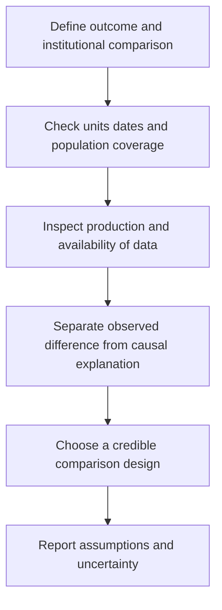

# Audit comparative data, dates, units and reading scope

## Record metadata

```json
{
  "schema_version": 3,
  "owner": "plan",
  "course_id": "2026_2027/Winter_Semester/Comparative_Economics",
  "transaction_id": "PLAN-20261018-CE-P003-LINKS",
  "plan_version": "P003",
  "source_version": "V002",
  "ingestion_revision": 2,
  "objective_id": "O009",
  "objective_revision": 1,
  "criterion_version": "O009-C1",
  "status": "ready",
  "lesson_content_contract": "self-contained-lessons-v1",
  "knowledge_components": [
    "growth_rate_units_and_series_breaks",
    "data_production_proxies_and_vintages",
    "reading_questions_and_coverage_limits"
  ],
  "prerequisite_ids": [
    "O002",
    "O008"
  ],
  "compatible_versions": [
    {
      "objective_revision": 1,
      "criterion_version": "O009-C1",
      "plan_version": "P002",
      "source_version": "V002",
      "ingestion_revision": 2,
      "reason": "P003 changes only two visible Wiki provenance anchor spellings by removing inline italic markup from the rendered heading target. Exact checked structured headings, complete academic content, questions/keys, quantities, criteria, routes, tools and clocks are unchanged. Current P002 evidence remains compatible; no reassessment or learner result is inferred.",
      "change_class": "formatting_only",
      "requires_reassessment": false
    }
  ],
  "note_locations": [
    {
      "path": "01_Notes/2026_2027/Winter_Semester/Comparative_Economics/Week_2/Comparability_Data_and_Reading_Questions.md",
      "heading": "Comparability, data reliability and reading questions"
    },
    {
      "path": "01_Notes/2026_2027/Winter_Semester/Comparative_Economics/Week_2/Comparability_Data_and_Reading_Questions.md",
      "heading": "Measurement can change what a comparison means"
    },
    {
      "path": "01_Notes/2026_2027/Winter_Semester/Comparative_Economics/Week_2/Comparability_Data_and_Reading_Questions.md",
      "heading": "Source chronology and the first summary"
    },
    {
      "path": "01_Notes/2026_2027/Winter_Semester/Comparative_Economics/Week_2/Comparability_Data_and_Reading_Questions.md",
      "heading": "Acemoglu–Robinson reading questions and answer routes"
    },
    {
      "path": "01_Notes/2026_2027/Winter_Semester/Comparative_Economics/Week_2/Comparability_Data_and_Reading_Questions.md",
      "heading": "Earlier lecture questions and the boundary of supplied readings"
    },
    {
      "path": "01_Notes/2026_2027/Winter_Semester/Comparative_Economics/Week_2/Comparability_Data_and_Reading_Questions.md",
      "heading": "What the source leads add to the map"
    }
  ],
  "acquisition_rule": {
    "distinct_independent_passes": 2,
    "required_item_roles": [
      "full_capability_check",
      "full_capability_check"
    ],
    "allowed_routes": [
      [
        "O009-I1",
        "O009-I2"
      ],
      [
        "O009-I1",
        "O009-D1"
      ],
      [
        "O009-I1",
        "O009-D2"
      ],
      [
        "O009-I2",
        "O009-D1"
      ],
      [
        "O009-I2",
        "O009-D2"
      ],
      [
        "O009-D1",
        "O009-D2"
      ]
    ]
  },
  "delayed_rule": {
    "minimum_elapsed_hours": 24,
    "fresh_item": true,
    "independent_required": true
  },
  "review_topic": "Audit comparative data, dates, units and reading scope",
  "review_instruction": "Begin a closed-note review with teach for O009; request an unused prepared delayed item before recap."
}
```

## Outcome and conditions

Audit growth graphs, definition breaks, proxies and dataset counts, and identify the dated assignments and actual checked-source boundaries. All essential components listed in metadata are required. Hypothetical assessment values instantiate the checked equations; they are not historical observations or observed outcomes. Independent checks are closed-note and without hints, solution access, external retrieval or other assistance; a basic arithmetic calculator is allowed. Teach establishes and records actual help/exposure conditions before claiming independence.

## Prerequisites and checks

- [O002 outcome and repair route](../lessons/O002.md#outcome-and-conditions): explicit criteria, units, dates and causal limits govern data comparisons.
- [O008 outcome and repair route](../lessons/O008.md#outcome-and-conditions): historical institutional narratives illustrate mechanisms without becoming isolated causal estimates.

O009-P1, item_version 1, prerequisite_diagnostic. **Prompt:** Why can differing dates/definitions undermine a country comparison, and why is a Gates–Slim contrast not a controlled causal estimate?

**Complete key and rubric:** O002 requires matched indicators/units/periods rather than causal ranking from a table; O008 supplies an institutional mechanism with historical cases, not isolated identification. Require both; repair their complete explanations. Pass requires every requested reason and result; partial for an omitted reason or unresolved isolated arithmetic slip; fail for the conflicting mechanism. This diagnostic never counts as acquisition. Current or explicitly compatible committed independent prerequisite evidence may permit skipping its check; familiarity alone cannot. Use the cited complete prerequisite lesson or the named included foundation, then the worked example, after a partial/failing entry check.

## Teaching order and rationale

1. Use the diagnostic once to establish the necessary conceptual or algebraic foundation.
2. Present the complete checked-note explanation below, preserving variables, dates, assumptions and source qualifications. Follow one reasoning chain at a time so every intermediate step is visible.
3. Work W1 fully, asking the learner to explain why each step follows.
4. Use S1 as completion practice: show the setup and first identity, hide the final algebra/numbers and interpretation. After an explanation of the missing steps, withdraw support.
5. Present unused I1/I2 full checks with hidden solutions; use correction/repair after scoring the original answer. An unused D form can replace an exposed I only through a listed route.
6. On a later eligible occasion, begin an unused D item before recap. A numeric variant establishes bounded same-method performance, not general transfer.

## Motivation, intuition, and definitions

Audit growth graphs, definition breaks, proxies and dataset counts, and identify the dated assignments and actual checked-source boundaries. Establish the definitions, assumptions and relevant comparisons before simplifying an equation. The complete reused passages establish every academic claim, notation choice and qualification assessed here; necessary prerequisites use the complete lessons above.

## Explanation steps

Origin: reused complete checked passage [[01_Notes/2026_2027/Winter_Semester/Comparative_Economics/Week_2/Comparability_Data_and_Reading_Questions.md#Comparability, data reliability and reading questions]]; fingerprint `edb8887ee683dab0eac786b8cbb319555883374c9c39b4b7b770e66a110e7055`. Heading depth and required relative figure-path relocation alone are adapted.

### Comparability, data reliability and reading questions

Source: [[00_Materials/2026_2027/Winter_Semester/Comparative_Economics/Week_2/Week II - lecture - large slides.pdf]]
Source: [[00_Materials/2026_2027/Winter_Semester/Comparative_Economics/Week_3/Week III - lecture - large slides.pdf]]

- [[#Measurement can change what a comparison means|Measurement can change what a comparison means]]
- [[#Source chronology and the first summary|Source chronology and the first summary]]
- [[#Acemoglu–Robinson reading questions and answer routes|Acemoglu–Robinson reading questions and answer routes]]
- [[#Earlier lecture questions and the boundary of supplied readings|Earlier lecture questions and the boundary of supplied readings]]
- [[#What the source leads add to the map|What the source leads add to the map]]


Comparative economics asks positive questions about how institutions and economic systems work. Meaningful comparisons need a defined outcome, credible units and a defensible counterfactual; a large difference alone does not establish its cause. Countries supply a limited and heterogeneous sample, and qualitative features such as informal institutions are difficult to compress into comparable numbers. [[00_Materials/2026_2027/Winter_Semester/Comparative_Economics/Week_2/Week II - lecture - large slides.pdf#page=6|Week II lecture, physical PDF pp. 6–7]]



The data checks are a necessary foundation for the synthetic-control case and institutional narratives. They do not imply that every official statistic is false or every alternative proxy is superior. [[00_Materials/2026_2027/Winter_Semester/Comparative_Economics/Week_2/Week II - lecture - large slides.pdf#page=6|Week II lecture, physical PDF pp. 6–15]]

#### Measurement can change what a comparison means

A series can change over time because the economy changes, because its definition changes, or because collection/reporting changes. Cross-country differences can likewise mix true differences with measurement conventions. Record the unit, price basis, coverage, reference date and missing observations before explaining a gap. Political pressure, censorship, self-censorship and incentives within statistical agencies can affect data production and availability. That motivates scrutiny of the specific measurement process, rather than a blanket rejection based on the country’s political label. [[00_Materials/2026_2027/Winter_Semester/Comparative_Economics/Week_2/Week II - lecture - large slides.pdf#page=6|Week II lecture, physical PDF pp. 6–10]]

The lecture reports Li Keqiang’s older skepticism about Chinese GDP and his interest in electricity, rail freight and loans as alternative activity indicators. Such indicators can triangulate an official series but each measures a particular part of the economy; a shift toward services can weaken a historical proxy relationship. Its Chen et al. (2019) graph places the **official provincial GDP growth rate** on the horizontal axis and the researchers’ **adjusted provincial GDP growth rate** on the vertical, both in **percent**, with a 45-degree equality line. Circle size separately represents the relative size of provincial GDP. Points below the line indicate adjusted **growth** below officially reported growth, not a direct estimate of the GDP-level gap. The chart is not a newly audited correction of current national GDP. [[00_Materials/2026_2027/Winter_Semester/Comparative_Economics/Week_2/Week II - lecture - large slides.pdf#page=8|Week II lecture, physical PDF pp. 8–9]]

![[01_Notes/2026_2027/Winter_Semester/Comparative_Economics/assets/Week_2_Provincial_GDP.png]]

The axes compare **growth rates in percent**; the vertical discrepancy at a given official growth rate is a difference in **percentage points**. Circle size represents relative provincial GDP level. Growth-rate differences and relative economic size are distinct information. [[00_Materials/2026_2027/Winter_Semester/Comparative_Economics/Week_2/Week II - lecture - large slides.pdf#page=9|Week II lecture, physical PDF pp. 9]]

The youth-unemployment chart reports a **21.3% June 2023** value for ages 16–24 and a later **18.8% August 2024** value for the series excluding students. Those figures straddle a definitional/publication break. Subtracting them and calling the result an improvement in one unchanged population would be invalid. The accompanying land-sales figure measures area in **billions of square feet**, over 2010–2020; it is not land-sale revenue, an asset price, or a current property-market indicator. [[00_Materials/2026_2027/Winter_Semester/Comparative_Economics/Week_2/Week II - lecture - large slides.pdf#page=10|Week II lecture, physical PDF pp. 10–12]]

![[01_Notes/2026_2027/Winter_Semester/Comparative_Economics/assets/Week_2_Youth_Unemployment.png]]

The annotation marks the reporting/definition discontinuity; retaining that context prevents a false before/after comparison. [[00_Materials/2026_2027/Winter_Semester/Comparative_Economics/Week_2/Week II - lecture - large slides.pdf#page=11|Week II lecture, physical PDF pp. 11]]

The lecture also points to North Korean nighttime lights as a proxy, and to removals or alterations of US government datasets. Its Freilich et al. (2025) example reports CDC datasets declining from **1,519 to 1,316 between January 21 and February 11, 2025**; the Guardian chart reports **nearly 400 deleted or altered datasets** in a distinct **August 18, 2026** report. These are separate source-attributed claims with different dates and coverage. Neither count measures all data quality, and a deleted webpage does not automatically mean underlying observations were destroyed. The articles are references cited on the lecture slide, not independently ingested full sources or a live inventory checked here. [[00_Materials/2026_2027/Winter_Semester/Comparative_Economics/Week_2/Week II - lecture - large slides.pdf#page=13|Week II lecture, physical PDF pp. 13–14]]

![[01_Notes/2026_2027/Winter_Semester/Comparative_Economics/assets/Week_2_Data_Availability.png]]

The source’s topic and agency counts describe its classified set of affected datasets. Agency totals and topic totals group the same reported events differently; they should not be added together as independent removals. [[00_Materials/2026_2027/Winter_Semester/Comparative_Economics/Week_2/Week II - lecture - large slides.pdf#page=14|Week II lecture, physical PDF pp. 14]]

#### Source chronology and the first summary

The Week II lecture’s next-session assignment is dated **October 16**. It asks students to discuss five questions on *The Narrow Corridor*, chapter 1, and six on *Paths of Economic and Political Development* (2006), without submitting written answers. The supplied assignment image repeats those reading prompts and points toward synthetic-control resources; it contains no learner responses or results. [[00_Materials/2026_2027/Winter_Semester/Comparative_Economics/Week_2/Week II - lecture - large slides.pdf#page=3|Week II lecture, physical PDF pp. 3]]

For the first “summary,” the lecture names **Roland chapter 7** and **Acemoglu–Robinson (2006)**. It states that the summary takes the final twenty minutes of the third seminar on October 16, with several multiple-choice questions and one or two open questions. That is the source’s dated course instruction, not an inferred expansion of examination scope to every additional reading. The existing Week 1 institution note supplies the checked Roland foundations. [[00_Materials/2026_2027/Winter_Semester/Comparative_Economics/Week_2/Week II - lecture - large slides.pdf#page=4|Week II lecture, physical PDF pp. 4]]

The Week III lecture’s next-session assignment is dated **October 23** and asks for oral discussion of Polanyi chapter 4 and Rosser–Rosser chapter 4 (or its named alternative title). The files are inside the selected Week 3 folder and are covered as supplied; the date does not authorize ingestion of a separate later folder. [[00_Materials/2026_2027/Winter_Semester/Comparative_Economics/Week_3/Week III - lecture - large slides.pdf#page=3|Week III lecture, physical PDF pp. 3]]

#### Acemoglu–Robinson reading questions and answer routes

The six supplied questions can be answered from [[01_Notes/2026_2027/Winter_Semester/Comparative_Economics/Week_2/Institutions_Power_and_Democratization.md|Institutions, power and democratization]]:

1. **Driving force:** economic institutions shape incentives and performance, while their political selection responds to distributional conflict and power. This is the authors’ explanation, not a one-variable causal estimate.
2. **Model:** political institutions supply de jure power; resources and organization supply de facto power; together they shape current economic rules and future political institutions; economic rules affect current outcomes and future resources.
3. **De facto power:** resources and the ability to solve collective-action problems, organize, protest or use force; wealth is one input rather than the definition itself.
4. **Credible commitment:** a future transfer or reform promise may be reneged on once the other side’s leverage fades. Durable political-rule changes can alter tomorrow’s incentives where a revocable policy promise cannot.
5. **Repression:** elites choose it when retaining their advantages is valuable and repression is sufficiently feasible/cheap relative to concessions; destruction, failure and empowerment of the military can make it unattractive.
6. **Britain:** growth and political reform interact through institutional protection, investment, industrial/urban change and the organization of excluded groups. Early parliamentary constraints were not yet universal democracy; the narrative is joint evolution rather than proof that income alone automatically causes democracy.

The detailed explanation and historical limits appear in the linked note, grounded in the complete supplied chapter. [[00_Materials/2026_2027/Winter_Semester/Comparative_Economics/Week_2/Acemoglu Robinson 2006 v2.pdf#page=1|Acemoglu–Robinson (2006), physical PDF pp. 1–19]] [[00_Materials/2026_2027/Winter_Semester/Comparative_Economics/Week_2/Week II - lecture - large slides.pdf#page=3|Week II lecture, physical PDF pp. 3, 44–50]]

The five *Narrow Corridor* prompts have their full answers in [[01_Notes/2026_2027/Winter_Semester/Comparative_Economics/Week_2/Liberty_Leviathans_and_Norms.md|Liberty, Leviathans and the cage of norms]]: Warre discourages commerce/investment through persistent threats; order is valuable but statelessness need not imply constant violence and state strength need not protect liberty; the three Leviathans differ in capacity and effective societal constraint; the cage enforces unequal customary roles; the Asante protection/dependency account shows a norm protecting against danger while binding a person to subordination. [[00_Materials/2026_2027/Winter_Semester/Comparative_Economics/Week_2/Acemoglu Robinson - The Narrow Corridor - chapter 1.pdf#page=7|The Narrow Corridor, chapter 1, physical PDF pp. 7–26]] [[00_Materials/2026_2027/Winter_Semester/Comparative_Economics/Week_2/Week II - lecture - large slides.pdf#page=3|Week II lecture, physical PDF pp. 3]]

#### Earlier lecture questions and the boundary of supplied readings

The Week II lecture repeats questions on *Why Nations Fail*, chapter 1. Its supplied slides answer the Nogales, encomienda, Jamestown, colonial divergence and institutional-definition prompts; the complete book chapter itself is a reference lead, not another supplied source in this pass. Nogales contrasts are dated examples. Spanish extraction used tribute/labour claims under encomienda; failed coercion in Jamestown led toward land and work incentives rather than successful adoption of the same Spanish regime. Institutions are the rules governing incentives and power, which can be inclusive or extractive, rather than a synonym for a building or organization. Existing Week 1 checked notes develop the colonial context. [[00_Materials/2026_2027/Winter_Semester/Comparative_Economics/Week_2/Week II - lecture - large slides.pdf#page=37|Week II lecture, physical PDF pp. 37–43]]

**Carlos Slim prompt—bounded clarification:** the institutional mechanism relevant to the question is control of a protected telecommunications incumbent. The [OECD’s 2012 *Review of Telecommunication Policy and Regulation in Mexico*](https://www.oecd.org/content/dam/oecd/en/publications/reports/2012/01/oecd-review-of-telecommunication-policy-and-regulation-in-mexico_g1g17f98/9789264060111-en.pdf), Table 1.3 and the following Telmex paragraph, printed pp. 21–22 (physical PDF pp. 23–24), describes Slim-family control of América Móvil, its Telmex stake, and the 1990 sale of controlling Telmex shares to a Grupo Carso-led consortium. Telmex received exclusive long-distance/international service rights until 1997 alongside expansion and regulatory obligations. Ownership and entry rules can therefore create concentrated income opportunities. This verifies that mechanism; it does not claim that those pages reconstruct Slim’s entire fortune or that all his earnings were explained by one event.

The full *Why Nations Fail* chapter’s finer biographical/legal narrative is not certified here. The publisher’s accessible excerpt was checked for the prompt but did not contain Slim’s discussion; no unsupported quotation or invented chapter answer is supplied. The separate 2006 chapter and lecture already support the general distinction between selective protection and broad institutional inclusion. [[00_Materials/2026_2027/Winter_Semester/Comparative_Economics/Week_2/Week II - lecture - large slides.pdf#page=37|Week II lecture, physical PDF pp. 37–43]]

#### What the source leads add to the map

The lecture bibliography includes Abadie, Korolev, other synthetic-control articles, an R-bloggers example and other empirical references. The two supplied full papers establish the method and Russia case; a link alone is not evidence that code was run or every cited article was read. Likewise, Week III’s later-book-chapter pointers, Murphy–O’Reilly empirical illustration, Irfan references, S&P/UK reports and two YouTube links have the bounded treatment stated in their relevant notes. No later-week material, unavailable book chapter, video content or unexecuted replication result is silently promoted into checked course coverage. [[00_Materials/2026_2027/Winter_Semester/Comparative_Economics/Week_2/Week II - lecture - large slides.pdf#page=19|Week II lecture, physical PDF pp. 19–20, 51]] [[00_Materials/2026_2027/Winter_Semester/Comparative_Economics/Week_3/Week III - lecture - large slides.pdf#page=8|Week III lecture, physical PDF pp. 8, 24–26, 43–47]]


## Worked example

O009-W1, item_version 1, worked_example. **Prompt:** A hypothetical provincial graph reports official GDP growth 8% and adjusted growth 6%, while circle area indicates relative GDP size. Compute the adjusted-minus-official growth discrepancy and distinguish its units from a GDP-level difference. A second graph reports youth unemployment of 21.3% in June 2023 and 18.8% in August 2024 after excluding students; may their difference measure improvement for one unchanged population? A land-sales observation is 2 billion square feet. Interpret the quantity, alternative electricity/rail/loan/night-light proxies and reporting incentives. Explain why CDC 1519→1316 and nearly 400 deleted/altered datasets are distinct reports, summarize the dated October 16/23 assignments/first-summary scope, and distinguish checked readings, lecture interpretations, bounded Slim verification and unexecuted bibliography leads.

**Complete solution and essential rubric:** The growth discrepancy is $6-8=-2$ percentage points. The axes contain growth rates in percent, not GDP levels; circle size contains separate relative-level information. The youth series crosses a population/definition and publication break, so subtracting the two rates cannot isolate improvement in one unchanged series. $2$ billion square feet is land area, not revenue, price or a current market reading. Activity proxies each cover a subset and can lose relevance with structural change; political/reporting incentives require specific scrutiny, not rejection of every official statistic. The CDC count difference is $1519-1316=203$ over January 21–February 11,2025; nearly 400 deleted/altered datasets is a distinct August 18,2026 source-attributed report, not an additional independent count to sum or proof all underlying observations were destroyed. October 16 oral questions concern Narrow Corridor chapter 1 and the 2006 institutional chapter; the first summary names Roland 7 plus the 2006 chapter in the final 20 seminar minutes, not every additional reading. October 23 oral questions concern Polanyi 4 and Rosser 4. Existing Week 1 foundations support the earlier prompts; the bounded OECD 2012 check supports protected Telmex control/entry, not an entire biography. Links to other papers/code/videos are leads, not proof of full ingestion or executed replication. Dates/units/outcome definitions, uncertainty and precise scope are essential, with no whole-exam inference. All requested calculations, derivations and qualifications are essential; the component map above applies to every full form.

## Practice with fading assistance

O009-S1, item_version 1, supported_completion. **Prompt:** A hypothetical provincial graph reports official GDP growth 7% and adjusted growth 5%, while circle area indicates relative GDP size. Compute the adjusted-minus-official growth discrepancy and distinguish its units from a GDP-level difference. A second graph reports youth unemployment of 21.3% in June 2023 and 18.8% in August 2024 after excluding students; may their difference measure improvement for one unchanged population? A land-sales observation is 3 billion square feet. Interpret the quantity, alternative electricity/rail/loan/night-light proxies and reporting incentives. Explain why CDC 1519→1316 and nearly 400 deleted/altered datasets are distinct reports, summarize the dated October 16/23 assignments/first-summary scope, and distinguish checked readings, lecture interpretations, bounded Slim verification and unexecuted bibliography leads.

**Complete solution and essential rubric:** The growth discrepancy is $5-7=-2$ percentage points. The axes contain growth rates in percent, not GDP levels; circle size contains separate relative-level information. The youth series crosses a population/definition and publication break, so subtracting the two rates cannot isolate improvement in one unchanged series. $3$ billion square feet is land area, not revenue, price or a current market reading. Activity proxies each cover a subset and can lose relevance with structural change; political/reporting incentives require specific scrutiny, not rejection of every official statistic. The CDC count difference is $1519-1316=203$ over January 21–February 11,2025; nearly 400 deleted/altered datasets is a distinct August 18,2026 source-attributed report, not an additional independent count to sum or proof all underlying observations were destroyed. October 16 oral questions concern Narrow Corridor chapter 1 and the 2006 institutional chapter; the first summary names Roland 7 plus the 2006 chapter in the final 20 seminar minutes, not every additional reading. October 23 oral questions concern Polanyi 4 and Rosser 4. Existing Week 1 foundations support the earlier prompts; the bounded OECD 2012 check supports protected Telmex control/entry, not an entire biography. Links to other papers/code/videos are leads, not proof of full ingestion or executed replication. Dates/units/outcome definitions, uncertainty and precise scope are essential, with no whole-exam inference. All requested calculations, derivations and qualifications are essential; the component map above applies to every full form.

Allowed support is the first stated identity only; hide the remaining key while the learner completes it. Supported performance is practice, not an independent result.

## Rubric and independence

Required components: growth_rate_units_and_series_breaks, data_production_proxies_and_vintages, reading_questions_and_coverage_limits. Each full prompt/key below elicits every component; all are necessary for a pass on every permitted pair. Accept algebraically equivalent expressions and clearly defined opposite cash-flow signs with correct interpretation. A pass requires all requested outputs/reasons, correct units/assumptions and no critical conceptual error. Partial means a missing component or an unresolved isolated arithmetic slip with an otherwise valid method; independent correction is required for a pass. Fail means a critical mechanism/condition is wrong. Unscorable means a response or its help/exposure conditions cannot be established. Unknown help conditions are never independent evidence.

Critical errors: Growth rates treated as GDP levels; incomparable unemployment populations subtracted causally; dataset reports summed; links treated as executed replication.

Acquisition requires two distinct unused unassisted full checks selected from the six exact metadata routes. Every I/D form covers all components; W1, S1, the prerequisite and C1 are forbidden substitutes. A D form used for acquisition cannot later be counted again as delayed success. No teach-generated item may replace a named full check; additional verified explanation/practice is allowed under the unchanged method and may not fabricate evidence. If fewer than two fresh forms remain for acquisition, return a plan_issue for an additional prepared bank.

| Component | I1 | I2 | D1 | D2 |
|---|---|---|---|---|
| growth_rate_units_and_series_breaks | required | required | required | required |
| data_production_proxies_and_vintages | required | required | required | required |
| reading_questions_and_coverage_limits | required | required | required | required |

## Misconceptions and correction

An observed omitted term/sign is tentative until the learner explains it; compare the reasoning with the critical errors above. Score the original response before providing help. Route a conceptual failure to the relevant included derivation and prerequisite, then use an unused full form.

O009-C1, item_version 1, narrow_correction. **Prompt:** May a political label alone establish that every official statistic is false? **Key/rubric:** No. Inspect the particular series, collection incentives, definitions and triangulating proxies; each alternative indicator also has limited coverage. Pass requires all keyed reasoning; partial for a missing part; fail for the conflicting mechanism. This repairs a common inference only; it cannot substitute for a full numerical/capability check.

Give at most two hints (first identify the date/unit, second point to the included identity); after ineffective hints show the relevant worked step. After two unsuccessful independent attempts stop repeated quizzing, revisit the explanation/prerequisite and preserve the unresolved status.

## Immediate and delayed checks

### O009-I1

O009-I1, item_version 1, full_capability_check. **Prompt:** A hypothetical provincial graph reports official GDP growth 10% and adjusted growth 7%, while circle area indicates relative GDP size. Compute the adjusted-minus-official growth discrepancy and distinguish its units from a GDP-level difference. A second graph reports youth unemployment of 21.3% in June 2023 and 18.8% in August 2024 after excluding students; may their difference measure improvement for one unchanged population? A land-sales observation is 4 billion square feet. Interpret the quantity, alternative electricity/rail/loan/night-light proxies and reporting incentives. Explain why CDC 1519→1316 and nearly 400 deleted/altered datasets are distinct reports, summarize the dated October 16/23 assignments/first-summary scope, and distinguish checked readings, lecture interpretations, bounded Slim verification and unexecuted bibliography leads.

**Complete solution and essential rubric:** The growth discrepancy is $7-10=-3$ percentage points. The axes contain growth rates in percent, not GDP levels; circle size contains separate relative-level information. The youth series crosses a population/definition and publication break, so subtracting the two rates cannot isolate improvement in one unchanged series. $4$ billion square feet is land area, not revenue, price or a current market reading. Activity proxies each cover a subset and can lose relevance with structural change; political/reporting incentives require specific scrutiny, not rejection of every official statistic. The CDC count difference is $1519-1316=203$ over January 21–February 11,2025; nearly 400 deleted/altered datasets is a distinct August 18,2026 source-attributed report, not an additional independent count to sum or proof all underlying observations were destroyed. October 16 oral questions concern Narrow Corridor chapter 1 and the 2006 institutional chapter; the first summary names Roland 7 plus the 2006 chapter in the final 20 seminar minutes, not every additional reading. October 23 oral questions concern Polanyi 4 and Rosser 4. Existing Week 1 foundations support the earlier prompts; the bounded OECD 2012 check supports protected Telmex control/entry, not an entire biography. Links to other papers/code/videos are leads, not proof of full ingestion or executed replication. Dates/units/outcome definitions, uncertainty and precise scope are essential, with no whole-exam inference. All requested calculations, derivations and qualifications are essential; the component map above applies to every full form.

I1/I2 are immediate checks; D1/D2 are distinct parallel variants reserved where possible for delayed checks. A delayed success requires an unused form before recap, no help/solution access, and at least 24 actual elapsed hours after acquisition and the most recent relevant teaching/solution exposure. Record intervening exposure. A calendar-date change alone is insufficient; an early D attempt is immediate evidence only.

### O009-I2

O009-I2, item_version 1, full_capability_check. **Prompt:** A hypothetical provincial graph reports official GDP growth 9% and adjusted growth 6%, while circle area indicates relative GDP size. Compute the adjusted-minus-official growth discrepancy and distinguish its units from a GDP-level difference. A second graph reports youth unemployment of 21.3% in June 2023 and 18.8% in August 2024 after excluding students; may their difference measure improvement for one unchanged population? A land-sales observation is 5 billion square feet. Interpret the quantity, alternative electricity/rail/loan/night-light proxies and reporting incentives. Explain why CDC 1519→1316 and nearly 400 deleted/altered datasets are distinct reports, summarize the dated October 16/23 assignments/first-summary scope, and distinguish checked readings, lecture interpretations, bounded Slim verification and unexecuted bibliography leads.

**Complete solution and essential rubric:** The growth discrepancy is $6-9=-3$ percentage points. The axes contain growth rates in percent, not GDP levels; circle size contains separate relative-level information. The youth series crosses a population/definition and publication break, so subtracting the two rates cannot isolate improvement in one unchanged series. $5$ billion square feet is land area, not revenue, price or a current market reading. Activity proxies each cover a subset and can lose relevance with structural change; political/reporting incentives require specific scrutiny, not rejection of every official statistic. The CDC count difference is $1519-1316=203$ over January 21–February 11,2025; nearly 400 deleted/altered datasets is a distinct August 18,2026 source-attributed report, not an additional independent count to sum or proof all underlying observations were destroyed. October 16 oral questions concern Narrow Corridor chapter 1 and the 2006 institutional chapter; the first summary names Roland 7 plus the 2006 chapter in the final 20 seminar minutes, not every additional reading. October 23 oral questions concern Polanyi 4 and Rosser 4. Existing Week 1 foundations support the earlier prompts; the bounded OECD 2012 check supports protected Telmex control/entry, not an entire biography. Links to other papers/code/videos are leads, not proof of full ingestion or executed replication. Dates/units/outcome definitions, uncertainty and precise scope are essential, with no whole-exam inference. All requested calculations, derivations and qualifications are essential; the component map above applies to every full form.

### O009-D1

O009-D1, item_version 1, full_capability_check. **Prompt:** A hypothetical provincial graph reports official GDP growth 6% and adjusted growth 5%, while circle area indicates relative GDP size. Compute the adjusted-minus-official growth discrepancy and distinguish its units from a GDP-level difference. A second graph reports youth unemployment of 21.3% in June 2023 and 18.8% in August 2024 after excluding students; may their difference measure improvement for one unchanged population? A land-sales observation is 1 billion square feet. Interpret the quantity, alternative electricity/rail/loan/night-light proxies and reporting incentives. Explain why CDC 1519→1316 and nearly 400 deleted/altered datasets are distinct reports, summarize the dated October 16/23 assignments/first-summary scope, and distinguish checked readings, lecture interpretations, bounded Slim verification and unexecuted bibliography leads.

**Complete solution and essential rubric:** The growth discrepancy is $5-6=-1$ percentage points. The axes contain growth rates in percent, not GDP levels; circle size contains separate relative-level information. The youth series crosses a population/definition and publication break, so subtracting the two rates cannot isolate improvement in one unchanged series. $1$ billion square feet is land area, not revenue, price or a current market reading. Activity proxies each cover a subset and can lose relevance with structural change; political/reporting incentives require specific scrutiny, not rejection of every official statistic. The CDC count difference is $1519-1316=203$ over January 21–February 11,2025; nearly 400 deleted/altered datasets is a distinct August 18,2026 source-attributed report, not an additional independent count to sum or proof all underlying observations were destroyed. October 16 oral questions concern Narrow Corridor chapter 1 and the 2006 institutional chapter; the first summary names Roland 7 plus the 2006 chapter in the final 20 seminar minutes, not every additional reading. October 23 oral questions concern Polanyi 4 and Rosser 4. Existing Week 1 foundations support the earlier prompts; the bounded OECD 2012 check supports protected Telmex control/entry, not an entire biography. Links to other papers/code/videos are leads, not proof of full ingestion or executed replication. Dates/units/outcome definitions, uncertainty and precise scope are essential, with no whole-exam inference. All requested calculations, derivations and qualifications are essential; the component map above applies to every full form.

### O009-D2

O009-D2, item_version 1, full_capability_check. **Prompt:** A hypothetical provincial graph reports official GDP growth 12% and adjusted growth 8%, while circle area indicates relative GDP size. Compute the adjusted-minus-official growth discrepancy and distinguish its units from a GDP-level difference. A second graph reports youth unemployment of 21.3% in June 2023 and 18.8% in August 2024 after excluding students; may their difference measure improvement for one unchanged population? A land-sales observation is 6 billion square feet. Interpret the quantity, alternative electricity/rail/loan/night-light proxies and reporting incentives. Explain why CDC 1519→1316 and nearly 400 deleted/altered datasets are distinct reports, summarize the dated October 16/23 assignments/first-summary scope, and distinguish checked readings, lecture interpretations, bounded Slim verification and unexecuted bibliography leads.

**Complete solution and essential rubric:** The growth discrepancy is $8-12=-4$ percentage points. The axes contain growth rates in percent, not GDP levels; circle size contains separate relative-level information. The youth series crosses a population/definition and publication break, so subtracting the two rates cannot isolate improvement in one unchanged series. $6$ billion square feet is land area, not revenue, price or a current market reading. Activity proxies each cover a subset and can lose relevance with structural change; political/reporting incentives require specific scrutiny, not rejection of every official statistic. The CDC count difference is $1519-1316=203$ over January 21–February 11,2025; nearly 400 deleted/altered datasets is a distinct August 18,2026 source-attributed report, not an additional independent count to sum or proof all underlying observations were destroyed. October 16 oral questions concern Narrow Corridor chapter 1 and the 2006 institutional chapter; the first summary names Roland 7 plus the 2006 chapter in the final 20 seminar minutes, not every additional reading. October 23 oral questions concern Polanyi 4 and Rosser 4. Existing Week 1 foundations support the earlier prompts; the bounded OECD 2012 check supports protected Telmex control/entry, not an entire biography. Links to other papers/code/videos are leads, not proof of full ingestion or executed replication. Dates/units/outcome definitions, uncertainty and precise scope are essential, with no whole-exam inference. All requested calculations, derivations and qualifications are essential; the component map above applies to every full form.

## Advance, revisit, pause, and escalate

Advance only after teach commits two qualifying independent full passes under a listed route. Keep acquisition and each later delayed observation separate. A source conflict blocks the affected claim and returns to ingest with the exact note heading. Missing criteria, a new method, unsupported alternative or exhausted fresh bank returns to plan with 2026_2027/Winter_Semester/Comparative_Economics, O009, revision1/O009-C1, P003/V002/ingestion2 and item ID. Equivalent valid methods meeting the frozen criterion may receive credit after verification; no criterion is changed to fit an answer. Closing a session preserves the actual stopping point without claiming completion.

## Content provenance and generation boundaries

Explanations, figures and qualifications above reuse complete checked-note sections with exact origin/fingerprint; heading depth alone is adapted. Main exercises and worked arithmetic are plan-created hypothetical instantiations of those displayed identities. No additional academic claims or external course scope are introduced. Preserve the note conventions and explicit qualifications; checked references reused from notes are not an independent raw-source audit by plan. New numerical practice can use the same method only after its complete solution and unchanged components are checked before display; it cannot replace this lesson’s named evidence forms. Prerequisites route to the complete prepared lessons above.

## Answer-free recall handoff

Topic: Audit comparative data, dates, units and reading scope. Begin a closed-note review with teach for O009; request an unused prepared delayed item before recap. Exact lesson: [[03_Agents/2026_2027/Winter_Semester/Comparative_Economics/lessons/O009.md#Immediate and delayed checks]]. Teach supplies actual committed evidence and timestamps; recall alone dates reviews. No learner outcome or due date is created by this curriculum.
