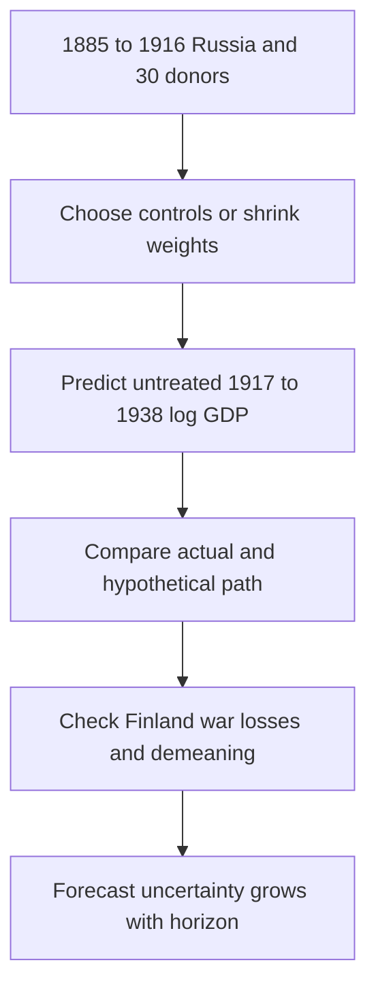

# Evaluate Russia’s predictive counterfactual without causal overclaim

## Record metadata

```json
{
  "schema_version": 3,
  "owner": "plan",
  "course_id": "2026_2027/Winter_Semester/Comparative_Economics",
  "transaction_id": "PLAN-20261018-CE-P003-LINKS",
  "plan_version": "P003",
  "source_version": "V002",
  "ingestion_revision": 2,
  "objective_id": "O012",
  "objective_revision": 1,
  "criterion_version": "O012-C1",
  "status": "ready",
  "lesson_content_contract": "self-contained-lessons-v1",
  "knowledge_components": [
    "demeaned_log_gap_and_trend_amplification",
    "historical_donor_war_and_sample_comparability",
    "diagnostics_structural_targets_and_welfare_limits"
  ],
  "prerequisite_ids": [
    "O010",
    "O011"
  ],
  "compatible_versions": [
    {
      "objective_revision": 1,
      "criterion_version": "O012-C1",
      "plan_version": "P002",
      "source_version": "V002",
      "ingestion_revision": 2,
      "reason": "P003 changes only two visible Wiki provenance anchor spellings by removing inline italic markup from the rendered heading target. Exact checked structured headings, complete academic content, questions/keys, quantities, criteria, routes, tools and clocks are unchanged. Current P002 evidence remains compatible; no reassessment or learner result is inferred.",
      "change_class": "formatting_only",
      "requires_reassessment": false
    }
  ],
  "note_locations": [
    {
      "path": "01_Notes/2026_2027/Winter_Semester/Comparative_Economics/Week_2/Russia_Without_Revolution_Counterfactuals.md",
      "heading": "Russia without the Revolution: predictive counterfactuals"
    },
    {
      "path": "01_Notes/2026_2027/Winter_Semester/Comparative_Economics/Week_2/Russia_Without_Revolution_Counterfactuals.md",
      "heading": "Historical setting and policy sequence"
    },
    {
      "path": "01_Notes/2026_2027/Winter_Semester/Comparative_Economics/Week_2/Russia_Without_Revolution_Counterfactuals.md",
      "heading": "Data and the prediction target"
    },
    {
      "path": "01_Notes/2026_2027/Winter_Semester/Comparative_Economics/Week_2/Russia_Without_Revolution_Counterfactuals.md",
      "heading": "Competing estimators and regularization"
    },
    {
      "path": "01_Notes/2026_2027/Winter_Semester/Comparative_Economics/Week_2/Russia_Without_Revolution_Counterfactuals.md",
      "heading": "Main scenarios and donor weights"
    },
    {
      "path": "01_Notes/2026_2027/Winter_Semester/Comparative_Economics/Week_2/Russia_Without_Revolution_Counterfactuals.md",
      "heading": "War, population and comparability"
    },
    {
      "path": "01_Notes/2026_2027/Winter_Semester/Comparative_Economics/Week_2/Russia_Without_Revolution_Counterfactuals.md",
      "heading": "Diagnostics and forecast uncertainty"
    },
    {
      "path": "01_Notes/2026_2027/Winter_Semester/Comparative_Economics/Week_2/Russia_Without_Revolution_Counterfactuals.md",
      "heading": "Why close fit can forecast badly"
    },
    {
      "path": "01_Notes/2026_2027/Winter_Semester/Comparative_Economics/Week_2/Russia_Without_Revolution_Counterfactuals.md",
      "heading": "Structural simulations and the stability assumption"
    },
    {
      "path": "01_Notes/2026_2027/Winter_Semester/Comparative_Economics/Week_2/Russia_Without_Revolution_Counterfactuals.md",
      "heading": "Logs, levels, growth and welfare limits"
    }
  ],
  "acquisition_rule": {
    "distinct_independent_passes": 2,
    "required_item_roles": [
      "full_capability_check",
      "full_capability_check"
    ],
    "allowed_routes": [
      [
        "O012-I1",
        "O012-I2"
      ],
      [
        "O012-I1",
        "O012-D1"
      ],
      [
        "O012-I1",
        "O012-D2"
      ],
      [
        "O012-I2",
        "O012-D1"
      ],
      [
        "O012-I2",
        "O012-D2"
      ],
      [
        "O012-D1",
        "O012-D2"
      ]
    ]
  },
  "delayed_rule": {
    "minimum_elapsed_hours": 24,
    "fresh_item": true,
    "independent_required": true
  },
  "review_topic": "Evaluate Russia’s predictive counterfactual without causal overclaim",
  "review_instruction": "Begin a closed-note review with teach for O012; request an unused prepared delayed item before recap."
}
```

## Outcome and conditions

Compute a demeaned log forecast and interpret finite-sample method comparisons, historical donor concerns, uncertainty and policy/welfare limits. All essential components listed in metadata are required. Hypothetical assessment values instantiate the checked equations; they are not historical observations or observed outcomes. Independent checks are closed-note and without hints, solution access, external retrieval or other assistance; a basic arithmetic calculator is allowed. Teach establishes and records actual help/exposure conditions before claiming independence.

## Prerequisites and checks

- [O010 outcome and repair route](../lessons/O010.md#outcome-and-conditions): convex versus shifted/unrestricted predictions and their stability assumptions are necessary for the Russia forecasts.
- [O011 outcome and repair route](../lessons/O011.md#outcome-and-conditions): placebos, validation and scenario sensitivity must be distinguished from formal inference.

O012-P1, item_version 1, prerequisite_diagnostic. **Prompt:** What is the missing untreated outcome, and can donor placebos automatically make a historical intervention randomized?

**Complete key and rubric:** O010 defines the missing potential outcome; O011 requires an explicit reference benchmark and distinguishes diagnostics from random assignment/formal inference. Require both; repair those lessons. Pass requires every requested reason and result; partial for an omitted reason or unresolved isolated arithmetic slip; fail for the conflicting mechanism. This diagnostic never counts as acquisition. Current or explicitly compatible committed independent prerequisite evidence may permit skipping its check; familiarity alone cannot. Use the cited complete prerequisite lesson or the named included foundation, then the worked example, after a partial/failing entry check.

## Teaching order and rationale

1. Use the diagnostic once to establish the necessary conceptual or algebraic foundation.
2. Present the complete checked-note explanation below, preserving variables, dates, assumptions and source qualifications. Follow one reasoning chain at a time so every intermediate step is visible.
3. Work W1 fully, asking the learner to explain why each step follows.
4. Use S1 as completion practice: show the setup and first identity, hide the final algebra/numbers and interpretation. After an explanation of the missing steps, withdraw support.
5. Present unused I1/I2 full checks with hidden solutions; use correction/repair after scoring the original answer. An unused D form can replace an exposed I only through a listed route.
6. On a later eligible occasion, begin an unused D item before recap. A numeric variant establishes bounded same-method performance, not general transfer.

## Motivation, intuition, and definitions

Compute a demeaned log forecast and interpret finite-sample method comparisons, historical donor concerns, uncertainty and policy/welfare limits. Establish the definitions, assumptions and relevant comparisons before simplifying an equation. The complete reused passages establish every academic claim, notation choice and qualification assessed here; necessary prerequisites use the complete lessons above.

## Explanation steps

Origin: reused complete checked passage [[01_Notes/2026_2027/Winter_Semester/Comparative_Economics/Week_2/Russia_Without_Revolution_Counterfactuals.md#Russia without the Revolution: predictive counterfactuals]]; fingerprint `fdca1e98732bf62614e87748ccaae494b4e87b9e06154c38b9eac5e257e63f40`. Heading depth and required relative figure-path relocation alone are adapted.

### Russia without the Revolution: predictive counterfactuals

Source: [[00_Materials/2026_2027/Winter_Semester/Comparative_Economics/Week_2/How Russia might have evolved without the revolution annaeconstat2009.144.0075.pdf]]
Source: [[00_Materials/2026_2027/Winter_Semester/Comparative_Economics/Week_2/Week II - lecture - large slides.pdf]]

- [[#Historical setting and policy sequence|Historical setting and policy sequence]]
- [[#Data and the prediction target|Data and the prediction target]]
- [[#Competing estimators and regularization|Competing estimators and regularization]]
- [[#Main scenarios and donor weights|Main scenarios and donor weights]]
- [[#War, population and comparability|War, population and comparability]]
- [[#Diagnostics and forecast uncertainty|Diagnostics and forecast uncertainty]]
- [[#Why close fit can forecast badly|Why close fit can forecast badly]]
- [[#Structural simulations and the stability assumption|Structural simulations and the stability assumption]]
- [[#Logs, levels, growth and welfare limits|Logs, levels, growth and welfare limits]]


This case applies synthetic-control reasoning; the design and inference foundations are explained in [[01_Notes/2026_2027/Winter_Semester/Comparative_Economics/Week_2/Synthetic_Control_Design_and_Inference.md|Synthetic control: design, fit and inference]].



Korolev asks how Russia’s GDP per capita might have evolved without the 1917 Revolution. This is a predictive exercise: estimate pre-1917 relationships between Russia and other countries, then extend those relationships after 1917. It does not determine whether the Revolution could have been avoided, and it cannot isolate the Revolution from the Civil War, World War I, country-specific shocks, or Soviet policies (abstract and §§1, 4.4–5, printed pp. 75–76, 99–103; physical PDF pp. 2–3, 26–30) [[00_Materials/2026_2027/Winter_Semester/Comparative_Economics/Week_2/How Russia might have evolved without the revolution annaeconstat2009.144.0075.pdf#page=2|Korolev (2021), physical PDF pp. 2]].

#### Historical setting and policy sequence

Korolev describes late-imperial Russia as predominantly agrarian and poorer than most European countries, with an expanding industrial and rail sector. His cited 1913 estimates put roughly three-quarters of workers in agriculture and more than half of GDP there. It was largely a market economy with a substantial state role. The 1905 Revolution prompted constitutional changes without ending the monarchy; Stolypin’s agrarian reforms began in 1906, and World War I interrupted the reform path. The paper distinguishes the February–March and October–November 1917 changes while acknowledging alternative historical periodizations. [[00_Materials/2026_2027/Winter_Semester/Comparative_Economics/Week_2/How Russia might have evolved without the revolution annaeconstat2009.144.0075.pdf#page=4|Physical PDF pp. 4]]

Civil War dating is not uniform in the cited histories. The Bolsheviks’ **War Communism** from 1918 involved nationalization, rationing, compulsory grain acquisition and market restrictions amid war and crises. The **1921 New Economic Policy (NEP)** restored substantial market elements, including peasants’ ability to sell output, while large industry remained state-owned. From **1928**, centralized industrialization emphasized capital goods alongside agricultural collectivization. The paper associates this period with famine and repression and later emphasizes that GDP comparisons omit those human costs. These are its historical account and cited estimates, not a claim that the counterfactual separately identifies each policy’s effect. [[00_Materials/2026_2027/Winter_Semester/Comparative_Economics/Week_2/How Russia might have evolved without the revolution annaeconstat2009.144.0075.pdf#page=4|Physical PDF pp. 4–5]]

#### Data and the prediction target

The panel uses the 2020 Maddison Project update and Russia’s GDP series completed by Markevich and Harrison. It covers 31 countries with complete GDP per capita series from 1885 to 1938. Russia is treated; there are 30 potential donors. The outcome is usually log GDP per capita. The pre-period is 1885–1916, $T_0=32$; treatment starts in 1917 and the outcome window runs through 1938, 22 post-period years. The author notes territorial and population changes and possible data-quality concerns, while relying on the source series’ adjustments for consistent Russian/Soviet GDP per capita (§3, printed pp. 79; Table A1, printed p. 108 / physical PDF p. 35) [[00_Materials/2026_2027/Winter_Semester/Comparative_Economics/Week_2/How Russia might have evolved without the revolution annaeconstat2009.144.0075.pdf#page=6|Korolev (2021), physical PDF pp. 6]].

#### Competing estimators and regularization

All candidate methods forecast the untreated Russian outcome from donor outcomes:

$$\widehat y^0_{1t}=\widehat\alpha+Y_{-1,t}^{\top}\widehat\beta.$$

The key finite-sample challenge is 30 possible controls for only 32 pre-treatment observations. Unrestricted regression can overfit and yield unstable forecasts. The article compares three approaches. HCW selects a subset of donor countries and estimates OLS; best-subset selection compares the best model at each size using BIC or AICc. Lasso minimizes pre-period squared error plus $\lambda\sum_j|\beta_j|$, shrinking some coefficients to zero; post-lasso refits OLS on selected controls. The author tries leave-one-out and blocked 4-fold/8-fold cross-validation. Canonical synthetic control minimizes pre-period squared outcome gaps subject to nonnegative weights summing to one. The demeaned version matches deviations from each country’s pre-period mean and reconstructs the forecast by adding Russia’s mean, allowing a parallel level shift. Equations (3.1)–(3.2) and these estimators are in §3, printed pp. 79–82 / physical PDF pp. 6–9. [[00_Materials/2026_2027/Winter_Semester/Comparative_Economics/Week_2/How Russia might have evolved without the revolution annaeconstat2009.144.0075.pdf#page=6|Physical PDF pp. 6–9]]

#### Main scenarios and donor weights

The paper prefers synthetic control, especially the demeaned version, because its placebo exercises generally forecast better in this finite sample. Its Figure 2 shows the two synthetic specifications predicting a World War I-era decline, recovery and growth in the 1920s, a recession around the beginning of the 1930s, and eventual recovery. The counterfactual is above actual Soviet Russia in the 1920s and early 1930s; actual GDP per capita overtakes some counterfactuals in the second half of the 1930s (Figure 2, printed pp. 83) [[00_Materials/2026_2027/Winter_Semester/Comparative_Economics/Week_2/How Russia might have evolved without the revolution annaeconstat2009.144.0075.pdf#page=10|Korolev (2021), physical PDF pp. 10]]. This is a comparison of scenario paths, not a structurally identified treatment effect.

The donor weights reveal substantive concerns. In baseline synthetic control, Finland receives 0.332; India 0.206; Sri Lanka 0.289; Argentina 0.052; Peru 0.115; Norway 0.001; and Sweden 0.003. In the demeaned version the principal weights are Sri Lanka 0.410, Denmark 0.249, Finland 0.316, with smaller weights for Canada, Portugal, and Switzerland (Table II, printed pp. 85) [[00_Materials/2026_2027/Winter_Semester/Comparative_Economics/Week_2/How Russia might have evolved without the revolution annaeconstat2009.144.0075.pdf#page=12|Korolev (2021), physical PDF pp. 12]]. Finland was part of the Russian Empire before the Revolution, so its status as a donor is questionable, although it did not become communist. Dropping Finland changes donor composition but leaves the counterfactual path broadly similar. Non-European donors are also a concern because closer Eastern European countries are missing from the complete panel.

#### War, population and comparability

World War I comparability is another issue. Russia’s listed military losses are 1.7 million, or 1.09% of its 1913 population. The baseline synthetic units’ implied losses are much smaller: depending on specification and calculation, 0.03–0.30% (Table I, printed pp. 84) [[00_Materials/2026_2027/Winter_Semester/Comparative_Economics/Week_2/How Russia might have evolved without the revolution annaeconstat2009.144.0075.pdf#page=11|Korolev (2021), physical PDF pp. 11]]. Restricting donors to countries with at least 0.5% population losses leaves Austria, Finland, France, Germany, Italy, UK, Australia, New Zealand, and Canada. The ordinary synthetic control then cannot match pre-1917 Russia because all restricted donors are richer; the demeaned version fits better. The author interprets baseline results with the risk that World War I damage is understated in the counterfactual. Table I also shows a scaling assumption: the baseline synthetic control’s implied population (65.9 million) is far below Russia’s (156.2 million), so the comparison assumes economies are scalable and population size or density does not change growth (Table I, printed pp. 84–86) [[00_Materials/2026_2027/Winter_Semester/Comparative_Economics/Week_2/How Russia might have evolved without the revolution annaeconstat2009.144.0075.pdf#page=11|Korolev (2021), physical PDF pp. 11]].

#### Diagnostics and forecast uncertainty

Robustness checks find similar synthetic paths through much of the 1920s and early 1930s when Finland is dropped or a demeaned model is used. The restricted-donor standard model fails pre-fit; its demeaned form works better. The 1930s paths diverge more across specifications. Leave-one-out estimates appear fairly robust to removing donor countries one at a time (Figures 4–6, printed pp. 86–88) [[00_Materials/2026_2027/Winter_Semester/Comparative_Economics/Week_2/How Russia might have evolved without the revolution annaeconstat2009.144.0075.pdf#page=13|Korolev (2021), physical PDF pp. 13]]. Russia backdating to 1905, 1909, and 1913 tests match-period sensitivity. 1905 is a poor placebo because Russia had a revolution and reforms then; the mismatch may reflect that event, and the author cautions against causal interpretation. At 1909 and 1913, some methods fail to reproduce the pre-1917 path or World War I downturn; the demeaned all-donor synthetic control performs more plausibly (Backdating discussion and Figures 7–9, printed pp. 88–91 / physical PDF pp. 15–18) [[00_Materials/2026_2027/Winter_Semester/Comparative_Economics/Week_2/How Russia might have evolved without the revolution annaeconstat2009.144.0075.pdf#page=15|Korolev (2021), physical PDF pp. 15]].

The author does not conduct formal inference. Instead, he compares placebo gaps for each donor country treated as if it had experienced a 1917 intervention. Russia’s actual-minus-counterfactual log gap is negative and near the bottom of placebo gaps through much of the 1920s, consistent with higher predicted GDP absent the Revolution. In the 1930s it approaches zero and turns positive in some specifications, but lies near the middle of a dispersed placebo distribution. The placebo spread increases with the forecast horizon. Table III ranks Russia backdating MSEs (×1,000): demeaned synthetic control is best for 1909 and 1913; demeaned restricted-donor synthetic is best for 1905. Table V’s other-country placebo MSEs (×1,000) are 43.943 for canonical synthetic control and 43.697 for demeaned synthetic control, compared with 65.015 for a linear trend and much larger HCW errors. Placebo-based cross-validation performs better on those same placebo MSEs, but the paper cautions that it directly optimizes that metric (Figures 3 and 7–9; Tables III–V, printed pp. 84, 89–93 / physical PDF pp. 11, 16–20) [[00_Materials/2026_2027/Winter_Semester/Comparative_Economics/Week_2/How Russia might have evolved without the revolution annaeconstat2009.144.0075.pdf#page=10|Korolev (2021), physical PDF pp. 10]].

#### Why close fit can forecast badly

HCW and lasso fit pre-1917 Russia very closely but often forecast implausibly volatile paths. HCW coefficient totals in the all-donor specifications are about 2.099 or 2.998, which implies two to three times the common growth if donors all grow at the same rate (Table VI, printed pp. 96) [[00_Materials/2026_2027/Winter_Semester/Comparative_Economics/Week_2/How Russia might have evolved without the revolution annaeconstat2009.144.0075.pdf#page=23|Korolev (2021), physical PDF pp. 23]]. Lasso/post-lasso totals range from about 1.25 to 2.36 in Table VII (printed pp. 101) [[00_Materials/2026_2027/Winter_Semester/Comparative_Economics/Week_2/How Russia might have evolved without the revolution annaeconstat2009.144.0075.pdf#page=28|Korolev (2021), physical PDF pp. 28]]. With restricted World War I donors, these totals move closer to one and forecasts become more moderate (Table VIII, printed pp. 102) [[00_Materials/2026_2027/Winter_Semester/Comparative_Economics/Week_2/How Russia might have evolved without the revolution annaeconstat2009.144.0075.pdf#page=29|Korolev (2021), physical PDF pp. 29]]. The article’s explanation is finite-sample bias–variance tradeoff: many regressors relative to 32 pre-observations make HCW and weakly regularized lasso vulnerable to overfit. Leave-one-out CV can under-regularize dependent time-series data; blocked folds do not consistently solve it here. These comparisons support this case’s method ranking, not a universal claim that synthetic control always wins (§§1, 4.2–4.4, printed pp. 76, 90–102 / physical PDF pp. 3, 17–29) [[00_Materials/2026_2027/Winter_Semester/Comparative_Economics/Week_2/How Russia might have evolved without the revolution annaeconstat2009.144.0075.pdf#page=3|Korolev (2021), physical PDF pp. 3]].

#### Structural simulations and the stability assumption

Korolev contrasts his predictive relationship with earlier **structural simulations**, in which a model specifies how sectors, capital accumulation and policy distortions generate output. In his account, Hunter–Szyrmer’s KAPROST model considers detailed or aggregate production and alternative 1928–1940 policies; they conclude that less demanding policies, including avoiding collectivization, could have done better. Allen’s three-sector model assumes excess agricultural labour, and instead finds capitalist or continued-NEP counterfactuals below actual Soviet output. Those differences depend on the specified technologies, labour constraints and policies; their models are summarized in this supplied paper, not independently audited here. [[00_Materials/2026_2027/Winter_Semester/Comparative_Economics/Week_2/How Russia might have evolved without the revolution annaeconstat2009.144.0075.pdf#page=26|Physical PDF pp. 26–28]]

Cheremukhin and coauthors use a two-sector growth model with productivity paths and wedges representing distortions. Continuing pre-1913 productivity trends with fixed distortions gives a counterfactual below actual 1939 Soviet output; removing labour/capital wedges while holding other components at 1913 levels yields a much better counterfactual. Korolev’s preferred paths are nearer the former comparison in the late 1930s but remain uncertain across specifications. His reduced-form donor relationship covers 1917 onward and cannot decide which individual industrialization or agricultural policy was optimal. A fitted forecast and a structural policy simulation answer different questions under different maintained assumptions. [[00_Materials/2026_2027/Winter_Semester/Comparative_Economics/Week_2/How Russia might have evolved without the revolution annaeconstat2009.144.0075.pdf#page=28|Physical PDF pp. 28–29]]

Stability is a specific historical concern: the paper reports that Russian capital-goods industries were largely foreign-owned and that Russia depended heavily on grain exports and international trade. World War I disrupted world trade and finance; that exposure could have harmed Russia differently from the selected donors even without a Revolution. Missing comparable Eastern European data limits how well the donor pool can address this. Thus “the pre-1917 predictive relation would persist” is a substantive assumption threatened by a known structural break, not a consequence of small pre-period residuals. [[00_Materials/2026_2027/Winter_Semester/Comparative_Economics/Week_2/How Russia might have evolved without the revolution annaeconstat2009.144.0075.pdf#page=29|Physical PDF pp. 29]]

#### Logs, levels, growth and welfare limits

The appendix compares logs, levels, and growth rates. The author chooses logs because they substantially improve pre-period log-series fit relative to modeling first differences, while only slightly reducing fit for growth rates. Reconstructing log levels from fitted growth rates compounds past forecast errors, behaving like a random walk. Modeling GDP in levels gives qualitatively similar synthetic-control results, though some demeaned variants look optimistic and placebo fit is worse (Appendix A, printed pp. 103–110; Figures A2–A5; Tables A2–A5) [[00_Materials/2026_2027/Winter_Semester/Comparative_Economics/Week_2/How Russia might have evolved without the revolution annaeconstat2009.144.0075.pdf#page=30|Korolev (2021), physical PDF pp. 30]]. The article’s conclusion is carefully qualified: the counterfactual suggests a shorter downturn and stronger 1920s growth without the Revolution, while 1930s outcomes are specification-sensitive and increasingly uncertain. The paper cannot distinguish effects of the Revolution, Civil War, World War I, and other Russia-specific forces; nor can it evaluate individual policies or welfare costs. Its results are predictive, and economic outcomes omit deaths from famine and repression (printed pp. 99–103) [[00_Materials/2026_2027/Winter_Semester/Comparative_Economics/Week_2/How Russia might have evolved without the revolution annaeconstat2009.144.0075.pdf#page=26|Korolev (2021), physical PDF pp. 26]].


The demeaned estimator makes the level shift explicit. Let $\bar y_j=T_0^{-1}\sum_{t=1}^{T_0}y_{jt}$ and $\widetilde y_{jt}=y_{jt}-\bar y_j$. Fit nonnegative weights summing to one using the demeaned pre-period observations, then forecast

$$\widehat y^0_{1t}=\bar y_1+\sum_{j=2}^{J+1}\widehat\beta_j\,(y_{jt}-\bar y_j).$$

The estimated intercept is therefore $\bar y_1-\sum_j\widehat\beta_j\bar y_j$. Ordinary convex weights cannot predict below every donor’s outcome level; demeaning can match **changes** while shifting the level. That is useful only if the shifted donor relation is credible after treatment. [[00_Materials/2026_2027/Winter_Semester/Comparative_Economics/Week_2/How Russia might have evolved without the revolution annaeconstat2009.144.0075.pdf#page=9|Korolev (2021), physical PDF pp. 9]]

![[01_Notes/2026_2027/Winter_Semester/Comparative_Economics/assets/Week_2_Russia_Main_Scenarios.png]]

Figure 2 compares actual and counterfactual **log** GDP per capita, standard (left) and demeaned (right) synthetic control. These vertical differences are log gaps, not raw-dollar GDP or directly measured welfare. [[00_Materials/2026_2027/Winter_Semester/Comparative_Economics/Week_2/How Russia might have evolved without the revolution annaeconstat2009.144.0075.pdf#page=10|Korolev (2021), physical PDF pp. 10]]


![[01_Notes/2026_2027/Winter_Semester/Comparative_Economics/assets/Week_2_Russia_Placebos_War_Balance.png]]

Figure 3 places Russia’s actual-minus-counterfactual log gap among donor placebo gaps; Table I records population and war-loss comparability. The author explicitly declines formal inference, and the placebo spread grows over the horizon. [[00_Materials/2026_2027/Winter_Semester/Comparative_Economics/Week_2/How Russia might have evolved without the revolution annaeconstat2009.144.0075.pdf#page=11|Korolev (2021), physical PDF pp. 11]]


![[01_Notes/2026_2027/Winter_Semester/Comparative_Economics/assets/Week_2_Russia_Donor_Weights.png]]

Table II preserves standard/demeaned, no-Finland and WWI-restricted weights. Changing specification can change the contributing countries; none is simply a randomly chosen untreated twin. [[00_Materials/2026_2027/Winter_Semester/Comparative_Economics/Week_2/How Russia might have evolved without the revolution annaeconstat2009.144.0075.pdf#page=12|Korolev (2021), physical PDF pp. 12]]


![[01_Notes/2026_2027/Winter_Semester/Comparative_Economics/assets/Week_2_Russia_Scenario_Range.png]]

Figure 5 is a range of selected counterfactual scenarios, not a confidence interval. Divergence is larger for the 1930s than for the central 1920s comparison. [[00_Materials/2026_2027/Winter_Semester/Comparative_Economics/Week_2/How Russia might have evolved without the revolution annaeconstat2009.144.0075.pdf#page=14|Korolev (2021), physical PDF pp. 14]]


![[01_Notes/2026_2027/Winter_Semester/Comparative_Economics/assets/Week_2_Russia_Method_Comparison.png]]

Tables IV–V preserve cross-validated penalty choices and average other-country placebo MSE ×1,000. Small differences between synthetic variants are sample results; placebo-based CV optimizes this same metric. [[00_Materials/2026_2027/Winter_Semester/Comparative_Economics/Week_2/How Russia might have evolved without the revolution annaeconstat2009.144.0075.pdf#page=20|Korolev (2021), physical PDF pp. 20]]


![[01_Notes/2026_2027/Winter_Semester/Comparative_Economics/assets/Week_2_Russia_HCW_Weights.png]]

This page contains **two distinct items**: Table VI reports **all-donor HCW coefficients**, whose totals exceed two; **Figure 12 below it** displays the restricted-WWI HCW forecast paths. Adding unrestricted slopes can amplify a common donor trend rather than simply average it. Table VI also repeats $J_{\max}=8$ in its final BIC header, while the discussion on physical PDF pp. 21–22 distinguishes maximum subsets of 8 and 28 controls. Preserve that source-header discrepancy; do not interpret the repeated header as an additional independently specified model. [[00_Materials/2026_2027/Winter_Semester/Comparative_Economics/Week_2/How Russia might have evolved without the revolution annaeconstat2009.144.0075.pdf#page=23|Korolev (2021), physical PDF pp. 23]]


![[01_Notes/2026_2027/Winter_Semester/Comparative_Economics/assets/Week_2_Russia_Appendix_Fit.png]]

Appendix Tables A2–A3 compare pre-period fit when models are estimated in logs or differences. A good growth fit does not guarantee a good reconstructed level path because errors accumulate. [[00_Materials/2026_2027/Winter_Semester/Comparative_Economics/Week_2/How Russia might have evolved without the revolution annaeconstat2009.144.0075.pdf#page=36|Korolev (2021), physical PDF pp. 36]]


## Worked example

O012-W1, item_version 1, worked_example. **Prompt:** For a hypothetical demeaned log-GDP counterfactual, Russia’s pre-mean is 4; two donor post-minus-pre-mean deviations are 0.2 and 0.4 with weights 0.25 and 0.75. Compute the missing log outcome and actual-minus-predicted gap if actual is 4.1. An unrestricted forecast instead has donor coefficient sum 2; what common log-growth contribution does donor growth 0.1 imply? Explain canonical versus demeaned/HCW/lasso forecasts, the actual sample/timing/policy sequence, donor/WWI/population and foreign-trade comparability, diagnostics and the absence of formal inference. Interpret the 1920 s versus 1930 s scenario conclusions, logs/levels/growth reconstruction and structural policy simulations, including welfare limits.

**Complete solution and essential rubric:** The demeaned forecast is $4+0.25(0.2)+0.75(0.4)=4.350000$; gap is $4.1-4.350000=-0.250000$ log units, not raw dollars or exact percentage points. Demeaning adds the treated pre-mean to weighted donor deviations; its intercept is the treated mean minus weighted donor means. A common donor log increase $0.1$ contributes $2(0.1)=0.200000$ under the supplied coefficient sum, illustrating amplification rather than averaging. The actual panel is 31 countries/30 donors,1885–1916 pre 32 years and 1917–1938 post 22 years. War Communism 1918,NEP 1921 and industrialization/collectivization from 1928 belong to a joint historical sequence, not separately identified effects. HCW subset OLS and lasso/post-lasso can overfit 30 controls/32 observations; blocked/leave-one-out CV do not universally solve dependent-data regularization. StandardSCM uses convex weights; demeaning allows a level shift only if post stability is credible. Finland’s imperial connection, missing comparable Eastern Europe, donor war losses far below Russia’s, richer restricted-WWI donors and population scaling all matter; ordinary restricted SCM fails prefit, while demeaned fit can improve without proving comparability. Foreign-owned capital/trade dependence plus WWI disruption threatens the predictive relation. Leave-one-out, Finland removal, restricted donors and backdating probe sensitivity;1905 itself had revolution/reforms. The paper explicitly does not conduct formal inference; widening placebo gaps/scenario ranges are not confidence intervals. Preferred scenarios suggest shorter downturn/stronger 1920 s growth absentRevolution;1930 s rank/sign depend more on specification with wider uncertainty. Growth errors cumulate when reconstructing log levels; logs improve relevant prefit here, not universally. Structural simulations encode sectors/productivity/wedges and answer different policy questions; conflicting conclusions depend on those assumptions. The predictive case cannot isolate Revolution/Civil War/WWI/individualSovietpolicies or measure famine/repression deaths and welfare from GDP alone. All requested calculations, derivations and qualifications are essential; the component map above applies to every full form.

## Practice with fading assistance

O012-S1, item_version 1, supported_completion. **Prompt:** For a hypothetical demeaned log-GDP counterfactual, Russia’s pre-mean is 5; two donor post-minus-pre-mean deviations are 0.4 and 0.2 with weights 0.5 and 0.5. Compute the missing log outcome and actual-minus-predicted gap if actual is 5.1. An unrestricted forecast instead has donor coefficient sum 3; what common log-growth contribution does donor growth 0.1 imply? Explain canonical versus demeaned/HCW/lasso forecasts, the actual sample/timing/policy sequence, donor/WWI/population and foreign-trade comparability, diagnostics and the absence of formal inference. Interpret the 1920 s versus 1930 s scenario conclusions, logs/levels/growth reconstruction and structural policy simulations, including welfare limits.

**Complete solution and essential rubric:** The demeaned forecast is $5+0.5(0.4)+0.5(0.2)=5.300000$; gap is $5.1-5.300000=-0.200000$ log units, not raw dollars or exact percentage points. Demeaning adds the treated pre-mean to weighted donor deviations; its intercept is the treated mean minus weighted donor means. A common donor log increase $0.1$ contributes $3(0.1)=0.300000$ under the supplied coefficient sum, illustrating amplification rather than averaging. The actual panel is 31 countries/30 donors,1885–1916 pre 32 years and 1917–1938 post 22 years. War Communism 1918,NEP 1921 and industrialization/collectivization from 1928 belong to a joint historical sequence, not separately identified effects. HCW subset OLS and lasso/post-lasso can overfit 30 controls/32 observations; blocked/leave-one-out CV do not universally solve dependent-data regularization. StandardSCM uses convex weights; demeaning allows a level shift only if post stability is credible. Finland’s imperial connection, missing comparable Eastern Europe, donor war losses far below Russia’s, richer restricted-WWI donors and population scaling all matter; ordinary restricted SCM fails prefit, while demeaned fit can improve without proving comparability. Foreign-owned capital/trade dependence plus WWI disruption threatens the predictive relation. Leave-one-out, Finland removal, restricted donors and backdating probe sensitivity;1905 itself had revolution/reforms. The paper explicitly does not conduct formal inference; widening placebo gaps/scenario ranges are not confidence intervals. Preferred scenarios suggest shorter downturn/stronger 1920 s growth absentRevolution;1930 s rank/sign depend more on specification with wider uncertainty. Growth errors cumulate when reconstructing log levels; logs improve relevant prefit here, not universally. Structural simulations encode sectors/productivity/wedges and answer different policy questions; conflicting conclusions depend on those assumptions. The predictive case cannot isolate Revolution/Civil War/WWI/individualSovietpolicies or measure famine/repression deaths and welfare from GDP alone. All requested calculations, derivations and qualifications are essential; the component map above applies to every full form.

Allowed support is the first stated identity only; hide the remaining key while the learner completes it. Supported performance is practice, not an independent result.

## Rubric and independence

Required components: demeaned_log_gap_and_trend_amplification, historical_donor_war_and_sample_comparability, diagnostics_structural_targets_and_welfare_limits. Each full prompt/key below elicits every component; all are necessary for a pass on every permitted pair. Accept algebraically equivalent expressions and clearly defined opposite cash-flow signs with correct interpretation. A pass requires all requested outputs/reasons, correct units/assumptions and no critical conceptual error. Partial means a missing component or an unresolved isolated arithmetic slip with an otherwise valid method; independent correction is required for a pass. Fail means a critical mechanism/condition is wrong. Unscorable means a response or its help/exposure conditions cannot be established. Unknown help conditions are never independent evidence.

Critical errors: Predictive gap isolates Revolution; scenarios become confidence intervals; logs called raw dollars; donor relation assumed stable by fit alone.

Acquisition requires two distinct unused unassisted full checks selected from the six exact metadata routes. Every I/D form covers all components; W1, S1, the prerequisite and C1 are forbidden substitutes. A D form used for acquisition cannot later be counted again as delayed success. No teach-generated item may replace a named full check; additional verified explanation/practice is allowed under the unchanged method and may not fabricate evidence. If fewer than two fresh forms remain for acquisition, return a plan_issue for an additional prepared bank.

| Component | I1 | I2 | D1 | D2 |
|---|---|---|---|---|
| demeaned_log_gap_and_trend_amplification | required | required | required | required |
| historical_donor_war_and_sample_comparability | required | required | required | required |
| diagnostics_structural_targets_and_welfare_limits | required | required | required | required |

## Misconceptions and correction

An observed omitted term/sign is tentative until the learner explains it; compare the reasoning with the critical errors above. Score the original response before providing help. Route a conceptual failure to the relevant included derivation and prerequisite, then use an unused full form.

O012-C1, item_version 1, narrow_correction. **Prompt:** Actual GDP overtakes one scenario in the1930s. Does that establish the welfare superiority of every Soviet policy? **Key/rubric:** No. Scenario rank is specification-sensitive and predictive, not a decomposition of policy effects; GDP omits famine/repression deaths and other welfare costs. Pass requires all keyed reasoning; partial for a missing part; fail for the conflicting mechanism. This repairs a common inference only; it cannot substitute for a full numerical/capability check.

Give at most two hints (first identify the date/unit, second point to the included identity); after ineffective hints show the relevant worked step. After two unsuccessful independent attempts stop repeated quizzing, revisit the explanation/prerequisite and preserve the unresolved status.

## Immediate and delayed checks

### O012-I1

O012-I1, item_version 1, full_capability_check. **Prompt:** For a hypothetical demeaned log-GDP counterfactual, Russia’s pre-mean is 3; two donor post-minus-pre-mean deviations are 0.6 and 0.2 with weights 0.25 and 0.75. Compute the missing log outcome and actual-minus-predicted gap if actual is 3.2. An unrestricted forecast instead has donor coefficient sum 2.5; what common log-growth contribution does donor growth 0.2 imply? Explain canonical versus demeaned/HCW/lasso forecasts, the actual sample/timing/policy sequence, donor/WWI/population and foreign-trade comparability, diagnostics and the absence of formal inference. Interpret the 1920 s versus 1930 s scenario conclusions, logs/levels/growth reconstruction and structural policy simulations, including welfare limits.

**Complete solution and essential rubric:** The demeaned forecast is $3+0.25(0.6)+0.75(0.2)=3.300000$; gap is $3.2-3.300000=-0.100000$ log units, not raw dollars or exact percentage points. Demeaning adds the treated pre-mean to weighted donor deviations; its intercept is the treated mean minus weighted donor means. A common donor log increase $0.2$ contributes $2.5(0.2)=0.500000$ under the supplied coefficient sum, illustrating amplification rather than averaging. The actual panel is 31 countries/30 donors,1885–1916 pre 32 years and 1917–1938 post 22 years. War Communism 1918,NEP 1921 and industrialization/collectivization from 1928 belong to a joint historical sequence, not separately identified effects. HCW subset OLS and lasso/post-lasso can overfit 30 controls/32 observations; blocked/leave-one-out CV do not universally solve dependent-data regularization. StandardSCM uses convex weights; demeaning allows a level shift only if post stability is credible. Finland’s imperial connection, missing comparable Eastern Europe, donor war losses far below Russia’s, richer restricted-WWI donors and population scaling all matter; ordinary restricted SCM fails prefit, while demeaned fit can improve without proving comparability. Foreign-owned capital/trade dependence plus WWI disruption threatens the predictive relation. Leave-one-out, Finland removal, restricted donors and backdating probe sensitivity;1905 itself had revolution/reforms. The paper explicitly does not conduct formal inference; widening placebo gaps/scenario ranges are not confidence intervals. Preferred scenarios suggest shorter downturn/stronger 1920 s growth absentRevolution;1930 s rank/sign depend more on specification with wider uncertainty. Growth errors cumulate when reconstructing log levels; logs improve relevant prefit here, not universally. Structural simulations encode sectors/productivity/wedges and answer different policy questions; conflicting conclusions depend on those assumptions. The predictive case cannot isolate Revolution/Civil War/WWI/individualSovietpolicies or measure famine/repression deaths and welfare from GDP alone. All requested calculations, derivations and qualifications are essential; the component map above applies to every full form.

I1/I2 are immediate checks; D1/D2 are distinct parallel variants reserved where possible for delayed checks. A delayed success requires an unused form before recap, no help/solution access, and at least 24 actual elapsed hours after acquisition and the most recent relevant teaching/solution exposure. Record intervening exposure. A calendar-date change alone is insufficient; an early D attempt is immediate evidence only.

### O012-I2

O012-I2, item_version 1, full_capability_check. **Prompt:** For a hypothetical demeaned log-GDP counterfactual, Russia’s pre-mean is 6; two donor post-minus-pre-mean deviations are 0.2 and 0.6 with weights 0.75 and 0.25. Compute the missing log outcome and actual-minus-predicted gap if actual is 6.2. An unrestricted forecast instead has donor coefficient sum 2; what common log-growth contribution does donor growth 0.2 imply? Explain canonical versus demeaned/HCW/lasso forecasts, the actual sample/timing/policy sequence, donor/WWI/population and foreign-trade comparability, diagnostics and the absence of formal inference. Interpret the 1920 s versus 1930 s scenario conclusions, logs/levels/growth reconstruction and structural policy simulations, including welfare limits.

**Complete solution and essential rubric:** The demeaned forecast is $6+0.75(0.2)+0.25(0.6)=6.300000$; gap is $6.2-6.300000=-0.100000$ log units, not raw dollars or exact percentage points. Demeaning adds the treated pre-mean to weighted donor deviations; its intercept is the treated mean minus weighted donor means. A common donor log increase $0.2$ contributes $2(0.2)=0.400000$ under the supplied coefficient sum, illustrating amplification rather than averaging. The actual panel is 31 countries/30 donors,1885–1916 pre 32 years and 1917–1938 post 22 years. War Communism 1918,NEP 1921 and industrialization/collectivization from 1928 belong to a joint historical sequence, not separately identified effects. HCW subset OLS and lasso/post-lasso can overfit 30 controls/32 observations; blocked/leave-one-out CV do not universally solve dependent-data regularization. StandardSCM uses convex weights; demeaning allows a level shift only if post stability is credible. Finland’s imperial connection, missing comparable Eastern Europe, donor war losses far below Russia’s, richer restricted-WWI donors and population scaling all matter; ordinary restricted SCM fails prefit, while demeaned fit can improve without proving comparability. Foreign-owned capital/trade dependence plus WWI disruption threatens the predictive relation. Leave-one-out, Finland removal, restricted donors and backdating probe sensitivity;1905 itself had revolution/reforms. The paper explicitly does not conduct formal inference; widening placebo gaps/scenario ranges are not confidence intervals. Preferred scenarios suggest shorter downturn/stronger 1920 s growth absentRevolution;1930 s rank/sign depend more on specification with wider uncertainty. Growth errors cumulate when reconstructing log levels; logs improve relevant prefit here, not universally. Structural simulations encode sectors/productivity/wedges and answer different policy questions; conflicting conclusions depend on those assumptions. The predictive case cannot isolate Revolution/Civil War/WWI/individualSovietpolicies or measure famine/repression deaths and welfare from GDP alone. All requested calculations, derivations and qualifications are essential; the component map above applies to every full form.

### O012-D1

O012-D1, item_version 1, full_capability_check. **Prompt:** For a hypothetical demeaned log-GDP counterfactual, Russia’s pre-mean is 4; two donor post-minus-pre-mean deviations are 0.4 and 0.8 with weights 0.5 and 0.5. Compute the missing log outcome and actual-minus-predicted gap if actual is 4.3. An unrestricted forecast instead has donor coefficient sum 3; what common log-growth contribution does donor growth 0.2 imply? Explain canonical versus demeaned/HCW/lasso forecasts, the actual sample/timing/policy sequence, donor/WWI/population and foreign-trade comparability, diagnostics and the absence of formal inference. Interpret the 1920 s versus 1930 s scenario conclusions, logs/levels/growth reconstruction and structural policy simulations, including welfare limits.

**Complete solution and essential rubric:** The demeaned forecast is $4+0.5(0.4)+0.5(0.8)=4.600000$; gap is $4.3-4.600000=-0.300000$ log units, not raw dollars or exact percentage points. Demeaning adds the treated pre-mean to weighted donor deviations; its intercept is the treated mean minus weighted donor means. A common donor log increase $0.2$ contributes $3(0.2)=0.600000$ under the supplied coefficient sum, illustrating amplification rather than averaging. The actual panel is 31 countries/30 donors,1885–1916 pre 32 years and 1917–1938 post 22 years. War Communism 1918,NEP 1921 and industrialization/collectivization from 1928 belong to a joint historical sequence, not separately identified effects. HCW subset OLS and lasso/post-lasso can overfit 30 controls/32 observations; blocked/leave-one-out CV do not universally solve dependent-data regularization. StandardSCM uses convex weights; demeaning allows a level shift only if post stability is credible. Finland’s imperial connection, missing comparable Eastern Europe, donor war losses far below Russia’s, richer restricted-WWI donors and population scaling all matter; ordinary restricted SCM fails prefit, while demeaned fit can improve without proving comparability. Foreign-owned capital/trade dependence plus WWI disruption threatens the predictive relation. Leave-one-out, Finland removal, restricted donors and backdating probe sensitivity;1905 itself had revolution/reforms. The paper explicitly does not conduct formal inference; widening placebo gaps/scenario ranges are not confidence intervals. Preferred scenarios suggest shorter downturn/stronger 1920 s growth absentRevolution;1930 s rank/sign depend more on specification with wider uncertainty. Growth errors cumulate when reconstructing log levels; logs improve relevant prefit here, not universally. Structural simulations encode sectors/productivity/wedges and answer different policy questions; conflicting conclusions depend on those assumptions. The predictive case cannot isolate Revolution/Civil War/WWI/individualSovietpolicies or measure famine/repression deaths and welfare from GDP alone. All requested calculations, derivations and qualifications are essential; the component map above applies to every full form.

### O012-D2

O012-D2, item_version 1, full_capability_check. **Prompt:** For a hypothetical demeaned log-GDP counterfactual, Russia’s pre-mean is 5; two donor post-minus-pre-mean deviations are 0.8 and 0.4 with weights 0.25 and 0.75. Compute the missing log outcome and actual-minus-predicted gap if actual is 5.2. An unrestricted forecast instead has donor coefficient sum 2.5; what common log-growth contribution does donor growth 0.1 imply? Explain canonical versus demeaned/HCW/lasso forecasts, the actual sample/timing/policy sequence, donor/WWI/population and foreign-trade comparability, diagnostics and the absence of formal inference. Interpret the 1920 s versus 1930 s scenario conclusions, logs/levels/growth reconstruction and structural policy simulations, including welfare limits.

**Complete solution and essential rubric:** The demeaned forecast is $5+0.25(0.8)+0.75(0.4)=5.500000$; gap is $5.2-5.500000=-0.300000$ log units, not raw dollars or exact percentage points. Demeaning adds the treated pre-mean to weighted donor deviations; its intercept is the treated mean minus weighted donor means. A common donor log increase $0.1$ contributes $2.5(0.1)=0.250000$ under the supplied coefficient sum, illustrating amplification rather than averaging. The actual panel is 31 countries/30 donors,1885–1916 pre 32 years and 1917–1938 post 22 years. War Communism 1918,NEP 1921 and industrialization/collectivization from 1928 belong to a joint historical sequence, not separately identified effects. HCW subset OLS and lasso/post-lasso can overfit 30 controls/32 observations; blocked/leave-one-out CV do not universally solve dependent-data regularization. StandardSCM uses convex weights; demeaning allows a level shift only if post stability is credible. Finland’s imperial connection, missing comparable Eastern Europe, donor war losses far below Russia’s, richer restricted-WWI donors and population scaling all matter; ordinary restricted SCM fails prefit, while demeaned fit can improve without proving comparability. Foreign-owned capital/trade dependence plus WWI disruption threatens the predictive relation. Leave-one-out, Finland removal, restricted donors and backdating probe sensitivity;1905 itself had revolution/reforms. The paper explicitly does not conduct formal inference; widening placebo gaps/scenario ranges are not confidence intervals. Preferred scenarios suggest shorter downturn/stronger 1920 s growth absentRevolution;1930 s rank/sign depend more on specification with wider uncertainty. Growth errors cumulate when reconstructing log levels; logs improve relevant prefit here, not universally. Structural simulations encode sectors/productivity/wedges and answer different policy questions; conflicting conclusions depend on those assumptions. The predictive case cannot isolate Revolution/Civil War/WWI/individualSovietpolicies or measure famine/repression deaths and welfare from GDP alone. All requested calculations, derivations and qualifications are essential; the component map above applies to every full form.

## Advance, revisit, pause, and escalate

Advance only after teach commits two qualifying independent full passes under a listed route. Keep acquisition and each later delayed observation separate. A source conflict blocks the affected claim and returns to ingest with the exact note heading. Missing criteria, a new method, unsupported alternative or exhausted fresh bank returns to plan with 2026_2027/Winter_Semester/Comparative_Economics, O012, revision1/O012-C1, P003/V002/ingestion2 and item ID. Equivalent valid methods meeting the frozen criterion may receive credit after verification; no criterion is changed to fit an answer. Closing a session preserves the actual stopping point without claiming completion.

## Content provenance and generation boundaries

Explanations, figures and qualifications above reuse complete checked-note sections with exact origin/fingerprint; heading depth alone is adapted. Main exercises and worked arithmetic are plan-created hypothetical instantiations of those displayed identities. No additional academic claims or external course scope are introduced. Preserve the note conventions and explicit qualifications; checked references reused from notes are not an independent raw-source audit by plan. New numerical practice can use the same method only after its complete solution and unchanged components are checked before display; it cannot replace this lesson’s named evidence forms. Prerequisites route to the complete prepared lessons above.

## Answer-free recall handoff

Topic: Evaluate Russia’s predictive counterfactual without causal overclaim. Begin a closed-note review with teach for O012; request an unused prepared delayed item before recap. Exact lesson: [[03_Agents/2026_2027/Winter_Semester/Comparative_Economics/lessons/O012.md#Immediate and delayed checks]]. Teach supplies actual committed evidence and timestamps; recall alone dates reviews. No learner outcome or due date is created by this curriculum.
