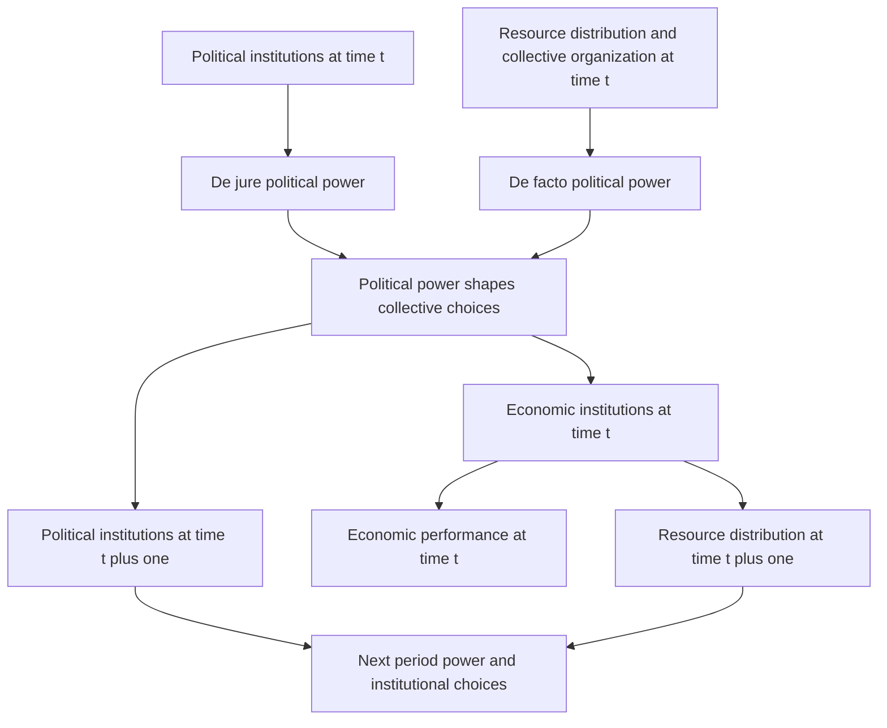

# Trace endogenous power, commitment and democratization

## Record metadata

```json
{
  "schema_version": 3,
  "owner": "plan",
  "course_id": "2026_2027/Winter_Semester/Comparative_Economics",
  "transaction_id": "PLAN-20261018-CE-P003-LINKS",
  "plan_version": "P003",
  "source_version": "V002",
  "ingestion_revision": 2,
  "objective_id": "O013",
  "objective_revision": 1,
  "criterion_version": "O013-C1",
  "status": "ready",
  "lesson_content_contract": "self-contained-lessons-v1",
  "knowledge_components": [
    "dynamic_de_jure_de_facto_feedback",
    "credible_political_commitment_and_reversal",
    "conditional_comparative_statics_and_history"
  ],
  "prerequisite_ids": [
    "O004",
    "O006",
    "O008"
  ],
  "compatible_versions": [
    {
      "objective_revision": 1,
      "criterion_version": "O013-C1",
      "plan_version": "P002",
      "source_version": "V002",
      "ingestion_revision": 2,
      "reason": "P003 changes only two visible Wiki provenance anchor spellings by removing inline italic markup from the rendered heading target. Exact checked structured headings, complete academic content, questions/keys, quantities, criteria, routes, tools and clocks are unchanged. Current P002 evidence remains compatible; no reassessment or learner result is inferred.",
      "change_class": "formatting_only",
      "requires_reassessment": false
    }
  ],
  "note_locations": [
    {
      "path": "01_Notes/2026_2027/Winter_Semester/Comparative_Economics/Week_2/Institutions_Power_and_Democratization.md",
      "heading": "Institutions, power and democratization"
    },
    {
      "path": "01_Notes/2026_2027/Winter_Semester/Comparative_Economics/Week_2/Institutions_Power_and_Democratization.md",
      "heading": "Rules, incentives and selective protection"
    },
    {
      "path": "01_Notes/2026_2027/Winter_Semester/Comparative_Economics/Week_2/Institutions_Power_and_Democratization.md",
      "heading": "Reconstructing the dynamic framework"
    },
    {
      "path": "01_Notes/2026_2027/Winter_Semester/Comparative_Economics/Week_2/Institutions_Power_and_Democratization.md",
      "heading": "Democratization and its reversal"
    },
    {
      "path": "01_Notes/2026_2027/Winter_Semester/Comparative_Economics/Week_2/Institutions_Power_and_Democratization.md",
      "heading": "Comparative statics and limits"
    },
    {
      "path": "01_Notes/2026_2027/Winter_Semester/Comparative_Economics/Week_2/Institutions_Power_and_Democratization.md",
      "heading": "Britain as an application"
    },
    {
      "path": "01_Notes/2026_2027/Winter_Semester/Comparative_Economics/Week_2/Institutions_Power_and_Democratization.md",
      "heading": "Lecture applications and interpretation"
    }
  ],
  "acquisition_rule": {
    "distinct_independent_passes": 2,
    "required_item_roles": [
      "full_capability_check",
      "full_capability_check"
    ],
    "allowed_routes": [
      [
        "O013-I1",
        "O013-I2"
      ],
      [
        "O013-I1",
        "O013-D1"
      ],
      [
        "O013-I1",
        "O013-D2"
      ],
      [
        "O013-I2",
        "O013-D1"
      ],
      [
        "O013-I2",
        "O013-D2"
      ],
      [
        "O013-D1",
        "O013-D2"
      ]
    ]
  },
  "delayed_rule": {
    "minimum_elapsed_hours": 24,
    "fresh_item": true,
    "independent_required": true
  },
  "review_topic": "Trace endogenous power, commitment and democratization",
  "review_instruction": "Begin a closed-note review with teach for O013; request an unused prepared delayed item before recap."
}
```

## Outcome and conditions

Reconstruct the dynamic institutional framework and conditional democratization/coup mechanisms with a qualified British application. All essential components listed in metadata are required. Hypothetical assessment values instantiate the checked equations; they are not historical observations or observed outcomes. Independent checks are closed-note and without hints, solution access, external retrieval or other assistance; a basic arithmetic calculator is allowed. Teach establishes and records actual help/exposure conditions before claiming independence.

## Prerequisites and checks

- [O004 outcome and repair route](../lessons/O004.md#outcome-and-conditions): time inconsistency differs from the specific investment-based hold-up mechanism.
- [O006 outcome and repair route](../lessons/O006.md#outcome-and-conditions): beneficiaries, collective action and power feedback explain persistence.
- [O008 outcome and repair route](../lessons/O008.md#outcome-and-conditions): political constraints, finance and broad versus selective rights establish the historical incentive chain.

O013-P1, item_version 1, prerequisite_diagnostic. **Prompt:** Why can a useful reform fail even when everyone could in principle be compensated, and is every broken promise a hold-up?

**Complete key and rubric:** O004 distinguishes a general incentive-to-renege problem from sunk-specific-investment hold-up; O006/O008 identify beneficiary power, organizing barriers and feedback. Require the distinction plus mechanism; repair those full lessons. Pass requires every requested reason and result; partial for an omitted reason or unresolved isolated arithmetic slip; fail for the conflicting mechanism. This diagnostic never counts as acquisition. Current or explicitly compatible committed independent prerequisite evidence may permit skipping its check; familiarity alone cannot. Use the cited complete prerequisite lesson or the named included foundation, then the worked example, after a partial/failing entry check.

## Teaching order and rationale

1. Use the diagnostic once to establish the necessary conceptual or algebraic foundation.
2. Present the complete checked-note explanation below, preserving variables, dates, assumptions and source qualifications. Follow one reasoning chain at a time so every intermediate step is visible.
3. Work W1 fully, asking the learner to explain why each step follows.
4. Use S1 as completion practice: show the setup and first identity, hide the final algebra/numbers and interpretation. After an explanation of the missing steps, withdraw support.
5. Present unused I1/I2 full checks with hidden solutions; use correction/repair after scoring the original answer. An unused D form can replace an exposed I only through a listed route.
6. On a later eligible occasion, begin an unused D item before recap. A numeric variant establishes bounded same-method performance, not general transfer.

## Motivation, intuition, and definitions

Reconstruct the dynamic institutional framework and conditional democratization/coup mechanisms with a qualified British application. Establish the definitions, assumptions and relevant comparisons before simplifying an equation. The complete reused passages establish every academic claim, notation choice and qualification assessed here; necessary prerequisites use the complete lessons above.

## Explanation steps

Origin: reused complete checked passage [[01_Notes/2026_2027/Winter_Semester/Comparative_Economics/Week_2/Institutions_Power_and_Democratization.md#Institutions, power and democratization]]; fingerprint `bf0560feeb58d62c7ccfa01f533301f1666e3c7a968faa595c85d53afe507f1e`. Heading depth and required relative figure-path relocation alone are adapted.

### Institutions, power and democratization

Source: [[00_Materials/2026_2027/Winter_Semester/Comparative_Economics/Week_2/Acemoglu Robinson 2006 v2.pdf]]
Source: [[00_Materials/2026_2027/Winter_Semester/Comparative_Economics/Week_2/Week II - lecture - large slides.pdf]]

- [[#Rules, incentives and selective protection|Rules, incentives and selective protection]]
- [[#Reconstructing the dynamic framework|Reconstructing the dynamic framework]]
- [[#Democratization and its reversal|Democratization and its reversal]]
- [[#Comparative statics and limits|Comparative statics and limits]]
- [[#Britain as an application|Britain as an application]]
- [[#Lecture applications and interpretation|Lecture applications and interpretation]]


Why can institutions that discourage investment persist, and why do promises of reform sometimes fail? Acemoglu and Robinson's 2006 chapter treats economic rules and political power as jointly evolving. Economic institutions shape prosperity, but groups choose them under distributional conflict; the institutions that enlarge the total pie need not benefit those with power. This is the chapter's theoretical account, not a claim that a cross-country correlation alone identifies causation. [[00_Materials/2026_2027/Winter_Semester/Comparative_Economics/Week_2/Acemoglu Robinson 2006 v2.pdf#page=1|Acemoglu–Robinson (2006), physical PDF pp. 1–3]]



This map preserves the two state variables, two power channels and distinct current/future outcomes. The source calls it schematic and simplified. In particular, resources are a major focus, but the ability to solve collective-action problems is also a source of de facto power. [[00_Materials/2026_2027/Winter_Semester/Comparative_Economics/Week_2/Acemoglu Robinson 2006 v2.pdf#page=2|Acemoglu–Robinson (2006), physical PDF pp. 2–6]] [[00_Materials/2026_2027/Winter_Semester/Comparative_Economics/Week_2/Week II - lecture - large slides.pdf#page=44|Week II lecture, physical PDF pp. 44–50]]

#### Rules, incentives and selective protection

Institutions are humanly devised rules and constraints, rather than the organizations playing within them. Formal political rules govern leader selection and allocation of authority; formal legal rules govern rights, obligations and transactions; informal norms govern expected behaviour through social pressure, guilt and moral obligation. Effective institutions can reduce uncertainty, cheating and transaction costs, but “institutions” does not mean “efficient rules” by definition. [[00_Materials/2026_2027/Winter_Semester/Comparative_Economics/Week_2/Week II - lecture - large slides.pdf#page=30|Week II lecture, physical PDF pp. 30–32]]

The **hold-up problem** arises when one party makes a relationship-specific sunk investment and then faces worse terms from a partner, with limited alternatives. Anticipating that ex post vulnerability can discourage an otherwise useful investment. Credibly enforceable contracts may help if litigation/enforcement costs are low enough. A **commitment problem** is broader: a promise that is attractive now may be abandoned later when incentives change. Hold-up is a particular investment-based instance, not a synonym for every broken promise. [[00_Materials/2026_2027/Winter_Semester/Comparative_Economics/Week_2/Week II - lecture - large slides.pdf#page=33|Week II lecture, physical PDF pp. 33–34]]

The lecture distinguishes inclusive economic institutions—broad participation, broadly secure property rights, occupational choice, entry, competition and incentives to invest/innovate—from extractive institutions that channel resources toward privileged groups, selectively protect rights and restrict others through coercion or entry barriers. Inclusive political institutions combine pluralism and accountability with sufficient central authority to enforce rules; extraction can coexist with a powerful authoritarian state or an ineffective one. “Small state” is therefore not equivalent to inclusion. [[00_Materials/2026_2027/Winter_Semester/Comparative_Economics/Week_2/Week II - lecture - large slides.pdf#page=41|Week II lecture, physical PDF pp. 41–43]]

#### Reconstructing the dynamic framework

Economic institutions affect investments in physical and human capital and technology, organization of production, aggregate performance and the next period's distribution. They are endogenous collective choices because their distributive effects create conflicts. The authors emphasize institutions without claiming that geography and culture can never matter. [[00_Materials/2026_2027/Winter_Semester/Comparative_Economics/Week_2/Acemoglu Robinson 2006 v2.pdf#page=2|Acemoglu–Robinson (2006), physical PDF pp. 2–3]]

**De jure power** comes from political institutions: constitutional rules, voting rights and constraints on rulers. **De facto power** comes from effective organization and resources, including protests, revolts, armed groups or military influence even without formal authority. A constitutional monarchy reallocates formal power relative to an unconstrained monarch; a disenfranchised organized group can still impose costs. Neither power channel is simply another name for income. [[00_Materials/2026_2027/Winter_Semester/Comparative_Economics/Week_2/Acemoglu Robinson 2006 v2.pdf#page=3|Acemoglu–Robinson (2006), physical PDF pp. 3–4]]

Together they influence current economic rules and future political institutions. Political institutions and resource distribution are relatively durable state variables. An already wealthy group can use resources to preserve favourable rules and thereby reproduce its advantage; formal institutions also tend to persist until a sufficiently large power shift occurs. Persistence does not imply inevitability: technology, external conditions and critical junctures can alter the balance. [[00_Materials/2026_2027/Winter_Semester/Comparative_Economics/Week_2/Acemoglu Robinson 2006 v2.pdf#page=4|Acemoglu–Robinson (2006), physical PDF pp. 4–5]]

Why not adopt efficient rules and compensate the losers? Promised transfers and protection may not be credible when tomorrow's powerful group can renege. A monarch can promise secure property rights today yet retain the ability to expropriate later. Merchants who gain temporary protest power want durable protection, but their organization may dissolve; converting de facto power into a change in formal political institutions can make future concessions more credible. This connects distribution, efficiency and political commitment rather than treating them as separable bargains automatically enforceable by a neutral third party. [[00_Materials/2026_2027/Winter_Semester/Comparative_Economics/Week_2/Acemoglu Robinson 2006 v2.pdf#page=3|Acemoglu–Robinson (2006), physical PDF pp. 3, 6–7]]

![[01_Notes/2026_2027/Winter_Semester/Comparative_Economics/assets/Week_2_Power_Feedback.png]]

The reproduced lecture diagram has current economic performance and future resources on its right, and future political institutions below. Those time labels explain the feedback: future resources and formal rules change the next round of power, not the past. [[00_Materials/2026_2027/Winter_Semester/Comparative_Economics/Week_2/Week II - lecture - large slides.pdf#page=50|Week II lecture, physical PDF pp. 50]]

#### Democratization and its reversal

In the chapter's simple “today/tomorrow” account, citizens temporarily overcome collective-action problems and threaten costly disorder or revolution. Elites can offer current policy concessions, promise future concessions, repress, or transfer durable political power. If citizens' temporary threat will fade, future elite promises may be noncredible. Extending voting rights changes who can choose policy tomorrow and therefore supplies a more credible commitment than a revocable policy promise. [[00_Materials/2026_2027/Winter_Semester/Comparative_Economics/Week_2/Acemoglu Robinson 2006 v2.pdf#page=7|Acemoglu–Robinson (2006), physical PDF pp. 7–8]]

Democratization is not automatic. Elites may choose repression when retaining power is sufficiently valuable and repression is relatively cheap or feasible. Repression risks destroyed wealth, loss of life, sanctions, failure and empowerment of a military that could threaten elites themselves. In this framework democracy emerges when temporary concessions are insufficient, promises are noncredible and repression is too costly relative to conceding. Those are conditional mechanisms, not a universal numerical threshold supplied by the chapter. [[00_Materials/2026_2027/Winter_Semester/Comparative_Economics/Week_2/Acemoglu Robinson 2006 v2.pdf#page=8|Acemoglu–Robinson (2006), physical PDF pp. 8–9]]

**Consolidation** means democratic institutions endure. A coup is the reverse conversion: elites with a temporary military/political opportunity can change formal institutions to secure future policies they favour. Promises by a democratic majority to remain moderate may also lack credibility after the coup threat subsides. The model therefore distinguishes creating democracy from sustaining it. [[00_Materials/2026_2027/Winter_Semester/Comparative_Economics/Week_2/Acemoglu Robinson 2006 v2.pdf#page=9|Acemoglu–Robinson (2006), physical PDF pp. 9–10]]

#### Comparative statics and limits

The chapter gives three connected conditions favouring broad property protection and democratization: checks/balance of power; a relatively broad powerful group with investment opportunities; and limited rents available through coercive/extractive institutions. A small investor oligarchy may protect only its own assets, so investment interests alone are insufficient. Resource equality or effective organization can balance de facto power. Checks can also make democracy less threatening to elites by limiting what the majority can do. [[00_Materials/2026_2027/Winter_Semester/Comparative_Economics/Week_2/Acemoglu Robinson 2006 v2.pdf#page=10|Acemoglu–Robinson (2006), physical PDF pp. 10–12]]

Economic structure changes those trade-offs. Land can be easier to tax/redistribute than mobile capital; resource rents raise the stakes of political monopoly; physical/human-capital economies may suffer greater destruction from repression and require less easily coerced effort. These mechanisms can make repression and coups more attractive in some agrarian/resource settings and less attractive in others. They are the authors' comparative arguments, not an assertion that all agrarian societies follow one path. [[00_Materials/2026_2027/Winter_Semester/Comparative_Economics/Week_2/Acemoglu Robinson 2006 v2.pdf#page=11|Acemoglu–Robinson (2006), physical PDF pp. 11–12]]

Prosperity and democracy are **jointly endogenous** in the framework. Correlation does not by itself show that income causes democracy or that elections alone ensure growth. The chapter reports evidence against an automatic income-to-democracy causal interpretation after historical factors are considered; the claim is tied to that cited research, rather than a proof that every possible income effect is zero. [[00_Materials/2026_2027/Winter_Semester/Comparative_Economics/Week_2/Acemoglu Robinson 2006 v2.pdf#page=12|Acemoglu–Robinson (2006), physical PDF pp. 12–13, 18–19]]

#### Britain as an application

The authors trace a sequence from seventeenth-century conflict and limits on the monarchy through more secure property rights and financial development, then industrialization/urbanization and stronger organization among previously excluded groups. Parliament's gains after the Civil War and 1688 were not mass democracy: voting remained narrow and corrupt. The 1832 reform removed many rotten-borough inequalities and expanded an electorate still limited to a minority of adult men; further organization and unrest preceded the 1867 and 1884 reforms. Secret ballots and anti-corruption measures also matter; formal suffrage alone did not immediately remove intimidation. [[00_Materials/2026_2027/Winter_Semester/Comparative_Economics/Week_2/Acemoglu Robinson 2006 v2.pdf#page=13|Acemoglu–Robinson (2006), physical PDF pp. 13–15]]

Later changes included merit-based civil service, labour protections, social insurance/pensions, redistributive taxation and mass education. The chapter's narrative gives the **1918** Representation of the People Act and equal voting terms for women in **1928**. Its opening reference to 1919 is internally inconsistent with that later chronology; use the body chronology, not the opening typo. Reform was gradual and strategic, with unrest, organization, electoral calculation and the costs of repression all relevant. [[00_Materials/2026_2027/Winter_Semester/Comparative_Economics/Week_2/Acemoglu Robinson 2006 v2.pdf#page=15|Acemoglu–Robinson (2006), physical PDF pp. 15–18]]

This application answers why economic rise and democratization appear related without reducing the story to “richer people demand democracy.” Earlier institutions altered investment and growth; resulting structural changes altered de facto power; reform then changed de jure power and subsequent economic rules. Haiti is the authors' contrasting historical path, described as of the chapter's 2006 context, not a current country-status assessment. [[00_Materials/2026_2027/Winter_Semester/Comparative_Economics/Week_2/Acemoglu Robinson 2006 v2.pdf#page=1|Acemoglu–Robinson (2006), physical PDF pp. 1–2, 16–19]]

#### Lecture applications and interpretation

The lecture's Nogales table contrasts annual household income (Arizona about USD 30,000 versus Sonora about one-third), education, health, services, security/business conditions and accountability across a border. These are the reading's historical comparisons, not current statistics. Encomienda granted tribute/labour claims over Indigenous populations with nominal conversion obligations, enabling elite extraction. Jamestown did not implement that Spanish institution: attempts to extract from Indigenous people and coercion of English settlers eventually gave way to land/incentive changes when the original strategy failed. The table and examples illustrate institutional incentives; a border narrative alone is not a controlled estimate of every difference. [[00_Materials/2026_2027/Winter_Semester/Comparative_Economics/Week_2/Week II - lecture - large slides.pdf#page=37|Week II lecture, physical PDF pp. 37–40]]

Institutions may remain inefficient because reform requires collective action, people can free ride, small groups with concentrated stakes may organize more effectively, and existing rules may obstruct challengers. The **functionalist fallacy** is to infer an institution's origin or automatic emergence from its useful function. These foundations connect the lecture to the chapter's persistence mechanism and the additional Olson reading. [[00_Materials/2026_2027/Winter_Semester/Comparative_Economics/Week_2/Week II - lecture - large slides.pdf#page=35|Week II lecture, physical PDF pp. 35–36]]

The full dynamic model and commitment mechanism are core because they explain endogenous institutions and answer the supplied seminar questions. Britain, Nogales and colonial contrasts support the reasoning; they do not establish a single inevitable development path or a forecast of present politics. [[00_Materials/2026_2027/Winter_Semester/Comparative_Economics/Week_2/Acemoglu Robinson 2006 v2.pdf#page=18|Acemoglu–Robinson (2006), physical PDF pp. 18–19]] [[00_Materials/2026_2027/Winter_Semester/Comparative_Economics/Week_2/Week II - lecture - large slides.pdf#page=3|Week II lecture, physical PDF pp. 3, 44–50]]


## Worked example

O013-W1, item_version 1, worked_example. **Prompt:** In a hypothetical polity, workers gain temporary effective power through urban organization; formal rules favour landowners. Elites offer a current concession plus a revocable future promise, repression at uncertain cost, or broader voting rights. Reconstruct the complete dynamic institutional framework. Explain commitment versus hold-up, concessions/repression/democratization and later coups, conditional comparative statics and Britain’s sequence. Does income alone imply democracy or selective investor protection imply inclusion?

**Complete solution and essential rubric:** Political institutions at $t$ allocate de jure power; current resources and collective organization create de facto power. Together they shape current economic institutions and political institutions at $t+1$. Economic rules affect current performance and future resources, feeding the next round of power. Temporary mobilization is effective influence without formal votes, rather than simply wealth. Efficient rules can hurt incumbents; compensation may not be credible once leverage fades. Hold-up specifically requires a sunk relationship-specific investment; commitment is the broader future-incentive problem. Current concessions do not bind tomorrow, while voting rights alter future policy choice. Repression depends on rents, feasibility and destruction, failure and military-empowerment costs. Democratization can become attractive when temporary promises fail and repression is too costly; consolidation is separate because a temporary coup threat can become durable elite formal power. Balanced checks, a broad investing coalition and limited coercive rents can help; a narrow oligarchy may protect only itself. Land, resource rents, capital mobility, human-capital dependence and repression costs change the trade-offs without a universal threshold. Britain’s monarchy/parliament constraints preceded finance, investment and industrial/urban change, which strengthened excluded groups before 1832/1867/1884 and later reforms; early Parliament was not mass democracy. Use the body chronology of the 1918 Act and 1928 equal terms, retaining the opening 1919 discrepancy. Prosperity and democracy are jointly endogenous: correlation is not a one-way income effect. Broad rights, entry and accountability with capacity differ from selective protection or a small state. Historical Nogales/colonial cases remain dated illustrations; beneficiary and organization barriers explain persistence without inevitability or a functionalist origin claim. All requested calculations, derivations and qualifications are essential; the component map above applies to every full form.

## Practice with fading assistance

O013-S1, item_version 1, supported_completion. **Prompt:** In a hypothetical polity, merchants gain temporary effective power through coordinated protest; formal rules favour a narrow court. Elites offer a current concession plus a revocable future promise, repression at uncertain cost, or broader voting rights. Reconstruct the complete dynamic institutional framework. Explain commitment versus hold-up, concessions/repression/democratization and later coups, conditional comparative statics and Britain’s sequence. Does income alone imply democracy or selective investor protection imply inclusion?

**Complete solution and essential rubric:** Political institutions at $t$ allocate de jure power; current resources and collective organization create de facto power. Together they shape current economic institutions and political institutions at $t+1$. Economic rules affect current performance and future resources, feeding the next round of power. Temporary mobilization is effective influence without formal votes, rather than simply wealth. Efficient rules can hurt incumbents; compensation may not be credible once leverage fades. Hold-up specifically requires a sunk relationship-specific investment; commitment is the broader future-incentive problem. Current concessions do not bind tomorrow, while voting rights alter future policy choice. Repression depends on rents, feasibility and destruction, failure and military-empowerment costs. Democratization can become attractive when temporary promises fail and repression is too costly; consolidation is separate because a temporary coup threat can become durable elite formal power. Balanced checks, a broad investing coalition and limited coercive rents can help; a narrow oligarchy may protect only itself. Land, resource rents, capital mobility, human-capital dependence and repression costs change the trade-offs without a universal threshold. Britain’s monarchy/parliament constraints preceded finance, investment and industrial/urban change, which strengthened excluded groups before 1832/1867/1884 and later reforms; early Parliament was not mass democracy. Use the body chronology of the 1918 Act and 1928 equal terms, retaining the opening 1919 discrepancy. Prosperity and democracy are jointly endogenous: correlation is not a one-way income effect. Broad rights, entry and accountability with capacity differ from selective protection or a small state. Historical Nogales/colonial cases remain dated illustrations; beneficiary and organization barriers explain persistence without inevitability or a functionalist origin claim. All requested calculations, derivations and qualifications are essential; the component map above applies to every full form.

Allowed support is the first stated identity only; hide the remaining key while the learner completes it. Supported performance is practice, not an independent result.

## Rubric and independence

Required components: dynamic_de_jure_de_facto_feedback, credible_political_commitment_and_reversal, conditional_comparative_statics_and_history. Each full prompt/key below elicits every component; all are necessary for a pass on every permitted pair. Accept algebraically equivalent expressions and clearly defined opposite cash-flow signs with correct interpretation. A pass requires all requested outputs/reasons, correct units/assumptions and no critical conceptual error. Partial means a missing component or an unresolved isolated arithmetic slip with an otherwise valid method; independent correction is required for a pass. Fail means a critical mechanism/condition is wrong. Unscorable means a response or its help/exposure conditions cannot be established. Unknown help conditions are never independent evidence.

Critical errors: De facto power equated only with wealth; current/future arrows reversed; rising income guarantees democracy; early Parliament called universal suffrage.

Acquisition requires two distinct unused unassisted full checks selected from the six exact metadata routes. Every I/D form covers all components; W1, S1, the prerequisite and C1 are forbidden substitutes. A D form used for acquisition cannot later be counted again as delayed success. No teach-generated item may replace a named full check; additional verified explanation/practice is allowed under the unchanged method and may not fabricate evidence. If fewer than two fresh forms remain for acquisition, return a plan_issue for an additional prepared bank.

| Component | I1 | I2 | D1 | D2 |
|---|---|---|---|---|
| dynamic_de_jure_de_facto_feedback | required | required | required | required |
| credible_political_commitment_and_reversal | required | required | required | required |
| conditional_comparative_statics_and_history | required | required | required | required |

## Misconceptions and correction

An observed omitted term/sign is tentative until the learner explains it; compare the reasoning with the critical errors above. Score the original response before providing help. Route a conceptual failure to the relevant included derivation and prerequisite, then use an unused full form.

O013-C1, item_version 1, narrow_correction. **Prompt:** Why might elites choose voting rights over a cheaper-looking future policy promise? **Key/rubric:** If challengers’ temporary leverage fades, future policy promises may be reneged on. Durable political-rule changes can alter tomorrow’s incentives; repression costs and distributional stakes determine whether this option is chosen. Pass requires all keyed reasoning; partial for a missing part; fail for the conflicting mechanism. This repairs a common inference only; it cannot substitute for a full numerical/capability check.

Give at most two hints (first identify the date/unit, second point to the included identity); after ineffective hints show the relevant worked step. After two unsuccessful independent attempts stop repeated quizzing, revisit the explanation/prerequisite and preserve the unresolved status.

## Immediate and delayed checks

### O013-I1

O013-I1, item_version 1, full_capability_check. **Prompt:** A constitution gives merchants no votes. An export boom finances their independent associations and a temporary boycott; no political law has yet changed. The ruler promises secure property next year but retains unilateral expropriation, while a small court-connected investor group already has protected assets. Diagnose the two power channels, reconstruct the full current/future feedback and explain which arrows the export shock initially changes. Compare the promise, durable voting reform and repression; explain why narrow investor protection need not produce inclusion, and how capital mobility, broad organization and coercive rents could alter the choice. If merchant voting reform is adopted, does that guarantee consolidation? Suppose the former court-connected elite later gains a temporary military opportunity and demands restrictions on the new electorate while the majority promises future moderation: explain how reversal can turn effective leverage into durable formal power. A commentator calls Britain’s 1832 reform universal democracy and treats its growth correlation as a one-way income effect: assess both claims.

**Complete solution and essential rubric:** The unchanged constitution fixes the current de jure allocation; export resources and association/boycott capacity change de facto power before formal votes change. Political institutions at $t$ shape de jure power, current resources/collective organization shape de facto power, and both affect current economic institutions and political institutions at $t+1$. Economic rules affect current performance and next-period resources. The boom first affects the resource/organization channel, not retroactively the constitution; later feedback can change formal rules. The ruler’s revocable property promise may fail once the boycott fades because expropriation remains attractive and feasible. Durable voting rights can change future policy control; a current concession alone does not do so. This is general commitment, whereas hold-up specifically requires a sunk relationship-specific investment. Protected court investors demonstrate selective rights, not broad entry/security; a small powerful investing group may defend its privilege. Balanced power and a broad investing coalition with limited extractive rents can favour broader protection; mobile capital or destructive repression can increase repression’s cost, while valuable coercive rents can increase resistance. No numerical threshold or inevitable democratization follows. Even if the merchants obtain voting reform, consolidation is a separate question of whether the new democratic rules endure. In the specified later military opportunity, the former elite gains temporary de facto coup leverage; restricting the franchise or replacing democratic rules can convert that temporary threat into durable de jure control over future policy. The majority’s promised moderation may be noncredible after the coup threat fades, so the same commitment logic can drive reversal. This is a conditional mechanism, not a prediction that the coup must occur or that the earlier reform itself failed. British parliamentary constraints supported finance/investment before industrialization and urban organization changed excluded groups’power. The 1832 electorate remained a minority of adult men; later 1867/1884 changes, secret ballots and social reforms mattered. Income and democracy are jointly endogenous, so correlation alone does not identify a one-way income effect. Require the complete dated feedback, commitment/investment distinction, conditional political choice and historical correction; no learner result or historical causal estimate is implied.

I1/I2 are immediate checks; D1/D2 are distinct parallel variants reserved where possible for delayed checks. A delayed success requires an unused form before recap, no help/solution access, and at least 24 actual elapsed hours after acquisition and the most recent relevant teaching/solution exposure. Record intervening exposure. A calendar-date change alone is insufficient; an early D attempt is immediate evidence only.

### O013-I2

O013-I2, item_version 1, full_capability_check. **Prompt:** A democracy faces a temporary military coup threat. Its majority offers moderation this year and promises to keep future taxes low after the army withdraws; an elite faction demands permanent limits on who may vote. Compare this reverse transition with initial democratization, distinguishing effective military leverage, formal rights, credible commitment and consolidation. Reconstruct the complete two-state-variable feedback rather than drawing performance as a cause of past institutions. Contrast a landed/resource-rent elite with owners of mobile industrial capital, including repression/destruction/military risks and the danger of selective protection. Use Britain’s secret-ballot and 1918/1928 chronology to assess the statement “passing one suffrage law completes democracy and establishes growth causation.”

**Complete solution and essential rubric:** The temporary military threat supplies de facto leverage; changing the franchise converts it into durable de jure power. A promise of low future taxes may be noncredible once that threat recedes, just as an elite promise of future concessions can fail after popular mobilization fades. Initial democratization transfers durable policy choice toward citizens; a coup can reverse that conversion. Consolidation is whether democracy endures, not merely whether it was once created. Political institutions and resource distribution are state variables: today’s institutions assign legal power, today’s resources/organization assign effective power, together they shape current economic institutions and future political institutions, and current economic rules affect current performance and future resources. No arrow changes the past. This is intertemporal political commitment without a necessary relationship-specific investment; a supplier’s sunk dedicated machine would add hold-up. Immobile land/resource rents can raise redistributive stakes and the value of political monopoly; mobile capital and dependence on skilled effort can make repression/destruction more costly. Repression may also empower the army against elites. Checks, balanced organization, a broad investing group and limited coercive rents can favour broad rights, while protecting only elite investors is not inclusion; these are conditional comparisons. Britain’s broader franchise developed over multiple reforms; secret ballots and anti-corruption protections address intimidation that formal suffrage alone does not remove. Use the 1918 Act and equal terms for women in 1928, retaining the chapter’s opening 1919 discrepancy. The joint institutional/economic sequence does not identify an automatic income-to-democracy or elections-to-growth law. Require the complete reverse-transition reasoning, feedback, comparative statics and source chronology.

### O013-D1

O013-D1, item_version 1, full_capability_check. **Prompt:** A proposed reform would increase total output but remove an incumbent monopoly. New reformers promise to compensate its owner from future public revenue; the owner doubts that future governments will pay. Citizens have recently become better organized and resource distribution more equal, but rulers retain formal control and can repress. Explain why an aggregate gain need not secure agreement and distinguish this problem from a manufacturer repricing after a dedicated machine is installed. Reconstruct the full institutional feedback, compare checks/broad investment interests/limited rents with selective protection, and state how repression/coup incentives affect creation versus consolidation of democracy. Explain why Britain’s joint finance–industrialization–political-reform sequence cannot be replaced by “income alone causes democracy.”

**Complete solution and essential rubric:** The incumbent can lose protected rents despite a larger aggregate pie, and future compensation may not be credible when recipients of power can renege. This is political commitment and distributional conflict, not ignorance of an efficient rule. The dedicated machine adds a sunk relationship-specific investment and hence hold-up; compensation failure does not require that investment. Better citizen organization and more balanced resources increase de facto influence without automatically changing formal de jure authority. At $t$, political institutions and resources/organization generate those respective power channels; together they choose current economic institutions and future political institutions. Economic institutions affect current performance and next-period resources, which feed back into power. Balanced checks, a broad group with investment opportunities and limited coercive rents can support broad property protection; a small investing oligarchy may instead protect only its own assets. Temporary citizen leverage makes a revocable policy promise weak; durable rights can change tomorrow’s decision makers. Repression can be chosen when rents are valuable and costs low, but destruction, failure and army empowerment can reverse that ranking. Democracy’s creation is separate from its endurance; a later temporary coup opportunity can undo formal rights. In Britain, limits on monarchy helped property/finance and investment, industrial/urban changes strengthened organization, and further franchise/ballot/social reforms followed while early participation remained restricted. Neither income alone nor one reform is isolated as the causal driver. Require the surplus-versus-distribution/credibility distinction, complete feedback and conditional political/historical analysis; do not infer agreement, reform or a permanent path merely from the stated improvement.

### O013-D2

O013-D2, item_version 1, full_capability_check. **Prompt:** A resource-price windfall strengthens a ruler’s allied security firms. Formal voting rights do not change, independent associations are obstructed, and the ruler uses new revenue to grant allies exclusive licences. An adviser says that the present boom proves inclusive institutions and that greater repression is costless because the army is paid. Trace the full current/future feedback and distinguish both power channels. Evaluate commitment, current concessions versus durable political change, repression and a possible later coup. Compare resource rents with a broad human-capital-intensive investing economy, and explain the lesson of Britain’s early parliamentary constraints without calling them immediate mass democracy or treating prosperity/democracy correlation as causal proof.

**Complete solution and essential rubric:** The windfall initially changes resources and effective/de facto power, not the unchanged legal/de jure franchise. Obstructed organization weakens challengers even where formal votes exist. Exclusive licences are current economic institutions that selectively channel returns; a current boom does not establish broad entry, secure rights or inclusion. Political rules at $t$ allocate de jure power; resources and organization at $t$ allocate de facto power; both shape current economic rules and future political institutions. Those economic rules affect current performance and future resources, potentially reproducing allied power. Ruler promises or temporary transfers can be reneged on once opposition leverage fades; durable political constraints alter tomorrow’s incentives. A dedicated investment followed by repricing would be the narrower hold-up case, rather than every political promise. Paid troops can still destroy assets, fail or acquire independent coup leverage, so repression is not costless. High extractive rents raise the stakes of monopoly; broad investors, balanced power/checks, mobile capital and reliance on skilled effort can change the costs and benefits of inclusion or repression. Democratization and consolidation remain distinct; neither windfall nor human-capital structure guarantees one outcome. Britain’s monarchical constraints supported property/finance before industrialization and organized excluded groups prompted further changes; early parliamentary rights were narrow. Subsequent reforms and reciprocal economic/political effects preclude a simple one-way correlation claim. Require all power/time channels, the selective-rights diagnosis, commitment and conditional transition/reversal/history reasoning.

## Advance, revisit, pause, and escalate

Advance only after teach commits two qualifying independent full passes under a listed route. Keep acquisition and each later delayed observation separate. A source conflict blocks the affected claim and returns to ingest with the exact note heading. Missing criteria, a new method, unsupported alternative or exhausted fresh bank returns to plan with 2026_2027/Winter_Semester/Comparative_Economics, O013, revision1/O013-C1, P003/V002/ingestion2 and item ID. Equivalent valid methods meeting the frozen criterion may receive credit after verification; no criterion is changed to fit an answer. Closing a session preserves the actual stopping point without claiming completion.

## Content provenance and generation boundaries

Explanations, figures and qualifications above reuse complete checked-note sections with exact origin/fingerprint; heading depth alone is adapted. Main exercises and worked arithmetic are plan-created hypothetical instantiations of those displayed identities. No additional academic claims or external course scope are introduced. Preserve the note conventions and explicit qualifications; checked references reused from notes are not an independent raw-source audit by plan. New numerical practice can use the same method only after its complete solution and unchanged components are checked before display; it cannot replace this lesson’s named evidence forms. Prerequisites route to the complete prepared lessons above.

## Answer-free recall handoff

Topic: Trace endogenous power, commitment and democratization. Begin a closed-note review with teach for O013; request an unused prepared delayed item before recap. Exact lesson: [[03_Agents/2026_2027/Winter_Semester/Comparative_Economics/lessons/O013.md#Immediate and delayed checks]]. Teach supplies actual committed evidence and timestamps; recall alone dates reviews. No learner outcome or due date is created by this curriculum.
