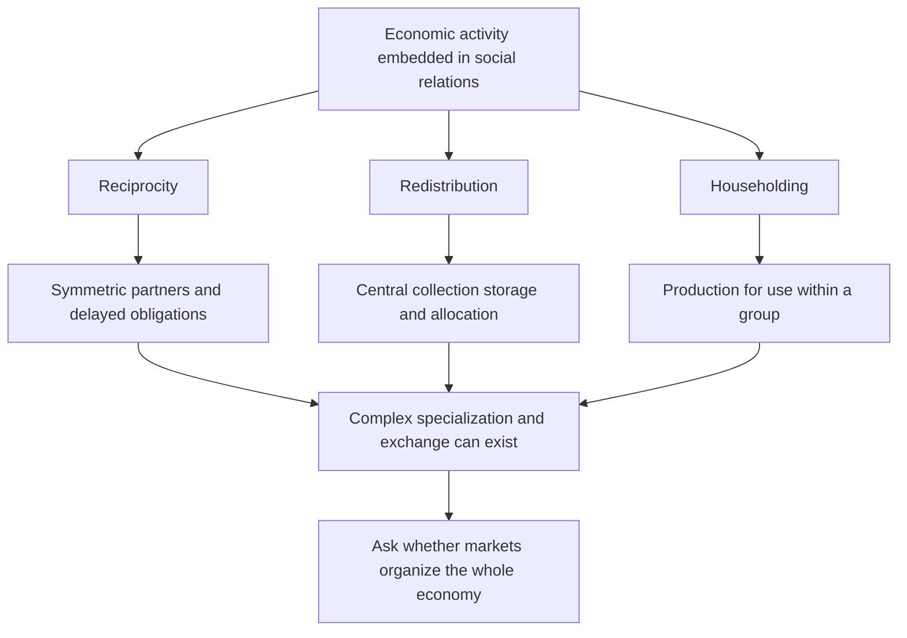

# Compare embedded coordination and Kula exchange

## Record metadata

```json
{
  "schema_version": 3,
  "owner": "plan",
  "course_id": "2026_2027/Winter_Semester/Comparative_Economics",
  "transaction_id": "PLAN-20261018-CE-P003-LINKS",
  "plan_version": "P003",
  "source_version": "V002",
  "ingestion_revision": 2,
  "objective_id": "O015",
  "objective_revision": 1,
  "criterion_version": "O015-C1",
  "status": "ready",
  "lesson_content_contract": "self-contained-lessons-v1",
  "knowledge_components": [
    "reciprocity_redistribution_householding_and_patterns",
    "kula_and_trobriand_institutional_mechanisms",
    "market_system_distinction_and_power_limits"
  ],
  "prerequisite_ids": [
    "O001",
    "O005"
  ],
  "compatible_versions": [
    {
      "objective_revision": 1,
      "criterion_version": "O015-C1",
      "plan_version": "P002",
      "source_version": "V002",
      "ingestion_revision": 2,
      "reason": "P003 changes only two visible Wiki provenance anchor spellings by removing inline italic markup from the rendered heading target. Exact checked structured headings, complete academic content, questions/keys, quantities, criteria, routes, tools and clocks are unchanged. Current P002 evidence remains compatible; no reassessment or learner result is inferred.",
      "change_class": "formatting_only",
      "requires_reassessment": false
    }
  ],
  "note_locations": [
    {
      "path": "01_Notes/2026_2027/Winter_Semester/Comparative_Economics/Week_3/Embedded_Economies_and_Kula.md",
      "heading": "Embedded economies, reciprocity and the Kula ring"
    },
    {
      "path": "01_Notes/2026_2027/Winter_Semester/Comparative_Economics/Week_3/Embedded_Economies_and_Kula.md",
      "heading": "Social motives and economic organization"
    },
    {
      "path": "01_Notes/2026_2027/Winter_Semester/Comparative_Economics/Week_3/Embedded_Economies_and_Kula.md",
      "heading": "Reciprocity and symmetry"
    },
    {
      "path": "01_Notes/2026_2027/Winter_Semester/Comparative_Economics/Week_3/Embedded_Economies_and_Kula.md",
      "heading": "Redistribution and centricity"
    },
    {
      "path": "01_Notes/2026_2027/Winter_Semester/Comparative_Economics/Week_3/Embedded_Economies_and_Kula.md",
      "heading": "Householding and production for use"
    },
    {
      "path": "01_Notes/2026_2027/Winter_Semester/Comparative_Economics/Week_3/Embedded_Economies_and_Kula.md",
      "heading": "The 1920 Trobriand report"
    }
  ],
  "acquisition_rule": {
    "distinct_independent_passes": 2,
    "required_item_roles": [
      "full_capability_check",
      "full_capability_check"
    ],
    "allowed_routes": [
      [
        "O015-I1",
        "O015-I2"
      ],
      [
        "O015-I1",
        "O015-D1"
      ],
      [
        "O015-I1",
        "O015-D2"
      ],
      [
        "O015-I2",
        "O015-D1"
      ],
      [
        "O015-I2",
        "O015-D2"
      ],
      [
        "O015-D1",
        "O015-D2"
      ]
    ]
  },
  "delayed_rule": {
    "minimum_elapsed_hours": 24,
    "fresh_item": true,
    "independent_required": true
  },
  "review_topic": "Compare embedded coordination and Kula exchange",
  "review_instruction": "Begin a closed-note review with teach for O015; request an unused prepared delayed item before recap."
}
```

## Outcome and conditions

Classify embedded organization, explain Kula and the1920 report, and distinguish complex exchange from a self-regulating market economy. All essential components listed in metadata are required. Hypothetical assessment values instantiate the checked equations; they are not historical observations or observed outcomes. Independent checks are closed-note and without hints, solution access, external retrieval or other assistance; a basic arithmetic calculator is allowed. Teach establishes and records actual help/exposure conditions before claiming independence.

## Prerequisites and checks

- [O001 outcome and repair route](../lessons/O001.md#outcome-and-conditions): allocation mechanisms and ownership labels must be separated before classifying embedded systems.
- [O005 outcome and repair route](../lessons/O005.md#outcome-and-conditions): coordination and cooperation require institutions rather than an assumed universal motive.

O015-P1, item_version 1, prerequisite_diagnostic. **Prompt:** Does exchange imply private ownership or a whole market-governed system, and can individually sensible actions need coordination?

**Complete key and rubric:** O001 separates ownership from allocation and mixed institutions; O005 shows shared patterns and collective incentives need institutional coordination. Require both; repair those lessons. Pass requires every requested reason and result; partial for an omitted reason or unresolved isolated arithmetic slip; fail for the conflicting mechanism. This diagnostic never counts as acquisition. Current or explicitly compatible committed independent prerequisite evidence may permit skipping its check; familiarity alone cannot. Use the cited complete prerequisite lesson or the named included foundation, then the worked example, after a partial/failing entry check.

## Teaching order and rationale

1. Use the diagnostic once to establish the necessary conceptual or algebraic foundation.
2. Present the complete checked-note explanation below, preserving variables, dates, assumptions and source qualifications. Follow one reasoning chain at a time so every intermediate step is visible.
3. Work W1 fully, asking the learner to explain why each step follows.
4. Use S1 as completion practice: show the setup and first identity, hide the final algebra/numbers and interpretation. After an explanation of the missing steps, withdraw support.
5. Present unused I1/I2 full checks with hidden solutions; use correction/repair after scoring the original answer. An unused D form can replace an exposed I only through a listed route.
6. On a later eligible occasion, begin an unused D item before recap. A numeric variant establishes bounded same-method performance, not general transfer.

## Motivation, intuition, and definitions

Classify embedded organization, explain Kula and the1920 report, and distinguish complex exchange from a self-regulating market economy. Establish the definitions, assumptions and relevant comparisons before simplifying an equation. The complete reused passages establish every academic claim, notation choice and qualification assessed here; necessary prerequisites use the complete lessons above.

## Explanation steps

Origin: reused complete checked passage [[01_Notes/2026_2027/Winter_Semester/Comparative_Economics/Week_3/Embedded_Economies_and_Kula.md#Embedded economies, reciprocity and the Kula ring]]; fingerprint `400fa27117a34f59293450de25852717ea932ca25ca96a5066d709d769df66fe`. Heading depth and required relative figure-path relocation alone are adapted.

### Embedded economies, reciprocity and the Kula ring

Source: [[00_Materials/2026_2027/Winter_Semester/Comparative_Economics/Week_3/Polanyi 1944 Great-Transformation_chapter 4.pdf]]
Source: [[00_Materials/2026_2027/Winter_Semester/Comparative_Economics/Week_3/ADDITIONAL - Economic Pursuits of the Trobriand Islanders.pdf]]
Source: [[00_Materials/2026_2027/Winter_Semester/Comparative_Economics/Week_3/Week III - lecture - large slides.pdf]]

- [[#Social motives and economic organization|Social motives and economic organization]]
- [[#Reciprocity and symmetry|Reciprocity and symmetry]]
- [[#Redistribution and centricity|Redistribution and centricity]]
- [[#Householding and production for use|Householding and production for use]]
- [[#The 1920 Trobriand report|The 1920 Trobriand report]]


Can a complex economy operate without market prices governing the whole system? Polanyi's chapter distinguishes the existence of trade, money and markets from a **self-regulating market economy** in which prices organize economic life as a whole. His historical thesis is that such a system is an exceptional development, rather than the natural expression of an invariant propensity to barter. This is the author's interpretation; it should not be turned into a claim that earlier societies had no trade or no individual motives. [[00_Materials/2026_2027/Winter_Semester/Comparative_Economics/Week_3/Polanyi 1944 Great-Transformation_chapter 4.pdf#page=1|Polanyi, chapter 4, physical PDF pp. 1–3]] [[00_Materials/2026_2027/Winter_Semester/Comparative_Economics/Week_3/Week III - lecture - large slides.pdf#page=13|Week III lecture, physical PDF pp. 13–16]]



This map separates principles of behaviour from the institutional patterns that support them. It follows Polanyi's argument rather than equating every gift economy with modern socialism or every exchange with capitalism. [[00_Materials/2026_2027/Winter_Semester/Comparative_Economics/Week_3/Polanyi 1944 Great-Transformation_chapter 4.pdf#page=5|Polanyi, chapter 4, physical PDF pp. 5–13]]

#### Social motives and economic organization

Polanyi argues that social standing, obligations, kinship and community membership can organize production and distribution. Reputation and public recognition reward effort; ostracism and sanctions discipline noncompliance. The relevant contrast is the dominant coordinating institution and motive, not an assumption that people in one society are inherently generous and those in another inherently selfish. He explicitly rejects replacing a stereotyped “capitalistic” psychology with an equally simple “communistic” psychology. [[00_Materials/2026_2027/Winter_Semester/Comparative_Economics/Week_3/Polanyi 1944 Great-Transformation_chapter 4.pdf#page=2|Polanyi, chapter 4, physical PDF pp. 2–5]]

The lecture groups traditional systems around slowly coevolved family, customary and religious institutions—“familistic groupism”—and contrasts that embedding with the greater subordination of social frameworks to economic calculation in stylized market/command systems. It also warns that traditional systems are diverse. This is a comparative organizing distinction, not a literal claim that modern economies lack norms or that every traditional economy has the same religion or technology. [[00_Materials/2026_2027/Winter_Semester/Comparative_Economics/Week_3/Week III - lecture - large slides.pdf#page=12|Week III lecture, physical PDF pp. 12–16]]

#### Reciprocity and symmetry

**Reciprocity** organizes giving and receiving through continuing social obligations. Returns can be delayed and may come through a network rather than the same person immediately. **Symmetry**—recognized paired partners, kin groups or villages—helps those obligations remain legible without a spot-market contract for every exchange. Polanyi's matrilineal example has a man delivering produce to his sister's household while his own wife's relatives provide reciprocal support. Public displays of good gardening protect reputation; the pattern coordinates provision without a wage for each act. [[00_Materials/2026_2027/Winter_Semester/Comparative_Economics/Week_3/Polanyi 1944 Great-Transformation_chapter 4.pdf#page=5|Polanyi, chapter 4, physical PDF pp. 5–7]]

The lecture's Kula example is a ceremonial network across at least 18 island communities. Red shell-disc necklaces (soulava/veigun) circulate clockwise, and white arm-shells (mwali) counterclockwise; “north” and “south” in a ring are simplified local directions, not global compass rules. Objects have prestige linked to history and former owners, and ownership is temporary. Their limited practical use does not mean they have no social value. [[00_Materials/2026_2027/Winter_Semester/Comparative_Economics/Week_3/Week III - lecture - large slides.pdf#page=19|Week III lecture, physical PDF pp. 19–20]] [[00_Materials/2026_2027/Winter_Semester/Comparative_Economics/Week_3/Polanyi 1944 Great-Transformation_chapter 4.pdf#page=7|Polanyi, chapter 4, physical PDF pp. 7–8]]

Partners undertake dangerous long-distance voyages and exchange under ritual rules, rather than bargaining for immediate monetary profit. Polanyi describes circulation over years, sometimes up to a decade; an object may return after gaining history. Complex specialization and exchange therefore do not logically require a system wholly governed by market prices. The example demonstrates organizational complexity rather than proving that modern markets could never handle ceremonial valuables. [[00_Materials/2026_2027/Winter_Semester/Comparative_Economics/Week_3/Polanyi 1944 Great-Transformation_chapter 4.pdf#page=8|Polanyi, chapter 4, physical PDF pp. 8]]

#### Redistribution and centricity

**Redistribution** collects products at a centre, stores them and reallocates them. **Centricity** is the institutional arrangement that makes the centre available: a chief, temple, court or administration. Hunters sharing through a headman, Trobriand chief stores supporting feasts/expeditions, and large ancient granary systems are different scales and political forms of the principle. Redistribution can connect geographically specialized producers. [[00_Materials/2026_2027/Winter_Semester/Comparative_Economics/Week_3/Polanyi 1944 Great-Transformation_chapter 4.pdf#page=6|Polanyi, chapter 4, physical PDF pp. 6–10]]

It need not imply equality or voluntary cooperation. A chief may create dependency through gifts; a despot may collect tribute by coercion. Polanyi's “communistic” description of ancient household-like distribution explicitly permits sharply graded rations. His second use rejects the simplistic attribution of an innate communistic psychology to early people. The adjective therefore does not certify modern egalitarian communism. [[00_Materials/2026_2027/Winter_Semester/Comparative_Economics/Week_3/Polanyi 1944 Great-Transformation_chapter 4.pdf#page=2|Polanyi, chapter 4, physical PDF pp. 2, 9–10]]

#### Householding and production for use

**Householding** means producing and storing for a group's own use, with a closed-group/self-sufficiency pattern. The group can be a family, village or manor, with democratic or despotic internal relations. Polanyi rejects an isolated self-sufficient “savage” as the universal original economic unit; household provision develops within social organization. [[00_Materials/2026_2027/Winter_Semester/Comparative_Economics/Week_3/Polanyi 1944 Great-Transformation_chapter 4.pdf#page=11|Polanyi, chapter 4, physical PDF pp. 11]]

Aristotle's distinction between household provisioning and unlimited money-making supplies the interpretive contrast. Selling an incidental surplus need not transform a household into production organized primarily for gain. Polanyi recognizes that Greek commerce, loans, insurance and banking were highly developed, even while he argues that market organization did not govern the whole social economy. The presence of money is therefore insufficient to classify the whole system. [[00_Materials/2026_2027/Winter_Semester/Comparative_Economics/Week_3/Polanyi 1944 Great-Transformation_chapter 4.pdf#page=11|Polanyi, chapter 4, physical PDF pp. 11–12]]

The chapter characterizes the Greco-Roman economy as householding combined with large-scale grain redistribution. Feudal arrangements likewise combine collection, tribute, protection and distribution, often with exploitation and unequal status. Its conclusion groups premodern economies under combinations of reciprocity, redistribution and householding. Sixteenth-century mercantilist governments made markets important objects of regulation; that is still different from a nineteenth-century ideal of a self-regulating market. These broad historical propositions remain attributed to Polanyi, rather than presented as uncontested findings from a newly audited history literature. [[00_Materials/2026_2027/Winter_Semester/Comparative_Economics/Week_3/Polanyi 1944 Great-Transformation_chapter 4.pdf#page=9|Polanyi, chapter 4, physical PDF pp. 9–13]]

#### The 1920 Trobriand report

The two-page *Nature* item reports Malinowski's presentation to the Royal Anthropological Institute and the subsequent discussion. It rejects a view of Indigenous economies as merely individual subsistence. In its account, organized agriculture depends on chief authority and garden magic: the chief allocates land and finances communal work, while the magician directs ceremonial stages. **Kayasa** organizes communal gardening, fishing, construction, sports and games through announced enterprises and feasts. [[00_Materials/2026_2027/Winter_Semester/Comparative_Economics/Week_3/ADDITIONAL - Economic Pursuits of the Trobriand Islanders.pdf#page=1|Trobriand report (1920), physical PDF pp. 1]]

Producers receive a share, while chiefly collection—reported as about 30–50% of tribal wealth—supports collective projects and accumulation of ceremonial valuables made by dependent specialists. The report distinguishes a common measure of value, tokens of stored wealth and a general medium of exchange; it says no single article performs the latter role in the described setting. Gift/counter-gift obligations also support authority, warfare/peace and penalties. This reinforces the connection between political organization and economic institutions, not an image of a society without power or conflict. [[00_Materials/2026_2027/Winter_Semester/Comparative_Economics/Week_3/ADDITIONAL - Economic Pursuits of the Trobriand Islanders.pdf#page=1|Trobriand report (1920), physical PDF pp. 1]]

The Kula description emphasizes opposite-direction circulation, temporary ownership and repeated overseas expeditions. In discussion, Seligman asks whether elaborate garden organization depends on chiefs; Malinowski replies that Southern Massim/Dobu garden magic existed without the same elaborate distribution. Frazer, Routledge and Ray offer comparative comments about agriculture, magic and chiefly origin, which remain discussion suggestions rather than settled causal tests. Unrelated material on fungi/canvas and scientific services printed around the article is outside the academic item and is not imported into course notes. [[00_Materials/2026_2027/Winter_Semester/Comparative_Economics/Week_3/ADDITIONAL - Economic Pursuits of the Trobriand Islanders.pdf#page=1|Trobriand report (1920), physical PDF pp. 1–2]]

Traditional systems matter here because they expose the institutional assumptions behind apparently universal economic motives. The lecture then asks how “new traditional” movements might combine modern technology with religiously derived social organization. That is an ideal/political perspective with diverse forms, not proof that a complete third system has been realized everywhere. [[00_Materials/2026_2027/Winter_Semester/Comparative_Economics/Week_3/Week III - lecture - large slides.pdf#page=24|Week III lecture, physical PDF pp. 24–26]]


![[01_Notes/2026_2027/Winter_Semester/Comparative_Economics/assets/Week_3_Trobriand_Map.png]]

The lecture locates the islands surrounding the Kula network. The spatial figure supplies context for the opposite directions of ceremonial circulation; the diagram does not label every exchange as ordinary barter. [[00_Materials/2026_2027/Winter_Semester/Comparative_Economics/Week_3/Week III - lecture - large slides.pdf#page=18|Week III lecture, physical PDF pp. 18]]


## Worked example

O015-W1, item_version 1, worked_example. **Prompt:** A hypothetical network includes paired coastal kin: paired families send produce with delayed returns; central granaries: a chief collects stores and distributes unequal rations for expeditions; garden households: a household produces for use and sells occasional surplus. Classify principles and institutional patterns; distinguish exchange/money from a self-regulating market economy. Explain incentives/power, Kula circulation/prestige/ownership and the 1920 report’s agriculture, kayasa, collection and value instruments. Do gifts imply egalitarian socialism or modern machines determine one system?

**Complete solution and essential rubric:** paired coastal kin is reciprocity supported by symmetry and recognized partners; delayed network obligations differ from immediate spot barter. central granaries is redistribution supported by centricity and can be coercive/unequal. garden households is householding within a group, compatible with incidental surplus sales. Trade, money and specialization can exist without prices organizing the whole economy. Polanyi’s attributed historical thesis does not deny all premodern trade or individual motives. Reputation, status, kinship, obligations and sanctions coordinate effort; no innate communist psychology follows. Kula links at least 18 island communities: red necklaces circulate clockwise, white arm-shells counterclockwise; simplified north/south labels are not global compass rules. Prestige/history and temporary ownership give objects social value; ritual voyages and returns can span years. The 1920 report links agriculture to chief authority/garden magic, kayasa to announced communal enterprises and feasts, and roughly 30–50% chiefly collection to projects and dependent specialists. A measure of value or store of wealth need not be a general medium of exchange; the report denies a single general-medium article there. The discussion’s Southern Massim/Dobu contrast shows garden magic without identical elaborate distribution; comments are not causal tests. Other institutions can coordinate complex exchange, without proving markets could never handle ceremonial goods. Modern technology does not select one ownership/allocation model, and chiefly gifts need not be egalitarian or voluntary. All requested calculations, derivations and qualifications are essential; the component map above applies to every full form.

## Practice with fading assistance

O015-S1, item_version 1, supported_completion. **Prompt:** A hypothetical network includes recognized villages: paired families send produce with delayed returns; temple stores: a chief collects stores and distributes unequal rations for expeditions; manor provisioning: a household produces for use and sells occasional surplus. Classify principles and institutional patterns; distinguish exchange/money from a self-regulating market economy. Explain incentives/power, Kula circulation/prestige/ownership and the 1920 report’s agriculture, kayasa, collection and value instruments. Do gifts imply egalitarian socialism or modern machines determine one system?

**Complete solution and essential rubric:** recognized villages is reciprocity supported by symmetry and recognized partners; delayed network obligations differ from immediate spot barter. temple stores is redistribution supported by centricity and can be coercive/unequal. manor provisioning is householding within a group, compatible with incidental surplus sales. Trade, money and specialization can exist without prices organizing the whole economy. Polanyi’s attributed historical thesis does not deny all premodern trade or individual motives. Reputation, status, kinship, obligations and sanctions coordinate effort; no innate communist psychology follows. Kula links at least 18 island communities: red necklaces circulate clockwise, white arm-shells counterclockwise; simplified north/south labels are not global compass rules. Prestige/history and temporary ownership give objects social value; ritual voyages and returns can span years. The 1920 report links agriculture to chief authority/garden magic, kayasa to announced communal enterprises and feasts, and roughly 30–50% chiefly collection to projects and dependent specialists. A measure of value or store of wealth need not be a general medium of exchange; the report denies a single general-medium article there. The discussion’s Southern Massim/Dobu contrast shows garden magic without identical elaborate distribution; comments are not causal tests. Other institutions can coordinate complex exchange, without proving markets could never handle ceremonial goods. Modern technology does not select one ownership/allocation model, and chiefly gifts need not be egalitarian or voluntary. All requested calculations, derivations and qualifications are essential; the component map above applies to every full form.

Allowed support is the first stated identity only; hide the remaining key while the learner completes it. Supported performance is practice, not an independent result.

## Rubric and independence

Required components: reciprocity_redistribution_householding_and_patterns, kula_and_trobriand_institutional_mechanisms, market_system_distinction_and_power_limits. Each full prompt/key below elicits every component; all are necessary for a pass on every permitted pair. Accept algebraically equivalent expressions and clearly defined opposite cash-flow signs with correct interpretation. A pass requires all requested outputs/reasons, correct units/assumptions and no critical conceptual error. Partial means a missing component or an unresolved isolated arithmetic slip with an otherwise valid method; independent correction is required for a pass. Fail means a critical mechanism/condition is wrong. Unscorable means a response or its help/exposure conditions cannot be established. Unknown help conditions are never independent evidence.

Critical errors: Ceremonial valuables called valueless; reciprocity becomes immediate barter; chiefly redistribution assumed equal; technology fixes institutions.

Acquisition requires two distinct unused unassisted full checks selected from the six exact metadata routes. Every I/D form covers all components; W1, S1, the prerequisite and C1 are forbidden substitutes. A D form used for acquisition cannot later be counted again as delayed success. No teach-generated item may replace a named full check; additional verified explanation/practice is allowed under the unchanged method and may not fabricate evidence. If fewer than two fresh forms remain for acquisition, return a plan_issue for an additional prepared bank.

| Component | I1 | I2 | D1 | D2 |
|---|---|---|---|---|
| reciprocity_redistribution_householding_and_patterns | required | required | required | required |
| kula_and_trobriand_institutional_mechanisms | required | required | required | required |
| market_system_distinction_and_power_limits | required | required | required | required |

## Misconceptions and correction

An observed omitted term/sign is tentative until the learner explains it; compare the reasoning with the critical errors above. Score the original response before providing help. Route a conceptual failure to the relevant included derivation and prerequisite, then use an unused full form.

O015-C1, item_version 1, narrow_correction. **Prompt:** A chiefly store redistributes food unequally. Does redistribution by definition require equal voluntary sharing? **Key/rubric:** No. Collection at a centre and reallocation define the principle; rations, authority, coercion and dependency can be unequal. Pass requires all keyed reasoning; partial for a missing part; fail for the conflicting mechanism. This repairs a common inference only; it cannot substitute for a full numerical/capability check.

Give at most two hints (first identify the date/unit, second point to the included identity); after ineffective hints show the relevant worked step. After two unsuccessful independent attempts stop repeated quizzing, revisit the explanation/prerequisite and preserve the unresolved status.

## Immediate and delayed checks

### O015-I1

O015-I1, item_version 1, full_capability_check. **Prompt:** A visitor sees ceremonial shell valuables circulating for years without bargaining, ordinary goods bought on another market, unequal chief-organized grain distributions and families selling occasional surplus from production for use. She says the shells are valueless, every gift is spot barter and the presence of a market proves a self-regulating market economy. Diagnose these claims, classifying all three Polanyi principles and their supporting patterns. Reconstruct the Kula directions/ownership/history and explain how the 1920 report’s agriculture,kayasa,chieflycollection and value instruments relate to power. Distinguish source interpretation from a claim of universal altruism or modern egalitarian socialism.

**Complete solution and essential rubric:** The visitor confuses practical use with social value: Kula objects carry prestige and histories, with temporary ownership and delayed ritual returns. Red shell-disc necklaces move clockwise and white arm-shells counterclockwise across at least 18 island communities; local north/south simplifications are not global compass rules. Such reciprocal obligations rely on symmetry/recognized partners, not immediate bargained barter. Chiefly grain collection and reallocation are redistribution supported by centricity and can be unequal/coercive. Family production for its own use is householding with a closed-group pattern; incidental sales do not automatically make gain the organizing aim. A market for ordinary goods establishes exchange, not that prices govern economic life as a whole. The 1920 report links organized gardening to chief authority/garden magic and kayasa to announced communal enterprises and feasts. Its roughly 30–50%chiefly collection supports projects and dependent specialists and is not an equality measure. A common value measure or stored wealth need not be one generally accepted medium of exchange; the report finds no single general-medium article there. Its Southern Massim/Dobu discussion separates garden magic from identical elaborate chiefly distribution, not a causal test. Reputation, obligations, sanctions and power coordinate work without universal altruism; Polanyi rejects simple capitalist or communist psychologies. These attributed historical mechanisms neither prove modern egalitarian socialism nor deny that markets could handle ceremonial objects. Require each visitor-claim correction, all principles/patterns and Kula/report/power qualifications.

I1/I2 are immediate checks; D1/D2 are distinct parallel variants reserved where possible for delayed checks. A delayed success requires an unused form before recap, no help/solution access, and at least 24 actual elapsed hours after acquisition and the most recent relevant teaching/solution exposure. Record intervening exposure. A calendar-date change alone is insufficient; an early D attempt is immediate evidence only.

### O015-I2

O015-I2, item_version 1, full_capability_check. **Prompt:** A comparative account describes garden magic in a community without the Trobriands’ elaborate chiefly distribution, then concludes that magic alone causes central redistribution. Elsewhere a temple collects tribute into stores, two kin groups exchange harvest gifts on delayed obligations, and a manor produces for use while selling incidental excess. The author reverses the Kula directions and calls temporary possession permanent investment ownership. Evaluate the inference and classify each arrangement/pattern; explain the 1920 discussion and kayasa, value instruments and power, and whether complex specialization, money or modern machinery alone establishes a self-regulating market economy.

**Complete solution and essential rubric:** The reported Southern Massim/Dobu contrast is precisely a warning that garden magic need not entail the same elaborate chiefly distribution; the discussion supplies comparison/questions, not a magic-causes-redistribution test. Temple tribute collection/storage/reallocation is redistribution with centricity; delayed kin-group obligations are reciprocity with symmetry; manor production for its own group is householding, not converted automatically by occasional surplus sales. None requires equality or voluntary relations. Kayasa coordinates announced communal work/enterprises through feasts; the 1920 report links chief land allocation/financing and garden ceremonial organization, and reports roughly 30–50%chiefly collection supporting projects/ceremonial specialists. Value measurement and storing wealth are distinct from a general medium; no single article performs the latter universally there. Correct Kula to red necklaces clockwise and white arm-shells counterclockwise; objects circulate over years, have histories/prestige and temporary rather than permanent exclusive possession. Opposite ritual circulation is not just immediate barter or proof of no social value. Specialized exchange and developed money/markets can coexist with householding/redistribution/reciprocity; self-regulating market organization concerns what governs the whole system. Machinery does not choose an institutional form or universal motive. Polanyi’s broad historical thesis and the 1920 discussion remain attributed, while chiefs, tribute and dependency make power/inequality visible rather than certifying communal egalitarianism. Require the false causal/ownership/direction corrections and complete institutional/whole-system contrast.

### O015-D1

O015-D1, item_version 1, full_capability_check. **Prompt:** An ethnographer declares a prestige object “general money” because participants use it to compare values and preserve wealth, although sellers do not accept it generally for ordinary goods. Her notes also record paired obligations between villages, compulsory collection by a ruler, and household provisioning supplemented by occasional sales. She argues that an object’s limited practical use means it cannot coordinate complex exchange, and that adopting modern boats would necessarily turn the system into market capitalism. Assess the claims using all three principles/patterns, the Kula mechanism and 1920 Trobriand organization/discussion; separate attribution, power and whole-system organization.

**Complete solution and essential rubric:** A unit of comparison and a store of wealth do not by themselves establish a generally accepted medium of exchange; the observed refusal for ordinary goods directly defeats that inference. The 1920 report makes those functions distinct and describes no single general-medium article. Paired continuing village obligations exemplify reciprocity/symmetry; compulsory collection and reallocation exemplify redistribution/centricity, with coercion possible; household provisioning is production for group use/closed-group self-sufficiency, compatible with incidental sales. Kula valuables can coordinate prestige relations and risky voyages despite limited practical use: red necklaces move clockwise, white arm-shells counterclockwise, temporarily possessed with histories and delayed returns over years. At least 18 island communities demonstrate network complexity, not universal barter or altruism. The report’s chief allocates land/finances communal work, garden magic organizes stages, and kayasa announces collective enterprises/feasts; reported 30–50%collection supports projects and dependent specialists, showing authority rather than equal ownership. Its discussion notes garden magic without the same distribution elsewhere, so no one-factor origin claim follows. Modern boats change technology, not logically the ownership/allocation/obligation rules; complex exchange or some markets do not establish a whole self-regulating market economy. Polanyi’s attributed history permits mixed principles and rejects a simple innate communist psychology. Require the money-function test, every institutional classification, prestige/organization reasoning and limits on technological or egalitarian conclusions.

### O015-D2

O015-D2, item_version 1, full_capability_check. **Prompt:** A textbook summary quotes Polanyi’s word “communistic” and infers that all premodern economies had equal rations, no markets and no individual status motives. It also says Greek banking disproves householding and that ceremonial redistribution cannot support specialization. Construct a corrected comparison using reciprocity/symmetry, redistribution/centricity and householding/production for use, then use Kula and the 1920 report as explicit counterexamples to those inferences. Include circulation directions, possession/value, kayasa/authority, the report’s discussion limits and why neither modern socialism nor a universal motive follows.

**Complete solution and essential rubric:** The inferences confuse institutional principles, distribution and psychology. Polanyi’s description permits sharply graded rations in household-like central distribution and expressly rejects an innate communist psychology; status, reputation, obligation and sanctions still motivate. Reciprocity relies on recognized symmetric partners and delayed giving/return; redistribution collects/reallocates at a centre and can sustain coercive unequal authority; householding organizes production for the group’s use, not an isolated universal original individual. Incidental selling and sophisticated Greek commerce/loans/insurance/banking can coexist with householding plus grain redistribution, so their presence does not settle whole-system market dominance. Kula spans at least 18 communities with red necklaces clockwise and white arm-shells counterclockwise; temporary possession, prestige/history and delayed ritual voyages show nontrivial coordination without reducing objects to useless goods or spot barter. The 1920 report describes chief land allocation and financed communal work, garden magic, kayasa announced enterprises/feasts and roughly 30–50%collection supporting projects and dependent specialists: specialization can coexist with redistribution. It distinguishes value measure, stored wealth and general exchange medium, finding no single universal article for the latter. The Southern Massim/Dobu discussion raises comparative alternatives rather than proving chiefly power caused all organization. These attributed historical arguments establish neither equal voluntary sharing nor identity with modern socialism; a self-regulating market economy is a distinct organizing claim, and technology alone does not choose it. Require a correction linked to every summary assertion plus all mechanisms and source limits.

## Advance, revisit, pause, and escalate

Advance only after teach commits two qualifying independent full passes under a listed route. Keep acquisition and each later delayed observation separate. A source conflict blocks the affected claim and returns to ingest with the exact note heading. Missing criteria, a new method, unsupported alternative or exhausted fresh bank returns to plan with 2026_2027/Winter_Semester/Comparative_Economics, O015, revision1/O015-C1, P003/V002/ingestion2 and item ID. Equivalent valid methods meeting the frozen criterion may receive credit after verification; no criterion is changed to fit an answer. Closing a session preserves the actual stopping point without claiming completion.

## Content provenance and generation boundaries

Explanations, figures and qualifications above reuse complete checked-note sections with exact origin/fingerprint; heading depth alone is adapted. Main exercises and worked arithmetic are plan-created hypothetical instantiations of those displayed identities. No additional academic claims or external course scope are introduced. Preserve the note conventions and explicit qualifications; checked references reused from notes are not an independent raw-source audit by plan. New numerical practice can use the same method only after its complete solution and unchanged components are checked before display; it cannot replace this lesson’s named evidence forms. Prerequisites route to the complete prepared lessons above.

## Answer-free recall handoff

Topic: Compare embedded coordination and Kula exchange. Begin a closed-note review with teach for O015; request an unused prepared delayed item before recap. Exact lesson: [[03_Agents/2026_2027/Winter_Semester/Comparative_Economics/lessons/O015.md#Immediate and delayed checks]]. Teach supplies actual committed evidence and timestamps; recall alone dates reviews. No learner outcome or due date is created by this curriculum.
