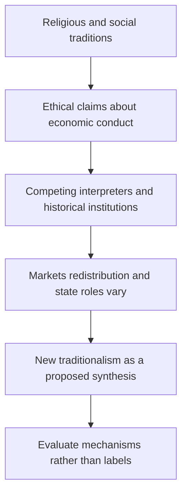

# Compare religious programs and New Traditional aspirations

## Record metadata

```json
{
  "schema_version": 3,
  "owner": "plan",
  "course_id": "2026_2027/Winter_Semester/Comparative_Economics",
  "transaction_id": "PLAN-20261018-CE-P003-LINKS",
  "plan_version": "P003",
  "source_version": "V002",
  "ingestion_revision": 2,
  "objective_id": "O016",
  "objective_revision": 1,
  "criterion_version": "O016-C1",
  "status": "ready",
  "lesson_content_contract": "self-contained-lessons-v1",
  "knowledge_components": [
    "embeddedness_and_normative_vs_analytic_study",
    "six_reading_questions_and_comparative_mechanisms",
    "within_tradition_diversity_and_dated_limits"
  ],
  "prerequisite_ids": [
    "O015"
  ],
  "compatible_versions": [
    {
      "objective_revision": 1,
      "criterion_version": "O016-C1",
      "plan_version": "P002",
      "source_version": "V002",
      "ingestion_revision": 2,
      "reason": "P003 changes only two visible Wiki provenance anchor spellings by removing inline italic markup from the rendered heading target. Exact checked structured headings, complete academic content, questions/keys, quantities, criteria, routes, tools and clocks are unchanged. Current P002 evidence remains compatible; no reassessment or learner result is inferred.",
      "change_class": "formatting_only",
      "requires_reassessment": false
    }
  ],
  "note_locations": [
    {
      "path": "01_Notes/2026_2027/Winter_Semester/Comparative_Economics/Week_3/Religion_and_Economic_Organization.md",
      "heading": "Religion and economic organization"
    },
    {
      "path": "01_Notes/2026_2027/Winter_Semester/Comparative_Economics/Week_3/Religion_and_Economic_Organization.md",
      "heading": "Embedded economies and the proposed “New Traditional Economy”"
    },
    {
      "path": "01_Notes/2026_2027/Winter_Semester/Comparative_Economics/Week_3/Religion_and_Economic_Organization.md",
      "heading": "Religious traditions and economic conduct"
    },
    {
      "path": "01_Notes/2026_2027/Winter_Semester/Comparative_Economics/Week_3/Religion_and_Economic_Organization.md",
      "heading": "The six lecture reading questions"
    },
    {
      "path": "01_Notes/2026_2027/Winter_Semester/Comparative_Economics/Week_3/Religion_and_Economic_Organization.md",
      "heading": "Diversity within the source’s Protestant comparison"
    }
  ],
  "acquisition_rule": {
    "distinct_independent_passes": 2,
    "required_item_roles": [
      "full_capability_check",
      "full_capability_check"
    ],
    "allowed_routes": [
      [
        "O016-I1",
        "O016-I2"
      ],
      [
        "O016-I1",
        "O016-D1"
      ],
      [
        "O016-I1",
        "O016-D2"
      ],
      [
        "O016-I2",
        "O016-D1"
      ],
      [
        "O016-I2",
        "O016-D2"
      ],
      [
        "O016-D1",
        "O016-D2"
      ]
    ]
  },
  "delayed_rule": {
    "minimum_elapsed_hours": 24,
    "fresh_item": true,
    "independent_required": true
  },
  "review_topic": "Compare religious programs and New Traditional aspirations",
  "review_instruction": "Begin a closed-note review with teach for O016; request an unused prepared delayed item before recap."
}
```

## Outcome and conditions

Explain proposed religious re-embedding, answer the supplied reading questions and compare diverse ethical/state/market interpretations with historical care. All essential components listed in metadata are required. Hypothetical assessment values instantiate the checked equations; they are not historical observations or observed outcomes. Independent checks are closed-note and without hints, solution access, external retrieval or other assistance; a basic arithmetic calculator is allowed. Teach establishes and records actual help/exposure conditions before claiming independence.

## Prerequisites and checks

- [O015 outcome and repair route](../lessons/O015.md#outcome-and-conditions): embeddedness and institutional diversity establish the basis for proposed modern re-embedding.

O016-P1, item_version 1, prerequisite_diagnostic. **Prompt:** Does Polanyi’s claim require earlier economies to have no trade or all people to be altruistic?

**Complete key and rubric:** No. O015 distinguishes market activity from whole-system market organization and describes reputation, obligations and power without a uniform psychology. Require both; repair O015. Pass requires every requested reason and result; partial for an omitted reason or unresolved isolated arithmetic slip; fail for the conflicting mechanism. This diagnostic never counts as acquisition. Current or explicitly compatible committed independent prerequisite evidence may permit skipping its check; familiarity alone cannot. Use the cited complete prerequisite lesson or the named included foundation, then the worked example, after a partial/failing entry check.

## Teaching order and rationale

1. Use the diagnostic once to establish the necessary conceptual or algebraic foundation.
2. Present the complete checked-note explanation below, preserving variables, dates, assumptions and source qualifications. Follow one reasoning chain at a time so every intermediate step is visible.
3. Work W1 fully, asking the learner to explain why each step follows.
4. Use S1 as completion practice: show the setup and first identity, hide the final algebra/numbers and interpretation. After an explanation of the missing steps, withdraw support.
5. Present unused I1/I2 full checks with hidden solutions; use correction/repair after scoring the original answer. An unused D form can replace an exposed I only through a listed route.
6. On a later eligible occasion, begin an unused D item before recap. A numeric variant establishes bounded same-method performance, not general transfer.

## Motivation, intuition, and definitions

Explain proposed religious re-embedding, answer the supplied reading questions and compare diverse ethical/state/market interpretations with historical care. Establish the definitions, assumptions and relevant comparisons before simplifying an equation. The complete reused passages establish every academic claim, notation choice and qualification assessed here; necessary prerequisites use the complete lessons above.

## Explanation steps

Origin: reused complete checked passage [[01_Notes/2026_2027/Winter_Semester/Comparative_Economics/Week_3/Religion_and_Economic_Organization.md#Religion and economic organization]]; fingerprint `d251fd4c2dea68517f51f376ccccfd7a1ad3f7b9306eb7b70e46c6ebca9a25f2`. Heading depth and required relative figure-path relocation alone are adapted.

### Religion and economic organization

Source: [[00_Materials/2026_2027/Winter_Semester/Comparative_Economics/Week_3/Comparative Economics - Islamic Economics and the Economics of Other Religions.pdf]]
Source: [[00_Materials/2026_2027/Winter_Semester/Comparative_Economics/Week_3/Week III - lecture - large slides.pdf]]

- [[#Embedded economies and the proposed “New Traditional Economy”|Embedded economies and the proposed “New Traditional Economy”]]
- [[#Religious traditions and economic conduct|Religious traditions and economic conduct]]
- [[#The six lecture reading questions|The six lecture reading questions]]
- [[#Diversity within the source’s Protestant comparison|Diversity within the source’s Protestant comparison]]


The lecture makes traditional organization and its possible modern revival a core comparison. Definitions of embeddedness in [[01_Notes/2026_2027/Winter_Semester/Comparative_Economics/Week_3/Embedded_Economies_and_Kula.md|Embedded economies and the Kula ring]] explain why modern technology need not determine one set of social obligations.



#### Embedded economies and the proposed “New Traditional Economy”

Rosser and Rosser use Karl Polanyi’s idea of embeddedness to distinguish economic organization. In market and command systems, they say, production and distribution decisions are largely made on economic grounds; in traditional economies, decisions are embedded in social and cultural relationships and inherited practices. They identify three “Old Traditional Economy” forms: household sharing, reciprocal gift exchange between groups, and redistribution by a central authority or “Big Man.” The authors note controversy over this taxonomy: formalist economists argue that economies follow universal market principles, while substantivist scholars associated with Polanyi emphasize institutional and cultural variation; another position is that all economies are embedded, but differently. They also qualify Polanyi’s original ordering of household and reciprocal forms. [[00_Materials/2026_2027/Winter_Semester/Comparative_Economics/Week_3/Comparative Economics - Islamic Economics and the Economics of Other Religions.pdf#page=1|Rosser & Rosser, printed pp. 85–86.]]

The “New Traditional Economy” aims to restore religious and social priorities while retaining modern technology. Its advocates present it as a “Third Way” that would combine the efficiency associated with markets, the social concern associated with socialism, and a renewed sense of ethical community. Rosser and Rosser describe this as an aspirational program rather than an established outcome: it looks nostalgically to old communities while seeking to operate in modern settings and use modern communications. The claimed benefits include family and social cohesion; the source also suggests that this can be interpreted as an attempt to build social capital. [[00_Materials/2026_2027/Winter_Semester/Comparative_Economics/Week_3/Comparative Economics - Islamic Economics and the Economics of Other Religions.pdf#page=2|Rosser & Rosser, printed pp. 86–87.]]

#### Religious traditions and economic conduct

The authors distinguish **religious economics**—an advocacy program that seeks to organize society according to a religion’s economic teaching—from **the economics of religion**, the scholarly study of religion’s effects on economic behavior and institutions. Their comparative tour stresses that no single religious tradition yields one uncontested economic model. Teachings, institutions, political movements, historical settings, and interpreters differ within each tradition. Their examples should therefore be read as the authors’ historically situated comparisons, not as exhaustive descriptions of contemporary religions. [[00_Materials/2026_2027/Winter_Semester/Comparative_Economics/Week_3/Comparative Economics - Islamic Economics and the Economics of Other Religions.pdf#page=3|Rosser & Rosser, printed pp. 87–88.]]

In Schumacher’s influential account, Buddhist economics emphasizes spiritual liberation, moderation in consumption, harmony with nature, resource conservation, local production, and self-sufficiency. The authors question whether this ideal describes Buddhism as practiced across diverse societies. They contrast Thailand’s more individualistic religious and market-oriented trajectory with Burmese Buddhist socialism and merit-making practices that may encourage both wealth accumulation and spending on temples rather than productive investment. They also discuss the different political histories of Theravada and Mahayana traditions. The economic implications are presented as varied and historically contingent, not as a single Buddhist prescription. [[00_Materials/2026_2027/Winter_Semester/Comparative_Economics/Week_3/Comparative Economics - Islamic Economics and the Economics of Other Religions.pdf#page=4|Rosser & Rosser, printed pp. 88–89.]]

Confucianism is treated as a philosophy and cultural influence rather than straightforwardly as a religion. Rosser and Rosser outline benevolence, righteousness, propriety, wisdom, and faithfulness, with particular emphasis on hierarchical relationships and education. They describe mixed historical attitudes toward commerce: some passages permit markets under benevolent rule, while later neo-Confucianism opposed commerce, industrialization, and foreign trade. Modern revivals, in their account, tend to support market activity alongside authoritarian governance and state planning. They present claims that Confucian values foster growth together with concerns about cronyism and corruption, especially in light of the East Asian financial crisis of 1997. [[00_Materials/2026_2027/Winter_Semester/Comparative_Economics/Week_3/Comparative Economics - Islamic Economics and the Economics of Other Religions.pdf#page=5|Rosser & Rosser, printed pp. 89–90.]]

The discussion of Hindu economics centers on caste, village-based specialization, and the *jajmani* system, then turns to Gandhi’s *Hind Swaraj*: self-rule and self-sufficiency nationally and locally, village production, restrained consumption, and skepticism toward industrialization and urbanization. Gandhi’s vision included reform of caste practices, especially the oppression of “Untouchables,” while retaining a reformed caste structure. Deendayal Upadhyaya’s later “Integral Humanism” is presented as a New Traditional adaptation that accepts appropriate modern technology while preserving decentralized villages. This is a description of particular thinkers and political tendencies; it must not be taken as an endorsement of caste hierarchy or as a complete account of Hindu thought. [[00_Materials/2026_2027/Winter_Semester/Comparative_Economics/Week_3/Comparative Economics - Islamic Economics and the Economics of Other Religions.pdf#page=6|Rosser & Rosser, printed pp. 90–91.]]

For Judaism, the authors discuss biblical economic rules concerning property, tithes, interest, Sabbath observance, and the Jubilee Year’s debt, land, and emancipation provisions. They describe different modern interpretations, including proposals for redistribution and debt relief, and note that Israel’s economic institutions also reflect secular socialist and state-building influences, not simply religious doctrine. For Christianity, they contrast Aquinas’s just price and opposition to usury; Catholic social teaching’s later support for markets combined with concern about poverty; Christian Democratic welfare-state politics; and Protestant currents ranging from Calvinist associations with capitalism to Anabaptist communalism, the Social Gospel, and divergent American fundamentalist positions. Their box on U.S. Protestant fundamentalism displays internal disagreement between laissez-faire, anti-market, and redistributive views. [[00_Materials/2026_2027/Winter_Semester/Comparative_Economics/Week_3/Comparative Economics - Islamic Economics and the Economics of Other Religions.pdf#page=7|Rosser & Rosser, printed pp. 91–94.]]

The chapter concludes that these examples resist simple religion-to-system mappings. Buddhist traditions range from ecological critique to support for market activity; Confucian-influenced systems combine markets and hierarchy; Hindu economic visions include village self-sufficiency and contested caste reform; Judaic and Christian interpretations range across market, welfare, and redistributive positions. This is the comparative lesson: a tradition can shape economic arguments, but historical institutions and competing interpretations mediate its effects. [[00_Materials/2026_2027/Winter_Semester/Comparative_Economics/Week_3/Comparative Economics - Islamic Economics and the Economics of Other Religions.pdf#page=25|Rosser & Rosser, printed pp. 109–110.]]

**Discussion questions and reasoned answers [[00_Materials/2026_2027/Winter_Semester/Comparative_Economics/Week_3/Comparative Economics - Islamic Economics and the Economics of Other Religions.pdf#page=26|Rosser & Rosser, printed p. 110]].**

1. **In what sense can Buddhist and Hindu economics support modern “green” movements?** Schumacher’s Buddhist economics favors moderate consumption, conservation, harmony with nature, local production, and reduced long-distance transport. Gandhi’s Hindu economic vision favors restrained consumption, self-sufficient villages, and decentralized, appropriate technology. Both can support ecological aims by questioning materialism and resource-intensive growth. The source gives these as intellectual affinities, not evidence that all Buddhist or Hindu communities act uniformly or that the traditions offer identical environmental programs. [[00_Materials/2026_2027/Winter_Semester/Comparative_Economics/Week_3/Comparative Economics - Islamic Economics and the Economics of Other Religions.pdf#page=4|Rosser & Rosser, printed pp. 88–91.]]

2. **Compare Buddhist, Confucian, and Hindu views of the state.** The chapter’s Buddhist examples range from individual responsibility under Thai royal reforms to Burmese welfare-state ideals and socialist central planning. Confucian political thought emphasizes benevolent hierarchy, educated elites, order, and—in modern revivals—market activity combined with an authoritarian state and some planning. Gandhi’s model is more decentralized, emphasizing village self-rule and self-sufficiency; Upadhyaya adapts this to modern small-scale technology. These are contrasting cases and thinkers, not universal doctrines. [[00_Materials/2026_2027/Winter_Semester/Comparative_Economics/Week_3/Comparative Economics - Islamic Economics and the Economics of Other Religions.pdf#page=4|Rosser & Rosser, printed pp. 88–91.]]

3. **Compare Judaic, Catholic, Protestant, and Islamic views of market capitalism.** Rosser and Rosser present Judaic scripture as containing both market-compatible private-property rules and redistributive or interest restrictions, with contemporary interpretations varying. Catholic thought historically includes just-price and usury concerns, later combines support for markets with social protection, and has Christian Democratic welfare-state expression. Protestant traditions range from Calvinist and fundamentalist pro-market positions to communal, Social Gospel, and redistributive alternatives. The Islamic chapter sections likewise show approval of trade and private property alongside zakat, restrictions on riba and other conduct, and arguments for both market capitalism and redistribution. None of these traditions has one uncontested stance. [[00_Materials/2026_2027/Winter_Semester/Comparative_Economics/Week_3/Comparative Economics - Islamic Economics and the Economics of Other Religions.pdf#page=7|Rosser & Rosser, printed pp. 91–94 and 105–110.]]

4. **Why does Islam seem to have a more fully developed economic system than other major religions?** The authors suggest that Islam’s founder Muhammad was a merchant, that the tradition developed a legal framework (Shari’a) with rules relevant to transactions, and that modern Islamic movements have articulated a more explicit program, including zakat, fair dealing, profit-sharing finance, and riba restrictions. They also describe political and institutional reasons for the program’s visibility. This is a claim about the comparative elaboration and public prominence of a modern movement in the authors’ account, not proof that other religions lack economic thought or that Muslims agree on one system. [[00_Materials/2026_2027/Winter_Semester/Comparative_Economics/Week_3/Comparative Economics - Islamic Economics and the Economics of Other Religions.pdf#page=3|Rosser & Rosser, printed pp. 87–88, 94–95, 97–100, 101–104.]]

**Limitations and terminology.** The chapter’s publication context predates many subsequent developments and uses country labels, political descriptions, demographic claims, and present-tense assertions that are dated. Do not restate its current-sounding numbers, election results, country lists, or claims about political conditions as current facts. The source itself notes scholarly disputes over Polanyi’s categories and diversity within religious traditions. Older terms such as “Hinayana,” “Mohammedan,” “fundamentalist,” and some country/place names require attribution and care; use contemporary neutral labels in explanatory prose while retaining historical source wording only when necessary. [[00_Materials/2026_2027/Winter_Semester/Comparative_Economics/Week_3/Comparative Economics - Islamic Economics and the Economics of Other Religions.pdf#page=1|Rosser & Rosser, printed pp. 85–110.]]


#### The six lecture reading questions

**Schumacher and environmentalism:** moderation, local production, reduced transport, conservation and respect for nonrenewable resources explain the affinity. The ideal does not establish that every Buddhist economy implements it. [[00_Materials/2026_2027/Winter_Semester/Comparative_Economics/Week_3/Comparative Economics - Islamic Economics and the Economics of Other Religions.pdf#page=3|Rosser & Rosser, chapter 4, physical PDF pp. 3–5]]

**Crucial Confucian elements:** benevolence, righteousness, propriety, wisdom and faithfulness; relationships of hierarchical duty, educated leadership and reciprocal obligations, with benevolent rule rather than an automatic commitment to one ownership system. The chapter contrasts older anti-commercial currents with modern market/authoritarian combinations. [[00_Materials/2026_2027/Winter_Semester/Comparative_Economics/Week_3/Comparative Economics - Islamic Economics and the Economics of Other Religions.pdf#page=5|Rosser & Rosser, chapter 4, physical PDF pp. 5–6]]

**Jajmani:** a local, relatively self-sufficient village arrangement in which hereditary caste-based occupations provide complementary goods/services through a stable division of labour and customary relations. It is neither simply a freely entered modern labour contract nor identical to every form of Indian village organization. [[00_Materials/2026_2027/Winter_Semester/Comparative_Economics/Week_3/Comparative Economics - Islamic Economics and the Economics of Other Religions.pdf#page=6|Rosser & Rosser, chapter 4, physical PDF pp. 6]]

**Jubilee:** the chapter connects seven Sabbath-year cycles (49 years) to a Jubilee, when property returns to its original owner and recently acquired slaves are freed, including debt release. Modern proposals extend this idea to debt relief, but the biblical rule and a contemporary policy are distinct. The source uses the 49-year cycle; do not confuse it with an annual tax or claim it describes actual current practice. [[00_Materials/2026_2027/Winter_Semester/Comparative_Economics/Week_3/Comparative Economics - Islamic Economics and the Economics of Other Religions.pdf#page=7|Rosser & Rosser, chapter 4, physical PDF pp. 7–8]]

**Judaism and interest:** the chapter reports a restriction on charging interest among Jews with a different rule for lending to non-Jews, plus a footnoted qualification for destitute borrowers. Describe the distinction and interpretive context; “all interest everywhere forbidden by Judaism” would erase the supplied rule’s boundary. [[00_Materials/2026_2027/Winter_Semester/Comparative_Economics/Week_3/Comparative Economics - Islamic Economics and the Economics of Other Religions.pdf#page=7|Rosser & Rosser, chapter 4, physical PDF pp. 7]]

**Aristotle’s ideas in Christianity:** the chapter identifies a just price and an abhorrence of interest as ideas Aquinas reconciled with Christian theology. This historically situated synthesis is different from a claim that every Christian movement has adopted one identical stance on finance. [[00_Materials/2026_2027/Winter_Semester/Comparative_Economics/Week_3/Comparative Economics - Islamic Economics and the Economics of Other Religions.pdf#page=8|Rosser & Rosser, chapter 4, physical PDF pp. 8]]

The Week III assignment asks for oral discussion rather than written submission. Its alternative Rosser–Rosser title is a reading lead, not a second supplied chapter audited here. [[00_Materials/2026_2027/Winter_Semester/Comparative_Economics/Week_3/Week III - lecture - large slides.pdf#page=3|Week III lecture, physical PDF pp. 3]]

#### Diversity within the source’s Protestant comparison

| Position in Box 4-1 | Economic stance described in the historical source |
|---|---|
| Strict fundamentalists | Avoid extensive political/economic theorizing or emphasize individual spiritual conduct. |
| New Christian Right | Endorse a pro-market Chicago-style approach alongside moral/religious political aims. |
| Christian Reconstructionists | Prefer an Austrian/libertarian framework, a flat tax and gold-based money, oppose income redistribution and broad state intervention. |
| Evangelical left | Accept markets more conditionally and support greater redistribution on the basis of social concern. |
| Radical evangelicalism | Advocates a socialist alternative. |

These are the authors’ categories and examples, not an exhaustive contemporary typology. Their variation is the point: a religious label alone does not identify a policy package. [[00_Materials/2026_2027/Winter_Semester/Comparative_Economics/Week_3/Comparative Economics - Islamic Economics and the Economics of Other Religions.pdf#page=10|Rosser & Rosser, chapter 4, physical PDF pp. 10]]


## Worked example

O016-W1, item_version 1, worked_example. **Prompt:** A hypothetical movement proposes community obligations and modest consumption while retaining modern communications. Explain New Traditional aspirations and embeddedness debates, religious economics versus economics of religion, the six lecture prompts (Schumacher, Confucian elements, jajmani, Jubilee, Judaism/interest, Aristotle/Aquinas), environmental/state contrasts and market interpretations across religions. Explain the Protestant comparison and why a label does not identify a current policy bundle.

**Complete solution and essential rubric:** The movement seeks religious/social re-embedding with modern technology: an aspirational Third Way, not proven efficiency, equality or cohesion. Religious economics advocates a normative program; economics of religion studies behaviour/institutions. Formalists emphasize universal market principles, substantivists institutional variation, and another position says all economies are embedded differently. Schumacher’s moderation, local production, conservation and reduced transport, and Gandhi’s restrained consumption/village self-rule, give environmental affinities rather than uniform religious conduct. Confucian elements are benevolence, righteousness, propriety, wisdom and faithfulness with hierarchy, reciprocal duty and education; older anti-commercial and modern market/authoritarian positions differ. Jajmani is hereditary caste-linked village specialization/customary exchange, not a freely entered modern labour contract. Gandhi sought reform of oppression with a reformed caste structure; Upadhyaya accepted appropriate modern technology. Jubilee follows seven Sabbath-year cycles/49 years and concerns restoration, debt and emancipation, not an annual tax or universal present practice. The chapter reports differing interest rules for in-group/out-group, with a destitute-borrower qualification; no uniform all-interest prohibition follows. Aquinas reconciled just-price and anti-usury ideas with Christianity; later Catholic teaching combines markets and social protection. Buddhist state examples range from Thai individualism to Burmese welfare/socialism; Confucian hierarchy differs from Gandhi’s decentralization. Judaic property and redistribution, Catholic welfare, Protestant pro-market/communal/Social Gospel positions and Islamic trade/property with zakat/riba restrictions resist single mappings. Box 4-1 ranges from strict spiritual focus, New Christian Right pro-market views and Reconstructionist libertarian flat-tax/gold/opposition to redistribution to evangelical-left redistribution and radical evangelical socialism. The authors’ merchant/legal/modern-movement account motivates Islamic economics’ visibility, not doctrinal unanimity or absence of other traditions’ economic thought. All country/political/demographic claims are publication-period examples; oral assignments do not establish whole-exam coverage. All requested calculations, derivations and qualifications are essential; the component map above applies to every full form.

## Practice with fading assistance

O016-S1, item_version 1, supported_completion. **Prompt:** A hypothetical movement proposes religious ethical priorities while retaining modern machinery. Explain New Traditional aspirations and embeddedness debates, religious economics versus economics of religion, the six lecture prompts (Schumacher, Confucian elements, jajmani, Jubilee, Judaism/interest, Aristotle/Aquinas), environmental/state contrasts and market interpretations across religions. Explain the Protestant comparison and why a label does not identify a current policy bundle.

**Complete solution and essential rubric:** The movement seeks religious/social re-embedding with modern technology: an aspirational Third Way, not proven efficiency, equality or cohesion. Religious economics advocates a normative program; economics of religion studies behaviour/institutions. Formalists emphasize universal market principles, substantivists institutional variation, and another position says all economies are embedded differently. Schumacher’s moderation, local production, conservation and reduced transport, and Gandhi’s restrained consumption/village self-rule, give environmental affinities rather than uniform religious conduct. Confucian elements are benevolence, righteousness, propriety, wisdom and faithfulness with hierarchy, reciprocal duty and education; older anti-commercial and modern market/authoritarian positions differ. Jajmani is hereditary caste-linked village specialization/customary exchange, not a freely entered modern labour contract. Gandhi sought reform of oppression with a reformed caste structure; Upadhyaya accepted appropriate modern technology. Jubilee follows seven Sabbath-year cycles/49 years and concerns restoration, debt and emancipation, not an annual tax or universal present practice. The chapter reports differing interest rules for in-group/out-group, with a destitute-borrower qualification; no uniform all-interest prohibition follows. Aquinas reconciled just-price and anti-usury ideas with Christianity; later Catholic teaching combines markets and social protection. Buddhist state examples range from Thai individualism to Burmese welfare/socialism; Confucian hierarchy differs from Gandhi’s decentralization. Judaic property and redistribution, Catholic welfare, Protestant pro-market/communal/Social Gospel positions and Islamic trade/property with zakat/riba restrictions resist single mappings. Box 4-1 ranges from strict spiritual focus, New Christian Right pro-market views and Reconstructionist libertarian flat-tax/gold/opposition to redistribution to evangelical-left redistribution and radical evangelical socialism. The authors’ merchant/legal/modern-movement account motivates Islamic economics’ visibility, not doctrinal unanimity or absence of other traditions’ economic thought. All country/political/demographic claims are publication-period examples; oral assignments do not establish whole-exam coverage. All requested calculations, derivations and qualifications are essential; the component map above applies to every full form.

Allowed support is the first stated identity only; hide the remaining key while the learner completes it. Supported performance is practice, not an independent result.

## Rubric and independence

Required components: embeddedness_and_normative_vs_analytic_study, six_reading_questions_and_comparative_mechanisms, within_tradition_diversity_and_dated_limits. Each full prompt/key below elicits every component; all are necessary for a pass on every permitted pair. Accept algebraically equivalent expressions and clearly defined opposite cash-flow signs with correct interpretation. A pass requires all requested outputs/reasons, correct units/assumptions and no critical conceptual error. Partial means a missing component or an unresolved isolated arithmetic slip with an otherwise valid method; independent correction is required for a pass. Fail means a critical mechanism/condition is wrong. Unscorable means a response or its help/exposure conditions cannot be established. Unknown help conditions are never independent evidence.

Critical errors: One religion identifies one policy; aspirational Third Way treated as proven; jajmani called free modern employment; Jubilee called annual tax.

Acquisition requires two distinct unused unassisted full checks selected from the six exact metadata routes. Every I/D form covers all components; W1, S1, the prerequisite and C1 are forbidden substitutes. A D form used for acquisition cannot later be counted again as delayed success. No teach-generated item may replace a named full check; additional verified explanation/practice is allowed under the unchanged method and may not fabricate evidence. If fewer than two fresh forms remain for acquisition, return a plan_issue for an additional prepared bank.

| Component | I1 | I2 | D1 | D2 |
|---|---|---|---|---|
| embeddedness_and_normative_vs_analytic_study | required | required | required | required |
| six_reading_questions_and_comparative_mechanisms | required | required | required | required |
| within_tradition_diversity_and_dated_limits | required | required | required | required |

## Misconceptions and correction

An observed omitted term/sign is tentative until the learner explains it; compare the reasoning with the critical errors above. Score the original response before providing help. Route a conceptual failure to the relevant included derivation and prerequisite, then use an unused full form.

O016-C1, item_version 1, narrow_correction. **Prompt:** Does the source’s Protestant comparison establish one pro-market policy for all Protestants? **Key/rubric:** No. Its historical box contains pro-market, libertarian, redistributive and socialist positions; interpretive/political institutions mediate the effects of a label. Pass requires all keyed reasoning; partial for a missing part; fail for the conflicting mechanism. This repairs a common inference only; it cannot substitute for a full numerical/capability check.

Give at most two hints (first identify the date/unit, second point to the included identity); after ineffective hints show the relevant worked step. After two unsuccessful independent attempts stop repeated quizzing, revisit the explanation/prerequisite and preserve the unresolved status.

## Immediate and delayed checks

### O016-I1

O016-I1, item_version 1, full_capability_check. **Prompt:** A modern ethical charter proposes local low-resource production with advanced communications. Its drafter says religious re-embedding is impossible with modern technology; Schumacher advocates maximal consumption; Confucian thought always bans markets; jajmani is freely chosen modern wage work; Jubilee is an annual wealth tax; Judaism forbids every interest charge without distinctions; and Aquinas defended unrestricted interest rather than just price. Audit all six lecture-question claims and the technology claim. Distinguish religious economics from economics of religion and formalist/substantivist/all-embedded views. Compare the source’s Buddhist/Hindu,state,market and Protestant alternatives without claiming a religion determines present policy.

**Complete solution and essential rubric:** The charter can express New Traditional aspirations: restored ethical/social priorities with modern technology, not a demonstrated efficient/equal Third Way. Religious economics advocates the program, whereas economics of religion analyses behaviour/institutions. Formalists emphasize universal market principles, substantivists institutional/cultural variation, and another view sees all economies embedded differently. Schumacher’s moderation, conservation, local production and reduced transport contradict maximal-consumption language and give an environmental affinity; Gandhi’s restraint/village self-rule has a related but distinct affinity, not uniform Buddhist/Hindu conduct. Confucian benevolence, righteousness, propriety, wisdom and faithfulness emphasize hierarchy/reciprocal duty/education; older anti-commercial and modern market/authoritarian currents refute always-bans-markets. Jajmani is hereditary caste-linked complementary village occupations/customary exchange, not freely chosen modern employment; Gandhi’s reformed caste vision and Upadhyaya’s appropriate technology remain specific programs. Jubilee follows seven Sabbath-year cycles/49 years with property restoration, emancipation/debt provisions, not an annual wealth tax. The chapter’s Judaism account distinguishes in-group/out-group lending and qualifies destitute borrowers; no universal prohibition follows. Aquinas reconciled Aristotelian just price/anti-usury with Christianity; later Catholic market/social-protection positions differ. Buddhist state examples vary Thai individualism/Burmese planning, Confucian educated hierarchy differs from Gandhian decentralization, and Judaic/Christian/Islamic property/redistribution arguments vary. Protestant Box 4-1 includes spiritual-focus, New Christian Right pro-market, Reconstructionist libertarian, evangelical left redistributive and radical socialist positions; a label cannot settle the charter’s policy. Publication-period cases, contested interpretations and oral-assignment scope remain explicit. Require corrections to every claim, study/advocacy and embedding distinctions, comparative mechanisms and dated/diverse limits.

I1/I2 are immediate checks; D1/D2 are distinct parallel variants reserved where possible for delayed checks. A delayed success requires an unused form before recap, no help/solution access, and at least 24 actual elapsed hours after acquisition and the most recent relevant teaching/solution exposure. Record intervening exposure. A calendar-date change alone is insufficient; an early D attempt is immediate evidence only.

### O016-I2

O016-I2, item_version 1, full_capability_check. **Prompt:** An archive juxtaposes Thai market-oriented examples with Burmese Buddhist planning; older anti-commercial Confucian passages with modern market/authoritarian combinations; Gandhi’s village ideal with Upadhyaya’s modern appropriate technology; and a contemporary debt-relief proposal inspired by Jubilee. A researcher concludes these contrasts are transcription mistakes because each religion must imply one policy. Explain each contrast, including Schumacher’s environmental mechanism, the five Confucian virtues, jajmani’s institutional form, the 49-year Jubilee rule versus modern proposal, the Judaism interest boundary and Aquinas’s Aristotelian synthesis. Locate the study/program distinction and New Traditional/embeddedness debate; test the one-policy thesis with the Protestantbox and other market/state interpretations.

**Complete solution and essential rubric:** The contrasts are the chapter’s evidence of competing historically situated interpretations, not contradictions removable by selecting one true policy label. Thai and Burmese examples show differing Buddhist state/economic paths; Schumacher’s moderation, conservation/local production and reduced transport are an ideal with green affinity, not a description of all practice. Confucian benevolence, righteousness, propriety, wisdom and faithfulness combine hierarchy, education and reciprocal obligations; old anti-commerce and modern market/planning mixtures are distinct currents. Gandhi’s restrained, self-governing village ideal and Upadhyaya’s appropriate modern technology differ without making hereditary caste-based jajmani a free modern contract. A Jubilee-inspired debt proposal is a new policy application; the source’s seven Sabbath cycles/49-year restoration, debt/emancipation rule is neither an annual tax nor proof current universal practice. Its Judaism lending distinction is in-/out-group with a destitute qualification, while Aquinas reconciles Aristotle’s just price and anti-usury with Christianity, not every later Christian view. Economicsofreligion analyses these effects; religious economics advocates a normative organization. New Traditional advocates seek ethical community with modern technology, an aspiration rather than proven synthesis. Formalists stress universal market principles, substantivists institutional variation and an alternative all-embedded view differing forms. Protestant Box 4-1 supplies spiritual-focus, pro-marketNew Christian Right, libertarian Reconstructionist, redistributive evangelical left and socialist alternatives; Judaic property/redistribution, Catholic markets/social protection and Islamic trade/property with zakat/riba constraints likewise resist one mapping. No current country/rule follows from dated examples. Require explanation of every archive contrast, all six reading mechanisms and the normative/analytic/diversity boundaries.

### O016-D1

O016-D1, item_version 1, full_capability_check. **Prompt:** A grant committee must assess a village project combining modern small-scale machinery, customary reciprocal services and an ethical claim of restrained consumption. One reviewer calls it automatically an efficient New Traditional Third Way; another says hereditary occupations are free contracts because money sometimes changes hands. A financial annex treats every Jubilee-inspired debt cancellation as the chapter’s actual annual rule and charges that Aquinas and every Protestant share one pro-market interest doctrine. Give an evidence-based assessment: distinguish advocacy from analysis and embedding debates; address Schumacher/green affinity, Confucian virtues/state variation, jajmani, Jubilee, the Judaism lending boundary and Aristotle/Aquinas. Use the source’s religious/state/market contrasts and Protestantbox to specify which conclusions the committee cannot infer.

**Complete solution and essential rubric:** The project resembles an aspiration to re-embed modern production in social/ethical priorities, but machinery plus community aims does not demonstrate efficiency, equality or social-capital outcomes. Advocacy is religious economics; analysing its consequences is economics of religion. Formalist universal-market, substantivist institution-sensitive and all-economies-differently-embedded positions disagree about interpretation, so exchanging some money does not settle the organizing institution. Schumacher’s moderation, conservation/local production/reduced transport and Gandhi’s restraint/decentralization give ecological affinities, not measured project success. Confucian benevolence, righteousness, propriety, wisdom, faithfulness, reciprocal hierarchy and educated leadership do not choose one ownership model; older anti-commerce and modern market/authoritarian cases differ, as do Thai/Burmese Buddhist state paths. Jajmani’s hereditary caste-linked complementary services differ from a freely entered wage contract even with payments; Gandhi’s reform and Upadhyaya’s appropriate technology are specific visions. Jubilee’s seven Sabbath cycles/49-year restoration/debt/emancipation differs from annual cancellation or any contemporary policy. The chapter’s Judaism interest rules distinguish in-/out-group with a destitute-borrower qualification. Aquinas’s Aristotelian just-price/anti-usury synthesis cannot be equated with all later Christian markets/social protection or Protestant positions. Box 4-1 contrasts spiritual-focus, pro-marketNew Christian Right, libertarian Reconstructionist, evangelical left redistribution and radical socialism; Judaic, Catholic and Islamic interpretations also combine property/trade and social obligations differently. Require the project/annex-specific corrections, all six concepts, study-versus-program/embeddedness distinctions and explicit historical/diversity limits; no universal current policy conclusion follows.

### O016-D2

O016-D2, item_version 1, full_capability_check. **Prompt:** A forecasting memo quotes largely correct source details but makes new deductions: Schumacher’s conservation ideal allegedly proves every Buddhist state achieves green outcomes; Confucian educated hierarchy allegedly selects private ownership alone; Upadhyaya’s acceptance of appropriate technology allegedly makes his program identical to Gandhi’s; a 49-year Jubilee account allegedly orders cancellation of every present loan today; reported variation in Judaism allegedly means the chapter supplies no lending boundary at all; and Aquinas’s anti-usury synthesis allegedly makes later Catholic acceptance of markets impossible. Evaluate all six deductions. In evaluating the third deduction, define jajmani and explain whether adopting modern technology by itself converts hereditary village services into freely entered wage contracts. Compare the state/market alternatives and Protestantbox; distinguish study from advocacy and New Traditional aspirations/embedding debates. Finally assess whether Islamic economics’visibility establishes exclusive economic thought or a predictable present policy ranking.

**Complete solution and essential rubric:** The memo confuses a source definition, an advocated ideal, a historical institution and an empirical forecast. Schumacher’s moderation, conservation, local production and reduced transport have green affinities, but Buddhist practice/state forms vary, including Thai individualistic/market and Burmese welfare/planning examples; no measured universal outcome follows. Confucian benevolence, righteousness, propriety, wisdom and faithfulness with education/hierarchical reciprocity do not select private ownership: older anti-commerce and modern market/authoritarian mixtures differ. Upadhyaya’s appropriate modern technology is an adaptation, not identity with Gandhi’s restrained self-governing village ideal; jajmani remains hereditary caste-linked complementary village services, not necessarily voluntary modern employment. Installing modern technology does not by itself change inherited obligations or freedom to enter and leave a wage contract; the institutional terms must actually change. The chapter’s seven Sabbath-year cycles/49-year Jubilee concerns restoration/debt/emancipation; it does not itself issue a present legal instruction for every loan or define an annual tax. Interpretive variation does not erase the reported Judaism in-group/out-group interest distinction and destitute-borrower qualification. Aquinas’s Aristotelian just-price/anti-usury synthesis is historically distinct from later Catholic markets with social protection. Protestant Box 4-1 likewise spans spiritual focus, pro-marketNew Christian Right, libertarian Reconstructionists, evangelical left redistribution and radical socialism; Judaic/Christian/Islamic property and welfare arguments resist a single ranking. Religious economics advocates a normative program; economics of religion studies its effects. Formalist universal-market, substantivist institutional and all-economies-differently-embedded positions frame the disagreement. New Traditional movements seek ethical re-embedding with modern technology, an aspiration rather than demonstrated Third Way benefits. The authors’merchant/legal/modern-movement account explains Islamic economics’comparative visibility, not exclusive economic thought or unanimity. Require a separate reason rejecting each memo deduction, the six underlying concepts, historical/state/market contrasts and bounded source/current-policy distinction.

## Advance, revisit, pause, and escalate

Advance only after teach commits two qualifying independent full passes under a listed route. Keep acquisition and each later delayed observation separate. A source conflict blocks the affected claim and returns to ingest with the exact note heading. Missing criteria, a new method, unsupported alternative or exhausted fresh bank returns to plan with 2026_2027/Winter_Semester/Comparative_Economics, O016, revision1/O016-C1, P003/V002/ingestion2 and item ID. Equivalent valid methods meeting the frozen criterion may receive credit after verification; no criterion is changed to fit an answer. Closing a session preserves the actual stopping point without claiming completion.

## Content provenance and generation boundaries

Explanations, figures and qualifications above reuse complete checked-note sections with exact origin/fingerprint; heading depth alone is adapted. Main exercises and worked arithmetic are plan-created hypothetical instantiations of those displayed identities. No additional academic claims or external course scope are introduced. Preserve the note conventions and explicit qualifications; checked references reused from notes are not an independent raw-source audit by plan. New numerical practice can use the same method only after its complete solution and unchanged components are checked before display; it cannot replace this lesson’s named evidence forms. Prerequisites route to the complete prepared lessons above.

## Answer-free recall handoff

Topic: Compare religious programs and New Traditional aspirations. Begin a closed-note review with teach for O016; request an unused prepared delayed item before recap. Exact lesson: [[03_Agents/2026_2027/Winter_Semester/Comparative_Economics/lessons/O016.md#Immediate and delayed checks]]. Teach supplies actual committed evidence and timestamps; recall alone dates reviews. No learner outcome or due date is created by this curriculum.
