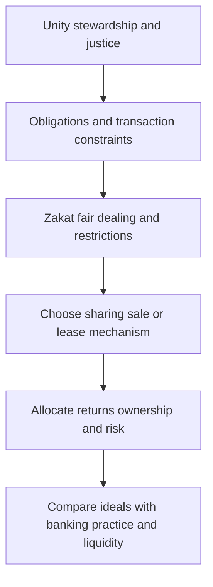

# Explain Islamic principles, interpretation and economic diversity

## Record metadata

```json
{
  "schema_version": 3,
  "owner": "plan",
  "course_id": "2026_2027/Winter_Semester/Comparative_Economics",
  "transaction_id": "PLAN-20261018-CE-P003-LINKS",
  "plan_version": "P003",
  "source_version": "V002",
  "ingestion_revision": 2,
  "objective_id": "O018",
  "objective_revision": 1,
  "criterion_version": "O018-C1",
  "status": "ready",
  "lesson_content_contract": "self-contained-lessons-v1",
  "knowledge_components": [
    "conditional_zakat_arithmetic_and_principles",
    "chronology_legal_interpretation_and_risk_debates",
    "riba_property_and_unresolved_program_evaluation"
  ],
  "prerequisite_ids": [
    "O016",
    "O003"
  ],
  "compatible_versions": [
    {
      "objective_revision": 1,
      "criterion_version": "O018-C1",
      "plan_version": "P002",
      "source_version": "V002",
      "ingestion_revision": 2,
      "reason": "P003 changes only two visible Wiki provenance anchor spellings by removing inline italic markup from the rendered heading target. Exact checked structured headings, complete academic content, questions/keys, quantities, criteria, routes, tools and clocks are unchanged. Current P002 evidence remains compatible; no reassessment or learner result is inferred.",
      "change_class": "formatting_only",
      "requires_reassessment": false
    }
  ],
  "note_locations": [
    {
      "path": "01_Notes/2026_2027/Winter_Semester/Comparative_Economics/Week_3/Islamic_Finance_and_Institutional_Diversity.md",
      "heading": "Islamic finance and institutional diversity"
    },
    {
      "path": "01_Notes/2026_2027/Winter_Semester/Comparative_Economics/Week_3/Islamic_Finance_and_Institutional_Diversity.md",
      "heading": "Historical setting and diversity of Islamic interpretation"
    },
    {
      "path": "01_Notes/2026_2027/Winter_Semester/Comparative_Economics/Week_3/Islamic_Finance_and_Institutional_Diversity.md",
      "heading": "Chronology, succession and interpretation"
    },
    {
      "path": "01_Notes/2026_2027/Winter_Semester/Comparative_Economics/Week_3/Islamic_Finance_and_Institutional_Diversity.md",
      "heading": "Foundational principles and obligations"
    },
    {
      "path": "01_Notes/2026_2027/Winter_Semester/Comparative_Economics/Week_3/Islamic_Finance_and_Institutional_Diversity.md",
      "heading": "Gharar, qirad, and the problem of risk"
    },
    {
      "path": "01_Notes/2026_2027/Winter_Semester/Comparative_Economics/Week_3/Islamic_Finance_and_Institutional_Diversity.md",
      "heading": "Riba, competing economic arguments, and banking practice"
    },
    {
      "path": "01_Notes/2026_2027/Winter_Semester/Comparative_Economics/Week_3/Islamic_Finance_and_Institutional_Diversity.md",
      "heading": "Property, capitalism, socialism, and unresolved outcomes"
    },
    {
      "path": "01_Notes/2026_2027/Winter_Semester/Comparative_Economics/Week_3/Islamic_Finance_and_Institutional_Diversity.md",
      "heading": "Contract mechanisms, securities and the lecture’s corrections"
    },
    {
      "path": "01_Notes/2026_2027/Winter_Semester/Comparative_Economics/Week_3/Islamic_Finance_and_Institutional_Diversity.md",
      "heading": "Risk, liquidity and dated industry evidence"
    }
  ],
  "acquisition_rule": {
    "distinct_independent_passes": 2,
    "required_item_roles": [
      "full_capability_check",
      "full_capability_check"
    ],
    "allowed_routes": [
      [
        "O018-I1",
        "O018-I2"
      ],
      [
        "O018-I1",
        "O018-D1"
      ],
      [
        "O018-I1",
        "O018-D2"
      ],
      [
        "O018-I2",
        "O018-D1"
      ],
      [
        "O018-I2",
        "O018-D2"
      ],
      [
        "O018-D1",
        "O018-D2"
      ]
    ]
  },
  "delayed_rule": {
    "minimum_elapsed_hours": 24,
    "fresh_item": true,
    "independent_required": true
  },
  "review_topic": "Explain Islamic principles, interpretation and economic diversity",
  "review_instruction": "Begin a closed-note review with teach for O018; request an unused prepared delayed item before recap."
}
```

## Outcome and conditions

Compute a stipulated zakat illustration and explain diverse principles/history/risk/property arguments without issuing contemporary doctrine. All essential components listed in metadata are required. Hypothetical assessment values instantiate the checked equations; they are not historical observations or observed outcomes. Independent checks are closed-note and without hints, solution access, external retrieval or other assistance; a basic arithmetic calculator is allowed. Teach establishes and records actual help/exposure conditions before claiming independence.

## Prerequisites and checks

- [O016 outcome and repair route](../lessons/O016.md#outcome-and-conditions): religious advocacy and within-tradition diversity precede the specific Islamic program.
- [O003 outcome and repair route](../lessons/O003.md#outcome-and-conditions): verification and incentives remain relevant within different contractual institutions.

O018-P1, item_version 1, prerequisite_diagnostic. **Prompt:** Why does a religious label not establish one economic model, and how can unverifiable actions undermine a contract?

**Complete key and rubric:** O016 establishes competing interpretations/context; O003 identifies information and incentive problems requiring credible remedies. Require both; repair those lessons. Pass requires every requested reason and result; partial for an omitted reason or unresolved isolated arithmetic slip; fail for the conflicting mechanism. This diagnostic never counts as acquisition. Current or explicitly compatible committed independent prerequisite evidence may permit skipping its check; familiarity alone cannot. Use the cited complete prerequisite lesson or the named included foundation, then the worked example, after a partial/failing entry check.

## Teaching order and rationale

1. Use the diagnostic once to establish the necessary conceptual or algebraic foundation.
2. Present the complete checked-note explanation below, preserving variables, dates, assumptions and source qualifications. Follow one reasoning chain at a time so every intermediate step is visible.
3. Work W1 fully, asking the learner to explain why each step follows.
4. Use S1 as completion practice: show the setup and first identity, hide the final algebra/numbers and interpretation. After an explanation of the missing steps, withdraw support.
5. Present unused I1/I2 full checks with hidden solutions; use correction/repair after scoring the original answer. An unused D form can replace an exposed I only through a listed route.
6. On a later eligible occasion, begin an unused D item before recap. A numeric variant establishes bounded same-method performance, not general transfer.

## Motivation, intuition, and definitions

Compute a stipulated zakat illustration and explain diverse principles/history/risk/property arguments without issuing contemporary doctrine. Establish the definitions, assumptions and relevant comparisons before simplifying an equation. The complete reused passages establish every academic claim, notation choice and qualification assessed here; necessary prerequisites use the complete lessons above.

## Explanation steps

Origin: reused complete checked passage [[01_Notes/2026_2027/Winter_Semester/Comparative_Economics/Week_3/Islamic_Finance_and_Institutional_Diversity.md#Islamic finance and institutional diversity]]; fingerprint `01147e8ee729e8caeb0839c93797a7233d349875f87f720597d5609822c4c504`. Heading depth and required relative figure-path relocation alone are adapted.

### Islamic finance and institutional diversity

Source: [[00_Materials/2026_2027/Winter_Semester/Comparative_Economics/Week_3/Comparative Economics - Islamic Economics and the Economics of Other Religions.pdf]]
Source: [[00_Materials/2026_2027/Winter_Semester/Comparative_Economics/Week_3/Week III - lecture - large slides.pdf]]

- [[#Historical setting and diversity of Islamic interpretation|Historical setting and diversity of Islamic interpretation]]
- [[#Chronology, succession and interpretation|Chronology, succession and interpretation]]
- [[#Foundational principles and obligations|Foundational principles and obligations]]
- [[#Gharar, qirad, and the problem of risk|Gharar, qirad, and the problem of risk]]
- [[#Riba, competing economic arguments, and banking practice|Riba, competing economic arguments, and banking practice]]
- [[#Property, capitalism, socialism, and unresolved outcomes|Property, capitalism, socialism, and unresolved outcomes]]
- [[#Contract mechanisms, securities and the lecture’s corrections|Contract mechanisms, securities and the lecture’s corrections]]
- [[#Risk, liquidity and dated industry evidence|Risk, liquidity and dated industry evidence]]


The lecture gives Islamic finance a central role in the proposed new traditional economy. The contract mechanisms need the broader distinction between ethical programs and observed institutions explained in [[01_Notes/2026_2027/Winter_Semester/Comparative_Economics/Week_3/Religion_and_Economic_Organization.md|Religion and economic organization]].



#### Historical setting and diversity of Islamic interpretation

Rosser and Rosser begin the Islamic discussion with Muhammad’s life, the early community, the caliphate, and the development of the Qur’an, Hadith, and Shari’a. They describe the spread of Islam through conversion and political expansion and the later rise of multiple legal schools. They stress that even accepted foundational sources admit varying interpretations of economic questions, including differences between Shari’a schools. In the modern era, Islamic economics gained visibility amid anti-colonial nationalism, disappointment with post-independence economic models, concern about sovereignty, oil wealth, and appeals to a shared historical identity. Their account includes broad generalizations and political examples tied to its publication period; retain attribution and historical framing. [[00_Materials/2026_2027/Winter_Semester/Comparative_Economics/Week_3/Comparative Economics - Islamic Economics and the Economics of Other Religions.pdf#page=10|Rosser & Rosser, printed pp. 94–99.]]

#### Chronology, succession and interpretation

The supplied lecture dates the beginning of Muhammad’s revelations to around **610**, as part of the religious tradition it describes. The **622 Hijra**—migration to Medina—marks year one of the Islamic calendar and the formation of the **umma**, a religious, political and economic community. After Muhammad’s death in **632**, a caliph was chosen to lead that community without succeeding to prophetic status. The source traces early conquests, a large domain by 644, the confrontation at Tours in 732, and the Abbasid period based in Baghdad after **750**, portrayed as a centre of science and commerce. Political fragmentation by the mid-900s did not end religious expansion: the chapter’s **900–1700** account includes conversion under existing rulers, successor-state conquests, and merchant/missionary networks in different regions. These are source-attributed historical sequences; they do not mean all expansion occurred by one mechanism. [[00_Materials/2026_2027/Winter_Semester/Comparative_Economics/Week_3/Week III - lecture - large slides.pdf#page=29|Physical PDF pp. 29]] [[00_Materials/2026_2027/Winter_Semester/Comparative_Economics/Week_3/Comparative Economics - Islamic Economics and the Economics of Other Religions.pdf#page=10|Physical PDF pp. 10–13]]

The chapter connects the Sunni–Shi’a distinction to struggles over succession, including Ali, Mu’awiya and the 680 killing of Husayn at Karbala. That conflict concerns political and religious authority, which helps explain why a shared faith need not produce one legal or institutional practice. Its modern population shares and country-political descriptions are dated and are not adopted as present facts. [[00_Materials/2026_2027/Winter_Semester/Comparative_Economics/Week_3/Comparative Economics - Islamic Economics and the Economics of Other Religions.pdf#page=12|Physical PDF pp. 12]]

The chapter describes the **Qur’an** and **Hadith** as foundational for Shari’a, with interpretation shaped by language, the authenticity of reported sayings, local traditions and legal scholarship. Its four named Sunni schools are **Hanafi, Maliki, Shafi’i and Hanbali**. Naming them identifies organized traditions of interpretation; the source’s compressed strict/liberal country rankings are not timeless rules for every financial contract. [[00_Materials/2026_2027/Winter_Semester/Comparative_Economics/Week_3/Comparative Economics - Islamic Economics and the Economics of Other Religions.pdf#page=11|Physical PDF pp. 11–13]]

**Ijtihad** refers here to interpretation/reasoning about new practices. The chapter’s footnote reports the historical “closed gate” thesis after the tenth century and a claimed link to institutional ossification. Treat that as the authors’ reported interpretation: this excerpt does not establish that all subsequent Islamic interpretation universally stopped or that one legal development proves the cause of economic decline. The continuing disagreements about gharar, land rent, banking and property later in the same chapter show why interpretive diversity remains central to the economic analysis. [[00_Materials/2026_2027/Winter_Semester/Comparative_Economics/Week_3/Comparative Economics - Islamic Economics and the Economics of Other Religions.pdf#page=13|Physical PDF pp. 13]]

The “New Traditional Islamic Revival” is presented as a movement seeking to re-embed economic life in religious and social obligations while retaining modernity. The authors associate its political prominence with demands for Shari’a-based law and with the search for identity after colonial rule and failed or disappointing alternatives. They mention the oil shocks of the 1970s and the influence of wealthy states in funding movements. This is the authors’ account of political-economic context, not a statement that Islamic revival has one cause or that Muslims uniformly support fundamentalist politics. [[00_Materials/2026_2027/Winter_Semester/Comparative_Economics/Week_3/Comparative Economics - Islamic Economics and the Economics of Other Religions.pdf#page=14|Rosser & Rosser, printed pp. 98–100.]]

#### Foundational principles and obligations

Three concepts frame the authors’ account of Islamic economics. **Tawhid** means divine unity and requires economic activity to conform to divine commands. **Khilafah** means human vicegerency or stewardship in managing the world and its resources, and is associated with universal brotherhood. **Adalah** means justice and concern for others’ welfare, with cooperation as a principle of organization. Umer Chapra’s proposal of employee stock ownership plans is given as one way to express cooperation. These are the authors’ summary of central concepts; theological and legal interpretations vary. [[00_Materials/2026_2027/Winter_Semester/Comparative_Economics/Week_3/Comparative Economics - Islamic Economics and the Economics of Other Religions.pdf#page=16|Rosser & Rosser, printed pp. 100–101.]]

**Zakat** is the major positive injunction discussed. The chapter describes it as almsgiving that developed in practice into a religious tax used by Islamic governments for redistribution. It gives a conventional 2.5 percent rate on many forms of wealth above basic needs and higher agricultural rates called *‘ushr* or tithe. It notes debate over which assets are covered, how newer forms of wealth should be treated, and how rules differ among legal schools. State-collected zakat is discussed for Pakistan, Saudi Arabia, Malaysia, and Sudan, with divergent assessments of its poverty effects. Zakat should therefore be explained as a religious obligation with historically and legally varied implementation; neither the rate nor outcomes should be presented as uniform or timeless. [[00_Materials/2026_2027/Winter_Semester/Comparative_Economics/Week_3/Comparative Economics - Islamic Economics and the Economics of Other Religions.pdf#page=17|Rosser & Rosser, printed pp. 101–102.]]

Other positive principles include hard work, honest and fair dealing, accurate weights and measures, just wages and prices, and avoidance of waste and conspicuous consumption. The chapter distinguishes these norms from restrictions on consumption and conduct, including pork, non-ritually slaughtered meat, alcohol, prostitution, and gambling. It is describing the authors’ summary of Islamic economic principles, not issuing religious guidance. [[00_Materials/2026_2027/Winter_Semester/Comparative_Economics/Week_3/Comparative Economics - Islamic Economics and the Economics of Other Religions.pdf#page=18|Rosser & Rosser, printed pp. 102–103.]]

#### Gharar, qirad, and the problem of risk

**Gharar** is discussed as a prohibition on certain kinds of chance or contractual uncertainty, rooted in the prohibition of gambling. Rosser and Rosser describe later juristic extension of the concept to contracts whose outcomes cannot be predicted, but they also emphasize controversy. Insurance is a central example: some interpretations accept pooled insurance as risk reduction, others classify it as gharar, and a third distinguishes life insurance from other forms. The authors report that these disagreements have led some to favor public insurance. This means gharar should not be simplified as a ban on all uncertainty or all risk-bearing economic activity. [[00_Materials/2026_2027/Winter_Semester/Comparative_Economics/Week_3/Comparative Economics - Islamic Economics and the Economics of Other Religions.pdf#page=18|Rosser & Rosser, chapter 4, physical PDF pp. 18–20]]

The chapter also describes disagreement about land rent and sharecropping. Some Islamic economists permit both; some oppose all rents; others regard fixed rent as riba but accept sharecropping as a form of *qirad* or profit-sharing; still others reverse these judgments. This diversity shows that legal conclusions depend on how gharar and riba are defined and applied, not on a single uncontested rule. [[00_Materials/2026_2027/Winter_Semester/Comparative_Economics/Week_3/Comparative Economics - Islamic Economics and the Economics of Other Religions.pdf#page=19|Rosser & Rosser, printed p. 103.]]

**Qirad** denotes accepted profit-sharing in the chapter’s terminology. The authors frame an unresolved boundary between prohibited chance and acceptable shared entrepreneurial risk. They suggest that profit-sharing can be permissible when parties do not seek gratuitous uncertainty and agreements clearly specify how profits and losses are shared. The historical justification they report relies on traditions about the Prophet’s commercial practice rather than a direct Qur’anic rule, and legal schools allow different arrangements. [[00_Materials/2026_2027/Winter_Semester/Comparative_Economics/Week_3/Comparative Economics - Islamic Economics and the Economics of Other Religions.pdf#page=18|Rosser & Rosser, chapter 4, physical PDF pp. 18–20]]

**Mudarabah** is presented as a widely recognized form of qirad: a financier supplies money or goods, an entrepreneur manages the enterprise, and profits are split according to an agreed share. The financier bears the loss of invested capital if the venture fails, while the manager loses labor time; any service compensation is specified. This differs from an interest-bearing loan because the return is contingent on realized profits and the investor bears business risk. The chapter notes practical problems: investors may have difficulty verifying reported profits, creating incentives for fraud or misreporting. For this reason, the ideal of profit-and-loss sharing has not always dominated actual Islamic banking. [[00_Materials/2026_2027/Winter_Semester/Comparative_Economics/Week_3/Comparative Economics - Islamic Economics and the Economics of Other Religions.pdf#page=18|Rosser & Rosser, chapter 4, physical PDF pp. 18–20]]

#### Riba, competing economic arguments, and banking practice

**Riba** is treated in the chapter as the prohibition of interest, but the authors distinguish the religious rule from debates over its definition and economic implications. They present arguments made by Islamic economists that interest can transfer income from poorer borrowers to wealthier lenders, encourage rentier behavior, raise costs, and contribute to instability. Some argue that profit-sharing focuses finance on productive enterprise. The authors also summarize theoretical claims that prohibiting interest could reduce inflation or monetary cycles. These are arguments within the literature, not established empirical results. They set out counterarguments: a ban may reduce saving, capital investment, or growth, and eliminating the price of capital creates an allocation problem. They note proposals ranging from central planning to linking zakat to the opportunity cost of capital. [[00_Materials/2026_2027/Winter_Semester/Comparative_Economics/Week_3/Comparative Economics - Islamic Economics and the Economics of Other Religions.pdf#page=20|Rosser & Rosser, printed pp. 104–105.]]

The chapter describes Islamic banking as seeking returns through permitted financing arrangements rather than explicit interest. In the idealized model, depositors become indirect participants in the ventures financed by a bank, for example through mudarabah. In practice, the authors say that **murabaha** became widely used: a financier purchases goods and resells them to a customer at an agreed higher price payable later. The justification described is that the financier owns the goods and bears some risk during that period. Because the ownership period can be very short, critics argue that this arrangement can closely resemble conventional interest and may undermine the ethical rationale. Murabaha is a cost-plus sale with deferred payment, not profit-sharing; mudarabah is the chapter’s example of profit-sharing. Keep that distinction explicit. [[00_Materials/2026_2027/Winter_Semester/Comparative_Economics/Week_3/Comparative Economics - Islamic Economics and the Economics of Other Religions.pdf#page=22|Rosser & Rosser, printed pp. 106–107.]]

The chapter’s historical examples include Mit Ghamr savings institution (1963), Nasser Social Bank (1972), a Dubai Islamic bank (1975), and the Islamic Development Bank (1975). It discusses growth of Islamic banks across countries and contrasting practices in Iran, Pakistan, and Sudan. It also describes conflicts between banking contracts and legal enforcement in Saudi Arabia, alongside efforts to reconcile conventional banking with religious restrictions. These examples document the chapter’s period and should not be treated as a current inventory of institutions or regulations. The authors say problems with profit reporting, expertise, and bad loans pushed banks toward more predictable financing forms such as murabaha. Their portfolio figures for the Islamic Development Bank illustrate a historical shift away from mudarabah and toward murabaha; they should be attributed as dated data from the cited study. [[00_Materials/2026_2027/Winter_Semester/Comparative_Economics/Week_3/Comparative Economics - Islamic Economics and the Economics of Other Religions.pdf#page=22|Rosser & Rosser, printed pp. 106–108.]]

#### Property, capitalism, socialism, and unresolved outcomes

The chapter rejects a simple classification of Islam as either capitalist or socialist. It reports that Qur’anic rules support trade and private property, while inheritance rules encourage division of wealth; charitable trusts (*waqf*) can preserve property across generations. Other Islamic thinkers call for stronger redistribution or public management, drawing on the premise that ultimate ownership belongs to Allah. The authors describe a socialist-oriented tradition and competing interpretations of scriptural passages, including divergent translations. They conclude that Islamic economics may support modified market capitalism, redistribution, or other institutional arrangements depending on political and legal interpretation. [[00_Materials/2026_2027/Winter_Semester/Comparative_Economics/Week_3/Comparative Economics - Islamic Economics and the Economics of Other Religions.pdf#page=24|Rosser & Rosser, printed pp. 108–109.]]

Rosser and Rosser close by juxtaposing Chapra’s optimistic account of a coordinated Islamic socioeconomic program with Timur Kuran’s pessimistic warning that a political project claiming definitive religious answers could become repressive and mistake symbolic changes for reform. They decline to adjudicate between them. This unresolved evaluation matters: the chapter presents Islamic economics as an influential program, not as a proven economic model with settled effects. [[00_Materials/2026_2027/Winter_Semester/Comparative_Economics/Week_3/Comparative Economics - Islamic Economics and the Economics of Other Religions.pdf#page=25|Rosser & Rosser, printed pp. 109–110.]]

**Terminology and limits.** Use *riba* for the source’s prohibited interest concept without implying that all contemporary Muslims or jurists define it identically; describe disagreement rather than deciding religious doctrine. Keep *gharar* bounded to contested forms of avoidable contractual uncertainty and chance rather than equating it with all risk. Keep *qirad* / *mudarabah* distinct from *murabaha*: the former are profit-sharing arrangements; the latter is a deferred-payment cost-plus sale which can approximate interest economically. The chapter repeatedly notes differences across Shari’a schools and interpretations. Its institutional data, laws, country conditions, and political claims are historical and dated; use them as examples from the authors’ period, not as current advice or facts. [[00_Materials/2026_2027/Winter_Semester/Comparative_Economics/Week_3/Comparative Economics - Islamic Economics and the Economics of Other Religions.pdf#page=16|Rosser & Rosser, printed pp. 100–110.]]


#### Contract mechanisms, securities and the lecture’s corrections

| Arrangement | Mechanism | Return and risk distinction |
|---|---|---|
| Mudarabah | Investor supplies capital; manager supplies enterprise/management; profits split by agreed shares. | Ordinary business capital loss belongs to the investor while the manager loses effort; this does not excuse manager misconduct or negligence. |
| Murabaha | Financier buys an asset and sells it at disclosed cost plus markup, often payable in instalments. | A sale obligation replaces a floating share of realized enterprise profit; brief ownership still differs from “no ownership at all.” |
| Ijara | Financier owns an asset and leases its use to the customer. | Rent compensates use; a separate purchase/transfer arrangement is needed if ownership will eventually pass to the customer. A lease alone does not automatically transfer title. |
| Sukuk | Certificates represent the relevant ownership/beneficial interests and associated cash flows under their specified structure. | The lecture’s rental/profit/redemption example is one arrangement; a certificate is not a universal guarantee of fixed income, principal or direct recourse to the physical asset. |
| Takaful | Cooperative insurance-type risk pooling under the relevant institutional rules. | Pooling does not make losses impossible; governance, underwriting and contract interpretation matter. |

The lecture’s profit-sharing label “Murababa” conflates spellings: the relevant profit-sharing concept here is **mudarabah**, while its later mortgage cost-plus sale is **murabaha**. Its early Egypt date “193–1968” is a typographical truncation: the supplied chapter gives Mit Ghamr **1963**, closed in 1968. “Do invest into forbidden” omits the intended negation: the slide’s argument is **do not invest in prohibited activities**. These corrections follow the chapter’s definitions and the lecture’s own context, rather than silently preserving contradictory labels. [[00_Materials/2026_2027/Winter_Semester/Comparative_Economics/Week_3/Week III - lecture - large slides.pdf#page=38|Week III lecture, physical PDF pp. 38–41]] [[00_Materials/2026_2027/Winter_Semester/Comparative_Economics/Week_3/Comparative Economics - Islamic Economics and the Economics of Other Religions.pdf#page=19|Rosser & Rosser, chapter 4, physical PDF pp. 19–23]]

The [IMF *Financial Soundness Indicators Compilation Guide* (2019), Annex 7.4, §§7.85–7.86 and contract definitions](https://www.elibrary.imf.org/display/book/9781484396209/ch07.xml), as actually available in its indexed definition passages, supports the qualification **excessive** uncertainty and the distinction between ordinary business loss and manager misconduct/negligence. This bounded clarification is not a survey of contemporary law or product compliance.

#### Risk, liquidity and dated industry evidence

Asset-linked financing, shared business exposure and restrictions on speculation may alter risks, but do not make every Islamic bank or security safer than every conventional one. Cost-plus obligations can resemble debt cash flows, profit-sharing exposes investors to enterprise performance and information problems, and securities can have market, credit and liquidity risks. The lecture’s cited Beck–Demirgüç-Kunt–Merrouche comparison reports stronger capital/asset indicators and crisis performance in its sample, which is an empirical association under that study’s design, not an unconditional theorem of safety. Irfan’s critique concerns divergence between ethical ideals and contracts made to resemble conventional products. [[00_Materials/2026_2027/Winter_Semester/Comparative_Economics/Week_3/Week III - lecture - large slides.pdf#page=42|Week III lecture, physical PDF pp. 42–45]]

Liquidity management requires assets and facilities whose cash-flow structure is acceptable under the institution’s rules while meeting prudential needs. The [Bank of England’s 2 December 2021 announcement](https://www.bankofengland.co.uk/news/2021/december/the-alternative-liquidity-facility), “The Alternative Liquidity Facility,” verifies that its non-interest deposit facility opened to deposits then. Deposits are backed by a fund of high-quality sukuk and earn the fund return net of costs; it complements, rather than removes, a bank’s regulatory liquidity obligations. This is a dated institutional example supporting the lecture, not a statement that a launch announcement in December 2020 and actual deposit opening in December 2021 were the same event.

The slide’s Saudi asset share is labelled **2014**. Its S&P figures—**10.6% growth in 2024** and sukuk above **USD 1 trillion**—and UK bank counts belong to the reports cited on the **2025** slide. They are supplied historical claims, not updated 2026 measurements or a verified present inventory. Its reference to a January 2024 Bank of England consultation is likewise a dated lead; the facility-opening fact above has direct bounded verification. The two YouTube references are optional leads, not viewed or imported as additional academic sources. [[00_Materials/2026_2027/Winter_Semester/Comparative_Economics/Week_3/Week III - lecture - large slides.pdf#page=39|Week III lecture, physical PDF pp. 39–46]]


## Worked example

O018-W1, item_version 1, worked_example. **Prompt:** A hypothetical exercise declares 1000 currency units to be eligible wealth above basic needs, all covered at the source’s conventional 2.5%zakat rate. Calculate the payment under that assumption, then explain why it is not a universal religious ruling. Reconstruct the bounded chronology, succession/interpretive diversity, tawhid/khilafah/adalah, positive obligations and riba/gharar/qirad debate; compare competing banking/property/capitalism/socialism arguments and unresolved Chapra/Kuran evaluations. Distinguish historical data from current law or product advice.

**Complete solution and essential rubric:** The stipulated payment is $0.025(1000)=25.000000$. The result assumes eligible base/rate rather than deciding disputed assets, agricultural rates, schools or present law. Tawhid is unity/conformity to divine commands; khilafah stewardship/vicegerency and brotherhood; adalah justice/welfare/cooperation. Zakat, honest weights, fair dealing/work and avoiding waste coexist with restrictions; implementation/outcomes vary. The source dates revelation around 610, Hijra/umma 622, Muhammad’sdeath 632 and Abbasidcentreafter 750; political fragmentation did not stop 900–1700 expansion through varied conversion/conquest/merchant channels. Sunni–Shi’a succession conflicts and Hanafi/Maliki/Shafi’i/Hanbali interpretation show shared sources do not produce one institutional practice. Ijtihad concerns reasoning about new practices; the closed-gate thesis is attributed, not proof all interpretation stopped. Gharar concerns contested excessive/avoidable uncertainty, not all risk; insurance/rent/sharecropping interpretations differ. Qirad/mudarabah allow specified entrepreneurial profit sharing, distinct from guaranteed loan interest; reporting creates information problems. The chapter treats riba as prohibited interest with disputed definitions; arguments about redistribution/productivity/inflation and counterarguments about saving/investment/allocation are theories, not settled empirical effects. Trade/private property/inheritance coexist with waqf and redistributive/public-management interpretations, so neither pure capitalism nor socialism follows. Historical banking and revival reflect legal/political contexts, not a current inventory. Chapra’s optimistic integrated program and Kuran’s warning about symbolic/repressive answers remain unresolved in the chapter. No doctrine, safety guarantee or timeless political characterization is inferred. All requested calculations, derivations and qualifications are essential; the component map above applies to every full form.

## Practice with fading assistance

O018-S1, item_version 1, supported_completion. **Prompt:** A hypothetical exercise declares 2000 currency units to be eligible wealth above basic needs, all covered at the source’s conventional 2.5%zakat rate. Calculate the payment under that assumption, then explain why it is not a universal religious ruling. Reconstruct the bounded chronology, succession/interpretive diversity, tawhid/khilafah/adalah, positive obligations and riba/gharar/qirad debate; compare competing banking/property/capitalism/socialism arguments and unresolved Chapra/Kuran evaluations. Distinguish historical data from current law or product advice.

**Complete solution and essential rubric:** The stipulated payment is $0.025(2000)=50.000000$. The result assumes eligible base/rate rather than deciding disputed assets, agricultural rates, schools or present law. Tawhid is unity/conformity to divine commands; khilafah stewardship/vicegerency and brotherhood; adalah justice/welfare/cooperation. Zakat, honest weights, fair dealing/work and avoiding waste coexist with restrictions; implementation/outcomes vary. The source dates revelation around 610, Hijra/umma 622, Muhammad’sdeath 632 and Abbasidcentreafter 750; political fragmentation did not stop 900–1700 expansion through varied conversion/conquest/merchant channels. Sunni–Shi’a succession conflicts and Hanafi/Maliki/Shafi’i/Hanbali interpretation show shared sources do not produce one institutional practice. Ijtihad concerns reasoning about new practices; the closed-gate thesis is attributed, not proof all interpretation stopped. Gharar concerns contested excessive/avoidable uncertainty, not all risk; insurance/rent/sharecropping interpretations differ. Qirad/mudarabah allow specified entrepreneurial profit sharing, distinct from guaranteed loan interest; reporting creates information problems. The chapter treats riba as prohibited interest with disputed definitions; arguments about redistribution/productivity/inflation and counterarguments about saving/investment/allocation are theories, not settled empirical effects. Trade/private property/inheritance coexist with waqf and redistributive/public-management interpretations, so neither pure capitalism nor socialism follows. Historical banking and revival reflect legal/political contexts, not a current inventory. Chapra’s optimistic integrated program and Kuran’s warning about symbolic/repressive answers remain unresolved in the chapter. No doctrine, safety guarantee or timeless political characterization is inferred. All requested calculations, derivations and qualifications are essential; the component map above applies to every full form.

Allowed support is the first stated identity only; hide the remaining key while the learner completes it. Supported performance is practice, not an independent result.

## Rubric and independence

Required components: conditional_zakat_arithmetic_and_principles, chronology_legal_interpretation_and_risk_debates, riba_property_and_unresolved_program_evaluation. Each full prompt/key below elicits every component; all are necessary for a pass on every permitted pair. Accept algebraically equivalent expressions and clearly defined opposite cash-flow signs with correct interpretation. A pass requires all requested outputs/reasons, correct units/assumptions and no critical conceptual error. Partial means a missing component or an unresolved isolated arithmetic slip with an otherwise valid method; independent correction is required for a pass. Fail means a critical mechanism/condition is wrong. Unscorable means a response or its help/exposure conditions cannot be established. Unknown help conditions are never independent evidence.

Critical errors: One zakat base/rate universalized; gharar bans all risk; closed-gate thesis treated as complete end of interpretation; historic data called current.

Acquisition requires two distinct unused unassisted full checks selected from the six exact metadata routes. Every I/D form covers all components; W1, S1, the prerequisite and C1 are forbidden substitutes. A D form used for acquisition cannot later be counted again as delayed success. No teach-generated item may replace a named full check; additional verified explanation/practice is allowed under the unchanged method and may not fabricate evidence. If fewer than two fresh forms remain for acquisition, return a plan_issue for an additional prepared bank.

| Component | I1 | I2 | D1 | D2 |
|---|---|---|---|---|
| conditional_zakat_arithmetic_and_principles | required | required | required | required |
| chronology_legal_interpretation_and_risk_debates | required | required | required | required |
| riba_property_and_unresolved_program_evaluation | required | required | required | required |

## Misconceptions and correction

An observed omitted term/sign is tentative until the learner explains it; compare the reasoning with the critical errors above. Score the original response before providing help. Route a conceptual failure to the relevant included derivation and prerequisite, then use an unused full form.

O018-C1, item_version 1, narrow_correction. **Prompt:** Does banning gharar imply no permissible venture can bear uncertain business profits? **Key/rubric:** No. The supplied chapter contrasts contested/excessive contractual uncertainty with specified entrepreneurial profit sharing, with disagreement across interpretations. Pass requires all keyed reasoning; partial for a missing part; fail for the conflicting mechanism. This repairs a common inference only; it cannot substitute for a full numerical/capability check.

Give at most two hints (first identify the date/unit, second point to the included identity); after ineffective hints show the relevant worked step. After two unsuccessful independent attempts stop repeated quizzing, revisit the explanation/prerequisite and preserve the unresolved status.

## Immediate and delayed checks

### O018-I1

O018-I1, item_version 1, full_capability_check. **Prompt:** A hypothetical exercise declares 4000 currency units to be eligible wealth above basic needs, all covered at the source’s conventional 2.5%zakat rate. Calculate the payment under that assumption, then explain why it is not a universal religious ruling. Reconstruct the bounded chronology, succession/interpretive diversity, tawhid/khilafah/adalah, positive obligations and riba/gharar/qirad debate; compare competing banking/property/capitalism/socialism arguments and unresolved Chapra/Kuran evaluations. Distinguish historical data from current law or product advice.

**Complete solution and essential rubric:** The stipulated payment is $0.025(4000)=100.000000$. The result assumes eligible base/rate rather than deciding disputed assets, agricultural rates, schools or present law. Tawhid is unity/conformity to divine commands; khilafah stewardship/vicegerency and brotherhood; adalah justice/welfare/cooperation. Zakat, honest weights, fair dealing/work and avoiding waste coexist with restrictions; implementation/outcomes vary. The source dates revelation around 610, Hijra/umma 622, Muhammad’sdeath 632 and Abbasidcentreafter 750; political fragmentation did not stop 900–1700 expansion through varied conversion/conquest/merchant channels. Sunni–Shi’a succession conflicts and Hanafi/Maliki/Shafi’i/Hanbali interpretation show shared sources do not produce one institutional practice. Ijtihad concerns reasoning about new practices; the closed-gate thesis is attributed, not proof all interpretation stopped. Gharar concerns contested excessive/avoidable uncertainty, not all risk; insurance/rent/sharecropping interpretations differ. Qirad/mudarabah allow specified entrepreneurial profit sharing, distinct from guaranteed loan interest; reporting creates information problems. The chapter treats riba as prohibited interest with disputed definitions; arguments about redistribution/productivity/inflation and counterarguments about saving/investment/allocation are theories, not settled empirical effects. Trade/private property/inheritance coexist with waqf and redistributive/public-management interpretations, so neither pure capitalism nor socialism follows. Historical banking and revival reflect legal/political contexts, not a current inventory. Chapra’s optimistic integrated program and Kuran’s warning about symbolic/repressive answers remain unresolved in the chapter. No doctrine, safety guarantee or timeless political characterization is inferred. All requested calculations, derivations and qualifications are essential; the component map above applies to every full form.

I1/I2 are immediate checks; D1/D2 are distinct parallel variants reserved where possible for delayed checks. A delayed success requires an unused form before recap, no help/solution access, and at least 24 actual elapsed hours after acquisition and the most recent relevant teaching/solution exposure. Record intervening exposure. A calendar-date change alone is insufficient; an early D attempt is immediate evidence only.

### O018-I2

O018-I2, item_version 1, full_capability_check. **Prompt:** A hypothetical exercise declares 6000 currency units to be eligible wealth above basic needs, all covered at the source’s conventional 2.5%zakat rate. Calculate the payment under that assumption, then explain why it is not a universal religious ruling. Reconstruct the bounded chronology, succession/interpretive diversity, tawhid/khilafah/adalah, positive obligations and riba/gharar/qirad debate; compare competing banking/property/capitalism/socialism arguments and unresolved Chapra/Kuran evaluations. Distinguish historical data from current law or product advice.

**Complete solution and essential rubric:** The stipulated payment is $0.025(6000)=150.000000$. The result assumes eligible base/rate rather than deciding disputed assets, agricultural rates, schools or present law. Tawhid is unity/conformity to divine commands; khilafah stewardship/vicegerency and brotherhood; adalah justice/welfare/cooperation. Zakat, honest weights, fair dealing/work and avoiding waste coexist with restrictions; implementation/outcomes vary. The source dates revelation around 610, Hijra/umma 622, Muhammad’sdeath 632 and Abbasidcentreafter 750; political fragmentation did not stop 900–1700 expansion through varied conversion/conquest/merchant channels. Sunni–Shi’a succession conflicts and Hanafi/Maliki/Shafi’i/Hanbali interpretation show shared sources do not produce one institutional practice. Ijtihad concerns reasoning about new practices; the closed-gate thesis is attributed, not proof all interpretation stopped. Gharar concerns contested excessive/avoidable uncertainty, not all risk; insurance/rent/sharecropping interpretations differ. Qirad/mudarabah allow specified entrepreneurial profit sharing, distinct from guaranteed loan interest; reporting creates information problems. The chapter treats riba as prohibited interest with disputed definitions; arguments about redistribution/productivity/inflation and counterarguments about saving/investment/allocation are theories, not settled empirical effects. Trade/private property/inheritance coexist with waqf and redistributive/public-management interpretations, so neither pure capitalism nor socialism follows. Historical banking and revival reflect legal/political contexts, not a current inventory. Chapra’s optimistic integrated program and Kuran’s warning about symbolic/repressive answers remain unresolved in the chapter. No doctrine, safety guarantee or timeless political characterization is inferred. All requested calculations, derivations and qualifications are essential; the component map above applies to every full form.

### O018-D1

O018-D1, item_version 1, full_capability_check. **Prompt:** A hypothetical exercise declares 8000 currency units to be eligible wealth above basic needs, all covered at the source’s conventional 2.5%zakat rate. Calculate the payment under that assumption, then explain why it is not a universal religious ruling. Reconstruct the bounded chronology, succession/interpretive diversity, tawhid/khilafah/adalah, positive obligations and riba/gharar/qirad debate; compare competing banking/property/capitalism/socialism arguments and unresolved Chapra/Kuran evaluations. Distinguish historical data from current law or product advice.

**Complete solution and essential rubric:** The stipulated payment is $0.025(8000)=200.000000$. The result assumes eligible base/rate rather than deciding disputed assets, agricultural rates, schools or present law. Tawhid is unity/conformity to divine commands; khilafah stewardship/vicegerency and brotherhood; adalah justice/welfare/cooperation. Zakat, honest weights, fair dealing/work and avoiding waste coexist with restrictions; implementation/outcomes vary. The source dates revelation around 610, Hijra/umma 622, Muhammad’sdeath 632 and Abbasidcentreafter 750; political fragmentation did not stop 900–1700 expansion through varied conversion/conquest/merchant channels. Sunni–Shi’a succession conflicts and Hanafi/Maliki/Shafi’i/Hanbali interpretation show shared sources do not produce one institutional practice. Ijtihad concerns reasoning about new practices; the closed-gate thesis is attributed, not proof all interpretation stopped. Gharar concerns contested excessive/avoidable uncertainty, not all risk; insurance/rent/sharecropping interpretations differ. Qirad/mudarabah allow specified entrepreneurial profit sharing, distinct from guaranteed loan interest; reporting creates information problems. The chapter treats riba as prohibited interest with disputed definitions; arguments about redistribution/productivity/inflation and counterarguments about saving/investment/allocation are theories, not settled empirical effects. Trade/private property/inheritance coexist with waqf and redistributive/public-management interpretations, so neither pure capitalism nor socialism follows. Historical banking and revival reflect legal/political contexts, not a current inventory. Chapra’s optimistic integrated program and Kuran’s warning about symbolic/repressive answers remain unresolved in the chapter. No doctrine, safety guarantee or timeless political characterization is inferred. All requested calculations, derivations and qualifications are essential; the component map above applies to every full form.

### O018-D2

O018-D2, item_version 1, full_capability_check. **Prompt:** A hypothetical exercise declares 10000 currency units to be eligible wealth above basic needs, all covered at the source’s conventional 2.5%zakat rate. Calculate the payment under that assumption, then explain why it is not a universal religious ruling. Reconstruct the bounded chronology, succession/interpretive diversity, tawhid/khilafah/adalah, positive obligations and riba/gharar/qirad debate; compare competing banking/property/capitalism/socialism arguments and unresolved Chapra/Kuran evaluations. Distinguish historical data from current law or product advice.

**Complete solution and essential rubric:** The stipulated payment is $0.025(10000)=250.000000$. The result assumes eligible base/rate rather than deciding disputed assets, agricultural rates, schools or present law. Tawhid is unity/conformity to divine commands; khilafah stewardship/vicegerency and brotherhood; adalah justice/welfare/cooperation. Zakat, honest weights, fair dealing/work and avoiding waste coexist with restrictions; implementation/outcomes vary. The source dates revelation around 610, Hijra/umma 622, Muhammad’sdeath 632 and Abbasidcentreafter 750; political fragmentation did not stop 900–1700 expansion through varied conversion/conquest/merchant channels. Sunni–Shi’a succession conflicts and Hanafi/Maliki/Shafi’i/Hanbali interpretation show shared sources do not produce one institutional practice. Ijtihad concerns reasoning about new practices; the closed-gate thesis is attributed, not proof all interpretation stopped. Gharar concerns contested excessive/avoidable uncertainty, not all risk; insurance/rent/sharecropping interpretations differ. Qirad/mudarabah allow specified entrepreneurial profit sharing, distinct from guaranteed loan interest; reporting creates information problems. The chapter treats riba as prohibited interest with disputed definitions; arguments about redistribution/productivity/inflation and counterarguments about saving/investment/allocation are theories, not settled empirical effects. Trade/private property/inheritance coexist with waqf and redistributive/public-management interpretations, so neither pure capitalism nor socialism follows. Historical banking and revival reflect legal/political contexts, not a current inventory. Chapra’s optimistic integrated program and Kuran’s warning about symbolic/repressive answers remain unresolved in the chapter. No doctrine, safety guarantee or timeless political characterization is inferred. All requested calculations, derivations and qualifications are essential; the component map above applies to every full form.

## Advance, revisit, pause, and escalate

Advance only after teach commits two qualifying independent full passes under a listed route. Keep acquisition and each later delayed observation separate. A source conflict blocks the affected claim and returns to ingest with the exact note heading. Missing criteria, a new method, unsupported alternative or exhausted fresh bank returns to plan with 2026_2027/Winter_Semester/Comparative_Economics, O018, revision1/O018-C1, P003/V002/ingestion2 and item ID. Equivalent valid methods meeting the frozen criterion may receive credit after verification; no criterion is changed to fit an answer. Closing a session preserves the actual stopping point without claiming completion.

## Content provenance and generation boundaries

Explanations, figures and qualifications above reuse complete checked-note sections with exact origin/fingerprint; heading depth alone is adapted. Main exercises and worked arithmetic are plan-created hypothetical instantiations of those displayed identities. No additional academic claims or external course scope are introduced. Preserve the note conventions and explicit qualifications; checked references reused from notes are not an independent raw-source audit by plan. New numerical practice can use the same method only after its complete solution and unchanged components are checked before display; it cannot replace this lesson’s named evidence forms. Prerequisites route to the complete prepared lessons above.

## Answer-free recall handoff

Topic: Explain Islamic principles, interpretation and economic diversity. Begin a closed-note review with teach for O018; request an unused prepared delayed item before recap. Exact lesson: [[03_Agents/2026_2027/Winter_Semester/Comparative_Economics/lessons/O018.md#Immediate and delayed checks]]. Teach supplies actual committed evidence and timestamps; recall alone dates reviews. No learner outcome or due date is created by this curriculum.
