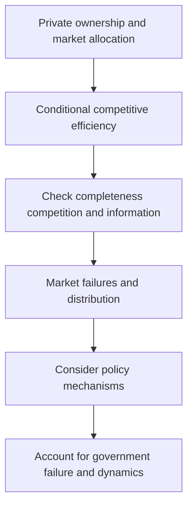

# Compare market failures and imperfect policy remedies

## Record metadata

```json
{
  "schema_version": 3,
  "owner": "plan",
  "course_id": "2026_2027/Winter_Semester/Comparative_Economics",
  "transaction_id": "PLAN-20261018-CE-P003-LINKS",
  "plan_version": "P003",
  "source_version": "V002",
  "ingestion_revision": 2,
  "objective_id": "O021",
  "objective_revision": 1,
  "criterion_version": "O021-C1",
  "status": "ready",
  "lesson_content_contract": "self-contained-lessons-v1",
  "knowledge_components": [
    "monopoly_externality_arithmetic_and_welfare_areas",
    "public_information_labour_and_macro_mechanisms",
    "policy_tradeoffs_source_discrepancies_and_schools"
  ],
  "prerequisite_ids": [
    "O020",
    "O003",
    "O005"
  ],
  "compatible_versions": [
    {
      "objective_revision": 1,
      "criterion_version": "O021-C1",
      "plan_version": "P002",
      "source_version": "V002",
      "ingestion_revision": 2,
      "reason": "P003 changes only two visible Wiki provenance anchor spellings by removing inline italic markup from the rendered heading target. Exact checked structured headings, complete academic content, questions/keys, quantities, criteria, routes, tools and clocks are unchanged. Current P002 evidence remains compatible; no reassessment or learner result is inferred.",
      "change_class": "formatting_only",
      "requires_reassessment": false
    }
  ],
  "note_locations": [
    {
      "path": "01_Notes/2026_2027/Winter_Semester/Comparative_Economics/Week_3/Market_Capitalism_Theory_and_Practice.md",
      "heading": "Market capitalism: efficiency, failures and institutions"
    },
    {
      "path": "01_Notes/2026_2027/Winter_Semester/Comparative_Economics/Week_3/Market_Capitalism_Theory_and_Practice.md",
      "heading": "Why capitalist markets attract emulation—and why no economy is a pure case"
    },
    {
      "path": "01_Notes/2026_2027/Winter_Semester/Comparative_Economics/Week_3/Market_Capitalism_Theory_and_Practice.md",
      "heading": "Competitive equilibrium, Pareto efficiency, and the PPF"
    },
    {
      "path": "01_Notes/2026_2027/Winter_Semester/Comparative_Economics/Week_3/Market_Capitalism_Theory_and_Practice.md",
      "heading": "Market failures and policy trade-offs"
    },
    {
      "path": "01_Notes/2026_2027/Winter_Semester/Comparative_Economics/Week_3/Market_Capitalism_Theory_and_Practice.md",
      "heading": "Source discussion questions: answer outlines"
    }
  ],
  "acquisition_rule": {
    "distinct_independent_passes": 2,
    "required_item_roles": [
      "full_capability_check",
      "full_capability_check"
    ],
    "allowed_routes": [
      [
        "O021-I1",
        "O021-I2"
      ],
      [
        "O021-I1",
        "O021-D1"
      ],
      [
        "O021-I1",
        "O021-D2"
      ],
      [
        "O021-I2",
        "O021-D1"
      ],
      [
        "O021-I2",
        "O021-D2"
      ],
      [
        "O021-D1",
        "O021-D2"
      ]
    ]
  },
  "delayed_rule": {
    "minimum_elapsed_hours": 24,
    "fresh_item": true,
    "independent_required": true
  },
  "review_topic": "Compare market failures and imperfect policy remedies",
  "review_instruction": "Begin a closed-note review with teach for O021; request an unused prepared delayed item before recap."
}
```

## Outcome and conditions

Compute supplied monopoly/externality quantities and compare policy, labour and macro mechanisms with the source’s table and theory qualifications. All essential components listed in metadata are required. Hypothetical assessment values instantiate the checked equations; they are not historical observations or observed outcomes. Independent checks are closed-note and without hints, solution access, external retrieval or other assistance; a basic arithmetic calculator is allowed. Teach establishes and records actual help/exposure conditions before claiming independence.

## Prerequisites and checks

- [O020 outcome and repair route](../lessons/O020.md#outcome-and-conditions): the competitive benchmark defines which assumptions fail and which welfare comparisons are conditional.
- [O003 outcome and repair route](../lessons/O003.md#outcome-and-conditions): information remedies have credibility and institutional costs.
- [O005 outcome and repair route](../lessons/O005.md#outcome-and-conditions): free riding, coordination and governance affect public/collective provision.

O021-P1, item_version 1, prerequisite_diagnostic. **Prompt:** What makes the welfare theorem conditional, and how can hidden information or free riding break its benchmark?

**Complete key and rubric:** O020 requires complete competitive full-information general equilibrium; O003 explains hidden types/actions and O005 individual versus shared incentives. Require all; repair the cited complete lessons. Pass requires every requested reason and result; partial for an omitted reason or unresolved isolated arithmetic slip; fail for the conflicting mechanism. This diagnostic never counts as acquisition. Current or explicitly compatible committed independent prerequisite evidence may permit skipping its check; familiarity alone cannot. Use the cited complete prerequisite lesson or the named included foundation, then the worked example, after a partial/failing entry check.

## Teaching order and rationale

1. Use the diagnostic once to establish the necessary conceptual or algebraic foundation.
2. Present the complete checked-note explanation below, preserving variables, dates, assumptions and source qualifications. Follow one reasoning chain at a time so every intermediate step is visible.
3. Work W1 fully, asking the learner to explain why each step follows.
4. Use S1 as completion practice: show the setup and first identity, hide the final algebra/numbers and interpretation. After an explanation of the missing steps, withdraw support.
5. Present unused I1/I2 full checks with hidden solutions; use correction/repair after scoring the original answer. An unused D form can replace an exposed I only through a listed route.
6. On a later eligible occasion, begin an unused D item before recap. A numeric variant establishes bounded same-method performance, not general transfer.

## Motivation, intuition, and definitions

Compute supplied monopoly/externality quantities and compare policy, labour and macro mechanisms with the source’s table and theory qualifications. Establish the definitions, assumptions and relevant comparisons before simplifying an equation. The complete reused passages establish every academic claim, notation choice and qualification assessed here; necessary prerequisites use the complete lessons above.

## Explanation steps

Origin: reused complete checked passage [[01_Notes/2026_2027/Winter_Semester/Comparative_Economics/Week_3/Market_Capitalism_Theory_and_Practice.md#Market capitalism: efficiency, failures and institutions]]; fingerprint `dc387f3c6d6c03ee9dd03f145669646e436b9982423201093efa570170e80569`. Heading depth and required relative figure-path relocation alone are adapted.

### Market capitalism: efficiency, failures and institutions

Source: [[00_Materials/2026_2027/Winter_Semester/Comparative_Economics/Week_3/35_Chapter 2 - Theory and practice of market capitalismComparative Economics RosserRosser.pdf]]

- [[#Why capitalist markets attract emulation—and why no economy is a pure case|Why capitalist markets attract emulation—and why no economy is a pure case]]
- [[#Competitive equilibrium, Pareto efficiency, and the PPF|Competitive equilibrium, Pareto efficiency, and the PPF]]
- [[#Market failures and policy trade-offs|Market failures and policy trade-offs]]
- [[#Source discussion questions: answer outlines|Source discussion questions: answer outlines]]


This chapter supplies the comparative benchmark: a conditional efficiency argument, the mechanisms by which real markets depart from it, and the institutional costs of possible remedies. Its country tables describe historical observations.



#### Why capitalist markets attract emulation—and why no economy is a pure case

Market capitalism combines private ownership and decentralized market exchange, but the chapter treats actual economies as mixed systems whose institutions and public sectors vary. It describes merchant capitalism as taking coherent shape in medieval northern Italy and Flanders, then growing into a dominant system through Britain’s Industrial Revolution. Nineteenth-century Britain and the United States are presented as historical approximations to laissez-faire, not pure examples: governments still protected trade, subsidized transport infrastructure, and maintained military forces. The author associates capitalism’s attraction with technological dynamism and “creative destruction,” while noting macroeconomic instability and rising concentration and inequality. [[00_Materials/2026_2027/Winter_Semester/Comparative_Economics/Week_3/35_Chapter 2 - Theory and practice of market capitalismComparative Economics RosserRosser.pdf#page=1|Rosser & Rosser, printed pp. 23–25, “Introduction.”]]

The chapter’s contemporary comparisons are historical claims from the book’s publication context. It names Hong Kong, Singapore, and New Zealand as relatively laissez-faire advanced economies, while also describing state planning or ownership in Hong Kong, state-owned enterprises in Singapore, and New Zealand’s post-1984 privatization and deregulation followed by partial policy reversal. Treat these as the author’s period-specific account, not current country descriptions. It also distinguishes market capitalism from a small state sector: poor countries may have smaller state sectors while lacking developed markets and modern industrial capitalism. [[00_Materials/2026_2027/Winter_Semester/Comparative_Economics/Week_3/35_Chapter 2 - Theory and practice of market capitalismComparative Economics RosserRosser.pdf#page=2|Rosser & Rosser, printed pp. 24–25.]]

#### Competitive equilibrium, Pareto efficiency, and the PPF

The chapter’s central efficiency claim is that a **complete, competitive, full-information general equilibrium is efficient**. “Complete” means a market exists for every good or service that affects anyone’s utility. “Competitive” means many buyers and sellers, free entry and exit, homogeneous goods, and no individual seller controls price. “Full information” means agents know preferences, technologies, prices, and other decision-relevant facts. “General equilibrium” means supply equals demand in every market, rather than only selected markets. “Efficient” means Pareto optimal: no one can be made better off without making someone else worse off. The text traces the intuition to Smith’s invisible hand, the formal equilibrium concept to Walras, and the existence-and-efficiency proof to Arrow and Debreu. [[00_Materials/2026_2027/Winter_Semester/Comparative_Economics/Week_3/35_Chapter 2 - Theory and practice of market capitalismComparative Economics RosserRosser.pdf#page=3|Rosser & Rosser, printed pp. 25–27.]]

The reasoning is that if a mutually beneficial reallocation remains possible, the allocation is not Pareto optimal. At an efficient production point, the economy lies on its production possibilities frontier (PPF), the maximum feasible output combinations given resources and technology. However, being on the PPF alone does not guarantee that the mix of goods matches people’s preferences: the chapter’s “guns versus butter” figure distinguishes a utility-maximizing tangency from another point on the frontier that yields lower utility. A point inside the frontier represents unused resources; with involuntary unemployment, some additional output could be produced without reducing another good. The chapter therefore connects microeconomic efficiency to full employment under its production assumptions. Its social-indifference-curve construction assumes identical preferences, which the author explicitly calls a strong simplification. [[00_Materials/2026_2027/Winter_Semester/Comparative_Economics/Week_3/35_Chapter 2 - Theory and practice of market capitalismComparative Economics RosserRosser.pdf#page=4|Rosser & Rosser, printed pp. 26–27, Fig. 2-1.]]

Pareto efficiency is not a fairness criterion. An allocation with equal incomes and one with nearly all resources held by one person can both be Pareto efficient if no feasible change helps someone without harming someone else. The equilibrium also takes an initial wealth distribution as given; it does not establish that the resulting distribution is desirable. [[00_Materials/2026_2027/Winter_Semester/Comparative_Economics/Week_3/35_Chapter 2 - Theory and practice of market capitalismComparative Economics RosserRosser.pdf#page=5|Rosser & Rosser, printed p. 27.]]

Under the diagram’s assumption that actual trade is limited by the short side, in a single competitive market, a price above equilibrium creates a surplus: sellers offer more than buyers wish to purchase, reducing the amount actually exchanged. A price below equilibrium creates a shortage: buyers demand more than sellers supply. At equilibrium price P*, quantity supplied equals quantity demanded, and the chapter says the amount produced and sold is greatest. Extending this logic across all markets motivates the general-equilibrium result. [[00_Materials/2026_2027/Winter_Semester/Comparative_Economics/Week_3/35_Chapter 2 - Theory and practice of market capitalismComparative Economics RosserRosser.pdf#page=5|Rosser & Rosser, printed pp. 27–28, Fig. 2-2.]]

**First welfare theorem, source-supported interpretation.** Under the chapter’s completeness, competition, full-information, and general-equilibrium assumptions, decentralized price-taking choices yield a Pareto-efficient allocation. This is the theorem the chapter states and motivates; its argument is conditional on the assumptions, not a claim that laissez-faire economies automatically satisfy them. [[00_Materials/2026_2027/Winter_Semester/Comparative_Economics/Week_3/35_Chapter 2 - Theory and practice of market capitalismComparative Economics RosserRosser.pdf#page=3|Rosser & Rosser, printed pp. 25–28.]]

#### Market failures and policy trade-offs

**Monopoly.** A profit-maximizing monopolist chooses output where marginal revenue equals marginal cost; a price-taking competitive industry produces where price equals marginal cost. With a downward-sloping demand curve, monopoly output is lower and price higher. The diagram separates the transfer from consumers to the monopolist (rectangle C, measured relative to the competitive price) from the lost consumer and producer surplus (triangles A and B). Thus monopoly produces both a redistribution and a deadweight loss. [[00_Materials/2026_2027/Winter_Semester/Comparative_Economics/Week_3/35_Chapter 2 - Theory and practice of market capitalismComparative Economics RosserRosser.pdf#page=6|Rosser & Rosser, printed pp. 28–30, Fig. 2-3.]]

The chapter qualifies the simple antimonopoly conclusion. A natural monopoly has economies of scale across the whole market, so a single supplier may minimize production cost. The stated trilemma is laissez-faire monopoly losses, regulation that may encourage excess capital investment under rate-of-return rules, or public ownership with possible bureaucratic inefficiency. Schumpeter’s counterargument is that monopoly profits can finance research and development where R&D has scale economies; the chapter’s AT&T example is qualified by the possibility that potential competition helped spur innovation. Monopolistic competition gives firms some price-setting power through differentiated products; the chapter’s “excess capacity” claim is that long-run output is below the scale that minimizes average cost. Oligopoly outcomes depend on rivals’ reactions: cartel collusion can be unstable because members can profit by cheating, while contestable markets may approach competitive pricing when entry barriers are low. [[00_Materials/2026_2027/Winter_Semester/Comparative_Economics/Week_3/35_Chapter 2 - Theory and practice of market capitalismComparative Economics RosserRosser.pdf#page=7|Rosser & Rosser, printed pp. 29–31.]]

The text surveys U.S. antitrust laws and enforcement history, then compares concentration measures across countries. It cautions that Japan’s reported concentration may be understated because nominally independent firms can belong to keiretsu groups; South Korea has analogous chaebol. It also notes the transition problem when formerly state-owned monopolies gain control over prices after planning is removed. The table’s employment and concentration figures are historical data from cited studies, not current estimates. [[00_Materials/2026_2027/Winter_Semester/Comparative_Economics/Week_3/35_Chapter 2 - Theory and practice of market capitalismComparative Economics RosserRosser.pdf#page=8|Rosser & Rosser, printed pp. 30–32, Table 2-1.]]

**Externalities.** An externality occurs when an agent’s action imposes a cost or benefit on someone else. With pollution, private marginal cost omits damage to others, so output is too high relative to the social-cost outcome. With an invention whose benefits spill over without patent protection, private marginal benefit may be below social marginal benefit, so too little innovation occurs. In each case the market is incomplete because there is no price for the unaccounted-for environmental quality or spillover benefit. [[00_Materials/2026_2027/Winter_Semester/Comparative_Economics/Week_3/35_Chapter 2 - Theory and practice of market capitalismComparative Economics RosserRosser.pdf#page=10|Rosser & Rosser, printed pp. 32–33, Fig. 2-4.]]

Four responses are compared. Pigouvian taxes or subsidies can internalize the marginal external cost or benefit. Command-and-control rules set quantities or technologies, but a uniform standard may ignore that the marginal damage of pollution differs by region. The Coase approach relies on well-defined property rights and negligible transaction costs so affected parties can bargain; it is limited when rights are difficult to assign or many parties make negotiation costly. The chapter distinguishes common property with controlled access from open access: it attributes the Caspian fishery collapse after Soviet dissolution to expanded access among successor states. Tradable permits create a regulated emissions cap and allow firms with lower cleanup costs to sell permits to firms with higher costs; with a sufficiently competitive permit market, a fixed cleanup target is reached at lower cost. The U.S. sulfur-dioxide program and offset examples illustrate this approach. [[00_Materials/2026_2027/Winter_Semester/Comparative_Economics/Week_3/35_Chapter 2 - Theory and practice of market capitalismComparative Economics RosserRosser.pdf#page=11|Rosser & Rosser, printed pp. 33–35, Fig. 2-4 and Box 2-1.]]

The pollution table compares 1989 and 1996 per-capita CO₂, NOₓ, and SO₂ emissions. The chapter associates CO₂ with richer and oil-producing economies, NOₓ with automobile use, and SO₂ with coal and oil burning in industrial economies. It reports reductions in several former command economies after 1989, while warning that output changes may not explain all of them. The source’s units and dates should stay attached to any reused data; its country labels and political categories reflect that period. [[00_Materials/2026_2027/Winter_Semester/Comparative_Economics/Week_3/35_Chapter 2 - Theory and practice of market capitalismComparative Economics RosserRosser.pdf#page=13|Rosser & Rosser, printed pp. 35–37, Table 2-2.]]

**Public goods.** A pure public good is nonexcludable and nondepletable in consumption; the chapter treats nonexcludability as the more important feature. National defense is the example: everyone receives the benefit whether or not they paid. Because the benefit cannot readily be withheld from nonpayers, private suppliers may not collect enough to provide the Pareto-optimal quantity. Government financing can address this free-rider problem, though public provision may also be wasteful. Education is placed on a continuum between private and collective benefits. Public choice analysis adds that legislative decisions can reflect logrolling, lobbying, inertia, and special interests; this complicates the choice between public and private provision. [[00_Materials/2026_2027/Winter_Semester/Comparative_Economics/Week_3/35_Chapter 2 - Theory and practice of market capitalismComparative Economics RosserRosser.pdf#page=15|Rosser & Rosser, printed pp. 37–39.]]

**Imperfect information.** With asymmetric information, one party knows more than another. In Akerlof’s used-car example, buyers anticipate hidden quality problems and discount offers, making it harder for owners of good cars to sell at a fair price. Principal-agent problems and insurance moral hazard provide further cases. Government data agencies may improve information, while Hayek’s argument emphasizes that decentralized prices transmit local knowledge unavailable to a central planner. The chapter leaves imperfect and asymmetric information as difficulties for all systems. [[00_Materials/2026_2027/Winter_Semester/Comparative_Economics/Week_3/35_Chapter 2 - Theory and practice of market capitalismComparative Economics RosserRosser.pdf#page=17|Rosser & Rosser, printed pp. 39–40.]]

**Unions and labor markets.** In a perfectly competitive, nondiscriminatory labor market, unions need not improve efficiency, though they can provide safety, benefits, job security, political voice, and income redistribution. A union with monopoly power in labor supply can reduce efficiency, but unions can also counter employer monopsony. The chapter traces the U.S. development of craft and industrial unionism and contrasts U.S. and European union structures. Tables report union membership for selected years and strike days per worker; both are historical measures. The text cautions that effects depend on bargaining and labor-market institutions: cooperation and worker voice may support productivity, while restrictive rules can discourage hiring. [[00_Materials/2026_2027/Winter_Semester/Comparative_Economics/Week_3/35_Chapter 2 - Theory and practice of market capitalismComparative Economics RosserRosser.pdf#page=18|Rosser & Rosser, printed pp. 40–43, Tables 2-3 and 2-4.]]

**Corporatism**, in this chapter’s labour-relations sense, means economy-wide labour–management bargaining encouraged by government for macroeconomic stabilization. It differs from a single firm consulting its workers and from corporate ownership as such. Coordination can seek wage restraint and stable employment alongside worker representation. The chapter’s historical footnote contrasts an earlier authoritarian usage with more voluntary arrangements in European social democracies; that history does not make every coordinated bargaining system identical. [[00_Materials/2026_2027/Winter_Semester/Comparative_Economics/Week_3/35_Chapter 2 - Theory and practice of market capitalismComparative Economics RosserRosser.pdf#page=20|Physical PDF pp. 20]]

**Macroeconomic instability and policy.** The chapter treats cyclical involuntary unemployment as both an efficiency loss and a political challenge to market capitalism. Investment is identified as a volatile GDP component, with technology, interest rates, and investor “animal spirits” among possible drivers. Keynesians emphasize rigidities and persistent investment collapses, supporting stabilization through fiscal and monetary policy; the Classical view expects self-correction and favors stable policy and fewer interventions. Figure 2-6 contrasts an upward-sloping short-run aggregate supply curve with vertical long-run aggregate supply: a decline in aggregate demand reduces real output and employment in the Keynesian short run, while the classical long-run account predicts adjustment mainly through prices. Fiscal policy changes spending and taxes; monetary policy changes money supply and interest rates. The chapter compares discretionary stabilization and monetarist rules, and notes that policy-making institutions affect implementation. [[00_Materials/2026_2027/Winter_Semester/Comparative_Economics/Week_3/35_Chapter 2 - Theory and practice of market capitalismComparative Economics RosserRosser.pdf#page=21|Rosser & Rosser, printed pp. 43–47, Table 2-5 and Figs. 2-5–2-6.]]

**Competing defenses of laissez-faire.** The Chicago School uses the static Pareto-efficiency argument and downplays market failures or expects private bargaining to resolve them; it is skeptical of antitrust and redistribution, and favors monetarist policy. Public choice theory warns that market-correcting agencies can be captured and create rents that motivate lobbying or corruption. The Austrian School differs: it rejects equilibrium as the central lens and stresses entrepreneurial discovery, innovation, and dynamic change. The chapter’s overall conclusion is that market capitalism’s efficiency case depends on conditions that real economies often violate, while government remedies also have costs. The book’s closing comparative claims about the United States—higher income and competitiveness, greater inequality, weaker unions, more air pollution, smaller public sector, and greater historical GDP volatility—are period-specific summary claims. [[00_Materials/2026_2027/Winter_Semester/Comparative_Economics/Week_3/35_Chapter 2 - Theory and practice of market capitalismComparative Economics RosserRosser.pdf#page=26|Rosser & Rosser, printed pp. 48–52, Box 2-2, “Summary and Conclusions.”]]

The rent-seeking argument has a dynamic version in **Box 2-2**, summarizing Olson’s *Rise and Decline of Nations*: organized interests can accumulate power during long periods of stability, protect rents through restrictions and make the economy less adaptable. The box contrasts its account of Britain with postwar Germany and Japan, where disruption could weaken entrenched coalitions. This is the source’s historical hypothesis about institutional sclerosis, not proof that war or conquest improves welfare, a rule that stability is harmful, or a current forecast for Russia. It connects regulatory capture to long-run resistance to productive change rather than merely listing corruption as an unexplained label. [[00_Materials/2026_2027/Winter_Semester/Comparative_Economics/Week_3/35_Chapter 2 - Theory and practice of market capitalismComparative Economics RosserRosser.pdf#page=27|Physical PDF pp. 27–28]]

#### Source discussion questions: answer outlines

1. **Are the two Pareto claims true?** Neither follows. Pareto efficiency is compatible with many income distributions, including extreme inequality; it does not require inequality to motivate effort. Equal distribution also does not guarantee Pareto efficiency: a feasible reallocation could still make someone better off without harming another. [[00_Materials/2026_2027/Winter_Semester/Comparative_Economics/Week_3/35_Chapter 2 - Theory and practice of market capitalismComparative Economics RosserRosser.pdf#page=5|Rosser & Rosser, printed p. 27.]]
2. **How does the U.S. compare in concentration and antitrust?** The chapter describes U.S. concentration as generally lower than in other economies, partly because of market size and antitrust tradition. It recounts the Sherman, Clayton, and FTC Acts and alternating periods of enforcement. Its table and keiretsu/chaebol caveat qualify direct comparisons. [[00_Materials/2026_2027/Winter_Semester/Comparative_Economics/Week_3/35_Chapter 2 - Theory and practice of market capitalismComparative Economics RosserRosser.pdf#page=7|Rosser & Rosser, printed pp. 29–32.]]
3. **Why could environmental conditions have been better in market economies?** The chapter suggests this may reflect greater democracy and public pressure in advanced market economies rather than an inherent planning advantage. It also describes measurement patterns by income and pollutant, while noting that command systems theoretically could plan to avoid pollution. [[00_Materials/2026_2027/Winter_Semester/Comparative_Economics/Week_3/35_Chapter 2 - Theory and practice of market capitalismComparative Economics RosserRosser.pdf#page=13|Rosser & Rosser, printed pp. 35–37.]]
4. **Which U.S. public goods could be provided privately, and why not?** The source names services and intermediate goods—such as education, utilities, airports, harbors, water, and waste services—as debated cases, not as settled opportunities. An answer can assess excludability, external benefits, scale economies, and administrative costs; the chapter supplies no case-by-case efficiency proof. [[00_Materials/2026_2027/Winter_Semester/Comparative_Economics/Week_3/35_Chapter 2 - Theory and practice of market capitalismComparative Economics RosserRosser.pdf#page=16|Rosser & Rosser, printed pp. 38–39.]]
5. **Does the data show Keynes improved macro performance?** Table 2-5 shows generally lower unemployment in many later benchmark years than in the 1931 depression for many listed countries, and Fig. 2-5 indicates smaller GDP contractions after World War II than before it. This is consistent with—but does not identify—a Keynesian contribution. The source itself notes multiple causes and that some unemployment rose after the early 1970s; cross-period comparisons are not causal tests. [[00_Materials/2026_2027/Winter_Semester/Comparative_Economics/Week_3/35_Chapter 2 - Theory and practice of market capitalismComparative Economics RosserRosser.pdf#page=22|Rosser & Rosser, printed pp. 44–46.]]
6. **How critique laissez-faire?** Use the chapter’s failures—market power, externalities, public-good underprovision, information asymmetry, unemployment, and instability—then account for government failure, transaction costs, public choice, and uncertainty over policy design. The answer should compare mechanisms, not assume one system always dominates. [[00_Materials/2026_2027/Winter_Semester/Comparative_Economics/Week_3/35_Chapter 2 - Theory and practice of market capitalismComparative Economics RosserRosser.pdf#page=6|Rosser & Rosser, printed pp. 28–40, 43–51.]]
7. **How do Chicago and Austrian defenses differ?** Chicago accepts static Pareto equilibrium and argues exceptions are limited or better handled privately. Austrian analysis rejects equilibrium as its focus and emphasizes entrepreneurial discovery and dynamic market change. [[00_Materials/2026_2027/Winter_Semester/Comparative_Economics/Week_3/35_Chapter 2 - Theory and practice of market capitalismComparative Economics RosserRosser.pdf#page=26|Rosser & Rosser, printed pp. 48–51.]]


![[01_Notes/2026_2027/Winter_Semester/Comparative_Economics/assets/Week_3_PPF.png]]

Figure 2-1: point A is a tangency of the preference curve and production frontier, B is on the frontier with an inferior mix in the simplified common-preference construction, and C lies inside. Technical feasibility alone does not select the preferred mix. [[00_Materials/2026_2027/Winter_Semester/Comparative_Economics/Week_3/35_Chapter 2 - Theory and practice of market capitalismComparative Economics RosserRosser.pdf#page=4|Rosser & Rosser, chapter 2, physical PDF pp. 4]]


![[01_Notes/2026_2027/Winter_Semester/Comparative_Economics/assets/Week_3_Competitive_Equilibrium.png]]

Figure 2-2: price above equilibrium produces excess supply and a price below it excess demand. The chapter’s maximum-trade comparison assumes short-side rationing; it is not a theorem about every real allocation mechanism. [[00_Materials/2026_2027/Winter_Semester/Comparative_Economics/Week_3/35_Chapter 2 - Theory and practice of market capitalismComparative Economics RosserRosser.pdf#page=6|Rosser & Rosser, chapter 2, physical PDF pp. 6]]


![[01_Notes/2026_2027/Winter_Semester/Comparative_Economics/assets/Week_3_Monopoly.png]]

Figure 2-3: monopoly chooses MR = MC, then reads its higher price from demand. Triangles A and B are lost producer and consumer surplus; rectangle C is a transfer, so counting all higher monopoly revenue as social loss would double-count. [[00_Materials/2026_2027/Winter_Semester/Comparative_Economics/Week_3/35_Chapter 2 - Theory and practice of market capitalismComparative Economics RosserRosser.pdf#page=7|Rosser & Rosser, chapter 2, physical PDF pp. 7]]


![[01_Notes/2026_2027/Winter_Semester/Comparative_Economics/assets/Week_3_Concentration_Table.png]]

Historical industrial-concentration Table 2-1: average size, employment share and three-firm concentration are different measures. The notes below the table specify source vintages and cross-country comparability limits. [[00_Materials/2026_2027/Winter_Semester/Comparative_Economics/Week_3/35_Chapter 2 - Theory and practice of market capitalismComparative Economics RosserRosser.pdf#page=10|Rosser & Rosser, chapter 2, physical PDF pp. 10]]


![[01_Notes/2026_2027/Winter_Semester/Comparative_Economics/assets/Week_3_External_Cost.png]]

Figure 2-4: social marginal cost lies above private marginal cost, so private equilibrium quantity exceeds the social-cost optimum. The vertical wedge is marginal damage under this model, not a measured tax recommendation. [[00_Materials/2026_2027/Winter_Semester/Comparative_Economics/Week_3/35_Chapter 2 - Theory and practice of market capitalismComparative Economics RosserRosser.pdf#page=11|Rosser & Rosser, chapter 2, physical PDF pp. 11]]


![[01_Notes/2026_2027/Winter_Semester/Comparative_Economics/assets/Week_3_Offset_Trading.png]]

Box 2-1 records a historical negotiated offset example. It illustrates trading potential under a binding emissions regime; its stated dollar savings and reduction quantities belong to that source case. [[00_Materials/2026_2027/Winter_Semester/Comparative_Economics/Week_3/35_Chapter 2 - Theory and practice of market capitalismComparative Economics RosserRosser.pdf#page=14|Rosser & Rosser, chapter 2, physical PDF pp. 14]]


![[01_Notes/2026_2027/Winter_Semester/Comparative_Economics/assets/Week_3_Pollution_Table.png]]

Table 2-2 preserves 1989/1996 columns, missing values and country-boundary notes. CO2 is measured in metric tons per person; NOx and SO2 in kilograms per person. The German CO2 entries use Germany overall for both years, while the footnote gives 1996 NOx/SO2 changes for reunited Germany rather than separate eastern/western observations. Different pollutants’ numbers must not be compared as if they used one common unit. [[00_Materials/2026_2027/Winter_Semester/Comparative_Economics/Week_3/35_Chapter 2 - Theory and practice of market capitalismComparative Economics RosserRosser.pdf#page=15|Rosser & Rosser, chapter 2, physical PDF pp. 15]]


![[01_Notes/2026_2027/Winter_Semester/Comparative_Economics/assets/Week_3_Union_Membership.png]]

Table 2-3 measures the percentage of the labour force in unions in 1955/1975/1995, with explicit exceptions. **Source discrepancy:** the embedded prose says Japanese membership declined to 28%, but the table’s 1995 Japan cell reads **24%**. Use the table cell when describing this table and retain the disagreement; neither is a current estimate. Membership differs from strike intensity or a causal union-effect estimate. [[00_Materials/2026_2027/Winter_Semester/Comparative_Economics/Week_3/35_Chapter 2 - Theory and practice of market capitalismComparative Economics RosserRosser.pdf#page=20|Rosser & Rosser, chapter 2, physical PDF pp. 20]]


![[01_Notes/2026_2027/Winter_Semester/Comparative_Economics/assets/Week_3_Strike_Days.png]]

Table 2-4 records days lost per 1,000 workers in 1985–1989 and 1990–1994. **Source discrepancy:** the preceding prose names the UK, Sweden, New Zealand and Denmark as exceptions to decline, while the table shows all four **falling** (180→37, 121→57, 491→105 and 235→37 respectively). Its increases are Belgium, West Germany, the Netherlands and Switzerland. Describe those visible table readings without silently repeating the contradictory prose. Membership and days lost need not rank countries identically. [[00_Materials/2026_2027/Winter_Semester/Comparative_Economics/Week_3/35_Chapter 2 - Theory and practice of market capitalismComparative Economics RosserRosser.pdf#page=21|Rosser & Rosser, chapter 2, physical PDF pp. 21]]


![[01_Notes/2026_2027/Winter_Semester/Comparative_Economics/assets/Week_3_Unemployment_Table.png]]

Table 2-5 is a collection of historical benchmark-year unemployment rates with its source notes. Comparing eras cannot separate Keynesian policy from wars, structural change or measurement differences. [[00_Materials/2026_2027/Winter_Semester/Comparative_Economics/Week_3/35_Chapter 2 - Theory and practice of market capitalismComparative Economics RosserRosser.pdf#page=22|Rosser & Rosser, chapter 2, physical PDF pp. 22]]


![[01_Notes/2026_2027/Winter_Semester/Comparative_Economics/assets/Week_3_Cycle_Declines.png]]

Figure 2-5 plots the maximum peak-to-trough GDP contraction in each displayed period, a crude instability measure. Its points are not average annual growth rates. [[00_Materials/2026_2027/Winter_Semester/Comparative_Economics/Week_3/35_Chapter 2 - Theory and practice of market capitalismComparative Economics RosserRosser.pdf#page=23|Rosser & Rosser, chapter 2, physical PDF pp. 23]]


![[01_Notes/2026_2027/Winter_Semester/Comparative_Economics/assets/Week_3_Aggregate_Supply.png]]

Figure 2-6 compares upward short-run and vertical long-run aggregate supply with aggregate demand. The output and price effects of a demand shift depend on the relevant adjustment horizon and maintained supply assumptions. [[00_Materials/2026_2027/Winter_Semester/Comparative_Economics/Week_3/35_Chapter 2 - Theory and practice of market capitalismComparative Economics RosserRosser.pdf#page=24|Rosser & Rosser, chapter 2, physical PDF pp. 24]]


## Worked example

O021-W1, item_version 1, worked_example. **Prompt:** A hypothetical market has inverse demand $P=20-Q$, constant private marginal cost 4 and no fixed cost. Use $MR=20-2Q$ to compute monopoly output/price, competitive output, the consumer-to-producer transfer rectangle and deadweight-loss triangle. Separately suppose competitive production creates constant external marginal damage 2; compute the social-cost quantity and the model’s marginal-damage tax. Explain natural-monopoly remedies/dynamics, externality policy options, public goods versus open-access commons, information, labour bargaining and macro horizons. Interpret the chapter’s table units/discrepancies, policy evidence and Chicago/Austrian/public-choice/Olson arguments with their limitations.

**Complete solution and essential rubric:** $MR=MC$ gives $Q_M=(20-4)/2=8.000000$ and $P_M=20-8.000000=12.000000$; competition gives $Q_C=20-4=16$. Transfer is $(P_M-4)Q_M=64.000000$, not a social loss; deadweight loss is $\tfrac12(Q_C-Q_M)(P_M-4)=32.000000$. Separately $P=MC+MD$ gives $Q^*=20-4-2=14$ and a Pigouvian tax $2$ per unit under the stated constant-damage model, not a measured real policy recommendation. Monopoly reduces quantity; natural scale economies complicate competition, regulation can distort capital incentives and public ownership can have bureaucracy costs; R&D/potential competition and cartel cheating affect dynamic outcomes. Taxes/subsidies, standards, bargaining with defined rights/low transaction costs and tradable caps have distinct information/distribution/enforcement requirements. Permit trading can lower target costs under competition; common property with governed access differs from open access. Public goods are nonexcludable/nondepletable, with free-rider underprovision; public finance can help but lobbying/capture/inertia remain. Information is asymmetric and prices carry local knowledge, so no system gets perfect information for free. A union may counter monopsony or exercise monopoly; corporatism is coordinated economy-wide labour–management bargaining, not corporate ownership. Demand decline lowers output along upward short-run supply; vertical long-run supply implies different price/output adjustment under the stated assumptions; benchmark unemployment/contraction comparisons do not identify Keynesian causation. CO 2 uses metrictons/person, NOx/SO 2 kilograms/person,1989/1996 with German-boundary footnotes; union membership and strike days/1000 workers differ. Japan’s 1995 table cell is 24% despite prose 28%; the cited UK/Sweden/New Zealand/Denmark strike entries fall despite the contradictory exception claim. Chicago stresses static equilibrium/private correction, Austrian discovery/dynamics, public choice policy failure, and Olson’s box rent-coalition sclerosis. The latter is a historical hypothesis, not proof war improves welfare or stability must harm growth. All vintage/measurement/source discrepancies and remedy costs remain explicit; no universal market/state superiority follows. All requested calculations, derivations and qualifications are essential; the component map above applies to every full form.

## Practice with fading assistance

O021-S1, item_version 1, supported_completion. **Prompt:** A hypothetical market has inverse demand $P=30-Q$, constant private marginal cost 6 and no fixed cost. Use $MR=30-2Q$ to compute monopoly output/price, competitive output, the consumer-to-producer transfer rectangle and deadweight-loss triangle. Separately suppose competitive production creates constant external marginal damage 3; compute the social-cost quantity and the model’s marginal-damage tax. Explain natural-monopoly remedies/dynamics, externality policy options, public goods versus open-access commons, information, labour bargaining and macro horizons. Interpret the chapter’s table units/discrepancies, policy evidence and Chicago/Austrian/public-choice/Olson arguments with their limitations.

**Complete solution and essential rubric:** $MR=MC$ gives $Q_M=(30-6)/2=12.000000$ and $P_M=30-12.000000=18.000000$; competition gives $Q_C=30-6=24$. Transfer is $(P_M-6)Q_M=144.000000$, not a social loss; deadweight loss is $\tfrac12(Q_C-Q_M)(P_M-6)=72.000000$. Separately $P=MC+MD$ gives $Q^*=30-6-3=21$ and a Pigouvian tax $3$ per unit under the stated constant-damage model, not a measured real policy recommendation. Monopoly reduces quantity; natural scale economies complicate competition, regulation can distort capital incentives and public ownership can have bureaucracy costs; R&D/potential competition and cartel cheating affect dynamic outcomes. Taxes/subsidies, standards, bargaining with defined rights/low transaction costs and tradable caps have distinct information/distribution/enforcement requirements. Permit trading can lower target costs under competition; common property with governed access differs from open access. Public goods are nonexcludable/nondepletable, with free-rider underprovision; public finance can help but lobbying/capture/inertia remain. Information is asymmetric and prices carry local knowledge, so no system gets perfect information for free. A union may counter monopsony or exercise monopoly; corporatism is coordinated economy-wide labour–management bargaining, not corporate ownership. Demand decline lowers output along upward short-run supply; vertical long-run supply implies different price/output adjustment under the stated assumptions; benchmark unemployment/contraction comparisons do not identify Keynesian causation. CO 2 uses metrictons/person, NOx/SO 2 kilograms/person,1989/1996 with German-boundary footnotes; union membership and strike days/1000 workers differ. Japan’s 1995 table cell is 24% despite prose 28%; the cited UK/Sweden/New Zealand/Denmark strike entries fall despite the contradictory exception claim. Chicago stresses static equilibrium/private correction, Austrian discovery/dynamics, public choice policy failure, and Olson’s box rent-coalition sclerosis. The latter is a historical hypothesis, not proof war improves welfare or stability must harm growth. All vintage/measurement/source discrepancies and remedy costs remain explicit; no universal market/state superiority follows. All requested calculations, derivations and qualifications are essential; the component map above applies to every full form.

Allowed support is the first stated identity only; hide the remaining key while the learner completes it. Supported performance is practice, not an independent result.

## Rubric and independence

Required components: monopoly_externality_arithmetic_and_welfare_areas, public_information_labour_and_macro_mechanisms, policy_tradeoffs_source_discrepancies_and_schools. Each full prompt/key below elicits every component; all are necessary for a pass on every permitted pair. Accept algebraically equivalent expressions and clearly defined opposite cash-flow signs with correct interpretation. A pass requires all requested outputs/reasons, correct units/assumptions and no critical conceptual error. Partial means a missing component or an unresolved isolated arithmetic slip with an otherwise valid method; independent correction is required for a pass. Fail means a critical mechanism/condition is wrong. Unscorable means a response or its help/exposure conditions cannot be established. Unknown help conditions are never independent evidence.

Critical errors: Transfer rectangle counted as deadweight loss; all common property called open access; theorem proves remedies costless; historical correlations identify policy.

Acquisition requires two distinct unused unassisted full checks selected from the six exact metadata routes. Every I/D form covers all components; W1, S1, the prerequisite and C1 are forbidden substitutes. A D form used for acquisition cannot later be counted again as delayed success. No teach-generated item may replace a named full check; additional verified explanation/practice is allowed under the unchanged method and may not fabricate evidence. If fewer than two fresh forms remain for acquisition, return a plan_issue for an additional prepared bank.

| Component | I1 | I2 | D1 | D2 |
|---|---|---|---|---|
| monopoly_externality_arithmetic_and_welfare_areas | required | required | required | required |
| public_information_labour_and_macro_mechanisms | required | required | required | required |
| policy_tradeoffs_source_discrepancies_and_schools | required | required | required | required |

## Misconceptions and correction

An observed omitted term/sign is tentative until the learner explains it; compare the reasoning with the critical errors above. Score the original response before providing help. Route a conceptual failure to the relevant included derivation and prerequisite, then use an unused full form.

O021-C1, item_version 1, narrow_correction. **Prompt:** If a tax can internalize a modelled externality, is any government intervention automatically superior? **Key/rubric:** No. Information, enforcement, distribution, capture, lobbying, administrative and dynamic costs matter; compare feasible mechanisms under the specific assumptions. Pass requires all keyed reasoning; partial for a missing part; fail for the conflicting mechanism. This repairs a common inference only; it cannot substitute for a full numerical/capability check.

Give at most two hints (first identify the date/unit, second point to the included identity); after ineffective hints show the relevant worked step. After two unsuccessful independent attempts stop repeated quizzing, revisit the explanation/prerequisite and preserve the unresolved status.

## Immediate and delayed checks

### O021-I1

O021-I1, item_version 1, full_capability_check. **Prompt:** A hypothetical market has inverse demand $P=40-Q$, constant private marginal cost 8 and no fixed cost. Use $MR=40-2Q$ to compute monopoly output/price, competitive output, the consumer-to-producer transfer rectangle and deadweight-loss triangle. Separately suppose competitive production creates constant external marginal damage 4; compute the social-cost quantity and the model’s marginal-damage tax. Explain natural-monopoly remedies/dynamics, externality policy options, public goods versus open-access commons, information, labour bargaining and macro horizons. Interpret the chapter’s table units/discrepancies, policy evidence and Chicago/Austrian/public-choice/Olson arguments with their limitations.

**Complete solution and essential rubric:** $MR=MC$ gives $Q_M=(40-8)/2=16.000000$ and $P_M=40-16.000000=24.000000$; competition gives $Q_C=40-8=32$. Transfer is $(P_M-8)Q_M=256.000000$, not a social loss; deadweight loss is $\tfrac12(Q_C-Q_M)(P_M-8)=128.000000$. Separately $P=MC+MD$ gives $Q^*=40-8-4=28$ and a Pigouvian tax $4$ per unit under the stated constant-damage model, not a measured real policy recommendation. Monopoly reduces quantity; natural scale economies complicate competition, regulation can distort capital incentives and public ownership can have bureaucracy costs; R&D/potential competition and cartel cheating affect dynamic outcomes. Taxes/subsidies, standards, bargaining with defined rights/low transaction costs and tradable caps have distinct information/distribution/enforcement requirements. Permit trading can lower target costs under competition; common property with governed access differs from open access. Public goods are nonexcludable/nondepletable, with free-rider underprovision; public finance can help but lobbying/capture/inertia remain. Information is asymmetric and prices carry local knowledge, so no system gets perfect information for free. A union may counter monopsony or exercise monopoly; corporatism is coordinated economy-wide labour–management bargaining, not corporate ownership. Demand decline lowers output along upward short-run supply; vertical long-run supply implies different price/output adjustment under the stated assumptions; benchmark unemployment/contraction comparisons do not identify Keynesian causation. CO 2 uses metrictons/person, NOx/SO 2 kilograms/person,1989/1996 with German-boundary footnotes; union membership and strike days/1000 workers differ. Japan’s 1995 table cell is 24% despite prose 28%; the cited UK/Sweden/New Zealand/Denmark strike entries fall despite the contradictory exception claim. Chicago stresses static equilibrium/private correction, Austrian discovery/dynamics, public choice policy failure, and Olson’s box rent-coalition sclerosis. The latter is a historical hypothesis, not proof war improves welfare or stability must harm growth. All vintage/measurement/source discrepancies and remedy costs remain explicit; no universal market/state superiority follows. All requested calculations, derivations and qualifications are essential; the component map above applies to every full form.

I1/I2 are immediate checks; D1/D2 are distinct parallel variants reserved where possible for delayed checks. A delayed success requires an unused form before recap, no help/solution access, and at least 24 actual elapsed hours after acquisition and the most recent relevant teaching/solution exposure. Record intervening exposure. A calendar-date change alone is insufficient; an early D attempt is immediate evidence only.

### O021-I2

O021-I2, item_version 1, full_capability_check. **Prompt:** A hypothetical market has inverse demand $P=24-Q$, constant private marginal cost 4 and no fixed cost. Use $MR=24-2Q$ to compute monopoly output/price, competitive output, the consumer-to-producer transfer rectangle and deadweight-loss triangle. Separately suppose competitive production creates constant external marginal damage 2; compute the social-cost quantity and the model’s marginal-damage tax. Explain natural-monopoly remedies/dynamics, externality policy options, public goods versus open-access commons, information, labour bargaining and macro horizons. Interpret the chapter’s table units/discrepancies, policy evidence and Chicago/Austrian/public-choice/Olson arguments with their limitations.

**Complete solution and essential rubric:** $MR=MC$ gives $Q_M=(24-4)/2=10.000000$ and $P_M=24-10.000000=14.000000$; competition gives $Q_C=24-4=20$. Transfer is $(P_M-4)Q_M=100.000000$, not a social loss; deadweight loss is $\tfrac12(Q_C-Q_M)(P_M-4)=50.000000$. Separately $P=MC+MD$ gives $Q^*=24-4-2=18$ and a Pigouvian tax $2$ per unit under the stated constant-damage model, not a measured real policy recommendation. Monopoly reduces quantity; natural scale economies complicate competition, regulation can distort capital incentives and public ownership can have bureaucracy costs; R&D/potential competition and cartel cheating affect dynamic outcomes. Taxes/subsidies, standards, bargaining with defined rights/low transaction costs and tradable caps have distinct information/distribution/enforcement requirements. Permit trading can lower target costs under competition; common property with governed access differs from open access. Public goods are nonexcludable/nondepletable, with free-rider underprovision; public finance can help but lobbying/capture/inertia remain. Information is asymmetric and prices carry local knowledge, so no system gets perfect information for free. A union may counter monopsony or exercise monopoly; corporatism is coordinated economy-wide labour–management bargaining, not corporate ownership. Demand decline lowers output along upward short-run supply; vertical long-run supply implies different price/output adjustment under the stated assumptions; benchmark unemployment/contraction comparisons do not identify Keynesian causation. CO 2 uses metrictons/person, NOx/SO 2 kilograms/person,1989/1996 with German-boundary footnotes; union membership and strike days/1000 workers differ. Japan’s 1995 table cell is 24% despite prose 28%; the cited UK/Sweden/New Zealand/Denmark strike entries fall despite the contradictory exception claim. Chicago stresses static equilibrium/private correction, Austrian discovery/dynamics, public choice policy failure, and Olson’s box rent-coalition sclerosis. The latter is a historical hypothesis, not proof war improves welfare or stability must harm growth. All vintage/measurement/source discrepancies and remedy costs remain explicit; no universal market/state superiority follows. All requested calculations, derivations and qualifications are essential; the component map above applies to every full form.

### O021-D1

O021-D1, item_version 1, full_capability_check. **Prompt:** A hypothetical market has inverse demand $P=36-Q$, constant private marginal cost 6 and no fixed cost. Use $MR=36-2Q$ to compute monopoly output/price, competitive output, the consumer-to-producer transfer rectangle and deadweight-loss triangle. Separately suppose competitive production creates constant external marginal damage 3; compute the social-cost quantity and the model’s marginal-damage tax. Explain natural-monopoly remedies/dynamics, externality policy options, public goods versus open-access commons, information, labour bargaining and macro horizons. Interpret the chapter’s table units/discrepancies, policy evidence and Chicago/Austrian/public-choice/Olson arguments with their limitations.

**Complete solution and essential rubric:** $MR=MC$ gives $Q_M=(36-6)/2=15.000000$ and $P_M=36-15.000000=21.000000$; competition gives $Q_C=36-6=30$. Transfer is $(P_M-6)Q_M=225.000000$, not a social loss; deadweight loss is $\tfrac12(Q_C-Q_M)(P_M-6)=112.500000$. Separately $P=MC+MD$ gives $Q^*=36-6-3=27$ and a Pigouvian tax $3$ per unit under the stated constant-damage model, not a measured real policy recommendation. Monopoly reduces quantity; natural scale economies complicate competition, regulation can distort capital incentives and public ownership can have bureaucracy costs; R&D/potential competition and cartel cheating affect dynamic outcomes. Taxes/subsidies, standards, bargaining with defined rights/low transaction costs and tradable caps have distinct information/distribution/enforcement requirements. Permit trading can lower target costs under competition; common property with governed access differs from open access. Public goods are nonexcludable/nondepletable, with free-rider underprovision; public finance can help but lobbying/capture/inertia remain. Information is asymmetric and prices carry local knowledge, so no system gets perfect information for free. A union may counter monopsony or exercise monopoly; corporatism is coordinated economy-wide labour–management bargaining, not corporate ownership. Demand decline lowers output along upward short-run supply; vertical long-run supply implies different price/output adjustment under the stated assumptions; benchmark unemployment/contraction comparisons do not identify Keynesian causation. CO 2 uses metrictons/person, NOx/SO 2 kilograms/person,1989/1996 with German-boundary footnotes; union membership and strike days/1000 workers differ. Japan’s 1995 table cell is 24% despite prose 28%; the cited UK/Sweden/New Zealand/Denmark strike entries fall despite the contradictory exception claim. Chicago stresses static equilibrium/private correction, Austrian discovery/dynamics, public choice policy failure, and Olson’s box rent-coalition sclerosis. The latter is a historical hypothesis, not proof war improves welfare or stability must harm growth. All vintage/measurement/source discrepancies and remedy costs remain explicit; no universal market/state superiority follows. All requested calculations, derivations and qualifications are essential; the component map above applies to every full form.

### O021-D2

O021-D2, item_version 1, full_capability_check. **Prompt:** A hypothetical market has inverse demand $P=50-Q$, constant private marginal cost 10 and no fixed cost. Use $MR=50-2Q$ to compute monopoly output/price, competitive output, the consumer-to-producer transfer rectangle and deadweight-loss triangle. Separately suppose competitive production creates constant external marginal damage 5; compute the social-cost quantity and the model’s marginal-damage tax. Explain natural-monopoly remedies/dynamics, externality policy options, public goods versus open-access commons, information, labour bargaining and macro horizons. Interpret the chapter’s table units/discrepancies, policy evidence and Chicago/Austrian/public-choice/Olson arguments with their limitations.

**Complete solution and essential rubric:** $MR=MC$ gives $Q_M=(50-10)/2=20.000000$ and $P_M=50-20.000000=30.000000$; competition gives $Q_C=50-10=40$. Transfer is $(P_M-10)Q_M=400.000000$, not a social loss; deadweight loss is $\tfrac12(Q_C-Q_M)(P_M-10)=200.000000$. Separately $P=MC+MD$ gives $Q^*=50-10-5=35$ and a Pigouvian tax $5$ per unit under the stated constant-damage model, not a measured real policy recommendation. Monopoly reduces quantity; natural scale economies complicate competition, regulation can distort capital incentives and public ownership can have bureaucracy costs; R&D/potential competition and cartel cheating affect dynamic outcomes. Taxes/subsidies, standards, bargaining with defined rights/low transaction costs and tradable caps have distinct information/distribution/enforcement requirements. Permit trading can lower target costs under competition; common property with governed access differs from open access. Public goods are nonexcludable/nondepletable, with free-rider underprovision; public finance can help but lobbying/capture/inertia remain. Information is asymmetric and prices carry local knowledge, so no system gets perfect information for free. A union may counter monopsony or exercise monopoly; corporatism is coordinated economy-wide labour–management bargaining, not corporate ownership. Demand decline lowers output along upward short-run supply; vertical long-run supply implies different price/output adjustment under the stated assumptions; benchmark unemployment/contraction comparisons do not identify Keynesian causation. CO 2 uses metrictons/person, NOx/SO 2 kilograms/person,1989/1996 with German-boundary footnotes; union membership and strike days/1000 workers differ. Japan’s 1995 table cell is 24% despite prose 28%; the cited UK/Sweden/New Zealand/Denmark strike entries fall despite the contradictory exception claim. Chicago stresses static equilibrium/private correction, Austrian discovery/dynamics, public choice policy failure, and Olson’s box rent-coalition sclerosis. The latter is a historical hypothesis, not proof war improves welfare or stability must harm growth. All vintage/measurement/source discrepancies and remedy costs remain explicit; no universal market/state superiority follows. All requested calculations, derivations and qualifications are essential; the component map above applies to every full form.

## Advance, revisit, pause, and escalate

Advance only after teach commits two qualifying independent full passes under a listed route. Keep acquisition and each later delayed observation separate. A source conflict blocks the affected claim and returns to ingest with the exact note heading. Missing criteria, a new method, unsupported alternative or exhausted fresh bank returns to plan with 2026_2027/Winter_Semester/Comparative_Economics, O021, revision1/O021-C1, P003/V002/ingestion2 and item ID. Equivalent valid methods meeting the frozen criterion may receive credit after verification; no criterion is changed to fit an answer. Closing a session preserves the actual stopping point without claiming completion.

## Content provenance and generation boundaries

Explanations, figures and qualifications above reuse complete checked-note sections with exact origin/fingerprint; heading depth alone is adapted. Main exercises and worked arithmetic are plan-created hypothetical instantiations of those displayed identities. No additional academic claims or external course scope are introduced. Preserve the note conventions and explicit qualifications; checked references reused from notes are not an independent raw-source audit by plan. New numerical practice can use the same method only after its complete solution and unchanged components are checked before display; it cannot replace this lesson’s named evidence forms. Prerequisites route to the complete prepared lessons above.

## Answer-free recall handoff

Topic: Compare market failures and imperfect policy remedies. Begin a closed-note review with teach for O021; request an unused prepared delayed item before recap. Exact lesson: [[03_Agents/2026_2027/Winter_Semester/Comparative_Economics/lessons/O021.md#Immediate and delayed checks]]. Teach supplies actual committed evidence and timestamps; recall alone dates reviews. No learner outcome or due date is created by this curriculum.
