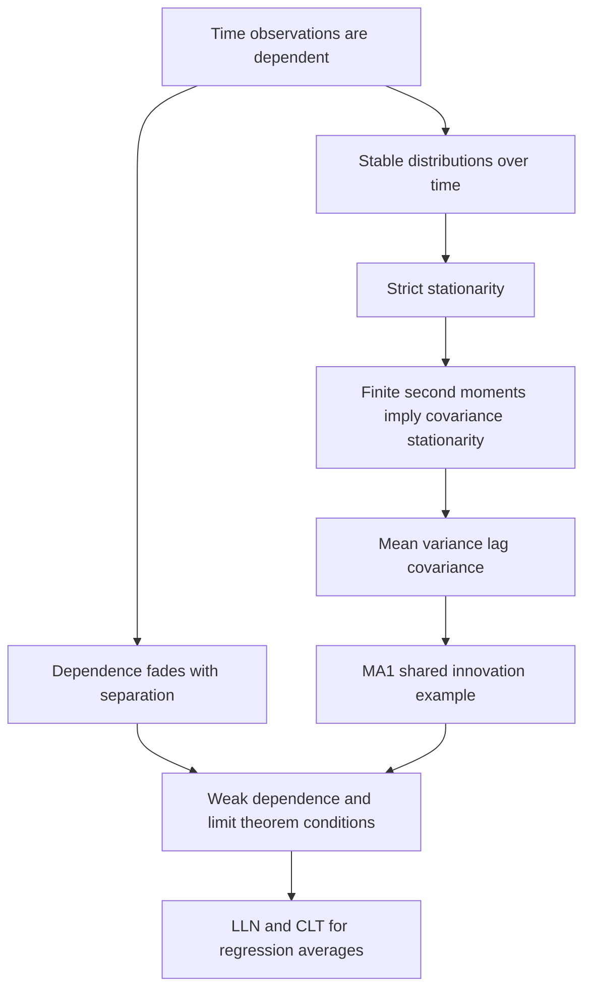

# Distinguish stationarity from weak dependence and limit-theorem roles

## Record metadata

```json
{
  "schema_version": 3,
  "owner": "plan",
  "course_id": "2026_2027/Winter_Semester/Econometrics_II",
  "transaction_id": "PLAN-20261018-ECOX-P004",
  "plan_version": "P004",
  "source_version": "V003",
  "ingestion_revision": 3,
  "objective_id": "O014",
  "objective_revision": 1,
  "criterion_version": "O014-C1",
  "status": "ready",
  "lesson_content_contract": "self-contained-lessons-v1",
  "knowledge_components": [
    "process_and_stationarity_definitions",
    "contrasting_moment_and_dependence_cases",
    "lln_clt_and_observed_plot_limits"
  ],
  "prerequisite_ids": [
    "O009"
  ],
  "compatible_versions": [],
  "note_locations": [
    {
      "path": "01_Notes/2026_2027/Winter_Semester/Econometrics_II/Week_3/Stationarity_Weak_Dependence_and_MA1.md",
      "heading": "Stationarity, weak dependence and MA(1)"
    },
    {
      "path": "01_Notes/2026_2027/Winter_Semester/Econometrics_II/Week_3/Stationarity_Weak_Dependence_and_MA1.md",
      "heading": "A process and one observed realization"
    },
    {
      "path": "01_Notes/2026_2027/Winter_Semester/Econometrics_II/Week_3/Stationarity_Weak_Dependence_and_MA1.md",
      "heading": "Strict and covariance stationarity"
    },
    {
      "path": "01_Notes/2026_2027/Winter_Semester/Econometrics_II/Week_3/Stationarity_Weak_Dependence_and_MA1.md",
      "heading": "Weak dependence and why limit theorems need it"
    },
    {
      "path": "01_Notes/2026_2027/Winter_Semester/Econometrics_II/Week_3/Stationarity_Weak_Dependence_and_MA1.md",
      "heading": "Reading priority and prerequisites"
    }
  ],
  "acquisition_rule": {
    "distinct_independent_passes": 2,
    "required_item_roles": [
      "full_capability_check",
      "full_capability_check"
    ],
    "allowed_routes": [
      [
        "O014-I1",
        "O014-I2"
      ],
      [
        "O014-I1",
        "O014-D1"
      ],
      [
        "O014-I1",
        "O014-D2"
      ],
      [
        "O014-I2",
        "O014-D1"
      ],
      [
        "O014-I2",
        "O014-D2"
      ],
      [
        "O014-D1",
        "O014-D2"
      ]
    ]
  },
  "delayed_rule": {
    "minimum_elapsed_hours": 24,
    "fresh_item": true,
    "independent_required": true
  },
  "review_topic": "Distinguish stationarity from weak dependence and limit-theorem roles",
  "review_instruction": "Begin a closed-note review with teach for O014; request an unused prepared delayed item before recap."
}
```

## Outcome and conditions

Define strict/moment stationarity and weak dependence, apply them to explicit processes and qualify visual and limit-theorem inferences. All essential components listed in metadata are required. Hypothetical assessment values instantiate the checked equations; they are not historical observations or observed outcomes. Independent checks are closed-note and without hints, solution access, external retrieval or other assistance; a basic arithmetic calculator is allowed. Teach establishes and records actual help/exposure conditions before claiming independence.

## Prerequisites and checks

- [O009 outcome and repair route](../lessons/O009.md#outcome-and-conditions): the process/one-history distinction and time ordering replace the random-sampling setting.

O014-P1, item_version 1, prerequisite_diagnostic. **Prompt:** In time-series OLS, does one observed path equal repeated independent samples at each date? Define a stochastic process and distinguish strict exogeneity from random sampling.

**Complete key and rubric:** No. A process is a sequence of random variables and the observed series is one realization; temporal dependence differs from independent sampling. Strict exogeneity conditions error mean on the full regressor sequence, not a statement that observations are independently sampled. Require both distinctions; repair O009 full temporal-ordering/assumption explanation. Pass requires every requested reason and result; partial for an omitted reason or unresolved isolated arithmetic slip; fail for the conflicting mechanism. This diagnostic never counts as acquisition. Current or explicitly compatible committed independent prerequisite evidence may permit skipping its check; familiarity alone cannot. Use the cited complete prerequisite lesson or the named included foundation, then the worked example, after a partial/failing entry check.

## Teaching order and rationale

1. Use the diagnostic once to establish the necessary conceptual or algebraic foundation.
2. Present the complete checked-note explanation below, preserving variables, dates, assumptions and source qualifications. Follow one reasoning chain at a time so every intermediate step is visible.
3. Work W1 fully, asking the learner to explain why each step follows.
4. Use S1 as completion practice: show the setup and first identity, hide the final algebra/numbers and interpretation. After an explanation of the missing steps, withdraw support.
5. Present unused I1/I2 full checks with hidden solutions; use correction/repair after scoring the original answer. An unused D form can replace an exposed I only through a listed route.
6. On a later eligible occasion, begin an unused D item before recap. A numeric variant establishes bounded same-method performance, not general transfer.

## Motivation, intuition, and definitions

Define strict/moment stationarity and weak dependence, apply them to explicit processes and qualify visual and limit-theorem inferences. Establish the definitions, assumptions and relevant comparisons before simplifying an equation. The complete reused passages establish every academic claim, notation choice and qualification assessed here; necessary prerequisites use the complete lessons above.

## Explanation steps

Origin: reused complete note introduction before its first subsection, [[01_Notes/2026_2027/Winter_Semester/Econometrics_II/Week_3/Stationarity_Weak_Dependence_and_MA1.md#Stationarity, weak dependence and MA(1)]], fingerprint `6f5ada6d78aec79c0f8d3419b4cd89e9fa50e130af71d6ca9b0958a4c57bb974`. Heading depth alone is adapted.

### Stationarity, weak dependence and MA(1)

How can more time observations reveal a stable relationship when they are not independent draws? Week 3 replaces random sampling with conditions that make observations sufficiently informative despite dependence. Stationarity concerns stability of distributions over dates; weak dependence concerns how dependence fades as dates separate. They answer different questions and neither should be inferred simply from a smooth-looking time plot. [[00_Materials/2026_2027/Winter_Semester/Econometrics_II/Week_3/2026_Lecture3_print.pdf#page=3|2026_Lecture3_print.pdf, physical PDF p. 3, 6–13]]



This map comes from physical pp.7–14; it traces the foundations required for the OLS asymptotic results on pp.20–24. [[00_Materials/2026_2027/Winter_Semester/Econometrics_II/Week_3/2026_Lecture3_print.pdf#page=7|2026_Lecture3_print.pdf, physical PDF p. 7–14, 20–24]]

Origin: reused complete checked passage [[01_Notes/2026_2027/Winter_Semester/Econometrics_II/Week_3/Stationarity_Weak_Dependence_and_MA1.md#A process and one observed realization]]; fingerprint `6f5ada6d78aec79c0f8d3419b4cd89e9fa50e130af71d6ca9b0958a4c57bb974`. Heading depth alone is adapted.

### A process and one observed realization

A stochastic process $\{x_t\}$ is a collection of random variables indexed by time. The observed series is one realization of that process, rather than many repetitions at each date. To learn a relationship from a single stretch of history, the mechanism cannot change arbitrarily whenever the observation period changes. Stationarity supplies a particular form of stability; it does not say every realized observation is equal. [[00_Materials/2026_2027/Winter_Semester/Econometrics_II/Week_3/2026_Lecture3_print.pdf#page=7|2026_Lecture3_print.pdf, physical PDF p. 7–8]] [[00_Materials/2026_2027/Winter_Semester/Econometrics_II/Dump/textbook.pdf#page=409|Wooldridge, Introductory Econometrics, 5th ed., printed p. 381 (PDF p. 409)]]


Origin: reused complete checked passage [[01_Notes/2026_2027/Winter_Semester/Econometrics_II/Week_3/Stationarity_Weak_Dependence_and_MA1.md#Strict and covariance stationarity]]; fingerprint `6f5ada6d78aec79c0f8d3419b4cd89e9fa50e130af71d6ca9b0958a4c57bb974`. Heading depth alone is adapted.

### Strict and covariance stationarity

The lecture's term **stationary** means strict stationarity: for every finite set $t_1<\cdots<t_m$ and permissible shift $h$, the joint distribution of $(x_{t_1},\ldots,x_{t_m})$ equals that of $(x_{t_1+h},\ldots,x_{t_m+h})$. Single-date distributions are therefore unchanged, and so are joint relationships at fixed lags. The definition allows strong adjacent correlation; what cannot change is the distributional pattern when all dates shift together. [[00_Materials/2026_2027/Winter_Semester/Econometrics_II/Week_3/2026_Lecture3_print.pdf#page=8|2026_Lecture3_print.pdf, physical PDF p. 8]]

If second moments exist, covariance stationarity requires only

$$E[x_t]=\mu,\qquad \operatorname{Var}(x_t)=\gamma(0),\qquad
\operatorname{Cov}(x_t,x_{t+h})=\gamma(h),$$

where $\mu,\gamma(0)$ are finite constants and $\gamma(h)$ depends on lag $h$, not calendar date $t$. Strict stationarity **with finite second moments** implies these moment restrictions; the converse need not hold because higher-order distributional features may change. The opening sentence on lecture p.10 calls covariance stationarity a “special case,” but its later finite-moment implication correctly identifies it as a weaker condition. An observed sample mean/variance is a diagnostic, not proof of an unchanged population distribution. [[00_Materials/2026_2027/Winter_Semester/Econometrics_II/Week_3/2026_Lecture3_print.pdf#page=10|2026_Lecture3_print.pdf, physical PDF p. 10]] [[00_Materials/2026_2027/Winter_Semester/Econometrics_II/Dump/textbook.pdf#page=409|Wooldridge, Introductory Econometrics, 5th ed., printed p. 381 (PDF p. 409)]] [[00_Materials/2026_2027/Winter_Semester/Econometrics_II/Dump/textbook.pdf#page=410|Wooldridge, Introductory Econometrics, 5th ed., printed p. 382 (PDF p. 410)]]

![[01_Notes/2026_2027/Winter_Semester/Econometrics_II/assets/Week_3_Lecture3_Stationarity_Comparison.png]]

Physical p.9 compares different time windows (roughly100–300 and600–800). The left series has similar location/spread and overlapping histograms; the right shifts in location. This illustrates distributional stability rather than constituting a statistical test. The second right-hand histogram legend mistakenly uses an $x$ label despite the plotted right series being $y$; do not infer a third variable. [[00_Materials/2026_2027/Winter_Semester/Econometrics_II/Week_3/2026_Lecture3_print.pdf#page=9|2026_Lecture3_print.pdf, physical PDF p. 9]]

The restaurant-price index on the appended physical p.32 changes its level over the sample; p.11 classifies it as nonstationary. A deterministic trend also changes the mean. The plot alone does not tell whether detrending or differencing is the correct remedy, because deterministic and stochastic trends are different mechanisms. [[00_Materials/2026_2027/Winter_Semester/Econometrics_II/Week_3/2026_Lecture3_print.pdf#page=11|2026_Lecture3_print.pdf, physical PDF p. 11, 18, 30, 32]]


Origin: reused complete checked passage [[01_Notes/2026_2027/Winter_Semester/Econometrics_II/Week_3/Stationarity_Weak_Dependence_and_MA1.md#Weak dependence and why limit theorems need it]]; fingerprint `6f5ada6d78aec79c0f8d3419b4cd89e9fa50e130af71d6ca9b0958a4c57bb974`. Heading depth alone is adapted.

### Weak dependence and why limit theorems need it

Weak dependence means that sufficiently distant observations are nearly independent in the sense required by the relevant limit theorem. The lecture uses a covariance-stationary intuition: $\operatorname{Corr}(x_t,x_{t+h})\to0$ sufficiently rapidly as $h\to\infty$. That rate qualification matters. Pairwise zero or vanishing correlation alone is not a universal independence condition or a complete general CLT assumption. The lecture deliberately leaves formal definitions outside scope. Its stationarity-based introduction on p.12 is a convenient setting, not a universal rule that a process with deterministic trend can never have weakly dependent deviations; p.18 and the textbook explicitly allow that distinction. [[00_Materials/2026_2027/Winter_Semester/Econometrics_II/Week_3/2026_Lecture3_print.pdf#page=12|2026_Lecture3_print.pdf, physical PDF p. 12–13, 18]] [[00_Materials/2026_2027/Winter_Semester/Econometrics_II/Dump/textbook.pdf#page=410|Wooldridge, Introductory Econometrics, 5th ed., printed p. 382 (PDF p. 410)]]

The **law of large numbers (LLN)** makes suitable sample averages approach their population counterparts. The **central limit theorem (CLT)** describes the scaled fluctuation around those limits and supports approximate normal inference. With independent draws these results are familiar; for time series they need dependence and moment regularity strong enough for the required averages. More observations of an almost permanently shared shock need not act like more independent information. This is why weak dependence is a substantive prerequisite, not a cosmetic relabeling of random sampling. [[00_Materials/2026_2027/Winter_Semester/Econometrics_II/Week_3/2026_Lecture3_print.pdf#page=6|2026_Lecture3_print.pdf, physical PDF p. 6–7, 12–13, 20]]


Origin: reused complete checked passage [[01_Notes/2026_2027/Winter_Semester/Econometrics_II/Week_3/Stationarity_Weak_Dependence_and_MA1.md#Reading priority and prerequisites]]; fingerprint `6f5ada6d78aec79c0f8d3419b4cd89e9fa50e130af71d6ca9b0958a4c57bb974`. Heading depth alone is adapted.

### Reading priority and prerequisites

Strict-versus-moment stability and weak dependence are core foundations because they justify the assumptions used by the later consistency/inference theorems. Covariance algebra and independent innovations are prerequisites for understanding why MA(1) dependence ends and AR(1) dependence fades; memorizing the labels does not supply that reasoning. The histogram/restaurant examples support diagnosis but cannot replace those definitions. Continue with the AR(1)/random-walk note, then the OLS asymptotic note. This is a conceptual reading path, not an assessment prediction. [[00_Materials/2026_2027/Winter_Semester/Econometrics_II/Week_3/2026_Lecture3_print.pdf#page=7|2026_Lecture3_print.pdf, physical PDF p. 7–17, 20–30]]


## Worked example

O014-W1, item_version 1, worked_example. **Prompt:** Explain the difference between a stochastic process and its one observed history, define strict and covariance stationarity and their finite-moment implication, and distinguish weak dependence. Evaluate $x_t=Z$, where the same mean-zero finite-variance random variable $Z$ with variance 4 appears at every date, and $y_t=1t+\varepsilon_t$, where the innovations are i.i.d. mean zero with variance 4. Derive mean, variance and lag-3 covariance for each and state which stationarity/dependence claims follow. If two observed windows A/B have similar histograms, what does that establish? Explain the different roles of LLN and CLT and why vanishing pairwise correlation alone is not their full general assumption.

**Complete solution and essential rubric:** A process is a collection of time-indexed random variables; a recorded time path is one realization. Strict stationarity preserves every finite joint distribution under a common date shift. Covariance stationarity requires constant finite mean/variance and covariance depending only on lag. Strict stationarity plus finite second moments implies covariance stationarity; the converse need not hold. Weak dependence concerns fading distant dependence under the relevant moment/rate regularity, rather than date-shift stability. For $x_t=Z$, $E[x_t]=0$, $\operatorname{Var}(x_t)=4$ and $\operatorname{Cov}(x_t,x_{t+3})=4$: the joint vector is copies of the same $Z$ at every shift, so it is strictly/covariance stationary, but correlation stays one and this shared-shock process fails the fading-dependence condition. For $y_t=1t+\varepsilon_t$, $E[y_t]=1t$, variance is 4, and covariance at positive lag is zero because innovations are independent. Its changing mean prevents covariance/strict stationarity, although its deviations after removing the deterministic trend are i.i.d./weakly dependent. This proves that the concepts differ. Similar sample histograms support descriptive stability only, not population stationarity or a test conclusion. LLN supplies convergence of suitable sample averages; CLT supplies the limiting distribution of scaled fluctuations for approximate inference. The required dependence/moment assumptions must cover those averages and rates; pairwise uncorrelatedness alone is not universal independence or a general CLT guarantee. All requested calculations, derivations and qualifications are essential; the component map above applies to every full form.

## Practice with fading assistance

O014-S1, item_version 1, supported_completion. **Prompt:** Explain the difference between a stochastic process and its one observed history, define strict and covariance stationarity and their finite-moment implication, and distinguish weak dependence. Evaluate $x_t=Z$, where the same mean-zero finite-variance random variable $Z$ with variance 9 appears at every date, and $y_t=2t+\varepsilon_t$, where the innovations are i.i.d. mean zero with variance 9. Derive mean, variance and lag-5 covariance for each and state which stationarity/dependence claims follow. If two observed windows C/D have similar histograms, what does that establish? Explain the different roles of LLN and CLT and why vanishing pairwise correlation alone is not their full general assumption.

**Complete solution and essential rubric:** A process is a collection of time-indexed random variables; a recorded time path is one realization. Strict stationarity preserves every finite joint distribution under a common date shift. Covariance stationarity requires constant finite mean/variance and covariance depending only on lag. Strict stationarity plus finite second moments implies covariance stationarity; the converse need not hold. Weak dependence concerns fading distant dependence under the relevant moment/rate regularity, rather than date-shift stability. For $x_t=Z$, $E[x_t]=0$, $\operatorname{Var}(x_t)=9$ and $\operatorname{Cov}(x_t,x_{t+5})=9$: the joint vector is copies of the same $Z$ at every shift, so it is strictly/covariance stationary, but correlation stays one and this shared-shock process fails the fading-dependence condition. For $y_t=2t+\varepsilon_t$, $E[y_t]=2t$, variance is 9, and covariance at positive lag is zero because innovations are independent. Its changing mean prevents covariance/strict stationarity, although its deviations after removing the deterministic trend are i.i.d./weakly dependent. This proves that the concepts differ. Similar sample histograms support descriptive stability only, not population stationarity or a test conclusion. LLN supplies convergence of suitable sample averages; CLT supplies the limiting distribution of scaled fluctuations for approximate inference. The required dependence/moment assumptions must cover those averages and rates; pairwise uncorrelatedness alone is not universal independence or a general CLT guarantee. All requested calculations, derivations and qualifications are essential; the component map above applies to every full form.

Allowed support is the first stated identity only; hide the remaining key while the learner completes it. Supported performance is practice, not an independent result.

## Rubric and independence

Required components: process_and_stationarity_definitions, contrasting_moment_and_dependence_cases, lln_clt_and_observed_plot_limits. Each full prompt/key below elicits every component; all are necessary for a pass on every permitted pair. Accept algebraically equivalent expressions and clearly defined opposite cash-flow signs with correct interpretation. A pass requires all requested outputs/reasons, correct units/assumptions and no critical conceptual error. Partial means a missing component or an unresolved isolated arithmetic slip with an otherwise valid method; independent correction is required for a pass. Fail means a critical mechanism/condition is wrong. Unscorable means a response or its help/exposure conditions cannot be established. Unknown help conditions are never independent evidence.

Critical errors: Stationarity equated with independence or constant realizations; finite-moment implication reversed; a plot or vanishing correlation claimed as a complete general theorem assumption.

Acquisition requires two distinct unused unassisted full checks selected from the six exact metadata routes. Every I/D form covers all components; W1, S1, the prerequisite and C1 are forbidden substitutes. A D form used for acquisition cannot later be counted again as delayed success. No teach-generated item may replace a named full check; additional verified explanation/practice is allowed under the unchanged method and may not fabricate evidence. If fewer than two fresh forms remain for acquisition, return a plan_issue for an additional prepared bank.

| Component | I1 | I2 | D1 | D2 |
|---|---|---|---|---|
| process_and_stationarity_definitions | required | required | required | required |
| contrasting_moment_and_dependence_cases | required | required | required | required |
| lln_clt_and_observed_plot_limits | required | required | required | required |

## Misconceptions and correction

An observed omitted term/sign is tentative until the learner explains it; compare the reasoning with the critical errors above. Score the original response before providing help. Route a conceptual failure to the relevant included derivation and prerequisite, then use an unused full form.

O014-C1, item_version 1, narrow_correction. **Prompt:** A time series has constant population mean but variance grows with date. Is covariance stationarity established? **Key/rubric:** No: constant finite variance and lag-only covariance are also required. Constant mean alone cannot establish it. Pass requires all keyed reasoning; partial for a missing part; fail for the conflicting mechanism. This repairs a common inference only; it cannot substitute for a full numerical/capability check.

Give at most two hints (first identify the date/unit, second point to the included identity); after ineffective hints show the relevant worked step. After two unsuccessful independent attempts stop repeated quizzing, revisit the explanation/prerequisite and preserve the unresolved status.

## Immediate and delayed checks

### O014-I1

O014-I1, item_version 1, full_capability_check. **Prompt:** Explain the difference between a stochastic process and its one observed history, define strict and covariance stationarity and their finite-moment implication, and distinguish weak dependence. Evaluate $x_t=Z$, where the same mean-zero finite-variance random variable $Z$ with variance 2 appears at every date, and $y_t=0.5t+\varepsilon_t$, where the innovations are i.i.d. mean zero with variance 2. Derive mean, variance and lag-4 covariance for each and state which stationarity/dependence claims follow. If two observed windows E/F have similar histograms, what does that establish? Explain the different roles of LLN and CLT and why vanishing pairwise correlation alone is not their full general assumption.

**Complete solution and essential rubric:** A process is a collection of time-indexed random variables; a recorded time path is one realization. Strict stationarity preserves every finite joint distribution under a common date shift. Covariance stationarity requires constant finite mean/variance and covariance depending only on lag. Strict stationarity plus finite second moments implies covariance stationarity; the converse need not hold. Weak dependence concerns fading distant dependence under the relevant moment/rate regularity, rather than date-shift stability. For $x_t=Z$, $E[x_t]=0$, $\operatorname{Var}(x_t)=2$ and $\operatorname{Cov}(x_t,x_{t+4})=2$: the joint vector is copies of the same $Z$ at every shift, so it is strictly/covariance stationary, but correlation stays one and this shared-shock process fails the fading-dependence condition. For $y_t=0.5t+\varepsilon_t$, $E[y_t]=0.5t$, variance is 2, and covariance at positive lag is zero because innovations are independent. Its changing mean prevents covariance/strict stationarity, although its deviations after removing the deterministic trend are i.i.d./weakly dependent. This proves that the concepts differ. Similar sample histograms support descriptive stability only, not population stationarity or a test conclusion. LLN supplies convergence of suitable sample averages; CLT supplies the limiting distribution of scaled fluctuations for approximate inference. The required dependence/moment assumptions must cover those averages and rates; pairwise uncorrelatedness alone is not universal independence or a general CLT guarantee. All requested calculations, derivations and qualifications are essential; the component map above applies to every full form.

I1/I2 are immediate checks; D1/D2 are distinct parallel variants reserved where possible for delayed checks. A delayed success requires an unused form before recap, no help/solution access, and at least 24 actual elapsed hours after acquisition and the most recent relevant teaching/solution exposure. Record intervening exposure. A calendar-date change alone is insufficient; an early D attempt is immediate evidence only.

### O014-I2

O014-I2, item_version 1, full_capability_check. **Prompt:** Explain the difference between a stochastic process and its one observed history, define strict and covariance stationarity and their finite-moment implication, and distinguish weak dependence. Evaluate $x_t=Z$, where the same mean-zero finite-variance random variable $Z$ with variance 5 appears at every date, and $y_t=-1t+\varepsilon_t$, where the innovations are i.i.d. mean zero with variance 5. Derive mean, variance and lag-6 covariance for each and state which stationarity/dependence claims follow. If two observed windows G/H have similar histograms, what does that establish? Explain the different roles of LLN and CLT and why vanishing pairwise correlation alone is not their full general assumption.

**Complete solution and essential rubric:** A process is a collection of time-indexed random variables; a recorded time path is one realization. Strict stationarity preserves every finite joint distribution under a common date shift. Covariance stationarity requires constant finite mean/variance and covariance depending only on lag. Strict stationarity plus finite second moments implies covariance stationarity; the converse need not hold. Weak dependence concerns fading distant dependence under the relevant moment/rate regularity, rather than date-shift stability. For $x_t=Z$, $E[x_t]=0$, $\operatorname{Var}(x_t)=5$ and $\operatorname{Cov}(x_t,x_{t+6})=5$: the joint vector is copies of the same $Z$ at every shift, so it is strictly/covariance stationary, but correlation stays one and this shared-shock process fails the fading-dependence condition. For $y_t=-1t+\varepsilon_t$, $E[y_t]=-1t$, variance is 5, and covariance at positive lag is zero because innovations are independent. Its changing mean prevents covariance/strict stationarity, although its deviations after removing the deterministic trend are i.i.d./weakly dependent. This proves that the concepts differ. Similar sample histograms support descriptive stability only, not population stationarity or a test conclusion. LLN supplies convergence of suitable sample averages; CLT supplies the limiting distribution of scaled fluctuations for approximate inference. The required dependence/moment assumptions must cover those averages and rates; pairwise uncorrelatedness alone is not universal independence or a general CLT guarantee. All requested calculations, derivations and qualifications are essential; the component map above applies to every full form.

### O014-D1

O014-D1, item_version 1, full_capability_check. **Prompt:** Explain the difference between a stochastic process and its one observed history, define strict and covariance stationarity and their finite-moment implication, and distinguish weak dependence. Evaluate $x_t=Z$, where the same mean-zero finite-variance random variable $Z$ with variance 1 appears at every date, and $y_t=3t+\varepsilon_t$, where the innovations are i.i.d. mean zero with variance 1. Derive mean, variance and lag-2 covariance for each and state which stationarity/dependence claims follow. If two observed windows I/J have similar histograms, what does that establish? Explain the different roles of LLN and CLT and why vanishing pairwise correlation alone is not their full general assumption.

**Complete solution and essential rubric:** A process is a collection of time-indexed random variables; a recorded time path is one realization. Strict stationarity preserves every finite joint distribution under a common date shift. Covariance stationarity requires constant finite mean/variance and covariance depending only on lag. Strict stationarity plus finite second moments implies covariance stationarity; the converse need not hold. Weak dependence concerns fading distant dependence under the relevant moment/rate regularity, rather than date-shift stability. For $x_t=Z$, $E[x_t]=0$, $\operatorname{Var}(x_t)=1$ and $\operatorname{Cov}(x_t,x_{t+2})=1$: the joint vector is copies of the same $Z$ at every shift, so it is strictly/covariance stationary, but correlation stays one and this shared-shock process fails the fading-dependence condition. For $y_t=3t+\varepsilon_t$, $E[y_t]=3t$, variance is 1, and covariance at positive lag is zero because innovations are independent. Its changing mean prevents covariance/strict stationarity, although its deviations after removing the deterministic trend are i.i.d./weakly dependent. This proves that the concepts differ. Similar sample histograms support descriptive stability only, not population stationarity or a test conclusion. LLN supplies convergence of suitable sample averages; CLT supplies the limiting distribution of scaled fluctuations for approximate inference. The required dependence/moment assumptions must cover those averages and rates; pairwise uncorrelatedness alone is not universal independence or a general CLT guarantee. All requested calculations, derivations and qualifications are essential; the component map above applies to every full form.

### O014-D2

O014-D2, item_version 1, full_capability_check. **Prompt:** Explain the difference between a stochastic process and its one observed history, define strict and covariance stationarity and their finite-moment implication, and distinguish weak dependence. Evaluate $x_t=Z$, where the same mean-zero finite-variance random variable $Z$ with variance 8 appears at every date, and $y_t=-2t+\varepsilon_t$, where the innovations are i.i.d. mean zero with variance 8. Derive mean, variance and lag-7 covariance for each and state which stationarity/dependence claims follow. If two observed windows K/L have similar histograms, what does that establish? Explain the different roles of LLN and CLT and why vanishing pairwise correlation alone is not their full general assumption.

**Complete solution and essential rubric:** A process is a collection of time-indexed random variables; a recorded time path is one realization. Strict stationarity preserves every finite joint distribution under a common date shift. Covariance stationarity requires constant finite mean/variance and covariance depending only on lag. Strict stationarity plus finite second moments implies covariance stationarity; the converse need not hold. Weak dependence concerns fading distant dependence under the relevant moment/rate regularity, rather than date-shift stability. For $x_t=Z$, $E[x_t]=0$, $\operatorname{Var}(x_t)=8$ and $\operatorname{Cov}(x_t,x_{t+7})=8$: the joint vector is copies of the same $Z$ at every shift, so it is strictly/covariance stationary, but correlation stays one and this shared-shock process fails the fading-dependence condition. For $y_t=-2t+\varepsilon_t$, $E[y_t]=-2t$, variance is 8, and covariance at positive lag is zero because innovations are independent. Its changing mean prevents covariance/strict stationarity, although its deviations after removing the deterministic trend are i.i.d./weakly dependent. This proves that the concepts differ. Similar sample histograms support descriptive stability only, not population stationarity or a test conclusion. LLN supplies convergence of suitable sample averages; CLT supplies the limiting distribution of scaled fluctuations for approximate inference. The required dependence/moment assumptions must cover those averages and rates; pairwise uncorrelatedness alone is not universal independence or a general CLT guarantee. All requested calculations, derivations and qualifications are essential; the component map above applies to every full form.

## Advance, revisit, pause, and escalate

Advance only after teach commits two qualifying independent full passes under a listed route. Keep acquisition and each later delayed observation separate. A source conflict blocks the affected claim and returns to ingest with the exact note heading. Missing criteria, a new method, unsupported alternative or exhausted fresh bank returns to plan with 2026_2027/Winter_Semester/Econometrics_II, O014, revision1/O014-C1, P004/V003/ingestion3 and item ID. Equivalent valid methods meeting the frozen criterion may receive credit after verification; no criterion is changed to fit an answer. Closing a session preserves the actual stopping point without claiming completion.

## Content provenance and generation boundaries

Explanations, figures and qualifications above reuse complete checked-note sections with exact origin/fingerprint; heading depth alone is adapted. Main exercises and worked arithmetic are plan-created hypothetical instantiations of those displayed identities. No additional academic claims or external course scope are introduced. Preserve the note conventions and explicit qualifications; checked references reused from notes are not an independent raw-source audit by plan. New numerical practice can use the same method only after its complete solution and unchanged components are checked before display; it cannot replace this lesson’s named evidence forms. Prerequisites route to the complete prepared lessons above.

## Answer-free recall handoff

Topic: Distinguish stationarity from weak dependence and limit-theorem roles. Begin a closed-note review with teach for O014; request an unused prepared delayed item before recap. Exact lesson: [[03_Agents/2026_2027/Winter_Semester/Econometrics_II/lessons/O014.md#Immediate and delayed checks]]. Teach supplies actual committed evidence and timestamps; recall alone dates reviews. No learner outcome or due date is created by this curriculum.
