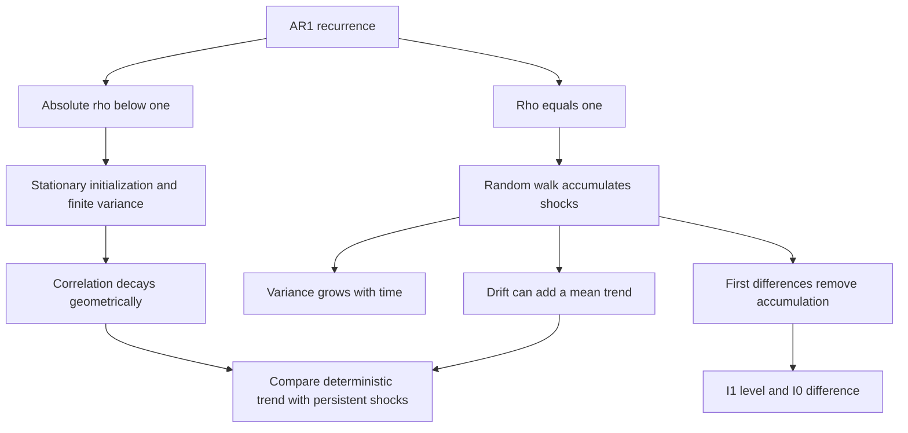

# Derive stable AR(1) moments, forecasts and initialization limits

## Record metadata

```json
{
  "schema_version": 3,
  "owner": "plan",
  "course_id": "2026_2027/Winter_Semester/Econometrics_II",
  "transaction_id": "PLAN-20261018-ECOX-P004",
  "plan_version": "P004",
  "source_version": "V003",
  "ingestion_revision": 3,
  "objective_id": "O016",
  "objective_revision": 1,
  "criterion_version": "O016-C1",
  "status": "ready",
  "lesson_content_contract": "self-contained-lessons-v1",
  "knowledge_components": [
    "stationary_ar_moments",
    "lag_correlation_and_forecast",
    "fixed_initialization_and_stability_limits"
  ],
  "prerequisite_ids": [
    "O014",
    "O015"
  ],
  "compatible_versions": [],
  "note_locations": [
    {
      "path": "01_Notes/2026_2027/Winter_Semester/Econometrics_II/Week_3/AR1_Random_Walks_and_Integration.md",
      "heading": "AR(1), random walks and integration"
    },
    {
      "path": "01_Notes/2026_2027/Winter_Semester/Econometrics_II/Week_3/AR1_Random_Walks_and_Integration.md",
      "heading": "Stable AR(1): assumptions before moments"
    },
    {
      "path": "01_Notes/2026_2027/Winter_Semester/Econometrics_II/Week_3/AR1_Random_Walks_and_Integration.md",
      "heading": "Why AR(1) correlation fades"
    }
  ],
  "acquisition_rule": {
    "distinct_independent_passes": 2,
    "required_item_roles": [
      "full_capability_check",
      "full_capability_check"
    ],
    "allowed_routes": [
      [
        "O016-I1",
        "O016-I2"
      ],
      [
        "O016-I1",
        "O016-D1"
      ],
      [
        "O016-I1",
        "O016-D2"
      ],
      [
        "O016-I2",
        "O016-D1"
      ],
      [
        "O016-I2",
        "O016-D2"
      ],
      [
        "O016-D1",
        "O016-D2"
      ]
    ]
  },
  "delayed_rule": {
    "minimum_elapsed_hours": 24,
    "fresh_item": true,
    "independent_required": true
  },
  "review_topic": "Derive stable AR(1) moments, forecasts and initialization limits",
  "review_instruction": "Begin a closed-note review with teach for O016; request an unused prepared delayed item before recap."
}
```

## Outcome and conditions

Derive stable AR(1) moments, lag decay and forecasts and distinguish stationary initialization from finite-date convergence. All essential components listed in metadata are required. Hypothetical assessment values instantiate the checked equations; they are not historical observations or observed outcomes. Independent checks are closed-note and without hints, solution access, external retrieval or other assistance; a basic arithmetic calculator is allowed. Teach establishes and records actual help/exposure conditions before claiming independence.

## Prerequisites and checks

- [O014 outcome and repair route](../lessons/O014.md#outcome-and-conditions): covariance stationarity defines the constant moments assumed in the recurrence proof.
- [O015 outcome and repair route](../lessons/O015.md#outcome-and-conditions): independent-innovation covariance expansions justify removing cross terms.

O016-P1, item_version 1, prerequisite_diagnostic. **Prompt:** For independent zero-mean terms A,B, why is $\operatorname{Var}(A+B)=\operatorname{Var}(A)+\operatorname{Var}(B)$? Does a strictly stationary finite-second-moment process need independent adjacent values?

**Complete key and rubric:** The variance cross term is twice $\operatorname{Cov}(A,B)=0$ under independence. Strict stationarity preserves shifted joint distributions but permits adjacent dependence. Require covariance reasoning (O015) and definition (O014); repair those complete lessons. Pass requires every requested reason and result; partial for an omitted reason or unresolved isolated arithmetic slip; fail for the conflicting mechanism. This diagnostic never counts as acquisition. Current or explicitly compatible committed independent prerequisite evidence may permit skipping its check; familiarity alone cannot. Use the cited complete prerequisite lesson or the named included foundation, then the worked example, after a partial/failing entry check.

## Teaching order and rationale

1. Use the diagnostic once to establish the necessary conceptual or algebraic foundation.
2. Present the complete checked-note explanation below, preserving variables, dates, assumptions and source qualifications. Follow one reasoning chain at a time so every intermediate step is visible.
3. Work W1 fully, asking the learner to explain why each step follows.
4. Use S1 as completion practice: show the setup and first identity, hide the final algebra/numbers and interpretation. After an explanation of the missing steps, withdraw support.
5. Present unused I1/I2 full checks with hidden solutions; use correction/repair after scoring the original answer. An unused D form can replace an exposed I only through a listed route.
6. On a later eligible occasion, begin an unused D item before recap. A numeric variant establishes bounded same-method performance, not general transfer.

## Motivation, intuition, and definitions

Derive stable AR(1) moments, lag decay and forecasts and distinguish stationary initialization from finite-date convergence. Establish the definitions, assumptions and relevant comparisons before simplifying an equation. The complete reused passages establish every academic claim, notation choice and qualification assessed here; necessary prerequisites use the complete lessons above.

## Explanation steps

Origin: reused complete note introduction before its first subsection, [[01_Notes/2026_2027/Winter_Semester/Econometrics_II/Week_3/AR1_Random_Walks_and_Integration.md#AR(1), random walks and integration]], fingerprint `710163a54be6e9043b101fb7c24a6ba169ce5ba3899e3cd065fab4a095829965`. Heading depth alone is adapted.

### AR(1), random walks and integration

Does a shock fade away, or does it permanently change the level of a series? Comparing a stable autoregression with a random walk explains why apparent persistence changes the validity of ordinary regression asymptotics. It also separates removing a deterministic trend from differencing an accumulated random shock. [[00_Materials/2026_2027/Winter_Semester/Econometrics_II/Week_3/2026_Lecture3_print.pdf#page=15|2026_Lecture3_print.pdf, physical PDF p. 15–18, 25–30]]



The diagram follows physical pp.15–18 and26–30; stationary moments/independent innovations are explained in the preceding Week3 note. [[00_Materials/2026_2027/Winter_Semester/Econometrics_II/Week_3/2026_Lecture3_print.pdf#page=15|2026_Lecture3_print.pdf, physical PDF p. 15–18, 26–30]]

Origin: reused complete checked passage [[01_Notes/2026_2027/Winter_Semester/Econometrics_II/Week_3/AR1_Random_Walks_and_Integration.md#Stable AR(1): assumptions before moments]]; fingerprint `710163a54be6e9043b101fb7c24a6ba169ce5ba3899e3cd065fab4a095829965`. Heading depth alone is adapted.

### Stable AR(1): assumptions before moments

An autoregression of order one obeys

$$x_t=\rho x_{t-1}+\varepsilon_t,$$

with i.i.d. zero-mean innovations of finite variance $\sigma_\varepsilon^2>0$. Future innovations must be independent of the initial value/past. The stability condition is $|\rho|<1$. To derive the lecture's constant moments **from the start**, take a covariance-stationary initialization; the recurrence and stability alone do not guarantee that an arbitrary fixed or random $x_0$ has the stationary distribution. The lecture omits that initialization qualification on p.15; the textbook explicitly assumes covariance stationarity in the displayed moment argument. [[00_Materials/2026_2027/Winter_Semester/Econometrics_II/Week_3/2026_Lecture3_print.pdf#page=15|2026_Lecture3_print.pdf, physical PDF p. 15–16]] [[00_Materials/2026_2027/Winter_Semester/Econometrics_II/Dump/textbook.pdf#page=411|Wooldridge, Introductory Econometrics, 5th ed., printed p. 383 (PDF p. 411)]]

Under stationary initialization, the mean satisfies $\mu=\rho\mu$, giving $\mu=0$ because $\rho\ne1$. Independence of the innovation from the past gives

$$\sigma_x^2=\rho^2\sigma_x^2+\sigma_\varepsilon^2,\qquad
\sigma_x^2=\frac{\sigma_\varepsilon^2}{1-\rho^2}.$$

The positive denominator is why a nondegenerate finite stationary variance is compatible with $|\rho|<1$. A recurrence started instead at fixed zero has

$$\operatorname{Var}(x_t)=\sigma_\varepsilon^2\sum_{j=0}^{t-1}\rho^{2j}=\sigma_\varepsilon^2\frac{1-\rho^{2t}}{1-\rho^2},$$

which approaches the stationary variance but is not equal to it at every finite date. This last expression is **agent-derived qualification**: repeatedly substitute the recurrence, then add variances of independent shocks. It shows exactly what the missing initialization changes. [[00_Materials/2026_2027/Winter_Semester/Econometrics_II/Week_3/2026_Lecture3_print.pdf#page=15|2026_Lecture3_print.pdf, physical PDF p. 15–16]] [[00_Materials/2026_2027/Winter_Semester/Econometrics_II/Dump/textbook.pdf#page=411|Wooldridge, Introductory Econometrics, 5th ed., printed p. 383 (PDF p. 411)]]


Origin: reused complete checked passage [[01_Notes/2026_2027/Winter_Semester/Econometrics_II/Week_3/AR1_Random_Walks_and_Integration.md#Why AR(1) correlation fades]]; fingerprint `710163a54be6e9043b101fb7c24a6ba169ce5ba3899e3cd065fab4a095829965`. Heading depth alone is adapted.

### Why AR(1) correlation fades

Substitution over $h$ future periods gives

$$x_{t+h}=\rho^h x_t+\sum_{j=1}^{h}\rho^{h-j}\varepsilon_{t+j}.$$

Future innovations have zero covariance with $x_t$, so under the stationary moments

$$\operatorname{Cov}(x_t,x_{t+h})=\rho^h\sigma_x^2,\qquad
\operatorname{Corr}(x_t,x_{t+h})=\rho^h.$$

Thus correlation tends to zero geometrically when $|\rho|<1$. Negative $\rho$ alternates the sign; a $\rho$ near one decays slowly in a short sample but remains stable. Under zero conditional-mean future innovations, $E[x_{t+h}\mid x_t]=\rho^h x_t$ approaches zero. This is the mechanism behind fading shocks, rather than a claim that adjacent values are independent. [[00_Materials/2026_2027/Winter_Semester/Econometrics_II/Week_3/2026_Lecture3_print.pdf#page=17|2026_Lecture3_print.pdf, physical PDF p. 17, 27]] [[00_Materials/2026_2027/Winter_Semester/Econometrics_II/Dump/textbook.pdf#page=412|Wooldridge, Introductory Econometrics, 5th ed., printed p. 384 (PDF p. 412)]]


## Worked example

O016-W1, item_version 1, worked_example. **Prompt:** For $x_t=\rho x_{t-1}+\varepsilon_t$, take $\rho=0.5$, i.i.d. zero-mean innovations of variance 3, independent of the initial value/past. Under covariance-stationary initialization derive mean, variance, lag-2 covariance/correlation and forecast from current $x_t=8$. Compare with initialization $x_0=0$ by computing variance at date 2. Explain stability, shock decay and the distinction between a near-unit-root stable coefficient and an exact random walk. Does the recurrence with $|\rho|<1$ alone force stationary finite-date moments from an arbitrary initialization?

**Complete solution and essential rubric:** With $|\rho|<1$ and stationary initialization, $\mu=\rho\mu$ implies $\mu=0$. Independence gives $\sigma_x^2=\rho^2\sigma_x^2+\sigma_\varepsilon^2$, hence $\sigma_x^2=4.00000000$. Iteration gives $x_{t+h}=\rho^h x_t+\sum_{j=1}^h\rho^{h-j}\varepsilon_{t+j}$. Future innovations have zero covariance/conditional mean given the past, so lag-2 covariance is $\rho^2\sigma_x^2=1.00000000$, correlation $\rho^2=0.25000000$ and conditional forecast $\rho^2(8)=2.00000000$. With fixed zero initialization, variance at date 2 is $\sigma_\varepsilon^2(1-\rho^{2t})/(1-\rho^2)=3.75000000$; it approaches but generally is not the stationary variance at a finite date. Thus stability/recurrence alone does not supply stationary initialization. Powers decay to zero; negative rho alternates signs and a value near one decays slowly without equaling a unit root. At rho one shocks accumulate instead. Constant population moments and sample appearances are distinct. All requested calculations, derivations and qualifications are essential; the component map above applies to every full form.

## Practice with fading assistance

O016-S1, item_version 1, supported_completion. **Prompt:** For $x_t=\rho x_{t-1}+\varepsilon_t$, take $\rho=-0.5$, i.i.d. zero-mean innovations of variance 4, independent of the initial value/past. Under covariance-stationary initialization derive mean, variance, lag-3 covariance/correlation and forecast from current $x_t=6$. Compare with initialization $x_0=0$ by computing variance at date 3. Explain stability, shock decay and the distinction between a near-unit-root stable coefficient and an exact random walk. Does the recurrence with $|\rho|<1$ alone force stationary finite-date moments from an arbitrary initialization?

**Complete solution and essential rubric:** With $|\rho|<1$ and stationary initialization, $\mu=\rho\mu$ implies $\mu=0$. Independence gives $\sigma_x^2=\rho^2\sigma_x^2+\sigma_\varepsilon^2$, hence $\sigma_x^2=5.33333333$. Iteration gives $x_{t+h}=\rho^h x_t+\sum_{j=1}^h\rho^{h-j}\varepsilon_{t+j}$. Future innovations have zero covariance/conditional mean given the past, so lag-3 covariance is $\rho^3\sigma_x^2=-0.66666667$, correlation $\rho^3=-0.12500000$ and conditional forecast $\rho^3(6)=-0.75000000$. With fixed zero initialization, variance at date 3 is $\sigma_\varepsilon^2(1-\rho^{2t})/(1-\rho^2)=5.25000000$; it approaches but generally is not the stationary variance at a finite date. Thus stability/recurrence alone does not supply stationary initialization. Powers decay to zero; negative rho alternates signs and a value near one decays slowly without equaling a unit root. At rho one shocks accumulate instead. Constant population moments and sample appearances are distinct. All requested calculations, derivations and qualifications are essential; the component map above applies to every full form.

Allowed support is the first stated identity only; hide the remaining key while the learner completes it. Supported performance is practice, not an independent result.

## Rubric and independence

Required components: stationary_ar_moments, lag_correlation_and_forecast, fixed_initialization_and_stability_limits. Each full prompt/key below elicits every component; all are necessary for a pass on every permitted pair. Accept algebraically equivalent expressions and clearly defined opposite cash-flow signs with correct interpretation. A pass requires all requested outputs/reasons, correct units/assumptions and no critical conceptual error. Partial means a missing component or an unresolved isolated arithmetic slip with an otherwise valid method; independent correction is required for a pass. Fail means a critical mechanism/condition is wrong. Unscorable means a response or its help/exposure conditions cannot be established. Unknown help conditions are never independent evidence.

Critical errors: Stationary initialization inferred from recurrence alone; squared coefficient omitted in variance; negative rho sign ignored; near-one declared exact unit root.

Acquisition requires two distinct unused unassisted full checks selected from the six exact metadata routes. Every I/D form covers all components; W1, S1, the prerequisite and C1 are forbidden substitutes. A D form used for acquisition cannot later be counted again as delayed success. No teach-generated item may replace a named full check; additional verified explanation/practice is allowed under the unchanged method and may not fabricate evidence. If fewer than two fresh forms remain for acquisition, return a plan_issue for an additional prepared bank.

| Component | I1 | I2 | D1 | D2 |
|---|---|---|---|---|
| stationary_ar_moments | required | required | required | required |
| lag_correlation_and_forecast | required | required | required | required |
| fixed_initialization_and_stability_limits | required | required | required | required |

## Misconceptions and correction

An observed omitted term/sign is tentative until the learner explains it; compare the reasoning with the critical errors above. Score the original response before providing help. Route a conceptual failure to the relevant included derivation and prerequisite, then use an unused full form.

O016-C1, item_version 1, narrow_correction. **Prompt:** A stable AR(1) starts at fixed zero. May its date-one variance be replaced by the stationary variance without qualification? **Key/rubric:** No: date-one variance is the innovation variance, while the stationary variance includes an infinite accumulation of past shocks. They generally differ; state initialization and use the finite-date sum. Pass requires all keyed reasoning; partial for a missing part; fail for the conflicting mechanism. This repairs a common inference only; it cannot substitute for a full numerical/capability check.

Give at most two hints (first identify the date/unit, second point to the included identity); after ineffective hints show the relevant worked step. After two unsuccessful independent attempts stop repeated quizzing, revisit the explanation/prerequisite and preserve the unresolved status.

## Immediate and delayed checks

### O016-I1

O016-I1, item_version 1, full_capability_check. **Prompt:** For $x_t=\rho x_{t-1}+\varepsilon_t$, take $\rho=0.8$, i.i.d. zero-mean innovations of variance 2, independent of the initial value/past. Under covariance-stationary initialization derive mean, variance, lag-2 covariance/correlation and forecast from current $x_t=10$. Compare with initialization $x_0=0$ by computing variance at date 2. Explain stability, shock decay and the distinction between a near-unit-root stable coefficient and an exact random walk. Does the recurrence with $|\rho|<1$ alone force stationary finite-date moments from an arbitrary initialization?

**Complete solution and essential rubric:** With $|\rho|<1$ and stationary initialization, $\mu=\rho\mu$ implies $\mu=0$. Independence gives $\sigma_x^2=\rho^2\sigma_x^2+\sigma_\varepsilon^2$, hence $\sigma_x^2=5.55555556$. Iteration gives $x_{t+h}=\rho^h x_t+\sum_{j=1}^h\rho^{h-j}\varepsilon_{t+j}$. Future innovations have zero covariance/conditional mean given the past, so lag-2 covariance is $\rho^2\sigma_x^2=3.55555556$, correlation $\rho^2=0.64000000$ and conditional forecast $\rho^2(10)=6.40000000$. With fixed zero initialization, variance at date 2 is $\sigma_\varepsilon^2(1-\rho^{2t})/(1-\rho^2)=3.28000000$; it approaches but generally is not the stationary variance at a finite date. Thus stability/recurrence alone does not supply stationary initialization. Powers decay to zero; negative rho alternates signs and a value near one decays slowly without equaling a unit root. At rho one shocks accumulate instead. Constant population moments and sample appearances are distinct. All requested calculations, derivations and qualifications are essential; the component map above applies to every full form.

I1/I2 are immediate checks; D1/D2 are distinct parallel variants reserved where possible for delayed checks. A delayed success requires an unused form before recap, no help/solution access, and at least 24 actual elapsed hours after acquisition and the most recent relevant teaching/solution exposure. Record intervening exposure. A calendar-date change alone is insufficient; an early D attempt is immediate evidence only.

### O016-I2

O016-I2, item_version 1, full_capability_check. **Prompt:** For $x_t=\rho x_{t-1}+\varepsilon_t$, take $\rho=-0.6$, i.i.d. zero-mean innovations of variance 5, independent of the initial value/past. Under covariance-stationary initialization derive mean, variance, lag-3 covariance/correlation and forecast from current $x_t=5$. Compare with initialization $x_0=0$ by computing variance at date 4. Explain stability, shock decay and the distinction between a near-unit-root stable coefficient and an exact random walk. Does the recurrence with $|\rho|<1$ alone force stationary finite-date moments from an arbitrary initialization?

**Complete solution and essential rubric:** With $|\rho|<1$ and stationary initialization, $\mu=\rho\mu$ implies $\mu=0$. Independence gives $\sigma_x^2=\rho^2\sigma_x^2+\sigma_\varepsilon^2$, hence $\sigma_x^2=7.81250000$. Iteration gives $x_{t+h}=\rho^h x_t+\sum_{j=1}^h\rho^{h-j}\varepsilon_{t+j}$. Future innovations have zero covariance/conditional mean given the past, so lag-3 covariance is $\rho^3\sigma_x^2=-1.68750000$, correlation $\rho^3=-0.21600000$ and conditional forecast $\rho^3(5)=-1.08000000$. With fixed zero initialization, variance at date 4 is $\sigma_\varepsilon^2(1-\rho^{2t})/(1-\rho^2)=7.68128000$; it approaches but generally is not the stationary variance at a finite date. Thus stability/recurrence alone does not supply stationary initialization. Powers decay to zero; negative rho alternates signs and a value near one decays slowly without equaling a unit root. At rho one shocks accumulate instead. Constant population moments and sample appearances are distinct. All requested calculations, derivations and qualifications are essential; the component map above applies to every full form.

### O016-D1

O016-D1, item_version 1, full_capability_check. **Prompt:** For $x_t=\rho x_{t-1}+\varepsilon_t$, take $\rho=0.9$, i.i.d. zero-mean innovations of variance 1, independent of the initial value/past. Under covariance-stationary initialization derive mean, variance, lag-4 covariance/correlation and forecast from current $x_t=12$. Compare with initialization $x_0=0$ by computing variance at date 3. Explain stability, shock decay and the distinction between a near-unit-root stable coefficient and an exact random walk. Does the recurrence with $|\rho|<1$ alone force stationary finite-date moments from an arbitrary initialization?

**Complete solution and essential rubric:** With $|\rho|<1$ and stationary initialization, $\mu=\rho\mu$ implies $\mu=0$. Independence gives $\sigma_x^2=\rho^2\sigma_x^2+\sigma_\varepsilon^2$, hence $\sigma_x^2=5.26315789$. Iteration gives $x_{t+h}=\rho^h x_t+\sum_{j=1}^h\rho^{h-j}\varepsilon_{t+j}$. Future innovations have zero covariance/conditional mean given the past, so lag-4 covariance is $\rho^4\sigma_x^2=3.45315789$, correlation $\rho^4=0.65610000$ and conditional forecast $\rho^4(12)=7.87320000$. With fixed zero initialization, variance at date 3 is $\sigma_\varepsilon^2(1-\rho^{2t})/(1-\rho^2)=2.46610000$; it approaches but generally is not the stationary variance at a finite date. Thus stability/recurrence alone does not supply stationary initialization. Powers decay to zero; negative rho alternates signs and a value near one decays slowly without equaling a unit root. At rho one shocks accumulate instead. Constant population moments and sample appearances are distinct. All requested calculations, derivations and qualifications are essential; the component map above applies to every full form.

### O016-D2

O016-D2, item_version 1, full_capability_check. **Prompt:** For $x_t=\rho x_{t-1}+\varepsilon_t$, take $\rho=0.4$, i.i.d. zero-mean innovations of variance 6, independent of the initial value/past. Under covariance-stationary initialization derive mean, variance, lag-3 covariance/correlation and forecast from current $x_t=15$. Compare with initialization $x_0=0$ by computing variance at date 2. Explain stability, shock decay and the distinction between a near-unit-root stable coefficient and an exact random walk. Does the recurrence with $|\rho|<1$ alone force stationary finite-date moments from an arbitrary initialization?

**Complete solution and essential rubric:** With $|\rho|<1$ and stationary initialization, $\mu=\rho\mu$ implies $\mu=0$. Independence gives $\sigma_x^2=\rho^2\sigma_x^2+\sigma_\varepsilon^2$, hence $\sigma_x^2=7.14285714$. Iteration gives $x_{t+h}=\rho^h x_t+\sum_{j=1}^h\rho^{h-j}\varepsilon_{t+j}$. Future innovations have zero covariance/conditional mean given the past, so lag-3 covariance is $\rho^3\sigma_x^2=0.45714286$, correlation $\rho^3=0.06400000$ and conditional forecast $\rho^3(15)=0.96000000$. With fixed zero initialization, variance at date 2 is $\sigma_\varepsilon^2(1-\rho^{2t})/(1-\rho^2)=6.96000000$; it approaches but generally is not the stationary variance at a finite date. Thus stability/recurrence alone does not supply stationary initialization. Powers decay to zero; negative rho alternates signs and a value near one decays slowly without equaling a unit root. At rho one shocks accumulate instead. Constant population moments and sample appearances are distinct. All requested calculations, derivations and qualifications are essential; the component map above applies to every full form.

## Advance, revisit, pause, and escalate

Advance only after teach commits two qualifying independent full passes under a listed route. Keep acquisition and each later delayed observation separate. A source conflict blocks the affected claim and returns to ingest with the exact note heading. Missing criteria, a new method, unsupported alternative or exhausted fresh bank returns to plan with 2026_2027/Winter_Semester/Econometrics_II, O016, revision1/O016-C1, P004/V003/ingestion3 and item ID. Equivalent valid methods meeting the frozen criterion may receive credit after verification; no criterion is changed to fit an answer. Closing a session preserves the actual stopping point without claiming completion.

## Content provenance and generation boundaries

Explanations, figures and qualifications above reuse complete checked-note sections with exact origin/fingerprint; heading depth alone is adapted. Main exercises and worked arithmetic are plan-created hypothetical instantiations of those displayed identities. No additional academic claims or external course scope are introduced. Preserve the note conventions and explicit qualifications; checked references reused from notes are not an independent raw-source audit by plan. New numerical practice can use the same method only after its complete solution and unchanged components are checked before display; it cannot replace this lesson’s named evidence forms. Prerequisites route to the complete prepared lessons above.

## Answer-free recall handoff

Topic: Derive stable AR(1) moments, forecasts and initialization limits. Begin a closed-note review with teach for O016; request an unused prepared delayed item before recap. Exact lesson: [[03_Agents/2026_2027/Winter_Semester/Econometrics_II/lessons/O016.md#Immediate and delayed checks]]. Teach supplies actual committed evidence and timestamps; recall alone dates reviews. No learner outcome or due date is created by this curriculum.
