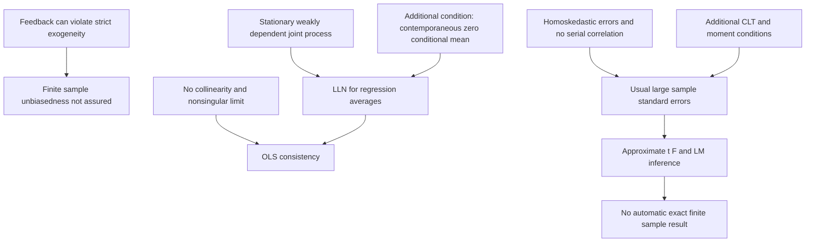

# Derive time-series OLS consistency under contemporaneous exogeneity

## Record metadata

```json
{
  "schema_version": 3,
  "owner": "plan",
  "course_id": "2026_2027/Winter_Semester/Econometrics_II",
  "transaction_id": "PLAN-20261018-ECOX-P004",
  "plan_version": "P004",
  "source_version": "V003",
  "ingestion_revision": 3,
  "objective_id": "O018",
  "objective_revision": 1,
  "criterion_version": "O018-C1",
  "status": "ready",
  "lesson_content_contract": "self-contained-lessons-v1",
  "knowledge_components": [
    "normalized_ols_limit_and_iterated_expectations",
    "joint_regularity_rank_and_exogeneity",
    "feedback_unbiasedness_and_nonzero_score_contrast"
  ],
  "prerequisite_ids": [
    "O002",
    "O009",
    "O014"
  ],
  "compatible_versions": [],
  "note_locations": [
    {
      "path": "01_Notes/2026_2027/Winter_Semester/Econometrics_II/Week_3/Time_Series_OLS_Consistency_and_Inference.md",
      "heading": "Time-series OLS consistency and inference"
    },
    {
      "path": "01_Notes/2026_2027/Winter_Semester/Econometrics_II/Week_3/Time_Series_OLS_Consistency_and_Inference.md",
      "heading": "The growth and interest-rate example"
    },
    {
      "path": "01_Notes/2026_2027/Winter_Semester/Econometrics_II/Week_3/Time_Series_OLS_Consistency_and_Inference.md",
      "heading": "Assumptions for consistency"
    },
    {
      "path": "01_Notes/2026_2027/Winter_Semester/Econometrics_II/Week_3/Time_Series_OLS_Consistency_and_Inference.md",
      "heading": "Why these conditions yield consistency"
    }
  ],
  "acquisition_rule": {
    "distinct_independent_passes": 2,
    "required_item_roles": [
      "full_capability_check",
      "full_capability_check"
    ],
    "allowed_routes": [
      [
        "O018-I1",
        "O018-I2"
      ],
      [
        "O018-I1",
        "O018-D1"
      ],
      [
        "O018-I1",
        "O018-D2"
      ],
      [
        "O018-I2",
        "O018-D1"
      ],
      [
        "O018-I2",
        "O018-D2"
      ],
      [
        "O018-D1",
        "O018-D2"
      ]
    ]
  },
  "delayed_rule": {
    "minimum_elapsed_hours": 24,
    "fresh_item": true,
    "independent_required": true
  },
  "review_topic": "Derive time-series OLS consistency under contemporaneous exogeneity",
  "review_instruction": "Begin a closed-note review with teach for O018; request an unused prepared delayed item before recap."
}
```

## Outcome and conditions

Derive consistency from the normalized design/score limits under TS1a–3a and distinguish finite-sample unbiasedness and further inference requirements. All essential components listed in metadata are required. Hypothetical assessment values instantiate the checked equations; they are not historical observations or observed outcomes. Independent checks are closed-note and without hints, solution access, external retrieval or other assistance; a basic arithmetic calculator is allowed. Teach establishes and records actual help/exposure conditions before claiming independence.

## Prerequisites and checks

- [O002 outcome and repair route](../lessons/O002.md#outcome-and-conditions): the exact matrix OLS decomposition is normalized before taking limits.
- [O009 outcome and repair route](../lessons/O009.md#outcome-and-conditions): strict versus current-date conditioning distinguishes the feedback guarantee.
- [O014 outcome and repair route](../lessons/O014.md#outcome-and-conditions): joint weak-dependence/moment regularity must justify the necessary product LLNs.

O018-P1, item_version 1, prerequisite_diagnostic. **Prompt:** Give the OLS error decomposition with full-rank design, distinguish strict from contemporaneous exogeneity, and state what LLN must establish for time-series product averages.

**Complete key and rubric:** OLS error is $\widehat\beta-\beta=(Z\prime Z)^{-1}Z\prime u$. Strict conditions on the whole regressor sequence, contemporaneous only current regressors. Suitable joint dependence/moments must give LLNs for $z_t z_t\prime$ and $z_tu_t$, with nonsingular design limit; marginal stability alone is insufficient. Require all three clauses; repair O002 algebra, O009 exogeneity, O014 limit foundations. Pass requires every requested reason and result; partial for an omitted reason or unresolved isolated arithmetic slip; fail for the conflicting mechanism. This diagnostic never counts as acquisition. Current or explicitly compatible committed independent prerequisite evidence may permit skipping its check; familiarity alone cannot. Use the cited complete prerequisite lesson or the named included foundation, then the worked example, after a partial/failing entry check.

## Teaching order and rationale

1. Use the diagnostic once to establish the necessary conceptual or algebraic foundation.
2. Present the complete checked-note explanation below, preserving variables, dates, assumptions and source qualifications. Follow one reasoning chain at a time so every intermediate step is visible.
3. Work W1 fully, asking the learner to explain why each step follows.
4. Use S1 as completion practice: show the setup and first identity, hide the final algebra/numbers and interpretation. After an explanation of the missing steps, withdraw support.
5. Present unused I1/I2 full checks with hidden solutions; use correction/repair after scoring the original answer. An unused D form can replace an exposed I only through a listed route.
6. On a later eligible occasion, begin an unused D item before recap. A numeric variant establishes bounded same-method performance, not general transfer.

## Motivation, intuition, and definitions

Derive consistency from the normalized design/score limits under TS1a–3a and distinguish finite-sample unbiasedness and further inference requirements. Establish the definitions, assumptions and relevant comparisons before simplifying an equation. The complete reused passages establish every academic claim, notation choice and qualification assessed here; necessary prerequisites use the complete lessons above.

## Explanation steps

Origin: reused complete note introduction before its first subsection, [[01_Notes/2026_2027/Winter_Semester/Econometrics_II/Week_3/Time_Series_OLS_Consistency_and_Inference.md#Time-series OLS consistency and inference]], fingerprint `f8f1fed88dd1e8f0a86a8954bd76e9a37f8708535e6b596fb1e6028bbc02fadb`. Heading depth alone is adapted.

### Time-series OLS consistency and inference

Can OLS still be useful when economic feedback violates strict exogeneity? Yes, under the lecture's weaker contemporaneous exogeneity and appropriate time-series regularity, OLS can be consistent even when finite-sample unbiasedness is unavailable. Inference requires additional conditions. The purpose of the assumption ladder is to keep these conclusions separate. [[00_Materials/2026_2027/Winter_Semester/Econometrics_II/Week_3/2026_Lecture3_print.pdf#page=3|2026_Lecture3_print.pdf, physical PDF p. 3–7, 20–24]]



This is a conceptual map of pp.4–7 and20–25, using the stationarity/dependence foundations developed in the other Week3 notes. [[00_Materials/2026_2027/Winter_Semester/Econometrics_II/Week_3/2026_Lecture3_print.pdf#page=4|2026_Lecture3_print.pdf, physical PDF p. 4–7, 20–25]]

Origin: reused complete checked passage [[01_Notes/2026_2027/Winter_Semester/Econometrics_II/Week_3/Time_Series_OLS_Consistency_and_Inference.md#The growth and interest-rate example]]; fingerprint `f8f1fed88dd1e8f0a86a8954bd76e9a37f8708535e6b596fb1e6028bbc02fadb`. Heading depth alone is adapted.

### The growth and interest-rate example

The lecture begins with

$$gGDP_t=\beta_0+\beta_1 int_t+u_t,$$

then adds controls $X_t\Gamma$. Here $X_t$ is a row of additional covariates and $\Gamma$ their coefficient column. A policy rate can respond to economic conditions: today's shock to growth may influence a later interest-rate decision. Then $u_t$ can be related to future regressors even if current regressors have zero conditional error mean. This violates **strict** exogeneity, which conditions on the full regressor history/future in the sample. [[00_Materials/2026_2027/Winter_Semester/Econometrics_II/Week_3/2026_Lecture3_print.pdf#page=4|2026_Lecture3_print.pdf, physical PDF p. 4–5]]

Adding controls does not by itself prove $E[u_t\mid int_t,X_t]=0$. The source says contemporaneous exogeneity “should” hold after relevant controls; that is an identifying/modeling assumption whose plausibility depends on omitted variables, simultaneity and measurement, not an algebraic consequence of writing $X_t\Gamma$. Likewise, lacking strict exogeneity means unbiasedness is **not guaranteed**; it is not a theorem that every such estimator must have nonzero bias. The lecture's “biased but might be consistent” wording is read as the general danger/possibility, preserving this distinction. [[00_Materials/2026_2027/Winter_Semester/Econometrics_II/Week_3/2026_Lecture3_print.pdf#page=5|2026_Lecture3_print.pdf, physical PDF p. 5]] [[00_Materials/2026_2027/Winter_Semester/Econometrics_II/Dump/textbook.pdf#page=413|Wooldridge, Introductory Econometrics, 5th ed., printed p. 385 (PDF p. 413)]] [[00_Materials/2026_2027/Winter_Semester/Econometrics_II/Dump/textbook.pdf#page=414|Wooldridge, Introductory Econometrics, 5th ed., printed p. 386 (PDF p. 414)]]


Origin: reused complete checked passage [[01_Notes/2026_2027/Winter_Semester/Econometrics_II/Week_3/Time_Series_OLS_Consistency_and_Inference.md#Assumptions for consistency]]; fingerprint `f8f1fed88dd1e8f0a86a8954bd76e9a37f8708535e6b596fb1e6028bbc02fadb`. Heading depth alone is adapted.

### Assumptions for consistency

Write $y_t=z_t'\beta+u_t$, where $z_t=(1,x_{t1},\ldots,x_{tk})'$ includes the intercept, $\beta$ is a $(k+1)$-vector and $z_t$ is a column. The lecture's conditions are:

- **TS1a:** the model is linear in its coefficients and the **joint process** $(x_t,y_t)$ is stationary and weakly dependent, with the moment/regularity conditions needed for the stated LLN/CLT. Checking each series' marginal distribution alone does not establish joint stability.
- **TS2a:** no explanatory variable is constant or an exact combination of the others (apart from the designated intercept); the relevant population second-moment matrix must be finite and nonsingular for the limit inversion below.
- **TS3a:** $E[u_t\mid x_t]=0$ for each $t$, contemporaneous exogeneity. It imposes no requirement of zero relation with other dates' regressors.

These are the lecture's “a” versions of the textbook's primed assumptions. They relax the strict conditional-mean condition from Week2, while adding time-series restrictions replacing random sampling. [[00_Materials/2026_2027/Winter_Semester/Econometrics_II/Week_3/2026_Lecture3_print.pdf#page=20|2026_Lecture3_print.pdf, physical PDF p. 20–22]] [[00_Materials/2026_2027/Winter_Semester/Econometrics_II/Dump/textbook.pdf#page=412|Wooldridge, Introductory Econometrics, 5th ed., printed p. 384 (PDF p. 412)]] [[00_Materials/2026_2027/Winter_Semester/Econometrics_II/Dump/textbook.pdf#page=413|Wooldridge, Introductory Econometrics, 5th ed., printed p. 385 (PDF p. 413)]]


Origin: reused complete checked passage [[01_Notes/2026_2027/Winter_Semester/Econometrics_II/Week_3/Time_Series_OLS_Consistency_and_Inference.md#Why these conditions yield consistency]]; fingerprint `f8f1fed88dd1e8f0a86a8954bd76e9a37f8708535e6b596fb1e6028bbc02fadb`. Heading depth alone is adapted.

### Why these conditions yield consistency

The following is **agent-expanded algebra** connecting the lecture's theorem to its stated LLN mechanism. Put $n$ observations into OLS. Substituting $y_t=z_t'\beta+u_t$ gives

$$\widehat\beta-\beta=\left(\frac1n\sum_{t=1}^n z_tz_t'\right)^{-1}\left(\frac1n\sum_{t=1}^n z_tu_t\right).$$

The first factor converges to $Q^{-1}$, with $Q=E[z_tz_t']$ nonsingular. The second converges to $E[z_tu_t]=0$, because iterated expectations gives $E[z_tu_t]=E[z_tE(u_t\mid x_t)]=0$. Therefore $\operatorname{plim}\widehat\beta=\beta$. This is convergence in probability as the sample grows, not equality of the finite-sample expectation with $\beta$. The random sample denominator and error numerator may be related in a finite sample even though their large-sample product has a zero limit. [[00_Materials/2026_2027/Winter_Semester/Econometrics_II/Week_3/2026_Lecture3_print.pdf#page=6|2026_Lecture3_print.pdf, physical PDF p. 6–7, 20–22]] [[00_Materials/2026_2027/Winter_Semester/Econometrics_II/Dump/textbook.pdf#page=413|Wooldridge, Introductory Econometrics, 5th ed., printed p. 385 (PDF p. 413)]] [[00_Materials/2026_2027/Winter_Semester/Econometrics_II/Dump/textbook.pdf#page=414|Wooldridge, Introductory Econometrics, 5th ed., printed p. 386 (PDF p. 414)]]

Weak dependence/moments must support the LLN for the **products** appearing here, not just a casual observation that one series' correlation seems small. The lecture omits the technical proofs and points to Wooldridge (1994); this note supplies the OLS algebra while retaining those regularity assumptions rather than claiming a universal proof for arbitrary dependent data. The linked video is a reading lead, not additional source content inspected here. [[00_Materials/2026_2027/Winter_Semester/Econometrics_II/Week_3/2026_Lecture3_print.pdf#page=12|2026_Lecture3_print.pdf, physical PDF p. 12, 19–22]]


## Worked example

O018-W1, item_version 1, worked_example. **Prompt:** Consider $y_t=z_t\prime\beta+u_t$ with $z_t=(1,x_t)\prime$ and $\beta=(1,2)\prime$. A correctly specified jointly stationary weakly dependent process has suitable moments and LLN for the OLS product averages, no perfect collinearity and $Q=E[z_tz_t\prime]=\operatorname{diag}(1,4)$. Assume $E[u_t\mid x_t]=0$, but policy feedback makes current shocks related to future regressors. Derive the normalized OLS error identity and probability limit using iterated expectations. State every relevant TS1a–3a requirement and why joint rather than marginal regularity matters. Is finite-sample unbiasedness or usual inference guaranteed? As a diagnostic contrasting assumption failure, if instead the score limit were $c=(0.2,0.8)\prime$, compute the coefficient probability limit and explain which zero-score step fails; do not call that alternative a contemporaneously exogenous model.

**Complete solution and essential rubric:** The exact OLS identity is $\widehat\beta-\beta=[n^{-1}\sum z_tz_t\prime]^{-1}[n^{-1}\sum z_tu_t]$. TS1a supplies linear coefficients and joint stationary weak dependence with regularity for these product LLNs; marginal plots or pairwise correlations alone cannot establish that. TS2a requires finite nonsingular design limit/full rank; here $q=4>0$. TS3a is contemporaneous zero conditional mean. Then $E[z_tu_t]=E[z_tE(u_t\mid x_t)]=0$ and the probability limit of the error is $Q^{-1}0=0$, so $\operatorname{plim}\widehat\beta=(1,2)\prime$. Feedback can violate strict exogeneity without violating the assumed current-date condition; lack of strict exogeneity removes the general finite-sample unbiasedness guarantee, not a proof that every example is biased. A random inverse denominator can correlate with the numerator in finite samples. Usual standard errors need further inference assumptions. In the expressly different nonzero-score case the limit is $\beta+Q^{-1}c=(1.20000000,2.20000000)\prime$; the zero-score implication of TS3a fails, and the original consistency conclusion cannot be imported. Adding controls alone does not prove TS3a. All requested calculations, derivations and qualifications are essential; the component map above applies to every full form.

## Practice with fading assistance

O018-S1, item_version 1, supported_completion. **Prompt:** Consider $y_t=z_t\prime\beta+u_t$ with $z_t=(1,x_t)\prime$ and $\beta=(0,3)\prime$. A correctly specified jointly stationary weakly dependent process has suitable moments and LLN for the OLS product averages, no perfect collinearity and $Q=E[z_tz_t\prime]=\operatorname{diag}(1,2)$. Assume $E[u_t\mid x_t]=0$, but policy feedback makes current shocks related to future regressors. Derive the normalized OLS error identity and probability limit using iterated expectations. State every relevant TS1a–3a requirement and why joint rather than marginal regularity matters. Is finite-sample unbiasedness or usual inference guaranteed? As a diagnostic contrasting assumption failure, if instead the score limit were $c=(0.1,-0.4)\prime$, compute the coefficient probability limit and explain which zero-score step fails; do not call that alternative a contemporaneously exogenous model.

**Complete solution and essential rubric:** The exact OLS identity is $\widehat\beta-\beta=[n^{-1}\sum z_tz_t\prime]^{-1}[n^{-1}\sum z_tu_t]$. TS1a supplies linear coefficients and joint stationary weak dependence with regularity for these product LLNs; marginal plots or pairwise correlations alone cannot establish that. TS2a requires finite nonsingular design limit/full rank; here $q=2>0$. TS3a is contemporaneous zero conditional mean. Then $E[z_tu_t]=E[z_tE(u_t\mid x_t)]=0$ and the probability limit of the error is $Q^{-1}0=0$, so $\operatorname{plim}\widehat\beta=(0,3)\prime$. Feedback can violate strict exogeneity without violating the assumed current-date condition; lack of strict exogeneity removes the general finite-sample unbiasedness guarantee, not a proof that every example is biased. A random inverse denominator can correlate with the numerator in finite samples. Usual standard errors need further inference assumptions. In the expressly different nonzero-score case the limit is $\beta+Q^{-1}c=(0.10000000,2.80000000)\prime$; the zero-score implication of TS3a fails, and the original consistency conclusion cannot be imported. Adding controls alone does not prove TS3a. All requested calculations, derivations and qualifications are essential; the component map above applies to every full form.

Allowed support is the first stated identity only; hide the remaining key while the learner completes it. Supported performance is practice, not an independent result.

## Rubric and independence

Required components: normalized_ols_limit_and_iterated_expectations, joint_regularity_rank_and_exogeneity, feedback_unbiasedness_and_nonzero_score_contrast. Each full prompt/key below elicits every component; all are necessary for a pass on every permitted pair. Accept algebraically equivalent expressions and clearly defined opposite cash-flow signs with correct interpretation. A pass requires all requested outputs/reasons, correct units/assumptions and no critical conceptual error. Partial means a missing component or an unresolved isolated arithmetic slip with an otherwise valid method; independent correction is required for a pass. Fail means a critical mechanism/condition is wrong. Unscorable means a response or its help/exposure conditions cannot be established. Unknown help conditions are never independent evidence.

Critical errors: Controls declared to prove exogeneity; numerator expectation used as finite-sample ratio expectation; singular/marginal-only process treated as sufficient; nonzero score declared consistent.

Acquisition requires two distinct unused unassisted full checks selected from the six exact metadata routes. Every I/D form covers all components; W1, S1, the prerequisite and C1 are forbidden substitutes. A D form used for acquisition cannot later be counted again as delayed success. No teach-generated item may replace a named full check; additional verified explanation/practice is allowed under the unchanged method and may not fabricate evidence. If fewer than two fresh forms remain for acquisition, return a plan_issue for an additional prepared bank.

| Component | I1 | I2 | D1 | D2 |
|---|---|---|---|---|
| normalized_ols_limit_and_iterated_expectations | required | required | required | required |
| joint_regularity_rank_and_exogeneity | required | required | required | required |
| feedback_unbiasedness_and_nonzero_score_contrast | required | required | required | required |

## Misconceptions and correction

An observed omitted term/sign is tentative until the learner explains it; compare the reasoning with the critical errors above. Score the original response before providing help. Route a conceptual failure to the relevant included derivation and prerequisite, then use an unused full form.

O018-C1, item_version 1, narrow_correction. **Prompt:** If the normalized design converges to nonsingular Q but the score converges to nonzero c, what happens to the OLS coefficient limit? **Key/rubric:** It becomes beta+Q^{-1}c, not beta. The zero-score condition needed by the consistency argument fails; invertible design alone is insufficient. Pass requires all keyed reasoning; partial for a missing part; fail for the conflicting mechanism. This repairs a common inference only; it cannot substitute for a full numerical/capability check.

Give at most two hints (first identify the date/unit, second point to the included identity); after ineffective hints show the relevant worked step. After two unsuccessful independent attempts stop repeated quizzing, revisit the explanation/prerequisite and preserve the unresolved status.

## Immediate and delayed checks

### O018-I1

O018-I1, item_version 1, full_capability_check. **Prompt:** Consider $y_t=z_t\prime\beta+u_t$ with $z_t=(1,x_t)\prime$ and $\beta=(2,-1)\prime$. A correctly specified jointly stationary weakly dependent process has suitable moments and LLN for the OLS product averages, no perfect collinearity and $Q=E[z_tz_t\prime]=\operatorname{diag}(1,5)$. Assume $E[u_t\mid x_t]=0$, but policy feedback makes current shocks related to future regressors. Derive the normalized OLS error identity and probability limit using iterated expectations. State every relevant TS1a–3a requirement and why joint rather than marginal regularity matters. Is finite-sample unbiasedness or usual inference guaranteed? As a diagnostic contrasting assumption failure, if instead the score limit were $c=(-0.2,1)\prime$, compute the coefficient probability limit and explain which zero-score step fails; do not call that alternative a contemporaneously exogenous model.

**Complete solution and essential rubric:** The exact OLS identity is $\widehat\beta-\beta=[n^{-1}\sum z_tz_t\prime]^{-1}[n^{-1}\sum z_tu_t]$. TS1a supplies linear coefficients and joint stationary weak dependence with regularity for these product LLNs; marginal plots or pairwise correlations alone cannot establish that. TS2a requires finite nonsingular design limit/full rank; here $q=5>0$. TS3a is contemporaneous zero conditional mean. Then $E[z_tu_t]=E[z_tE(u_t\mid x_t)]=0$ and the probability limit of the error is $Q^{-1}0=0$, so $\operatorname{plim}\widehat\beta=(2,-1)\prime$. Feedback can violate strict exogeneity without violating the assumed current-date condition; lack of strict exogeneity removes the general finite-sample unbiasedness guarantee, not a proof that every example is biased. A random inverse denominator can correlate with the numerator in finite samples. Usual standard errors need further inference assumptions. In the expressly different nonzero-score case the limit is $\beta+Q^{-1}c=(1.80000000,-0.80000000)\prime$; the zero-score implication of TS3a fails, and the original consistency conclusion cannot be imported. Adding controls alone does not prove TS3a. All requested calculations, derivations and qualifications are essential; the component map above applies to every full form.

I1/I2 are immediate checks; D1/D2 are distinct parallel variants reserved where possible for delayed checks. A delayed success requires an unused form before recap, no help/solution access, and at least 24 actual elapsed hours after acquisition and the most recent relevant teaching/solution exposure. Record intervening exposure. A calendar-date change alone is insufficient; an early D attempt is immediate evidence only.

### O018-I2

O018-I2, item_version 1, full_capability_check. **Prompt:** Consider $y_t=z_t\prime\beta+u_t$ with $z_t=(1,x_t)\prime$ and $\beta=(3,0.5)\prime$. A correctly specified jointly stationary weakly dependent process has suitable moments and LLN for the OLS product averages, no perfect collinearity and $Q=E[z_tz_t\prime]=\operatorname{diag}(1,3)$. Assume $E[u_t\mid x_t]=0$, but policy feedback makes current shocks related to future regressors. Derive the normalized OLS error identity and probability limit using iterated expectations. State every relevant TS1a–3a requirement and why joint rather than marginal regularity matters. Is finite-sample unbiasedness or usual inference guaranteed? As a diagnostic contrasting assumption failure, if instead the score limit were $c=(0.3,-0.6)\prime$, compute the coefficient probability limit and explain which zero-score step fails; do not call that alternative a contemporaneously exogenous model.

**Complete solution and essential rubric:** The exact OLS identity is $\widehat\beta-\beta=[n^{-1}\sum z_tz_t\prime]^{-1}[n^{-1}\sum z_tu_t]$. TS1a supplies linear coefficients and joint stationary weak dependence with regularity for these product LLNs; marginal plots or pairwise correlations alone cannot establish that. TS2a requires finite nonsingular design limit/full rank; here $q=3>0$. TS3a is contemporaneous zero conditional mean. Then $E[z_tu_t]=E[z_tE(u_t\mid x_t)]=0$ and the probability limit of the error is $Q^{-1}0=0$, so $\operatorname{plim}\widehat\beta=(3,0.5)\prime$. Feedback can violate strict exogeneity without violating the assumed current-date condition; lack of strict exogeneity removes the general finite-sample unbiasedness guarantee, not a proof that every example is biased. A random inverse denominator can correlate with the numerator in finite samples. Usual standard errors need further inference assumptions. In the expressly different nonzero-score case the limit is $\beta+Q^{-1}c=(3.30000000,0.30000000)\prime$; the zero-score implication of TS3a fails, and the original consistency conclusion cannot be imported. Adding controls alone does not prove TS3a. All requested calculations, derivations and qualifications are essential; the component map above applies to every full form.

### O018-D1

O018-D1, item_version 1, full_capability_check. **Prompt:** Consider $y_t=z_t\prime\beta+u_t$ with $z_t=(1,x_t)\prime$ and $\beta=(-1,4)\prime$. A correctly specified jointly stationary weakly dependent process has suitable moments and LLN for the OLS product averages, no perfect collinearity and $Q=E[z_tz_t\prime]=\operatorname{diag}(1,8)$. Assume $E[u_t\mid x_t]=0$, but policy feedback makes current shocks related to future regressors. Derive the normalized OLS error identity and probability limit using iterated expectations. State every relevant TS1a–3a requirement and why joint rather than marginal regularity matters. Is finite-sample unbiasedness or usual inference guaranteed? As a diagnostic contrasting assumption failure, if instead the score limit were $c=(0.4,1.6)\prime$, compute the coefficient probability limit and explain which zero-score step fails; do not call that alternative a contemporaneously exogenous model.

**Complete solution and essential rubric:** The exact OLS identity is $\widehat\beta-\beta=[n^{-1}\sum z_tz_t\prime]^{-1}[n^{-1}\sum z_tu_t]$. TS1a supplies linear coefficients and joint stationary weak dependence with regularity for these product LLNs; marginal plots or pairwise correlations alone cannot establish that. TS2a requires finite nonsingular design limit/full rank; here $q=8>0$. TS3a is contemporaneous zero conditional mean. Then $E[z_tu_t]=E[z_tE(u_t\mid x_t)]=0$ and the probability limit of the error is $Q^{-1}0=0$, so $\operatorname{plim}\widehat\beta=(-1,4)\prime$. Feedback can violate strict exogeneity without violating the assumed current-date condition; lack of strict exogeneity removes the general finite-sample unbiasedness guarantee, not a proof that every example is biased. A random inverse denominator can correlate with the numerator in finite samples. Usual standard errors need further inference assumptions. In the expressly different nonzero-score case the limit is $\beta+Q^{-1}c=(-0.60000000,4.20000000)\prime$; the zero-score implication of TS3a fails, and the original consistency conclusion cannot be imported. Adding controls alone does not prove TS3a. All requested calculations, derivations and qualifications are essential; the component map above applies to every full form.

### O018-D2

O018-D2, item_version 1, full_capability_check. **Prompt:** Consider $y_t=z_t\prime\beta+u_t$ with $z_t=(1,x_t)\prime$ and $\beta=(2,1.5)\prime$. A correctly specified jointly stationary weakly dependent process has suitable moments and LLN for the OLS product averages, no perfect collinearity and $Q=E[z_tz_t\prime]=\operatorname{diag}(1,4)$. Assume $E[u_t\mid x_t]=0$, but policy feedback makes current shocks related to future regressors. Derive the normalized OLS error identity and probability limit using iterated expectations. State every relevant TS1a–3a requirement and why joint rather than marginal regularity matters. Is finite-sample unbiasedness or usual inference guaranteed? As a diagnostic contrasting assumption failure, if instead the score limit were $c=(-0.1,-0.8)\prime$, compute the coefficient probability limit and explain which zero-score step fails; do not call that alternative a contemporaneously exogenous model.

**Complete solution and essential rubric:** The exact OLS identity is $\widehat\beta-\beta=[n^{-1}\sum z_tz_t\prime]^{-1}[n^{-1}\sum z_tu_t]$. TS1a supplies linear coefficients and joint stationary weak dependence with regularity for these product LLNs; marginal plots or pairwise correlations alone cannot establish that. TS2a requires finite nonsingular design limit/full rank; here $q=4>0$. TS3a is contemporaneous zero conditional mean. Then $E[z_tu_t]=E[z_tE(u_t\mid x_t)]=0$ and the probability limit of the error is $Q^{-1}0=0$, so $\operatorname{plim}\widehat\beta=(2,1.5)\prime$. Feedback can violate strict exogeneity without violating the assumed current-date condition; lack of strict exogeneity removes the general finite-sample unbiasedness guarantee, not a proof that every example is biased. A random inverse denominator can correlate with the numerator in finite samples. Usual standard errors need further inference assumptions. In the expressly different nonzero-score case the limit is $\beta+Q^{-1}c=(1.90000000,1.30000000)\prime$; the zero-score implication of TS3a fails, and the original consistency conclusion cannot be imported. Adding controls alone does not prove TS3a. All requested calculations, derivations and qualifications are essential; the component map above applies to every full form.

## Advance, revisit, pause, and escalate

Advance only after teach commits two qualifying independent full passes under a listed route. Keep acquisition and each later delayed observation separate. A source conflict blocks the affected claim and returns to ingest with the exact note heading. Missing criteria, a new method, unsupported alternative or exhausted fresh bank returns to plan with 2026_2027/Winter_Semester/Econometrics_II, O018, revision1/O018-C1, P004/V003/ingestion3 and item ID. Equivalent valid methods meeting the frozen criterion may receive credit after verification; no criterion is changed to fit an answer. Closing a session preserves the actual stopping point without claiming completion.

## Content provenance and generation boundaries

Explanations, figures and qualifications above reuse complete checked-note sections with exact origin/fingerprint; heading depth alone is adapted. Main exercises and worked arithmetic are plan-created hypothetical instantiations of those displayed identities. No additional academic claims or external course scope are introduced. Preserve the note conventions and explicit qualifications; checked references reused from notes are not an independent raw-source audit by plan. New numerical practice can use the same method only after its complete solution and unchanged components are checked before display; it cannot replace this lesson’s named evidence forms. Prerequisites route to the complete prepared lessons above.

## Answer-free recall handoff

Topic: Derive time-series OLS consistency under contemporaneous exogeneity. Begin a closed-note review with teach for O018; request an unused prepared delayed item before recap. Exact lesson: [[03_Agents/2026_2027/Winter_Semester/Econometrics_II/lessons/O018.md#Immediate and delayed checks]]. Teach supplies actual committed evidence and timestamps; recall alone dates reviews. No learner outcome or due date is created by this curriculum.
