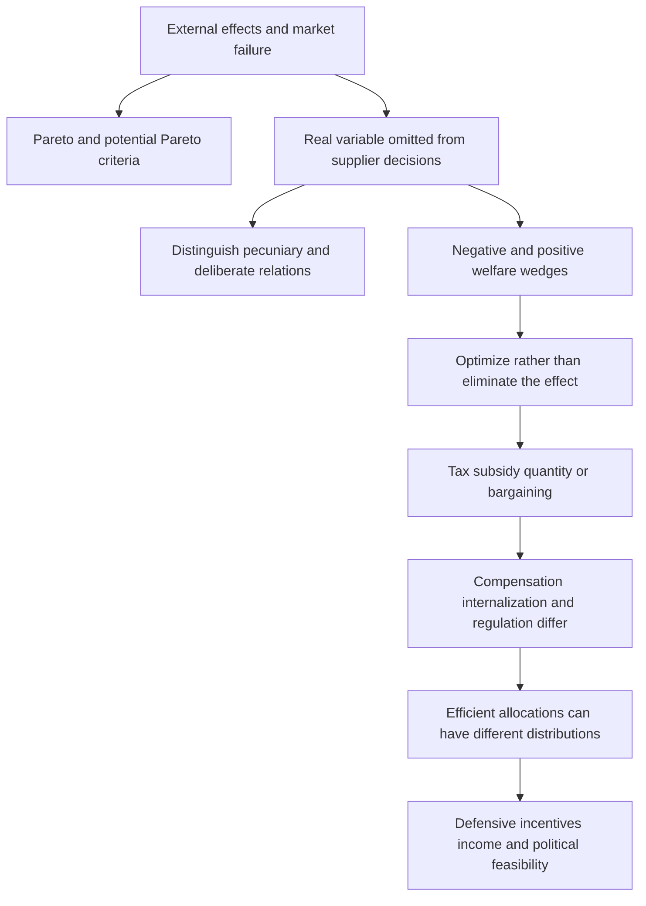

# Identify economic externalities and apply conditional welfare criteria

```json
{
  "schema_version": 3,
  "owner": "plan",
  "course_id": "2026_2027/Winter_Semester/Economics_of_Green_Deal",
  "transaction_id": "PLAN-20261018-GREEN-P004",
  "plan_version": "P004",
  "source_version": "V003",
  "ingestion_revision": 3,
  "objective_id": "O005",
  "objective_revision": 2,
  "criterion_version": "O005-C1",
  "status": "ready",
  "knowledge_components": [
    "neglected_real_effect_and_types",
    "pareto_and_compensation_tests",
    "intervention_and_risk_boundaries"
  ],
  "prerequisite_ids": [
    "O002"
  ],
  "compatible_versions": [
    {
      "objective_revision": 1,
      "criterion_version": "O005-C1",
      "plan_version": "P003",
      "source_version": "V002",
      "ingestion_revision": 2,
      "reason": "Selected earlier academic note passages retain identical meaning and criteria after inspection. Full-content teaching reuse, exact locator normalization and formula typesetting do not change the preserved assessment prompts/keys, essential components or evidence conditions. New methods receive new IDs; no learner response is regraded.",
      "change_class": "unchanged",
      "requires_reassessment": false
    }
  ],
  "note_locations": [
    {
      "path": "01_Notes/2026_2027/Winter_Semester/Economics_of_Green_Deal/Week_2/Externalities_and_Welfare_Optimum.md",
      "heading": "Identify the externality before proposing a remedy"
    },
    {
      "path": "01_Notes/2026_2027/Winter_Semester/Economics_of_Green_Deal/Week_2/Externalities_and_Welfare_Optimum.md",
      "heading": "Types and boundaries"
    },
    {
      "path": "01_Notes/2026_2027/Winter_Semester/Economics_of_Green_Deal/Week_2/Externalities_and_Welfare_Optimum.md",
      "heading": "What welfare criteria can establish"
    },
    {
      "path": "01_Notes/2026_2027/Winter_Semester/Economics_of_Green_Deal/Week_2/Externalities_and_Welfare_Optimum.md",
      "heading": "The next-chapter fragment included in the file"
    },
    {
      "path": "01_Notes/2026_2027/Winter_Semester/Economics_of_Green_Deal/Week_2/Externalities_and_Welfare_Optimum.md",
      "heading": "Topic map of the Verhoef chapter"
    },
    {
      "path": "01_Notes/2026_2027/Winter_Semester/Economics_of_Green_Deal/Week_2/Externalities_and_Welfare_Optimum.md",
      "heading": "What to retain"
    }
  ],
  "acquisition_rule": {
    "distinct_independent_passes": 2,
    "required_item_roles": [
      "full_capability_check",
      "full_capability_check"
    ],
    "allowed_routes": [
      [
        "O005-I1",
        "O005-I2"
      ],
      [
        "O005-I1",
        "O005-D1"
      ],
      [
        "O005-I1",
        "O005-D2"
      ],
      [
        "O005-I2",
        "O005-D1"
      ],
      [
        "O005-I2",
        "O005-D2"
      ],
      [
        "O005-D1",
        "O005-D2"
      ]
    ]
  },
  "delayed_rule": {
    "minimum_elapsed_hours": 24,
    "fresh_item": true,
    "independent_required": true
  },
  "review_topic": "Identify economic externalities and apply conditional welfare criteria",
  "review_instruction": "Begin a closed-note review with teach for O005; request an unused prepared delayed item before recap.",
  "lesson_content_contract": "self-contained-lessons-v1"
}
```

## Outcome and conditions

Classify a neglected real welfare relationship and distinguish actual versus potential welfare improvement with stated boundaries. Required components: neglected_real_effect_and_types, pareto_and_compensation_tests, intervention_and_risk_boundaries. Supported work may use the cited notes; independent checks use no notes, internet, solution or hints. A basic calculator and blank paper are allowed; reasoning, formula selection and assumptions must be supplied by the learner. Numerical examples below are agent-created hypothetical instantiations unless explicitly labelled as a finished-note example. They do not assert current market or policy facts.

[[01_Notes/2026_2027/Winter_Semester/Economics_of_Green_Deal/Week_2/Externalities_and_Welfare_Optimum.md#Identify the externality before proposing a remedy|Identify the externality before proposing a remedy]]
[[01_Notes/2026_2027/Winter_Semester/Economics_of_Green_Deal/Week_2/Externalities_and_Welfare_Optimum.md#Types and boundaries|Types and boundaries]]
[[01_Notes/2026_2027/Winter_Semester/Economics_of_Green_Deal/Week_2/Externalities_and_Welfare_Optimum.md#What welfare criteria can establish|What welfare criteria can establish]]
[[01_Notes/2026_2027/Winter_Semester/Economics_of_Green_Deal/Week_2/Externalities_and_Welfare_Optimum.md#The next-chapter fragment included in the file|The next-chapter fragment included in the file]]

## Prerequisites and checks

O005-P1 / item_version 1: O002 is needed because material/utility paths identify whose wellbeing can change. Prompt: Does a waste arrow alone prove another person loses welfare? Key: No; trace exposure/utility and whether the actor considers it, rather than infer harm from physical movement alone. Pass requires the keyed mechanism and qualification; partial means an omitted step; fail means a conflicting mechanism. Adequate committed evidence under a compatible criterion permits skipping this diagnostic. Otherwise repair through [[03_Agents/2026_2027/Winter_Semester/Economics_of_Green_Deal/lessons/O002.md#Outcome and conditions]] before continuing.

## Teaching order and rationale

1. Read **Motivation and explanation** for the decision, definitions and conditions before performing calculations.
2. Follow **Worked example** with all steps visible to connect the model to its interpretation.
3. Attempt **Supported completion** with the named help, then remove notes and solutions.
4. Use **Immediate and delayed checks** I1 and I2, answering before feedback. These each assess the entire outcome.
5. Use **Misconceptions and correction** after scoring an error; then use an unused full item.
6. Later use an unused D item before recap under the actual elapsed-time rule. The order avoids treating helped performance as independent learning.

## Motivation and explanation

Start with the decision maker (supplier), affected receptor and real variable in utility or production. The effect must be omitted from that decision for this technological-externality framework. Physical changes, competitive price effects and deliberate reciprocal/altruistic relations must be distinguished; social/private benefits of transport do not erase an external wedge. Effects differ by sign, production/consumption origin, spatial reach (local or global), temporal reach (current or intergenerational), depletability and recipient structure. These dimensions require separately stated facts; location or activity alone does not imply a particular magnitude. Congestion shows an actor can also be a receptor. A strict Pareto improvement has at least one gain and no loss. Pareto efficiency says no feasible such improvement remains, not that distribution is uniquely fair. Kaldor accepts if winners could compensate afterwards; Hicks if initial losers could not compensate winners sufficiently to prevent the change. These potential tests do not require payment. Competitive welfare theorems are conditional and equity/merit arguments are separate; a remedy also incurs costs. The supplied risk opening distinguishes event probability/severity and defensive choices from compensating insurance, without a complete later model.

## Complete checked-note explanation

Deliver these complete reused passages before the worked example; earlier concise prompts are checkpoints, not substitutes. Necessary prerequisites use the complete prepared lessons specified above.

Origin: reused complete checked passage [[01_Notes/2026_2027/Winter_Semester/Economics_of_Green_Deal/Week_2/Externalities_and_Welfare_Optimum.md#Identify the externality before proposing a remedy]]; fingerprint `529d959710600922cf0919bc4bb77ccd698aa1e4c411e91dcc19de2023f47e39`. Heading depth alone is adapted.

### Identify the externality before proposing a remedy

The chapter's definition has two actors: a **supplier** whose action determines a real variable and a **receptor** whose utility or production function depends on it. The supplier does not account for that effect in choosing the action. Noise, contaminated water or air quality can be such real variables. An upstream factory that discharges waste, reduces dissolved oxygen and fish stocks, and harms downstream anglers illustrates the mechanism. If downstream welfare does not enter the factory's decision, the private return from production remains higher than its social return. The lecture also presents the uncompensated-welfare-loss wording of an external cost. The definition used in the chapter makes the neglected real relationship central; compensation and incentives require separate analysis. [[00_Materials/2026_2027/Winter_Semester/Economics_of_Green_Deal/Week_2/01_Regulation_Externality-1.pdf#page=3|Lecture, physical PDF pp. 3,5–6]] [[00_Materials/2026_2027/Winter_Semester/Economics_of_Green_Deal/Week_2/ARTICLE_01a_Verhoef_2002-1.pdf#page=3|Verhoef Externalities, physical PDF pp. 3,5]]

A physical environmental change without a utility or production consequence does not establish an economic externality. An unpriced relationship is also insufficient. Barter can exchange benefits implicitly, and altruism deliberately takes another person's pleasure into account. The chapter excludes deliberate violence, jealousy and promotion from its externality category as well. This is a classification of the argument for efficiency correction, not approval of harmful conduct or a claim that policy has no equity or other rationale. [[00_Materials/2026_2027/Winter_Semester/Economics_of_Green_Deal/Week_2/01_Regulation_Externality-1.pdf#page=7|Lecture, physical PDF pp. 7–10]] [[00_Materials/2026_2027/Winter_Semester/Economics_of_Green_Deal/Week_2/ARTICLE_01a_Verhoef_2002-1.pdf#page=3|Verhoef Externalities, physical PDF p. 3]]

**Pecuniary effects** operate through prices in existing markets. A change in transport or input prices moves a consumer along a given demand/utility relationship rather than creating the technological shift represented by an externality. Under the competitive assumptions here, the market already transmits these effects. Greater consumer surplus from cheaper output can be valuable without being an external benefit. Employment and value added in related industries are likewise not evidence that excessive externality-generating activity should be encouraged. Infrastructure investment and the actual use of infrastructure need separate assessments. The [[01_Notes/2026_2027/Winter_Semester/Economics_of_Green_Deal/Week_2/Road_Transport_External_Costs|transport note]] develops these distinctions. [[00_Materials/2026_2027/Winter_Semester/Economics_of_Green_Deal/Week_2/01_Regulation_Externality-1.pdf#page=9|Lecture, physical PDF pp. 9–10,19]] [[00_Materials/2026_2027/Winter_Semester/Economics_of_Green_Deal/Week_2/ARTICLE_01a_Verhoef_2002-1.pdf#page=3|Verhoef Externalities, physical PDF pp. 3–5]]

#### Types and boundaries

Positive versus negative refers to the receptor's benefit or loss, while production versus consumption refers to the originating activity. Spatial neighbourhood, partial/global and intergenerational classifications identify the reach of the effect. The lecture also lists effects involving several interacting uses, such as fishing, boating and swimming, and marginal versus inframarginal effects. These classifications identify which relationships require measurement; the lecture supplies no separate formal model for every category. [[00_Materials/2026_2027/Winter_Semester/Economics_of_Green_Deal/Week_2/01_Regulation_Externality-1.pdf#page=12|Lecture, physical PDF p. 12]]

A **depletable** effect differs from an **undepletable** effect in whether one receptor's consumption changes what is available to others. An undepletable externality has public-good or public-bad characteristics alongside the externality. The chapter reports that this distinction does not require different Pigouvian pricing rules by itself, but can make voluntary bargaining vulnerable to strategic behaviour and free riding. In **congestion**, an actor can simultaneously cause and receive effects; the appropriate individual-level incentive does not disappear merely because the harm stays inside the road-user sector. [[00_Materials/2026_2027/Winter_Semester/Economics_of_Green_Deal/Week_2/ARTICLE_01a_Verhoef_2002-1.pdf#page=3|Verhoef Externalities, physical PDF pp. 3,6–7]] [[00_Materials/2026_2027/Winter_Semester/Economics_of_Green_Deal/Week_2/01_Regulation_Externality-1.pdf#page=12|Lecture, physical PDF pp. 12,27]]


Origin: reused complete checked passage [[01_Notes/2026_2027/Winter_Semester/Economics_of_Green_Deal/Week_2/Externalities_and_Welfare_Optimum.md#What welfare criteria can establish]]; fingerprint `529d959710600922cf0919bc4bb77ccd698aa1e4c411e91dcc19de2023f47e39`. Heading depth alone is adapted.

### What welfare criteria can establish

A **Pareto improvement** makes at least one person better off without making anyone worse off. A **Pareto-efficient allocation** leaves no feasible rearrangement that everyone weakly prefers, with somebody strictly preferring it. These criteria make relatively little use of interpersonal welfare comparisons, but they cannot rank alternative efficient allocations with different distributions. Verhoef contrasts them with **potential Pareto** or compensation criteria: the winners could compensate the losers so that a Pareto improvement becomes possible. The Kaldor criterion accepts the change if its winners could compensate its losers afterwards. The Hicks criterion accepts it if the initial losers could not compensate the winners sufficiently to prevent the change. These are differently directed compensation tests, not a requirement that a transfer actually occurs. Actual compensation is not required by the potential criterion. Therefore a positive aggregate net benefit can coexist with people who lose. [[00_Materials/2026_2027/Winter_Semester/Economics_of_Green_Deal/Week_2/ARTICLE_01a_Verhoef_2002-1.pdf#page=2|Verhoef Externalities, physical PDF p. 2]]

Under the conditions of the first welfare theorem, a competitive equilibrium is Pareto efficient; the second theorem relates alternative efficient allocations to appropriate endowment distributions. The chapter also relates maxima of Paretian, welfaristic social welfare functions to efficiency and, under concavity, the converse with suitable welfare weights. These are conditional results. Increasing returns, market power, external effects, public goods and imperfect information can prevent their usual competitive conclusion. Equity and merit-good arguments are additional rationales for intervention, distinct from a demonstration of market failure. A failure identifies a possible efficiency rationale; an intervention still needs gains exceeding its costs. The chapter calls a technological externality potentially Pareto relevant when correcting it costs less than the available welfare gain. [[00_Materials/2026_2027/Winter_Semester/Economics_of_Green_Deal/Week_2/ARTICLE_01a_Verhoef_2002-1.pdf#page=2|Verhoef Externalities, physical PDF pp. 2–3]] [[00_Materials/2026_2027/Winter_Semester/Economics_of_Green_Deal/Week_2/01_Regulation_Externality-1.pdf#page=4|Lecture, physical PDF pp. 4,22]]


Origin: reused complete checked passage [[01_Notes/2026_2027/Winter_Semester/Economics_of_Green_Deal/Week_2/Externalities_and_Welfare_Optimum.md#The next-chapter fragment included in the file]]; fingerprint `529d959710600922cf0919bc4bb77ccd698aa1e4c411e91dcc19de2023f47e39`. Heading depth alone is adapted.

### The next-chapter fragment included in the file

Physical PDF p. 10 includes printed p. 215, the opening of “Endogenous environmental risk” by Crocker and Shogren. It defines risk through an event's likelihood and severity and explains how defensive choices can alter these, particularly when insurance/contingent-claims markets are incomplete. Examples include boiling contaminated drinking water, filtering water, changing outdoor activity and using sunscreen. Insurance compensates an insured loss; it does not by itself change the probability. Defining only contamination as a fixed state can hide the household's ability to change the risk of illness through boiling. This is an additional supplied fragment, not the full chapter, and contains no complete risk model or later argument to reconstruct. [[00_Materials/2026_2027/Winter_Semester/Economics_of_Green_Deal/Week_2/ARTICLE_01a_Verhoef_2002-1.pdf#page=10|Verhoef Externalities, physical PDF p. 10]]


Origin: reused complete checked passage [[01_Notes/2026_2027/Winter_Semester/Economics_of_Green_Deal/Week_2/Externalities_and_Welfare_Optimum.md#Topic map of the Verhoef chapter]]; fingerprint `529d959710600922cf0919bc4bb77ccd698aa1e4c411e91dcc19de2023f47e39`. Heading depth alone is adapted.

### Topic map of the Verhoef chapter



*Source-grounded topic map of the chapter “Externalities,” physical PDF pp. 1–9 (printed pp. 197–213). The printed p. 214 references and the next-chapter fragment on physical p. 10 are accounted for below.* [[00_Materials/2026_2027/Winter_Semester/Economics_of_Green_Deal/Week_2/ARTICLE_01a_Verhoef_2002-1.pdf#page=1|Verhoef Externalities, physical PDF pp. 1–9]]


Origin: reused complete checked passage [[01_Notes/2026_2027/Winter_Semester/Economics_of_Green_Deal/Week_2/Externalities_and_Welfare_Optimum.md#What to retain]]; fingerprint `529d959710600922cf0919bc4bb77ccd698aa1e4c411e91dcc19de2023f47e39`. Heading depth alone is adapted.

### What to retain

Identify a neglected real welfare relationship before applying externality policy. In the smooth first-best model, compare social marginal benefit and social marginal cost; optimal damage can remain positive. Compensation, internalization and regulation have different incentive and distribution effects. The efficiency optimum is conditional and cannot by itself settle fairness, income-sensitive valuation or political feasibility. [[00_Materials/2026_2027/Winter_Semester/Economics_of_Green_Deal/Week_2/ARTICLE_01a_Verhoef_2002-1.pdf#page=3|Verhoef Externalities, physical PDF pp. 3–9]] [[00_Materials/2026_2027/Winter_Semester/Economics_of_Green_Deal/Week_2/01_Regulation_Externality-1.pdf#page=20|Lecture, physical PDF pp. 20–28]]


## Worked example

O005-W1 / item_version 1, worked_example. **Prompt:** Given hypothetical cases: (a)factory discharge reduces an angler’s utility, explicitly omitted from the supplier’s decision; (b)cheaper production lowers a product price through ordinary competitive prices without an unpriced real effect; (c)a friend deliberately enjoys helping another friend, deliberately considered by the actor. Classify each using supplier/receptor/real-variable/neglected-effect criteria; explain why a physical change alone is insufficient and what depletable/public-bad and congestion distinctions mean. In three additional hypothetical omitted-effect cases, the household actions are consumption and the mine/farm/workshop/factory/plant/forest actions are production. Classify sign, origin and spatial/temporal reach from the declared effects: a factory’s smoke harms nearby households today; a household’s ornamental garden benefits a local neighbour in the next generation; a factory’s greenhouse emissions harm people worldwide in future generations. A separate money-valued policy gives winners20, losers−10; within this declared transferable-money illustration explain strict Pareto, Kaldor and Hicks acceptance directions and apply them without assuming actual compensation. State why market-failure and welfare-theorem conditions do not automatically justify any intervention. Distinguish defensive reduction of environmental illness risk from insurance compensation using the supplied next-chapter fragment, and limit the inference to that fragment.

**Steps and interpretation:** (a) is a technological externality: identify the supplier action, other person’s utility/production affected through the specified real variable, and its omission. (b) is a pecuniary market effect under the stated competitive boundary, not that externality; ordinary price transmission already enters decisions. (c) is an intentionally considered unpriced relation, so omission is absent; unpriced alone is not enough. The additional cases are respectively negative/production/local/current; positive/consumption/local/intergenerational; negative/production/global/intergenerational. Classification follows the declared origin and recipients/timing; it does not estimate magnitude or prove the effect exists in an actual case. A physical alteration without welfare effect does not meet the definition. Depletable/rival benefit can be used up; an undepletable public bad affects many simultaneously and creates coordination/free-rider problems. Congestion can be caused and received by the same road users but remains external to the individual actor. With gains20 and loss10, net10>0 but losers remain: no strict Pareto improvement absent compensation. Kaldor accepts if winners could compensate afterwards; here20>10. Hicks accepts if initial losers cannot compensate winners enough to prevent it; under this explicitly transferable-money example their10 is insufficient against20. Actual transfer is not required by these potential criteria and redistribution/equity remains separate. Conditional competitive welfare results can fail with externalities, public goods, market power, increasing returns or information limits; correction costs must be compared with possible gain, so identifying failure is not universal policy approval. Boiling contaminated water can change illness likelihood; risk includes likelihood and severity, while insurance compensates a loss without itself changing probability. The supplied page is only an opening fragment, not a complete risk model.

## Supported completion

O005-S1 / item_version 1, supported_completion. **Prompt:** Given hypothetical cases: (a)noise reduces a neighbour’s utility, explicitly omitted from the supplier’s decision; (b)competition reduces a shop’s price through ordinary competitive prices without an unpriced real effect; (c)a relative deliberately makes a reciprocal visit, deliberately considered by the actor. Classify each using supplier/receptor/real-variable/neglected-effect criteria; explain why a physical change alone is insufficient and what depletable/public-bad and congestion distinctions mean. In three additional hypothetical omitted-effect cases, the household actions are consumption and the mine/farm/workshop/factory/plant/forest actions are production. Classify sign, origin and spatial/temporal reach from the declared effects: a workshop’s machine noise harms neighbouring households now; household recreation releases a persistent contaminant harming people worldwide in later generations; a farm’s production creates an unpriced benefit for nearby households today. A separate money-valued policy gives winners30, losers−12; within this declared transferable-money illustration explain strict Pareto, Kaldor and Hicks acceptance directions and apply them without assuming actual compensation. State why market-failure and welfare-theorem conditions do not automatically justify any intervention. Distinguish defensive reduction of environmental illness risk from insurance compensation using the supplied next-chapter fragment, and limit the inference to that fragment.

**Key:** (a) is a technological externality: identify the supplier action, other person’s utility/production affected through the specified real variable, and its omission. (b) is a pecuniary market effect under the stated competitive boundary, not that externality; ordinary price transmission already enters decisions. (c) is an intentionally considered unpriced relation, so omission is absent; unpriced alone is not enough. The additional cases are respectively negative/production/local/current; negative/consumption/global/intergenerational; positive/production/local/current. Classification follows the declared origin and recipients/timing; it does not estimate magnitude or prove the effect exists in an actual case. A physical alteration without welfare effect does not meet the definition. Depletable/rival benefit can be used up; an undepletable public bad affects many simultaneously and creates coordination/free-rider problems. Congestion can be caused and received by the same road users but remains external to the individual actor. With gains30 and loss12, net18>0 but losers remain: no strict Pareto improvement absent compensation. Kaldor accepts if winners could compensate afterwards; here30>12. Hicks accepts if initial losers cannot compensate winners enough to prevent it; under this explicitly transferable-money example their12 is insufficient against30. Actual transfer is not required by these potential criteria and redistribution/equity remains separate. Conditional competitive welfare results can fail with externalities, public goods, market power, increasing returns or information limits; correction costs must be compared with possible gain, so identifying failure is not universal policy approval. Boiling contaminated water can change illness likelihood; risk includes likelihood and severity, while insurance compensates a loss without itself changing probability. The supplied page is only an opening fragment, not a complete risk model.

Allowed support: show the named definition or equation in Motivation and explanation, then ask for the missing substitution and interpretation. At most two hints: first identify the relevant distinction; second point to the first keyed step. Reveal the worked solution if those fail. Supported success does not establish acquisition. Fade assistance only once the learner explains the keyed steps; then hide the solution and use an unused full check.

## Rubric and independence

Pass requires every listed component, all requested outputs and essential keyed reasoning without a critical conceptual error. Algebraically equivalent formulas, explicitly defined opposite cash-flow signs and equivalent plain-language reasoning are accepted. Partial means a missing component or a correct method with an unresolved isolated arithmetic slip; fail means the central mechanism or condition is wrong. Unscorable means the response or help/exposure conditions cannot be established. Unknown conditions never certify independence. Arithmetic slips require independent correction before a pass. No numerical grade is invented.

Critical errors: Any unpriced/physical/price effect automatically external; positive aggregate benefit establishes no losers; Hicks acceptance reversed; market failure proves every remedy worthwhile; risk fragment promoted to full model.

Acquisition requires two distinct unassisted passes from I1/I2/D1/D2 using the exact six routes in metadata. Each full prompt and key covers every component; any pair therefore covers the whole outcome twice. A fresh D item used for acquisition cannot later certify delayed retention. Worked/support/prerequisite items and the narrow C1 correction cannot substitute for a full check. The finite bank must not be reused after exposure; request a plan_issue when fewer than two fresh full items remain.

| Component | I1 | I2 | D1 | D2 |
|---|---|---|---|---|
| neglected_real_effect_and_types | required | required | required | required |
| pareto_and_compensation_tests | required | required | required | required |
| intervention_and_risk_boundaries | required | required | required | required |

## Misconceptions and correction

If gain totals are called Pareto improvement, identify the actual loser before discussing possible transfers. If an unpriced act is called external, check whether it was intentionally considered. Observe the learner's reasoning before diagnosing: a sign or omitted word alone is tentative. Score before help. O005-C1 / item_version 1, narrow_correction. **Fresh prompt:** Fresh narrow check: winners gain 12, losers lose5, no transfer. Strict Pareto and Kaldor? **Key and rubric:** No strict Pareto because an actual loser exists. In the declared transferable-money case winners could compensate5 from12, so Kaldor accepts without asserting payment. Pass only if the keyed repaired component is supplied; partial for an omission or arithmetic slip; fail for the same conflicting mechanism. C1 is not a full independent check. After two ineffective hints show the relevant worked step; after another failed correction pause and return to the named prerequisite or explanation.

## Immediate and delayed checks

All items are item_version 1 and full_capability_check. I1/I2 are immediate forms; D1/D2 are distinct delayed forms. Delayed success requires an unused unassisted item before recap, at least 24 actual elapsed hours after acquisition and the most recent relevant teaching/solution exposure, with intervening exposure recorded. A date change alone does not qualify. Early D attempts may be acquisition checks only. Each item is a bounded parallel or near-context variant, not proof of broad transfer. Each key states the full required response; do not improvise extra variants.

### O005-I1

**Prompt:** Given hypothetical cases: (a)vehicle emissions harm another household’s health, explicitly omitted from the supplier’s decision; (b)faster paid delivery lowers traded-goods cost through ordinary competitive prices without an unpriced real effect; (c)a donor knowingly values a recipient’s wellbeing, deliberately considered by the actor. Classify each using supplier/receptor/real-variable/neglected-effect criteria; explain why a physical change alone is insufficient and what depletable/public-bad and congestion distinctions mean. In three additional hypothetical omitted-effect cases, the household actions are consumption and the mine/farm/workshop/factory/plant/forest actions are production. Classify sign, origin and spatial/temporal reach from the declared effects: a mine’s operations damage nearby crops now; a household’s shade tree benefits local neighbours in a later generation; a power plant’s emissions harm people globally in future generations. A separate money-valued policy gives winners40, losers−15; within this declared transferable-money illustration explain strict Pareto, Kaldor and Hicks acceptance directions and apply them without assuming actual compensation. State why market-failure and welfare-theorem conditions do not automatically justify any intervention. Distinguish defensive reduction of environmental illness risk from insurance compensation using the supplied next-chapter fragment, and limit the inference to that fragment.

**Key and essential rubric:** (a) is a technological externality: identify the supplier action, other person’s utility/production affected through the specified real variable, and its omission. (b) is a pecuniary market effect under the stated competitive boundary, not that externality; ordinary price transmission already enters decisions. (c) is an intentionally considered unpriced relation, so omission is absent; unpriced alone is not enough. The additional cases are respectively negative/production/local/current; positive/consumption/local/intergenerational; negative/production/global/intergenerational. Classification follows the declared origin and recipients/timing; it does not estimate magnitude or prove the effect exists in an actual case. A physical alteration without welfare effect does not meet the definition. Depletable/rival benefit can be used up; an undepletable public bad affects many simultaneously and creates coordination/free-rider problems. Congestion can be caused and received by the same road users but remains external to the individual actor. With gains40 and loss15, net25>0 but losers remain: no strict Pareto improvement absent compensation. Kaldor accepts if winners could compensate afterwards; here40>15. Hicks accepts if initial losers cannot compensate winners enough to prevent it; under this explicitly transferable-money example their15 is insufficient against40. Actual transfer is not required by these potential criteria and redistribution/equity remains separate. Conditional competitive welfare results can fail with externalities, public goods, market power, increasing returns or information limits; correction costs must be compared with possible gain, so identifying failure is not universal policy approval. Boiling contaminated water can change illness likelihood; risk includes likelihood and severity, while insurance compensates a loss without itself changing probability. The supplied page is only an opening fragment, not a complete risk model. All components are required.

### O005-I2

**Prompt:** Given hypothetical cases: (a)smoke damages another grower’s crops, explicitly omitted from the supplier’s decision; (b)more competitive supply reduces input price through ordinary competitive prices without an unpriced real effect; (c)a visitor deliberately reciprocates friendship, deliberately considered by the actor. Classify each using supplier/receptor/real-variable/neglected-effect criteria; explain why a physical change alone is insufficient and what depletable/public-bad and congestion distinctions mean. In three additional hypothetical omitted-effect cases, the household actions are consumption and the mine/farm/workshop/factory/plant/forest actions are production. Classify sign, origin and spatial/temporal reach from the declared effects: household heating smoke harms nearby residents today; a production forest creates an unpriced global carbon benefit in future generations; factory waste harms a nearby community in a later generation. A separate money-valued policy gives winners50, losers−20; within this declared transferable-money illustration explain strict Pareto, Kaldor and Hicks acceptance directions and apply them without assuming actual compensation. State why market-failure and welfare-theorem conditions do not automatically justify any intervention. Distinguish defensive reduction of environmental illness risk from insurance compensation using the supplied next-chapter fragment, and limit the inference to that fragment.

**Key and essential rubric:** (a) is a technological externality: identify the supplier action, other person’s utility/production affected through the specified real variable, and its omission. (b) is a pecuniary market effect under the stated competitive boundary, not that externality; ordinary price transmission already enters decisions. (c) is an intentionally considered unpriced relation, so omission is absent; unpriced alone is not enough. The additional cases are respectively negative/consumption/local/current; positive/production/global/intergenerational; negative/production/local/intergenerational. Classification follows the declared origin and recipients/timing; it does not estimate magnitude or prove the effect exists in an actual case. A physical alteration without welfare effect does not meet the definition. Depletable/rival benefit can be used up; an undepletable public bad affects many simultaneously and creates coordination/free-rider problems. Congestion can be caused and received by the same road users but remains external to the individual actor. With gains50 and loss20, net30>0 but losers remain: no strict Pareto improvement absent compensation. Kaldor accepts if winners could compensate afterwards; here50>20. Hicks accepts if initial losers cannot compensate winners enough to prevent it; under this explicitly transferable-money example their20 is insufficient against50. Actual transfer is not required by these potential criteria and redistribution/equity remains separate. Conditional competitive welfare results can fail with externalities, public goods, market power, increasing returns or information limits; correction costs must be compared with possible gain, so identifying failure is not universal policy approval. Boiling contaminated water can change illness likelihood; risk includes likelihood and severity, while insurance compensates a loss without itself changing probability. The supplied page is only an opening fragment, not a complete risk model. All components are required.

### O005-D1

**Prompt:** Given hypothetical cases: (a)traffic delay imposed on another driver, explicitly omitted from the supplier’s decision; (b)traded labour demand raises an ordinary wage through ordinary competitive prices without an unpriced real effect; (c)a person deliberately values another person’s benefit, deliberately considered by the actor. Classify each using supplier/receptor/real-variable/neglected-effect criteria; explain why a physical change alone is insufficient and what depletable/public-bad and congestion distinctions mean. In three additional hypothetical omitted-effect cases, the household actions are consumption and the mine/farm/workshop/factory/plant/forest actions are production. Classify sign, origin and spatial/temporal reach from the declared effects: a producer’s discharge harms a local fisher today; a household’s leisure activity creates an unpriced benefit for people worldwide in future generations; a factory’s persistent pollutant harms local descendants. A separate money-valued policy gives winners60, losers−25; within this declared transferable-money illustration explain strict Pareto, Kaldor and Hicks acceptance directions and apply them without assuming actual compensation. State why market-failure and welfare-theorem conditions do not automatically justify any intervention. Distinguish defensive reduction of environmental illness risk from insurance compensation using the supplied next-chapter fragment, and limit the inference to that fragment.

**Key and essential rubric:** (a) is a technological externality: identify the supplier action, other person’s utility/production affected through the specified real variable, and its omission. (b) is a pecuniary market effect under the stated competitive boundary, not that externality; ordinary price transmission already enters decisions. (c) is an intentionally considered unpriced relation, so omission is absent; unpriced alone is not enough. The additional cases are respectively negative/production/local/current; positive/consumption/global/intergenerational; negative/production/local/intergenerational. Classification follows the declared origin and recipients/timing; it does not estimate magnitude or prove the effect exists in an actual case. A physical alteration without welfare effect does not meet the definition. Depletable/rival benefit can be used up; an undepletable public bad affects many simultaneously and creates coordination/free-rider problems. Congestion can be caused and received by the same road users but remains external to the individual actor. With gains60 and loss25, net35>0 but losers remain: no strict Pareto improvement absent compensation. Kaldor accepts if winners could compensate afterwards; here60>25. Hicks accepts if initial losers cannot compensate winners enough to prevent it; under this explicitly transferable-money example their25 is insufficient against60. Actual transfer is not required by these potential criteria and redistribution/equity remains separate. Conditional competitive welfare results can fail with externalities, public goods, market power, increasing returns or information limits; correction costs must be compared with possible gain, so identifying failure is not universal policy approval. Boiling contaminated water can change illness likelihood; risk includes likelihood and severity, while insurance compensates a loss without itself changing probability. The supplied page is only an opening fragment, not a complete risk model. All components are required.

### O005-D2

**Prompt:** Given hypothetical cases: (a)pollution reduces another firm’s productive water quality, explicitly omitted from the supplier’s decision; (b)an ordinary market cost saving raises consumer surplus through ordinary competitive prices without an unpriced real effect; (c)a household deliberately chooses an altruistic gift, deliberately considered by the actor. Classify each using supplier/receptor/real-variable/neglected-effect criteria; explain why a physical change alone is insufficient and what depletable/public-bad and congestion distinctions mean. In three additional hypothetical omitted-effect cases, the household actions are consumption and the mine/farm/workshop/factory/plant/forest actions are production. Classify sign, origin and spatial/temporal reach from the declared effects: household music harms local neighbours now; a factory’s emissions harm people globally in future generations; a producer’s landscaping benefits a nearby community in a later generation. A separate money-valued policy gives winners70, losers−30; within this declared transferable-money illustration explain strict Pareto, Kaldor and Hicks acceptance directions and apply them without assuming actual compensation. State why market-failure and welfare-theorem conditions do not automatically justify any intervention. Distinguish defensive reduction of environmental illness risk from insurance compensation using the supplied next-chapter fragment, and limit the inference to that fragment.

**Key and essential rubric:** (a) is a technological externality: identify the supplier action, other person’s utility/production affected through the specified real variable, and its omission. (b) is a pecuniary market effect under the stated competitive boundary, not that externality; ordinary price transmission already enters decisions. (c) is an intentionally considered unpriced relation, so omission is absent; unpriced alone is not enough. The additional cases are respectively negative/consumption/local/current; negative/production/global/intergenerational; positive/production/local/intergenerational. Classification follows the declared origin and recipients/timing; it does not estimate magnitude or prove the effect exists in an actual case. A physical alteration without welfare effect does not meet the definition. Depletable/rival benefit can be used up; an undepletable public bad affects many simultaneously and creates coordination/free-rider problems. Congestion can be caused and received by the same road users but remains external to the individual actor. With gains70 and loss30, net40>0 but losers remain: no strict Pareto improvement absent compensation. Kaldor accepts if winners could compensate afterwards; here70>30. Hicks accepts if initial losers cannot compensate winners enough to prevent it; under this explicitly transferable-money example their30 is insufficient against70. Actual transfer is not required by these potential criteria and redistribution/equity remains separate. Conditional competitive welfare results can fail with externalities, public goods, market power, increasing returns or information limits; correction costs must be compared with possible gain, so identifying failure is not universal policy approval. Boiling contaminated water can change illness likelihood; risk includes likelihood and severity, while insurance compensates a loss without itself changing probability. The supplied page is only an opening fragment, not a complete risk model. All components are required.

## Advance, revisit, pause, and escalate

Advance after teach commits two distinct qualifying full passes; initial acquisition and delayed retention remain separate observations. After one failure, score, explain the named repair and use another unused item. After two unsuccessful independent attempts, pause repeated quizzing and revisit the explanation or diagnostic dependency. Source conflict stops the affected lesson and goes to ingest with the exact note heading. Missing or ambiguous keys, unsupported alternatives and an exhausted bank go to plan as plan_issue with 2026_2027/Winter_Semester/Economics_of_Green_Deal, O005, revision2/O005-C1, P004/V003/ingestion3 and the exact item ID. Closing a partial session does not fabricate acquisition.

## Answer-free recall handoff

Topic: Identify economic externalities and apply conditional welfare criteria. Instruction: Begin a closed-note review with teach for O005; request an unused prepared delayed item before recap. Lesson: [[03_Agents/2026_2027/Winter_Semester/Economics_of_Green_Deal/lessons/O005.md#Immediate and delayed checks]]. Teach supplies committed evidence and timestamps; recall alone assigns due dates or Todoist tasks. Deadline/retention horizon is null; this plan defines no learner result.

## Content provenance and generation boundaries

Complete checked-note passages above are reused with only heading-depth and explicit mathematical typography adaptation; exact origin/fingerprint and asset dependencies are in source_manifest.md. All earlier plan-created exercises/full keys and named evidence routes remain intact. Hypothetical arithmetic instantiates the included definitions and does not introduce empirical results or new academic claims. Only named prepared full-capability forms and their existing permitted pairs can certify acquisition/delayed evidence. Extra checked explanation/practice cannot replace a named full form or reassessment gate. Equivalent verified methods may meet the unchanged pre-answer criterion; ambiguous criteria or an exhausted fresh bank return to plan. The current objective revision is 2; item/criterion versions remain as explicitly stated above.
