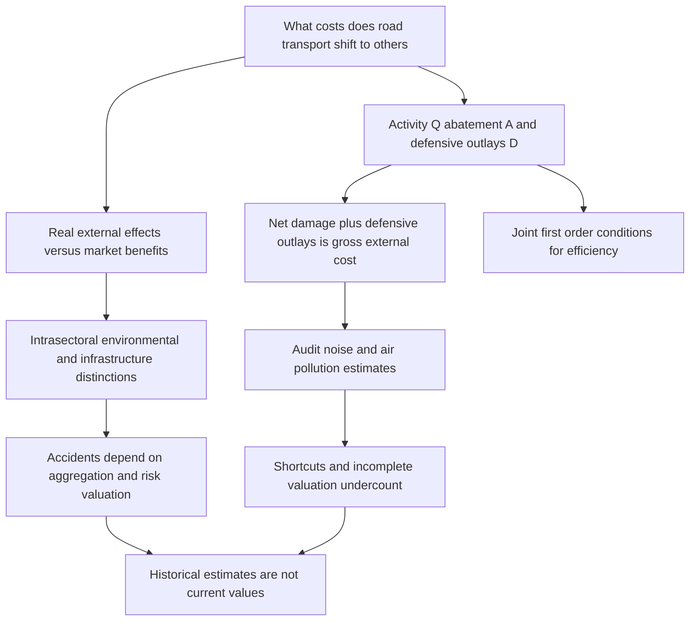

# Audit transport cost estimates by welfare component, valuation and aggregation

```json
{
  "schema_version": 3,
  "owner": "plan",
  "course_id": "2026_2027/Winter_Semester/Economics_of_Green_Deal",
  "transaction_id": "PLAN-20261018-GREEN-P004",
  "plan_version": "P004",
  "source_version": "V003",
  "ingestion_revision": 3,
  "objective_id": "O009",
  "objective_revision": 2,
  "criterion_version": "O009-C1",
  "status": "ready",
  "knowledge_components": [
    "gross_bill_and_incidence",
    "marginal_and_total_measurement",
    "valuation_units_and_historical_limits"
  ],
  "prerequisite_ids": [
    "O008"
  ],
  "compatible_versions": [
    {
      "objective_revision": 1,
      "criterion_version": "O009-C1",
      "plan_version": "P003",
      "source_version": "V002",
      "ingestion_revision": 2,
      "reason": "Selected earlier academic note passages retain identical meaning and criteria after inspection. Full-content teaching reuse, exact locator normalization and formula typesetting do not change the preserved assessment prompts/keys, essential components or evidence conditions. New methods receive new IDs; no learner response is regraded.",
      "change_class": "unchanged",
      "requires_reassessment": false
    }
  ],
  "note_locations": [
    {
      "path": "01_Notes/2026_2027/Winter_Semester/Economics_of_Green_Deal/Week_2/Road_Transport_External_Costs.md",
      "heading": "Transport benefits and external benefits are different"
    },
    {
      "path": "01_Notes/2026_2027/Winter_Semester/Economics_of_Green_Deal/Week_2/Road_Transport_External_Costs.md",
      "heading": "Classify the harm and its incidence"
    },
    {
      "path": "01_Notes/2026_2027/Winter_Semester/Economics_of_Green_Deal/Week_2/Road_Transport_External_Costs.md",
      "heading": "Efficiency and the unpaid bill require different measures"
    },
    {
      "path": "01_Notes/2026_2027/Winter_Semester/Economics_of_Green_Deal/Week_2/Road_Transport_External_Costs.md",
      "heading": "Accidents: risk valuation and aggregation"
    },
    {
      "path": "01_Notes/2026_2027/Winter_Semester/Economics_of_Green_Deal/Week_2/Road_Transport_External_Costs.md",
      "heading": "Topic map of the paper"
    },
    {
      "path": "01_Notes/2026_2027/Winter_Semester/Economics_of_Green_Deal/Week_2/Road_Transport_External_Costs.md",
      "heading": "Why noise and air-pollution estimates can undercount"
    },
    {
      "path": "01_Notes/2026_2027/Winter_Semester/Economics_of_Green_Deal/Week_2/Road_Transport_External_Costs.md",
      "heading": "Shortcuts and choice of a standard"
    },
    {
      "path": "01_Notes/2026_2027/Winter_Semester/Economics_of_Green_Deal/Week_2/Road_Transport_External_Costs.md",
      "heading": "What valuation techniques measure"
    },
    {
      "path": "01_Notes/2026_2027/Winter_Semester/Economics_of_Green_Deal/Week_2/Road_Transport_External_Costs.md",
      "heading": "Read the historical tables"
    },
    {
      "path": "01_Notes/2026_2027/Winter_Semester/Economics_of_Green_Deal/Week_2/Road_Transport_External_Costs.md",
      "heading": "What the review establishes"
    }
  ],
  "acquisition_rule": {
    "distinct_independent_passes": 2,
    "required_item_roles": [
      "full_capability_check",
      "full_capability_check"
    ],
    "allowed_routes": [
      [
        "O009-I1",
        "O009-I2"
      ],
      [
        "O009-I1",
        "O009-D1"
      ],
      [
        "O009-I1",
        "O009-D2"
      ],
      [
        "O009-I2",
        "O009-D1"
      ],
      [
        "O009-I2",
        "O009-D2"
      ],
      [
        "O009-D1",
        "O009-D2"
      ]
    ]
  },
  "delayed_rule": {
    "minimum_elapsed_hours": 24,
    "fresh_item": true,
    "independent_required": true
  },
  "review_topic": "Audit transport cost estimates by welfare component, valuation and aggregation",
  "review_instruction": "Begin a closed-note review with teach for O009; request an unused prepared delayed item before recap.",
  "lesson_content_contract": "self-contained-lessons-v1"
}
```

## Outcome and conditions

Audit a supplied transport estimate for omitted cost components and incompatible valuation/aggregation rather than treating historical tables as current totals. Required components: gross_bill_and_incidence, marginal_and_total_measurement, valuation_units_and_historical_limits. Supported work may use the cited notes; independent checks use no notes, internet, solution or hints. A basic calculator and blank paper are allowed; reasoning, formula selection and assumptions must be supplied by the learner. Numerical examples below are agent-created hypothetical instantiations unless explicitly labelled as a finished-note example. They do not assert current market or policy facts.

[[01_Notes/2026_2027/Winter_Semester/Economics_of_Green_Deal/Week_2/Road_Transport_External_Costs.md#Transport benefits and external benefits are different|Transport benefits and external benefits are different]]
[[01_Notes/2026_2027/Winter_Semester/Economics_of_Green_Deal/Week_2/Road_Transport_External_Costs.md#Classify the harm and its incidence|Classify the harm and its incidence]]
[[01_Notes/2026_2027/Winter_Semester/Economics_of_Green_Deal/Week_2/Road_Transport_External_Costs.md#Efficiency and the unpaid bill require different measures|Efficiency and the unpaid bill require different measures]]
[[01_Notes/2026_2027/Winter_Semester/Economics_of_Green_Deal/Week_2/Road_Transport_External_Costs.md#What valuation techniques measure|What valuation techniques measure]]
[[01_Notes/2026_2027/Winter_Semester/Economics_of_Green_Deal/Week_2/Road_Transport_External_Costs.md#Read the historical tables|Read the historical tables]]
[[01_Notes/2026_2027/Winter_Semester/Economics_of_Green_Deal/Week_2/Road_Transport_External_Costs.md#Accidents: risk valuation and aggregation|Accidents: risk valuation and aggregation]]

## Prerequisites and checks

O009-P1 / item_version 1: O008 is needed because net damage and protective outlays must remain separate. Prompt: Ifresidual EC10 and defence D3, is gross receptor burden10? Key: No:EC+D=13 with a matched boundary, because defence consumes resources. Pass requires the keyed mechanism and qualification; partial means an omitted step; fail means a conflicting mechanism. Adequate committed evidence under a compatible criterion permits skipping this diagnostic. Otherwise repair through [[03_Agents/2026_2027/Winter_Semester/Economics_of_Green_Deal/lessons/O008.md#Outcome and conditions]] before continuing.

## Teaching order and rationale

1. Read **Motivation and explanation** for the decision, definitions and conditions before performing calculations.
2. Follow **Worked example** with all steps visible to connect the model to its interpretation.
3. Attempt **Supported completion** with the named help, then remove notes and solutions.
4. Use **Immediate and delayed checks** I1 and I2, answering before feedback. These each assess the entire outcome.
5. Use **Misconceptions and correction** after scoring an error; then use an unused full item.
6. Later use an unused D item before recap under the actual elapsed-time rule. The order avoids treating helped performance as independent learning.

## Motivation and explanation

Define who causes/receives effects and whether the boundary is the individual, sector or whole society. Residual damage EC excludes receptor protection D; gross burden EC+D includes both, while abatement A is on the supplier side. Congestion and accidents can be external to an individual but inside the sector. Efficient pricing asks for marginal cost at a time/place; the unpaid bill asks for a consistently bounded total. Damage×market price methods and behavioural valuation (surrogate markets or hypothetical survey) measure different components and uncertainty; higher WTP is not automatically verified complete harm. Complementarity needs nonoverlap. Investment stocks require annualisation before comparison with annual GDP. Historical noise/pollution/accident tables vary in years, currency, standards and valuation; preserve attribution and limitations rather than memorising old amounts. Accident risk valuation/insurance boundaries matter; transport usefulness/infrastructure development does not remove a trip’s external wedge.

## Complete checked-note explanation

Deliver these complete reused passages before the worked example; earlier concise prompts are checkpoints, not substitutes. Necessary prerequisites use the complete prepared lessons specified above.

Origin: reused complete checked passage [[01_Notes/2026_2027/Winter_Semester/Economics_of_Green_Deal/Week_2/Road_Transport_External_Costs.md#Transport benefits and external benefits are different]]; fingerprint `cc396e42c7c4541affc1793168ef6857bb6cf76f1e847ce27f397ae86f77b0fd`. Heading depth alone is adapted.

### Transport benefits and external benefits are different

The article requires a real variable in a receptor's utility/profit function whose value depends on a supplier's behaviour and is omitted from that supplier's decision. Ordinary economic dependencies through prices are excluded from this definition. In the paper's simple Figure 1, external costs push unrestricted activity beyond its efficient level, while external benefits would justify encouragement. A downward private-cost shift can increase consumer surplus while leaving the external-cost wedge intact. Thus useful transport and technological external benefit are different propositions. [[00_Materials/2026_2027/Winter_Semester/Economics_of_Green_Deal/Week_2/ARTICLE_01b_Verhoef_1994.pdf#page=2|Verhoef 1994, physical PDF pp. 2–3]]

The author finds no significant external benefits of **individual road transport activities**, apart from a possible car-spotter example. Cheaper production, wider product choice and faster delivery generally enter market transactions; associated employment and value added do not justify transport above its optimum. Visits to friends can reflect reciprocal exchange or deliberate altruism. Infrastructure's contribution to accessibility and regional development belongs to the investment appraisal, rather than being credited as an external benefit of each extra trip. Better emergency access also depends on infrastructure; more traffic may instead obstruct it through congestion. These conclusions are the author's classifications under the stated market framework, including the assumption of no distortions elsewhere when tracing market benefits to final consumers. They do not say transport has no private or social benefit. [[00_Materials/2026_2027/Winter_Semester/Economics_of_Green_Deal/Week_2/ARTICLE_01b_Verhoef_1994.pdf#page=4|Verhoef 1994, physical PDF pp. 4–6]]

#### Classify the harm and its incidence

![[01_Notes/2026_2027/Winter_Semester/Economics_of_Green_Deal/assets/Week2_Verhoef1994_Transport_Typology.png]]

*Figure 2, physical PDF p. 4 (printed p. 276), also reproduced in lecture p. 11. Rows separate intra-sectoral harm among road users from ecological and social environmental harm; columns separate moving traffic, stationary vehicles and infrastructure-associated effects. Shading represents first-order incidence.* [[00_Materials/2026_2027/Winter_Semester/Economics_of_Green_Deal/Week_2/ARTICLE_01b_Verhoef_1994.pdf#page=4|Verhoef 1994, physical PDF p. 4]]

Congestion lies largely within the sector; noise affects social surroundings; air, water and soil pollution reach ecological surroundings; accidents have several incidences, including fellow road users and people outside the sector, and hazardous-material accidents can harm ecosystems. Parking consumes public space and can create parking congestion. Infrastructure can sever biotopes, create visual annoyance or impose barriers within communities. The article displays this broad typology but explicitly excludes environmental effects caused by the mere presence of infrastructure from its later analysis. A second-order effect can connect categories: congestion increases emissions per vehicle-kilometre. Severity is sensitive to time and place. [[00_Materials/2026_2027/Winter_Semester/Economics_of_Green_Deal/Week_2/ARTICLE_01b_Verhoef_1994.pdf#page=4|Verhoef 1994, physical PDF pp. 4, footnote2]]


Origin: reused complete checked passage [[01_Notes/2026_2027/Winter_Semester/Economics_of_Green_Deal/Week_2/Road_Transport_External_Costs.md#Efficiency and the unpaid bill require different measures]]; fingerprint `cc396e42c7c4541affc1793168ef6857bb6cf76f1e847ce27f397ae86f77b0fd`. Heading depth alone is adapted.

### Efficiency and the unpaid bill require different measures

One question asks for optimal marginal choices or road prices. The other asks what total burden transport shifts to other people. The second requires $EC+D$, rather than residual damage alone. Average gross burden indicates an optimal marginal rate only under additional conditions such as constant marginal external cost; total harm divided by total kilometres generally does not supply a time-and-place-specific optimal price. There is no single aggregate optimal road-transport quantity independent of location and time. [[00_Materials/2026_2027/Winter_Semester/Economics_of_Green_Deal/Week_2/ARTICLE_01b_Verhoef_1994.pdf#page=8|Verhoef 1994, physical PDF p. 8]]

The level of aggregation matters too. Harm imposed by one motorist on another is external to the first motorist but remains inside the motorist sector. Adding that harm to environmental damage can be appropriate for some social-cost questions, but it cannot be labelled without qualification as the sector's unpaid bill to the rest of society. This distinction becomes especially important in accident accounting. [[00_Materials/2026_2027/Winter_Semester/Economics_of_Green_Deal/Week_2/ARTICLE_01b_Verhoef_1994.pdf#page=8|Verhoef 1994, physical PDF pp. 8–9]]


Origin: reused complete checked passage [[01_Notes/2026_2027/Winter_Semester/Economics_of_Green_Deal/Week_2/Road_Transport_External_Costs.md#Accidents: risk valuation and aggregation]]; fingerprint `cc396e42c7c4541affc1793168ef6857bb6cf76f1e847ce27f397ae86f77b0fd`. Heading depth alone is adapted.

### Accidents: risk valuation and aggregation

Accident costs can include vehicle/property/environmental damage, legal/police/emergency costs, medical/funeral costs, pain and suffering and lost production. Responsibility can be shared in a chain collision; a responsible driver's own injury can impose further losses on relatives and society. Some published studies define social accident costs as total costs less insurance coverage, which differs from the article's earlier total private-plus-external social-cost definition. Fixed yearly insurance premiums can compensate losses without pricing the marginal kilometre, so compensation does not establish optimized accident risk. [[00_Materials/2026_2027/Winter_Semester/Economics_of_Green_Deal/Week_2/ARTICLE_01b_Verhoef_1994.pdf#page=12|Verhoef 1994, physical PDF pp. 12–13, footnote12]]

Valuing life solely through expected net production can give negative values for elderly or jobless people. The author instead favours ex ante valuation of changes in physical risk. Historical estimates differ substantially by concept: the paper cites ECU 12,280 for gross earnings in Portugal, ECU 1,667,246 for social willingness to pay in Switzerland, and an even lower Netherlands friction-cost estimate of DFL 2,400 (about ECU 1,000). These are evidence of incompatible valuation concepts rather than comparable prices of a human being. [[00_Materials/2026_2027/Winter_Semester/Economics_of_Green_Deal/Week_2/ARTICLE_01b_Verhoef_1994.pdf#page=13|Verhoef 1994, physical PDF pp. 13–14]]

![[01_Notes/2026_2027/Winter_Semester/Economics_of_Green_Deal/assets/Week2_Verhoef1994_Table3_Accidents.png]]

*Table 3, PDF p. 13, printed p. 285. The original source clips some text at the right margin; the legible numerical columns and method distinctions are retained. These are social accident costs with varied boundaries, not one consistently defined environmental external-cost series.* [[00_Materials/2026_2027/Winter_Semester/Economics_of_Green_Deal/Week_2/ARTICLE_01b_Verhoef_1994.pdf#page=13|Verhoef 1994, physical PDF p. 13]]

The Swiss Neuenschwander et al. (1991) rows give SF 5,379 million / 1.70% GDP in social costs, SF 1,488 million / 0.47% GDP in external cost at individual level, and SF 789 million / 0.25% GDP at mode level. The footnote on PDF p. 12 likewise contrasts individual and mode aggregation for car traffic and reports a larger proportional reduction for rail traffic. Changing the analytical boundary changes what is external. The paper therefore warns against adding these accident totals to noise and air-pollution external costs and calling the result transport's external burden. [[00_Materials/2026_2027/Winter_Semester/Economics_of_Green_Deal/Week_2/ARTICLE_01b_Verhoef_1994.pdf#page=12|Verhoef 1994, physical PDF pp. 12 footnote11,13–14]]


Origin: reused complete checked passage [[01_Notes/2026_2027/Winter_Semester/Economics_of_Green_Deal/Week_2/Road_Transport_External_Costs.md#Topic map of the paper]]; fingerprint `cc396e42c7c4541affc1793168ef6857bb6cf76f1e847ce27f397ae86f77b0fd`. Heading depth alone is adapted.

### Topic map of the paper



*The diagram follows sections 2–6 and the qualifications in the original, physical PDF pp. 1–14 (printed pp. 273–286).* [[00_Materials/2026_2027/Winter_Semester/Economics_of_Green_Deal/Week_2/ARTICLE_01b_Verhoef_1994.pdf#page=1|Verhoef 1994, physical PDF pp. 1–14]]


Origin: reused complete checked passage [[01_Notes/2026_2027/Winter_Semester/Economics_of_Green_Deal/Week_2/Road_Transport_External_Costs.md#Why noise and air-pollution estimates can undercount]]; fingerprint `cc396e42c7c4541affc1793168ef6857bb6cf76f1e847ce27f397ae86f77b0fd`. Heading depth alone is adapted.

### Why noise and air-pollution estimates can undercount

The paper evaluates the studies in Tables 1 and 2 as mostly unpaid-bill studies, not estimations of the welfare-maximizing activity. A recurring problem is estimating one component of gross external cost instead of $EC+D$. Actual protective expenditure measures part of $D$ while omitting remaining damage. A valuation of experienced harm measures part of $EC$ while omitting induced protective expenditure. Studies using abatement expenditure $A$ measure a different component again. The paper's exceptions combining prevention and residual damage try to assess an optimal rather than actual situation, and their choice of optimum is unclear. [[00_Materials/2026_2027/Winter_Semester/Economics_of_Green_Deal/Week_2/ARTICLE_01b_Verhoef_1994.pdf#page=9|Verhoef 1994, physical PDF pp. 9–10]]

#### Shortcuts and choice of a standard

Using observed protection outlays as the entire loss assumes away the harm that remains after rational protection. Usually victims stop protection while another reduction in nuisance would still have value, because additional spending competes with other consumption. Using the hypothetical cost of a programme that reduces nuisance to a supposedly reasonable level has three further problems: it omits remaining damage, replaces the value of the damage reduction with the programme cost, and selects the standard before the cost/benefit balance that should determine it. The IRT France estimates vary by a factor of six with the noise standard; the Dutch Van der Meijs estimates differ by factors of nine for noise and twelve for pollution. These illustrate dependence on an imposed norm, not precision about the underlying welfare loss. [[00_Materials/2026_2027/Winter_Semester/Economics_of_Green_Deal/Week_2/ARTICLE_01b_Verhoef_1994.pdf#page=10|Verhoef 1994, physical PDF pp. 10–11, footnotes9–10]]

#### What valuation techniques measure

Nonbehavioural linkage methods start with a damage or dose-response relationship and multiply physical impacts by market prices: building deterioration, agricultural damage or cost of illness are examples. They do not directly recover the receptor's utility loss and can omit non-use values. Behavioural linkage methods infer valuation from choices in a **surrogate market**, such as hedonic house prices, travel costs or household protection, or from a **hypothetical market**, such as a contingent-valuation willingness-to-pay survey. Surrogate markets may be absent or regulated; hypothetical responses have methodological uncertainty. The author prefers utility-linked valuation conceptually but does not rank one method as universally best. [[00_Materials/2026_2027/Winter_Semester/Economics_of_Green_Deal/Week_2/ARTICLE_01b_Verhoef_1994.pdf#page=11|Verhoef 1994, physical PDF pp. 11–12]]

Some methods can be complementary if they measure genuinely different components. The example is psychological willingness to pay combined with costs, such as paid sick leave, that may not enter an individual's optimization. This is a conditional argument for assessing omitted components, not permission to add overlapping valuations blindly. The article notes that both behavioural and nonbehavioural estimates can still capture only net damage. [[00_Materials/2026_2027/Winter_Semester/Economics_of_Green_Deal/Week_2/ARTICLE_01b_Verhoef_1994.pdf#page=12|Verhoef 1994, physical PDF p. 12]]

#### Read the historical tables

![[01_Notes/2026_2027/Winter_Semester/Economics_of_Green_Deal/assets/Week2_Verhoef1994_Table1_Noise.png]]

*Table 1, PDF p. 9, printed p. 281. Columns retain authors/year/country, original monetary units, GDP shares and measurement methods. The footnote identifies GDP data from IMF (1991) and estimates quoted through Quinet (1989).* [[00_Materials/2026_2027/Winter_Semester/Economics_of_Green_Deal/Week_2/ARTICLE_01b_Verhoef_1994.pdf#page=9|Verhoef 1994, physical PDF p. 9]]

The road-noise row for Dogs et al. (1991), Germany, reports DM 0.84 billion / 0.03% GDP for avoidance cost versus DM 12.8 billion / 0.52% GDP for willingness to pay. This is about fifteen times as large, but the comparison concerns distinct methods rather than two independently comparable estimates of identical complete costs. The UK Sharp estimate of 11.18% GDP is particularly high because the study did not spread outlays over their useful years; a stock of investment should not be compared unadjusted with annual GDP. [[00_Materials/2026_2027/Winter_Semester/Economics_of_Green_Deal/Week_2/ARTICLE_01b_Verhoef_1994.pdf#page=9|Verhoef 1994, physical PDF pp. 9,11–12]]

![[01_Notes/2026_2027/Winter_Semester/Economics_of_Green_Deal/assets/Week2_Verhoef1994_Table2_Air_Pollution.png]]

*Table 2, PDF p. 10, printed p. 282. The source retains the distinct damage, programme-cost and WTP approaches and warns that some rows include noise or all transport modes.* [[00_Materials/2026_2027/Winter_Semester/Economics_of_Green_Deal/Week_2/ARTICLE_01b_Verhoef_1994.pdf#page=10|Verhoef 1994, physical PDF p. 10]]

Dogs et al.'s road-pollution rows report DM 12.1 billion / 0.49% GDP for damage cost and DM 22.3 billion / 0.91% GDP for WTP. Shulz's table contrasts DM 3–6 billion / 0.15–0.30% GDP for damage with DM 5–16 billion / 0.25–0.79% GDP for willingness to pay; each is attributed to 30% of the corresponding total air-pollution burden/value. Higher survey figures can indicate understatement by other methods **or** difficulties in contingent valuation. The article does not establish the larger figure as the true complete loss. Its review of hedonic noise studies reports house-price reductions of 0.15–1.3% per extra decibel, dependent on the zero-annoyance baseline and study setting. [[00_Materials/2026_2027/Winter_Semester/Economics_of_Green_Deal/Week_2/ARTICLE_01b_Verhoef_1994.pdf#page=10|Verhoef 1994, physical PDF pp. 10,12]]

The conclusion challenges frequently cited OECD-country figures of 0.1% GDP for noise and 0.4% for air pollution. It suggests possible multipliers of eight for noise and two or three for air pollution **if** hypothetical valuations are trusted. The author also identifies omitted effects, including then-unestimated CO₂ emissions and other Figure 2 categories. These are the 1994 review's criticism and conditional numerical comparisons; they are not present-day GDP shares, statistical confidence intervals or a new aggregate estimate. [[00_Materials/2026_2027/Winter_Semester/Economics_of_Green_Deal/Week_2/ARTICLE_01b_Verhoef_1994.pdf#page=14|Verhoef 1994, physical PDF p. 14]]


Origin: reused complete checked passage [[01_Notes/2026_2027/Winter_Semester/Economics_of_Green_Deal/Week_2/Road_Transport_External_Costs.md#What the review establishes]]; fingerprint `cc396e42c7c4541affc1793168ef6857bb6cf76f1e847ce27f397ae86f77b0fd`. Heading depth alone is adapted.

### What the review establishes

Transport's value to users and markets does not cancel a technological externality. A consistent assessment must specify the activity, who causes/receives effects, the aggregation boundary, and whether it measures residual damage, protective resources or both. Efficiency requires a joint marginal analysis; an unpaid-bill calculation needs the correctly bounded total. The survey's strongest conclusion is the conceptual incompleteness and noncomparability of many historical estimates, with contingent-valuation uncertainty and accident-specific complications retained. [[00_Materials/2026_2027/Winter_Semester/Economics_of_Green_Deal/Week_2/ARTICLE_01b_Verhoef_1994.pdf#page=6|Verhoef 1994, physical PDF pp. 6–14]]


## Worked example

O009-W1 / item_version 1, worked_example. **Prompt:** Hypothetical survey of noise and road use: measured residual harm EC=20, induced receptor defence D=5, supplier abatement A=4, of EC an identified 6 is borne by fellow road users within the sector. Separately a historical row reports protection investment stock 100 against annual GDP 1000. Derive a consistently bounded outside-sector unpaid bill given all D is borne outside; contrast residual-only, defence-only and abatement-only measures. Explain why that total / traffic is not automatically optimal marginal tax, how transport benefits/typology differ, and why stock/annual flow and survey valuation methods and overlap make historical tables noncomparable. Include accident risk versus production-value and insurance/aggregation qualifications; does an old GDP share prove current physical damage?

**Steps and interpretation:** Outside residual EC=20−6=14; all D outside gives bill EC_out+D=19. Residual-only omits defence, defence-only omits remaining harm, and A is supplier real cost, not automatically the victim’s unpaid bill. Whole individual harm EC+D=25 has another aggregation boundary; social cost may include PC+A as well. Total/traffic is an average; optimal rate uses marginal time/place harm under defined conditions, not generally the average. Ordinary priced transport benefits/employment do not cancel a technological external wedge; infrastructure access benefits are investment appraisal, not automatic trip MEB. Typology separates intra-sector/environment and moving/stationary/infrastructure; the later paper excludes mere infrastructure presence. Stock 100/annual GDP 1000 = 0.1 years: a stock-to-annual-flow ratio with time units, rather than an annual GDP cost share. An annual cost comparison requires annualisation (useful-life/assumptions absent). Dose-response×market price may omit utility/nonuse; surrogate hedonic/travel/defence and hypothetical WTP each have availability/bias/boundaries. Add methods only for genuinely nonoverlapping components; preset noise-standard programme cost is neither full harm nor an optimal standard. Ex-ante risk-change WTP differs from net earnings-life valuation, which can misrepresent elderly/jobless; fixed insurance compensation does not necessarily price marginal risk. Accident individual/sector aggregation changes externality classification, so adding all accident totals to noise/pollution can mix boundaries. Historically dated currencies and GDP shares do not establish present physical damage or current values.

## Supported completion

O009-S1 / item_version 1, supported_completion. **Prompt:** Hypothetical survey of air pollution and traffic: measured residual harm EC=30, induced receptor defence D=7, supplier abatement A=5, of EC an identified 8 is borne by fellow road users within the sector. Separately a historical row reports protection investment stock 120 against annual GDP 1500. Derive a consistently bounded outside-sector unpaid bill given all D is borne outside; contrast residual-only, defence-only and abatement-only measures. Explain why that total / traffic is not automatically optimal marginal tax, how transport benefits/typology differ, and why stock/annual flow and survey valuation methods and overlap make historical tables noncomparable. Include accident risk versus production-value and insurance/aggregation qualifications; does an old GDP share prove current physical damage?

**Key:** Outside residual EC=30−8=22; all D outside gives bill EC_out+D=29. Residual-only omits defence, defence-only omits remaining harm, and A is supplier real cost, not automatically the victim’s unpaid bill. Whole individual harm EC+D=37 has another aggregation boundary; social cost may include PC+A as well. Total/traffic is an average; optimal rate uses marginal time/place harm under defined conditions, not generally the average. Ordinary priced transport benefits/employment do not cancel a technological external wedge; infrastructure access benefits are investment appraisal, not automatic trip MEB. Typology separates intra-sector/environment and moving/stationary/infrastructure; the later paper excludes mere infrastructure presence. Stock 120/annual GDP 1500 = 0.08 years: a stock-to-annual-flow ratio with time units, rather than an annual GDP cost share. An annual cost comparison requires annualisation (useful-life/assumptions absent). Dose-response×market price may omit utility/nonuse; surrogate hedonic/travel/defence and hypothetical WTP each have availability/bias/boundaries. Add methods only for genuinely nonoverlapping components; preset noise-standard programme cost is neither full harm nor an optimal standard. Ex-ante risk-change WTP differs from net earnings-life valuation, which can misrepresent elderly/jobless; fixed insurance compensation does not necessarily price marginal risk. Accident individual/sector aggregation changes externality classification, so adding all accident totals to noise/pollution can mix boundaries. Historically dated currencies and GDP shares do not establish present physical damage or current values.

Allowed support: show the named definition or equation in Motivation and explanation, then ask for the missing substitution and interpretation. At most two hints: first identify the relevant distinction; second point to the first keyed step. Reveal the worked solution if those fail. Supported success does not establish acquisition. Fade assistance only once the learner explains the keyed steps; then hide the solution and use an unused full check.

## Rubric and independence

Pass requires every listed component, all requested outputs and essential keyed reasoning without a critical conceptual error. Algebraically equivalent formulas, explicitly defined opposite cash-flow signs and equivalent plain-language reasoning are accepted. Partial means a missing component or a correct method with an unresolved isolated arithmetic slip; fail means the central mechanism or condition is wrong. Unscorable means the response or help/exposure conditions cannot be established. Unknown conditions never certify independence. Arithmetic slips require independent correction before a pass. No numerical grade is invented.

Critical errors: AddingA automatically to the unpaid bill; ignoringD; sector-internal harm labelled as outside-sector bill; average called marginal tax; adding overlapping valuations; stock treated as annual flow; old estimates treated as current.

Acquisition requires two distinct unassisted passes from I1/I2/D1/D2 using the exact six routes in metadata. Each full prompt and key covers every component; any pair therefore covers the whole outcome twice. A fresh D item used for acquisition cannot later certify delayed retention. Worked/support/prerequisite items and the narrow C1 correction cannot substitute for a full check. The finite bank must not be reused after exposure; request a plan_issue when fewer than two fresh full items remain.

| Component | I1 | I2 | D1 | D2 |
|---|---|---|---|---|
| gross_bill_and_incidence | required | required | required | required |
| marginal_and_total_measurement | required | required | required | required |
| valuation_units_and_historical_limits | required | required | required | required |

## Misconceptions and correction

When two estimates differ, ask which component and boundary each measures before averaging. Draw EC, D, A as distinct boxes; markwho bears each. Observe the learner's reasoning before diagnosing: a sign or omitted word alone is tentative. Score before help. O009-C1 / item_version 1, narrow_correction. **Fresh prompt:** Fresh narrowcheck: study values residual noise10 and another estimates defence4. Is adding 14 always valid? **Key and rubric:** Onlyif same population/time/boundary and genuinely nonoverlapping components; a valuation already including defence cannot be added again. Pass only if the keyed repaired component is supplied; partial for an omission or arithmetic slip; fail for the same conflicting mechanism. C1 is not a full independent check. After two ineffective hints show the relevant worked step; after another failed correction pause and return to the named prerequisite or explanation.

## Immediate and delayed checks

All items are item_version 1 and full_capability_check. I1/I2 are immediate forms; D1/D2 are distinct delayed forms. Delayed success requires an unused unassisted item before recap, at least 24 actual elapsed hours after acquisition and the most recent relevant teaching/solution exposure, with intervening exposure recorded. A date change alone does not qualify. Early D attempts may be acquisition checks only. Each item is a bounded parallel or near-context variant, not proof of broad transfer. Each key states the full required response; do not improvise extra variants.

### O009-I1

**Prompt:** Hypothetical survey of accident and nuisance costs: measured residual harm EC=40, induced receptor defence D=9, supplier abatement A=6, of EC an identified 10 is borne by fellow road users within the sector. Separately a historical row reports protection investment stock 150 against annual GDP 2000. Derive a consistently bounded outside-sector unpaid bill given all D is borne outside; contrast residual-only, defence-only and abatement-only measures. Explain why that total / traffic is not automatically optimal marginal tax, how transport benefits/typology differ, and why stock/annual flow and survey valuation methods and overlap make historical tables noncomparable. Include accident risk versus production-value and insurance/aggregation qualifications; does an old GDP share prove current physical damage?

**Key and essential rubric:** Outside residual EC=40−10=30; all D outside gives bill EC_out+D=39. Residual-only omits defence, defence-only omits remaining harm, and A is supplier real cost, not automatically the victim’s unpaid bill. Whole individual harm EC+D=49 has another aggregation boundary; social cost may include PC+A as well. Total/traffic is an average; optimal rate uses marginal time/place harm under defined conditions, not generally the average. Ordinary priced transport benefits/employment do not cancel a technological external wedge; infrastructure access benefits are investment appraisal, not automatic trip MEB. Typology separates intra-sector/environment and moving/stationary/infrastructure; the later paper excludes mere infrastructure presence. Stock 150/annual GDP 2000 = 0.075 years: a stock-to-annual-flow ratio with time units, rather than an annual GDP cost share. An annual cost comparison requires annualisation (useful-life/assumptions absent). Dose-response×market price may omit utility/nonuse; surrogate hedonic/travel/defence and hypothetical WTP each have availability/bias/boundaries. Add methods only for genuinely nonoverlapping components; preset noise-standard programme cost is neither full harm nor an optimal standard. Ex-ante risk-change WTP differs from net earnings-life valuation, which can misrepresent elderly/jobless; fixed insurance compensation does not necessarily price marginal risk. Accident individual/sector aggregation changes externality classification, so adding all accident totals to noise/pollution can mix boundaries. Historically dated currencies and GDP shares do not establish present physical damage or current values. All components are required.

### O009-I2

**Prompt:** Hypothetical survey of urban roads and defence: measured residual harm EC=50, induced receptor defence D=11, supplier abatement A=7, of EC an identified 12 is borne by fellow road users within the sector. Separately a historical row reports protection investment stock 180 against annual GDP 2400. Derive a consistently bounded outside-sector unpaid bill given all D is borne outside; contrast residual-only, defence-only and abatement-only measures. Explain why that total / traffic is not automatically optimal marginal tax, how transport benefits/typology differ, and why stock/annual flow and survey valuation methods and overlap make historical tables noncomparable. Include accident risk versus production-value and insurance/aggregation qualifications; does an old GDP share prove current physical damage?

**Key and essential rubric:** Outside residual EC=50−12=38; all D outside gives bill EC_out+D=49. Residual-only omits defence, defence-only omits remaining harm, and A is supplier real cost, not automatically the victim’s unpaid bill. Whole individual harm EC+D=61 has another aggregation boundary; social cost may include PC+A as well. Total/traffic is an average; optimal rate uses marginal time/place harm under defined conditions, not generally the average. Ordinary priced transport benefits/employment do not cancel a technological external wedge; infrastructure access benefits are investment appraisal, not automatic trip MEB. Typology separates intra-sector/environment and moving/stationary/infrastructure; the later paper excludes mere infrastructure presence. Stock 180/annual GDP 2400 = 0.075 years: a stock-to-annual-flow ratio with time units, rather than an annual GDP cost share. An annual cost comparison requires annualisation (useful-life/assumptions absent). Dose-response×market price may omit utility/nonuse; surrogate hedonic/travel/defence and hypothetical WTP each have availability/bias/boundaries. Add methods only for genuinely nonoverlapping components; preset noise-standard programme cost is neither full harm nor an optimal standard. Ex-ante risk-change WTP differs from net earnings-life valuation, which can misrepresent elderly/jobless; fixed insurance compensation does not necessarily price marginal risk. Accident individual/sector aggregation changes externality classification, so adding all accident totals to noise/pollution can mix boundaries. Historically dated currencies and GDP shares do not establish present physical damage or current values. All components are required.

### O009-D1

**Prompt:** Hypothetical survey of regional transport burdens: measured residual harm EC=60, induced receptor defence D=13, supplier abatement A=8, of EC an identified 15 is borne by fellow road users within the sector. Separately a historical row reports protection investment stock 200 against annual GDP 3000. Derive a consistently bounded outside-sector unpaid bill given all D is borne outside; contrast residual-only, defence-only and abatement-only measures. Explain why that total / traffic is not automatically optimal marginal tax, how transport benefits/typology differ, and why stock/annual flow and survey valuation methods and overlap make historical tables noncomparable. Include accident risk versus production-value and insurance/aggregation qualifications; does an old GDP share prove current physical damage?

**Key and essential rubric:** Outside residual EC=60−15=45; all D outside gives bill EC_out+D=58. Residual-only omits defence, defence-only omits remaining harm, and A is supplier real cost, not automatically the victim’s unpaid bill. Whole individual harm EC+D=73 has another aggregation boundary; social cost may include PC+A as well. Total/traffic is an average; optimal rate uses marginal time/place harm under defined conditions, not generally the average. Ordinary priced transport benefits/employment do not cancel a technological external wedge; infrastructure access benefits are investment appraisal, not automatic trip MEB. Typology separates intra-sector/environment and moving/stationary/infrastructure; the later paper excludes mere infrastructure presence. Stock 200/annual GDP 3000 = 0.0666667 years: a stock-to-annual-flow ratio with time units, rather than an annual GDP cost share. An annual cost comparison requires annualisation (useful-life/assumptions absent). Dose-response×market price may omit utility/nonuse; surrogate hedonic/travel/defence and hypothetical WTP each have availability/bias/boundaries. Add methods only for genuinely nonoverlapping components; preset noise-standard programme cost is neither full harm nor an optimal standard. Ex-ante risk-change WTP differs from net earnings-life valuation, which can misrepresent elderly/jobless; fixed insurance compensation does not necessarily price marginal risk. Accident individual/sector aggregation changes externality classification, so adding all accident totals to noise/pollution can mix boundaries. Historically dated currencies and GDP shares do not establish present physical damage or current values. All components are required.

### O009-D2

**Prompt:** Hypothetical survey of historical transport valuation: measured residual harm EC=70, induced receptor defence D=15, supplier abatement A=9, of EC an identified 18 is borne by fellow road users within the sector. Separately a historical row reports protection investment stock 240 against annual GDP 4000. Derive a consistently bounded outside-sector unpaid bill given all D is borne outside; contrast residual-only, defence-only and abatement-only measures. Explain why that total / traffic is not automatically optimal marginal tax, how transport benefits/typology differ, and why stock/annual flow and survey valuation methods and overlap make historical tables noncomparable. Include accident risk versus production-value and insurance/aggregation qualifications; does an old GDP share prove current physical damage?

**Key and essential rubric:** Outside residual EC=70−18=52; all D outside gives bill EC_out+D=67. Residual-only omits defence, defence-only omits remaining harm, and A is supplier real cost, not automatically the victim’s unpaid bill. Whole individual harm EC+D=85 has another aggregation boundary; social cost may include PC+A as well. Total/traffic is an average; optimal rate uses marginal time/place harm under defined conditions, not generally the average. Ordinary priced transport benefits/employment do not cancel a technological external wedge; infrastructure access benefits are investment appraisal, not automatic trip MEB. Typology separates intra-sector/environment and moving/stationary/infrastructure; the later paper excludes mere infrastructure presence. Stock 240/annual GDP 4000 = 0.06 years: a stock-to-annual-flow ratio with time units, rather than an annual GDP cost share. An annual cost comparison requires annualisation (useful-life/assumptions absent). Dose-response×market price may omit utility/nonuse; surrogate hedonic/travel/defence and hypothetical WTP each have availability/bias/boundaries. Add methods only for genuinely nonoverlapping components; preset noise-standard programme cost is neither full harm nor an optimal standard. Ex-ante risk-change WTP differs from net earnings-life valuation, which can misrepresent elderly/jobless; fixed insurance compensation does not necessarily price marginal risk. Accident individual/sector aggregation changes externality classification, so adding all accident totals to noise/pollution can mix boundaries. Historically dated currencies and GDP shares do not establish present physical damage or current values. All components are required.

## Advance, revisit, pause, and escalate

Advance after teach commits two distinct qualifying full passes; initial acquisition and delayed retention remain separate observations. After one failure, score, explain the named repair and use another unused item. After two unsuccessful independent attempts, pause repeated quizzing and revisit the explanation or diagnostic dependency. Source conflict stops the affected lesson and goes to ingest with the exact note heading. Missing or ambiguous keys, unsupported alternatives and an exhausted bank go to plan as plan_issue with 2026_2027/Winter_Semester/Economics_of_Green_Deal, O009, revision2/O009-C1, P004/V003/ingestion3 and the exact item ID. Closing a partial session does not fabricate acquisition.

## Answer-free recall handoff

Topic: Audit transport cost estimates by welfare component, valuation and aggregation. Instruction: Begin a closed-note review with teach for O009; request an unused prepared delayed item before recap. Lesson: [[03_Agents/2026_2027/Winter_Semester/Economics_of_Green_Deal/lessons/O009.md#Immediate and delayed checks]]. Teach supplies committed evidence and timestamps; recall alone assigns due dates or Todoist tasks. Deadline/retention horizon is null; this plan defines no learner result.

## Content provenance and generation boundaries

Complete checked-note passages above are reused with only heading-depth and explicit mathematical typography adaptation; exact origin/fingerprint and asset dependencies are in source_manifest.md. All earlier plan-created exercises/full keys and named evidence routes remain intact. Hypothetical arithmetic instantiates the included definitions and does not introduce empirical results or new academic claims. Only named prepared full-capability forms and their existing permitted pairs can certify acquisition/delayed evidence. Extra checked explanation/practice cannot replace a named full form or reassessment gate. Equivalent verified methods may meet the unchanged pre-answer criterion; ambiguous criteria or an exhausted fresh bank return to plan. The current objective revision is 2; item/criterion versions remain as explicitly stated above.
