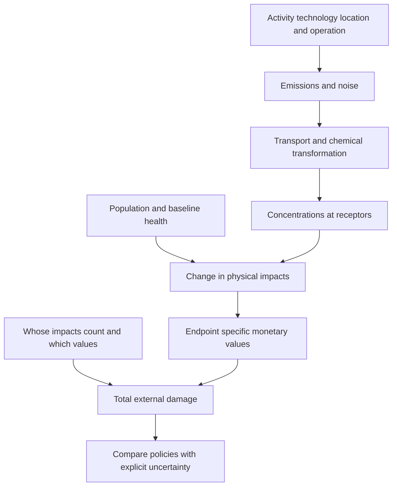

# Trace impact pathways and convert matched relative risks into cases

## Record metadata

```json
{
  "schema_version": 3,
  "owner": "plan",
  "course_id": "2026_2027/Winter_Semester/Economics_of_Green_Deal",
  "transaction_id": "PLAN-20261018-GREEN-P005-FORMAT",
  "plan_version": "P005",
  "source_version": "V003",
  "ingestion_revision": 3,
  "objective_id": "O014",
  "objective_revision": 1,
  "criterion_version": "O014-C1",
  "status": "ready",
  "lesson_content_contract": "self-contained-lessons-v1",
  "knowledge_components": [
    "pathway_and_top_down_contrast",
    "relative_risk_baseline_population_and_endpoint_units",
    "calibration_boundary_and_uncertainty"
  ],
  "prerequisite_ids": [
    "O005",
    "O009"
  ],
  "compatible_versions": [
    {
      "objective_revision": 1,
      "criterion_version": "O014-C1",
      "plan_version": "P004",
      "source_version": "V003",
      "ingestion_revision": 3,
      "reason": "P005 changes only six independent-observer formula grouping delimiters in O015 to avoid Markdown interpreting a LaTeX multiplication as a local file link. All academic quantities, assumptions, item/criterion definitions, routes, tools and timing conditions are unchanged; no reassessment or learner result is inferred.",
      "change_class": "formatting_only",
      "requires_reassessment": false
    }
  ],
  "note_locations": [
    {
      "path": "01_Notes/2026_2027/Winter_Semester/Economics_of_Green_Deal/Week_3/Impact_Pathways_Health_Valuation_and_Standing.md",
      "heading": "Impact pathways, health valuation and standing"
    },
    {
      "path": "01_Notes/2026_2027/Winter_Semester/Economics_of_Green_Deal/Week_3/Impact_Pathways_Health_Valuation_and_Standing.md",
      "heading": "Top-down allocation versus bottom-up pathways"
    },
    {
      "path": "01_Notes/2026_2027/Winter_Semester/Economics_of_Green_Deal/Week_3/Impact_Pathways_Health_Valuation_and_Standing.md",
      "heading": "From concentration to a receptor-specific impact"
    },
    {
      "path": "01_Notes/2026_2027/Winter_Semester/Economics_of_Green_Deal/Week_3/Impact_Pathways_Health_Valuation_and_Standing.md",
      "heading": "Endpoints and the source response-value table"
    }
  ],
  "acquisition_rule": {
    "distinct_independent_passes": 2,
    "required_item_roles": [
      "full_capability_check",
      "full_capability_check"
    ],
    "allowed_routes": [
      [
        "O014-I1",
        "O014-I2"
      ],
      [
        "O014-I1",
        "O014-D1"
      ],
      [
        "O014-I1",
        "O014-D2"
      ],
      [
        "O014-I2",
        "O014-D1"
      ],
      [
        "O014-I2",
        "O014-D2"
      ],
      [
        "O014-D1",
        "O014-D2"
      ]
    ]
  },
  "delayed_rule": {
    "minimum_elapsed_hours": 24,
    "fresh_item": true,
    "independent_required": true
  },
  "review_topic": "Trace impact pathways and convert matched relative risks into cases",
  "review_instruction": "Begin a closed-note review with teach for O014; request an unused prepared delayed item before recap."
}
```

## Outcome and conditions

Trace a specified source through concentration/receptors to health impacts, derive a matched reference-baseline risk-to-cases illustration and identify missing calibration before monetization. All essential components listed in metadata are required. Hypothetical assessment values instantiate the checked equations; they are not historical observations or observed outcomes. Independent checks are closed-note and without hints, solution access, external retrieval or other assistance; a basic arithmetic calculator is allowed. Teach establishes and records actual help/exposure conditions before claiming independence.

## Prerequisites and checks

- [O005 outcome and repair route](../lessons/O005.md#outcome-and-conditions): a real neglected receptor effect connects a physical pressure to the economic externality.
- [O009 outcome and repair route](../lessons/O009.md#outcome-and-conditions): the cost/endpoint boundary distinguishes protection resources from residual physical harm and valuation.

O014-P1, item_version 1, prerequisite_diagnostic. **Prompt:** Why does an uncounted emissions pressure need a receptor utility/production effect to be an economic externality? Is observed defensive spending automatically total external cost?

**Complete key and rubric:** An economic externality requires the neglected real effect on a receptor, not pressure alone. Defensive spending can omit residual harm; the correctly bounded total may need both. Require both distinctions; repair O005 definition and O009 cost-boundary/valuation audit. Pass requires every requested reason and result; partial for an omitted reason or unresolved isolated arithmetic slip; fail for the conflicting mechanism. This diagnostic never counts as acquisition. Current or explicitly compatible committed independent prerequisite evidence may permit skipping its check; familiarity alone cannot. Use the cited complete prerequisite lesson or the named included foundation, then the worked example, after a partial/failing entry check.

## Teaching order and rationale

1. Use the diagnostic once to establish the necessary conceptual or algebraic foundation.
2. Present the complete checked-note explanation below, preserving variables, dates, assumptions and source qualifications. Follow one reasoning chain at a time so every intermediate step is visible.
3. Work W1 fully, asking the learner to explain why each step follows.
4. Use S1 as completion practice: show the setup and first identity, hide the final algebra/numbers and interpretation. After an explanation of the missing steps, withdraw support.
5. Present unused I1/I2 full checks with hidden solutions; use correction/repair after scoring the original answer. An unused D form can replace an exposed I only through a listed route.
6. On a later eligible occasion, begin an unused D item before recap. A numeric variant establishes bounded same-method performance, not general transfer.

## Motivation, intuition, and definitions

Trace a specified source through concentration/receptors to health impacts, derive a matched reference-baseline risk-to-cases illustration and identify missing calibration before monetization. Establish the definitions, assumptions and relevant comparisons before simplifying an equation. The complete reused passages establish every academic claim, notation choice and qualification assessed here; necessary prerequisites use the complete lessons above.

## Explanation steps

Origin: reused complete note introduction before its first subsection, [[01_Notes/2026_2027/Winter_Semester/Economics_of_Green_Deal/Week_3/Impact_Pathways_Health_Valuation_and_Standing.md#Impact pathways, health valuation and standing]], fingerprint `df3400bedc26d3001c8239c118b327ba73e7fd2889154e49a8fb01fc0337016f`. Heading depth alone is adapted.

### Impact pathways, health valuation and standing

Why can the same tonne of pollution cause different damages in different places? Emissions are only the beginning of the causal chain. An impact-pathway assessment follows a specified activity through dispersion, exposure and physical effects, then values those effects for an explicitly chosen population. This connects Week 2 externality and benefit-cost concepts to a practical damage estimate. [[00_Materials/2026_2027/Winter_Semester/Economics_of_Green_Deal/Week_3/02_AQImp-ClimateChange.pdf#page=1|02_AQImp-ClimateChange.pdf, physical PDF p. 1–5, 19]]



This map follows physical pp. 2–13 and 19. Its central distinction is between a pressure, an exposure, an impact and a money value; each arrow needs different evidence. [[00_Materials/2026_2027/Winter_Semester/Economics_of_Green_Deal/Week_3/02_AQImp-ClimateChange.pdf#page=2|02_AQImp-ClimateChange.pdf, physical PDF p. 2–13, 19]]

Origin: reused complete checked passage [[01_Notes/2026_2027/Winter_Semester/Economics_of_Green_Deal/Week_3/Impact_Pathways_Health_Valuation_and_Standing.md#Top-down allocation versus bottom-up pathways]]; fingerprint `df3400bedc26d3001c8239c118b327ba73e7fd2889154e49a8fb01fc0337016f`. Heading depth alone is adapted.

### Top-down allocation versus bottom-up pathways

The top-down diagram starts from a national damage estimate and a pollutant/activity allocation, then assigns a fraction of damage to the activity. It can be useful at an aggregate level but does not itself trace where a particular source's emissions travel. The bottom-up side begins with resource use (electricity production), follows SO2 emissions and atmospheric concentrations, ecosystem acidification/disruption, damage to forest production/non-production functions, and market/non-market valuation. Moving from a national average to a specific plant requires those physical and receptor distinctions. [[00_Materials/2026_2027/Winter_Semester/Economics_of_Green_Deal/Week_3/02_AQImp-ClimateChange.pdf#page=2|02_AQImp-ClimateChange.pdf, physical PDF p. 2]]

The lecture describes **ExternE (Externalities of Energy)** as an EU research series launched in 1991, initially concerned with airborne pollution from power plants and later transport, industry and other activities. It connects the method to DPSIR: driving forces, pressures, state, impacts and responses. Its note that “I” is monetized impacts describes the valuation endpoint of this application; one must still calculate physical impacts before money values can be attached. Damage depends on technology, operation, location, time, the included fuel-cycle boundary and population preferences. [[00_Materials/2026_2027/Winter_Semester/Economics_of_Green_Deal/Week_3/02_AQImp-ClimateChange.pdf#page=3|02_AQImp-ClimateChange.pdf, physical PDF p. 3–4]]


Origin: reused complete checked passage [[01_Notes/2026_2027/Winter_Semester/Economics_of_Green_Deal/Week_3/Impact_Pathways_Health_Valuation_and_Standing.md#From concentration to a receptor-specific impact]]; fingerprint `df3400bedc26d3001c8239c118b327ba73e7fd2889154e49a8fb01fc0337016f`. Heading depth alone is adapted.

### From concentration to a receptor-specific impact

The Lauffen/Stuttgart example maps changes in sulfate concentration due to a plant's SO2 emissions across Europe. The pressure-map legend is in **ng/m³**. A separate receptor map shows where potentially exposed people live. The mortality/life-year-loss map combines exposure changes and population response: a high concentration change in a sparsely populated area need not create the largest health loss. Transboundary transport explains why damages need not stay within the emitting jurisdiction. The maps' different units and colour breaks must not be equated. [[00_Materials/2026_2027/Winter_Semester/Economics_of_Green_Deal/Week_3/02_AQImp-ClimateChange.pdf#page=5|02_AQImp-ClimateChange.pdf, physical PDF p. 5–8]]

![[01_Notes/2026_2027/Winter_Semester/Economics_of_Green_Deal/assets/Week_3_Impact_Pathway.png]]

The source diagram moves from emissions through transport/chemistry to human/material/crop effects and only then money. Treating an emission quantity itself as a welfare loss would skip the receptor and valuation steps. [[00_Materials/2026_2027/Winter_Semester/Economics_of_Green_Deal/Week_3/02_AQImp-ClimateChange.pdf#page=5|02_AQImp-ClimateChange.pdf, physical PDF p. 5]]

An exposure/dose/concentration-response function connects a specified exposure change with a specified outcome. Physical p. 9 gives the illustrative equation

$$\text{additional years of life lost}=3.9\times10^{-5}\,\Delta\text{Sulfate}\times\text{Population}.$$

The coefficient embodies a response per concentration unit and exposed person, so concentration units, population definition and exposure period must match its calibration. The slide does **not** supply those calibration units/time details; the ng/m³ map is not permission to assume the equation uses ng/m³. This formula supports the pathway logic, but not a reproducible numerical health estimate without that missing context. Its graph contrasts linear, nonlinear, threshold/limited and initially beneficial (“fertilizing”) shapes; choosing a straight line is a substantive response assumption, not an automatic property of every pollutant. [[00_Materials/2026_2027/Winter_Semester/Economics_of_Green_Deal/Week_3/02_AQImp-ClimateChange.pdf#page=9|02_AQImp-ClimateChange.pdf, physical PDF p. 9]]


Origin: reused complete checked passage [[01_Notes/2026_2027/Winter_Semester/Economics_of_Green_Deal/Week_3/Impact_Pathways_Health_Valuation_and_Standing.md#Endpoints and the source response-value table]]; fingerprint `df3400bedc26d3001c8239c118b327ba73e7fd2889154e49a8fb01fc0337016f`. Heading depth alone is adapted.

### Endpoints and the source response-value table

The source includes particulate matter, SO2/NOx/NH3/VOC, CO2, heavy metals, noise and odour as burdens, with health, buildings/materials, crops, climate, landscape, visibility and cultural heritage as impact categories. Its p. 11 embedded comment adds respiratory admissions, restricted activity, congestive heart failure, nonfatal cancer, bronchitis and asthma; material ageing/soiling across metals, paint and stone; and crop-yield changes for barley, oats, potato, rye, sugar beet, wheat, sunflower, rice and tobacco. The category list does not assert that every burden affects every endpoint equally. [[00_Materials/2026_2027/Winter_Semester/Economics_of_Green_Deal/Week_3/02_AQImp-ClimateChange.pdf#page=11|02_AQImp-ClimateChange.pdf, physical PDF p. 11, 11]]

![[01_Notes/2026_2027/Winter_Semester/Economics_of_Green_Deal/assets/Week_3_Concentration_Response_Table.png]]

Physical p. 10's complete table retains its endpoint units and numerical entries. Long-term PM2.5 adult mortality is expressed per year of life lost (YOLL), while infant mortality and bronchitis rows are per case. Short-term PM2.5/PM10/O3 rows distinguish restricted/work days, respiratory/cardiovascular admissions, asthma symptoms and mortality. A value per day cannot be multiplied by a number of people without specifying days per person; a value per YOLL is not a value per death. The CRF column is calibrated per 10 µg/m³, whereas the noise rows use weighted day-evening-night level $L_{den}$ in dB and separate quadratic annoyance functions. The table alone does not supply baseline disease frequencies, age structure or valid concentration/noise ranges; do not extrapolate its curves outside their study context. [[00_Materials/2026_2027/Winter_Semester/Economics_of_Green_Deal/Week_3/02_AQImp-ClimateChange.pdf#page=10|02_AQImp-ClimateChange.pdf, physical PDF p. 10]]

A CRF such as **1.019 per 10 µg/m³** is a relative risk: for that concentration increment, the respiratory-admission rate is multiplied by 1.019, a **1.9% relative increase**. It is not 1.019 extra admissions per person, and it is not a YOLL conversion. As an explicitly simplified calculation for a 10 µg/m³ increase from a reference exposure, if the baseline admission rate is $r_0$ cases per person per year and the exposed population is $N$, then

$$\Delta\text{cases}\approx N r_0(1.019-1).$$

For an illustrative baseline of 0.01 admissions per person per year and 100,000 exposed people, the reference count is 1,000 admissions per year and the increase is 19 per year. These invented round inputs teach the calculation; they are not an estimate for the lecture's plant. Other increments require the study's specified response function, and reductions from an already exposed observed baseline require the corresponding attributable-fraction calculation rather than silently reusing the same baseline. The baseline incidence, exposed population, period and endpoint must match. Mortality-to-YOLL estimation additionally needs life-expectancy/age information; a relative-risk coefficient alone cannot produce life years. This expands the source's pathway reasoning, supported by the manuscript's Methods/Table 1. [[00_Materials/2026_2027/Winter_Semester/Economics_of_Green_Deal/Week_3/02_AQImp-ClimateChange.pdf#page=10|02_AQImp-ClimateChange.pdf, physical PDF p. 10]]

**Bounded reference verification:** Máca, Melichar, Ščasný and Braun Kohlová (2017), “Valuing environmental health for informed policy-making,” *Reviews on Environmental Health* 32(1–2), 171–175, author manuscript physical pp. 3–5 (Methods/Table 1/perspectives), confirms that background population and incidence enter the assessment, and identifies the values as euro 2014. It also distinguishes physical modeling uncertainty from economic standing/value choices. [Consulted author manuscript](https://mpra.ub.uni-muenchen.de/92550/1/MPRA_paper_92550.pdf). This verifies interpretation of the supplied table, rather than importing its whole case study as assigned scope.


## Worked example

O014-W1, item_version 1, worked_example. **Prompt:** A hypothetical bottom-up assessment studies a 10 $\mu\mathrm{g/m^3}$ increase from a reference exposure. For this explicitly matched endpoint/population/year the supplied relative risk is $RR=1.019$, baseline respiratory admissions are $r_0=0.01$ cases/person/year and exposed population $N=100000$. Trace activity through emissions/chemistry, concentrations, receptor population, physical impacts and valuation, and contrast a national top-down allocation. Interpret RR and derive the baseline count and additional annual admissions. Explain why the emissions map alone cannot rank damages, why these are admissions rather than YOLL, and why the lecture sulfate coefficient $3.9\times10^{-5}$ cannot produce a calibrated plant estimate from its map without missing units/time. State the boundary for other increments or reductions from an already exposed baseline.

**Complete solution and essential rubric:** Bottom-up analysis specifies technology/operation/location/time, follows emissions through transport and chemistry to concentration changes at receptors, combines exposure with population/baseline response, then attaches matching values. Top-down allocation divides an aggregate damage estimate by activity/pollutant shares without tracing this plant’s spatial pathway. $RR=1.019$ multiplies the admission rate for the supplied reference-to-exposed increment, a relative increase of $1.900000\%$, not 1.019 extra cases/person. Reference admissions are $Nr_0=100000(0.01)=1000.000000$ cases/year; additional admissions are $\Delta I=Nr_0(RR-1)=19.000000$ cases/year. These are illustrative expected counts, not identified actual persons or a plant result. Population distribution can reverse the ranking of concentration changes and health impacts. Per-case counts cannot be treated as years of life lost; mortality-to-YOLL requires age/life-expectancy information, and values per day/case/YOLL must match endpoints. The source sulfate coefficient lacks calibration concentration/time details, so the map’s ng/m³ label is not permission to insert it. Other increments need the study’s response function; a reduction from an observed exposed baseline needs the corresponding attributable-fraction calculation, not an unqualified reuse of the reference-baseline formula. Linear, nonlinear and threshold shapes are substantive response assumptions. All requested calculations, derivations and qualifications are essential; the component map above applies to every full form.

## Practice with fading assistance

O014-S1, item_version 1, supported_completion. **Prompt:** A hypothetical bottom-up assessment studies a 10 $\mu\mathrm{g/m^3}$ increase from a reference exposure. For this explicitly matched endpoint/population/year the supplied relative risk is $RR=1.019$, baseline respiratory admissions are $r_0=0.015$ cases/person/year and exposed population $N=40000$. Trace activity through emissions/chemistry, concentrations, receptor population, physical impacts and valuation, and contrast a national top-down allocation. Interpret RR and derive the baseline count and additional annual admissions. Explain why the emissions map alone cannot rank damages, why these are admissions rather than YOLL, and why the lecture sulfate coefficient $3.9\times10^{-5}$ cannot produce a calibrated plant estimate from its map without missing units/time. State the boundary for other increments or reductions from an already exposed baseline.

**Complete solution and essential rubric:** Bottom-up analysis specifies technology/operation/location/time, follows emissions through transport and chemistry to concentration changes at receptors, combines exposure with population/baseline response, then attaches matching values. Top-down allocation divides an aggregate damage estimate by activity/pollutant shares without tracing this plant’s spatial pathway. $RR=1.019$ multiplies the admission rate for the supplied reference-to-exposed increment, a relative increase of $1.900000\%$, not 1.019 extra cases/person. Reference admissions are $Nr_0=40000(0.015)=600.000000$ cases/year; additional admissions are $\Delta I=Nr_0(RR-1)=11.400000$ cases/year. These are illustrative expected counts, not identified actual persons or a plant result. Population distribution can reverse the ranking of concentration changes and health impacts. Per-case counts cannot be treated as years of life lost; mortality-to-YOLL requires age/life-expectancy information, and values per day/case/YOLL must match endpoints. The source sulfate coefficient lacks calibration concentration/time details, so the map’s ng/m³ label is not permission to insert it. Other increments need the study’s response function; a reduction from an observed exposed baseline needs the corresponding attributable-fraction calculation, not an unqualified reuse of the reference-baseline formula. Linear, nonlinear and threshold shapes are substantive response assumptions. All requested calculations, derivations and qualifications are essential; the component map above applies to every full form.

Allowed support is the first stated identity only; hide the remaining key while the learner completes it. Supported performance is practice, not an independent result.

## Rubric and independence

Required components: pathway_and_top_down_contrast, relative_risk_baseline_population_and_endpoint_units, calibration_boundary_and_uncertainty. Each full prompt/key below elicits every component; all are necessary for a pass on every permitted pair. Accept algebraically equivalent expressions and clearly defined opposite cash-flow signs with correct interpretation. A pass requires all requested outputs/reasons, correct units/assumptions and no critical conceptual error. Partial means a missing component or an unresolved isolated arithmetic slip with an otherwise valid method; independent correction is required for a pass. Fail means a critical mechanism/condition is wrong. Unscorable means a response or its help/exposure conditions cannot be established. Unknown help conditions are never independent evidence.

Critical errors: RR interpreted as extra cases/person; concentration/map legend substituted for missing calibration; cases/deaths/YOLL interchanged; emissions directly declared a monetary damage.

Acquisition requires two distinct unused unassisted full checks selected from the six exact metadata routes. Every I/D form covers all components; W1, S1, the prerequisite and C1 are forbidden substitutes. A D form used for acquisition cannot later be counted again as delayed success. No teach-generated item may replace a named full check; additional verified explanation/practice is allowed under the unchanged method and may not fabricate evidence. If fewer than two fresh forms remain for acquisition, return a plan_issue for an additional prepared bank.

| Component | I1 | I2 | D1 | D2 |
|---|---|---|---|---|
| pathway_and_top_down_contrast | required | required | required | required |
| relative_risk_baseline_population_and_endpoint_units | required | required | required | required |
| calibration_boundary_and_uncertainty | required | required | required | required |

## Misconceptions and correction

An observed omitted term/sign is tentative until the learner explains it; compare the reasoning with the critical errors above. Score the original response before providing help. Route a conceptual failure to the relevant included derivation and prerequisite, then use an unused full form.

O014-C1, item_version 1, narrow_correction. **Prompt:** A coefficient is RR 1.019 for a specified 10 µg/m³ increment. Can multiplying it directly by population give additional admissions? **Key/rubric:** No. For the stated reference-to-exposed increment, derive baseline cases from matching incidence times population, then multiply by RR−1. Endpoint/period/reference must match and other increments need the stated response law. Pass requires all keyed reasoning; partial for a missing part; fail for the conflicting mechanism. This repairs a common inference only; it cannot substitute for a full numerical/capability check.

Give at most two hints (first identify the date/unit, second point to the included identity); after ineffective hints show the relevant worked step. After two unsuccessful independent attempts stop repeated quizzing, revisit the explanation/prerequisite and preserve the unresolved status.

## Immediate and delayed checks

### O014-I1

O014-I1, item_version 1, full_capability_check. **Prompt:** A hypothetical bottom-up assessment studies a 10 $\mu\mathrm{g/m^3}$ increase from a reference exposure. For this explicitly matched endpoint/population/year the supplied relative risk is $RR=1.019$, baseline respiratory admissions are $r_0=0.012$ cases/person/year and exposed population $N=120000$. Trace activity through emissions/chemistry, concentrations, receptor population, physical impacts and valuation, and contrast a national top-down allocation. Interpret RR and derive the baseline count and additional annual admissions. Explain why the emissions map alone cannot rank damages, why these are admissions rather than YOLL, and why the lecture sulfate coefficient $3.9\times10^{-5}$ cannot produce a calibrated plant estimate from its map without missing units/time. State the boundary for other increments or reductions from an already exposed baseline.

**Complete solution and essential rubric:** Bottom-up analysis specifies technology/operation/location/time, follows emissions through transport and chemistry to concentration changes at receptors, combines exposure with population/baseline response, then attaches matching values. Top-down allocation divides an aggregate damage estimate by activity/pollutant shares without tracing this plant’s spatial pathway. $RR=1.019$ multiplies the admission rate for the supplied reference-to-exposed increment, a relative increase of $1.900000\%$, not 1.019 extra cases/person. Reference admissions are $Nr_0=120000(0.012)=1440.000000$ cases/year; additional admissions are $\Delta I=Nr_0(RR-1)=27.360000$ cases/year. These are illustrative expected counts, not identified actual persons or a plant result. Population distribution can reverse the ranking of concentration changes and health impacts. Per-case counts cannot be treated as years of life lost; mortality-to-YOLL requires age/life-expectancy information, and values per day/case/YOLL must match endpoints. The source sulfate coefficient lacks calibration concentration/time details, so the map’s ng/m³ label is not permission to insert it. Other increments need the study’s response function; a reduction from an observed exposed baseline needs the corresponding attributable-fraction calculation, not an unqualified reuse of the reference-baseline formula. Linear, nonlinear and threshold shapes are substantive response assumptions. All requested calculations, derivations and qualifications are essential; the component map above applies to every full form.

I1/I2 are immediate checks; D1/D2 are distinct parallel variants reserved where possible for delayed checks. A delayed success requires an unused form before recap, no help/solution access, and at least 24 actual elapsed hours after acquisition and the most recent relevant teaching/solution exposure. Record intervening exposure. A calendar-date change alone is insufficient; an early D attempt is immediate evidence only.

### O014-I2

O014-I2, item_version 1, full_capability_check. **Prompt:** A hypothetical bottom-up assessment studies a 10 $\mu\mathrm{g/m^3}$ increase from a reference exposure. For this explicitly matched endpoint/population/year the supplied relative risk is $RR=1.019$, baseline respiratory admissions are $r_0=0.02$ cases/person/year and exposed population $N=80000$. Trace activity through emissions/chemistry, concentrations, receptor population, physical impacts and valuation, and contrast a national top-down allocation. Interpret RR and derive the baseline count and additional annual admissions. Explain why the emissions map alone cannot rank damages, why these are admissions rather than YOLL, and why the lecture sulfate coefficient $3.9\times10^{-5}$ cannot produce a calibrated plant estimate from its map without missing units/time. State the boundary for other increments or reductions from an already exposed baseline.

**Complete solution and essential rubric:** Bottom-up analysis specifies technology/operation/location/time, follows emissions through transport and chemistry to concentration changes at receptors, combines exposure with population/baseline response, then attaches matching values. Top-down allocation divides an aggregate damage estimate by activity/pollutant shares without tracing this plant’s spatial pathway. $RR=1.019$ multiplies the admission rate for the supplied reference-to-exposed increment, a relative increase of $1.900000\%$, not 1.019 extra cases/person. Reference admissions are $Nr_0=80000(0.02)=1600.000000$ cases/year; additional admissions are $\Delta I=Nr_0(RR-1)=30.400000$ cases/year. These are illustrative expected counts, not identified actual persons or a plant result. Population distribution can reverse the ranking of concentration changes and health impacts. Per-case counts cannot be treated as years of life lost; mortality-to-YOLL requires age/life-expectancy information, and values per day/case/YOLL must match endpoints. The source sulfate coefficient lacks calibration concentration/time details, so the map’s ng/m³ label is not permission to insert it. Other increments need the study’s response function; a reduction from an observed exposed baseline needs the corresponding attributable-fraction calculation, not an unqualified reuse of the reference-baseline formula. Linear, nonlinear and threshold shapes are substantive response assumptions. All requested calculations, derivations and qualifications are essential; the component map above applies to every full form.

### O014-D1

O014-D1, item_version 1, full_capability_check. **Prompt:** A hypothetical bottom-up assessment studies a 10 $\mu\mathrm{g/m^3}$ increase from a reference exposure. For this explicitly matched endpoint/population/year the supplied relative risk is $RR=1.019$, baseline respiratory admissions are $r_0=0.008$ cases/person/year and exposed population $N=150000$. Trace activity through emissions/chemistry, concentrations, receptor population, physical impacts and valuation, and contrast a national top-down allocation. Interpret RR and derive the baseline count and additional annual admissions. Explain why the emissions map alone cannot rank damages, why these are admissions rather than YOLL, and why the lecture sulfate coefficient $3.9\times10^{-5}$ cannot produce a calibrated plant estimate from its map without missing units/time. State the boundary for other increments or reductions from an already exposed baseline.

**Complete solution and essential rubric:** Bottom-up analysis specifies technology/operation/location/time, follows emissions through transport and chemistry to concentration changes at receptors, combines exposure with population/baseline response, then attaches matching values. Top-down allocation divides an aggregate damage estimate by activity/pollutant shares without tracing this plant’s spatial pathway. $RR=1.019$ multiplies the admission rate for the supplied reference-to-exposed increment, a relative increase of $1.900000\%$, not 1.019 extra cases/person. Reference admissions are $Nr_0=150000(0.008)=1200.000000$ cases/year; additional admissions are $\Delta I=Nr_0(RR-1)=22.800000$ cases/year. These are illustrative expected counts, not identified actual persons or a plant result. Population distribution can reverse the ranking of concentration changes and health impacts. Per-case counts cannot be treated as years of life lost; mortality-to-YOLL requires age/life-expectancy information, and values per day/case/YOLL must match endpoints. The source sulfate coefficient lacks calibration concentration/time details, so the map’s ng/m³ label is not permission to insert it. Other increments need the study’s response function; a reduction from an observed exposed baseline needs the corresponding attributable-fraction calculation, not an unqualified reuse of the reference-baseline formula. Linear, nonlinear and threshold shapes are substantive response assumptions. All requested calculations, derivations and qualifications are essential; the component map above applies to every full form.

### O014-D2

O014-D2, item_version 1, full_capability_check. **Prompt:** A hypothetical bottom-up assessment studies a 10 $\mu\mathrm{g/m^3}$ increase from a reference exposure. For this explicitly matched endpoint/population/year the supplied relative risk is $RR=1.019$, baseline respiratory admissions are $r_0=0.03$ cases/person/year and exposed population $N=60000$. Trace activity through emissions/chemistry, concentrations, receptor population, physical impacts and valuation, and contrast a national top-down allocation. Interpret RR and derive the baseline count and additional annual admissions. Explain why the emissions map alone cannot rank damages, why these are admissions rather than YOLL, and why the lecture sulfate coefficient $3.9\times10^{-5}$ cannot produce a calibrated plant estimate from its map without missing units/time. State the boundary for other increments or reductions from an already exposed baseline.

**Complete solution and essential rubric:** Bottom-up analysis specifies technology/operation/location/time, follows emissions through transport and chemistry to concentration changes at receptors, combines exposure with population/baseline response, then attaches matching values. Top-down allocation divides an aggregate damage estimate by activity/pollutant shares without tracing this plant’s spatial pathway. $RR=1.019$ multiplies the admission rate for the supplied reference-to-exposed increment, a relative increase of $1.900000\%$, not 1.019 extra cases/person. Reference admissions are $Nr_0=60000(0.03)=1800.000000$ cases/year; additional admissions are $\Delta I=Nr_0(RR-1)=34.200000$ cases/year. These are illustrative expected counts, not identified actual persons or a plant result. Population distribution can reverse the ranking of concentration changes and health impacts. Per-case counts cannot be treated as years of life lost; mortality-to-YOLL requires age/life-expectancy information, and values per day/case/YOLL must match endpoints. The source sulfate coefficient lacks calibration concentration/time details, so the map’s ng/m³ label is not permission to insert it. Other increments need the study’s response function; a reduction from an observed exposed baseline needs the corresponding attributable-fraction calculation, not an unqualified reuse of the reference-baseline formula. Linear, nonlinear and threshold shapes are substantive response assumptions. All requested calculations, derivations and qualifications are essential; the component map above applies to every full form.

## Advance, revisit, pause, and escalate

Advance only after teach commits two qualifying independent full passes under a listed route. Keep acquisition and each later delayed observation separate. A source conflict blocks the affected claim and returns to ingest with the exact note heading. Missing criteria, a new method, unsupported alternative or exhausted fresh bank returns to plan with 2026_2027/Winter_Semester/Economics_of_Green_Deal, O014, revision1/O014-C1, P005/V003/ingestion3 and item ID. Equivalent valid methods meeting the frozen criterion may receive credit after verification; no criterion is changed to fit an answer. Closing a session preserves the actual stopping point without claiming completion.

## Content provenance and generation boundaries

Explanations, figures and qualifications above reuse complete checked-note sections with exact origin/fingerprint; heading depth alone is adapted. Main exercises and worked arithmetic are plan-created hypothetical instantiations of those displayed identities. No additional academic claims or external course scope are introduced. Preserve the note conventions and explicit qualifications; checked references reused from notes are not an independent raw-source audit by plan. New numerical practice can use the same method only after its complete solution and unchanged components are checked before display; it cannot replace this lesson’s named evidence forms. Prerequisites route to the complete prepared lessons above.

## Answer-free recall handoff

Topic: Trace impact pathways and convert matched relative risks into cases. Begin a closed-note review with teach for O014; request an unused prepared delayed item before recap. Exact lesson: [[03_Agents/2026_2027/Winter_Semester/Economics_of_Green_Deal/lessons/O014.md#Immediate and delayed checks]]. Teach supplies actual committed evidence and timestamps; recall alone dates reviews. No learner outcome or due date is created by this curriculum.
