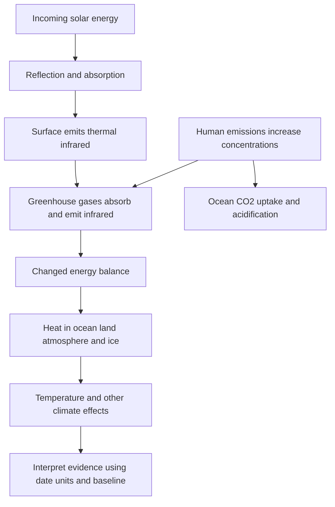

# Explain radiative balance, heat storage and ocean chemistry

## Record metadata

```json
{
  "schema_version": 3,
  "owner": "plan",
  "course_id": "2026_2027/Winter_Semester/Economics_of_Green_Deal",
  "transaction_id": "PLAN-20261018-GREEN-P005-FORMAT",
  "plan_version": "P005",
  "source_version": "V003",
  "ingestion_revision": 3,
  "objective_id": "O016",
  "objective_revision": 1,
  "criterion_version": "O016-C1",
  "status": "ready",
  "lesson_content_contract": "self-contained-lessons-v1",
  "knowledge_components": [
    "radiative_mechanism_and_external_balance",
    "heat_inventory_periods_layers_and_conditioning",
    "aerosol_and_acidification_distinctions"
  ],
  "prerequisite_ids": [
    "O001",
    "O002"
  ],
  "compatible_versions": [
    {
      "objective_revision": 1,
      "criterion_version": "O016-C1",
      "plan_version": "P004",
      "source_version": "V003",
      "ingestion_revision": 3,
      "reason": "P005 changes only six independent-observer formula grouping delimiters in O015 to avoid Markdown interpreting a LaTeX multiplication as a local file link. All academic quantities, assumptions, item/criterion definitions, routes, tools and timing conditions are unchanged; no reassessment or learner result is inferred.",
      "change_class": "formatting_only",
      "requires_reassessment": false
    }
  ],
  "note_locations": [
    {
      "path": "01_Notes/2026_2027/Winter_Semester/Economics_of_Green_Deal/Week_3/Greenhouse_Effect_CO2_and_Earth_Energy.md",
      "heading": "Greenhouse effect, CO2 and Earth's energy"
    },
    {
      "path": "01_Notes/2026_2027/Winter_Semester/Economics_of_Green_Deal/Week_3/Greenhouse_Effect_CO2_and_Earth_Energy.md",
      "heading": "The radiative mechanism and its limits as an analogy"
    },
    {
      "path": "01_Notes/2026_2027/Winter_Semester/Economics_of_Green_Deal/Week_3/Greenhouse_Effect_CO2_and_Earth_Energy.md",
      "heading": "Energy imbalance and the heat inventory"
    },
    {
      "path": "01_Notes/2026_2027/Winter_Semester/Economics_of_Green_Deal/Week_3/Greenhouse_Effect_CO2_and_Earth_Energy.md",
      "heading": "CO2 also changes ocean chemistry"
    }
  ],
  "acquisition_rule": {
    "distinct_independent_passes": 2,
    "required_item_roles": [
      "full_capability_check",
      "full_capability_check"
    ],
    "allowed_routes": [
      [
        "O016-I1",
        "O016-I2"
      ],
      [
        "O016-I1",
        "O016-D1"
      ],
      [
        "O016-I1",
        "O016-D2"
      ],
      [
        "O016-I2",
        "O016-D1"
      ],
      [
        "O016-I2",
        "O016-D2"
      ],
      [
        "O016-D1",
        "O016-D2"
      ]
    ]
  },
  "delayed_rule": {
    "minimum_elapsed_hours": 24,
    "fresh_item": true,
    "independent_required": true
  },
  "review_topic": "Explain radiative balance, heat storage and ocean chemistry",
  "review_instruction": "Begin a closed-note review with teach for O016; request an unused prepared delayed item before recap."
}
```

## Outcome and conditions

Explain infrared absorption/emission and external energy balance, calculate a declared illustrative heat partition and preserve period/coverage/conditionality and ocean-chemistry distinctions. All essential components listed in metadata are required. Hypothetical assessment values instantiate the checked equations; they are not historical observations or observed outcomes. Independent checks are closed-note and without hints, solution access, external retrieval or other assistance; a basic arithmetic calculator is allowed. Teach establishes and records actual help/exposure conditions before claiming independence.

## Prerequisites and checks

- [O001 outcome and repair route](../lessons/O001.md#outcome-and-conditions): climate is one of the wider life-support functions.
- [O002 outcome and repair route](../lessons/O002.md#outcome-and-conditions): the wider material/utility system explains why physical environmental changes matter beyond output.

O016-P1, item_version 1, prerequisite_diagnostic. **Prompt:** Which environmental function includes climate support, and why can the wider environmental system change wellbeing beyond the firms/households consumption loop?

**Complete key and rubric:** Climate belongs to global biospheric life-supporting services; resources/amenities/waste feedbacks affect wellbeing beyond consumption. Require the correct function and at least one explicit physical/utility path; repair O001 taxonomy and O002 full network. Pass requires every requested reason and result; partial for an omitted reason or unresolved isolated arithmetic slip; fail for the conflicting mechanism. This diagnostic never counts as acquisition. Current or explicitly compatible committed independent prerequisite evidence may permit skipping its check; familiarity alone cannot. Use the cited complete prerequisite lesson or the named included foundation, then the worked example, after a partial/failing entry check.

## Teaching order and rationale

1. Use the diagnostic once to establish the necessary conceptual or algebraic foundation.
2. Present the complete checked-note explanation below, preserving variables, dates, assumptions and source qualifications. Follow one reasoning chain at a time so every intermediate step is visible.
3. Work W1 fully, asking the learner to explain why each step follows.
4. Use S1 as completion practice: show the setup and first identity, hide the final algebra/numbers and interpretation. After an explanation of the missing steps, withdraw support.
5. Present unused I1/I2 full checks with hidden solutions; use correction/repair after scoring the original answer. An unused D form can replace an exposed I only through a listed route.
6. On a later eligible occasion, begin an unused D item before recap. A numeric variant establishes bounded same-method performance, not general transfer.

## Motivation, intuition, and definitions

Explain infrared absorption/emission and external energy balance, calculate a declared illustrative heat partition and preserve period/coverage/conditionality and ocean-chemistry distinctions. Establish the definitions, assumptions and relevant comparisons before simplifying an equation. The complete reused passages establish every academic claim, notation choice and qualification assessed here; necessary prerequisites use the complete lessons above.

## Explanation steps

Origin: reused complete note introduction before its first subsection, [[01_Notes/2026_2027/Winter_Semester/Economics_of_Green_Deal/Week_3/Greenhouse_Effect_CO2_and_Earth_Energy.md#Greenhouse effect, CO2 and Earth's energy]], fingerprint `0e546eb44a26562a6831079998cde23dd5004f51769540e9057950e69279b643`. Heading depth alone is adapted.

### Greenhouse effect, CO2 and Earth's energy

Why does increasing atmospheric greenhouse-gas abundance alter climate, and where does the extra energy go? The lecture links radiation, concentrations and Earth's heat inventory. A temperature change is one consequence of an energy imbalance; ocean heating and ice change are also part of that response. [[00_Materials/2026_2027/Winter_Semester/Economics_of_Green_Deal/Week_3/02_AQImp-ClimateChange.pdf#page=20|02_AQImp-ClimateChange.pdf, physical PDF p. 20–39]]



This source-derived map follows physical pp. 21–39 and distinguishes a radiative mechanism, its evidence and a separate chemical effect of CO2. [[00_Materials/2026_2027/Winter_Semester/Economics_of_Green_Deal/Week_3/02_AQImp-ClimateChange.pdf#page=21|02_AQImp-ClimateChange.pdf, physical PDF p. 21–39]]

Origin: reused complete checked passage [[01_Notes/2026_2027/Winter_Semester/Economics_of_Green_Deal/Week_3/Greenhouse_Effect_CO2_and_Earth_Energy.md#The radiative mechanism and its limits as an analogy]]; fingerprint `0e546eb44a26562a6831079998cde23dd5004f51769540e9057950e69279b643`. Heading depth alone is adapted.

### The radiative mechanism and its limits as an analogy

The Czech schematic on p. 22 shows incoming sunlight, some reflection by Earth's surface/atmosphere, absorption at the surface and outgoing longwave heat radiation. Greenhouse gases/clouds absorb and emit part of that infrared radiation, including downward emission. “Sluneční záření” is solar radiation, “Země” Earth and “atmosféra” atmosphere. The source's text describes this as absorption and “reflection” by greenhouse-gas molecules; the physical mechanism is absorption and re-emission, not a literal infrared mirror. The embedded comment likewise contrasts reflected sunlight and thermal radiation. [[00_Materials/2026_2027/Winter_Semester/Economics_of_Green_Deal/Week_3/02_AQImp-ClimateChange.pdf#page=22|02_AQImp-ClimateChange.pdf, physical PDF p. 22, 24–25]]

The p. 23 historical teaching diagram gives absorbed sunlight 235 W/m², split into 67 atmospheric and 168 surface absorption. Thermal loss to space is 195+40=235 W/m²; its larger internal downward/upward flows (including 324 downward and 350 absorbed greenhouse radiation) do not create energy but redistribute it within the surface–atmosphere system. These are the figure's illustrative older-budget values, not a current measurement of every energy flux. [[00_Materials/2026_2027/Winter_Semester/Economics_of_Green_Deal/Week_3/02_AQImp-ClimateChange.pdf#page=23|02_AQImp-ClimateChange.pdf, physical PDF p. 23]]

![[01_Notes/2026_2027/Winter_Semester/Economics_of_Green_Deal/assets/Week_3_Greenhouse_Budget.png]]

Natural greenhouse warming makes the surface warmer than it would be without this radiative effect. **Change** in greenhouse-gas abundance enhances that natural effect and changes the balance; a natural greenhouse effect by itself is not synonymous with ongoing human-caused climate change. CO2 is a central long-lived greenhouse gas, not the only one: methane, nitrous oxide and halogenated gases also matter. The source's description of CO2 as “most important” is read in its long-lived anthropogenic context rather than ignoring water-vapour/cloud feedback. [[00_Materials/2026_2027/Winter_Semester/Economics_of_Green_Deal/Week_3/02_AQImp-ClimateChange.pdf#page=24|02_AQImp-ClimateChange.pdf, physical PDF p. 24–25]]

The lecture says CO2 supplied about two-thirds of the total human-produced greenhouse-gas heating influence in 2021. Keep its year and denominator; a share of total forcing and a share of the **increase since 1990** are different statistics. Its list includes “black carbon” among gases on pp. 25/48; that is a category error. Black carbon is an aerosol/soot component, not a greenhouse gas. The European Commission JRC glossary explicitly defines it as an aerosol species: [consulted definition](https://knowledge4policy.ec.europa.eu/glossary-item/black-carbon_en). [[00_Materials/2026_2027/Winter_Semester/Economics_of_Green_Deal/Week_3/02_AQImp-ClimateChange.pdf#page=24|02_AQImp-ClimateChange.pdf, physical PDF p. 24–25, 48]]


Origin: reused complete checked passage [[01_Notes/2026_2027/Winter_Semester/Economics_of_Green_Deal/Week_3/Greenhouse_Effect_CO2_and_Earth_Energy.md#Energy imbalance and the heat inventory]]; fingerprint `0e546eb44a26562a6831079998cde23dd5004f51769540e9057950e69279b643`. Heading depth alone is adapted.

### Energy imbalance and the heat inventory

Incoming energy minus outgoing radiation is the net energy flux. A positive imbalance means energy accumulates in Earth's system. The source's von Schuckmann et al. 2020 figure estimates **358±37 ZJ** total heat gain over 1971–2018 (1 ZJ=$10^{21}$joules), equivalent to mean **0.47±0.10 W/m²**. Its 2010–2018 estimate is **0.87±0.12 W/m²**. These different periods must remain attached to the values. [[00_Materials/2026_2027/Winter_Semester/Economics_of_Green_Deal/Week_3/02_AQImp-ClimateChange.pdf#page=36|02_AQImp-ClimateChange.pdf, physical PDF p. 36–37]]

For 1971–2018, the diagram partitions heat uptake into ocean 89%, land 6%, cryosphere 4% and atmosphere 1%. Parentheses give 2010–2018 values 90%, 5%, 3%, 2%. Ocean layers account for 52% upper 0–700 m, 28% at 700–2000 m and 9% below 2000 m in the longer period, versus 52/30/8% in the later period. The ocean dominates: surface-air temperature alone does not measure all the accumulated energy. **Reference verification:** the cited original's §6 and Figure 8/caption reproduce the periods/partition and clarify the conditional calculation: [von Schuckmann et al.2020](https://essd.copernicus.org/articles/12/2013/2020/). [[00_Materials/2026_2027/Winter_Semester/Economics_of_Green_Deal/Week_3/02_AQImp-ClimateChange.pdf#page=37|02_AQImp-ClimateChange.pdf, physical PDF p. 37]]

![[01_Notes/2026_2027/Winter_Semester/Economics_of_Green_Deal/assets/Week_3_Earth_Heat_Inventory.png]]

The figure's “−57±8 ppm” is the paper's modeled CO2 reduction from an approximately 410 ppm reference needed to counter its estimated 2010–2018 imbalance under its radiative assumptions. It is neither an observed concentration decline nor an unconditional present-day policy target. The paper also notes other greenhouse-gas changes affect that calculation. [[00_Materials/2026_2027/Winter_Semester/Economics_of_Green_Deal/Week_3/02_AQImp-ClimateChange.pdf#page=37|02_AQImp-ClimateChange.pdf, physical PDF p. 37]]

Physical p. 38 shows ocean-heat-content anomalies relative to 2005–2017 for 0–300, 0–700, 0–2000 and 700–2000 m layers, with ensemble 2σ shading. Some depth bands overlap, so adding all curves would double count heat. The caption specifies the ocean area 60°S–60°N and bathymetry restrictions for the contributing products; do not generalize its per-area axis into an unqualified global total. Rising curves and uncertainty bands support ocean warming within that study coverage. [[00_Materials/2026_2027/Winter_Semester/Economics_of_Green_Deal/Week_3/02_AQImp-ClimateChange.pdf#page=38|02_AQImp-ClimateChange.pdf, physical PDF p. 38]]


Origin: reused complete checked passage [[01_Notes/2026_2027/Winter_Semester/Economics_of_Green_Deal/Week_3/Greenhouse_Effect_CO2_and_Earth_Energy.md#CO2 also changes ocean chemistry]]; fingerprint `0e546eb44a26562a6831079998cde23dd5004f51769540e9057950e69279b643`. Heading depth alone is adapted.

### CO2 also changes ocean chemistry

CO2 dissolving into seawater changes carbonate chemistry and lowers pH. Physical p. 39 reports surface-ocean pH falling from 8.21 to 8.10 since industrialization and contrasts an intact shell with one exposed to more corrosive conditions. “Acidification” means decreasing pH; it does not mean the average seawater has already become acidic in the everyday pH<7 sense. The shell comparison illustrates a biological consequence but supplies no full experiment protocol for estimating an effect size. This chemical pathway is distinct from the radiative-heating pathway even though both start with increased CO2. [[00_Materials/2026_2027/Winter_Semester/Economics_of_Green_Deal/Week_3/02_AQImp-ClimateChange.pdf#page=39|02_AQImp-ClimateChange.pdf, physical PDF p. 39]]

The core foundations are radiation/energy conservation, concentration-versus-emission units and period/reference baselines, because those distinctions keep every graph interpretable. Historical temperatures and the shell image support these mechanisms without becoming current datasets or independent causal estimates. [[00_Materials/2026_2027/Winter_Semester/Economics_of_Green_Deal/Week_3/02_AQImp-ClimateChange.pdf#page=22|02_AQImp-ClimateChange.pdf, physical PDF p. 22–39]]


## Worked example

O016-W1, item_version 1, worked_example. **Prompt:** In a hypothetical short energy budget, absorbed incoming energy is $240\ \mathrm{W/m^2}$ and outgoing radiation is $238\ \mathrm{W/m^2}$; internal downward infrared flux is larger than either external flow. Compute the net flux and explain the radiative greenhouse mechanism and conservation. For a separate hypothetical heat inventory of $100\ \mathrm{ZJ}$ over a specified study period, assume ocean share $89.0\%$ and compute ocean heat; interpret why atmospheric temperature alone is incomplete. Contrast these invented inputs with the source’s historical 235 W/m² budget and 1971–2018 versus 2010–2018 heat estimates. Explain the conditional 410→353 ppm calculation, overlapping ocean-depth curves, black-carbon category and pH 8.21→8.10 meaning.

**Complete solution and essential rubric:** Net external flux is $240-238=2.000000\ \mathrm{W/m^2}$: positive, so energy accumulates. Greenhouse gases/clouds absorb and emit thermal infrared, including downward emission; this is not a literal mirror or creation of energy. Large internal gross exchanges redistribute energy and do not add independently to the external budget. Natural greenhouse warming and increased abundance enhancing it are different statements. Hypothetical ocean heat is $100(0.89)=89.000000\ \mathrm{ZJ}$; ocean/land/ice/air together form the inventory. The source older budget balances $67+168=195+40=235\ \mathrm{W/m^2}$. Its measured-study estimates are $358\pm37$ ZJ and $0.47\pm0.10$ W/m² for 1971–2018, and $0.87\pm0.12$ W/m² for 2010–2018, with ocean shares 89% versus 90%; periods are not interchangeable. The paper’s about $410-57=353$ ppm is a conditional modeled reduction under its estimated imbalance/radiative assumptions and other-gas context, not an observed decline or unconditional current target. Overlapping 0–300/0–700/0–2000/700–2000 m bands cannot all be summed; region/baseline/2σ qualifications remain. Black carbon is an aerosol, not a greenhouse gas. CO2 also alters seawater chemistry: pH declines by $0.11$ from 8.21 to 8.10, still above 7; acidification is a decrease in pH, a separate pathway from radiative warming. All requested calculations, derivations and qualifications are essential; the component map above applies to every full form.

## Practice with fading assistance

O016-S1, item_version 1, supported_completion. **Prompt:** In a hypothetical short energy budget, absorbed incoming energy is $230\ \mathrm{W/m^2}$ and outgoing radiation is $231\ \mathrm{W/m^2}$; internal downward infrared flux is larger than either external flow. Compute the net flux and explain the radiative greenhouse mechanism and conservation. For a separate hypothetical heat inventory of $200\ \mathrm{ZJ}$ over a specified study period, assume ocean share $90.0\%$ and compute ocean heat; interpret why atmospheric temperature alone is incomplete. Contrast these invented inputs with the source’s historical 235 W/m² budget and 1971–2018 versus 2010–2018 heat estimates. Explain the conditional 410→353 ppm calculation, overlapping ocean-depth curves, black-carbon category and pH 8.21→8.10 meaning.

**Complete solution and essential rubric:** Net external flux is $230-231=-1.000000\ \mathrm{W/m^2}$: negative, so the system loses energy. Greenhouse gases/clouds absorb and emit thermal infrared, including downward emission; this is not a literal mirror or creation of energy. Large internal gross exchanges redistribute energy and do not add independently to the external budget. Natural greenhouse warming and increased abundance enhancing it are different statements. Hypothetical ocean heat is $200(0.9)=180.000000\ \mathrm{ZJ}$; ocean/land/ice/air together form the inventory. The source older budget balances $67+168=195+40=235\ \mathrm{W/m^2}$. Its measured-study estimates are $358\pm37$ ZJ and $0.47\pm0.10$ W/m² for 1971–2018, and $0.87\pm0.12$ W/m² for 2010–2018, with ocean shares 89% versus 90%; periods are not interchangeable. The paper’s about $410-57=353$ ppm is a conditional modeled reduction under its estimated imbalance/radiative assumptions and other-gas context, not an observed decline or unconditional current target. Overlapping 0–300/0–700/0–2000/700–2000 m bands cannot all be summed; region/baseline/2σ qualifications remain. Black carbon is an aerosol, not a greenhouse gas. CO2 also alters seawater chemistry: pH declines by $0.11$ from 8.21 to 8.10, still above 7; acidification is a decrease in pH, a separate pathway from radiative warming. All requested calculations, derivations and qualifications are essential; the component map above applies to every full form.

Allowed support is the first stated identity only; hide the remaining key while the learner completes it. Supported performance is practice, not an independent result.

## Rubric and independence

Required components: radiative_mechanism_and_external_balance, heat_inventory_periods_layers_and_conditioning, aerosol_and_acidification_distinctions. Each full prompt/key below elicits every component; all are necessary for a pass on every permitted pair. Accept algebraically equivalent expressions and clearly defined opposite cash-flow signs with correct interpretation. A pass requires all requested outputs/reasons, correct units/assumptions and no critical conceptual error. Partial means a missing component or an unresolved isolated arithmetic slip with an otherwise valid method; independent correction is required for a pass. Fail means a critical mechanism/condition is wrong. Unscorable means a response or its help/exposure conditions cannot be established. Unknown help conditions are never independent evidence.

Critical errors: Greenhouse effect described as energy creation or literal mirror; periods/depth layers added indiscriminately; conditional 353 ppm labeled current target; black carbon called gas; pH 8.10 called below 7.

Acquisition requires two distinct unused unassisted full checks selected from the six exact metadata routes. Every I/D form covers all components; W1, S1, the prerequisite and C1 are forbidden substitutes. A D form used for acquisition cannot later be counted again as delayed success. No teach-generated item may replace a named full check; additional verified explanation/practice is allowed under the unchanged method and may not fabricate evidence. If fewer than two fresh forms remain for acquisition, return a plan_issue for an additional prepared bank.

| Component | I1 | I2 | D1 | D2 |
|---|---|---|---|---|
| radiative_mechanism_and_external_balance | required | required | required | required |
| heat_inventory_periods_layers_and_conditioning | required | required | required | required |
| aerosol_and_acidification_distinctions | required | required | required | required |

## Misconceptions and correction

An observed omitted term/sign is tentative until the learner explains it; compare the reasoning with the critical errors above. Score the original response before providing help. Route a conceptual failure to the relevant included derivation and prerequisite, then use an unused full form.

O016-C1, item_version 1, narrow_correction. **Prompt:** An internal downward infrared flux exceeds absorbed sunlight. Does that create energy or contradict conservation? **Key/rubric:** No. Internal gross exchanges can exceed the external input while net incoming/outgoing balance determines accumulation. Count boundary flows, not every internal exchange as new energy. Pass requires all keyed reasoning; partial for a missing part; fail for the conflicting mechanism. This repairs a common inference only; it cannot substitute for a full numerical/capability check.

Give at most two hints (first identify the date/unit, second point to the included identity); after ineffective hints show the relevant worked step. After two unsuccessful independent attempts stop repeated quizzing, revisit the explanation/prerequisite and preserve the unresolved status.

## Immediate and delayed checks

### O016-I1

O016-I1, item_version 1, full_capability_check. **Prompt:** In a hypothetical short energy budget, absorbed incoming energy is $250\ \mathrm{W/m^2}$ and outgoing radiation is $247\ \mathrm{W/m^2}$; internal downward infrared flux is larger than either external flow. Compute the net flux and explain the radiative greenhouse mechanism and conservation. For a separate hypothetical heat inventory of $300\ \mathrm{ZJ}$ over a specified study period, assume ocean share $89.0\%$ and compute ocean heat; interpret why atmospheric temperature alone is incomplete. Contrast these invented inputs with the source’s historical 235 W/m² budget and 1971–2018 versus 2010–2018 heat estimates. Explain the conditional 410→353 ppm calculation, overlapping ocean-depth curves, black-carbon category and pH 8.21→8.10 meaning.

**Complete solution and essential rubric:** Net external flux is $250-247=3.000000\ \mathrm{W/m^2}$: positive, so energy accumulates. Greenhouse gases/clouds absorb and emit thermal infrared, including downward emission; this is not a literal mirror or creation of energy. Large internal gross exchanges redistribute energy and do not add independently to the external budget. Natural greenhouse warming and increased abundance enhancing it are different statements. Hypothetical ocean heat is $300(0.89)=267.000000\ \mathrm{ZJ}$; ocean/land/ice/air together form the inventory. The source older budget balances $67+168=195+40=235\ \mathrm{W/m^2}$. Its measured-study estimates are $358\pm37$ ZJ and $0.47\pm0.10$ W/m² for 1971–2018, and $0.87\pm0.12$ W/m² for 2010–2018, with ocean shares 89% versus 90%; periods are not interchangeable. The paper’s about $410-57=353$ ppm is a conditional modeled reduction under its estimated imbalance/radiative assumptions and other-gas context, not an observed decline or unconditional current target. Overlapping 0–300/0–700/0–2000/700–2000 m bands cannot all be summed; region/baseline/2σ qualifications remain. Black carbon is an aerosol, not a greenhouse gas. CO2 also alters seawater chemistry: pH declines by $0.11$ from 8.21 to 8.10, still above 7; acidification is a decrease in pH, a separate pathway from radiative warming. All requested calculations, derivations and qualifications are essential; the component map above applies to every full form.

I1/I2 are immediate checks; D1/D2 are distinct parallel variants reserved where possible for delayed checks. A delayed success requires an unused form before recap, no help/solution access, and at least 24 actual elapsed hours after acquisition and the most recent relevant teaching/solution exposure. Record intervening exposure. A calendar-date change alone is insufficient; an early D attempt is immediate evidence only.

### O016-I2

O016-I2, item_version 1, full_capability_check. **Prompt:** In a hypothetical short energy budget, absorbed incoming energy is $235\ \mathrm{W/m^2}$ and outgoing radiation is $234\ \mathrm{W/m^2}$; internal downward infrared flux is larger than either external flow. Compute the net flux and explain the radiative greenhouse mechanism and conservation. For a separate hypothetical heat inventory of $150\ \mathrm{ZJ}$ over a specified study period, assume ocean share $90.0\%$ and compute ocean heat; interpret why atmospheric temperature alone is incomplete. Contrast these invented inputs with the source’s historical 235 W/m² budget and 1971–2018 versus 2010–2018 heat estimates. Explain the conditional 410→353 ppm calculation, overlapping ocean-depth curves, black-carbon category and pH 8.21→8.10 meaning.

**Complete solution and essential rubric:** Net external flux is $235-234=1.000000\ \mathrm{W/m^2}$: positive, so energy accumulates. Greenhouse gases/clouds absorb and emit thermal infrared, including downward emission; this is not a literal mirror or creation of energy. Large internal gross exchanges redistribute energy and do not add independently to the external budget. Natural greenhouse warming and increased abundance enhancing it are different statements. Hypothetical ocean heat is $150(0.9)=135.000000\ \mathrm{ZJ}$; ocean/land/ice/air together form the inventory. The source older budget balances $67+168=195+40=235\ \mathrm{W/m^2}$. Its measured-study estimates are $358\pm37$ ZJ and $0.47\pm0.10$ W/m² for 1971–2018, and $0.87\pm0.12$ W/m² for 2010–2018, with ocean shares 89% versus 90%; periods are not interchangeable. The paper’s about $410-57=353$ ppm is a conditional modeled reduction under its estimated imbalance/radiative assumptions and other-gas context, not an observed decline or unconditional current target. Overlapping 0–300/0–700/0–2000/700–2000 m bands cannot all be summed; region/baseline/2σ qualifications remain. Black carbon is an aerosol, not a greenhouse gas. CO2 also alters seawater chemistry: pH declines by $0.11$ from 8.21 to 8.10, still above 7; acidification is a decrease in pH, a separate pathway from radiative warming. All requested calculations, derivations and qualifications are essential; the component map above applies to every full form.

### O016-D1

O016-D1, item_version 1, full_capability_check. **Prompt:** In a hypothetical short energy budget, absorbed incoming energy is $245\ \mathrm{W/m^2}$ and outgoing radiation is $242\ \mathrm{W/m^2}$; internal downward infrared flux is larger than either external flow. Compute the net flux and explain the radiative greenhouse mechanism and conservation. For a separate hypothetical heat inventory of $250\ \mathrm{ZJ}$ over a specified study period, assume ocean share $89.0\%$ and compute ocean heat; interpret why atmospheric temperature alone is incomplete. Contrast these invented inputs with the source’s historical 235 W/m² budget and 1971–2018 versus 2010–2018 heat estimates. Explain the conditional 410→353 ppm calculation, overlapping ocean-depth curves, black-carbon category and pH 8.21→8.10 meaning.

**Complete solution and essential rubric:** Net external flux is $245-242=3.000000\ \mathrm{W/m^2}$: positive, so energy accumulates. Greenhouse gases/clouds absorb and emit thermal infrared, including downward emission; this is not a literal mirror or creation of energy. Large internal gross exchanges redistribute energy and do not add independently to the external budget. Natural greenhouse warming and increased abundance enhancing it are different statements. Hypothetical ocean heat is $250(0.89)=222.500000\ \mathrm{ZJ}$; ocean/land/ice/air together form the inventory. The source older budget balances $67+168=195+40=235\ \mathrm{W/m^2}$. Its measured-study estimates are $358\pm37$ ZJ and $0.47\pm0.10$ W/m² for 1971–2018, and $0.87\pm0.12$ W/m² for 2010–2018, with ocean shares 89% versus 90%; periods are not interchangeable. The paper’s about $410-57=353$ ppm is a conditional modeled reduction under its estimated imbalance/radiative assumptions and other-gas context, not an observed decline or unconditional current target. Overlapping 0–300/0–700/0–2000/700–2000 m bands cannot all be summed; region/baseline/2σ qualifications remain. Black carbon is an aerosol, not a greenhouse gas. CO2 also alters seawater chemistry: pH declines by $0.11$ from 8.21 to 8.10, still above 7; acidification is a decrease in pH, a separate pathway from radiative warming. All requested calculations, derivations and qualifications are essential; the component map above applies to every full form.

### O016-D2

O016-D2, item_version 1, full_capability_check. **Prompt:** In a hypothetical short energy budget, absorbed incoming energy is $225\ \mathrm{W/m^2}$ and outgoing radiation is $227\ \mathrm{W/m^2}$; internal downward infrared flux is larger than either external flow. Compute the net flux and explain the radiative greenhouse mechanism and conservation. For a separate hypothetical heat inventory of $180\ \mathrm{ZJ}$ over a specified study period, assume ocean share $90.0\%$ and compute ocean heat; interpret why atmospheric temperature alone is incomplete. Contrast these invented inputs with the source’s historical 235 W/m² budget and 1971–2018 versus 2010–2018 heat estimates. Explain the conditional 410→353 ppm calculation, overlapping ocean-depth curves, black-carbon category and pH 8.21→8.10 meaning.

**Complete solution and essential rubric:** Net external flux is $225-227=-2.000000\ \mathrm{W/m^2}$: negative, so the system loses energy. Greenhouse gases/clouds absorb and emit thermal infrared, including downward emission; this is not a literal mirror or creation of energy. Large internal gross exchanges redistribute energy and do not add independently to the external budget. Natural greenhouse warming and increased abundance enhancing it are different statements. Hypothetical ocean heat is $180(0.9)=162.000000\ \mathrm{ZJ}$; ocean/land/ice/air together form the inventory. The source older budget balances $67+168=195+40=235\ \mathrm{W/m^2}$. Its measured-study estimates are $358\pm37$ ZJ and $0.47\pm0.10$ W/m² for 1971–2018, and $0.87\pm0.12$ W/m² for 2010–2018, with ocean shares 89% versus 90%; periods are not interchangeable. The paper’s about $410-57=353$ ppm is a conditional modeled reduction under its estimated imbalance/radiative assumptions and other-gas context, not an observed decline or unconditional current target. Overlapping 0–300/0–700/0–2000/700–2000 m bands cannot all be summed; region/baseline/2σ qualifications remain. Black carbon is an aerosol, not a greenhouse gas. CO2 also alters seawater chemistry: pH declines by $0.11$ from 8.21 to 8.10, still above 7; acidification is a decrease in pH, a separate pathway from radiative warming. All requested calculations, derivations and qualifications are essential; the component map above applies to every full form.

## Advance, revisit, pause, and escalate

Advance only after teach commits two qualifying independent full passes under a listed route. Keep acquisition and each later delayed observation separate. A source conflict blocks the affected claim and returns to ingest with the exact note heading. Missing criteria, a new method, unsupported alternative or exhausted fresh bank returns to plan with 2026_2027/Winter_Semester/Economics_of_Green_Deal, O016, revision1/O016-C1, P005/V003/ingestion3 and item ID. Equivalent valid methods meeting the frozen criterion may receive credit after verification; no criterion is changed to fit an answer. Closing a session preserves the actual stopping point without claiming completion.

## Content provenance and generation boundaries

Explanations, figures and qualifications above reuse complete checked-note sections with exact origin/fingerprint; heading depth alone is adapted. Main exercises and worked arithmetic are plan-created hypothetical instantiations of those displayed identities. No additional academic claims or external course scope are introduced. Preserve the note conventions and explicit qualifications; checked references reused from notes are not an independent raw-source audit by plan. New numerical practice can use the same method only after its complete solution and unchanged components are checked before display; it cannot replace this lesson’s named evidence forms. Prerequisites route to the complete prepared lessons above.

## Answer-free recall handoff

Topic: Explain radiative balance, heat storage and ocean chemistry. Begin a closed-note review with teach for O016; request an unused prepared delayed item before recap. Exact lesson: [[03_Agents/2026_2027/Winter_Semester/Economics_of_Green_Deal/lessons/O016.md#Immediate and delayed checks]]. Teach supplies actual committed evidence and timestamps; recall alone dates reviews. No learner outcome or due date is created by this curriculum.
