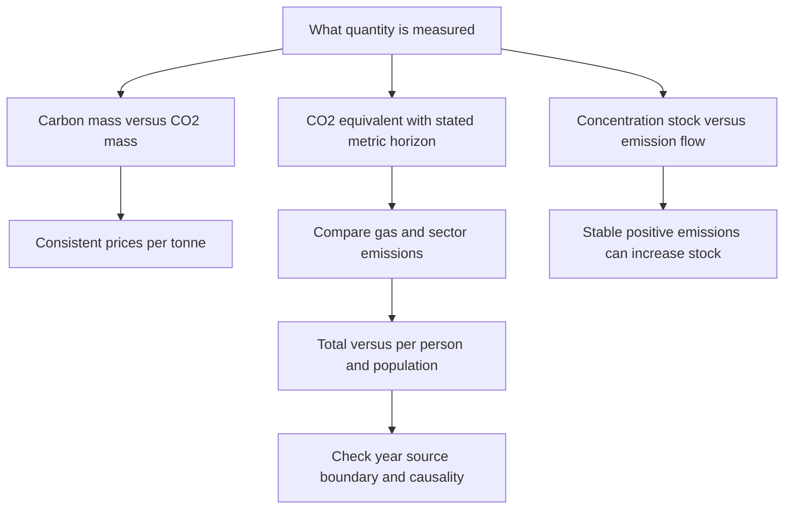

# Convert carbon quantities and audit stocks, flows and emissions charts

## Record metadata

```json
{
  "schema_version": 3,
  "owner": "plan",
  "course_id": "2026_2027/Winter_Semester/Economics_of_Green_Deal",
  "transaction_id": "PLAN-20261018-GREEN-P005-FORMAT",
  "plan_version": "P005",
  "source_version": "V003",
  "ingestion_revision": 3,
  "objective_id": "O018",
  "objective_revision": 1,
  "criterion_version": "O018-C1",
  "status": "ready",
  "lesson_content_contract": "self-contained-lessons-v1",
  "knowledge_components": [
    "mass_price_and_gwp_unit_conversions",
    "stock_flow_forcing_and_concentration_distinctions",
    "population_total_and_chart_boundary_audit"
  ],
  "prerequisite_ids": [
    "O003",
    "O017"
  ],
  "compatible_versions": [
    {
      "objective_revision": 1,
      "criterion_version": "O018-C1",
      "plan_version": "P004",
      "source_version": "V003",
      "ingestion_revision": 3,
      "reason": "P005 changes only six independent-observer formula grouping delimiters in O015 to avoid Markdown interpreting a LaTeX multiplication as a local file link. All academic quantities, assumptions, item/criterion definitions, routes, tools and timing conditions are unchanged; no reassessment or learner result is inferred.",
      "change_class": "formatting_only",
      "requires_reassessment": false
    }
  ],
  "note_locations": [
    {
      "path": "01_Notes/2026_2027/Winter_Semester/Economics_of_Green_Deal/Week_3/Carbon_Units_Stocks_Flows_and_Emissions_Charts.md",
      "heading": "Carbon units, stocks, flows and emissions charts"
    },
    {
      "path": "01_Notes/2026_2027/Winter_Semester/Economics_of_Green_Deal/Week_3/Carbon_Units_Stocks_Flows_and_Emissions_Charts.md",
      "heading": "Carbon mass and the inverse price conversion"
    },
    {
      "path": "01_Notes/2026_2027/Winter_Semester/Economics_of_Green_Deal/Week_3/Carbon_Units_Stocks_Flows_and_Emissions_Charts.md",
      "heading": "GWP and CO2-equivalent emissions"
    },
    {
      "path": "01_Notes/2026_2027/Winter_Semester/Economics_of_Green_Deal/Week_3/Carbon_Units_Stocks_Flows_and_Emissions_Charts.md",
      "heading": "Trace-gas concentration and AGGI"
    },
    {
      "path": "01_Notes/2026_2027/Winter_Semester/Economics_of_Green_Deal/Week_3/Carbon_Units_Stocks_Flows_and_Emissions_Charts.md",
      "heading": "Why a stable flow can increase an atmospheric stock"
    },
    {
      "path": "01_Notes/2026_2027/Winter_Semester/Economics_of_Green_Deal/Week_3/Carbon_Units_Stocks_Flows_and_Emissions_Charts.md",
      "heading": "Sector quantities: gas and denominator first"
    },
    {
      "path": "01_Notes/2026_2027/Winter_Semester/Economics_of_Green_Deal/Week_3/Carbon_Units_Stocks_Flows_and_Emissions_Charts.md",
      "heading": "Per person, population and totals"
    }
  ],
  "acquisition_rule": {
    "distinct_independent_passes": 2,
    "required_item_roles": [
      "full_capability_check",
      "full_capability_check"
    ],
    "allowed_routes": [
      [
        "O018-I1",
        "O018-I2"
      ],
      [
        "O018-I1",
        "O018-D1"
      ],
      [
        "O018-I1",
        "O018-D2"
      ],
      [
        "O018-I2",
        "O018-D1"
      ],
      [
        "O018-I2",
        "O018-D2"
      ],
      [
        "O018-D1",
        "O018-D2"
      ]
    ]
  },
  "delayed_rule": {
    "minimum_elapsed_hours": 24,
    "fresh_item": true,
    "independent_required": true
  },
  "review_topic": "Convert carbon quantities and audit stocks, flows and emissions charts",
  "review_instruction": "Begin a closed-note review with teach for O018; request an unused prepared delayed item before recap."
}
```

## Outcome and conditions

Apply carbon/CO2price and mass conversions, stated historical GWPweights, stock-flow accounting and population/chart boundaries; retain voluntary-reading status. All essential components listed in metadata are required. Hypothetical assessment values instantiate the checked equations; they are not historical observations or observed outcomes. Independent checks are closed-note and without hints, solution access, external retrieval or other assistance; a basic arithmetic calculator is allowed. Teach establishes and records actual help/exposure conditions before claiming independence.

## Prerequisites and checks

- [O003 outcome and repair route](../lessons/O003.md#outcome-and-conditions): compatible rate/stock boundaries are prerequisites for interpreting net atmospheric additions.
- [O017 outcome and repair route](../lessons/O017.md#outcome-and-conditions): concentration/averaging distinctions prevent emissions charts being mistaken for atmospheric stock observations.

O018-P1, item_version 1, prerequisite_diagnostic. **Prompt:** Does a renewable label prove harvest is sustainable without comparing same-interval growth? Is ppm concentration automatically a tonnes-per-year flow?

**Complete key and rubric:** No to both: harvest and yield need a comparable interval and net balance; ppm is an atmospheric fraction/stock measure, not an emissions flow. Require both; repair O003 capacity/rate comparison and O017 concentration definitions. Pass requires every requested reason and result; partial for an omitted reason or unresolved isolated arithmetic slip; fail for the conflicting mechanism. This diagnostic never counts as acquisition. Current or explicitly compatible committed independent prerequisite evidence may permit skipping its check; familiarity alone cannot. Use the cited complete prerequisite lesson or the named included foundation, then the worked example, after a partial/failing entry check.

## Teaching order and rationale

1. Use the diagnostic once to establish the necessary conceptual or algebraic foundation.
2. Present the complete checked-note explanation below, preserving variables, dates, assumptions and source qualifications. Follow one reasoning chain at a time so every intermediate step is visible.
3. Work W1 fully, asking the learner to explain why each step follows.
4. Use S1 as completion practice: show the setup and first identity, hide the final algebra/numbers and interpretation. After an explanation of the missing steps, withdraw support.
5. Present unused I1/I2 full checks with hidden solutions; use correction/repair after scoring the original answer. An unused D form can replace an exposed I only through a listed route.
6. On a later eligible occasion, begin an unused D item before recap. A numeric variant establishes bounded same-method performance, not general transfer.

## Motivation, intuition, and definitions

Apply carbon/CO2price and mass conversions, stated historical GWPweights, stock-flow accounting and population/chart boundaries; retain voluntary-reading status. Establish the definitions, assumptions and relevant comparisons before simplifying an equation. The complete reused passages establish every academic claim, notation choice and qualification assessed here; necessary prerequisites use the complete lessons above.

## Explanation steps

Origin: reused complete checked passage [[01_Notes/2026_2027/Winter_Semester/Economics_of_Green_Deal/Week_3/Carbon_Units_Stocks_Flows_and_Emissions_Charts.md#Carbon units, stocks, flows and emissions charts]]; fingerprint `53486825eda1979d271237a20403c33c1e0ba9e54a5c9ef0191ae8468ecb2b9d`. Heading depth alone is adapted.

### Carbon units, stocks, flows and emissions charts

Which quantities can be compared when a chart says carbon, CO2, CO2-equivalent, concentration or per person? The optional-reading section supplies unit conversions and charts. Reading their units and boundaries is a foundation for both climate-policy comparisons and monetary costs per tonne. These pages are included because they are inside the selected supplied document, while retaining their “Voluntary readings” status. [[00_Materials/2026_2027/Winter_Semester/Economics_of_Green_Deal/Week_3/02_AQImp-ClimateChange.pdf#page=46|02_AQImp-ClimateChange.pdf, physical PDF p. 46–58]]



The map follows pp. 47–58 and uses p. 26's GWP definition to separate mass conversion from warming equivalence. [[00_Materials/2026_2027/Winter_Semester/Economics_of_Green_Deal/Week_3/02_AQImp-ClimateChange.pdf#page=26|02_AQImp-ClimateChange.pdf, physical PDF p. 26, 47–58]]

#### Carbon mass and the inverse price conversion

A tonne of carbon (t C) measures carbon atoms; a tonne of CO2 measures the whole molecule. Using source atomic masses 12 for C and 16 for O, molecular mass is $12+2(16)=44$. Therefore

$$1\ \mathrm{tCO_2}=\frac{12}{44}\ \mathrm{tC}\approx0.2727\ \mathrm{tC},\qquad
1\ \mathrm{tC}=\frac{44}{12}\ \mathrm{tCO_2}\approx3.667\ \mathrm{tCO_2}.$$

For the **same total payment**, multiplying mass by $44/12$ requires dividing price per mass by $44/12$. Thus

$$100\ \$/\mathrm{tC}\times\frac{12}{44}=27.27\ \$/\mathrm{tCO_2},\qquad
100\ \$/\mathrm{tCO_2}\times\frac{44}{12}=366.67\ \$/\mathrm{tC}.$$

Confusing quantity conversion with price conversion reverses the comparison. Neither operation is a GWP conversion for methane or other gases. [[00_Materials/2026_2027/Winter_Semester/Economics_of_Green_Deal/Week_3/02_AQImp-ClimateChange.pdf#page=48|02_AQImp-ClimateChange.pdf, physical PDF p. 48]]

#### GWP and CO2-equivalent emissions

Global warming potential (GWP) compares the time-integrated radiative effect of a pulse mass of gas with an equal mass of CO2 over a stated horizon; CO2's value is one by definition. For a chosen metric, horizon and assessment,

$$E_{CO_2e}=\sum_g m_g GWP_g,$$

where $m_g$ is emitted mass of gas $g$. This is **agent-expanded notation** for the source's examples, not a new emissions estimate. A million tonnes of CH4 at GWP100=25 becomes 25 million tonnes CO2e; a million tonnes of N2O at 298 becomes 298 million tonnes CO2e. [[00_Materials/2026_2027/Winter_Semester/Economics_of_Green_Deal/Week_3/02_AQImp-ClimateChange.pdf#page=25|02_AQImp-ClimateChange.pdf, physical PDF p. 25–26, 53]]

The p. 26 table explicitly identifies **IPCC AR4 (2007)** values; retain that vintage. Its complete entries are:

| Gas | Lifetime, years | GWP20 | GWP100 | GWP500 |
|---|---:|---:|---:|---:|
| CH4 | 12 | 72 | 25 | 7.6 |
| N2O | 114 | 289 | 298 | 153 |
| HFC-23 | 270 | 12000 | 14800 | 12200 |
| HFC-134a | 14 | 3830 | 1430 | 425 |
| SF6 | 3200 | 16300 | 22800 | 32600 |

These are the supplied historical values, not current universal constants or evidence that later charts use exactly the same assessment. A CO2e label needs its horizon and metric convention for exact comparison. [[00_Materials/2026_2027/Winter_Semester/Economics_of_Green_Deal/Week_3/02_AQImp-ClimateChange.pdf#page=26|02_AQImp-ClimateChange.pdf, physical PDF p. 26]]

#### Trace-gas concentration and AGGI

Physical p. 47 uses ppm for CO2, ppb for CH4/N2O and ppt for halocarbons. Each panel has its own scale. The historical plots show rising CO2, CH4 and N2O, peaking/declining CFC-11/CFC-12, and rising HCFC-22/HFC-134a over their displayed period ending around 2020. Heights across separate axes are not direct abundance comparisons. [[00_Materials/2026_2027/Winter_Semester/Economics_of_Green_Deal/Week_3/02_AQImp-ClimateChange.pdf#page=47|02_AQImp-ClimateChange.pdf, physical PDF p. 47]]

Physical p. 49 contrasts CO2-alone concentration with a **CO2-equivalent mixing ratio** obtained by matching forcing from long-lived gases, and a separate AGGI right axis. This equivalent concentration is not a sum of GWP-weighted emission tonnes. The slide does not explain AGGI's baseline. **Supplementary definition:** NOAA defines AGGI as long-lived-gas effective radiative forcing relative to its 1990 value, making 1990 equal one. It is a forcing ratio, not an emissions flow or forecast. [NOAA AGGI, Introduction](https://gml.noaa.gov/aggi/aggi.html). [[00_Materials/2026_2027/Winter_Semester/Economics_of_Green_Deal/Week_3/02_AQImp-ClimateChange.pdf#page=49|02_AQImp-ClimateChange.pdf, physical PDF p. 49]]

#### Why a stable flow can increase an atmospheric stock

Concentration measures an atmospheric stock; emissions add mass per unit time and sinks remove it. A simple **agent synthesis** of this accounting is

$$A_{t+1}-A_t=E_t-R_t,$$

where $A_t$ is atmospheric mass, $E_t$ emissions and $R_t$ net removal over the same interval, all in compatible mass units. A constant positive emission flow still increases $A$ whenever $E_t>R_t$. Stabilizing emissions differs from bringing **net additions** to zero. Connecting mass to ppm requires an atmospheric-mass conversion, which the source does not supply. [[00_Materials/2026_2027/Winter_Semester/Economics_of_Green_Deal/Week_3/02_AQImp-ClimateChange.pdf#page=50|02_AQImp-ClimateChange.pdf, physical PDF p. 50–51]]

Physical p. 50 uses separate axes for concentration (ppm) and annual emissions (gigatonnes). Its 1751–2022 graph and caption's historical increase from about 5 Gt/year in the mid twentieth century to over 35 Gt/year illustrate different quantities, not a fitted causal coefficient. Physical p. 51 draws a flat emission line and rising concentration curve on uncalibrated x1–x20 axes with no dates, units or source. Its curved stock path does not follow from constant **net** additions alone, which would give a linear stock rise. Use it for stock-flow intuition, not a quantitative carbon-cycle law. NOAA's atmospheric-CO2 article independently explains that emissions exceeding sinks raise atmospheric abundance: [“Fossil fuels overwhelm Earth's natural carbon cycle”](https://content-drupal.climate.gov/news-features/understanding-climate/climate-change-atmospheric-carbon-dioxide). [[00_Materials/2026_2027/Winter_Semester/Economics_of_Green_Deal/Week_3/02_AQImp-ClimateChange.pdf#page=50|02_AQImp-ClimateChange.pdf, physical PDF p. 50–51]]

#### Sector quantities: gas and denominator first

Physical p. 52 is **2020 world per-capita CO2**, with these displayed sector values in tonnes per person for the reported year: electricity/heat 1.93, transport 0.91, manufacturing/construction 0.79, buildings 0.35, industry 0.21, land-use/forestry 0.15, aviation/shipping 0.12 and fugitive emissions 0.03. It credits Climate Watch (2023) and population sources (2023). It is not an all-gas CO2e total, and no finer time aggregation is supplied. [[00_Materials/2026_2027/Winter_Semester/Economics_of_Green_Deal/Week_3/02_AQImp-ClimateChange.pdf#page=52|02_AQImp-ClimateChange.pdf, physical PDF p. 52]]

Physical p. 53 instead shows CH4 and N2O in **CO2e**, roughly 1990–2021, with a GWP100 footnote. Agriculture is largest in each panel; methane also has substantial fugitive and waste emissions. The other methane series are land-use/forestry, other fuel combustion and industry; the other N2O series are industry, waste, land-use/forestry, fugitive and other fuel combustion. The panels have different scales, so their line heights do not directly compare gas mass. [[00_Materials/2026_2027/Winter_Semester/Economics_of_Green_Deal/Week_3/02_AQImp-ClimateChange.pdf#page=53|02_AQImp-ClimateChange.pdf, physical PDF p. 53]]

Physical p. 54 combines all-gas CO2e by sector: electricity/heat, transport, manufacturing/construction, agriculture, fugitive emissions, industry, buildings, waste, land-use/forestry, aviation/shipping and other fuel combustion. Its source is Climate Watch (2023). End-period downturns in some historical series do not establish a permanent future trend. Exact comparison with the AR4 table requires checking the chart dataset's assessment convention, which the slide does not establish. [[00_Materials/2026_2027/Winter_Semester/Economics_of_Green_Deal/Week_3/02_AQImp-ClimateChange.pdf#page=54|02_AQImp-ClimateChange.pdf, physical PDF p. 54]]

![[01_Notes/2026_2027/Winter_Semester/Economics_of_Green_Deal/assets/Week_3_Emissions_By_Sector.png]]

The complete graphic preserves each sector and its 100-year CO2e qualification. [[00_Materials/2026_2027/Winter_Semester/Economics_of_Green_Deal/Week_3/02_AQImp-ClimateChange.pdf#page=54|02_AQImp-ClimateChange.pdf, physical PDF p. 54]]

#### Per person, population and totals

Physical p. 55 encodes per-person emissions by rectangle **height**, population by **width**, and total emissions by **area**. A populous country can have a large area but lower per-person emissions than a small country. Labels emphasize countries with large totals rather than a complete per-capita ranking. Its title says CO2 but the vertical axis says tCO2e, so the supplied graphic leaves the gas/metric boundary ambiguous; do not silently treat the two labels as interchangeable. The illustration lacks a clear data-year citation and is not a current league table. [[00_Materials/2026_2027/Winter_Semester/Economics_of_Green_Deal/Week_3/02_AQImp-ClimateChange.pdf#page=55|02_AQImp-ClimateChange.pdf, physical PDF p. 55]]

The p. 56 map reports 2020 total GHG CO2e per person including land-use/forestry, credits Climate Watch (2023), and has a negative legend range and hatched “no data.” The p. 57 map reports 2021 CO2/CH4/N2O in GWP100 CO2e including land-use, credits Jones et al. (2023), and notes that land-use emissions can be negative. Different years, sources and gas/boundary labels mean their visual differences cannot be read as one harmonized annual change. Negative net land-use emissions and missing data are different categories: hatching is not zero emissions. [[00_Materials/2026_2027/Winter_Semester/Economics_of_Green_Deal/Week_3/02_AQImp-ClimateChange.pdf#page=56|02_AQImp-ClimateChange.pdf, physical PDF p. 56–57]]

Physical p. 58 compares 2018 CO2 per person with GDP per person in 2011 international dollars adjusted for purchasing power and inflation. Its GDP axis is **logarithmic** ($1000, $2000, $5000, $10000, $20000, $50000), so equal plot distances are not equal dollar increments. Emissions cover **fossil fuels and cement**, explicitly excluding land-use change. The positive cross-country association has considerable variation and does not identify a causal effect of income. Sources are the Global Carbon Project and Maddison Project Database 2020 (Bolt and van Zanden, 2020). [[00_Materials/2026_2027/Winter_Semester/Economics_of_Green_Deal/Week_3/02_AQImp-ClimateChange.pdf#page=58|02_AQImp-ClimateChange.pdf, physical PDF p. 58]]

Unit consistency, stock-flow accounting and total-versus-per-person denominators are core foundations because they unlock these comparisons. Historical charts remain context; none is relabeled as current or used as an unqualified causal estimate. [[00_Materials/2026_2027/Winter_Semester/Economics_of_Green_Deal/Week_3/02_AQImp-ClimateChange.pdf#page=47|02_AQImp-ClimateChange.pdf, physical PDF p. 47–58]]


## Worked example

O018-W1, item_version 1, worked_example. **Prompt:** Use a declared hypothetical inventory with $12\ \mathrm{tC}$ and price $p_C=100\ \mathrm{currency\ units/tC}$. Convert mass and the price for the same total payment into tCO2 and price/tCO2. For separate emissions of 1 t CH4 and 0.5 t N2O, use the explicitly historical AR4 GWP100 factors 25 and 298 to compute tCO2e and distinguish it from CO2-equivalent atmospheric concentration/AGGI. With atmospheric mass $A_t=100$, emissions $10$ and removals $6$ in common mass units over one interval, compute $A_{t+1}$ and explain stable-flow versus stable-stock claims and missing ppm conversion. Country A has 5 t CO2e/person and population 2 million, countryB 10 t CO2e/person and 0.5 million: compute totals and interpret rectangle height/width/area. State the necessary chart year/gas/horizon/boundary/log-axis/missing-data cautions and optional-reading status.

**Complete solution and essential rubric:** Mass scales as $m_{CO_2}=m_C(44/12)=44.00000000\ \mathrm{tCO_2}$, while the equal-payment unit price scales inversely, $p_{CO_2}=p_C(12/44)=27.27272727$ currency units/tCO2. Both products give the same total $1200.00000000$ currency units. This molecular-mass conversion is not methane GWP. Historical AR4 GWP100 gives $E_{CO_2e}=1(25)+0.5(298)=174.00000000$ t CO2e; horizon/assessment must be declared, not treated as current universal constants. A forcing-equivalent atmospheric mixing ratio is another quantity; AGGI is long-lived-gas forcing relative to 1990 = 1, not emitted tonnes. Stock accounting gives $A_{t+1}=A_t+E_t-R_t=104.00000000$; a stable positive gross flow grows the stock whenever emissions exceed removals. Constant net additions imply a linear stock increase, not the source’s uncalibrated curved law; mass-to-ppm conversion is absent. Country totals are $10.00000000$ and $5.00000000$ million tonnes: height is per person, width population, area total; a higher per-person value need not imply larger total. Exact comparisons require common year/source/gas boundaries (CO2 versus all-gas CO2e, land-use inclusion), metric horizon and vintage. The source title/axis CO2/CO2e conflict is unresolved; negative net land-use is not missing/hatched data. A logarithmic PPP income axis has unequal dollar increments and cross-country association is not causation. Pages 47–58 remain voluntary supporting material within supplied scope, not a claimed mandatory exam list. All requested calculations, derivations and qualifications are essential; the component map above applies to every full form.

## Practice with fading assistance

O018-S1, item_version 1, supported_completion. **Prompt:** Use a declared hypothetical inventory with $6\ \mathrm{tC}$ and price $p_C=120\ \mathrm{currency\ units/tC}$. Convert mass and the price for the same total payment into tCO2 and price/tCO2. For separate emissions of 2 t CH4 and 0.25 t N2O, use the explicitly historical AR4 GWP100 factors 25 and 298 to compute tCO2e and distinguish it from CO2-equivalent atmospheric concentration/AGGI. With atmospheric mass $A_t=200$, emissions $8$ and removals $5$ in common mass units over one interval, compute $A_{t+1}$ and explain stable-flow versus stable-stock claims and missing ppm conversion. Country A has 4 t CO2e/person and population 3 million, countryB 8 t CO2e/person and 1 million: compute totals and interpret rectangle height/width/area. State the necessary chart year/gas/horizon/boundary/log-axis/missing-data cautions and optional-reading status.

**Complete solution and essential rubric:** Mass scales as $m_{CO_2}=m_C(44/12)=22.00000000\ \mathrm{tCO_2}$, while the equal-payment unit price scales inversely, $p_{CO_2}=p_C(12/44)=32.72727273$ currency units/tCO2. Both products give the same total $720.00000000$ currency units. This molecular-mass conversion is not methane GWP. Historical AR4 GWP100 gives $E_{CO_2e}=2(25)+0.25(298)=124.50000000$ t CO2e; horizon/assessment must be declared, not treated as current universal constants. A forcing-equivalent atmospheric mixing ratio is another quantity; AGGI is long-lived-gas forcing relative to 1990 = 1, not emitted tonnes. Stock accounting gives $A_{t+1}=A_t+E_t-R_t=203.00000000$; a stable positive gross flow grows the stock whenever emissions exceed removals. Constant net additions imply a linear stock increase, not the source’s uncalibrated curved law; mass-to-ppm conversion is absent. Country totals are $12.00000000$ and $8.00000000$ million tonnes: height is per person, width population, area total; a higher per-person value need not imply larger total. Exact comparisons require common year/source/gas boundaries (CO2 versus all-gas CO2e, land-use inclusion), metric horizon and vintage. The source title/axis CO2/CO2e conflict is unresolved; negative net land-use is not missing/hatched data. A logarithmic PPP income axis has unequal dollar increments and cross-country association is not causation. Pages 47–58 remain voluntary supporting material within supplied scope, not a claimed mandatory exam list. All requested calculations, derivations and qualifications are essential; the component map above applies to every full form.

Allowed support is the first stated identity only; hide the remaining key while the learner completes it. Supported performance is practice, not an independent result.

## Rubric and independence

Required components: mass_price_and_gwp_unit_conversions, stock_flow_forcing_and_concentration_distinctions, population_total_and_chart_boundary_audit. Each full prompt/key below elicits every component; all are necessary for a pass on every permitted pair. Accept algebraically equivalent expressions and clearly defined opposite cash-flow signs with correct interpretation. A pass requires all requested outputs/reasons, correct units/assumptions and no critical conceptual error. Partial means a missing component or an unresolved isolated arithmetic slip with an otherwise valid method; independent correction is required for a pass. Fail means a critical mechanism/condition is wrong. Unscorable means a response or its help/exposure conditions cannot be established. Unknown help conditions are never independent evidence.

Critical errors: Price scaled in same direction as mass for equal payment; tonnesCO2econfused with forcing-equivalent concentration; stable gross emission flow equated with stable stock; missing data treated as zero; mixed chart boundaries treated as causal annual change.

Acquisition requires two distinct unused unassisted full checks selected from the six exact metadata routes. Every I/D form covers all components; W1, S1, the prerequisite and C1 are forbidden substitutes. A D form used for acquisition cannot later be counted again as delayed success. No teach-generated item may replace a named full check; additional verified explanation/practice is allowed under the unchanged method and may not fabricate evidence. If fewer than two fresh forms remain for acquisition, return a plan_issue for an additional prepared bank.

| Component | I1 | I2 | D1 | D2 |
|---|---|---|---|---|
| mass_price_and_gwp_unit_conversions | required | required | required | required |
| stock_flow_forcing_and_concentration_distinctions | required | required | required | required |
| population_total_and_chart_boundary_audit | required | required | required | required |

## Misconceptions and correction

An observed omitted term/sign is tentative until the learner explains it; compare the reasoning with the critical errors above. Score the original response before providing help. Route a conceptual failure to the relevant included derivation and prerequisite, then use an unused full form.

O018-C1, item_version 1, narrow_correction. **Prompt:** Mass in t CO2 is 44/12 times mass in t C. To preserve the same payment, does price per t CO2 also multiply by 44/12? **Key/rubric:** No. It divides by 44/12, or multiplies by 12/44; quantity times unit price must remain the same. This is molecular mass accounting, not another gas’s GWP. Pass requires all keyed reasoning; partial for a missing part; fail for the conflicting mechanism. This repairs a common inference only; it cannot substitute for a full numerical/capability check.

Give at most two hints (first identify the date/unit, second point to the included identity); after ineffective hints show the relevant worked step. After two unsuccessful independent attempts stop repeated quizzing, revisit the explanation/prerequisite and preserve the unresolved status.

## Immediate and delayed checks

### O018-I1

O018-I1, item_version 1, full_capability_check. **Prompt:** Use a declared hypothetical inventory with $9\ \mathrm{tC}$ and price $p_C=80\ \mathrm{currency\ units/tC}$. Convert mass and the price for the same total payment into tCO2 and price/tCO2. For separate emissions of 1.5 t CH4 and 0.2 t N2O, use the explicitly historical AR4 GWP100 factors 25 and 298 to compute tCO2e and distinguish it from CO2-equivalent atmospheric concentration/AGGI. With atmospheric mass $A_t=150$, emissions $12$ and removals $7$ in common mass units over one interval, compute $A_{t+1}$ and explain stable-flow versus stable-stock claims and missing ppm conversion. Country A has 6 t CO2e/person and population 2.5 million, countryB 12 t CO2e/person and 0.7 million: compute totals and interpret rectangle height/width/area. State the necessary chart year/gas/horizon/boundary/log-axis/missing-data cautions and optional-reading status.

**Complete solution and essential rubric:** Mass scales as $m_{CO_2}=m_C(44/12)=33.00000000\ \mathrm{tCO_2}$, while the equal-payment unit price scales inversely, $p_{CO_2}=p_C(12/44)=21.81818182$ currency units/tCO2. Both products give the same total $720.00000000$ currency units. This molecular-mass conversion is not methane GWP. Historical AR4 GWP100 gives $E_{CO_2e}=1.5(25)+0.2(298)=97.10000000$ t CO2e; horizon/assessment must be declared, not treated as current universal constants. A forcing-equivalent atmospheric mixing ratio is another quantity; AGGI is long-lived-gas forcing relative to 1990 = 1, not emitted tonnes. Stock accounting gives $A_{t+1}=A_t+E_t-R_t=155.00000000$; a stable positive gross flow grows the stock whenever emissions exceed removals. Constant net additions imply a linear stock increase, not the source’s uncalibrated curved law; mass-to-ppm conversion is absent. Country totals are $15.00000000$ and $8.40000000$ million tonnes: height is per person, width population, area total; a higher per-person value need not imply larger total. Exact comparisons require common year/source/gas boundaries (CO2 versus all-gas CO2e, land-use inclusion), metric horizon and vintage. The source title/axis CO2/CO2e conflict is unresolved; negative net land-use is not missing/hatched data. A logarithmic PPP income axis has unequal dollar increments and cross-country association is not causation. Pages 47–58 remain voluntary supporting material within supplied scope, not a claimed mandatory exam list. All requested calculations, derivations and qualifications are essential; the component map above applies to every full form.

I1/I2 are immediate checks; D1/D2 are distinct parallel variants reserved where possible for delayed checks. A delayed success requires an unused form before recap, no help/solution access, and at least 24 actual elapsed hours after acquisition and the most recent relevant teaching/solution exposure. Record intervening exposure. A calendar-date change alone is insufficient; an early D attempt is immediate evidence only.

### O018-I2

O018-I2, item_version 1, full_capability_check. **Prompt:** Use a declared hypothetical inventory with $15\ \mathrm{tC}$ and price $p_C=140\ \mathrm{currency\ units/tC}$. Convert mass and the price for the same total payment into tCO2 and price/tCO2. For separate emissions of 0.8 t CH4 and 0.4 t N2O, use the explicitly historical AR4 GWP100 factors 25 and 298 to compute tCO2e and distinguish it from CO2-equivalent atmospheric concentration/AGGI. With atmospheric mass $A_t=250$, emissions $9$ and removals $4$ in common mass units over one interval, compute $A_{t+1}$ and explain stable-flow versus stable-stock claims and missing ppm conversion. Country A has 3 t CO2e/person and population 5 million, countryB 9 t CO2e/person and 1 million: compute totals and interpret rectangle height/width/area. State the necessary chart year/gas/horizon/boundary/log-axis/missing-data cautions and optional-reading status.

**Complete solution and essential rubric:** Mass scales as $m_{CO_2}=m_C(44/12)=55.00000000\ \mathrm{tCO_2}$, while the equal-payment unit price scales inversely, $p_{CO_2}=p_C(12/44)=38.18181818$ currency units/tCO2. Both products give the same total $2100.00000000$ currency units. This molecular-mass conversion is not methane GWP. Historical AR4 GWP100 gives $E_{CO_2e}=0.8(25)+0.4(298)=139.20000000$ t CO2e; horizon/assessment must be declared, not treated as current universal constants. A forcing-equivalent atmospheric mixing ratio is another quantity; AGGI is long-lived-gas forcing relative to 1990 = 1, not emitted tonnes. Stock accounting gives $A_{t+1}=A_t+E_t-R_t=255.00000000$; a stable positive gross flow grows the stock whenever emissions exceed removals. Constant net additions imply a linear stock increase, not the source’s uncalibrated curved law; mass-to-ppm conversion is absent. Country totals are $15.00000000$ and $9.00000000$ million tonnes: height is per person, width population, area total; a higher per-person value need not imply larger total. Exact comparisons require common year/source/gas boundaries (CO2 versus all-gas CO2e, land-use inclusion), metric horizon and vintage. The source title/axis CO2/CO2e conflict is unresolved; negative net land-use is not missing/hatched data. A logarithmic PPP income axis has unequal dollar increments and cross-country association is not causation. Pages 47–58 remain voluntary supporting material within supplied scope, not a claimed mandatory exam list. All requested calculations, derivations and qualifications are essential; the component map above applies to every full form.

### O018-D1

O018-D1, item_version 1, full_capability_check. **Prompt:** Use a declared hypothetical inventory with $3\ \mathrm{tC}$ and price $p_C=160\ \mathrm{currency\ units/tC}$. Convert mass and the price for the same total payment into tCO2 and price/tCO2. For separate emissions of 2.5 t CH4 and 0.1 t N2O, use the explicitly historical AR4 GWP100 factors 25 and 298 to compute tCO2e and distinguish it from CO2-equivalent atmospheric concentration/AGGI. With atmospheric mass $A_t=180$, emissions $11$ and removals $8$ in common mass units over one interval, compute $A_{t+1}$ and explain stable-flow versus stable-stock claims and missing ppm conversion. Country A has 7 t CO2e/person and population 1.5 million, countryB 14 t CO2e/person and 0.4 million: compute totals and interpret rectangle height/width/area. State the necessary chart year/gas/horizon/boundary/log-axis/missing-data cautions and optional-reading status.

**Complete solution and essential rubric:** Mass scales as $m_{CO_2}=m_C(44/12)=11.00000000\ \mathrm{tCO_2}$, while the equal-payment unit price scales inversely, $p_{CO_2}=p_C(12/44)=43.63636364$ currency units/tCO2. Both products give the same total $480.00000000$ currency units. This molecular-mass conversion is not methane GWP. Historical AR4 GWP100 gives $E_{CO_2e}=2.5(25)+0.1(298)=92.30000000$ t CO2e; horizon/assessment must be declared, not treated as current universal constants. A forcing-equivalent atmospheric mixing ratio is another quantity; AGGI is long-lived-gas forcing relative to 1990 = 1, not emitted tonnes. Stock accounting gives $A_{t+1}=A_t+E_t-R_t=183.00000000$; a stable positive gross flow grows the stock whenever emissions exceed removals. Constant net additions imply a linear stock increase, not the source’s uncalibrated curved law; mass-to-ppm conversion is absent. Country totals are $10.50000000$ and $5.60000000$ million tonnes: height is per person, width population, area total; a higher per-person value need not imply larger total. Exact comparisons require common year/source/gas boundaries (CO2 versus all-gas CO2e, land-use inclusion), metric horizon and vintage. The source title/axis CO2/CO2e conflict is unresolved; negative net land-use is not missing/hatched data. A logarithmic PPP income axis has unequal dollar increments and cross-country association is not causation. Pages 47–58 remain voluntary supporting material within supplied scope, not a claimed mandatory exam list. All requested calculations, derivations and qualifications are essential; the component map above applies to every full form.

### O018-D2

O018-D2, item_version 1, full_capability_check. **Prompt:** Use a declared hypothetical inventory with $18\ \mathrm{tC}$ and price $p_C=60\ \mathrm{currency\ units/tC}$. Convert mass and the price for the same total payment into tCO2 and price/tCO2. For separate emissions of 1.2 t CH4 and 0.3 t N2O, use the explicitly historical AR4 GWP100 factors 25 and 298 to compute tCO2e and distinguish it from CO2-equivalent atmospheric concentration/AGGI. With atmospheric mass $A_t=300$, emissions $14$ and removals $9$ in common mass units over one interval, compute $A_{t+1}$ and explain stable-flow versus stable-stock claims and missing ppm conversion. Country A has 4.5 t CO2e/person and population 4 million, countryB 9 t CO2e/person and 1.2 million: compute totals and interpret rectangle height/width/area. State the necessary chart year/gas/horizon/boundary/log-axis/missing-data cautions and optional-reading status.

**Complete solution and essential rubric:** Mass scales as $m_{CO_2}=m_C(44/12)=66.00000000\ \mathrm{tCO_2}$, while the equal-payment unit price scales inversely, $p_{CO_2}=p_C(12/44)=16.36363636$ currency units/tCO2. Both products give the same total $1080.00000000$ currency units. This molecular-mass conversion is not methane GWP. Historical AR4 GWP100 gives $E_{CO_2e}=1.2(25)+0.3(298)=119.40000000$ t CO2e; horizon/assessment must be declared, not treated as current universal constants. A forcing-equivalent atmospheric mixing ratio is another quantity; AGGI is long-lived-gas forcing relative to 1990 = 1, not emitted tonnes. Stock accounting gives $A_{t+1}=A_t+E_t-R_t=305.00000000$; a stable positive gross flow grows the stock whenever emissions exceed removals. Constant net additions imply a linear stock increase, not the source’s uncalibrated curved law; mass-to-ppm conversion is absent. Country totals are $18.00000000$ and $10.80000000$ million tonnes: height is per person, width population, area total; a higher per-person value need not imply larger total. Exact comparisons require common year/source/gas boundaries (CO2 versus all-gas CO2e, land-use inclusion), metric horizon and vintage. The source title/axis CO2/CO2e conflict is unresolved; negative net land-use is not missing/hatched data. A logarithmic PPP income axis has unequal dollar increments and cross-country association is not causation. Pages 47–58 remain voluntary supporting material within supplied scope, not a claimed mandatory exam list. All requested calculations, derivations and qualifications are essential; the component map above applies to every full form.

## Advance, revisit, pause, and escalate

Advance only after teach commits two qualifying independent full passes under a listed route. Keep acquisition and each later delayed observation separate. A source conflict blocks the affected claim and returns to ingest with the exact note heading. Missing criteria, a new method, unsupported alternative or exhausted fresh bank returns to plan with 2026_2027/Winter_Semester/Economics_of_Green_Deal, O018, revision1/O018-C1, P005/V003/ingestion3 and item ID. Equivalent valid methods meeting the frozen criterion may receive credit after verification; no criterion is changed to fit an answer. Closing a session preserves the actual stopping point without claiming completion.

## Content provenance and generation boundaries

Explanations, figures and qualifications above reuse complete checked-note sections with exact origin/fingerprint; heading depth alone is adapted. Main exercises and worked arithmetic are plan-created hypothetical instantiations of those displayed identities. No additional academic claims or external course scope are introduced. Preserve the note conventions and explicit qualifications; checked references reused from notes are not an independent raw-source audit by plan. New numerical practice can use the same method only after its complete solution and unchanged components are checked before display; it cannot replace this lesson’s named evidence forms. Prerequisites route to the complete prepared lessons above.

## Answer-free recall handoff

Topic: Convert carbon quantities and audit stocks, flows and emissions charts. Begin a closed-note review with teach for O018; request an unused prepared delayed item before recap. Exact lesson: [[03_Agents/2026_2027/Winter_Semester/Economics_of_Green_Deal/lessons/O018.md#Immediate and delayed checks]]. Teach supplies actual committed evidence and timestamps; recall alone dates reviews. No learner outcome or due date is created by this curriculum.
