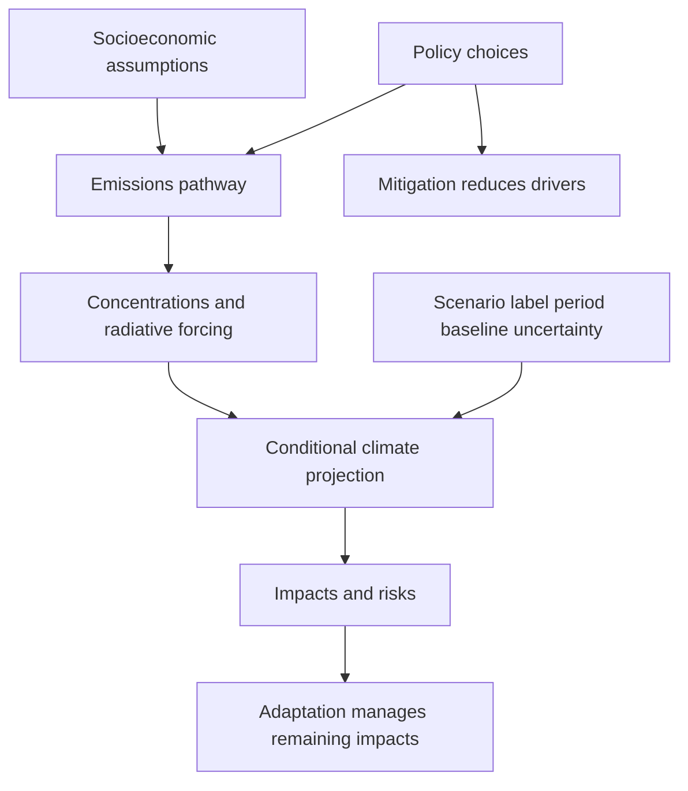

# Interpret conditional climate scenarios, policy chronology and adaptation

## Record metadata

```json
{
  "schema_version": 3,
  "owner": "plan",
  "course_id": "2026_2027/Winter_Semester/Economics_of_Green_Deal",
  "transaction_id": "PLAN-20261018-GREEN-P005-FORMAT",
  "plan_version": "P005",
  "source_version": "V003",
  "ingestion_revision": 3,
  "objective_id": "O019",
  "objective_revision": 1,
  "criterion_version": "O019-C1",
  "status": "ready",
  "lesson_content_contract": "self-contained-lessons-v1",
  "knowledge_components": [
    "scenario_type_forcing_and_concentration",
    "baseline_mean_comparison_and_uncertainty",
    "mitigation_adaptation_and_historical_policy_limits"
  ],
  "prerequisite_ids": [
    "O016",
    "O017",
    "O018"
  ],
  "compatible_versions": [
    {
      "objective_revision": 1,
      "criterion_version": "O019-C1",
      "plan_version": "P004",
      "source_version": "V003",
      "ingestion_revision": 3,
      "reason": "P005 changes only six independent-observer formula grouping delimiters in O015 to avoid Markdown interpreting a LaTeX multiplication as a local file link. All academic quantities, assumptions, item/criterion definitions, routes, tools and timing conditions are unchanged; no reassessment or learner result is inferred.",
      "change_class": "formatting_only",
      "requires_reassessment": false
    }
  ],
  "note_locations": [
    {
      "path": "01_Notes/2026_2027/Winter_Semester/Economics_of_Green_Deal/Week_3/Climate_Scenarios_Policy_and_Adaptation.md",
      "heading": "Climate scenarios, policy and adaptation"
    },
    {
      "path": "01_Notes/2026_2027/Winter_Semester/Economics_of_Green_Deal/Week_3/Climate_Scenarios_Policy_and_Adaptation.md",
      "heading": "SSP assumptions and RCP forcing pathways"
    },
    {
      "path": "01_Notes/2026_2027/Winter_Semester/Economics_of_Green_Deal/Week_3/Climate_Scenarios_Policy_and_Adaptation.md",
      "heading": "The AR5 temperature table needs its reference period"
    },
    {
      "path": "01_Notes/2026_2027/Winter_Semester/Economics_of_Green_Deal/Week_3/Climate_Scenarios_Policy_and_Adaptation.md",
      "heading": "Climate policy: source claims and verified chronology"
    },
    {
      "path": "01_Notes/2026_2027/Winter_Semester/Economics_of_Green_Deal/Week_3/Climate_Scenarios_Policy_and_Adaptation.md",
      "heading": "Mitigation and adaptation solve different parts of the problem"
    }
  ],
  "acquisition_rule": {
    "distinct_independent_passes": 2,
    "required_item_roles": [
      "full_capability_check",
      "full_capability_check"
    ],
    "allowed_routes": [
      [
        "O019-I1",
        "O019-I2"
      ],
      [
        "O019-I1",
        "O019-D1"
      ],
      [
        "O019-I1",
        "O019-D2"
      ],
      [
        "O019-I2",
        "O019-D1"
      ],
      [
        "O019-I2",
        "O019-D2"
      ],
      [
        "O019-D1",
        "O019-D2"
      ]
    ]
  },
  "delayed_rule": {
    "minimum_elapsed_hours": 24,
    "fresh_item": true,
    "independent_required": true
  },
  "review_topic": "Interpret conditional climate scenarios, policy chronology and adaptation",
  "review_instruction": "Begin a closed-note review with teach for O019; request an unused prepared delayed item before recap."
}
```

## Outcome and conditions

Trace assumptions through emissions/forcing to conditional projections, compare matching-baseline source means, and distinguish mitigation/adaptation and bounded historical treaty facts. All essential components listed in metadata are required. Hypothetical assessment values instantiate the checked equations; they are not historical observations or observed outcomes. Independent checks are closed-note and without hints, solution access, external retrieval or other assistance; a basic arithmetic calculator is allowed. Teach establishes and records actual help/exposure conditions before claiming independence.

## Prerequisites and checks

- [O016 outcome and repair route](../lessons/O016.md#outcome-and-conditions): forcing/energy mechanisms connect emissions to climate effects.
- [O017 outcome and repair route](../lessons/O017.md#outcome-and-conditions): dated baselines and uncertainty delimit the temperature comparison.
- [O018 outcome and repair route](../lessons/O018.md#outcome-and-conditions): emission flows, concentration stocks and forcing-equivalent metrics must not be conflated.

O019-P1, item_version 1, prerequisite_diagnostic. **Prompt:** Is forcing a heat flux, concentration a stock fraction and annual emissions a mass flow? Can temperature changes with different reference periods be compared directly without checking the baseline?

**Complete key and rubric:** Yes to the first distinctions; no to direct different-baseline equivalence. Radiation/energy (O016), dated anomalies (O017) and emissions/stock units (O018) are different quantities. Require all; repair those full lessons. Pass requires every requested reason and result; partial for an omitted reason or unresolved isolated arithmetic slip; fail for the conflicting mechanism. This diagnostic never counts as acquisition. Current or explicitly compatible committed independent prerequisite evidence may permit skipping its check; familiarity alone cannot. Use the cited complete prerequisite lesson or the named included foundation, then the worked example, after a partial/failing entry check.

## Teaching order and rationale

1. Use the diagnostic once to establish the necessary conceptual or algebraic foundation.
2. Present the complete checked-note explanation below, preserving variables, dates, assumptions and source qualifications. Follow one reasoning chain at a time so every intermediate step is visible.
3. Work W1 fully, asking the learner to explain why each step follows.
4. Use S1 as completion practice: show the setup and first identity, hide the final algebra/numbers and interpretation. After an explanation of the missing steps, withdraw support.
5. Present unused I1/I2 full checks with hidden solutions; use correction/repair after scoring the original answer. An unused D form can replace an exposed I only through a listed route.
6. On a later eligible occasion, begin an unused D item before recap. A numeric variant establishes bounded same-method performance, not general transfer.

## Motivation, intuition, and definitions

Trace assumptions through emissions/forcing to conditional projections, compare matching-baseline source means, and distinguish mitigation/adaptation and bounded historical treaty facts. Establish the definitions, assumptions and relevant comparisons before simplifying an equation. The complete reused passages establish every academic claim, notation choice and qualification assessed here; necessary prerequisites use the complete lessons above.

## Explanation steps

Origin: reused complete checked passage [[01_Notes/2026_2027/Winter_Semester/Economics_of_Green_Deal/Week_3/Climate_Scenarios_Policy_and_Adaptation.md#Climate scenarios, policy and adaptation]]; fingerprint `dc3f2be26999e63b812767c1b200564516dc4fb9a19243829ec7abf3f0ff1c90`. Heading depth alone is adapted.

### Climate scenarios, policy and adaptation

A climate scenario asks what follows **if** a coherent set of social, technological, emissions and policy conditions occurs. It is not an assigned probability or an unconditional forecast. The lecture uses older RCP projections alongside newer SSP-labelled examples; the two naming systems and their temperature baselines must be distinguished. [[00_Materials/2026_2027/Winter_Semester/Economics_of_Green_Deal/Week_3/02_AQImp-ClimateChange.pdf#page=40|02_AQImp-ClimateChange.pdf, physical PDF p. 40–45]]



This map follows pp. 40–45 and 43's paired emissions/concentration graphic; it explains why the policy discussion needs both mitigation and adaptation. [[00_Materials/2026_2027/Winter_Semester/Economics_of_Green_Deal/Week_3/02_AQImp-ClimateChange.pdf#page=40|02_AQImp-ClimateChange.pdf, physical PDF p. 40–45]]

#### SSP assumptions and RCP forcing pathways

The source presents **SSP2**, “middle of the road,” as its baseline socioeconomic narrative, extending major development trends without a large assumed policy/technology break. That is the lecture's baseline choice, not a universal definition that SSP2 equals one forcing outcome. Shared Socioeconomic Pathways describe demographic, economic and technological narratives; Representative Concentration Pathways describe emissions/concentration/forcing trajectories. [[00_Materials/2026_2027/Winter_Semester/Economics_of_Green_Deal/Week_3/02_AQImp-ClimateChange.pdf#page=41|02_AQImp-ClimateChange.pdf, physical PDF p. 41, 43]]

Radiative forcing measures a change in Earth's energy balance in **W/m²**, as the embedded comments on pp. 41–42 explain. RCP labels 2.6/4.5/6.0/8.5 refer to approximate 2100 forcing levels, with different trajectories toward them. The source associates 2.6/4.5/6.0 with approximately 490/650/850 ppm CO2-equivalent and leaves 8.5 unfinished. These are the slide's older shorthand values, not concentrations of CO2 alone; the exact trajectory and whether a quoted value is a peak or endpoint matter. Its claim that forcing is “declining” should not be read as monotonic decline throughout every RCP. [[00_Materials/2026_2027/Winter_Semester/Economics_of_Green_Deal/Week_3/02_AQImp-ClimateChange.pdf#page=41|02_AQImp-ClimateChange.pdf, physical PDF p. 41]]

There is a source inconsistency: p. 41 calls RCP6.0 “close to SSP2,” whereas p. 42 calls RCP8.5 “close to SSP2.” A socioeconomic family does not uniquely identify a forcing path. **Authoritative clarification:** IPCC AR6 WGI SPM BoxSPM.1 and note 22 define **SSPx-y** as socioeconomic family x plus approximate 2100 forcing y. The supplied p. 43 itself shows SSP2-4.5 as intermediate, alongside SSP1-1.9/SSP1-2.6 and SSP3-7.0/SSP5-8.5. [IPCC AR6 WGI SPM, BoxSPM.1/note22](https://www.ipcc.ch/report/ar6/wg1/chapter/summary-for-policymakers/). Thus neither conflicting “close to” statement is used as a one-to-one mapping. [[00_Materials/2026_2027/Winter_Semester/Economics_of_Green_Deal/Week_3/02_AQImp-ClimateChange.pdf#page=41|02_AQImp-ClimateChange.pdf, physical PDF p. 41–43]]

#### The AR5 temperature table needs its reference period

The supplied p. 42 table reports the following **°C changes relative to 1986–2005**, verified from IPCC 2014 Synthesis Report Table 2.1 (printed p. 60 and its notes). That missing baseline is essential: these are not automatically additional temperatures above the Paris preindustrial reference. Entries are means with the source's likely ranges; scenarios are conditional, and range width is not a probability assigned to the scenario itself. [[00_Materials/2026_2027/Winter_Semester/Economics_of_Green_Deal/Week_3/02_AQImp-ClimateChange.pdf#page=42|02_AQImp-ClimateChange.pdf, physical PDF p. 42]]

| RCP |2046–2065 mean (likely range),°C|2081–2100 mean (likely range),°C|
|---|---|---|
|2.6|1.0 (0.4–1.6)|1.0 (0.3–1.7)|
|4.5|1.4 (0.9–2.0)|1.8 (1.1–2.6)|
|6.0|1.3 (0.8–1.8)|2.2 (1.4–3.1)|
|8.5|2.0 (1.4–2.6)|3.7 (2.6–4.8)|

The official table notes natural variability, forcing/model uncertainty and different confidence for the two horizons. Its observed baseline offset is not itself a complete uncertainty conversion rule, so do not add a constant and reuse the identical uncertainty range without qualification. [IPCC2014 Synthesis Report, Table2.1 and notes](https://www.ipcc.ch/site/assets/uploads/2018/02/SYR_AR5_FINAL_full.pdf). [[00_Materials/2026_2027/Winter_Semester/Economics_of_Green_Deal/Week_3/02_AQImp-ClimateChange.pdf#page=42|02_AQImp-ClimateChange.pdf, physical PDF p. 42]]

![[01_Notes/2026_2027/Winter_Semester/Economics_of_Green_Deal/assets/Week_3_Emissions_Concentration_Scenarios.png]]

Physical p. 43 compares annual CO2 emissions (billions of tonnes/year) with resulting atmospheric CO2 concentrations (ppm). Low-emission paths bend down and can become net negative; concentrations need not follow emissions one-for-one because they reflect accumulated additions and removals. The caption says only central illustrative curves are shown, not the full uncertainty distribution. This graphic therefore illustrates scenario mechanisms rather than exact forecasts. [[00_Materials/2026_2027/Winter_Semester/Economics_of_Green_Deal/Week_3/02_AQImp-ClimateChange.pdf#page=43|02_AQImp-ClimateChange.pdf, physical PDF p. 43]]

#### Climate policy: source claims and verified chronology

Physical p. 44 names the UNFCCC, Kyoto arrangements and annual Conferences of the Parties (COPs). It refers to Annex I/II groupings and writes “DCM, JI”; the recognized Kyoto project mechanism is **CDM, Clean Development Mechanism**, alongside Joint Implementation. Annex groupings/targets are not all interchangeable: the official Kyoto overview distinguishes the Convention's annex structure and Kyoto Annex B commitments. Only that overview is needed here, not an invented treaty-law curriculum. **Correction:** the slide's “1996 Kyoto Protocol” is wrong; Kyoto was adopted 11 December 1997 and entered into force 16 February 2005. [UNFCCC Kyoto overview, opening/market mechanisms](https://unfccc.int/process-and-meetings/the-kyoto-protocol). [[00_Materials/2026_2027/Winter_Semester/Economics_of_Green_Deal/Week_3/02_AQImp-ClimateChange.pdf#page=44|02_AQImp-ClimateChange.pdf, physical PDF p. 44]]

The lecture describes Paris COP21 in 2015 as pursuing warming well below 2°C and efforts toward 1.5°C above preindustrial levels, with peaking as soon as possible and rapid subsequent reductions. Its discussion of INDCs concerns the pledges at that historical conference, not a checked present-day assessment of every NDC. The slide calls 4 November 2016 a “ratification” date; it is the Agreement's **entry into force** date. Adoption was 12 December 2015; individual parties ratify on their own dates. [UNFCCC Paris overview](https://unfccc.int/process-and-meetings/the-paris-agreement). [[00_Materials/2026_2027/Winter_Semester/Economics_of_Green_Deal/Week_3/02_AQImp-ClimateChange.pdf#page=44|02_AQImp-ClimateChange.pdf, physical PDF p. 44]]

The slide's subsequent conference list runs through COP30/Brazil 2025, naming Marrakesh 2016, Bonn 2017, Katowice 2018, Madrid 2019, the 2020 pandemic gap, Glasgow 2021, Cairo 2022, Dubai 2023 and Baku 2024. **Location correction:** COP27 was in Sharm el-Sheikh, Egypt, not Cairo; the official proceedings state its 2022 venue. [UNFCCC COP27 proceedings listing](https://unfccc.int/event/cop-27). These are the source's historical orientation, not a live future meeting schedule. [[00_Materials/2026_2027/Winter_Semester/Economics_of_Green_Deal/Week_3/02_AQImp-ClimateChange.pdf#page=44|02_AQImp-ClimateChange.pdf, physical PDF p. 44]]

#### Mitigation and adaptation solve different parts of the problem

Mitigation reduces climate-change drivers, such as net greenhouse-gas emissions; adaptation changes exposure/vulnerability and responses to climatic effects that still occur. Physical p. 45 combines a historical/projected warming panel with five escalating risk categories—unique/threatened systems, extreme weather, distribution of impacts, global aggregate impacts and large-scale singular events. Coloured transitions represent increasing risk, not cash damages or a uniform threshold for all outcomes. It overlays Paris NDC/aspiration labels on an AR5-era figure and concludes that even successful mitigation leaves impacts requiring adaptation. Read the overlay as a teaching illustration, not a current quantified forecast of the Paris pledges. [[00_Materials/2026_2027/Winter_Semester/Economics_of_Green_Deal/Week_3/02_AQImp-ClimateChange.pdf#page=45|02_AQImp-ClimateChange.pdf, physical PDF p. 45]]

The core reading path is assumptions→emissions→forcing→conditional climate→risks, then the complementary responses. Matching scenario type, baseline, date and uncertainty is prerequisite to using the numbers; conference chronology is supporting context with the source errors explicitly repaired here. [[00_Materials/2026_2027/Winter_Semester/Economics_of_Green_Deal/Week_3/02_AQImp-ClimateChange.pdf#page=40|02_AQImp-ClimateChange.pdf, physical PDF p. 40–45]]


## Worked example

O019-W1, item_version 1, worked_example. **Prompt:** Using the source AR5table, scenario RCP2.6 has mean warming 1.0°C for 2046–2065 and 1.0°C for 2081–2100; scenario RCP8.5 has late mean 3.7°C. State the reference period, compute within-scenario mean change and late between-scenario difference, and explain why these are not automatically Paris preindustrial warming or probabilities. Explain SSP2 versus RCP and SSP2-4.5, source conflicting SSP2 mappings and forcing versus concentration units. Classify “reduce fossil-fuel greenhouse emissions” and “protect exposed communities from remaining floods” as mitigation/adaptation and explain remaining risk. Correct the supplied historical claims “Kyoto 1996,” “4 November 2016 Paris ratification” and “COP27 Cairo”; distinguish verified chronology from an invented current policy or conference schedule.

**Complete solution and essential rubric:** AR5changes are relative to 1986–2005. For scenario RCP2.6, the difference of displayed means is$1.0-1.0=0.000000^\circ\mathrm{C}$; late between-scenario mean gap is$3.7-1.0=2.700000^\circ\mathrm{C}$. These mean differences are not new uncertainty intervals: preserve each likely range and model/natural-variability/horizon qualifications. They are conditional projections, not assigned scenario probabilities or automatically values above preindustrial conditions. SSPs describe socioeconomic narratives; RCPs describe forcing pathways. SSP2 alone does not uniquely select a forcing path, and SSP2-4.5 combines socioeconomic family 2 with approximate 2100 forcing 4.5 W/m². The source’s RCP6.0/8.5 “close to SSP2” statements conflict and are not used as unique mappings. Older ppm CO2e shorthand is forcing-equivalent concentration, not CO2 alone or GWP-weighted tonnes. The first action reduces climate drivers (mitigation); the second manages remaining exposure/vulnerability (adaptation). Even successful mitigation leaves some impacts; the source’s coloured risk categories are neither cash damages nor one uniform threshold. Kyoto was adopted 11 December 1997 and entered into force 16 February 2005; the mechanism is CDM with JI, not DCM. Paris adoption 12 December 2015 and entry 4 November 2016 are distinct from each party’s ratification date. COP27 was Sharm el-Sheikh, not Cairo. These bounded historical corrections and source COP30/Brazil 2025 pointer are not a checked live timetable or present NDC-effect assessment. All requested calculations, derivations and qualifications are essential; the component map above applies to every full form.

## Practice with fading assistance

O019-S1, item_version 1, supported_completion. **Prompt:** Using the source AR5table, scenario RCP4.5 has mean warming 1.4°C for 2046–2065 and 1.8°C for 2081–2100; scenario RCP6.0 has late mean 2.2°C. State the reference period, compute within-scenario mean change and late between-scenario difference, and explain why these are not automatically Paris preindustrial warming or probabilities. Explain SSP2 versus RCP and SSP2-4.5, source conflicting SSP2 mappings and forcing versus concentration units. Classify “lower net greenhouse emissions” and “prepare heat-risk responses” as mitigation/adaptation and explain remaining risk. Correct the supplied historical claims “Kyoto 1996,” “4 November 2016 Paris ratification” and “COP27 Cairo”; distinguish verified chronology from an invented current policy or conference schedule.

**Complete solution and essential rubric:** AR5changes are relative to 1986–2005. For scenario RCP4.5, the difference of displayed means is$1.8-1.4=0.400000^\circ\mathrm{C}$; late between-scenario mean gap is$2.2-1.8=0.400000^\circ\mathrm{C}$. These mean differences are not new uncertainty intervals: preserve each likely range and model/natural-variability/horizon qualifications. They are conditional projections, not assigned scenario probabilities or automatically values above preindustrial conditions. SSPs describe socioeconomic narratives; RCPs describe forcing pathways. SSP2 alone does not uniquely select a forcing path, and SSP2-4.5 combines socioeconomic family 2 with approximate 2100 forcing 4.5 W/m². The source’s RCP6.0/8.5 “close to SSP2” statements conflict and are not used as unique mappings. Older ppm CO2e shorthand is forcing-equivalent concentration, not CO2 alone or GWP-weighted tonnes. The first action reduces climate drivers (mitigation); the second manages remaining exposure/vulnerability (adaptation). Even successful mitigation leaves some impacts; the source’s coloured risk categories are neither cash damages nor one uniform threshold. Kyoto was adopted 11 December 1997 and entered into force 16 February 2005; the mechanism is CDM with JI, not DCM. Paris adoption 12 December 2015 and entry 4 November 2016 are distinct from each party’s ratification date. COP27 was Sharm el-Sheikh, not Cairo. These bounded historical corrections and source COP30/Brazil 2025 pointer are not a checked live timetable or present NDC-effect assessment. All requested calculations, derivations and qualifications are essential; the component map above applies to every full form.

Allowed support is the first stated identity only; hide the remaining key while the learner completes it. Supported performance is practice, not an independent result.

## Rubric and independence

Required components: scenario_type_forcing_and_concentration, baseline_mean_comparison_and_uncertainty, mitigation_adaptation_and_historical_policy_limits. Each full prompt/key below elicits every component; all are necessary for a pass on every permitted pair. Accept algebraically equivalent expressions and clearly defined opposite cash-flow signs with correct interpretation. A pass requires all requested outputs/reasons, correct units/assumptions and no critical conceptual error. Partial means a missing component or an unresolved isolated arithmetic slip with an otherwise valid method; independent correction is required for a pass. Fail means a critical mechanism/condition is wrong. Unscorable means a response or its help/exposure conditions cannot be established. Unknown help conditions are never independent evidence.

Critical errors: SSP2 forced into unique RCP; scenario range interpreted as scenario probability; AR5 baseline silently called preindustrial; adaptation treated as replacing all mitigation; historical source meeting list treated as current schedule.

Acquisition requires two distinct unused unassisted full checks selected from the six exact metadata routes. Every I/D form covers all components; W1, S1, the prerequisite and C1 are forbidden substitutes. A D form used for acquisition cannot later be counted again as delayed success. No teach-generated item may replace a named full check; additional verified explanation/practice is allowed under the unchanged method and may not fabricate evidence. If fewer than two fresh forms remain for acquisition, return a plan_issue for an additional prepared bank.

| Component | I1 | I2 | D1 | D2 |
|---|---|---|---|---|
| scenario_type_forcing_and_concentration | required | required | required | required |
| baseline_mean_comparison_and_uncertainty | required | required | required | required |
| mitigation_adaptation_and_historical_policy_limits | required | required | required | required |

## Misconceptions and correction

An observed omitted term/sign is tentative until the learner explains it; compare the reasoning with the critical errors above. Score the original response before providing help. Route a conceptual failure to the relevant included derivation and prerequisite, then use an unused full form.

O019-C1, item_version 1, narrow_correction. **Prompt:** Does SSP2 alone define RCP8.5, and does an AR5warming range relative to 1986–2005automatically equal warming above preindustrial? **Key/rubric:** No to both. Socioeconomic family and forcing trajectory are separate labels; temperature reference periods must be matched with a justified comparison. The source conflicts do not supply a unique mapping. Pass requires all keyed reasoning; partial for a missing part; fail for the conflicting mechanism. This repairs a common inference only; it cannot substitute for a full numerical/capability check.

Give at most two hints (first identify the date/unit, second point to the included identity); after ineffective hints show the relevant worked step. After two unsuccessful independent attempts stop repeated quizzing, revisit the explanation/prerequisite and preserve the unresolved status.

## Immediate and delayed checks

### O019-I1

O019-I1, item_version 1, full_capability_check. **Prompt:** Using the source AR5table, scenario RCP6.0 has mean warming 1.3°C for 2046–2065 and 2.2°C for 2081–2100; scenario RCP8.5 has late mean 3.7°C. State the reference period, compute within-scenario mean change and late between-scenario difference, and explain why these are not automatically Paris preindustrial warming or probabilities. Explain SSP2 versus RCP and SSP2-4.5, source conflicting SSP2 mappings and forcing versus concentration units. Classify “reduce climate drivers” and “manage vulnerability to remaining impacts” as mitigation/adaptation and explain remaining risk. Correct the supplied historical claims “Kyoto 1996,” “4 November 2016 Paris ratification” and “COP27 Cairo”; distinguish verified chronology from an invented current policy or conference schedule.

**Complete solution and essential rubric:** AR5changes are relative to 1986–2005. For scenario RCP6.0, the difference of displayed means is$2.2-1.3=0.900000^\circ\mathrm{C}$; late between-scenario mean gap is$3.7-2.2=1.500000^\circ\mathrm{C}$. These mean differences are not new uncertainty intervals: preserve each likely range and model/natural-variability/horizon qualifications. They are conditional projections, not assigned scenario probabilities or automatically values above preindustrial conditions. SSPs describe socioeconomic narratives; RCPs describe forcing pathways. SSP2 alone does not uniquely select a forcing path, and SSP2-4.5 combines socioeconomic family 2 with approximate 2100 forcing 4.5 W/m². The source’s RCP6.0/8.5 “close to SSP2” statements conflict and are not used as unique mappings. Older ppm CO2e shorthand is forcing-equivalent concentration, not CO2 alone or GWP-weighted tonnes. The first action reduces climate drivers (mitigation); the second manages remaining exposure/vulnerability (adaptation). Even successful mitigation leaves some impacts; the source’s coloured risk categories are neither cash damages nor one uniform threshold. Kyoto was adopted 11 December 1997 and entered into force 16 February 2005; the mechanism is CDM with JI, not DCM. Paris adoption 12 December 2015 and entry 4 November 2016 are distinct from each party’s ratification date. COP27 was Sharm el-Sheikh, not Cairo. These bounded historical corrections and source COP30/Brazil 2025 pointer are not a checked live timetable or present NDC-effect assessment. All requested calculations, derivations and qualifications are essential; the component map above applies to every full form.

I1/I2 are immediate checks; D1/D2 are distinct parallel variants reserved where possible for delayed checks. A delayed success requires an unused form before recap, no help/solution access, and at least 24 actual elapsed hours after acquisition and the most recent relevant teaching/solution exposure. Record intervening exposure. A calendar-date change alone is insufficient; an early D attempt is immediate evidence only.

### O019-I2

O019-I2, item_version 1, full_capability_check. **Prompt:** Using the source AR5table, scenario RCP8.5 has mean warming 2.0°C for 2046–2065 and 3.7°C for 2081–2100; scenario RCP2.6 has late mean 1.0°C. State the reference period, compute within-scenario mean change and late between-scenario difference, and explain why these are not automatically Paris preindustrial warming or probabilities. Explain SSP2 versus RCP and SSP2-4.5, source conflicting SSP2 mappings and forcing versus concentration units. Classify “reduce net greenhouse emissions” and “improve responses to remaining heat risks” as mitigation/adaptation and explain remaining risk. Correct the supplied historical claims “Kyoto 1996,” “4 November 2016 Paris ratification” and “COP27 Cairo”; distinguish verified chronology from an invented current policy or conference schedule.

**Complete solution and essential rubric:** AR5changes are relative to 1986–2005. For scenario RCP8.5, the difference of displayed means is$3.7-2.0=1.700000^\circ\mathrm{C}$; late between-scenario mean gap is$1.0-3.7=-2.700000^\circ\mathrm{C}$. These mean differences are not new uncertainty intervals: preserve each likely range and model/natural-variability/horizon qualifications. They are conditional projections, not assigned scenario probabilities or automatically values above preindustrial conditions. SSPs describe socioeconomic narratives; RCPs describe forcing pathways. SSP2 alone does not uniquely select a forcing path, and SSP2-4.5 combines socioeconomic family 2 with approximate 2100 forcing 4.5 W/m². The source’s RCP6.0/8.5 “close to SSP2” statements conflict and are not used as unique mappings. Older ppm CO2e shorthand is forcing-equivalent concentration, not CO2 alone or GWP-weighted tonnes. The first action reduces climate drivers (mitigation); the second manages remaining exposure/vulnerability (adaptation). Even successful mitigation leaves some impacts; the source’s coloured risk categories are neither cash damages nor one uniform threshold. Kyoto was adopted 11 December 1997 and entered into force 16 February 2005; the mechanism is CDM with JI, not DCM. Paris adoption 12 December 2015 and entry 4 November 2016 are distinct from each party’s ratification date. COP27 was Sharm el-Sheikh, not Cairo. These bounded historical corrections and source COP30/Brazil 2025 pointer are not a checked live timetable or present NDC-effect assessment. All requested calculations, derivations and qualifications are essential; the component map above applies to every full form.

### O019-D1

O019-D1, item_version 1, full_capability_check. **Prompt:** Using the source AR5table, scenario RCP2.6 has mean warming 1.0°C for 2046–2065 and 1.0°C for 2081–2100; scenario RCP4.5 has late mean 1.8°C. State the reference period, compute within-scenario mean change and late between-scenario difference, and explain why these are not automatically Paris preindustrial warming or probabilities. Explain SSP2 versus RCP and SSP2-4.5, source conflicting SSP2 mappings and forcing versus concentration units. Classify “lower greenhouse-gas additions” and “protect exposed infrastructure” as mitigation/adaptation and explain remaining risk. Correct the supplied historical claims “Kyoto 1996,” “4 November 2016 Paris ratification” and “COP27 Cairo”; distinguish verified chronology from an invented current policy or conference schedule.

**Complete solution and essential rubric:** AR5changes are relative to 1986–2005. For scenario RCP2.6, the difference of displayed means is$1.0-1.0=0.000000^\circ\mathrm{C}$; late between-scenario mean gap is$1.8-1.0=0.800000^\circ\mathrm{C}$. These mean differences are not new uncertainty intervals: preserve each likely range and model/natural-variability/horizon qualifications. They are conditional projections, not assigned scenario probabilities or automatically values above preindustrial conditions. SSPs describe socioeconomic narratives; RCPs describe forcing pathways. SSP2 alone does not uniquely select a forcing path, and SSP2-4.5 combines socioeconomic family 2 with approximate 2100 forcing 4.5 W/m². The source’s RCP6.0/8.5 “close to SSP2” statements conflict and are not used as unique mappings. Older ppm CO2e shorthand is forcing-equivalent concentration, not CO2 alone or GWP-weighted tonnes. The first action reduces climate drivers (mitigation); the second manages remaining exposure/vulnerability (adaptation). Even successful mitigation leaves some impacts; the source’s coloured risk categories are neither cash damages nor one uniform threshold. Kyoto was adopted 11 December 1997 and entered into force 16 February 2005; the mechanism is CDM with JI, not DCM. Paris adoption 12 December 2015 and entry 4 November 2016 are distinct from each party’s ratification date. COP27 was Sharm el-Sheikh, not Cairo. These bounded historical corrections and source COP30/Brazil 2025 pointer are not a checked live timetable or present NDC-effect assessment. All requested calculations, derivations and qualifications are essential; the component map above applies to every full form.

### O019-D2

O019-D2, item_version 1, full_capability_check. **Prompt:** Using the source AR5table, scenario RCP4.5 has mean warming 1.4°C for 2046–2065 and 1.8°C for 2081–2100; scenario RCP8.5 has late mean 3.7°C. State the reference period, compute within-scenario mean change and late between-scenario difference, and explain why these are not automatically Paris preindustrial warming or probabilities. Explain SSP2 versus RCP and SSP2-4.5, source conflicting SSP2 mappings and forcing versus concentration units. Classify “reduce fossil-related climate forcing” and “manage remaining climate vulnerability” as mitigation/adaptation and explain remaining risk. Correct the supplied historical claims “Kyoto 1996,” “4 November 2016 Paris ratification” and “COP27 Cairo”; distinguish verified chronology from an invented current policy or conference schedule.

**Complete solution and essential rubric:** AR5changes are relative to 1986–2005. For scenario RCP4.5, the difference of displayed means is$1.8-1.4=0.400000^\circ\mathrm{C}$; late between-scenario mean gap is$3.7-1.8=1.900000^\circ\mathrm{C}$. These mean differences are not new uncertainty intervals: preserve each likely range and model/natural-variability/horizon qualifications. They are conditional projections, not assigned scenario probabilities or automatically values above preindustrial conditions. SSPs describe socioeconomic narratives; RCPs describe forcing pathways. SSP2 alone does not uniquely select a forcing path, and SSP2-4.5 combines socioeconomic family 2 with approximate 2100 forcing 4.5 W/m². The source’s RCP6.0/8.5 “close to SSP2” statements conflict and are not used as unique mappings. Older ppm CO2e shorthand is forcing-equivalent concentration, not CO2 alone or GWP-weighted tonnes. The first action reduces climate drivers (mitigation); the second manages remaining exposure/vulnerability (adaptation). Even successful mitigation leaves some impacts; the source’s coloured risk categories are neither cash damages nor one uniform threshold. Kyoto was adopted 11 December 1997 and entered into force 16 February 2005; the mechanism is CDM with JI, not DCM. Paris adoption 12 December 2015 and entry 4 November 2016 are distinct from each party’s ratification date. COP27 was Sharm el-Sheikh, not Cairo. These bounded historical corrections and source COP30/Brazil 2025 pointer are not a checked live timetable or present NDC-effect assessment. All requested calculations, derivations and qualifications are essential; the component map above applies to every full form.

## Advance, revisit, pause, and escalate

Advance only after teach commits two qualifying independent full passes under a listed route. Keep acquisition and each later delayed observation separate. A source conflict blocks the affected claim and returns to ingest with the exact note heading. Missing criteria, a new method, unsupported alternative or exhausted fresh bank returns to plan with 2026_2027/Winter_Semester/Economics_of_Green_Deal, O019, revision1/O019-C1, P005/V003/ingestion3 and item ID. Equivalent valid methods meeting the frozen criterion may receive credit after verification; no criterion is changed to fit an answer. Closing a session preserves the actual stopping point without claiming completion.

## Content provenance and generation boundaries

Explanations, figures and qualifications above reuse complete checked-note sections with exact origin/fingerprint; heading depth alone is adapted. Main exercises and worked arithmetic are plan-created hypothetical instantiations of those displayed identities. No additional academic claims or external course scope are introduced. Preserve the note conventions and explicit qualifications; checked references reused from notes are not an independent raw-source audit by plan. New numerical practice can use the same method only after its complete solution and unchanged components are checked before display; it cannot replace this lesson’s named evidence forms. Prerequisites route to the complete prepared lessons above.

## Answer-free recall handoff

Topic: Interpret conditional climate scenarios, policy chronology and adaptation. Begin a closed-note review with teach for O019; request an unused prepared delayed item before recap. Exact lesson: [[03_Agents/2026_2027/Winter_Semester/Economics_of_Green_Deal/lessons/O019.md#Immediate and delayed checks]]. Teach supplies actual committed evidence and timestamps; recall alone dates reviews. No learner outcome or due date is created by this curriculum.
