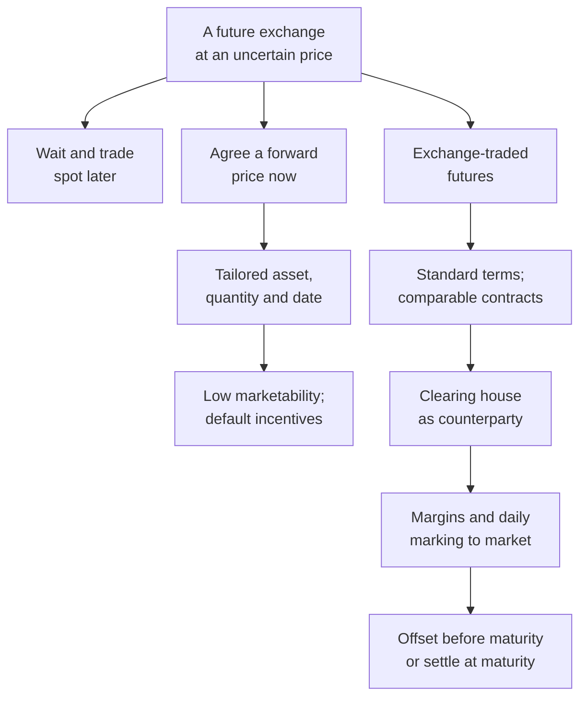
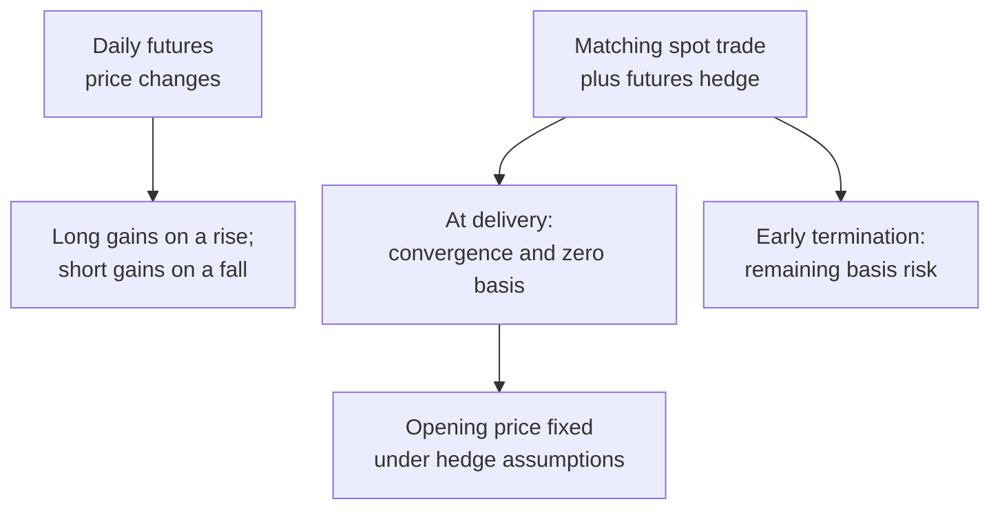

# Distinguish futures contract operation and its limits

```json
{
  "schema_version": 3,
  "owner": "plan",
  "course_id": "2026_2027/Winter_Semester/Financial_Markets_Instruments_I",
  "transaction_id": "PLAN-20261018-FMI-P004",
  "plan_version": "P004",
  "source_version": "V003",
  "ingestion_revision": 3,
  "objective_id": "O001",
  "objective_revision": 2,
  "criterion_version": "O001-C1",
  "status": "ready",
  "knowledge_components": [
    "timing_and_price_agreement",
    "standardization_and_matching_offset",
    "clearing_and_broker_limit",
    "settlement_and_market_limits"
  ],
  "prerequisite_ids": [],
  "compatible_versions": [
    {
      "objective_revision": 1,
      "criterion_version": "O001-C1",
      "plan_version": "P001",
      "source_version": "V001",
      "ingestion_revision": 1,
      "reason": "Finished-note bytes, capability, prompts/keys, success criteria and independence/delayed conditions unchanged. P002 propagates the bundle tuple; only O002 fresh numeric forms are revised.",
      "change_class": "unchanged",
      "requires_reassessment": false
    },
    {
      "objective_revision": 1,
      "criterion_version": "O001-C1",
      "plan_version": "P002",
      "source_version": "V001",
      "ingestion_revision": 1,
      "reason": "Selected Week1 academic note bytes and capability, criteria, prompts/keys and conditions unchanged. Additive Week2 hub context and new downstream objectives do not change this capability.",
      "change_class": "unchanged",
      "requires_reassessment": false
    },
    {
      "objective_revision": 1,
      "criterion_version": "O001-C1",
      "plan_version": "P003",
      "source_version": "V002",
      "ingestion_revision": 2,
      "reason": "Selected Week1–2 academic note bytes and all assessment prompts, keys, required components, conditions and six permitted routes remain unchanged. P004 adds complete reused teaching passages and explicit mathematical typesetting; new Week3 methods have separate IDs. No learner response is regraded.",
      "change_class": "unchanged",
      "requires_reassessment": false
    }
  ],
  "note_locations": [
    {
      "path": "01_Notes/2026_2027/Winter_Semester/Financial_Markets_Instruments_I/Week_1/Spot_Forward_and_Futures_Contracts.md",
      "heading": "Spot, forward and futures contracts"
    },
    {
      "path": "01_Notes/2026_2027/Winter_Semester/Financial_Markets_Instruments_I/Week_1/Spot_Forward_and_Futures_Contracts.md",
      "heading": "Topic map"
    },
    {
      "path": "01_Notes/2026_2027/Winter_Semester/Financial_Markets_Instruments_I/Week_1/Spot_Forward_and_Futures_Contracts.md",
      "heading": "When the agreement, payment and delivery happen"
    },
    {
      "path": "01_Notes/2026_2027/Winter_Semester/Financial_Markets_Instruments_I/Week_1/Spot_Forward_and_Futures_Contracts.md",
      "heading": "Standardized futures specifications"
    },
    {
      "path": "01_Notes/2026_2027/Winter_Semester/Financial_Markets_Instruments_I/Week_1/Spot_Forward_and_Futures_Contracts.md",
      "heading": "Positions, open interest and the clearing house"
    },
    {
      "path": "01_Notes/2026_2027/Winter_Semester/Financial_Markets_Instruments_I/Week_1/Spot_Forward_and_Futures_Contracts.md",
      "heading": "How the obligation ends"
    },
    {
      "path": "01_Notes/2026_2027/Winter_Semester/Financial_Markets_Instruments_I/Week_1/Spot_Forward_and_Futures_Contracts.md",
      "heading": "Trading limits and market abuse"
    },
    {
      "path": "01_Notes/2026_2027/Winter_Semester/Financial_Markets_Instruments_I/Week_1/Spot_Forward_and_Futures_Contracts.md",
      "heading": "What to carry forward"
    },
    {
      "path": "01_Notes/2026_2027/Winter_Semester/Financial_Markets_Instruments_I/Week_1/Introduction_to_Futures_Seminar_Exercises.md",
      "heading": "Problem 1: offsetting contracts"
    },
    {
      "path": "01_Notes/2026_2027/Winter_Semester/Financial_Markets_Instruments_I/Financial_Markets_Instruments_I_main.md",
      "heading": "Course organization"
    },
    {
      "path": "01_Notes/2026_2027/Winter_Semester/Financial_Markets_Instruments_I/Financial_Markets_Instruments_I_main.md",
      "heading": "Teaching and communication"
    },
    {
      "path": "01_Notes/2026_2027/Winter_Semester/Financial_Markets_Instruments_I/Financial_Markets_Instruments_I_main.md",
      "heading": "Assessment and the handbook's cutoff ambiguity"
    },
    {
      "path": "01_Notes/2026_2027/Winter_Semester/Financial_Markets_Instruments_I/Financial_Markets_Instruments_I_main.md",
      "heading": "Listed examination dates and materials"
    }
  ],
  "acquisition_rule": {
    "distinct_independent_passes": 2,
    "required_item_roles": [
      "full_capability_check",
      "full_capability_check"
    ],
    "allowed_routes": [
      [
        "O001-I1",
        "O001-I2"
      ],
      [
        "O001-I1",
        "O001-D1"
      ],
      [
        "O001-I1",
        "O001-D2"
      ],
      [
        "O001-I2",
        "O001-D1"
      ],
      [
        "O001-I2",
        "O001-D2"
      ],
      [
        "O001-D1",
        "O001-D2"
      ]
    ]
  },
  "delayed_rule": {
    "minimum_elapsed_hours": 24,
    "fresh_item": true,
    "independent_required": true
  },
  "review_topic": "Distinguish futures contract operation and its limits",
  "review_instruction": "Begin a closed-note review with teach for O001; request an unused prepared delayed item before recap.",
  "lesson_content_contract": "self-contained-lessons-v1"
}
```

## Outcome and conditions

Given a trading description, identify when terms are fixed, compare future spot/forward/futures, choose a matching offset, count open interest without double counting, explain clearing and the broker warning, and distinguish maturity settlement, daily price limits and position limits. This is a coherent capability to explain what contractual obligation a trader opens and how it ends; it does not assess legal rules or current exchange specifications.

Finished-note locations: [[01_Notes/2026_2027/Winter_Semester/Financial_Markets_Instruments_I/Week_1/Spot_Forward_and_Futures_Contracts.md#When the agreement, payment and delivery happen]]; [[01_Notes/2026_2027/Winter_Semester/Financial_Markets_Instruments_I/Week_1/Spot_Forward_and_Futures_Contracts.md#Standardized futures specifications]]; [[01_Notes/2026_2027/Winter_Semester/Financial_Markets_Instruments_I/Week_1/Spot_Forward_and_Futures_Contracts.md#Positions, open interest and the clearing house]]; [[01_Notes/2026_2027/Winter_Semester/Financial_Markets_Instruments_I/Week_1/Spot_Forward_and_Futures_Contracts.md#How the obligation ends]]; [[01_Notes/2026_2027/Winter_Semester/Financial_Markets_Instruments_I/Week_1/Spot_Forward_and_Futures_Contracts.md#Trading limits and market abuse]]; [[01_Notes/2026_2027/Winter_Semester/Financial_Markets_Instruments_I/Week_1/Introduction_to_Futures_Seminar_Exercises.md#Problem 1: offsetting contracts]].

Supported learning permits these note sections and the worked key. Independent checks permit blank paper and a non-programmable calculator only; no notes, formula list, key, hints, external help or generated solution. The tutor must confirm these conditions and known prior item exposure before marking independence. Unknown conditions are unscorable for independence, even if the content is correct. These stricter practice conditions do not purport to reproduce all exam rules. Hypothetical tasks below instantiate only note-supported mechanisms.

## Prerequisites and checks

No earlier course objective is required. O001-P0 / v1: A buyer intends today to buy in December but will agree the price only in December. Is today's price fixed? Key: no; intention is future spot, all specification/payment/delivery belong to the future deal. Pass: identifies unfixed future price and why; partial: correct label without timing; fail: says intention fixes it. Repair: the first two paragraphs of **Explanation steps**, then W1. This is an entry diagnostic of the objective, not an external assumed foundation.

A qualifying committed prerequisite result may skip its diagnostic only when its exact current tuple or explicitly approved compatible tuple and independence conditions are known. Familiarity is insufficient. Diagnostics do not count as acquisition checks. Do each relevant diagnostic once; failed/partial responses follow the stated repair, then one fresh full check rather than repeated diagnosis.

## Teaching order and rationale

1. Retrieve **Outcome and conditions** and **Prerequisites and checks**; repair a needed dependency before its notation is used.
2. Teach **Motivation, intuition, and definitions** to attach each symbol to an economic action.
3. Use **Explanation steps** to connect the assumptions to the result.
4. Present **Worked example** with the key exposed and ask the learner to identify each decision point.
5. Give **Practice with fading assistance** supported task; if a conceptual component is missing, use its prepared correction.
6. Withdraw all help and ask I1, score before feedback, then an unused full check under **Immediate and delayed checks**.
7. After qualifying acquisition, leave delayed assessment to an unused D item after the minimum elapsed interval. Never recap its solution before the answer.

A learner whose prerequisite diagnostic passes may skip prerequisite support; the objective explanation/example can be shortened to the identified gap. The same two full independent-check requirement remains. Full solutions shown on any route retire that item from independent use.

## Motivation, intuition, and definitions

Motivation: How can a later purchase have terms fixed today, and how can an obligation disappear before delivery? Spot agrees the current-price trade now, permitting the note's practical settlement delay. Future spot waits to trade at the later then-current price. A forward privately specifies asset, quantity, price and maturity now, with payment/delivery later. Futures standardize exchange terms, add clearing and daily settlement. Long means bought, short means sold. Open interest counts contracts via either open longs or open shorts, not their sum. Grade, delivery location and month matter to contract identity. The course's usual financial months and illustrative delivery percentages are introductory source statements, not universal live facts.

## Explanation steps

1. Separate specifying the deal from performing it: later delivery alone does not show whether price was agreed now. A forward supplies today's terms; waiting supplies none.
2. A fixed price removes that agreed-price uncertainty but creates unfavorable-value incentives to default: above the forward price the seller prefers spot; below it the buyer prefers spot.
3. Published asset, size, grade, place and delivery month make futures interchangeable. An equal opposite position in the same contract offsets; an opposite different month leaves two obligations.
4. Clearing interposes a formal counterparty and tracks/net positions through members, reducing reliance on the original opposing client. Brokers remain the client's access path. The notes explicitly warn about own-broker default; the handout's contrary wording is unresolved, so do not claim unlimited protection.
5. Offset before maturity ends open delivery exposure and fixes cumulative trading result. At maturity physical settlement delivers an eligible asset against cash (notification, assignment, eligible delivery, invoice/payment); cash settlement uses the defined final reference EDSP. An eligible-asset choice can permit cheapest-to-deliver selection; later bond calculations are excluded.
6. A daily price limit constrains the session band around prior settlement and may suspend trading; a position limit constrains speculative concentration. Neither is a lifetime loss guarantee. Cornering combines concentrated long futures with control of underlying supply, hurting shorts' ability to close/deliver. Margin supports performance and does not buy the asset.

## Complete checked-note explanation

Deliver these complete reused passages before the worked example; the earlier concise teaching prompts are checkpoints, not substitutes. Necessary prerequisite lessons remain the routes specified above. Course-organization details in O001 are supporting context, not additional scoring components.

Origin: reused complete checked passage [[01_Notes/2026_2027/Winter_Semester/Financial_Markets_Instruments_I/Week_1/Spot_Forward_and_Futures_Contracts.md#Spot, forward and futures contracts]]; fingerprint `ed4177199ebe557e2c52129bcd94b690b22e553a5eafba9ce5f4dc19656c3045`. Heading depth alone is adapted.

### Spot, forward and futures contracts

How can a trader agree today on an exchange that will occur later, and what makes that agreement reliable? Week 1 separates price agreement from payment and delivery. A forward fixes a later exchange through a private agreement; a futures contract adds exchange standardization, clearing and daily settlement. These arrangements explain both the usefulness of futures for managing price uncertainty and the cash obligations a trader accepts. [[00_Materials/2026_2027/Winter_Semester/Financial_Markets_Instruments_I/Week_1/L10(EssentialsOfFuturesTrading).pptx|L10(EssentialsOfFuturesTrading).pptx, slide 2–5]] [[00_Materials/2026_2027/Winter_Semester/Financial_Markets_Instruments_I/Week_1/FI01(Futures Contracts).doc|FI01(Futures Contracts).doc, Ch. I, LibreOffice-rendered p. 2–4]]

#### Topic map





The map synthesizes the selected handout chapter: classification on pp. 2–3, clearing and margins on pp. 3–5, convergence on p. 6, hedging on p. 7 and payoff/limits on pp. 8–9. It describes the Week 1 mechanism; it does not import the later chapters on financial contract examples, cost of carry or trading strategies. [[00_Materials/2026_2027/Winter_Semester/Financial_Markets_Instruments_I/Week_1/FI01(Futures Contracts).doc|FI01(Futures Contracts).doc, Ch. I, LibreOffice-rendered p. 2–9]]

#### When the agreement, payment and delivery happen

A **spot contract** agrees an immediate sale and delivery at the current spot, or prompt, price. The lecture allows the usual practical delay of up to two days between transaction and settlement; the defining point is that the deal uses the price prevailing now. A **future spot contract**, in the lecture's terminology, means waiting until a specified future date to make a spot transaction. Its future price is still unknown today. Merely intending to buy later does not fix a price. [[00_Materials/2026_2027/Winter_Semester/Financial_Markets_Instruments_I/Week_1/L10(EssentialsOfFuturesTrading).pptx|L10(EssentialsOfFuturesTrading).pptx, slide 2]] [[00_Materials/2026_2027/Winter_Semester/Financial_Markets_Instruments_I/Week_1/FI01(Futures Contracts).doc|FI01(Futures Contracts).doc, Ch. I, LibreOffice-rendered p. 2]]

![[01_Notes/2026_2027/Winter_Semester/Financial_Markets_Instruments_I/assets/Week_1_L10_Spot_Timelines.png]]

*Source timelines: S means specification, P payment, and D delivery. The upper line places all three near the present; the lower line postpones all three to the future date T. The lower transaction therefore retains future spot-price uncertainty.* [[00_Materials/2026_2027/Winter_Semester/Financial_Markets_Instruments_I/Week_1/L10(EssentialsOfFuturesTrading).pptx|L10(EssentialsOfFuturesTrading).pptx, slide 2]]

A **forward contract** specifies today the underlying asset and quantity, the agreed forward price, and the future delivery or maturity date. Payment and delivery occur later. The parties can tailor these terms to their business needs. The benefit is that the agreed exchange price is known in advance. The cost is that a unique private obligation may be difficult or expensive to transfer or terminate. [[00_Materials/2026_2027/Winter_Semester/Financial_Markets_Instruments_I/Week_1/L10(EssentialsOfFuturesTrading).pptx|L10(EssentialsOfFuturesTrading).pptx, slide 3]] [[00_Materials/2026_2027/Winter_Semester/Financial_Markets_Instruments_I/Week_1/FI01(Futures Contracts).doc|FI01(Futures Contracts).doc, Ch. I, LibreOffice-rendered p. 2]]

![[01_Notes/2026_2027/Winter_Semester/Financial_Markets_Instruments_I/assets/Week_1_L10_Forward_Timeline.png]]

*The forward timeline places S at the beginning and P and D at T: fixing the terms and executing the exchange are separate events.* [[00_Materials/2026_2027/Winter_Semester/Financial_Markets_Instruments_I/Week_1/L10(EssentialsOfFuturesTrading).pptx|L10(EssentialsOfFuturesTrading).pptx, slide 3]]

Fixing a price also creates an incentive for the losing party to default. If the later spot price S exceeds the agreed price F, the buyer prefers delivery at F, while the seller could obtain more by selling at S. If S is below F, the seller prefers the agreement, while the buyer would prefer to buy spot. This is a credit-risk problem arising from an obligation's unfavorable market value, even though the contract has removed uncertainty about the agreed price. [[00_Materials/2026_2027/Winter_Semester/Financial_Markets_Instruments_I/Week_1/L10(EssentialsOfFuturesTrading).pptx|L10(EssentialsOfFuturesTrading).pptx, slide 3]] [[00_Materials/2026_2027/Winter_Semester/Financial_Markets_Instruments_I/Week_1/FI01(Futures Contracts).doc|FI01(Futures Contracts).doc, Ch. I, LibreOffice-rendered p. 2]]

#### Standardized futures specifications

A **futures contract** is a standardized agreement for a future exchange, traded on a specialized exchange. The trader accepts the published terms and chooses whether to buy or sell at the available futures price. Standardization makes contracts comparable and allows an opposite trade to unwind a position. The lecture presents this ease of offsetting as an important source of liquidity. [[00_Materials/2026_2027/Winter_Semester/Financial_Markets_Instruments_I/Week_1/L10(EssentialsOfFuturesTrading).pptx|L10(EssentialsOfFuturesTrading).pptx, slide 4, 7]] [[00_Materials/2026_2027/Winter_Semester/Financial_Markets_Instruments_I/Week_1/FI01(Futures Contracts).doc|FI01(Futures Contracts).doc, Ch. I, LibreOffice-rendered p. 2–3]] [[00_Materials/2026_2027/Winter_Semester/Financial_Markets_Instruments_I/Week_1/02_seminar.pdf#page=3|02_seminar.pdf, PDF p. 3]]

A futures contract is a **derivative** because its price is derived from the underlying asset's price. The specifications identify the underlying asset, contract size, delivery month, quotation and minimum price movement, and delivery arrangements. An underlying asset may be a commodity, an index, an equity, a currency or an interest-rate-related instrument. For commodities, the grade of quality matters because goods of different quality need not have the same price. Delivery location also matters when transport costs are significant; alternative locations can require price adjustments. [[00_Materials/2026_2027/Winter_Semester/Financial_Markets_Instruments_I/Week_1/02_seminar.pdf#page=3|02_seminar.pdf, PDF p. 3–4]] [[00_Materials/2026_2027/Winter_Semester/Financial_Markets_Instruments_I/Week_1/02_seminar.pdf#page=8|02_seminar.pdf, PDF p. 8]]

The **contract multiplier** converts a quoted price movement into a monetary gain or loss. If a price is quoted in dollars per barrel and the contract covers 1,000 barrels, a $0.01 rise per barrel changes the contract's monetary value by $10. If an index contract pays $50 per index point and its minimum movement is 0.25 points, one tick is $12.50. In both cases,

$$\text{tick value}=\text{tick size}\times\text{contract multiplier}.$$

The units must cancel correctly: dollars per barrel times barrels gives dollars; index points times dollars per point gives dollars. For N contracts, multiply the monetary change by N. These are the seminar's examples, rather than claims that every oil or index contract uses those specifications. [[00_Materials/2026_2027/Winter_Semester/Financial_Markets_Instruments_I/Week_1/02_seminar.pdf#page=5|02_seminar.pdf, PDF p. 5]]

The seminar's fractional quotation example is $99+21.75/32=99.6796875$, or approximately 99.68, for the written quote $99\text{-}21\tfrac34$. Its text first discusses Treasury bonds and then labels the example “US T-Bill”; the label is internally inconsistent, so the verified learning point here is the arithmetic of the fractional quote. [[00_Materials/2026_2027/Winter_Semester/Financial_Markets_Instruments_I/Week_1/02_seminar.pdf#page=7|02_seminar.pdf, PDF p. 7]]

The seminar describes usual maturities as ranging from one month to two years. This is its introductory description; a particular contract's published terms determine its available maturities. [[00_Materials/2026_2027/Winter_Semester/Financial_Markets_Instruments_I/Week_1/02_seminar.pdf#page=6|02_seminar.pdf, PDF p. 6]]

Delivery month is part of the contract's identity: a June contract and a September contract are different obligations. The lecture and seminar describe March, June, September and December as usual financial-contract months, and the seminar says commodity contracts may be available monthly. These are the supplied introductory descriptions; the specified contract calendar remains necessary for an actual contract. A contract that is too large can exclude smaller traders, while one that is too small increases the number of transactions needed for a desired exposure. [[00_Materials/2026_2027/Winter_Semester/Financial_Markets_Instruments_I/Week_1/L10(EssentialsOfFuturesTrading).pptx|L10(EssentialsOfFuturesTrading).pptx, slide 4]] [[00_Materials/2026_2027/Winter_Semester/Financial_Markets_Instruments_I/Week_1/FI01(Futures Contracts).doc|FI01(Futures Contracts).doc, Ch. I, LibreOffice-rendered p. 3]] [[00_Materials/2026_2027/Winter_Semester/Financial_Markets_Instruments_I/Week_1/02_seminar.pdf#page=6|02_seminar.pdf, PDF p. 6]]

#### Positions, open interest and the clearing house

A **long position** is a bought futures contract; a **short position** is a sold futures contract. Each outstanding contract has a long and a short side. **Open interest** counts the outstanding contracts as the number of open longs or, equivalently, open shorts; it does not add both sides and double-count the same contracts. [[00_Materials/2026_2027/Winter_Semester/Financial_Markets_Instruments_I/Week_1/L10(EssentialsOfFuturesTrading).pptx|L10(EssentialsOfFuturesTrading).pptx, slide 5]]

The clearing arrangement places the exchange or clearing house between the original counterparties after brokers arrange the trade. The clearing house keeps track of transactions and becomes the formal counterparty, honoring the agreed obligations within the arrangement described by the sources. Non-members channel their trades through members, and the clearing house calculates members' net positions. This reduces the trader's exposure to the original opposing client. [[00_Materials/2026_2027/Winter_Semester/Financial_Markets_Instruments_I/Week_1/L10(EssentialsOfFuturesTrading).pptx|L10(EssentialsOfFuturesTrading).pptx, slide 12]] [[00_Materials/2026_2027/Winter_Semester/Financial_Markets_Instruments_I/Week_1/FI01(Futures Contracts).doc|FI01(Futures Contracts).doc, Ch. I, LibreOffice-rendered p. 3]] [[00_Materials/2026_2027/Winter_Semester/Financial_Markets_Instruments_I/Week_1/02_seminar.pdf#page=11|02_seminar.pdf, PDF p. 11]]

![[01_Notes/2026_2027/Winter_Semester/Financial_Markets_Instruments_I/assets/Week_1_L10_Clearing_Arrangement.png]]

*Compare the direct relationship above with the interposed exchange below. The intermediate counterparty changes whom each side relies on for the agreed transaction; brokers still connect clients to the exchange.* [[00_Materials/2026_2027/Winter_Semester/Financial_Markets_Instruments_I/Week_1/L10(EssentialsOfFuturesTrading).pptx|L10(EssentialsOfFuturesTrading).pptx, slide 12]]

The lecture explicitly says this arrangement does **not** protect a client against the default of their own broker. The handout p. 3 contains both a sentence about honoring obligations after a broker's default and this same non-protection warning. Those statements should be retained as a source ambiguity rather than turned into a blanket guarantee that clients cannot lose money through a broker. The diagram establishes the interposition of clearing; it does not establish unlimited protection against every participant's default. [[00_Materials/2026_2027/Winter_Semester/Financial_Markets_Instruments_I/Week_1/L10(EssentialsOfFuturesTrading).pptx|L10(EssentialsOfFuturesTrading).pptx, slide 12]] [[00_Materials/2026_2027/Winter_Semester/Financial_Markets_Instruments_I/Week_1/FI01(Futures Contracts).doc|FI01(Futures Contracts).doc, Ch. I, LibreOffice-rendered p. 3]]

#### How the obligation ends

**Closing out** means taking an offsetting position in an equivalent contract before maturity. A long sells the same underlying, contract size and delivery-month contract; a short buys it. The offset removes the open delivery obligation and fixes the cumulative trading result. A sale in a different delivery month would leave exposure in another contract rather than provide the matching offset. [[00_Materials/2026_2027/Winter_Semester/Financial_Markets_Instruments_I/Week_1/L10(EssentialsOfFuturesTrading).pptx|L10(EssentialsOfFuturesTrading).pptx, slide 7]] [[00_Materials/2026_2027/Winter_Semester/Financial_Markets_Instruments_I/Week_1/FI01(Futures Contracts).doc|FI01(Futures Contracts).doc, Ch. I, LibreOffice-rendered p. 5]] [[00_Materials/2026_2027/Winter_Semester/Financial_Markets_Instruments_I/Week_1/02_seminar.pdf#page=9|02_seminar.pdf, PDF p. 9]]

A position held to maturity follows its specified settlement method. **Physical delivery** exchanges the eligible underlying asset and cash. The source sequence is a long's notification, clearing-house assignment of a short, delivery of an eligible asset and determination/payment of the invoice. If the contract permits several eligible assets, the handout introduces the short's cheapest-to-deliver choice without developing the later bond calculations. **Cash settlement** transfers the final monetary amount when delivery is impractical, costly or excluded by the specification. The final marking-to-market price is the **Exchange Delivery Settlement Price (EDSP)**. [[00_Materials/2026_2027/Winter_Semester/Financial_Markets_Instruments_I/Week_1/L10(EssentialsOfFuturesTrading).pptx|L10(EssentialsOfFuturesTrading).pptx, slide 7]] [[00_Materials/2026_2027/Winter_Semester/Financial_Markets_Instruments_I/Week_1/FI01(Futures Contracts).doc|FI01(Futures Contracts).doc, Ch. I, LibreOffice-rendered p. 5]] [[00_Materials/2026_2027/Winter_Semester/Financial_Markets_Instruments_I/Week_1/02_seminar.pdf#page=8|02_seminar.pdf, PDF p. 8–9]]

The seminar states that less than 1% of all futures contracts end in commodity delivery and emphasizes that most traders offset. Treat that percentage as the seminar's illustrative statement; it supplies no sample, date or measurement method. The broader source-supported point is that closing out is common and enables trading without arranging physical delivery. [[00_Materials/2026_2027/Winter_Semester/Financial_Markets_Instruments_I/Week_1/02_seminar.pdf#page=9|02_seminar.pdf, PDF p. 9]] [[00_Materials/2026_2027/Winter_Semester/Financial_Markets_Instruments_I/Week_1/L10(EssentialsOfFuturesTrading).pptx|L10(EssentialsOfFuturesTrading).pptx, slide 7]]

#### Trading limits and market abuse

**Daily price limits** define a permitted band around the previous day's settlement price. The handout describes limit-up or limit-down suspension when prices pass that band, with a cooling-off period intended to help participants reassess positions. **Position limits** cap the number of speculative contracts one trader, or a coordinated group, can hold. These limits constrain market influence rather than specifying a maximum possible loss on a position. [[00_Materials/2026_2027/Winter_Semester/Financial_Markets_Instruments_I/Week_1/FI01(Futures Contracts).doc|FI01(Futures Contracts).doc, Ch. I, LibreOffice-rendered p. 8]] [[00_Materials/2026_2027/Winter_Semester/Financial_Markets_Instruments_I/Week_1/02_seminar.pdf#page=14|02_seminar.pdf, PDF p. 14]]

The handout describes **cornering the market** as combining many long futures positions with control of the underlying supply, raising the underlying price and making it difficult for shorts to close or deliver at a reasonable price. This explains why position limits address concentration as well as the leverage created by small margin deposits. [[00_Materials/2026_2027/Winter_Semester/Financial_Markets_Instruments_I/Week_1/FI01(Futures Contracts).doc|FI01(Futures Contracts).doc, Ch. I, LibreOffice-rendered p. 8]]

#### What to carry forward

The essential tradeoff is between a negotiated future exchange and a standardized obligation that can be offset and cleared. Standardization supports liquidity; clearing and daily settlement address counterparty exposure; margin makes the obligation operational but does not pay for the asset or cap its loss. The next note, [[01_Notes/2026_2027/Winter_Semester/Financial_Markets_Instruments_I/Week_1/Margins_and_Marking_to_Market.md|Margins and marking to market]], explains the daily cash mechanism. [[01_Notes/2026_2027/Winter_Semester/Financial_Markets_Instruments_I/Week_1/Basis_Convergence_and_Futures_Hedging.md|Basis, convergence and futures hedging]] shows why combining that mechanism with a spot transaction fixes a price only under the stated matching and convergence conditions. [[00_Materials/2026_2027/Winter_Semester/Financial_Markets_Instruments_I/Week_1/L10(EssentialsOfFuturesTrading).pptx|L10(EssentialsOfFuturesTrading).pptx, slide 4–10]]


Origin: reused complete checked passage [[01_Notes/2026_2027/Winter_Semester/Financial_Markets_Instruments_I/Week_1/Introduction_to_Futures_Seminar_Exercises.md#Problem 1: offsetting contracts]]; fingerprint `b10a0ed1ddfde242583a447a4246738dc8f31af4dca1c5f77970596782335d04`. Heading depth alone is adapted.

### Problem 1: offsetting contracts

John buys ten June Nasdaq 100 futures contracts on 9 January and wants to close them on 16 April. He sells ten equivalent **June Nasdaq 100** contracts on 16 April. Matching the underlying, delivery month and number cancels his existing long position; daily settlement fixes his cumulative gain/loss as ten times the multiplier times closing minus opening futures price. Jane opens a short September S&P 500 contract in early August and closes it a week later by buying one equivalent **September S&P 500** contract. A contract of another maturity would create a different position rather than be the matching offset. The question supplies no opening or closing prices, so it cannot determine a numerical profit. [[00_Materials/2026_2027/Winter_Semester/Financial_Markets_Instruments_I/Week_1/02_seminar.pdf#page=17|02_seminar.pdf, PDF p. 17]] [[00_Materials/2026_2027/Winter_Semester/Financial_Markets_Instruments_I/Week_1/L10(EssentialsOfFuturesTrading).pptx|L10(EssentialsOfFuturesTrading).pptx, slide 6–7]]


Origin: reused complete checked passage [[01_Notes/2026_2027/Winter_Semester/Financial_Markets_Instruments_I/Financial_Markets_Instruments_I_main.md#Course organization]]; fingerprint `5f4d7a51489bba43aa52b0e86b621c585e8c73c8a25a577a851dfa2fb405487c`. Heading depth alone is adapted.

### Course organization

The supplied 2026/2027 handbook and SIS export identify this course as **JEM035**, worth **6 ECTS**, with English instruction. Its scope concerns futures and options and their use in speculative, hedging and arbitrage trading; the summer course Financial Markets Instruments II is the continuation. The existing descriptive course-folder name is retained. The futures/options syllabus provides course context; later topics have not been turned into teaching notes by this Week 1 pass. [[00_Materials/2026_2027/Winter_Semester/Financial_Markets_Instruments_I/Week_1/handbook-1.pdf#page=1|handbook-1.pdf, PDF p. 1–3]] [[00_Materials/2026_2027/Winter_Semester/Financial_Markets_Instruments_I/Week_1/Předměty.pdf#page=1|Předměty.pdf, PDF p. 1–2]]

#### Teaching and communication

As of the handbook's 29 September 2026 update, the lecture is Tuesday 14:00–15:20 in room 314 and the seminar Tuesday 15:30–16:50 in room 109. In-person attendance is recommended, not mandatory. Lecture questions go to Prof. Oldřich Dědek, and seminar/exam questions to Petr Polák; the handbook recommends asking in person and specifies dedek@fsv.cuni.cz and petr.polak@fsv.cuni.cz, with an email subject beginning “FMI I:”. These are recorded source arrangements, not live schedule verification or messages sent by the assistant. [[00_Materials/2026_2027/Winter_Semester/Financial_Markets_Instruments_I/Week_1/handbook-1.pdf#page=1|handbook-1.pdf, PDF p. 1–2]]

The SIS export also supplies a Teams invitation/code under its English teaching-methods section and directs grading questions to the handbook. Its administrative interface and historical enrollment/results table on pp. 2–3 do not establish academic concepts or the learner's own performance. The external Teams/lecturer links and recommended books are not additional sources read in this pass. [[00_Materials/2026_2027/Winter_Semester/Financial_Markets_Instruments_I/Week_1/Předměty.pdf#page=2|Předměty.pdf, PDF p. 2–3]]

#### Assessment and the handbook's cutoff ambiguity

The handbook allocates **20 points to seminar activity** and **80 to the written exam**. At least **50% of the final exam**, hence 40 out of 80, is needed for eligibility to pass. It says there are three attempts and that an exam score cannot be improved after the minimum requirement has been passed. It also says at least 50 total points are needed; however, its grade table labels **0–50 as F** and starts **E at 51**. The exact treatment of a total of 50 is therefore unresolved in the supplied handbook and should be clarified with the teaching assistant; it is not silently chosen here. The table gives E=51–60, D=61–70, C=71–80, B=81–90 and A=91–100. [[00_Materials/2026_2027/Winter_Semester/Financial_Markets_Instruments_I/Week_1/handbook-1.pdf#page=3|handbook-1.pdf, PDF p. 3–4]]

Seminars begin with a brief theory recap and around three worked board exercises, then allow roughly 15–20 minutes for a point-bearing problem. The handbook gives up to three points per seminar, capped at 20 overall, and asks students to bring the formula list and a calculator. Question sets are supplied in SIS, while solutions are not. The written exam includes 40 theory points and four exercises worth 10 each; full exercise credit requires careful steps and explanation. [[00_Materials/2026_2027/Winter_Semester/Financial_Markets_Instruments_I/Week_1/handbook-1.pdf#page=4|handbook-1.pdf, PDF p. 4]]

Only a non-programmable calculator is allowed in the exam. The handbook prohibits communication devices, books, own notes, teamwork and exchange of notes, and says the formula list will be provided. SIS registration is compulsory. [[00_Materials/2026_2027/Winter_Semester/Financial_Markets_Instruments_I/Week_1/handbook-1.pdf#page=4|handbook-1.pdf, PDF p. 4–5]]

#### Listed examination dates and materials

The handbook lists 15 December 2026, 5 January 2027 and 19 January 2027, each 15:30–16:50. It assigns O314 to the December date and leaves the January rooms unknown, explicitly noting that times and rooms can change. It also discusses an exam in the last seminar; no unlisted additional date is invented from that sentence. These are the uploaded handbook's dates, not a checked live calendar. [[00_Materials/2026_2027/Winter_Semester/Financial_Markets_Instruments_I/Week_1/handbook-1.pdf#page=5|handbook-1.pdf, PDF p. 5]]

The handbook lists presentations and handouts plus books by Blake, Hull, Björk and Jílek and the Black–Scholes paper as available/recommended literature. The SIS export lists earlier editions and describes its linked Handbook.pdf as 2025/2026, whereas the actual uploaded handbook-1.pdf cover states 2026/2027. Those labels are preserved as a provenance difference. They do not authorize opening external websites or extending Week 1 into options pricing or the remaining futures chapters. [[00_Materials/2026_2027/Winter_Semester/Financial_Markets_Instruments_I/Week_1/handbook-1.pdf#page=1|handbook-1.pdf, PDF p. 1, 5]] [[00_Materials/2026_2027/Winter_Semester/Financial_Markets_Instruments_I/Week_1/Předměty.pdf#page=1|Předměty.pdf, PDF p. 1–2]]


## Worked example

O001-W1 / item_version 1 / worked-example; source-supported example or explicitly hypothetical instantiation.

John buys ten June Nasdaq futures and closes in April by selling ten equivalent June contracts. Selling September instead would create a September short while leaving the June long. Jane shorts one September S&P contract and closes by buying one equivalent September contract. These are the note's source exercises; no numerical profit follows without opening/closing prices. If ten outstanding contracts have ten long and ten short sides, open interest is ten. Decision checks: contract month and size match; opposite direction alone is insufficient. Clearing does not erase own-broker risk. Held positions follow physical/cash specification; an offset ends the open delivery obligation.

## Practice with fading assistance

O001-S1 / item_version 1 / supported-completion.

**Prompt:** Complete: intending a January spot purchase leaves ___ unknown; a private forward fixes ___ now and performs ___ later; closing three long June contracts requires ___; six outstanding matched contracts imply open interest ___; clearing protects against reliance on ___ but is no blanket protection against ___; distinguish physical/cash settlement and price/position limits.

**Key:** future spot price; asset/quantity/price/maturity; payment/delivery; sell three identical June contracts; six; original opposing client; own broker's default. Physical exchanges eligible asset and cash; cash uses final monetary settlement/EDSP. Daily price band vs concentration cap. Essential: all four outcome components. Supported omissions lead to the prepared correction, not an independent pass.

Allowed help: reveal the named definitions, then at most two prepared hints in **Misconceptions and correction**. After the learner supplies the missing steps and their reasons, hide all keys and use a fresh full check. Supported success is practice evidence only. If even the full worked correction does not restore the needed component, pause and follow the dependency repair.

## Rubric and independence

The required components are: timing_and_price_agreement; standardization_and_matching_offset; clearing_and_broker_limit; settlement_and_market_limits. Each full check below explicitly elicits and keys every component. Pass requires all its essential reasoning and requested outputs without a critical error. Partial means a correct mechanism but a missing component, unresolved sign/unit, or isolated arithmetic slip. Fail means a critical conceptual error persists or the method cannot establish the result. Unscorable means the response/conditions cannot be interpreted reliably; ask the existing prompt once for clarification, without adding a new assessment. Accept algebraically equivalent expressions, clearly defined opposite cash-flow signs, and plain-language explanations with the same mechanism. An arithmetic slip is partial until independently corrected; it is not automatically a conceptual failure. No numerical score is inferred.

Critical errors: A future-spot intention fixes today's price; a different maturity offsets; OI doubles both sides; clearing eliminates own-broker risk; price/position limits cap cumulative loss.

Acquisition requires two distinct unassisted passes from the explicitly permitted routes O001-I1/O001-I2, O001-I1/O001-D1, O001-I1/O001-D2, O001-I2/O001-D1, O001-I2/O001-D2, O001-D1/O001-D2. I items normally establish acquisition; an unused D item may replace an exposed or failed I item and then cannot later be counted as delayed retention. Each selected full item assesses all listed components, so every route covers them twice. W1, S1, prerequisite diagnostics and the narrow C1 correction are forbidden substitutes. The D bank is finite: never repeat an exposed item to certify fresh learning and never invent changed numbers. If fewer than two unused full items remain, raise a plan_issue for a new prepared bank.

| Component | I1 | I2 | D1 | D2 |
|---|---|---|---|---|
| timing_and_price_agreement | required | required | required | required |
| standardization_and_matching_offset | required | required | required | required |
| clearing_and_broker_limit | required | required | required | required |
| settlement_and_market_limits | required | required | required | required |

## Misconceptions and correction

Observable signs: treating any opposite contract as offset; adding longs and shorts; saying clearing guarantees every participant. Correction: equivalence includes month/asset/size, each contract has two sides, and the broker remains between client and clearing. Hint 1: ask which obligation was opened. Hint 2: list its maturity and reverse only direction. O001-C1 / v1: A short has three July contracts, and 11 contracts remain outstanding. What closes the short, what is OI, and does clearing prove own-broker immunity? Key: buy three equivalent July, OI 11, no—the warning remains. Pass: all three with reasons; partial: missing reason; fail: different month/double counting/immunity.

The sign alone is a tentative diagnosis; use the learner's reasoning to establish the confusion. Score the initial response before any hint. Hint 1 points to the named distinction; hint 2 points to the first correct step. After two ineffective hints show the prepared key, then pause if the fresh C1 response still fails. C1 checks the repaired component only and cannot replace a full independent check.

## Immediate and delayed checks

All items are item_version 1 and role full_capability_check. I1/I2 are immediate; D1/D2 are prepared delayed variants. D items may establish delayed success only when unused, unassisted, attempted before recap, at least 24 elapsed hours after acquisition and the most recent relevant solution/teaching exposure, with intervening exposure recorded. Early D attempts may be immediate checks but are not delayed evidence. Each delayed success is separate from initial acquisition. Numerical changes are parallel variants; a changed buyer/seller context is bounded near transfer, never proof of broad transfer.

### O001-I1

**Prompt:** A bakery will buy grain in December. Compare (a) waiting to negotiate then, (b) privately fixing price/quantity today, and (c) buying standardized December futures today. Explain losing-party default incentives at a high later spot price. It buys four December futures and proposes selling four March futures to close: assess and correct. There are nine outstanding contracts: give open interest. Explain clearing's benefit and own-broker limitation. Describe maturity physical versus cash settlement, daily price versus position limits, and the mechanism of cornering.

**Key and essential rubric:** (a) future spot, future price unknown; (b) forward, terms now and payment/delivery later; (c) futures, published terms plus clearing/daily settlement. Above forward price seller has an incentive to prefer selling spot, though the contract remains an obligation. March sale does not offset December: sell four equivalent December contracts. OI=9, not 18. Clearing becomes counterparty/reduces original counterparty exposure; own broker warning and ambiguous handout are not unlimited protection. Physical eligible asset/cash versus final monetary EDSP settlement. Daily band/suspension versus speculative quantity cap, neither loss cap. Cornering combines concentrated longs and controlled supply, making short closing/delivery difficult. Pass requires all timing, offset/OI, clearing and settlement/limit components.

### O001-I2

**Prompt:** A manufacturer agrees today on a tailored delivery in August. Classify and contrast with buying spot today and waiting to buy spot in August; identify the default incentive if later spot falls. A trader shorts two September index futures and suggests buying December to exit. Give the proper exit and OI when 12 contracts have 12 long and 12 short sides. Explain standard terms (grade/location/month/size), clearing and its broker boundary, physical/cash maturity settlement, and why a position limit and a daily price limit do different jobs. Describe cornering.

**Key and essential rubric:** Tailored fixed terms now/payment and delivery later is forward. Spot now uses current price and prompt exchange; future spot leaves August price unknown. Below agreed forward price buyer prefers cheaper spot. Buy two identical September index contracts, not December. OI=12. Terms create equivalent obligations: grade/location affect what/how delivered; month differs; size determines exposure. Clearing interposes counterparty but does not guarantee own broker. Physical delivers eligible goods for payment; cash uses EDSP monetary settlement. Position caps concentration/cornering; daily band restricts trading movement/session, neither guarantees bounded total loss. Cornering pairs many long futures and control of supply, pressuring shorts. All four components required.

### O001-D1

**Prompt:** A fuel buyer considers spot now, spot next month, private forward now for next month, or standardized next-month futures. Compare their agreement timing and futures operational additions; if the later spot price rises, who prefers to walk away from the forward? A long holds five October contracts: can a five-contract November sale close it? Give the correct trade, OI for seven outstanding contracts, clearing/broker caveat, physical/cash settlement distinction, and daily/position limits plus cornering.

**Key and essential rubric:** Spot now fixes current terms with prompt settlement; future spot negotiates next month at unknown price; forward fixes now and performs later; futures standardize, clear and mark daily. With a rise seller prefers higher spot rather than lower agreed price. November cannot offset October; sell five identical October. OI=7. Clearing reduces original opposing-client exposure without blanket own-broker protection. Physical eligible delivery/cash vs cash EDSP final settlement. Daily prior-settlement band vs speculative concentration cap; neither caps lifetime loss. Cornering uses long concentration and supply control to pressure shorts. All four components required.

### O001-D2

**Prompt:** A commodity seller privately fixes February terms now while another seller waits for a February spot deal. Compare them with spot today and a standardized February short. At a falling later spot price, identify the forward party with a default incentive. Close a short of six May contracts, reject a June buy as substitute, and count OI with 20 long and 20 matching short sides. Explain clearing, own-broker warning, eligible physical settlement versus cash EDSP, and daily/position limits and cornering.

**Key and essential rubric:** Forward terms today/performance February; future spot price unknown now; current spot near-present trade; futures standard terms/clearing/daily settlement. Falling spot gives buyer incentive to avoid paying agreed higher price. Buy six identical May contracts, June leaves May exposure. OI=20. Clearing interposition is original-counterparty-risk management, not a universal own-broker guarantee. Physical delivers eligible asset with invoice/payment; cash transfers final reference amount. Daily price band is a trading restriction, position cap restrains concentrated speculative holdings. Cornering combines many longs and supply control; neither limit is a loss cap. All four components required.

## Advance, revisit, pause, and escalate

Advance when teach has committed two qualifying distinct full passes with this current criterion; this defines acquisition, not durable retention. Delayed success requires a later fresh full pass under the delayed conditions. After one failed check, score, teach the named correction and use another unused full item. After two unsuccessful independent attempts or a failed fresh correction, pause independent quizzing and return to the relevant prepared explanation/dependency. Stop if a note/ingest conflict affects the mechanism. Unsupported accepted alternatives, unclear rubric, exhausted item bank, or missing blocks require plan_issue with 2026_2027/Winter_Semester/Financial_Markets_Instruments_I, O001, objective revision 2, O001-C1, P004/V003, ingestion revision 3 and the exact item ID. Academic note contradictions go to ingest with the cited heading; plan gaps go to plan. End a session with honest partial coverage if acquisition is unfinished.

## Answer-free recall handoff

Topic: Distinguish futures contract operation and its limits. Instruction: Begin a closed-note review with teach for O001; request an unused prepared delayed item before recap. Lesson: [[03_Agents/2026_2027/Winter_Semester/Financial_Markets_Instruments_I/lessons/O001.md#Immediate and delayed checks]]. Teach supplies committed evidence IDs and actual timestamps; recall owns due dates and Todoist. Deadline/retention horizon is null. No learner result or review date is created by this definition.

## Content provenance and generation boundaries

The complete checked-note passages above are reused with only heading-depth adaptation; exact origins and fingerprints are in source_manifest.md. Existing plan-created hypothetical exercises and their full keys are retained from P003; their algebra instantiates the included checked definitions. No new external academic claims are introduced. All figures retain checked vault-relative asset paths, captions and source qualifications. Main examples and assessment routes are fully prepared here.

Preserved assessment contract: only the named prepared full-capability items and six routes may establish acquisition or delayed evidence. Additional verified examples or practice may support explanation but cannot replace a named full check or reassessment gate. Teach may accept an independently verified equivalent method meeting the same pre-answer components and conditions. Ambiguous criteria or an exhausted fresh bank return to plan. The current objective revision is 2; unchanged item/criterion versions remain those explicitly stated above.
