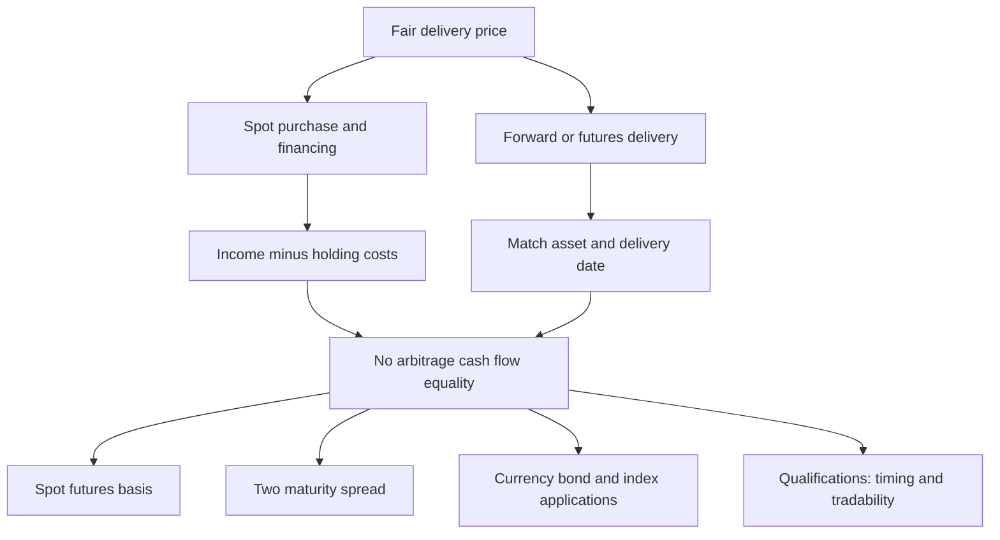

# Derive two-sided cost of carry and interpret spot–futures basis

## Record metadata

```json
{
  "schema_version": 3,
  "owner": "plan",
  "course_id": "2026_2027/Winter_Semester/Financial_Markets_Instruments_I",
  "transaction_id": "PLAN-20261018-FMI-P004",
  "plan_version": "P004",
  "source_version": "V003",
  "ingestion_revision": 3,
  "objective_id": "O014",
  "objective_revision": 1,
  "criterion_version": "O014-C1",
  "status": "ready",
  "lesson_content_contract": "self-contained-lessons-v1",
  "knowledge_components": [
    "zero_opening_and_both_terminal_packages",
    "fair_price_basis_and_arbitrage_direction",
    "conventions_forecast_and_implementation_limits"
  ],
  "prerequisite_ids": [
    "O002",
    "O006",
    "O003"
  ],
  "compatible_versions": [],
  "note_locations": [
    {
      "path": "01_Notes/2026_2027/Winter_Semester/Financial_Markets_Instruments_I/Week_3/Cost_of_Carry_and_Calendar_Spreads.md",
      "heading": "Cost of carry and calendar spreads"
    },
    {
      "path": "01_Notes/2026_2027/Winter_Semester/Financial_Markets_Instruments_I/Week_3/Cost_of_Carry_and_Calendar_Spreads.md",
      "heading": "Foundations and conventions"
    },
    {
      "path": "01_Notes/2026_2027/Winter_Semester/Financial_Markets_Instruments_I/Week_3/Cost_of_Carry_and_Calendar_Spreads.md",
      "heading": "Borrow cash, buy spot and sell futures"
    },
    {
      "path": "01_Notes/2026_2027/Winter_Semester/Financial_Markets_Instruments_I/Week_3/Cost_of_Carry_and_Calendar_Spreads.md",
      "heading": "Borrow the asset, sell spot and buy futures"
    },
    {
      "path": "01_Notes/2026_2027/Winter_Semester/Financial_Markets_Instruments_I/Week_3/Cost_of_Carry_and_Calendar_Spreads.md",
      "heading": "Basis, carry, contango and backwardation"
    },
    {
      "path": "01_Notes/2026_2027/Winter_Semester/Financial_Markets_Instruments_I/Week_3/Cost_of_Carry_and_Calendar_Spreads.md",
      "heading": "What makes the replication valid"
    }
  ],
  "acquisition_rule": {
    "distinct_independent_passes": 2,
    "required_item_roles": [
      "full_capability_check",
      "full_capability_check"
    ],
    "allowed_routes": [
      [
        "O014-I1",
        "O014-I2"
      ],
      [
        "O014-I1",
        "O014-D1"
      ],
      [
        "O014-I1",
        "O014-D2"
      ],
      [
        "O014-I2",
        "O014-D1"
      ],
      [
        "O014-I2",
        "O014-D2"
      ],
      [
        "O014-D1",
        "O014-D2"
      ]
    ]
  },
  "delayed_rule": {
    "minimum_elapsed_hours": 24,
    "fresh_item": true,
    "independent_required": true
  },
  "review_topic": "Derive two-sided cost of carry and interpret spot–futures basis",
  "review_instruction": "Begin a closed-note review with teach for O014; request an unused prepared delayed item before recap."
}
```

## Outcome and conditions

Construct both reversible replication packages, derive simple-rate fair delivery price and basis, calculate high/low quote payoffs and qualify feasibility. All essential components listed in metadata are required. Hypothetical assessment values instantiate the checked equations; they are not historical observations or current contract terms. Independent checks are closed-note and without hints, solution access, external retrieval or other assistance; a basic arithmetic calculator is allowed. Teach establishes and records actual help/exposure conditions before claiming independence.

## Prerequisites and checks

- [O002 outcome and repair route](../lessons/O002.md#outcome-and-conditions): signed cash gains and quotation units determine replication flows.
- [O006 outcome and repair route](../lessons/O006.md#outcome-and-conditions): basis convention and delivery matching establish what is being compared.
- [O003 outcome and repair route](../lessons/O003.md#outcome-and-conditions): daily margin funding is distinct from aggregate terminal payoff.

O014-P1, item_version 1, prerequisite_diagnostic. **Prompt:** A matching unit is bought for $100$ with a $100$ loan and a short future. Opening net investment? If futures exceed spot at maturity under executable delivery, which side profits? Can a hedge with a fixed final net price still require interim margin deposits, and why?

**Complete key and rubric:** $+100-100+0=0$; buy spot and deliver into the short if the delivery price exceeds matching spot. A futures short is distinct from borrowing the underlying. A daily adverse futures settlement can reduce the account below maintenance and require top-ups even when the matching final spot leg offsets it; final net price is not interim funding. Require zero net funding, direction/sign and this timing distinction; repair O006 for delivery convergence, O002 for signs/units, O003 for margin timing. Pass requires every requested reason and result; partial for an omitted reason or unresolved isolated arithmetic slip; fail for the conflicting mechanism. This diagnostic never counts as acquisition. Current or explicitly compatible committed independent prerequisite evidence may permit skipping its check; familiarity alone cannot. Use the cited complete prerequisite lesson or the named included foundation, then the worked example, after a partial/failing entry check.

## Teaching order and rationale

1. Use the diagnostic once to establish the necessary cash-flow/quotation foundation.
2. Present the complete checked-note explanation below, preserving variables, dates, assumptions and source qualifications. Follow one dated strategy at a time so cancellation is visible.
3. Work W1 fully, asking the learner to explain why each step follows.
4. Use S1 as completion practice: show the setup and first identity, hide the final algebra/numbers and interpretation. After an explanation of the missing steps, withdraw support.
5. Present unused I1/I2 full checks with hidden solutions; use correction/repair after scoring the original answer. An unused D form can replace an exposed I only through a listed route.
6. On a later eligible occasion, begin an unused D item before recap. A numeric variant establishes bounded same-method performance, not general transfer.

## Motivation, intuition, and definitions

Construct both reversible replication packages, derive simple-rate fair delivery price and basis, calculate high/low quote payoffs and qualify feasibility. The central question is which dated cash flows cancel and which risk remains. Match quantities and dates before simplifying an equation. The complete reused passages establish every academic claim, notation choice and qualification assessed here; necessary prerequisites use the complete lessons above.

## Explanation steps

Origin: reused complete note introduction before the first subsection, [[01_Notes/2026_2027/Winter_Semester/Financial_Markets_Instruments_I/Week_3/Cost_of_Carry_and_Calendar_Spreads.md#Cost of carry and calendar spreads]], fingerprint `7d0cb65d0bdf8c6f222c869632fef0242c46c9fb942547642920f337cf57f28d`.

### Cost of carry and calendar spreads

What determines a fair delivery price when an asset can be bought today, financed, and held until delivery? The lecture answers by constructing two ways to obtain the same asset at the same date. Comparing their cash flows removes the need to predict the future spot price. This is the core of Week 3 because currency, bond and index pricing are applications of the same replication logic. [[00_Materials/2026_2027/Winter_Semester/Financial_Markets_Instruments_I/Week_3/L12(CostOfCarryModel).pptx|L12(CostOfCarryModel).pptx, physical slide 2–5]]



This source-grounded map follows physical slides 2–10; the present note develops slides 2–5, with the applications in the other Week 3 notes. [[00_Materials/2026_2027/Winter_Semester/Financial_Markets_Instruments_I/Week_3/L12(CostOfCarryModel).pptx|L12(CostOfCarryModel).pptx, physical slide 2–10]]

Origin: reused complete checked passage [[01_Notes/2026_2027/Winter_Semester/Financial_Markets_Instruments_I/Week_3/Cost_of_Carry_and_Calendar_Spreads.md#Foundations and conventions]]; fingerprint `7d0cb65d0bdf8c6f222c869632fef0242c46c9fb942547642920f337cf57f28d`. Heading depth alone is adapted.

### Foundations and conventions

$S_0$ is today's spot price per unit of the underlying, $F_0$ today's agreed delivery price per unit, and $T$ the time to maturity in **years**. Annual decimal rates $d$ and $r$ represent respectively income/benefits and holding costs. The source lists coupons, dividends and convenience yield under $d$, and interest, insurance, storage and deterioration under $r$. In the linear model, income is $dS_0T$, cost is $rS_0T$, and **net carry** is $S_0(d-r)T$. No particular calendar day-count basis is supplied. [[00_Materials/2026_2027/Winter_Semester/Financial_Markets_Instruments_I/Week_3/L12(CostOfCarryModel).pptx|L12(CostOfCarryModel).pptx, physical slide 2–4]]

A long commits to buy and a short to sell. The foundational distinction is between paying for an asset now and agreeing a delivery price now: entering the idealized forward/futures position has zero opening value, whereas acquiring the asset costs $S_0$. A financed spot position can nevertheless have zero **net** opening investment because the loan receipt pays for the purchase. No-arbitrage rules out a feasible zero-investment package with a sure positive payoff; if both the package and its reverse can be traded, its riskless payoff must be zero. These are model conditions, not a promise that any real investment earns a guaranteed return. [[00_Materials/2026_2027/Winter_Semester/Financial_Markets_Instruments_I/Week_3/L12(CostOfCarryModel).pptx|L12(CostOfCarryModel).pptx, physical slide 2–4]]


Origin: reused complete checked passage [[01_Notes/2026_2027/Winter_Semester/Financial_Markets_Instruments_I/Week_3/Cost_of_Carry_and_Calendar_Spreads.md#Borrow cash, buy spot and sell futures]]; fingerprint `7d0cb65d0bdf8c6f222c869632fef0242c46c9fb942547642920f337cf57f28d`. Heading depth alone is adapted.

### Borrow cash, buy spot and sell futures

At time zero borrow $S_0$, pay it to buy one unit, and short one matching futures contract. Opening cash is $+S_0-S_0+0=0$. At maturity the asset is delivered for $F_0$, the loan principal $S_0$ and its interest $rS_0T$ are repaid, and the asset's income $dS_0T$ is received. Under the source's deterministic simple-rate/timing assumptions,

$$\Pi_{\rm cash}=F_0+dS_0T-S_0-rS_0T.$$

Setting this to zero and collecting $S_0$ terms gives

$$F_0=S_0+S_0(r-d)T=S_0[1+(r-d)T].$$

Financing raises the delivery price; income received while holding the asset lowers the net cost of replicating delivery. If quoted $F_0$ exceeds this value, the package earns a sure positive modeled payoff: buy the asset cheaply through spot plus financing and sell the expensive delivery commitment. [[00_Materials/2026_2027/Winter_Semester/Financial_Markets_Instruments_I/Week_3/L12(CostOfCarryModel).pptx|L12(CostOfCarryModel).pptx, physical slide 3]]

![[01_Notes/2026_2027/Winter_Semester/Financial_Markets_Instruments_I/assets/Week_3_L12_Cash_Strategy.png]]

Source slide 3: opening loan/purchase cancel, and maturity inflows equal maturity outflows at the fair price. The asset's uncertain resale price does not enter because the asset is delivered under the agreed contract. [[00_Materials/2026_2027/Winter_Semester/Financial_Markets_Instruments_I/Week_3/L12(CostOfCarryModel).pptx|L12(CostOfCarryModel).pptx, physical slide 3]]


Origin: reused complete checked passage [[01_Notes/2026_2027/Winter_Semester/Financial_Markets_Instruments_I/Week_3/Cost_of_Carry_and_Calendar_Spreads.md#Borrow the asset, sell spot and buy futures]]; fingerprint `7d0cb65d0bdf8c6f222c869632fef0242c46c9fb942547642920f337cf57f28d`. Heading depth alone is adapted.

### Borrow the asset, sell spot and buy futures

For the reverse strategy, borrow the asset, sell it for $S_0$, invest the proceeds and open a long matching futures position. Opening net cash is again zero. At maturity the deposit returns $S_0+rS_0T$. Pay $F_0$ to take delivery, return the asset to its owner and compensate the owner for income $dS_0T$. Thus

$$\Pi_{\rm reverse}=S_0+rS_0T-F_0-dS_0T.$$

This is the negative of the first payoff. If $F_0$ is too low, buy delivery cheaply and sell the asset now. When both strategies are feasible, neither sign can generate a riskless gain, forcing the equality above. In this strategy $r$ is the modeled deposit return, whereas slide 3 uses it as financing cost; the common rate and reversible cash flows are substantive assumptions. Shorting restrictions or different borrowing/lending terms can replace one exact price by a range. [[00_Materials/2026_2027/Winter_Semester/Financial_Markets_Instruments_I/Week_3/L12(CostOfCarryModel).pptx|L12(CostOfCarryModel).pptx, physical slide 4]]


Origin: reused complete checked passage [[01_Notes/2026_2027/Winter_Semester/Financial_Markets_Instruments_I/Week_3/Cost_of_Carry_and_Calendar_Spreads.md#Basis, carry, contango and backwardation]]; fingerprint `7d0cb65d0bdf8c6f222c869632fef0242c46c9fb942547642920f337cf57f28d`. Heading depth alone is adapted.

### Basis, carry, contango and backwardation

The course defines basis as **spot minus futures**, $B_0=S_0-F_0$. Therefore

$$B_0=S_0(d-r)T.$$

If $d>r$, net carry and basis are positive, so $F_0<S_0$: the lecture calls this backwardation. If $d<r$, carry and basis are negative, so $F_0>S_0$: contango. If $d=r$, $F_0=S_0$. These price relations follow from the stated model and sign convention. A positive **cost** of carry $r-d$ has the opposite sign to positive **net** carry $d-r$; interchanging the terms reverses the conclusion. No forecast of future spot prices follows solely from these inequalities. [[00_Materials/2026_2027/Winter_Semester/Financial_Markets_Instruments_I/Week_3/L12(CostOfCarryModel).pptx|L12(CostOfCarryModel).pptx, physical slide 3–4]]


Origin: reused complete checked passage [[01_Notes/2026_2027/Winter_Semester/Financial_Markets_Instruments_I/Week_3/Cost_of_Carry_and_Calendar_Spreads.md#What makes the replication valid]]; fingerprint `7d0cb65d0bdf8c6f222c869632fef0242c46c9fb942547642920f337cf57f28d`. Heading depth alone is adapted.

### What makes the replication valid

The lecture's linear rates, known income/costs, tradeable underlying, available short sales, matching delivery and locked funding underpin the derivation. A convenience benefit from physical ownership need not be a cash coupon transferable to a short seller. Thus listing convenience yield on slide 2 does not establish that every asset supports both exact arbitrages. **External qualification:** Damodaran's NYU “Futures Arbitrage,” sections “Storable Commodities” and “Stock Index Futures,” explains that funding differences, shorting costs and uncertain dividends weaken exact replication. These are reasons to inspect feasibility before applying the equation. [Damodaran, consulted sections](https://pages.stern.nyu.edu/~adamodar/New_Home_Page/invfables/futurearb.htm). [[00_Materials/2026_2027/Winter_Semester/Financial_Markets_Instruments_I/Week_3/L12(CostOfCarryModel).pptx|L12(CostOfCarryModel).pptx, physical slide 2–5]]

The source aggregates all futures flows at delivery. Actual futures have daily variation margin, as explained in the Week 1 margin note. That cash timing, funding and reinvestment can matter; this note preserves the lecture's simplified replication rather than treating a forward-style cash-flow table as a complete margin-funding model. The simple formula also differs from compounded conventions: do not replace it silently by an exponential. [[00_Materials/2026_2027/Winter_Semester/Financial_Markets_Instruments_I/Week_3/L12(CostOfCarryModel).pptx|L12(CostOfCarryModel).pptx, physical slide 3–5]]


## Worked example

O014-W1, item_version 1, worked_example. **Prompt:** One unit of a hypothetical storable asset costs $S_0=100$ currency units. Annual simple holding/funding cost is $r=0.06$ and known transferable income yield $d=0.02$; delivery is in $T=0.5$ years. Assume reversible borrowing/lending/shorting, equal relevant rates, matching asset/delivery, deterministic cash income, and aggregate terminal futures flows. Construct both zero-net-opening-investment strategies with every terminal flow; derive and calculate fair $F_0$ and spot-minus-futures basis. Explain contango/backwardation and what it says about a future-spot forecast. Evaluate delivery quotes $103.500000$ and $100.500000$ and give the feasible arbitrage direction and profit per unit for each. Finally identify why convenience benefits, shorting/funding restrictions or daily margin could invalidate the exact equality.

**Complete solution and essential rubric:** Borrow $100$, buy one unit and short the delivery commitment: opening $+100-100=0$, terminal $F_0+dS_0T-S_0-rS_0T$. Reverse: borrow/sell one unit, invest $100$ and go long; terminal $S_0+rS_0T-F_0-dS_0T$. The payoffs are negatives under the stated identical reversible terms. Zeroing either gives $F_0=S_0[1+(r-d)T]=102.000000$ and $B_0=S_0-F_0=-2.000000$. The futures price exceeds spot, so this is contango. These are current model price relations, not a forecast of terminal spot. At the high quote, borrow cash/buy spot/short delivery; profit is $103.500000+0.02(100)(0.5)-100-0.06(100)(0.5)=1.500000$. At the low quote, borrow asset/sell spot/invest/go long; profit is $100+0.06(100)(0.5)-100.500000-0.02(100)(0.5)=1.500000$. A nontransferable convenience benefit is not necessarily cash that a short can compensate, and asymmetric funding or shorting restrictions can prevent reversing the package. Daily variation-margin dates create funding/reinvestment effects omitted by this terminal model; exact equality is conditional, not universal. All requested calculations, derivations and qualifications are essential; the component map above applies to every full form.

## Practice with fading assistance

O014-S1, item_version 1, supported_completion. **Prompt:** One unit of a hypothetical storable asset costs $S_0=80$ currency units. Annual simple holding/funding cost is $r=0.02$ and known transferable income yield $d=0.05$; delivery is in $T=1$ years. Assume reversible borrowing/lending/shorting, equal relevant rates, matching asset/delivery, deterministic cash income, and aggregate terminal futures flows. Construct both zero-net-opening-investment strategies with every terminal flow; derive and calculate fair $F_0$ and spot-minus-futures basis. Explain contango/backwardation and what it says about a future-spot forecast. Evaluate delivery quotes $79.600000$ and $75.600000$ and give the feasible arbitrage direction and profit per unit for each. Finally identify why convenience benefits, shorting/funding restrictions or daily margin could invalidate the exact equality.

**Complete solution and essential rubric:** Borrow $80$, buy one unit and short the delivery commitment: opening $+80-80=0$, terminal $F_0+dS_0T-S_0-rS_0T$. Reverse: borrow/sell one unit, invest $80$ and go long; terminal $S_0+rS_0T-F_0-dS_0T$. The payoffs are negatives under the stated identical reversible terms. Zeroing either gives $F_0=S_0[1+(r-d)T]=77.600000$ and $B_0=S_0-F_0=2.400000$. The futures price is below spot, so this is backwardation. These are current model price relations, not a forecast of terminal spot. At the high quote, borrow cash/buy spot/short delivery; profit is $79.600000+0.05(80)(1)-80-0.02(80)(1)=2.000000$. At the low quote, borrow asset/sell spot/invest/go long; profit is $80+0.02(80)(1)-75.600000-0.05(80)(1)=2.000000$. A nontransferable convenience benefit is not necessarily cash that a short can compensate, and asymmetric funding or shorting restrictions can prevent reversing the package. Daily variation-margin dates create funding/reinvestment effects omitted by this terminal model; exact equality is conditional, not universal. All requested calculations, derivations and qualifications are essential; the component map above applies to every full form.

Allowed support is the first cash-flow identity only; hide the remaining key while the learner completes it. Supported performance is practice, not an independent result.

## Rubric and independence

Required components: zero_opening_and_both_terminal_packages, fair_price_basis_and_arbitrage_direction, conventions_forecast_and_implementation_limits. Each full prompt/key below elicits every component; all are necessary for a pass on every permitted pair. Accept algebraically equivalent expressions and clearly defined opposite cash-flow signs with correct interpretation. A pass requires all requested outputs/reasons, correct units/assumptions and no critical conceptual error. Partial means a missing component or an unresolved isolated arithmetic slip with an otherwise valid method; independent correction is required for a pass. Fail means a critical mechanism/condition is wrong. Unscorable means a response or its help/exposure conditions cannot be established. Unknown help conditions are never independent evidence.

Critical errors: Wrong arbitrage direction; net carry confused with cost of carry; margin/income treated as unconditional riskless funding; simple formula silently replaced by compounding.

Acquisition requires two distinct unused unassisted full checks selected from the six exact metadata routes. Every I/D form covers all components; W1, S1, the prerequisite and C1 are forbidden substitutes. A D form used for acquisition cannot later be counted again as delayed success. No teach-generated item may replace a named full check; additional verified explanation/practice is allowed under the unchanged method and may not fabricate evidence. If fewer than two fresh forms remain for acquisition, return a plan_issue for an additional prepared bank.

| Component | I1 | I2 | D1 | D2 |
|---|---|---|---|---|
| zero_opening_and_both_terminal_packages | required | required | required | required |
| fair_price_basis_and_arbitrage_direction | required | required | required | required |
| conventions_forecast_and_implementation_limits | required | required | required | required |

## Misconceptions and correction

An observed omitted term/sign is tentative until the learner explains it; compare the reasoning with the critical errors above. Score the original response before providing help. Route a conceptual failure to the relevant included derivation and prerequisite, then use an unused full form.

O014-C1, item_version 1, narrow_correction. **Prompt:** A cash-flow derivation has replaced an uncertain terminal price by its expectation and then calls its realized payoff guaranteed. Is the inference justified, and what must a riskless replication establish instead? **Key/rubric:** No: an expectation is not a realized amount. Matching feasible dated inflows/outflows must cancel uncertain states or contract the necessary conversions. Pass requires the distinction and matching condition; partial for missing one, fail for equating expectation with certainty. This repairs a common inference only; it cannot substitute for a full numerical/capability check.

Give at most two hints (first identify the date/unit, second point to the included identity); after ineffective hints show the relevant worked step. After two unsuccessful independent attempts stop repeated quizzing, revisit the explanation/prerequisite and preserve the unresolved status.

## Immediate and delayed checks

### O014-I1

O014-I1, item_version 1, full_capability_check. **Prompt:** One unit of a hypothetical storable asset costs $S_0=120$ currency units. Annual simple holding/funding cost is $r=0.07$ and known transferable income yield $d=0.03$; delivery is in $T=0.75$ years. Assume reversible borrowing/lending/shorting, equal relevant rates, matching asset/delivery, deterministic cash income, and aggregate terminal futures flows. Construct both zero-net-opening-investment strategies with every terminal flow; derive and calculate fair $F_0$ and spot-minus-futures basis. Explain contango/backwardation and what it says about a future-spot forecast. Evaluate delivery quotes $124.600000$ and $122.600000$ and give the feasible arbitrage direction and profit per unit for each. Finally identify why convenience benefits, shorting/funding restrictions or daily margin could invalidate the exact equality.

**Complete solution and essential rubric:** Borrow $120$, buy one unit and short the delivery commitment: opening $+120-120=0$, terminal $F_0+dS_0T-S_0-rS_0T$. Reverse: borrow/sell one unit, invest $120$ and go long; terminal $S_0+rS_0T-F_0-dS_0T$. The payoffs are negatives under the stated identical reversible terms. Zeroing either gives $F_0=S_0[1+(r-d)T]=123.600000$ and $B_0=S_0-F_0=-3.600000$. The futures price exceeds spot, so this is contango. These are current model price relations, not a forecast of terminal spot. At the high quote, borrow cash/buy spot/short delivery; profit is $124.600000+0.03(120)(0.75)-120-0.07(120)(0.75)=1.000000$. At the low quote, borrow asset/sell spot/invest/go long; profit is $120+0.07(120)(0.75)-122.600000-0.03(120)(0.75)=1.000000$. A nontransferable convenience benefit is not necessarily cash that a short can compensate, and asymmetric funding or shorting restrictions can prevent reversing the package. Daily variation-margin dates create funding/reinvestment effects omitted by this terminal model; exact equality is conditional, not universal. All requested calculations, derivations and qualifications are essential; the component map above applies to every full form.

I1/I2 are immediate checks; D1/D2 are distinct parallel variants reserved where possible for delayed checks. A delayed success requires an unused form before recap, no help/solution access, and at least 24 actual elapsed hours after acquisition and the most recent relevant teaching/solution exposure. Record intervening exposure. A calendar-date change alone is insufficient; an early D attempt is immediate evidence only.

### O014-I2

O014-I2, item_version 1, full_capability_check. **Prompt:** One unit of a hypothetical storable asset costs $S_0=200$ currency units. Annual simple holding/funding cost is $r=0.03$ and known transferable income yield $d=0.06$; delivery is in $T=0.5$ years. Assume reversible borrowing/lending/shorting, equal relevant rates, matching asset/delivery, deterministic cash income, and aggregate terminal futures flows. Construct both zero-net-opening-investment strategies with every terminal flow; derive and calculate fair $F_0$ and spot-minus-futures basis. Explain contango/backwardation and what it says about a future-spot forecast. Evaluate delivery quotes $200.000000$ and $194.000000$ and give the feasible arbitrage direction and profit per unit for each. Finally identify why convenience benefits, shorting/funding restrictions or daily margin could invalidate the exact equality.

**Complete solution and essential rubric:** Borrow $200$, buy one unit and short the delivery commitment: opening $+200-200=0$, terminal $F_0+dS_0T-S_0-rS_0T$. Reverse: borrow/sell one unit, invest $200$ and go long; terminal $S_0+rS_0T-F_0-dS_0T$. The payoffs are negatives under the stated identical reversible terms. Zeroing either gives $F_0=S_0[1+(r-d)T]=197.000000$ and $B_0=S_0-F_0=3.000000$. The futures price is below spot, so this is backwardation. These are current model price relations, not a forecast of terminal spot. At the high quote, borrow cash/buy spot/short delivery; profit is $200.000000+0.06(200)(0.5)-200-0.03(200)(0.5)=3.000000$. At the low quote, borrow asset/sell spot/invest/go long; profit is $200+0.03(200)(0.5)-194.000000-0.06(200)(0.5)=3.000000$. A nontransferable convenience benefit is not necessarily cash that a short can compensate, and asymmetric funding or shorting restrictions can prevent reversing the package. Daily variation-margin dates create funding/reinvestment effects omitted by this terminal model; exact equality is conditional, not universal. All requested calculations, derivations and qualifications are essential; the component map above applies to every full form.

### O014-D1

O014-D1, item_version 1, full_capability_check. **Prompt:** One unit of a hypothetical storable asset costs $S_0=90$ currency units. Annual simple holding/funding cost is $r=0.08$ and known transferable income yield $d=0.02$; delivery is in $T=0.25$ years. Assume reversible borrowing/lending/shorting, equal relevant rates, matching asset/delivery, deterministic cash income, and aggregate terminal futures flows. Construct both zero-net-opening-investment strategies with every terminal flow; derive and calculate fair $F_0$ and spot-minus-futures basis. Explain contango/backwardation and what it says about a future-spot forecast. Evaluate delivery quotes $92.550000$ and $90.150000$ and give the feasible arbitrage direction and profit per unit for each. Finally identify why convenience benefits, shorting/funding restrictions or daily margin could invalidate the exact equality.

**Complete solution and essential rubric:** Borrow $90$, buy one unit and short the delivery commitment: opening $+90-90=0$, terminal $F_0+dS_0T-S_0-rS_0T$. Reverse: borrow/sell one unit, invest $90$ and go long; terminal $S_0+rS_0T-F_0-dS_0T$. The payoffs are negatives under the stated identical reversible terms. Zeroing either gives $F_0=S_0[1+(r-d)T]=91.350000$ and $B_0=S_0-F_0=-1.350000$. The futures price exceeds spot, so this is contango. These are current model price relations, not a forecast of terminal spot. At the high quote, borrow cash/buy spot/short delivery; profit is $92.550000+0.02(90)(0.25)-90-0.08(90)(0.25)=1.200000$. At the low quote, borrow asset/sell spot/invest/go long; profit is $90+0.08(90)(0.25)-90.150000-0.02(90)(0.25)=1.200000$. A nontransferable convenience benefit is not necessarily cash that a short can compensate, and asymmetric funding or shorting restrictions can prevent reversing the package. Daily variation-margin dates create funding/reinvestment effects omitted by this terminal model; exact equality is conditional, not universal. All requested calculations, derivations and qualifications are essential; the component map above applies to every full form.

### O014-D2

O014-D2, item_version 1, full_capability_check. **Prompt:** One unit of a hypothetical storable asset costs $S_0=150$ currency units. Annual simple holding/funding cost is $r=0.02$ and known transferable income yield $d=0.04$; delivery is in $T=0.75$ years. Assume reversible borrowing/lending/shorting, equal relevant rates, matching asset/delivery, deterministic cash income, and aggregate terminal futures flows. Construct both zero-net-opening-investment strategies with every terminal flow; derive and calculate fair $F_0$ and spot-minus-futures basis. Explain contango/backwardation and what it says about a future-spot forecast. Evaluate delivery quotes $150.250000$ and $145.250000$ and give the feasible arbitrage direction and profit per unit for each. Finally identify why convenience benefits, shorting/funding restrictions or daily margin could invalidate the exact equality.

**Complete solution and essential rubric:** Borrow $150$, buy one unit and short the delivery commitment: opening $+150-150=0$, terminal $F_0+dS_0T-S_0-rS_0T$. Reverse: borrow/sell one unit, invest $150$ and go long; terminal $S_0+rS_0T-F_0-dS_0T$. The payoffs are negatives under the stated identical reversible terms. Zeroing either gives $F_0=S_0[1+(r-d)T]=147.750000$ and $B_0=S_0-F_0=2.250000$. The futures price is below spot, so this is backwardation. These are current model price relations, not a forecast of terminal spot. At the high quote, borrow cash/buy spot/short delivery; profit is $150.250000+0.04(150)(0.75)-150-0.02(150)(0.75)=2.500000$. At the low quote, borrow asset/sell spot/invest/go long; profit is $150+0.02(150)(0.75)-145.250000-0.04(150)(0.75)=2.500000$. A nontransferable convenience benefit is not necessarily cash that a short can compensate, and asymmetric funding or shorting restrictions can prevent reversing the package. Daily variation-margin dates create funding/reinvestment effects omitted by this terminal model; exact equality is conditional, not universal. All requested calculations, derivations and qualifications are essential; the component map above applies to every full form.

## Advance, revisit, pause, and escalate

Advance only after teach commits two qualifying independent full passes under a listed route. Keep acquisition and each later delayed observation separate. A source conflict blocks the affected claim and returns to ingest with the exact note heading. Missing criteria, a new method, unsupported alternative or exhausted fresh bank returns to plan with 2026_2027/Winter_Semester/Financial_Markets_Instruments_I, O014, revision1/O014-C1, P004/V003/ingestion3 and item ID. Equivalent valid methods meeting the frozen criterion may receive credit after verification; no criterion is changed to fit an answer. Closing a session preserves the actual stopping point without claiming completion.

## Content provenance and generation boundaries

Explanations, figures and qualifications above reuse complete checked-note sections with exact origin/fingerprint; heading depth alone is adapted. Main exercises and worked arithmetic are plan-created hypothetical instantiations of those displayed identities. No additional academic claims or external course scope are introduced. Preserve simple/compound conventions explicitly. Supplemental NDF/peg and implementation qualifications originate in the checked notes and their cited verified references, not an independent raw-source audit by plan. New numerical practice can use the same method only after its complete solution and unchanged components are checked before display; it cannot replace this lesson’s named evidence forms. Prerequisites route to the complete prepared lessons above.

## Answer-free recall handoff

Topic: Derive two-sided cost of carry and interpret spot–futures basis. Begin a closed-note review with teach for O014; request an unused prepared delayed item before recap. Exact lesson: [[03_Agents/2026_2027/Winter_Semester/Financial_Markets_Instruments_I/lessons/O014.md#Immediate and delayed checks]]. Teach supplies actual committed evidence and timestamps; recall alone dates reviews. No learner outcome or due date is created by this curriculum.
